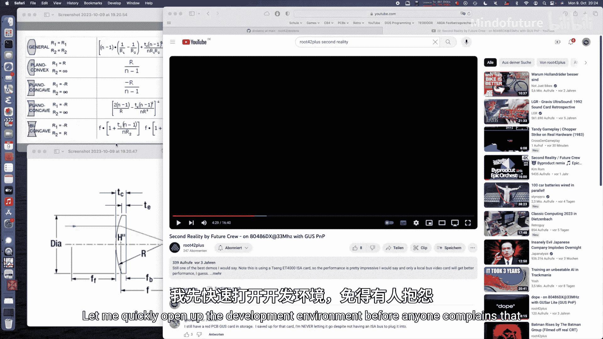
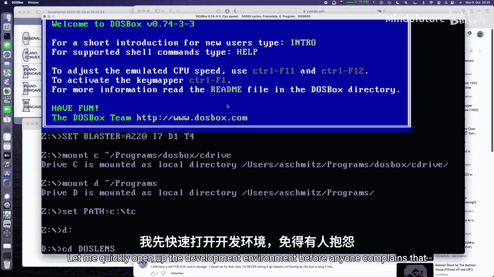
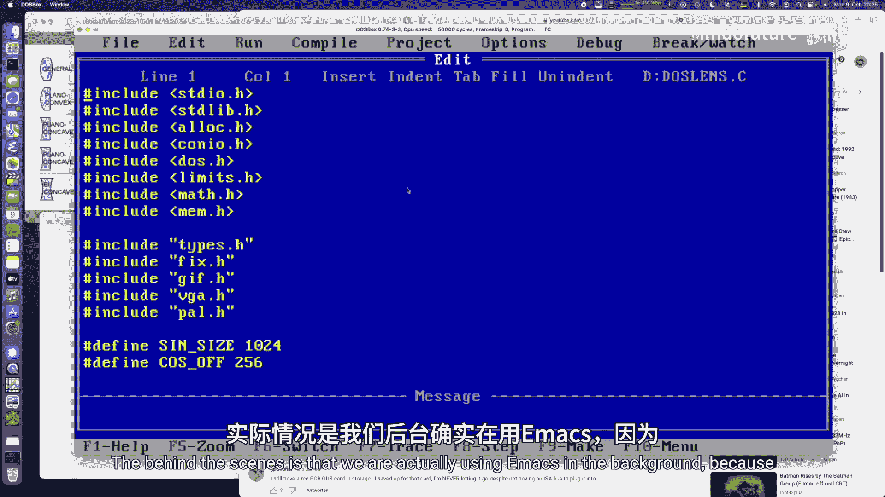
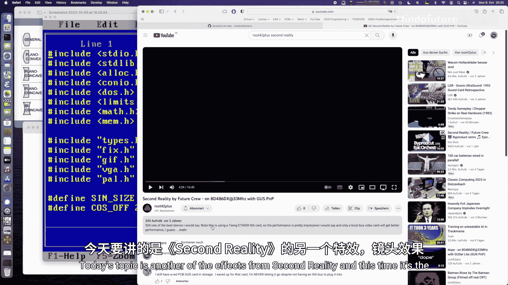
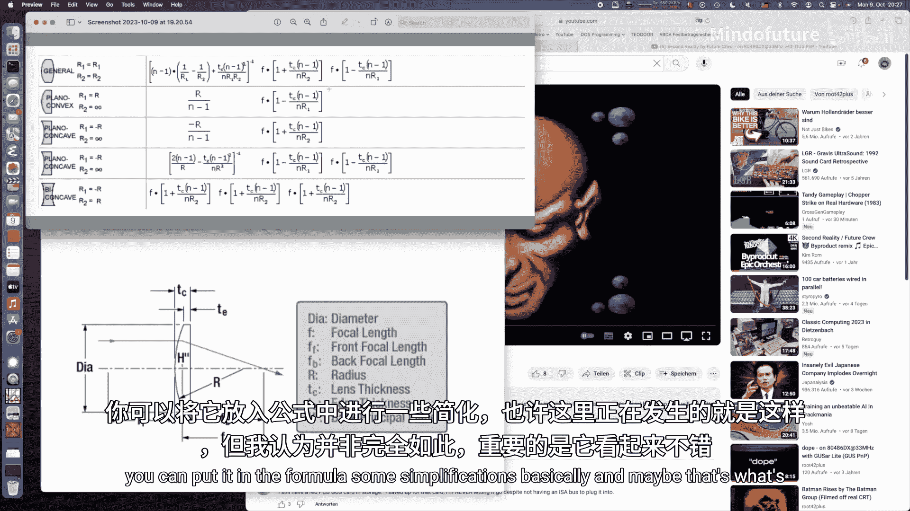
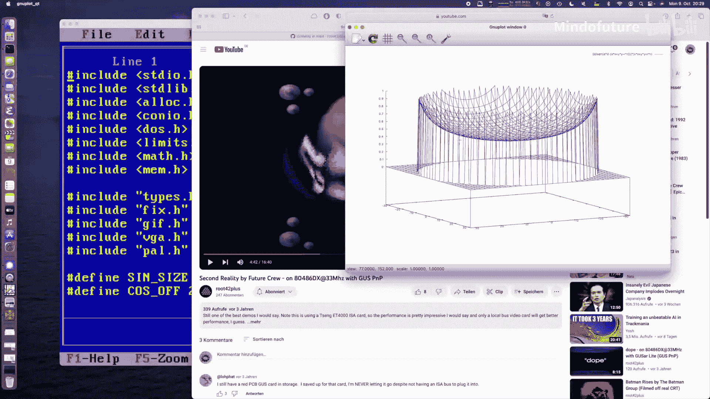
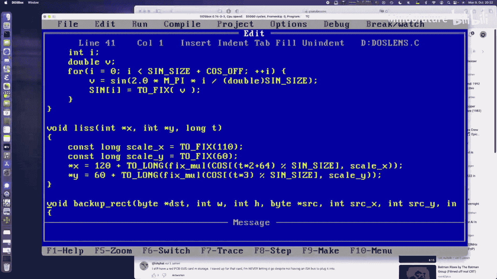
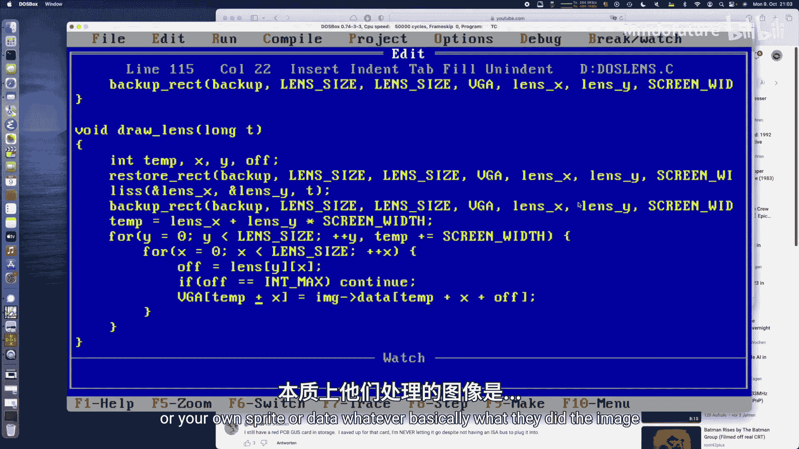
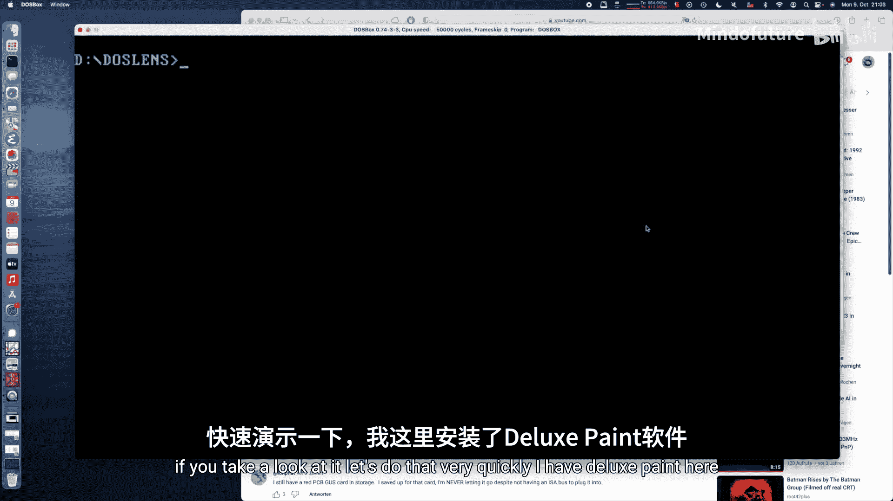
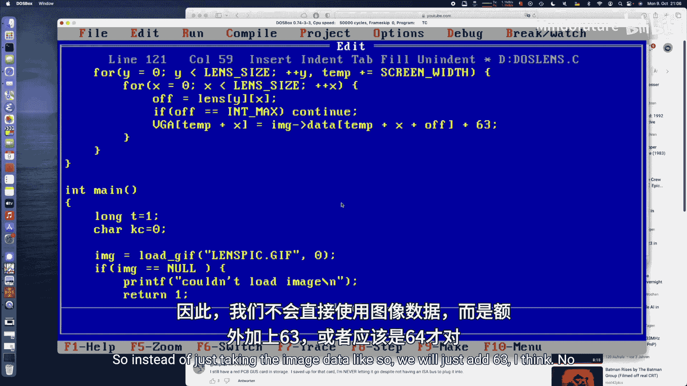

# 编写MS-DOS-系统-｜-windows-｜-操作系统-｜-汇编--｜-vga-｜-x86-p36-P36-Lets-Code-MS-DOS-0x23---2nd-Reality-Lens-Effect--BV1zs35zQEru_p36-

Hello， welcome and an excellent evening。 We are back with Let's call Am stars。

 Let me quickly open up the developmental environment before anyone。😊。

Complaints that I'm not using Troy， but image。

The other behind the scenes is that。We are actually using emex in the background。

But。Yeah， because it's easier to edit with。 But for you guys and girls。

 I will switch back to Toberi to do the final run。And what is today's topic。

 Today's topic is another of the effects from second reality。 And this time。

 it's the lens effect that comes right before the rottorzuma。

 which was pretty jaw dropping in my opinion when I saw it first on my 486 Sx。

And yeah， I think it looks pretty neat and convincing。Let's pause for a minute。 Basically。

 it simulates a kind of。Glass sphere or something like that that distorts the background image and even tints it a little bit in this bluish hue。

We will do all of this except for the bouncing， I'm just reusing the lidu curve from last from the last video。

 the tunnel effect just because I'm lazy and we will also not do the shading part here and here you can do that as a exercise basically because the source code is of course available and also the source code of second reality available。

But in my opinion， it's not quite as readable as what we are doing here。

 And there are not many explanations， obviously， but the graphics are in there as well。

 slightlylight different versions。 but there is a sprite that helps you generate this effect。

And we will get later to how you can achieve this。Because we will do the simple version with just the bluetoot without the shading here。

The graphics from the source archive of second reality is also a bit different。 The pentagram。

 for example， is missing， maybe due to。Censorship reasons， because it's satistic symbol or something。

 we will do slightly different distortion here because everybody does basically their own thing。

And I will not be able to explain the formula。 I found it in， in another explanatory。

File basically that tries to explain the lens effect。

I personally did a lot of computer graphics back in the day and wrote some ray traces and stuff。

 and I would have used some kind like this simulated plano convictx。

Lens or something which can magnify things。Or a general lens。

 And then you have all these stuff things。 And you can put it in the formula， some simplifications。

 basically。

And maybe that's what's happening here， but。I think not fully it。

 But the important thing is that it works out looking nice， basically。

It will look slightly different than this version here， but pretty neat。So， the formula that I found。

In is this year， let's pull up the。Good new plot window。We will get to the formula in a second again。

 but basically you have a zoom vector or a focal distance called D and you take the square root of d square root minus some formula for a sphere。

Yeah， and that will give us this funny looking function， basically。This is。

 this is basically the the glass ball that we are talking about。 Also。

 a glass ball would actually invert the image that you see here and make it。Yeah， upside。

 upside down， basically。Which we don't do here， but it still looks interesting and convincing in a way。

 And what we're doing here is calculating this surface。 and depending on the zoom factor。

 it will be more lens like or more sphere like。If it's more sphere like。

 the distortion will get bigger because。The y axis here goes from0 to one， and this is basically。

A scalingating factor where you don't take the pixel that you're currently rendering。

 but offsetting it to。

The yeah going outward basically from the centre of the of the render sphere。

 which gives a magnification in the centre， which falls off to the border。

 And I think they are actually doing pretty much exactly that because I think there's no offset here。

At the， at the border， because you can see there's no gap here。

 The cranium doesn't get that much distorted。 It's small less one line。

 The formula we are using does a bit more。嗯。Yeah， it will produce a bit more distortion at the edges。

 giving it a more glass like appearance。So the good thing is we can precompute these values。

 these will be offsets basically that you iterate over the x and y coordinates of the lens and then you take the offset and take not the pixel right below that。

 but you sub the offset and end up somewhere else in video memory。That's actually pretty simple。

 The only thing that we need to take care of is to back up the rectangle that encloses the sphere and restore it afterwards。

 We will do that in the vertical retrace， everything and on a relatively fast 586 that should work fine。

 This is not super optimized。 It will probably flicker on slower machines。

 You will see some redrwn and stuff。You could always switch this to mode X or mode Y of these leaf for page flipping or do the usual men copy。

Of either the whole screen or only the affected areas。But I'll leave that up to you。

 Let's have look at the code。 again， there are some stas here。

 We will be reusing quite a bit of old code。 We will be using the G dot H from many。

 many seasons back， which lets us load the image， which I converted using。

Dluux paint because it's an LBM file Then I exported to PC X and convert it using image magic 2。Gif。

 basically， I also use a slightly larger sign table to make the animation slower。

But the rest is the same basically as we had in the last episode。

 the li Jew curve is almost the same I introduced to scaling factors for the x and Y direction and some offsets to make it centered and on the screen with sensible sizes。

Excuse me if there are some noises。 I have to。Adjust my hands around the microphone the。Keyboard。

 basically。Then we have two functions that are won't code live because they are relatively simple。

 They are called backup rectangle and restore rectangle。

 They basically just do line by line copies without checking for any boundaries。

 So you must not run out of the VrM for that you would need to have some clipping function as well。

 which would limit the extent of this rectangle but for today we don't need that。And it， basically。

Backups， part of the VGA memory or。Whatever， buffer， basically。And it can restore as well。

 very simple。 You can have a look at it after the video。Then we have an inlet palette， which will。

 we will extend at the end of the video to make the tint effect basically。

We will have a in a lens effect where we pre computeute the offsets， and we have the draw lens。

Where which is applied during every frame。 So the main function is pretty straightforward。嗯。

We started time offset  one， because time offset 0 will be for the init lens to store the。

Basically in the background， the first time， otherwise， we will restore garbage。Then we load the G。

Initialalize the sign table， set the graphics mode， initialize the palette。

 initialize the lens structure。 Then we have our main loop。 While we did not hit escape。

 we wait for the retrace and redraw the lens， incrementing the time index。That's it。

 and that's all the stuff。 And it's more or less what we always do。So we will again。

 need some more global variables that we'll put in here。We will need to define。The lens size。

 you can play around with this。 It's depending on how fast your machine is can scale it up and down。

 I found。Size of 80 pixels of diameter。 Pret nice。Then for convenience。

 you also define the lens radius to be。The lens size， divided by2。And we define。

The lens zoom factor to be 16， the lower the number， the more distortion you will get。嗯。

You can again play around with this， I found 16 to be visually pleasing。But feel free to。

Triry out different values。 Then we will have a。The， the G structure。Initialize with null。

It will be initialised by the load GF or load GF function。Then we have the lens array。

 which is basically all the。Offset values。Like that， they need to be integergenous because we。Might。

Go multiple lines， or at least one line。Back in the video frame， I find one line-320 pixels。

And that doesn't fit in a byte。 So that's why we take it an in here。Then， we need a。

Backcca buffer for the background to save to。And that will be。Just an a array of size。

 length size times length size， very straightforward。Last but not least， we need the position。

 the current position of the lens on the screen。Which will be just an integer， lens x and lens Y。

Okay， that's more or less it。Those are all done that in it palette is all done。Okay。

 now comes the in lens function。And here we need quite a bunch of things。

 Let's first write our for loop。 Basically， we will loop over the rows and then the columns， so。

Y equals 0。Myhy。あ。Less than， I would first say length size， but we will have。我又。

Make sure not compute too much things。 So what we actually have is a little constant called L S。

 which is the lens size divided by2。AndBecause we have symmetry。

 we only have to compute one quarter of the function。 because as you remember， from our plot here。

 this is basically symmetrical。In all the quadrants。 So we only compute one quadrant， and then。

Flip and mirror the values， obviously。嗯。That's good。 So we do that。Furthermore， we were。

Store the square of。Why， because we'll need it a bunch of times， especially in the inner loop。

And we don't have to recompute the product all the time。 makes it a little bit faster。

 although this is only for initializing。 So it doesn't matter much。 Same goes for the columns。

 We also only can need compute one qua here。嗯。That's that。

And I think I can remove that empty line here。And yeah， the question is。

 what do we actually want to compute， And that's the so called shift。

 I'm gonna call it many of the codes that you can find on the hand we'll call it that。嗯。

I make sure to have my zoom or focal distance。Which we actually have to define here。Actually。

 I could just。I could probably just define this as a float。Makes it simpler。

So this is one time where we actually use floats lens。Zoom。

That's the content that we defined at the top。Also， we need the y 2， the x and the y。And we。

Probably also want to。Do we want to do that。No， we don't really need that。😔，But for symmetrym's sake。

 also define the X tool， which is。X squared。Let's do that。Right。Here， I think。X2 equals x times x。

Yeah， I think that's， I think that's pretty neat。 Yeah。 I think we can use that。So。

 we want to compute。This function， which is a ratio of the fo distance or whatever you want to call it divided by the square root。

Of the square of this distance。Minus。Something that。Looks a bit like a spherical。Equation。

 which is x squared plus y squared plus z squared。Equs r squared。But without the Z。

And the R on the other side of the equation， basically x squared plus y squared minus r squared。

 So the z is gone。 and I tried coming up with an argument why this is the function that you want to use。

 but I can't really deduce it。 If anyone has a good intuitive explanation。

Feel free to write in the comments。 All I can say is it's looking good。 And at some point。

 I w to try out a real lens function in here。To make it look more realistic and see if that can be done as well。

Because I think it can because。It's just a different transformation。But that's one another day。

However， we only want to do that if we are inside of the lens， which is a circle。

 So we will test if our current coordinates are inside a circle。

 which means that x squared plus y squared needs to be。Less than R squared， which is the radius。

 This is the definition of a circle。So we will get all the inner points。Of。This circle， basically。

And。If we don't have that。And we'll see how to compute the offset in a minute。

Then we will store a special value here in the lens array， which is in max。

And that's if it in STD and dot H。To be just able to skip those pixels。

 We will test for that in the draw lens routine， in a minute。But the question is。

 what are the offsets that we have to put in here， It' actually we take LS。

 which was exactly the center length size。Divided by two in both directions。

And then we need to just go through all the different combinations， minus y minus x。

To get all the quadrants， basically。嗯。Minus y and。Let's go， let's toggddle this first。😔，And then。

 togg。The plus， as well。Oh， we need to smoke one of these。 here doesn't matter。

 but I wanna get it aligned with the formula that I have in the other part。Okay。

 this gives us all the quadrants outside of the circle。嗯。So basically， where's a new window。

This basically covers everything that is here on the ground。So to speak。

 that's all outside of the circle。 and that gets the value in max。

 which we can detect and skip accordingly。Yeah， but the shift。We need to convert it into an offset。

And the offset is basically。Some kind of scaled。Y value times the screen width。

This gives us the number of pixels to skip in the wide direction。Plus。Some scaled x factor。

 The question is now， what are those and those are simply X times。The shift vector that we had-1。

The original formula was X times shift。Minus x。But you can factor that out， and it looks like that。

Basically。To give an offset from that particular coordinate and the same we do with the Y coordinate。

 obviously。So we can just replace all that。And we get the shift or the scale Y coordinate。 basically。

 this gives us the offset， and。That's more or less it。 We can now。Write that into our lens array。

Which gives us the。First， two entries， basically， only thing is that we need to flip the offset for the first part。

For the second part， it's fine and for the two other quadrants。We have to invert the scale。

 Y shift basically， and we will have to use the same signage as we did below。 Otherwise。

 we will have an issue。And that looks pretty much okay， I would say。Yeah， that's fine。

 This is already all the data that we need。 The only preparation that we have to do now is to store to copy basically the image data。

Into the VGA memory。 So we just target the VGA memory and take the image data。And that is 64。

000 bytes， obviously。嗯。We also。Initialize our length position by calling the list due function  for time in X 0。

L x。Ls y for time in X0。 And then we will store the background basically so that it can be restored by a regular draw lens function。

 So we call backup。Rectangle。And our destination is the backup bufferuffalo。Of size， lens， size。

 comma lens。Size。From the VGA buffer at the lens position。And the VJ buffer has screen width times。

Screen height。That should do。It nicely， I hope everything builds not quite。

We haven't defined our two。 Okay， there are a bunch of things that I didn't do。Which is our two。

Which is equal to length R times length R。Then we are missing I X and I Y。 And also。

 we need to define offset。Build all， and that's it。 The only thing that doesn't work is this。

Let's see if we can already see the image when running。Yeah。

 but nothing' is happening because we're not drawing anything， but the data searches are all there。

The program is working fine。 Okay， what do we need to do in the。Actual draw function。 First of all。

 we need to do the same things here。 back up and restore。 First of all。

 we need to restore whatever was there in the first place。

 the I kept the parameters exactly the same。 So I just switch source and destination around in the internals。

 but basically we can just copy， copy the stuff here， which is pretty nice。 Then we also need to。

Call the li function。To update the。Position， basically。

But this time with the correct time index and in the main function， we started one。To get the。

Next animation， basically， doesn't matter much， actually， but I think it's nice to have it like that。

What else do we need， Oh yeah， we can。Calculate a temporary position， which we will update。

 We can compute basically the offset into the VGM memory。

 which is our usual stuff lens X plus lens Y。Time screen width。

 This is basically where we're starting from。For which we obviously need to。Introduce。A1 variable。

But we will also very quickly need an excellent y for obvious reasons again。

So we iterate over all the rows again。This time， over the whole lens。Not only one quadrant。And。

Going there， we could even， in theory， do arbitrary lens。嗯。Shapes， basically， by。Doing some other。

 putting some other that other data into the lens array。 Maybe you can try that out。

 maybe you can pre computeute some very weird shapes with weird transformations。 That's all possible。

Question is， how much does it make sense？Then， we store the。

Offset that we fetch from the length array。We put the Y coordinate at first。

 I think also we need the variable up here。So we need to fetch it only once from memory and can save it in a register or something。

If the compiler clever enough。And if the offset is N max， that's what I was talking about。

 We don't have to do anything。 We will just continue to the next value。But if not， then we can。

Basically。Fettch the color。Which is just going into the data of the image at the temp plus X。Plus。

 our offset， because temp was。Just like that。 But we also need to update temp every row by。Doing。

Plus， equals screen width。 So it will skip to the next line。That's looking fine， yes。So。

 this fetches our data。And I'll leave it at that， for the minute。

And then we can write the output pixel just like that。We could have put that into one line as well。

Maybe we want to do that。 Yes， we want to do that。I'm gonna eliminate one variable， I think that。

Doesn't hurt。Does it know。And that's that。 That should already be everything that we need to do。

 But there is， oh， I called this pause because I had one more。Variable here that we don't even need。

Do it like this to make a very short program。 That's fine。 So to very quickly recap。

 we are restoring the background so that we don't see the old lens。

 We compute the new position of the lens。 We save the background at the new position。

Then we compute the position in VJ memory， iterate over all the rows updating our position and memory。

Iterating over all the columns， fetching the offset that we need to switch to if it's intmax。

 we just get because it means there's nothing to do here。 Otherwise。

 we fetch the data from the image at this position plus offset。And write it to VGA memory。

 So let's see what it looks like。Yeah， it does work。 We do have a lens。

But it now looks more like a clear。Glas bolt only be a black hole Who knows。

Something that distorts the light as it goes through there。But we also want to have the blue tint。

 and I will show you how to do that simple version。 And at home。

 you can do like this shading as well by using。The sprite that the future crewve supplied。

Or your own sprite or data， whatever。Basically， what they did， the image。 If you take a look at it。

 let's do that very quickly。 I have to。

Explain here， installed。And this is the image。The image only has 64 colors。嗯。

The colors end here at this。 This is the 64th color of the dark。Tel or whatever you call it。

 I think it's used here in these， these dots。And you have basically 192 colour to your disposal。

We will add another 64 colors， which is a copy of all the colors that you see on the screen。But with。

The blue turned all the way up， not all the way， but a little bit。 For example。

 instead of having this skin tone， we will turn up the blue slightly to get a more pinkish colour。

The yellow will also get a slightly more greenish tint， basically， et cetera， et cetera。

 And this will give and even the， even the blue will get a slight tint。

And this will give the impression of having a colored glass， basically。That's at least the idea。

And in the demo， they did two more variants， even another 64 colours and then another 64 colours with the different amounts of blue。

Or maybe even red and green mixed And to get different shades。 I'll skip that。

 but you can definitely try that at home。So what do we need to do。

 We need to adjust our in palette function。 actually， which well do here。

 well need an iteration variable。嗯。We will iterate。Over。The first 64 entries， obviously。嗯。来 so。And。

Then we will take the image part。Have this position。嗯。Plus 64， because this will be the next block。

And this is the right entry。 And for red and green， well just copy it。

 You can just this to give other hues or brightness， maybe to the colour， if you want to。So。

Feel free to play around。Play around with this。And for red， green and blue。We will do it like this。

 However， for the last for the blue， we will add what did I choose 16。

 I think on top of what we have here， but you have to be careful， the value must not go over 63。

 That's the maximum amount that the VGA deck can have。

 So we will take either that value plus 16 or 63 as the maximum。And this will set the palette。

 This will not do anything。 It will still look like that。

 We need to do something with the colour that we take from the picture。

 So instead of just taking the image data like so， we will just add 63， I think， no，64， obviously。

On all of that。 And that should。Give us the blue tint。 There you go。 As I said。

 feel free to adjust the tint， the colour， the hues， whatever。

 And you can also try to use a second image namely the sprite to adjust if you take the second 64 colour block or the third or the fourth to give it a little bit more shading。

Back when this came out， I was really amazed how this could be done in real time and so fluently。

 But as you can see， all the magic happens by precomputing the lens array。

And the rest is just copying single pixels with different offsets and a little bit of palette magic。

But it's actually rather simple。 And， but it still looks。Pretty amazing， I would say。 yeah。

 as I said， the。Only thing that I would wantna change。

Would be the formula itself to maybe even do correct ray tracing， basically on pre computer terms。

Which would mean that the image will be flipped。So this here is。Yeah。

 maybe it's a magnifying glass part， not a super realistic one， but it gives it gives a nice， smooth。

A distortion effect。 And I think that's what counts。 It's fast。 It's simple， and it looks good。

But again， this is it for the moment。 share like him subscribe。 that would be very helpful。

 Sha on social media is always welcome bringing in new people who watch the video commenting is also a thing that I like to see to be able to interact with you guys and gal and。

Yeah， if you want， you can support me， I'm over on Patreon。

 Qfi and you can also send money by Paypal。This helps immensely。

 especially with the hardware projects。Yeah， because lot of stuff costs money。If you can't do that。

 that's also fine， take care for yourself and everyone in your life。

So the Z see you in the next video and thanks for watching。🎼Yeah。🎼我不。🎼，🎼，🎼当哒。🎼。

