# 编写MS-DOS-系统-｜-windows-｜-操作系统-｜-汇编--｜-vga-｜-x86-p37-P37-Lets-Code-MS-DOS-0x24---Low-Level-Keyboard-Programming--BV1zs35zQEru_p37-

Hello， welcome and a very good evening Today。 we want to do a little bit of doth programming again。

 And this time， we will do some keyboard programming。😊。

We had one episode of that very early in the series。 but this time。

 we will do low level keyboard programming。 That is。

 we will write our own keyboard controller interrupt handler。

We already did some interrupt programming when doing the sound plaster sounds。 and very quick note。

 I'm having a bit of a cold。 So that's why my voice is a bit rapy。 So please forgive that。Anyway。

 yeah， we did some sound blaster programming and we needed to use the interrupts generated by the sound Blaer to fill the DMA buffers。

 and I also had an extra episode on interrupt handlers and here on far pointers and stuff like that。

 which you can also look up， or I probably put some links in the video description。

So make sure to check that out if you have more questions on the topic of interrupts。Yeah。

 this code is relatively short， but still quite a lot to type。 So let's just start。

 my goal here is to introduce it to the way you can do low level keyboard programming without the bias without the annoying habit of this。

That the keys repeat after a short while， but to have basically direct inputs whenever you press a key and also to be able to query multiple key presses at once。

 which is very important for gaming， obviously。And this only works if you talk to the keyboard controller in the PC directly。

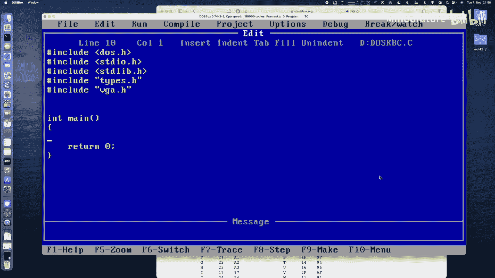

And the idea here is that the keyboard controller is attached to the interrupt 9 hardware interrupt on the ISA bus and that's hardwired since the very first PC and the keyboard will generate so-called make and break key codes that you can read out from the keyboard controller and every key basically has its own make and break code and the make code is generated when you push down on the key and the brakecode when you release the key。

 There's no repetition or anything you just get told this switch is closed or this switch is open。

Usually， these codes exactly。80 hexademal， apart， for example， a cap is。Make code 1。

 So brakecode is 81 hexademal， and that goes for all the other keys。

 There are enhanced keyboard codes for the A keyboard from the 2，86 onwards。

 which are multibed codes and more complicated make and break codes， but we won't deal with those。

 We will simply do a very， very simple。Basically， not really a game。

 but a little drawing program where you can use the W AS SD keys to move around and the left shift and the left control key。

Which are here to change the color of your line that you're drawing。 Very simple。

 You can use that and adjust that for your own games， etc ceter。 But that's basically it。

 So there is a very nice document called keyboard2 do TXt。

 which is sadly not available online anymore。 but there is the internet archive with its wayb machine。

 and you can get the file still from there， and it explains in a lot of detail the programming of the keyboard controller。

 even the more complicated A0 and PS2 style keyboard control。

But we won't even go into that much detail。 The important thing that you have to remember is。

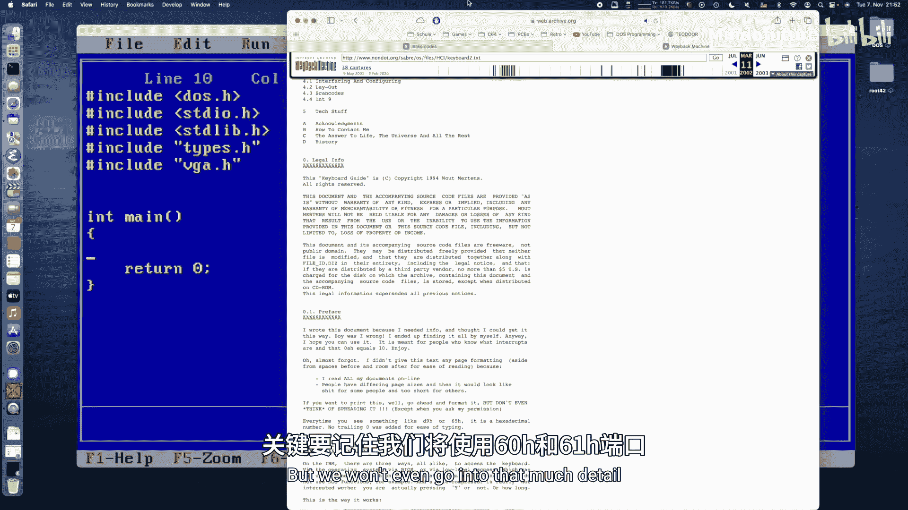

We will be using port 60 HexetadeimML and Po 61 hexetadeML to talk to the keyboard controller。

But that will come up in a minute。First of all， let's write the main function。

We will start with a while loop， as usual， to。Get the main loop running basically。

 And we will have some kind of keys vector where all the states of the keys are stored。 and for some。

Symbol key escape， which symbolizes the escape key， obviously。Well ask if it's depressed。

 And as long as it's depressed， we will keep on running。 And when it's pressed。

 we will quit out of our。Program basically。 and the program will be a drawing program。

 So we will call the set graphic mode function from our VGA routines。

 which you already know from previous episodes。 And if you don't， then check those out。And we will。

 upon quitting set the text mode。And that's that basically inside of the loop， as usual。

 we will wait for the vertical rets to make the programme run at a useful speed and not faster。

And that's also very standard。And that's more or less it。However。We， as I said。

 we want to code our own keyboard interrupt function， so。

Let's just write that and for now it will be empty。

There is the attribute interrupt for the Tobyi compiler， which。

Tells the compiler that this is an interrupt handlelo。WeWe will call it KBC for keyboard controller。

IQ handler。Doesn't take any arguments。And it will look more or less like that。

And it's always good practice to disable all other interrupts when entering the。

Handler and enabling them when leaving the handler。So that no other。

Driver or handler can mess up your hardware waist aid or anything like that。All right。

How do we set the handler？ That's pretty simple。 We will call the set vector。

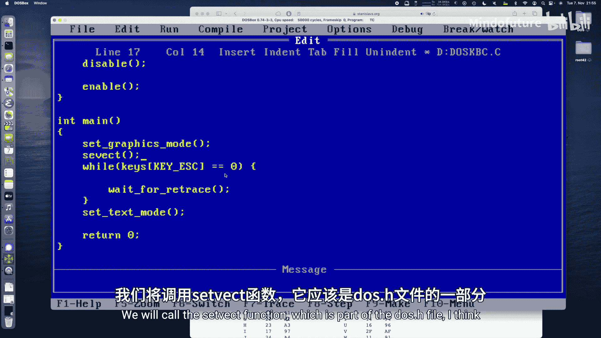

Function， which is part of the dos dot age file， I think。 So look at the headerophil。

And there should be， hopefully， yes， there's the set vector function。

 And there's obviously also a get vector function。

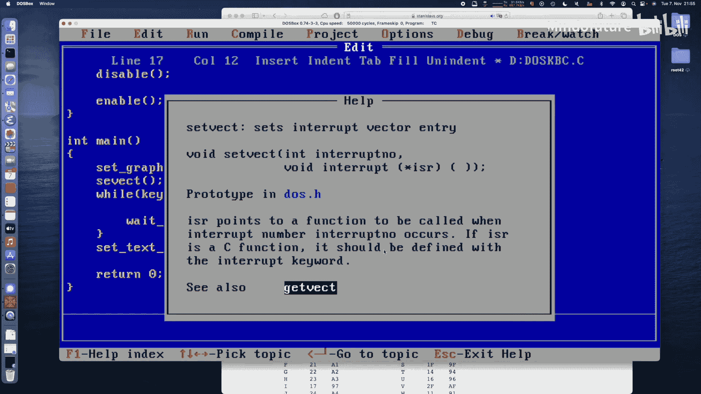

There is， of course， also a。Keyboard handler already on， on interrupt 9。

 usually the regular keyboard driver may be with German or French or English mappings。Who knows？

 So we will have to save that in a， in a minute。We will define a constant called KBC IRQ。

 which is just0 x 9， but Im I like to use symbolic names。Then we pass it the IQ handler。

And remember in C when using the name of a function， it gives you the address so that should be fine。

Also， we need to back up the old IRQ handler so we will introduce a variable old IRQ and that works just by calling GettW。

For the keyboard controller IQ。Very simple。Yeah， a in a minute。

 we'll introduce all those things and more。And after setting the text mode。

 we actually need to restore the。Interrupt vector。So， we call。

Set back again on the KBC IQ for the old IQ handle Otherwise。

 your machine will be unresponsive and you can just it， reset or restart your dos box or whatever。

Okay， that's pretty neat， I would say。Now， we have to fill the handler with some staff。 Also。

 we need to declare a variable for storing the old inter handler， so。Again， void interrupt。Star old。

I Q， this is how you define an NZ C a point or2， a function。That's nice。

 And we also need to define all our constants。 and I will define them all upfront now because we will need them。

嗯。We first need the IRQ controller port。Which is 20 exod small。

 because every time you service and interrupt， you will have to acknowledge that interrupt to the IQ controller by writing。

A certain value on port0 x20 here。 Let's just put I Q port here。 And for generic interrupts。

 like with the soundpl over here with it， keyboard handler， It's actually by coincidence。

 Also the value 20 xodus small。 You can read it up on Stanus lefts dot org。

 there's also page on the interrupt handler interrupt controller。But I'll leave that out for now。

This is definitely something we need to do。Then we had defined the keyboard controller， IQ。

This is 0 x09。Then， we have the。Cubable controller port。And on the original PC。

 that's 60 hex at Simmo， those things actually still exist on the PS2 and on the A T。

 because they have to be backwards compatible。 And there's a second part。 It's the so called。

System control port， I think it's called It manages a couple of peripherals on the original PC。It's。

 I think， obsoleted on the A， but it still works again because all this software has to work。

And the important thing here is there is， I think it's explained here in the keyboard 2 T X T。

 if we look for 61 H。

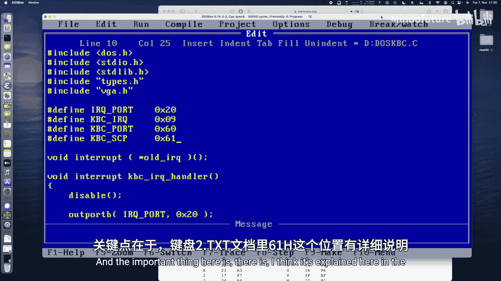

嗯。The old XC keyboard has a Intel 8848， which is， in essence。

 just a very primitive one way serial interface， so all use the S 61H to disable and reenable the keyboard on every scan code。

That's the whole idea。I think there is exactly there it's done。

 The spot is used to acknowledge the re of a scan code by disabling the keyboard and immediately re enablingabling it。

 This also means that you can read a set scan code as many times as you like until you acknowledge the receiver。

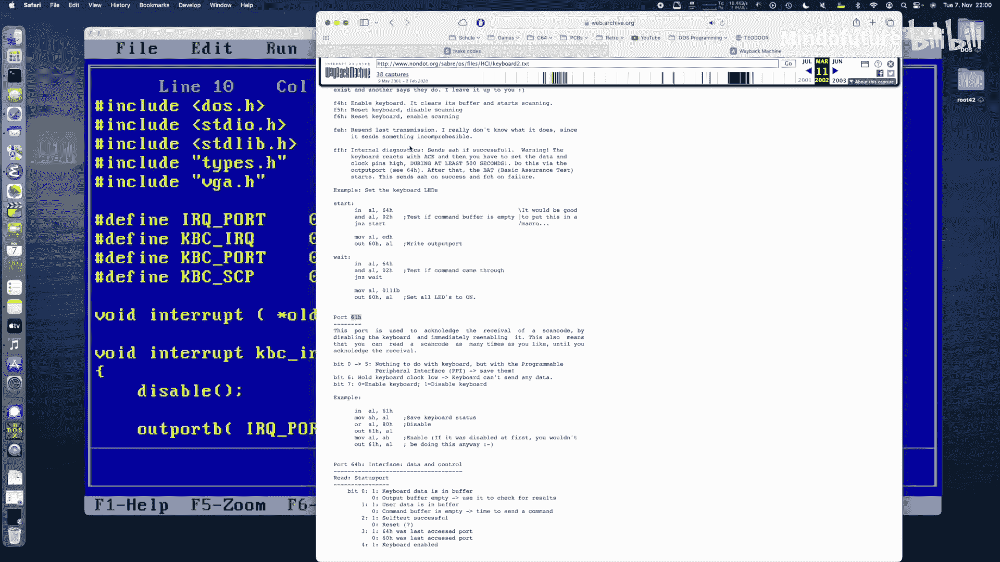

That's just how the original PC worked。 So we need this。

 the system control port for exactly that reason。We will also define。

A constant for the offset of the make and breakcodes， which was 80x at a small。And。By coincidence。

 the。System control port。Ceyboard controller disable function is also0 x 80。

 which is the seventh bit。 You just need to toggle that。So， there's a bunch of。

Duplicate numbers here。And。Do I need that。I put down one thing here that I probably don't need。 Now。

 I don't need that。 I leave that out。It's for later episode， maybe。

We define the scan codes or the make codes of the keys。 We definitely need to escape key。

We also need the W key。

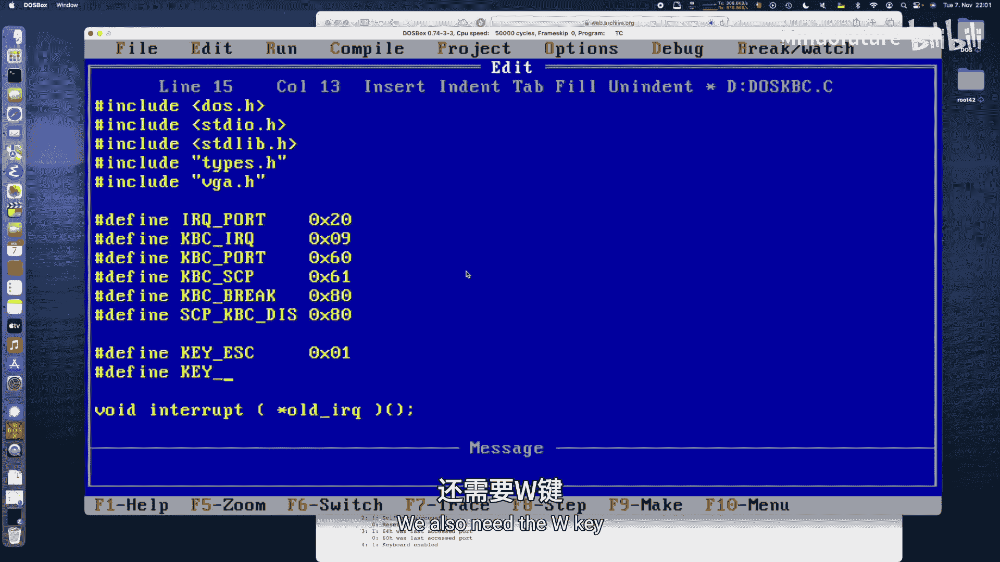

And you can look those up here in the list。 W is 0 x 11。

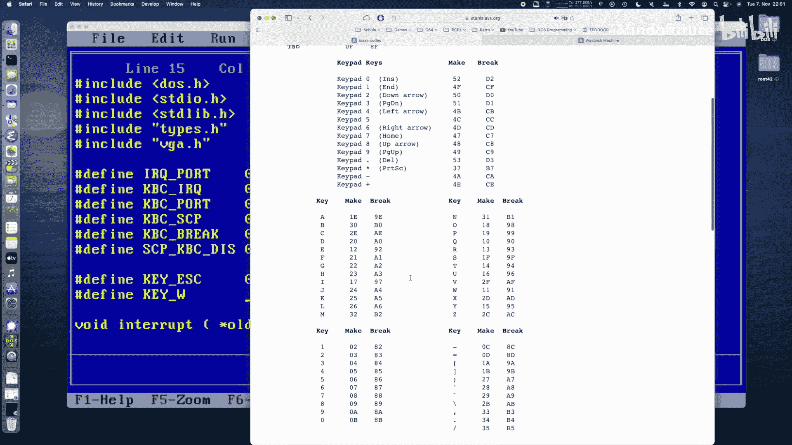

And we don't store the brake codes because that's just the make code plus KVC brake。Then。

 we need to define。What was it a。Ss 0 x 1 E。呃。S is0 x。And the the。1 F。

 because it's right next to each other。 That's very nice of IBM to design it that way。

And probably 0 x 24 KD。You see that this is in ascending order because it's basically the。

 the role and。You always increment one going from one letter to the next on the keyboard。Very nice。

 very organized。Then we need the shift key， which is left shift key。 so we should write L shift。

 but I can't be bothered to do that right now。And the left control key。

Because you can actually distinguish between the left and right shift and control keys。

 which is very nice。So those are the main codes for that。Then we need to have a keys area。

Which I just make 256。 I'm not sure how many scan codes， but it could be potentially 256 scan codes。

And also， because it will be。Handled by the in handler。

 we need to declare it volatile because it's changed in the。Interrupt。Very。

 very important to do that。All right。I'm not going run this right now。 It will compilely， probably。

No， there's one error。 Yeah， because I。Misyd。Was said Ved。But not。Compiles。

 I'm not gonna do that because it will lock up those box because our interrupt handler doesn't do much。

嗯。Okay， so what do we need inside here， We need a couple of。Variables and bite sized variables。

We need the scan code itself。We need the state of the system control port。

And whether we have a make or break code resume， a make code first。

 But we'll determine that in a second。So， in。Comes the scan code， just by reading。1 by it。

From the cable controller port。And we also have to store the。System control port。Which we。

 what did we call it？KVC S A P， Ok。KVC SP。This is a control part。

Because we only want to toggle 1 bit。 So we have to read out the actual value because。

The other bits control the different things。And then we determine if our coat is a make or a break coat。

 so code。ALo and KVC break。If that is the case， then we actually have a break code。

 So what we do here is then to set the value that we're gonna。store in our our keys。R2 0。

 which means the key is。Not pressed anymore。And we。Subtract the KBC。Break from our skin code。

 because we want to know， we want to write to the actual make code。

 because that's easier than having to。Test for two different scan codes。 Basically。

 we map everything to the make code of the key。 and that's that。And else。

That's actually not necessary， but for。Readability reasons I'm going to set value to 1。Otherwise。

 I can just delete that here， I think。All right。 that's that。 And then all we do is， we write。

This value to our key structure。 And then we have stored whatever there is。However。

 we still need to acknowledge the receiving of the。Scan code。 So we。

Right to the system control point。And we're doing this by。Toggling the。7th bit by logical oring。

The value here。And we can assume that the seventh bit was 0。

 Otherwise the keyboard wouldn't have worked because this actually disils the keyboard。

 And right after that。We are writing the original state back， and that should。

Acknowledge the keyboard skin code with the keyboard controller。And after that。

 we acknowledge the interrupt itself。 and then we're done。This now should be safe to run， I think。

 because now we already。Have a working intra handleler。We also set our entire tener and set it back。

 and it should work for pressing S K。 It will be a black screen， but。

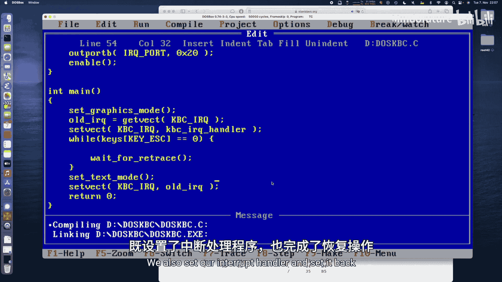

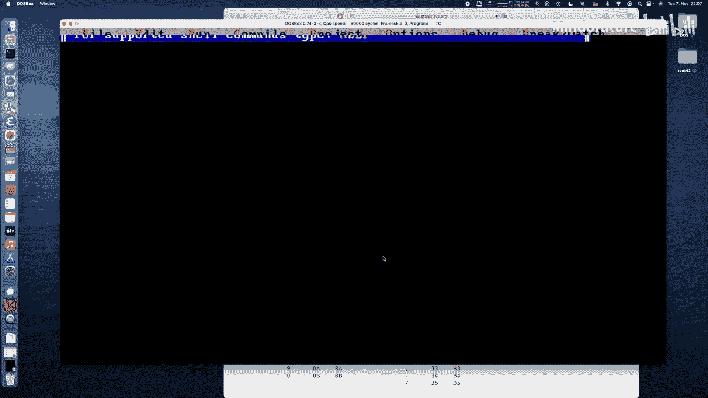

It should work， and it does。 And afterwards， I can even press。嗯。

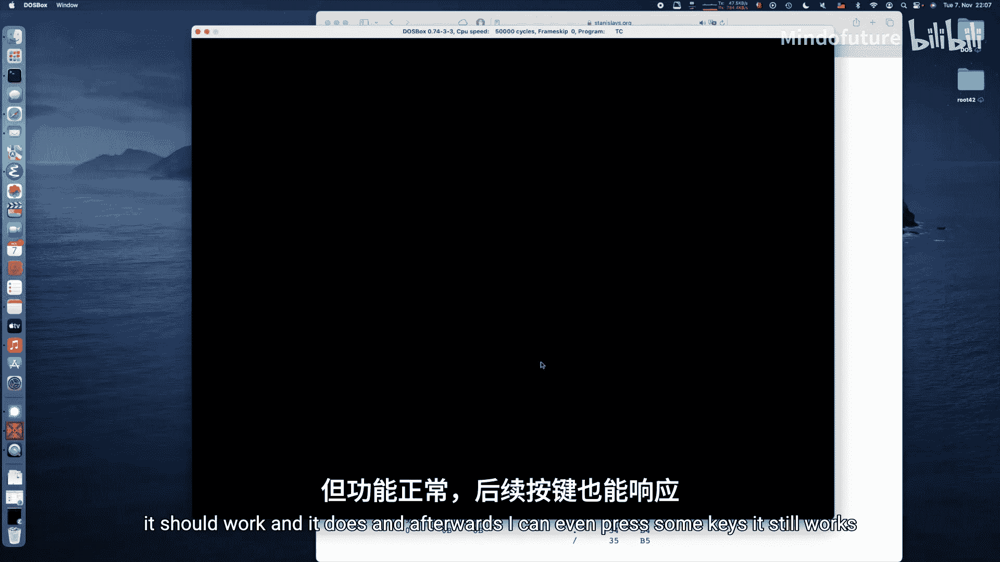

Some keys， still works。Now， for the actual drawing。

So that we can get something nice on the screen and see that we can do more than just hitting escape。

We will set a pixel at some current coordinate with some current colour， which also means that。

We have to have some words， X and Y。That I'll put in the middle of the screen。

 smack in the middle of the screen， something like that。We need a。Color， let's。It we call。

Something like 15， which is white in the default palette。What else do we need， It would be best。

 I didn't do that， but it would be best to set the keys vector to zero completely。

 otherwise by accident， some of the keys might be set to one or something else。And we might have。

Weird behavior， basically。Until some keys are pressed。That looks good。

 Now we have to check for the keys。 This will be a very simple。

 You can probably code up a more elegant solution。 But I'm gonna explicitly test for the keys。So。

 if I。Have the W key pressed。I will try to go up in the y direction。

 So I'm going do a test if y is still bigger than 0。Then I can return y -1。 Otherwise。

 I will just stick with what with y as it is。 so I don't run out of the screen。

And the same we can do for the S key， which will move down。

As long as we are smaller than the bottom border of the screen， we can。Go one down。 Otherwise。

 we stay where we are。And then we can copy the whole thing for the X axis for A And D。

We need to do X here。And the screen dimensions is 3119。And we， of course， we have to change for the。

X variable。The only thing still left is changing the color。We can do that， as well。If。Kese。

Key shift person with the shift key should increase the color。 So we do color equals。This color。

 still。Smaller than 2，55。Then， return color。Plus one otherwise。Will return color。

So we don't run or around or something。Although that could be， that would be nice， I think。

Having it wrap around。And here， if we are still bigger then。0， we will subtract 1。Okay， I think。

That's all there is。

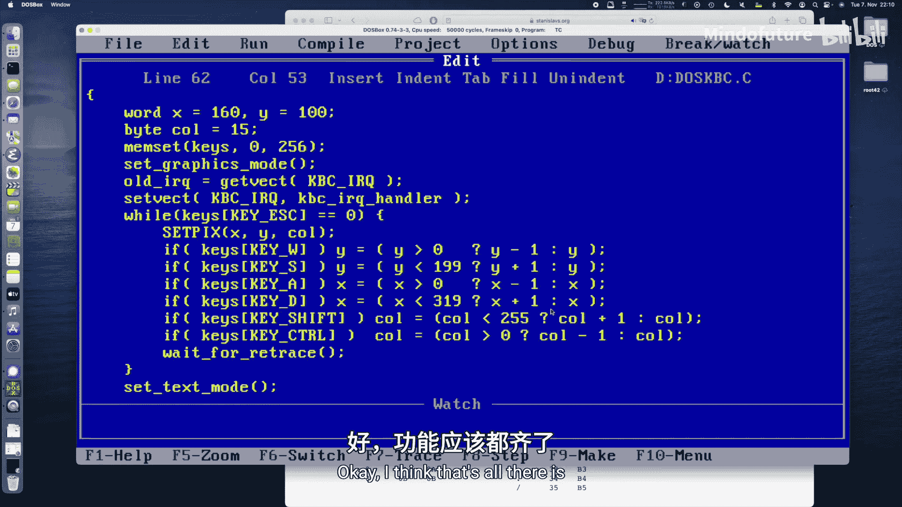

And they ask the why dot。 And I can now press。W AS SD。And try to。Traw something。Up and down works。To。

At the same time， works， I can even。Press up and down at the same time， and it will just stay。

But the rollover is not perfect。For example， I can't press a third key right now。

 That might be a limitation of Do box， though。 I don't know all of my keyboard。

 I can also press shift to。Cycle through the colors and also control to cycle through the colors backwards。

yeah。It's a pretty simple and stupid program， but you can， I think， imagine。

How to use this in a game to get really nice and responsive key presses。 And you can， of course。

 use any keys you like。It's more difficult to do text input this way because you will receive if you if the user presses down。

 I can hardly move one pixel at a time。 It always moves like two or three pixel because I have to press very。

Shortly to get exactly one pixel。So if you want to do proper keyboard input。

 you need to invest a lot more or have to disable your own keyboard interrupt temporarily and give back the control to the buy interrupt handler to get better key prices basically。

That's definitely a possibility。 Let's press escape。 But yeah， that's it， basically。

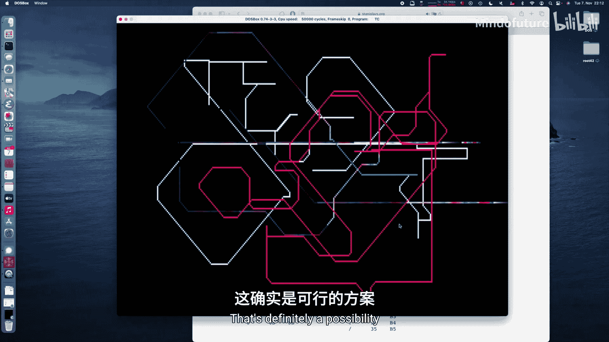

So very， very simple keyboard interrupt controller handler。Very simple。 Disable all the interrupts。

 read from the keyboard port， read the status port。 Maybe we should put this。Don here。

 where we do the toggling。I think that's nicer。Acknowledge that you received the scan code and then acknowledge that you have served。

The interrupt。 And that's basically it。 No big magic there。

 It becomes more complicated when doing the A T style keyboard。

 and it can do some other tricks like toggling the LEDs and stuff like that that are on the keyboard。

 But that's for another time。For now， thank you very much for watching。

 Make sure to check out the video description。 There's also links to Patreon cofi， etc cetera。

 I' be very happy if you could drop a coin in the head if you don't， That's also fine。

 Leave a thumbs up， leave some comments and most importantly share this on social media if you want。

 to bring even more people to this wonderful retro programming。😊，Yeah， but that's it for today。

 And thank you very much and see you next time。😊。

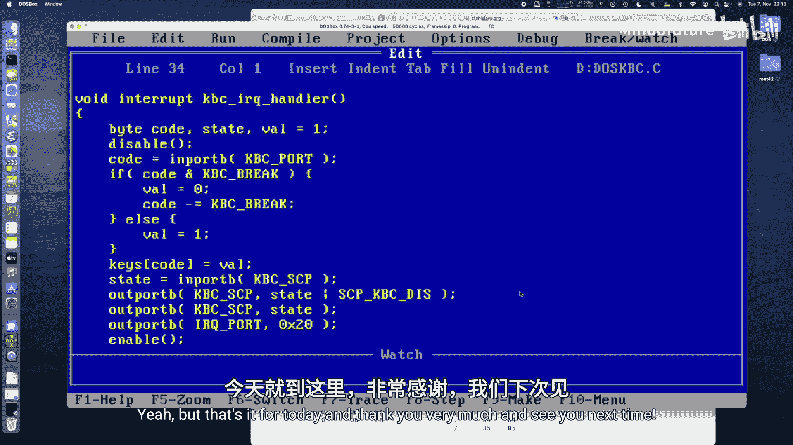

🎼，🎼Yeah。🎼。🎼。