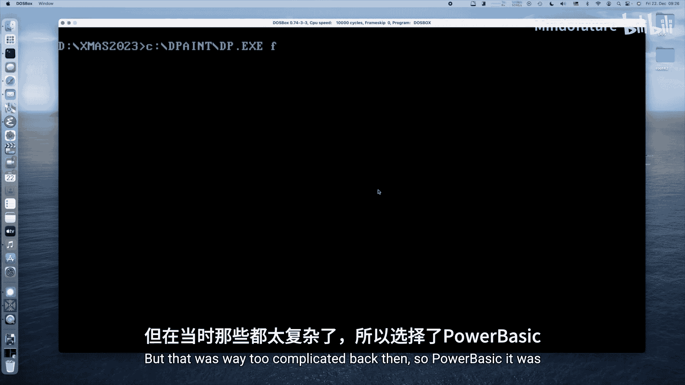
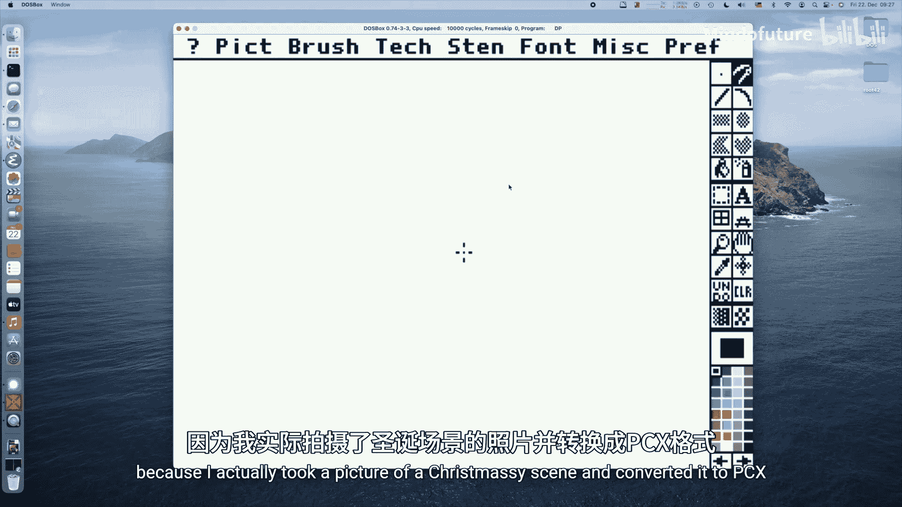
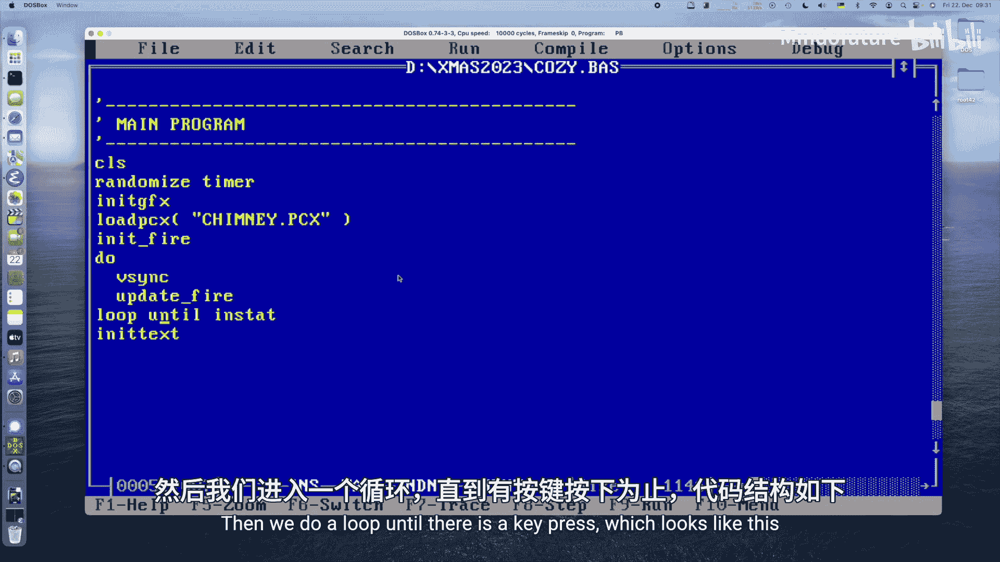
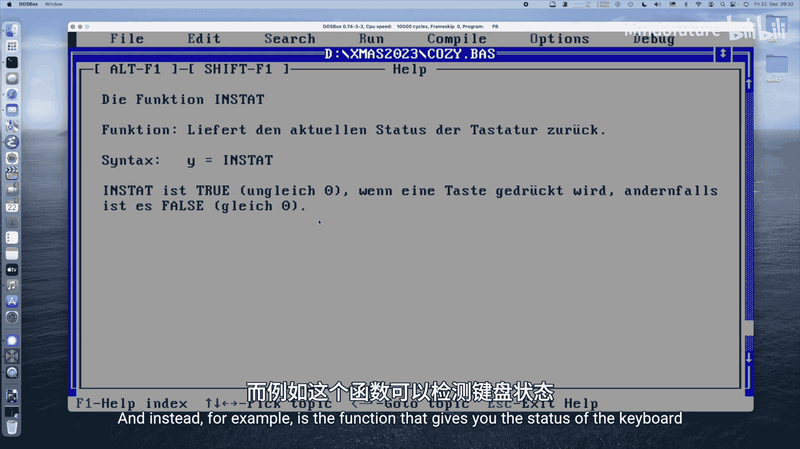
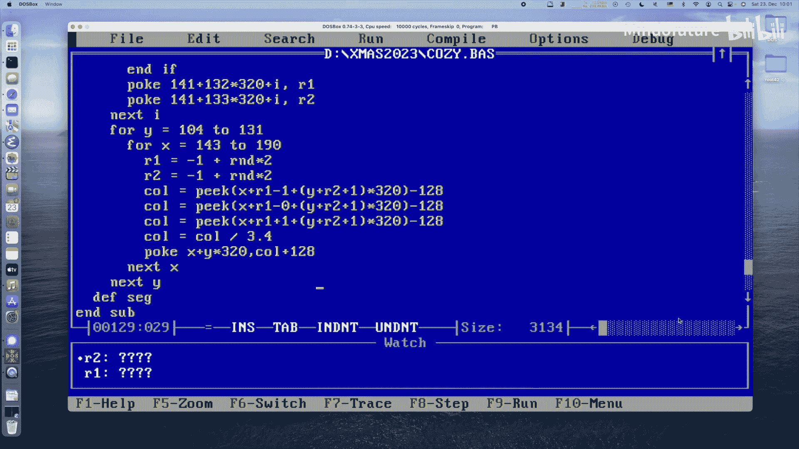
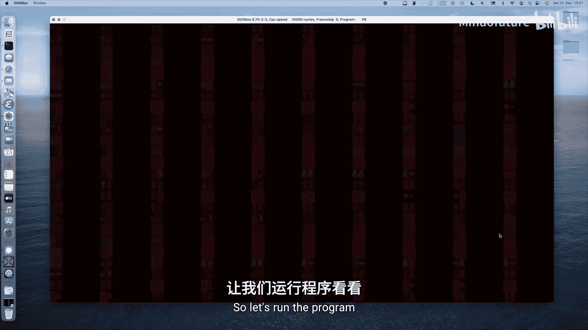
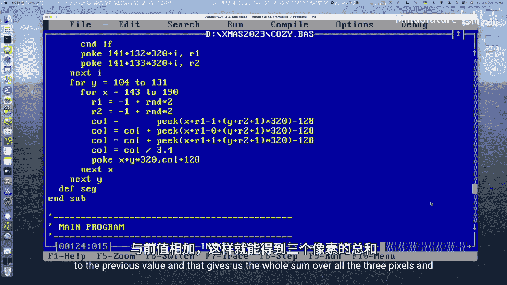

# 编写MS-DOS-系统-｜-windows-｜-操作系统-｜-汇编--｜-vga-｜-x86-p38-P38-Lets-Code-MS-DOS-0x25---A-Cozy-BASIC-Christmas--BV1zs35zQEru_p38-

Hello， welcome and a very nice Christmas evening or something， I guess。😊。

We are here for the Let's code attos Christmas episode。And as in the last years。

 we will be using power basicic。The basic compiler by well， good question。

I had used the version by the German company Kurshbaum， but I think the authors were US based。

 and I think the version that were now using here is maybe the US version now I think the version 3。

2 that I'm using today。Is from the German company， but either way， it's a compiler for basic。

 not an interpreter that compiles to DoOS Xi files。

There are still versions of that floating around compiling for windows。

 so some part of the company is still existing。 I think the original author has died in the meantime。

 so may hair rest in peace， but I used this programming language a lot when I was a kid。

Because it was quite cheap to get。 At first， I had a。Slightly less legal copy。

 but then I got a booklet with the disc for I think 6969 broch marks or something。

There was something that I could have saved up to for my pocket money。

And then I had my first legal commercial copy of a programming language。

 and I could produce ex files， which was important to me not to have a basic file that was like open source or anything。

Later changed my mind and did a lot of open source development using Gcc， etc。

 but that was way too complicated back then。 so how basic it was。

 but first of all we're going to run delux paint because I actually。

Took a picture。

Of a Christmas E scene and converted it to PCX format because that's a very simple to load format。

And it supports 256 colors。Using image magic on the Mac， but you could also use Linux。

 probably Windows as well， and it can convert a billion different formats and I forced it to have 128 colors。

 obviously。With a palette of 256 because I want to use the other 128 colors for some nice effect。

And this is the image it I don't know who the author is。

 so I'm using this here for artistic and educational purposes only。嗯。Looks quite nice。

 I think very kitsy Christmas scene， and our goal will be to render an animated fire here in the fireplace。

😊，Stuck in here。Using basic and the palette。Ass in the lower，128 entries the actual。Image colors。

 And up here I used our regular fire palette that we have used in so many episodes basically。

 and you can edit this very nicely with the palette editor here。

Doing all the gradients by using the spread button。And yeah， it will output a。嗯。What is it called。

 It will output a。Jimmy， I got it。PCx file。Because coding a。Let's say a gi file would be a bit hard。

PCX uses a simple compression， which doesn't work very well on this image because as you can see。

 it's 57 kilobytes， so it would normally be 64 kilobytes。So， we saved roughly。Let's say。

600 and a couple bys。That's at least something if the image were very smooth with not that much dithering。

 it might have been much smaller I had a version before without dithering that compressed down to 40 kilobytes。

Yeah， so PCx is not very optimal。 It uses a run length encoding。

 which means that it writes how many copies of a pixel will be done every time you have a pixel that is。

Greater in value than 192。 let's say，193 or 4。Bas。It will followed by a pixel number。

 let's say 128 or something。 and this means that you have to write the pixels of 1282 times because 194 minus 192 gives you the number2 and this can give you pretty good compression。

Ratio， if you have like 250， it will be。68 pixels that are compressed into two bytes， for example。

 that's a pretty good compression ratio， but it's nowhere near as good as GIF。

 which uses the lampmelive algorithm。Or some kind of halfmanco and will give you much better compression on。

 especially on things like this very desert image。But that's how it is。

 We will use this because it's a relatively easy to code。And。As I said I will use powerbasic 3。

2 here， I also tried it with 3。5 but the IDE looks a bit more well it's black and white mostly so I thought let's take the classic blue and yellow look。

The main program will look like this， first clear the screen that's actually not really necessary。

 randomized timer to get a different fire every time we start the program and there's a subpro called init graphics which initializes the graphics mode。

Load P X， which loads the image directly into the VGA memory without any。

Temporary buffer or anything unit fire clears the chimney to prepare everything for the fire。

To actually work， then we do a loop until there's a key press。

 which looks like this do loop until instead。

And there is a。Online help here。As I said， this seems to be the German version。

 but you can also get the English version and instead， for example， its the function that gives you。

The status of the keyboard， if there was the key press or not。

 so we can quit using that and in a text will go back to the text mode， obviously。

And yeah in the loop we will do a vertical blanking sync so that we are frame limited to 70 frames per second。

 although although this is still a this is a compiled language。

 it's still so slow that it probably won't hit the 70 frames per second of a VJA card。

And then after we in the vertical blank， we will update the fire for minimal tearing effects。

And I already created the subpperines here。More or less。 and yeah。

 let's start off by learning how to set the screen mode because usually you would write something like screen 13 and Q basic or quick basic but。

Power basicic never supported mode 13 for whatever reasons I'm not quite sure because it would actually be pretty easy to implement。

So if we were to do that。It probably will complain。Not like that。

And let's run this illegal function call， exactly。So that's something that doesn't work What we can do instead is there is a statement called for register and all the registers or at least the non segmentment registers are number register1 is AX and as we know we can just load up AX with hes 0013 Ah being the function number 0 and 13 the screen mode and then we can call and interrupt which works just by writing call interrupt。

With the interrupt number and 10 hexodadema is the graphics interrupt。Of the graphics card。

 and it will set screen mode 13。 And there we are。But you can copy all this down to the。

In a text and the text mode is3 hex disal so there we are。That's already that function。

The vertical sink。We used that in the last Christmas episode and I used inline assemblyly and I thought。

That's not even necessary， might not very optimal。But we can rewrite the assembly version。

 you can look it up in the old episode。Just by pure basic。 So we need two loops basically。

 So two labels we think 0 and we sync one， depending on if the leasingcing is active or not。 here。

 we are testing for active vas， so。We read from the register that shows us the status of the vertical retce。

 which is hexadeal。3D， No Vgs teleport。And if the value。Has the bit 8 being set to。One basically。

 so I can test for not equal zero。Then， we will loop。And the alternative is。Again， reading。

 once we are in the re， we wait for the screen to finish。

Being drawn so that we end up again in the retrace。And we can actually copy that。

And we wait for this to become 0。And of course， you need to do it like this。

 And that's already our v syncync input。So next up is the load PCX routine。

 which takes a file name as an input and will code a very minimalistic PCX loader without too many checks。

 we will do some very rough checks that it is actually a PCx file and that it is run length encoded。

But we won't check for the picture dimensions。 So if you put anything in。Which is。

Different from 320 by 200， it will produce some garbage。 but yeah， you can。

 you can enhance it if you want and make it more flexible。 So， first of all， let's open the file。

 and works with the open statement and。嗯。Basic， basically。

So we opened the file name for binary input。As file number one。

And this is one big disadvantage in my opinion， of basic that you can read binary files only into strings。

The string variable。 So I do a get dollar。Command here。

 and I will read 128 by into a variable called header。

The idea being here that PCX files always have 128 bytes of header。

That contains quite a bit of information。 We will only check two different bytes， the first byte。

 which will be a hexsterademal。Or1 additional。It signifying that it is a P X file and then the fourth by containing。

A one， if it is， around length en it。So how can we look into the string most simply。

 I think this is just for trying out how this works by using a pointer and looking inside because you can't index into this string very easily in basic。

 That's much easier in。See， for example， So we take the segment to create pointer of the header string variable。

And we define a head of pointer variable。By using the string pointer function。

 which gives us a pointer to the string， only the offset and the default segment will for doing peaks and pokes。

Will be the segment of this variable。 That's how pointers work in basic。 A bit cumbersome。Begin。

And then we can read out the value by using the peak function。On this pointer。And if this is。

Not equal to hexmal。诶。Then we will basically just quit。I think we should do a in it text。And then。

 print。Not a PC X file。嗯。And we'll print the number that we write instead， and then we'll end。

Something like that， I would say。Then we need to skip to forward to the fourth by it。

 So we increment。The point up twice。To get to the fourth bite。 And then we can basically do the same。

Like so。And。Instead of。诶。We use one。 is our comparison。So if it's zero。

 then we know that it's not run length encoded。嗯。And we printed as well because that we can't decode。

 There are are PC X files which just plainly dump all the， all the bytes， basically。

 but we want to have something slightly compressed。So and then we call Defec again。

 which returns to the normal data segment that Basi currently uses。Second。

 we will read in the VGA palette。 That is in the file。The palette comes after all the picture data。

 It's the last 768 bys。So what we'll do is we will again， define a。A stringing variable。

 We can also do it like this。 It doesn't have to have the dollar sign here。

 but we'll use a logo string variable。Then， we will seek。In5 one。To length of file。

 this is a function that returns the size of the file of file number1-768 by。

 So this basically rewinds to。The style of the palette in the fire。 then we also read the string。

 yet string。From Phi1。7 or 68 bys into the variable pal under the score。Again。

 creating a pointer defec equals the string segment of the power variable。And then our pal pointer。

Will be string pointer。Of the。Pown underscore variable。And now we can set the palette。

 which we already know how to do from C。So we write to the port， hexismmal 6， 3， C8。Which is the。嗯。

Pelleette index register on the VJA card。And we say we want to start at color 0。

And then we do a4 I equals0 to767。Next I somewhere。And then。あの。We read out the color。Which is。

Done by using peak at。The current pellet entry， which is P plus I or the。Pointer。

 we could have also just incremented the point and used the Y loop or something。

But let's not do it like that。Then we have to make sure the PC X palette is actually stored from 0 to 255。

 but the。A VJA card can only handle。Up to 63。 So we do a shift。Shift to the right。

Of the colour variable by 2 B， which is similar to a division by 4。

 but doesn't lead to the exact same results I tested probably due to the signed unsigned。

And nature or the floating point。Affinity of basic was not quite sure。

 but sometimes the colours were one off， and that was very weird。

 So I think the shifting is more accurate。And that we write to the。Data port for the palette。

 which is a 3 c 9 hexismmal。And that's it。 That should already set our palate。Next up would be。

Decoding everything。And for that， we。Create a string called Pics underscore score。With size one。

 because we don't need more。There is an issue we can't read。Of the data。

 I would have loved to just read in a whole bunch of data。

 but strings can only be something like 16 kB at most。 So we would need to use chunking。嗯。

Which might be more efficient because you don't have so many system calls for reading single bytes。

But that makes the code much more complex and hard to read。 So I decided to just read bitewise。

Because we are not here for the performance， but during runtime you will see how slow this actually is by seeing how slowly the pixels end up on the screen and see that would have been probably much faster。

 are we。Perhaps I will。Rewrite the whole thing and see at some point。

 and we can do some benchmarking to see that。Either way。

 we need to keep track of our pixels for that。 We need a。Long integer。

 because it's bigger than 32000 pixels。 we start out at 0。Then we re。

 rewind the file to just after the header。So skipping the first 128 pixel。 it's not pixels by it。

And very important， I set the option binary base to0 here。

 so the first by it in a binary file is by 0。 otherwise you would have had to increment this number here by  one to 129。

But I find zero based indexing much more intuitive。And then we do while count。The smaller than 64000。

 which is 3，20 by 200。嗯。Yeah， doing the loop。And we will read pixel by pixel basically or byteta byte from Phi 1。

1 by it into the pixel。Variable pixel nots go variable。

 And the actual value we can pick by just running the S key function， the A C functions。

On the pig string。Which gives us just a bitete value， and this is the value that we want to work on。

Because the ps underscore score is actually string， and we can't calculate with that。So。

 we check if pixel。认识。Bigger or equal than 192。Which means it isn't hourly encoded。Pixel。If so。

Then we calculate the number of pixels that we have to draw， which is pixels-192。

And then we will read the actual pixel value again from Phi1，1 by it。Into the ps， underscore string。

And the extra pixel value， again， is calculated using the A C function。

And then we can poke this directly into the screen memory。

 setting the default segment to be the start address of the VGA card， which is a000。And。

Then we do a little while loop while nuix is bigger than 0。En of the Y loop。Then we poke。

At offset count。Because we are counting from 0 to 64000。

 and that's exactly the linear address in PG memory， the pixel and question。 We increase the counter。

 obviously once we did that， and we decrease the nuix variable。

That's already the run length encoding。 Only thing we need to do is we have to reset our default segment。

And then we go off to the。Second part。Which is a non encoded pixel， which is actually pretty simple。

We can。More or less copy all this。嗯 taking。Most of this。Poking the pixel， increment the counter。

And resetting。The segment， I think。That should be it。

 Only thing left to do here is to close the file。And in theory， this should already compile。

Except that I did something wrong。Deafect。 yeah， that's probably。Like this。Looking good。

And there we go。 You can see how slowly the file loads。

 We are roughly on the performance here of often 486 something。 So that's that's really slow。

 maybe a 386， I'm not sure 10000 cycles somewhere there。Not super fast machine。

 but already a pretty performant machine that could， I think， run much faster than this。

So that's probably basic for you。But the graphics loads fine。 The Rlay R encoding works。

 You can use whatever graphics you choose。Now we just need to do the fire。 And how we do。

 how do we do that， First of all， we need to initialize the backdrop。

 Otherwise we will calculate on the pixels that are already there。Again， default segment should be。

Bja cards。We could probably get away with setting this only once。 We do have。One place like here。

 where we use the string segment。So best practice is to always set the default segment just for the occasion and then reset it。

 it probably will compile down to a push of DSs and restoring using Devec with a pop from a stack or something。

🤢，So。It's probably pretty efficient， So I usually keep it like that。

So I measured a little bit the pixels using theluxe paint。

 you can use your picture editor of choice to figure out where to place the fire and I noticed that。

It makes sense to go from Y coordinate 103。To 133， to get a nice rectangle。In the chimney that works。

 And in the X direction， I measured 140 to 195。 That's just arbitrary and specific to this particular picture。

And what we'll do here， we will poke into VGA memory。

 and the conversion of the x and y coordinates is always x coordinate plus y coordinate times the width。

Of the image， which is 320。And this gives us the offset into the VDA memory。

 And we're using colour 128， which is the black in our colour gradient， which is basically。The cool。

 not fiery color and the higher you get up to 255， the hotter， basically the fire gets。Yeah。

 that's that。That's already the initialization。 Can already take a look。 Oh， yeah。

 we've forgot an equal sign here。And that should draw a nice black rectangle。 Right。

 Smack in the middle of the chimney。 That's correct。And no， we need to update the fire。Very similar。

 the fold segment equals exodant a 0，0，0。And resetting at the end。

And now we will initialize the fire， we will put the fuel， so to speak in there。

I of figured out that。To get a good effect， we go from 0 to 54。Which is the width of the fire。

So to speak。And the idea being here that。If we at the borders。Which is the first and last 12 pixels。

Then， we are not。Drawing any fuel。 So I have two rows of fuels。Which I call R 1 and R 2。

 So both will be set to the cold。Basically。And otherwise。

 we will randomize the amount of fuel that will be there。

 So our 1 equals 128 times R And D times 127 R And D without any parameters will give us number between 0 and1 float number and multipplied by 127。

We get at most 255 sumed together。And we can use the same here for R2。In power basics 3。5。

 I think you can also give a range directly。 something like on 28， comm 25 5。

 And it will give you this。 But I think power basicsic 3。2 doesn't have that yet。

Or at least the older version stone。 So this is a bit more compatible with older basics。

And easier to port。 if you want to do that。So next we need to poke that into memory。

X coordinate was 144。Plus， the Y coordinate。 And we are going。For rows 132 and 133。

 because that's gives a nicer thing， because we will。Use a bigger range to average the file。So。

 times。320， and。Plus， I， which is the opposite into the X direction into the row。Basically。

And we use the first randomn variable。And the same for one row below that。With the second variable。

 if we do that， we are missing a2 here。But that's it。 And we should have the fuel being used。 Oh。

 we got an overflow。What did we do wrong。Something， something， something。Let me quickly check。

And going into debug mode here， which is very useful， you can add to watch。

Variables which appear in the bottom part of the screen。 You can see our2 is 10000。

 which doesn't fit into a bite， obviously。Which is due to the fact that I。Put a。

And Ether risk here where there should have been a plus。So。This should be much better。

And it actually gives us the fuel fizzling away， and we can use this to actually compute the fire。

Which is not that hard。 And it is the last part that we need to do。So after we have done that。

 we will iterate over the。W direction from 104 to 1，3，1。

 That's two less because we will look up to two rows ahead。Which gives a nicer。

 more chaotic fire than doing the thing that we did in a previous episode in C。

I noticed that this here looks， in my opinion， a bit more natural。And fire like。

 And in the X direction， we go 143 to 1，90 not to include the chimney colorss themselves because that will lead to very weird results。

But you can play around with that。 And we will。Create two more random variables from -1 to 1 to shift around。

 the look ahead。 This will be different from pixel to pixel and gives this more realistic thing。

So here we are producing a value between 0 and 2。Adding that to the -1 will lead to values between -0 and 1。

-0 0 or1。We're doing the same。For the second random variable。 So we get maximum randomization。

And then we will compute the color。 The first part of the color will be。

Reading at the current X coordinate。Plus， the first random variable to shift around in the x direction。

-1， and we will do something very similar。 Basically， what we will do is we will have a。

Shift by 0 by。By -1 by 0 and by plus 1。 So we look to the left。On the pixel and to the right。

Shifted by a random amount。And we will do the same for the Y direction。

 We'll do plus y plus the second random variable。Plus， one。Times 3，20。-128。

 because we need to subtract the shift in the palelleette data。

 otherwise we will get also very weird results and we can move that around。Yeah， we will do。

OfThe same， actually。No， that's correct。 Here， we will always look ahead one row to the bottom。

But randomly shifted up or down even further。That should do the trick。

Then we need to normalize this because we will get a value which is much higher than what one byte can take。

 So we need to divide at least by3， but I noticed that then the fire will be too big and to get a bit more attenuation。

 I divide by 3。4。 You can tweak that and it scales the height， Basically of the fire How quickly it。

It cools off basically。And the resulting value will just write to the X and y coordinate that we're currently looking at。

And we have to re add the color of that again。

And that should actually be。Everything we need。So let's run the program。

And this is actually much too small。 I need to figure out if I forgot something。And yes， indeed。

 I forgot to head all this up together。 He just copied and paste it。 And， of course。

 this was only one row of colour。 So you have to add color。To the previous value， and。

That gives us the whole sum overall all the three pixels。 And if we do it like that。

 we should have a nice growing fire， which also wobbles around relatively realistically。

And I think this is a pretty nice effect。 So they have it a cozy Christmas scene。

Written in Power basicsic for MS Dos link to the source code is in the video description。

Feel free to check it out。 play round with it。 And with this， I wish you a very。Merry， Christmas。

 holidays， festivities， whatever you're celebrating or not celebrating。

And I hope to see you next year on this channel。 Share a like and subscribe the usual stuff。

 leave a comment。Tell me of your basic adventures。 And yeah， I hope you are having a great time。

And yeah， I leave this a bit running and see him in the next video， bye。🎼，🎼The。🎼Yeah。🎼。🎼。

