# 编写MS-DOS-系统-｜-windows-｜-操作系统-｜-汇编--｜-vga-｜-x86-p39-P39-Lets-Code-MS-DOS-0x26---AdLib-Drum-Machine--BV1zs35zQEru_p39-

Hello， welcome。 and a very good evening to another episode of Let code Emmas Dos and something that I've been frequently asked about was。

Sound programming， actually， we did a little bit of sound plaster programming for playing。

Back in digitized sound。 But the sound blaster has another part。

 that is the F M synthesis for playing music。And that is compatible to the original alib cart。

 which you can see on screen here。Many， many years back。

 I also built one of the early replicas by tube time。

 I think there is also deep in the history of the channel， buried a。Video about exactly that。

But the car looks basically just like this one here。 And this big chip here in the middle。

 that's the OPL2， or also known as the Yamaha YM 3812。

With its little tiny digital to analog converter here on the side。And this card。Could play。

Synthesized music using so called F M synthesis， frequency modulation synthesis with up to 9 voices of。

We have solve basically each channel being able to be reprogrammed individually。Or alternatively。

6 mos with five percussion instruments based from Po Tom Hyatat Ss and。Snerum。So。

There is a very nice document called the Ela Music Sthesizer Car programming Guide。Which explains。

All the theory and also all the registers。 And in this particular episode。

 we will code a little drum machine， basically。Which will sound crap because I'm not a musician。

 but in the hands of a musician could probably produce something。That you could listen to。嗯。

But the main part being， I show you how to programme the device itself。

 and then maybe you can get something more advanced out of it。

I won to try and make another episode where we deal with the melodic part of the sound card。

 because the principles are almost the same。And you have to know a little bit about the theory behind sound synthesis。

 I will cover small amount of that to day and hope that you can understand and follow along。

There are a couple of things， and it's well explained in the first page passage of this thing。

 synthesizer， such as the opal2 chip on the adlib card works by having oscillators。

Which produce a vibration， basically， which gets fed through an envelope generator。

 which has a volume shape， basically， attack， decay， sustain release。 I won't say too much about it。

 but it basically。Can you see how fast the sound ising， how long it。Takes to get a bit quieter。

 And when it turns off， if at all。And then it goes through a level controller。

 which is not so important right now。But can still modify the output levels， and then gets output。

And the Elibp card can do two things。 It can do additive synthesis。

 It can take two oscillators or operators， in this case， producing sine waves or。Different waveforms。

 And just add them together。Which can sound interesting， but also pretty。Clean。

The other way that it can work is it can take one oscillator called the modulator。

 which changes the frequency of the second。Operator， let's say you tune the second。Operator。

 which is going to carry a two lake。And a just node a。Of the， I don't know，5th  Otve or something。

 And then。Modulated using a different operator maybe even faster than the original one。

 It will vibrate around the frequency of the， but not stay the same。

Depending on the waveforms of both operators， you can get。Quite complex sounds。Let's see if。

We have a。Graph here。Does it show。 No， it doesn't show the waveforms actually， but。

There are different waveforms that you can program。 There is basically sine waves。

Something similar to a square wave and a triangle wave。 And you can get something on that。

The waveform select enable the as。That is fine。But doesn't hear here we have to wave forms。

So basically， you can have a sign， a half sign， an absolute sign or a pulse sign。

 The pulse sign is basically。Sounds very similar to a square wave。

 although it's bit rounded off because the atlip can't produce square waves。

The half sign is similar to something like a saw tooth。And the absolute sign， similar。

 but not the same as a triangle wave for those who already know stuff about synthesis。

 But those are the closest you will get out of the。Edlip Sanar， basically。

The next thing you need to know is that the sound card is reachable via two addresses，3，8。

8 hacks and 389 hacks。the other options， not being really supported。But while it was planned。

 The first register is basically the index register where you tell which register to write。

And the second one is where you put the data to。 It's similar to how the VJA card works。

Then there's the actual registers， there's the status register for reading。Which we won't be using。

 And the data registerar， which has。This matrix here。

 these are the data bits in each byte of the registers。 and these are the registers themselves。

 They are single registers， which are for the whole card。 and then there's like ranges of。嗯。

Usually 16， which are for the different oscillators。

That you can program and smaller ones like these here， which are blocks of9。

 which are for the individual melodic voices。And there's one special registrar just for programming the drums。

 which we'll be using。In this register， you need to turn on the。A fifth bit。

 which is for the percussion mode。 And then you can toggle the instruments based drum， snad drum。

 tom tom， symbols and heightats on by just toggling the bits。So sounds relatively easy。

 but you still need to program the attack decay sustain and release for all these oscillators。

 as well as the pitch of the oscillators， which is basically the node。

Which is divided up on to this register here， a0 through a8 for each of the voices for the lower 8 bits and the highest2 bits because 10 bits for the frequency in the register t0 and D1 of p02 be8。

And the block number is basically is the octave。There's a very useful table at the end。

Offf the document showing the different octaves。 And， for example。

 if you want to program the note a 5， giving you 440 Hz。嗯。Yeah。

 basically that's you need to choose block 5 and then figure out what the frequency number is。

 And there's a formula for that。Which is。Here it's music frequency。 So let's。Calculator。

The frequency is 440 times。wo。To the powera。Of 20 minus the block， the block was 5。

 So that's2 to the power of 15。Divided by 4，9，7，1，6。

 because that's basically the sampling frequency of the chip internally。

And you get 290 point a very small number。 So what you want to use is the 290。嗯。

You will want to put that number into。The a0。Regar。

 depending on which channel you're of course using。

 and they hire two bits into the D 0 and D1 Bs of B 0 through B 8， depending on which。

A channelhannel you want to use and setting the block number to5 in this example。

And you can do that for all the voices independently so you can play different notess at different times。

That's the theory。The pre。Tickical implementation will look very similar to that。

 but there's a lot of。Small things that you have to take care of。 and we'll switch over to those box。

 where I。

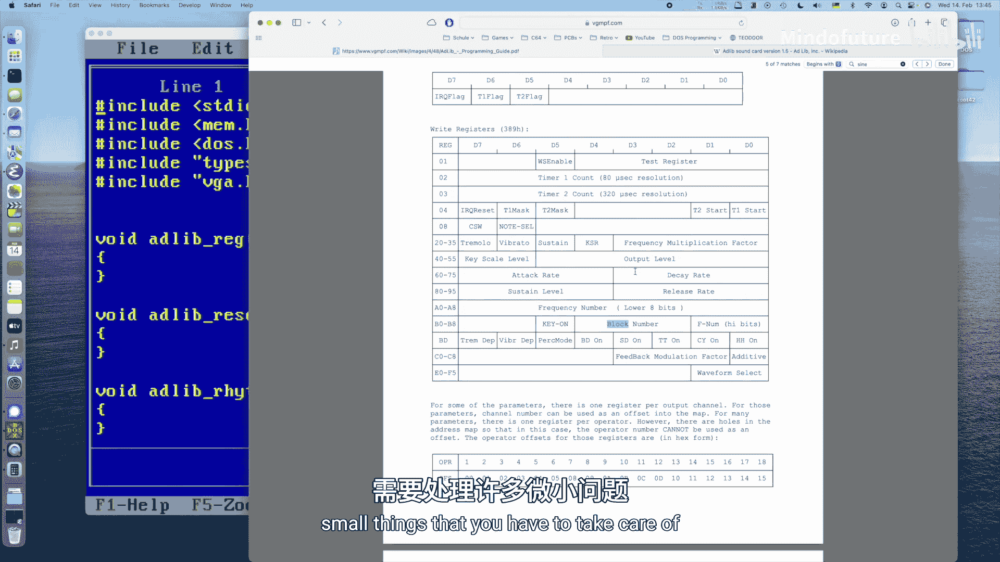

Implemented already， the stop program。Again， just like in our other programs。We will have。

A couple of helpaler variables， a main loop which waits for the escape key。

 and if a keep press was there we can we will be able to hit the drums with the number keys， 1，2，3。

4 or5 from bass drum to snare and so on。And we will have a couple of other things。

 We will have an array of。Values， drums， which is 512 entries long。

And it will be sync to the vertical refresh， so you get 17 ticks per second。

And every time you press a key， it will be stored， so your key press will be played back in a loop。

 basically making a drum machine。So what we need to do is we need to learn how to reset the E card。

 enable the rhythm mode， because usually the card starts up in melodic mode。

 or you don't know what it is actually in because it's a。Mostly a read only chip。

 So you have to reset it to known values。In the first function in the second function。

 we will enable the rhythm mode， and then in the loop here， we will be playing the actual stuff。

 and the rhythm mode will also program all the ADs R and oscillators and so on。So yeah。

 let's go do it and start off with resetting the count。

The first thought of business is to define a bunch of constants that will help us。 First of all。

 we will code the anlib offset register， which is0 x 3，88。And the。Elib date register。Which is 0 x 3。

8，9。And we'll also code the different registers inside the AdLP OPR chip。Those will be the。

Register for the attack and decay rates A R and D R， which will form the envelope。

 And maybe I can put a little comment here。So addx， sustain and release if you don't know it。

For those who can already know about this， basically trying to draw something here and。In ASi。

You can think of it like something like this。I think this is actually turning up pretty nice。嗯。

This party on the left is the so called attack phase where the tone gets louder until it reaches peak。

Then we get a slide decay， when you've hit。The key， basically。

 it goes down a little bit to be a bit quieter。 Then you have to sustain。

 which is as long as you're pressing the key on the keyboard， it will stay like that。

 And when you release the key， that is the release phase。And that's basically the whole。

Volume envelope and the first register deals with the attack and PK fact values， both are 144 bits。

 so 16 values that you can actually use and that's stored in register 60 plus I where I is the I oscillator basically that you're manipulating。

Furthermore， we have the register for sustain level and release rate。That's hexa doesn no， no。

 not 70 but 8。嗯。Next up are the。is the register。For the。Frequency。Number。M's0 x， a 0。And， of course。

 for the other voices， you have to add appropriate to。

Then we have to register the for different things actually for keyon this is actually when you want to play a melody。

 this is different， so we will talk about that in the next next video different from the drums which have their own thing for the octave block and for the frequency number。

 the high bits， the L here stands for the lower8 bits and these are the higher two bits basically。

And that's U x b0。And we have alibp。Register， drum。Which is 0， x and B and D。That's that。

Then we will also define constants for the different drums。The base drum is。Exodus mode 10。

 That's just。16， so2 to the powerw of4， the fifth bit in the。B， do you register。Edlib。Snare is。

0 were x 08。Ed lip。Tom， tom。S zero or X04， the， those are the individual bits。

 if you convertver that to binary。Should be easy enough， than the symbol。0 x 02。And。The high hat。

0 x or1。It's pretty neat。Will also。Although we won't be using it that much here， well still。

Have a aesthetic variable。Okay。For the drum register itself， if we change it， we will store it here。

 so we know its status。Furthermore， we have to reprogram the oscillators。There are。Let me count 2，4。

6，8，9，18 oscillators， which makes sense。 We have 9 voices with two oscillators each。Or 6 plus 5。

 depending on which mode you're using。And the。In， in this is into the registers that you have to use here for the。

A SDR ASR are not linear， but they are but jumbled up。 So we will have a mapping table called。E Lib。

Oscillator offset。And that。Looks something like this。 So the first couple of things are as expected。

0 2。3 up until 5， everything is just。Fine and dandy。 if I were to press the correct keys。

But then there's a gap。 Next， oscillator is actually index 8。9。And a is， again， expected。

And then we continue with B， as expected。D。And then we get another surprise， because it's now 10。

Because there's no E and no F。Index， basically。0 x 11，0， x 12，0 x 13，0， x 14。0 x15。

 you can find this information。In the programming manual， basically。

 this is taken straight from there， so to speak。嗯。Then the question is， how do we write to。

The alib opal chip。Well， simply enough， we use the output byte function。

 We use that in the VGA programming lots and lots。 First， we write the。To the offset register。

And choose the appropriate register that we want to write to， for example。Something like Edlib ARD R。

 which would be hexodus minus 60。And then， we do outport by it。Add Li data。

 and we write the value Simply enough， isn't it。Well， in theory， in emulation， this might work。

 but in real life， it won't because the O PL chip is slow。

 It takes quite a few microseconds to settle。While choosing the register and。Writing the actual data。

 so we need to do a little loop。And the manual is actually pretty specific。

That you need to do  six rounds of input from the same register。To。Have everything settled in。

 And this depends basically on the speed of the IA bus and how fast the input reads from the IA bus。

 but regular 8 MHz or 6 MHz bus should be fine with doing so on faster machines with faster buses。

 you might need to increase this， but regular PC， which has the normal IA bus frequencies should work。

When writing data， you actually need to do a lot more iterations there they say you need to do 35 iterations。

And we better also use the same register shouldn't make a difference because reading from the Iap will be all the same。

So that is the delay。 And this is basically our core function that we use all the time for manipulating the。

Orpio chip。So now the next part will be to reset the O PL to be in a。Usable state。

Well definitely need some it variable for the initialization of all the oscillators and voices。

We also already pick an octtave here to set a default frequency because without a default frequency。

 there will be no sound at all， especially from the drums。So I take octave 3 right now， but actually。

Doesn't really matter。嗯。We can pick。Anything here that you like。嗯。Actually， we should probably use。

 Let's start with  Otave 5， because we said we wanted to use that。

But we can play around with that later。诶。Now， let's use。Also， the frequency number。

 which for the a 5 node， as we calculate is 290。 This is just so。All of drum will play A。

 You can pick anything else here。 I'm gonna use。For all the channels right now， just in a5。

 So we get  phone 40 Hz。 When you play music， you will tweak that pitch around。

 It's just the default value。Next up， we need to enable。The wave select。Enableable bit。

Which lets us choose the wayform。 We don't do that in this episode。

 But before we forget to do that in the next， I'm just gonna。Do it like that。

We should actually perhaps create a define for that， but I'm not going to bother with that right now。

Important thing is， it's the sixth bit。 So 0 x 20。Next a， next step is disable the speech mode。

 the opio 2 has a weird mode that lets you do synthesized speech。

 although no one ever used that to my knowledge。And that is in register 8。

 and you need to just nu it。Otherwise， you will not be able to enter a rhythm or music mode。And。Also。

 we。Will need to。Enter the rhythm mode basically or disable it depending on what you want。

So here we can use our alib rack， just drum。Thing that we did before。

 So saying here we should probably name the register to make it a bit more readable。

And put 0 x 20 in there。 And that is basically already the reset itself， but we will。

Configure the A R envelopes so that we will hear something at some point。So。

We are going over all the 18。Oscillators that we have。And we will just simply set them all to a5。

And that is being done by， I know， not a5 but2 to some， some medium volume curve。

 because that's the areasR， the oscillus pitch will come next， sorry for that confusion。So。

 first of all， Adlap。Register at a rate and decay rate。Plus， obviously， the index。

 we now need to use it。 And the ala oscillator offset for the。Andth channel， eighth channel。

It will use 99。 I figured out。 That sounds pretty。Reasonable for。Our drums。For melody。

 you might want to tweak that。Sustain level and。Release rate similar nothing here。

 And I think if I remember correctly， the higher the number， the shorter the time。

But you can play around with the numbers。 It will change the sound significantly， the ADSR。So。

 that's that。And then， we will。Configure。The pitch， the default pitch。Here we have line voices。So。

 we will use the。啊。L and。Hi， Regar。And we don't need the offset here because this is actually very linear。

So we can delete everything but the eye。And。We use first of all。

 the block and shift it to to the left because it's in bits。2 and three。Basically， counting from 0。嗯。

And actually， that is not the correct register because this is the FN L register or the lower bit。

 So we just take our a5 note。And just mask and the lower8 bits。And this gives us the information。

 And now we have what we want。 We need to fill in the block。

By shifting the block number by 2 and oring that with。The highest2 Bs from a 5。

 So a 5 gets shifted a to the right， And this gives us our setting。

This is how you write single bits basically to a bite。 If you don't know why that works。

 just look up how the end and the left and right shifting and the all works。

And try to count it out on paper。 Basically。 It's actually not that super hard。

But that's how we can set all the bits， as they are explained in。

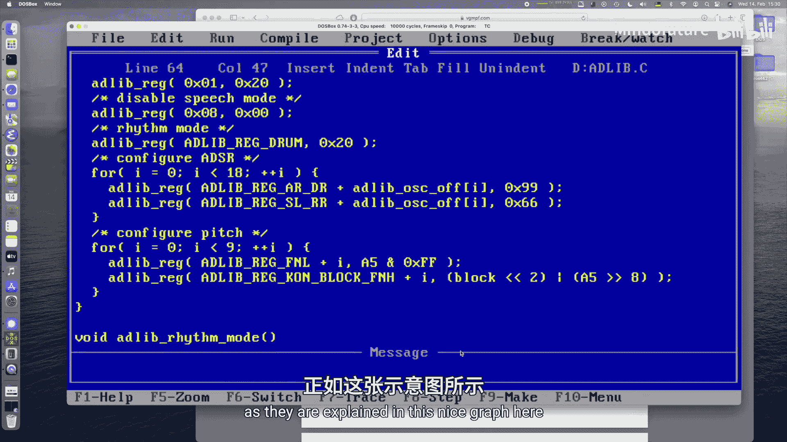

This nice graph here， we set these epi bits。Then these two bits and order them together with the block number。

 okay。

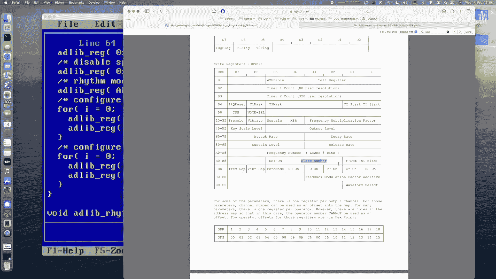

AndThat is it。We configure the pitch。 and and that's actually already what we。Wanted to see here。

All right。Then for enabling the rhythm modes。I figured out that we。Might want to use， also some。

Other nodes and put them on the oscillators for the different drums to make them sound more natural。

 because everything playing a 5 doesn't sound quite good。 So Im， I want to use in a four node。

 which I calculated to be 70。A 7， which I calculated to be a frequency number of a turnnet。70。Again。

 always using the same formula that you saw。

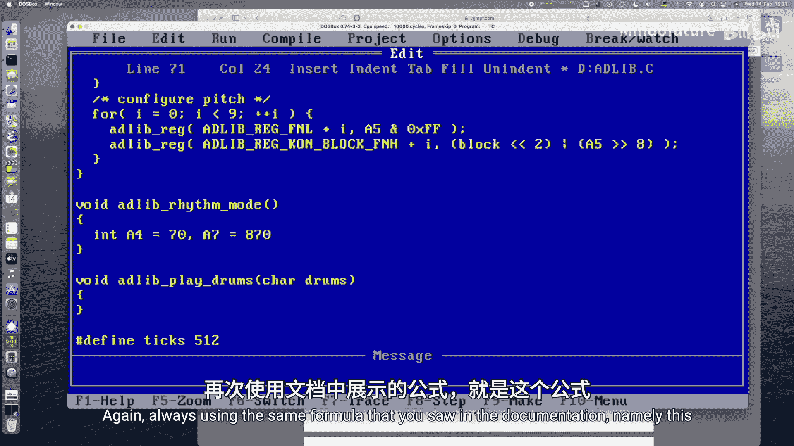

In the documentation， namely this formula here。

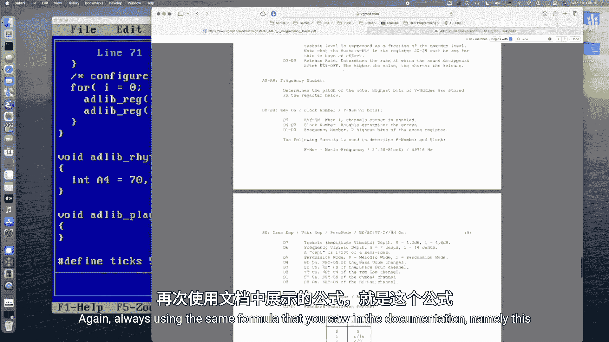

You can just plug that those values in。And we are using block。3 here。So that's that。

Then we will enable the drum mode or the rhythm mode bit， which means we take our。

Rrum register variable， and。Turn on。Bit number 5， I think， is that correct。

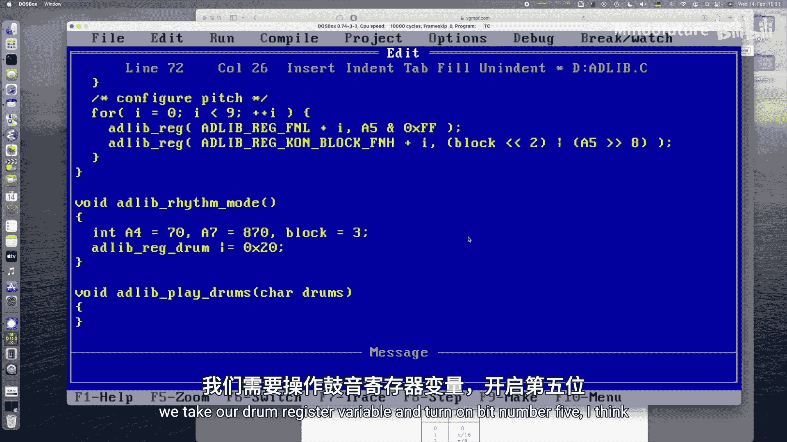

Is that but number5。To be the is here。 That's a bit number 5， indeed。

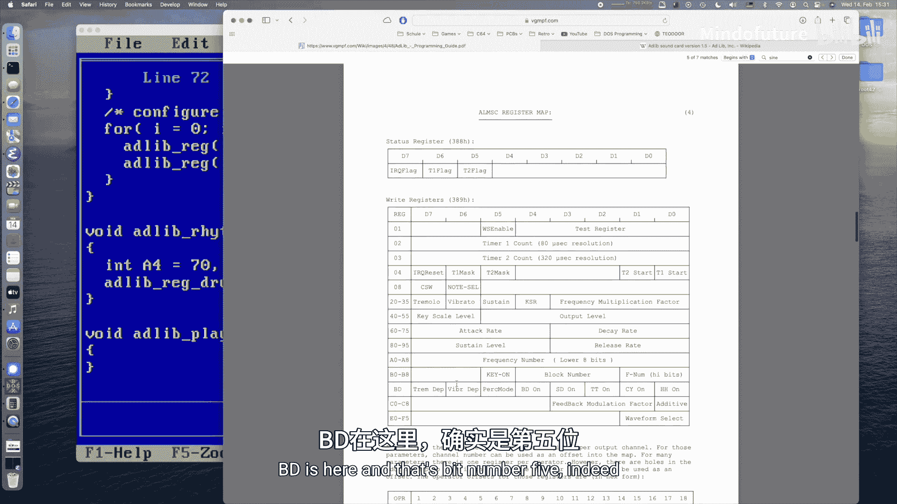

Thecus mode。 they call it。Doing that， we can write that using our function。Ela register， keyon。呃。No。

 that's wrong。 Reg drum， of course。With the headlo registered drum variable。

So that does all the magic。Alsoso。ちは。Pitch， said don to to I a pitch because it sounds better。

That way， we do the edit register。I never register F and L。 That's the lower bits plus 8。

 because oscillator 8 is actually the one for the totms。 There's also。

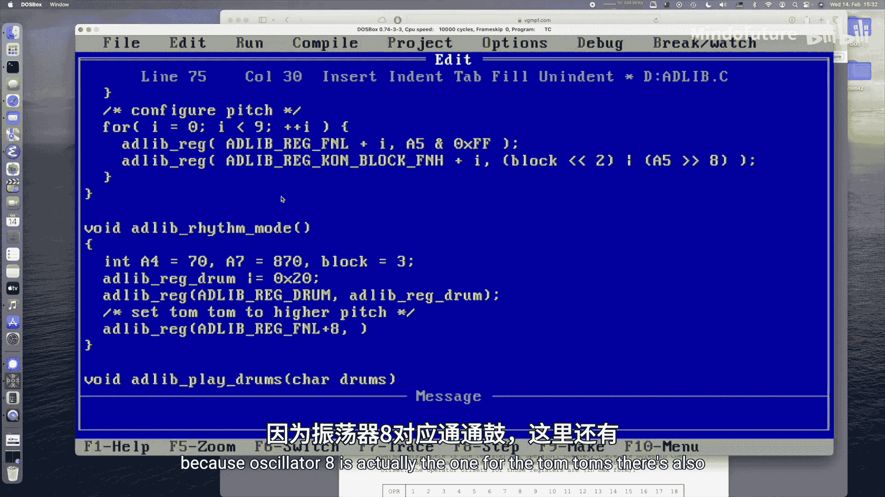

I look up somewhere here。Exactly， Tomm Tomm is oscillator 15 and oscillator 15 belongs to channelnel 8。

 So that's why you need to do it like that。

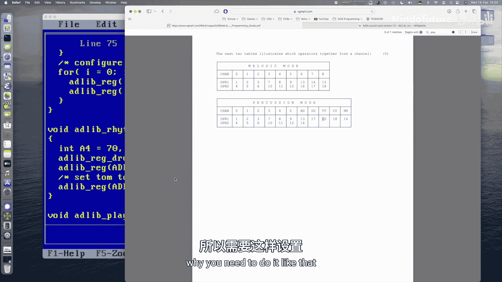

And we're gonna play a 7。On that particular drum。And it should sound a little bit better。嗯。Similarly。

 we need to set the block。Con block and F， and H。Same as we did before。

 we take the block shifted to left by2。Or this with the。A7 node shifted8 to the right。

And we set the pitch for the totm。And we do the same。For the bass drum。

But we make it a lower pitch to make it more base。

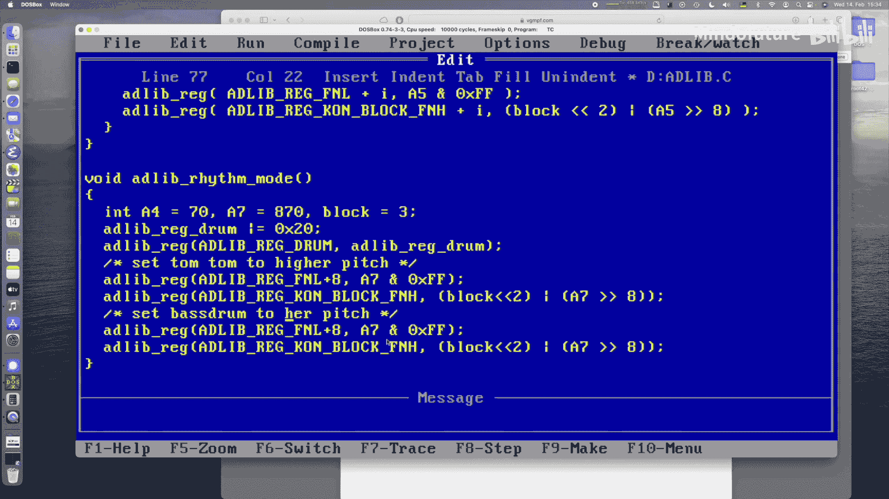

So a on to lower pitch。The base drum has two oscillators，13 and 16， and they belong to channel 6。

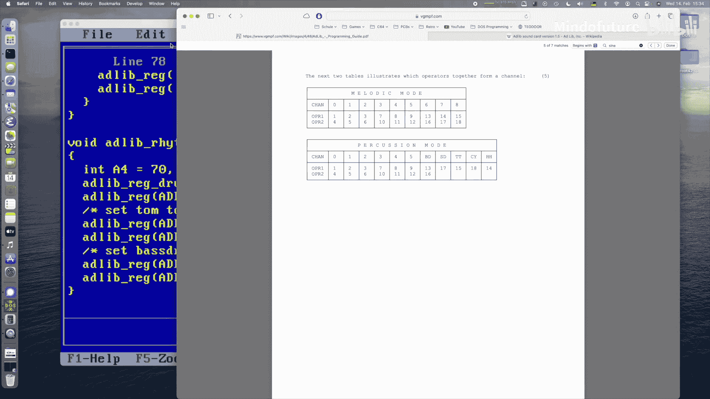

So we replaced that with a six year。啊。And we forgot the plus8 here， which is not good。So， plus 6。

And we play an a 4。And here， as well。So that's that。I think we are good。And we will also。

Adjust aius R for。Sybol and high hat。To slower values。

Because I noticed that all my default values are a bit too fast for those。嗯。So， we're gonna pick up。

Here， the 80s are setting。And copy that twice。

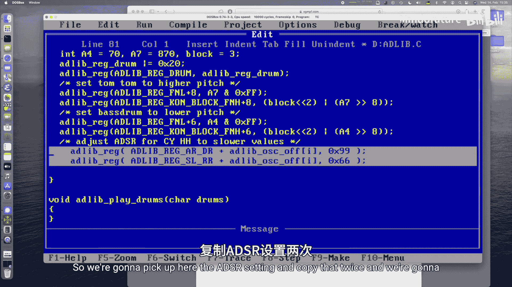

And we are gonna look at the。Oscillators for。The high hat and the symbols。Which are 18 and14。

 basically。

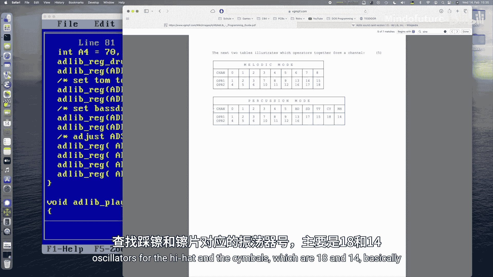

So when we need to subject one， because here we are。0 based。 And that table is one based 18。13 and。

17， sorry。And we're gonna set those to 88。And 55 so a little bit slower。Sa ADH。And 55。

 you can play around with these values and hope to get something more interesting。

So that's that again， does this still compile。There have a bunch of errors。嗯。I probably。

Mi typed something here。And let A R， D， R， O。Probably misname those。 Yes。

 I should name them correctly。With the register in there。 So we know that those are registers。

I can make it look a bit nicer。But all， okay， now we got a couple of warnings， which makes sense。

Okay。Because we don't do anything here。Okay， playgrounds， that actually clip pretty simple。

We simply write to the grammar register and turn off all the notes。Basically。

 and we can do this just by writing the current contents of the ala registered drum。Register。

And to turn on the notes to actually hit the drums， we just。Or this with the drums。 So basically。

 you do a key off and then a key on event。This is obviously not optimal because you want to record the keyon and keyoff events separately。

 But for our very simple purposes here， that is good enough。 So if you want to go above and beyond。

 you could not only do。A1，1 area with key on events。 But you could have two arrays or some。

Bits in they reserved for key on and key off events。

 so you can go nuts with with different ways to trigger the notes Basically What we are doing is we are doing the key on。

 And only when we the next key on comes we do the key off event。 So yeah， it's up to you。

But this will already play everything we need。 So we just need to fill in the main program。嗯。

This is already pretty far。 And first of all。We will check for keyboard prices。

 And if there's a keyboard price。We will do all our magic。First。

 I have an increment here where I will。Count up the。Timeimma that we have。

By this increment and the increment starts with 0， so nothing happens。But if a key is pressed。

 and if。Increment is 0。I will just start incrementing the time。

 That basically waits for you to press the first key so that your first drum hit is always on the first tick in your。

Sequenceer， basically， this just waiting for you to do something。Then we read out the。

Character from the keyboard。And later， you could change this to use the low level keyboard presses so you can record multiple key presses at once I showed you in another video。

So you can look that up。 But for now we are， we' are doing a simple。Very simple。 One key at one。

Tying， basically。Okay， then we have to choose which key was pressed。And as a default。

 I'm going to do the following。I'm going look into the drums。Sequence， basically modular。

 the number of ticks that we're actually storing。And we just， if you press another key like spacebar。

 you delete whatever was there。 so you can just hold the key and delete whatever you recorded。

 I think that's a pretty nice way of。Adjusting in this very， very simple drum machine。

 which sounds are currently played。嗯。We will come to the other keys in a second。First of all。

 after every。Yeah。Iteration in our Y loop， every timer increment， we want to。Play the drums。

Especially the ones that were just being enabled。So。We again， look into that sequence modulars。

And play that Very simple。And we don't want it to be dependent on the。Machine speed。 And for that。

 we have a function。 for retrace。From our VGA library。 And this will。At most。

 play 70 ticks per second because the VJ card has 70 Hz。 So this will wait for one frame choice。

 So you get 70 ticks per second， relatively stable。That should be fine。

 And to make it more clear which part of the sequence you are currently viewing。

 I'm gonna print out the ticks， basically。As a very simple printer function。

And you can think of this as which bar you're currently playing in music notation， very rough， very。

Hand wavy。 But you you will see a number incrementing 1，2，3， and so on。Up to 15 from 0 to 15。

 because we have 5 12 ticks divided by 32。 but it's sort of like playing， playing a bar。

And this should already be compiling， I think， and even running exactly it's waiting for a key。

 and I can quit。

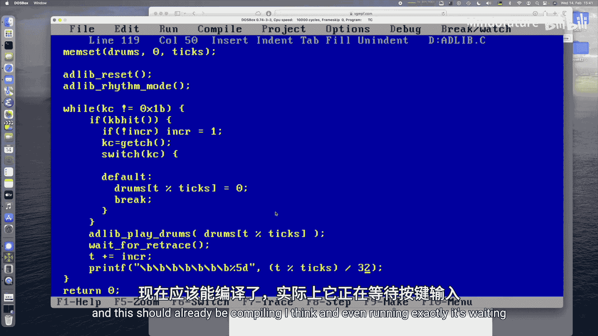

Or can press some other keys， and it will start counting。In theory。

 it's playing but you can can't hear anything。

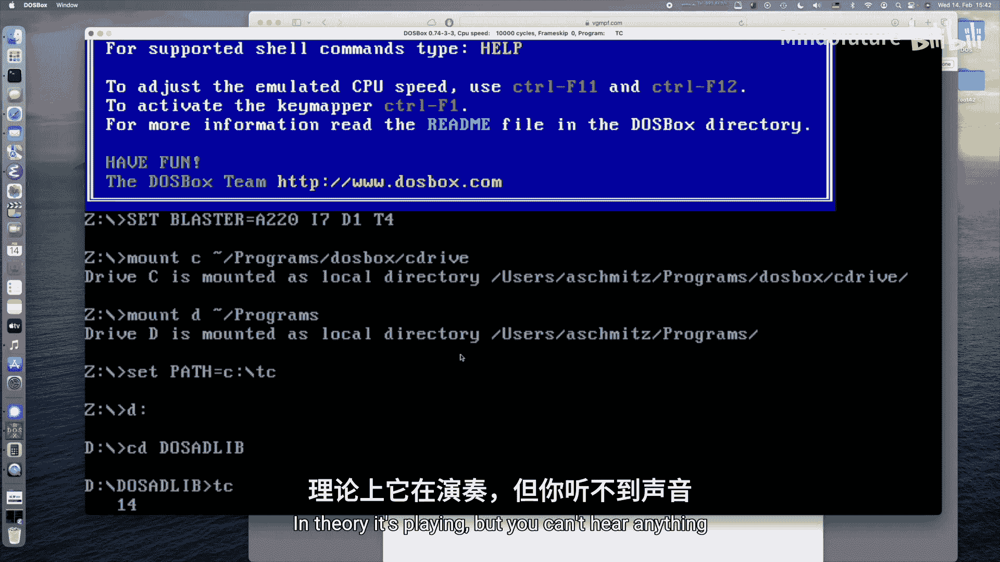

Sound is on because it's not playing yet because we haven't actually codeed which drums to play。

So we're doing that right now， case 1。Again， we take our drums sequence。Modulular the ticks。

 and we will。Just turn on the bit。 That is for the base drum。Just like that。And then we will break。

And we can copy the whole block。For more times。To deal with all the other drums。2，3。4，5。

And the other drums are。And they odd of their bits， basically the srerum。对装不装。你什么。And the， I had。

And now we're ready to go。Let's give it the whirl。It will not sound pretty。

 but it's the best I can do。

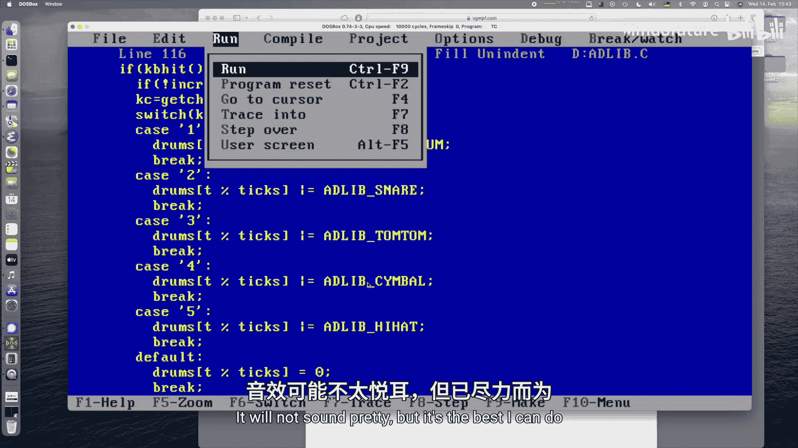

It's waiting for me to press something。 so I press a couple of times the bass。

AndNow I'll lift my hands off the keyboard。And the sequences play back。 We can add a temp to that。嗯。

嗯。Or some other drums。

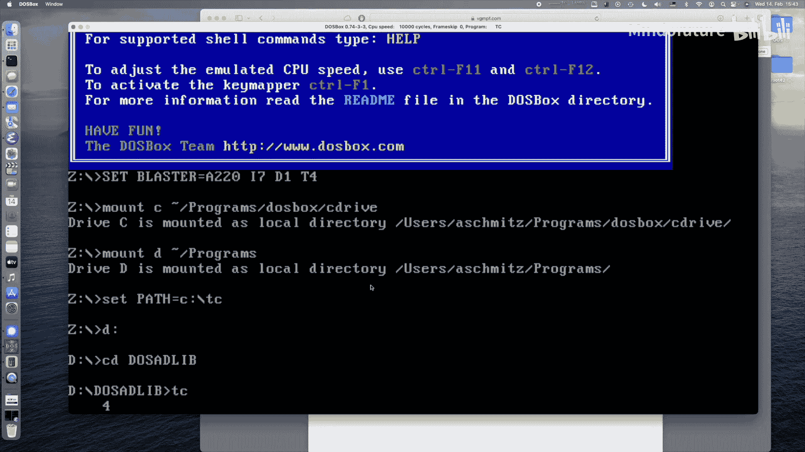

Okay， I'm gonna quit this now。 Obviously， I'm not a musician。

 I have no idea what I'm doing here other than I can code a little bit。

But this is how you program the drums on the adlib。 And I think this is a good program to build upon。

 you know now how to write to the registers， how to reset the car。

 how to program the oscillators and how the offsets work。You know how to program the ADSR curves。

 how to calculate a frequency to play a correct pitch and how to toggle the drums actually and how to turn on percussion mode if you want to have drums。

Next time we will look a bit more about how to play melodies。

 how to convert the nodes to frequency numbers and。We will try and make the keyboard。

The computer's keyboard behave a little bit like a musical keyboard。

 Let's say so we can play in this simple sequencer。 also a bunch of。Notes， probably even polyphonic。

 And maybe we can put in some other。Options for the waveforms and stuff like that。

 But this is already。I think a very good starting point for you to play around with。

 so I hope you enjoyed it。I hope you can make a lot better music and percussion than I can。But yeah。

 I think this is a good start。 So if you enjoyed this， leave a comment， thumbs up。Stuff like that。

 If you haven't subscribed， please do。 You can also support me by the usual means， Patreon。

 et cetera， et cetera。 Links are all down in the video description。 if you can't or won't。

 I won't the Matt。 This is just my hobby。 but every little bit helps for me to invest。

 especially in the hardware videos because they actually do cost money this year just cost me some time。

But enjoy doing these， let's code video。 So see you in the next one。

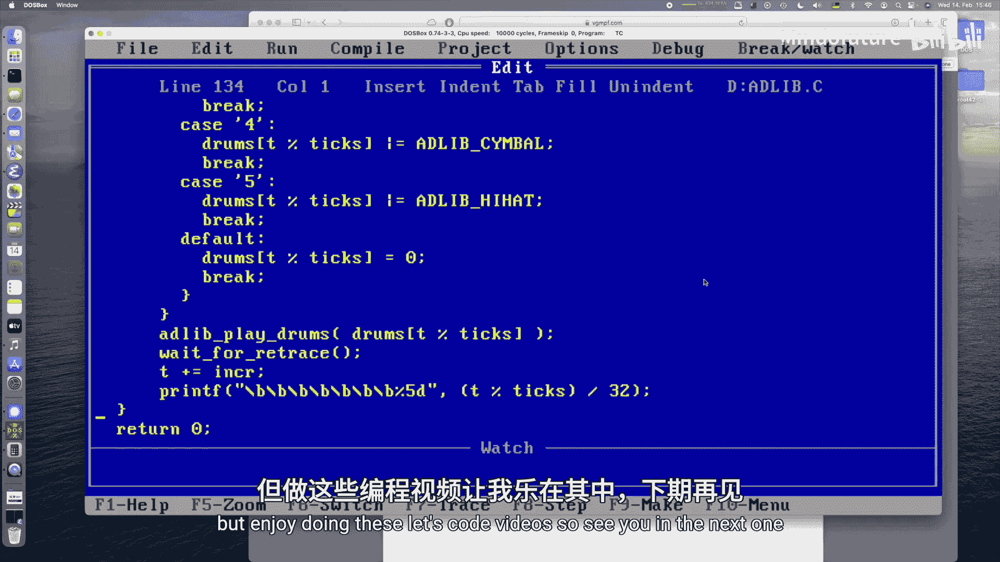

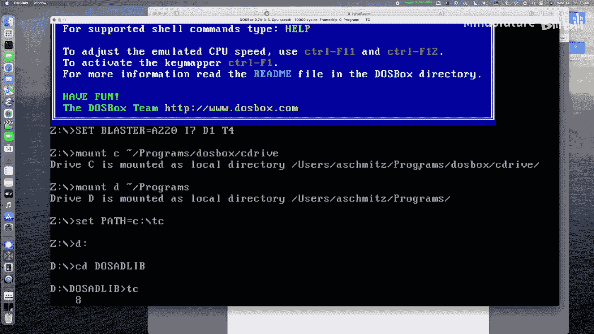

🎼The。🎼The。🎼，🎼。

