# 编写MS-DOS-系统-｜-windows-｜-操作系统-｜-汇编--｜-vga-｜-x86-p40-P40-Lets-Code-MS-DOS-0x27---AdLib-OPL2-Melodic-Programming--BV1zs35zQEru_p40-

Hello， welcome。 and an excellent evening。Here's part two of our adlibp programming tutorial。

 so speak， using Anaistoss and Topo C2 dot O， as usual in the Let's code Anaistdo series。

 in the last episode， we coded a simple adlibp。Based drum machine using the OPL2 synthesizer by Yama。

 which is on that card。But is also basically on all the ho plaster cards and their clothes。

And it's a bit tedious at times to programme this chip。

 But there's some good documentation out there。 And I also found this very nice。

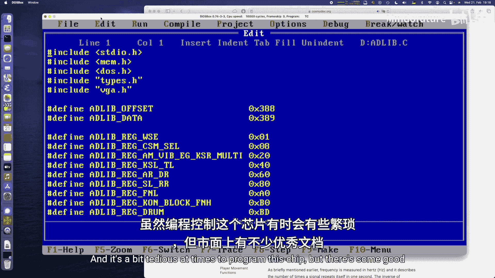

Page Cosmodo， I will link to it in the video description。 It has。

An excellent description of all the functions and ideas behind the O PL2。

Especially also stuff like very good pictures for the waveforms。

 basically everything on the opal2 is based on a sign which is actually stored in a ro like fashion。

 at least the quarter wave， which is then duplicated by mirroring。

For the positive and negative part and the other half of the phase。Et cetera。 So yeah。

 there's also a very good explanation of the envelope generator with the attack， decay。

 sustain and release Also， when the key on and decoff comes into play， actually。

 you can toggle that on the。Cart on the Edlib card that took me a while to figure out the bit that is actually doing that。

 If the bit is off。 then the after the decay phase。

 the release phase will go immediately off instead of the sustain which is similar to not pressing the sustained pedal on a piano。

 so to speak。 And yeah other nice examples with Fourier transformations or spectrograms of the different effects that you can have when using the modulator to modulate the carrier and also an explanation what the vibrato and the tmolo functions。

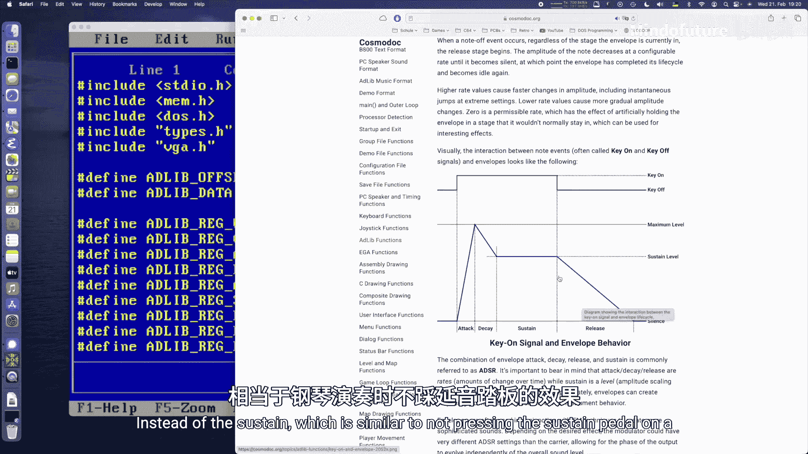

Which is called amplitude modulation。On the O2， well， how they work basically。And yeah。

 I can definitely recommend that。 And this time， we will actually do some melodic programming。

 We are in the rhythm mode of the OL2。Which means we have6 melodic voices and five drum voices， and。

I already put in a couple of stubbs， mainly。A function called Elib set instrument。

 where we will introduce a structure called Elib instrument， which takes。

The most important options for one instrument of one voice。

 one of the six melodic voices and their oscillators。And also， a function called play note。

 which will play a specific note on the specific voice。

And then we will introduce more keyboard presses here to have kind of a piano keyboard on our regular keyboard basically by using the row of the letter keys。

 AWST and so on。To do that。 And well， I also clean up a bit the register section and introduce all the registeres that we will need today day。

 So if you don't know what any of these mean， please check in with the first video in the series。

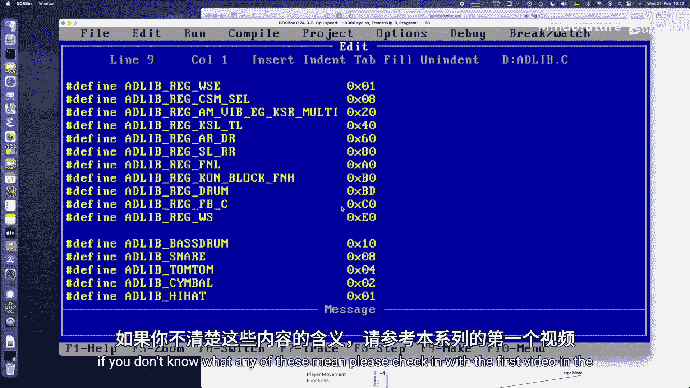

And also with the documentation of the chip， basically here， we have most of the registers explained。

嗯。Including the per channel registers， which are the。Voices， the six that we currently have。

And the per operator registers， which is basically one register per oscillator。

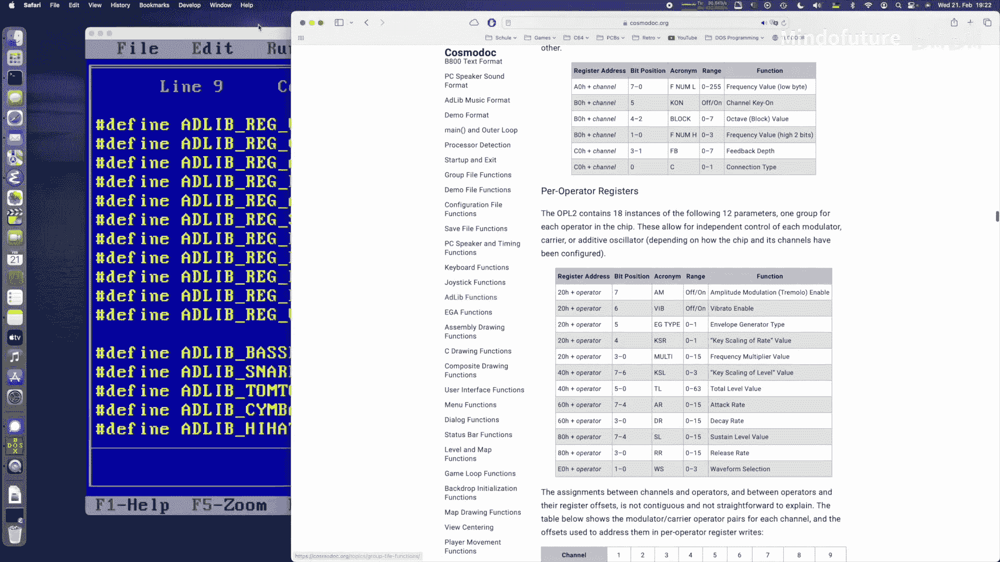

So let's get started。 First up， we need to define a couple of things。 And the first would be the。

Oscillators that are used for the different voices in the different modes。

 and we don't need to concern ourselves with the drums。But for the six melodic channels。

 we need to define that voice1 uses or voice 0 uses oscillators 1 and 4。

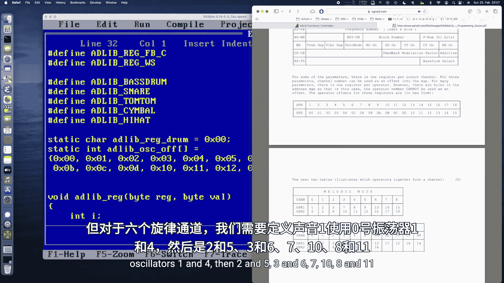

2 in， then，2 and 5，3， 6，7，10，1811。 So let's call this。 There's a。There's going to be a static hintt。

Edlib。Voice oci laterator。Size will be 6 voices by two operators。And yeah。

 we're gonna call it up like， so first one has 0 x 0，0 and 0 x 0，3。This is oscillator 1 and 4。

 because we are0 based， obviously， instead of this one here， which is a bit weird。

 they do a0 based index on the channel， but the operators are。

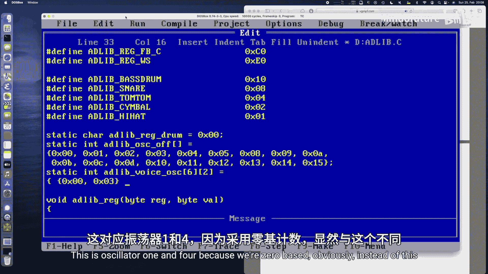

One in doesn't make sense because the offset into the registers is actually0。

 so it would have made no sense if they use0 for both。

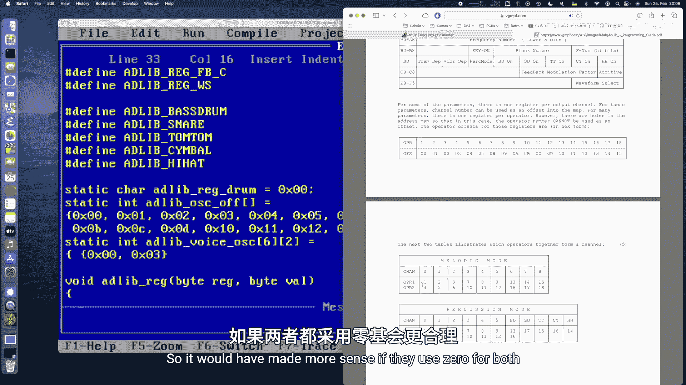

But yeah， we can work around that and next up is 0 x01 and 0 x04。Then we get 0 x 02 and 0 x05。

Furthermore，0 x，0，8 and 0 x 0 B， this is just。

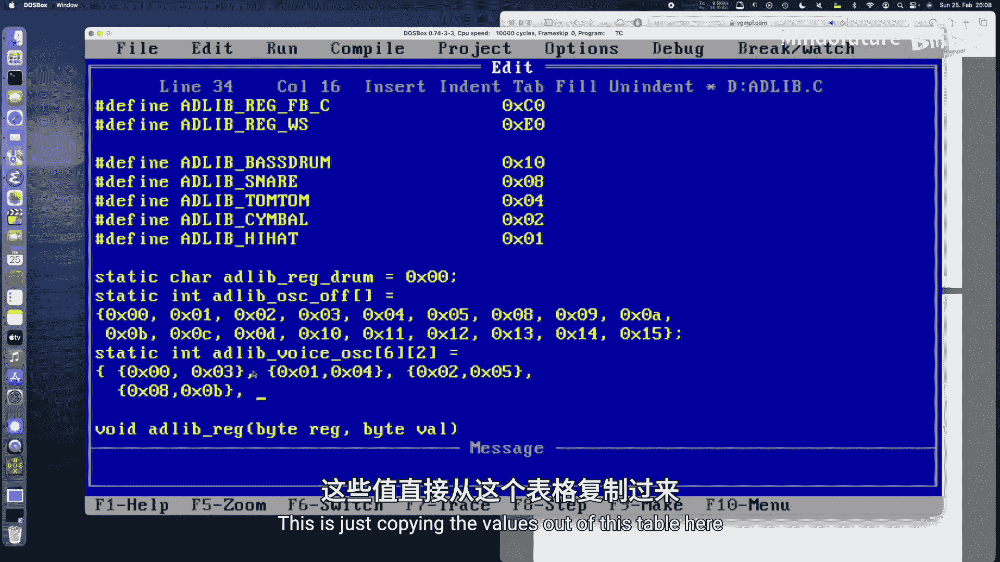

Copying the values out of this table here。

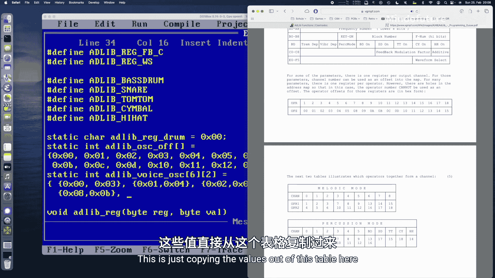

Nothing more。And the last but one is 0，0，9 and 0，0， c。Come on。And the last one is 0 x 0 A and0 x0 D。

This way， we can do a quick look up， which operator to use when we set an instrument。Furthermore。

 we need the。Frequency numbers。So this will be an unsigned in because we need how many 1010。

 I think bits。 So we'll use that。 And we call this addlib notes。This will be one octave。

And I did write a program to figure out these frequency numbers。

 because there is a long table at the end here。

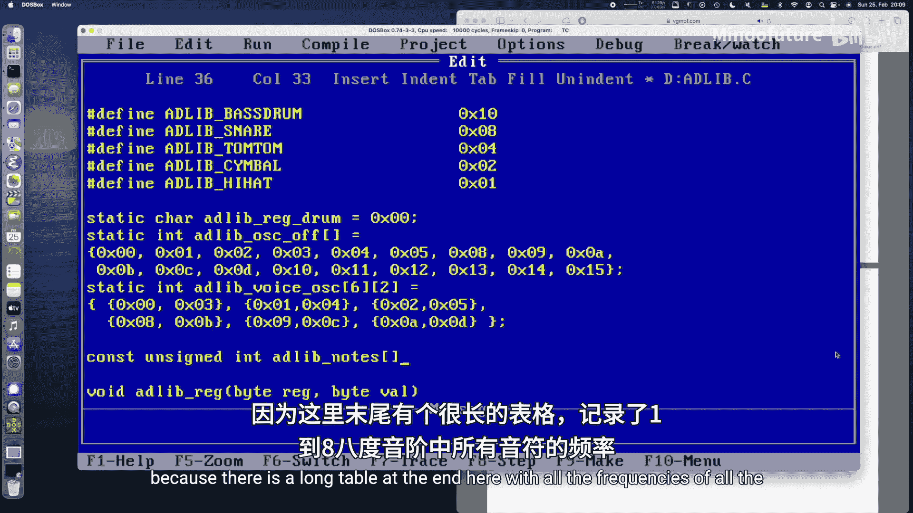

With all the frequencies of。All the notes for octaves1 through8。With 440 being a5， basically。

And I figured out that since the block numbers are equal to the octaves。

We don't actually need to code other frequency numbers， but one octave is enough。

 The only thing where this differs is， I think， let me look it up the F8， so。

This note here has a slightly different frequency number， which would be off by 5 Hz， I think。

But I'm not gonna bother with that。 So you can just code the frequency number for one octave and then just set the block number in the register。

 and you're mostly good to go。

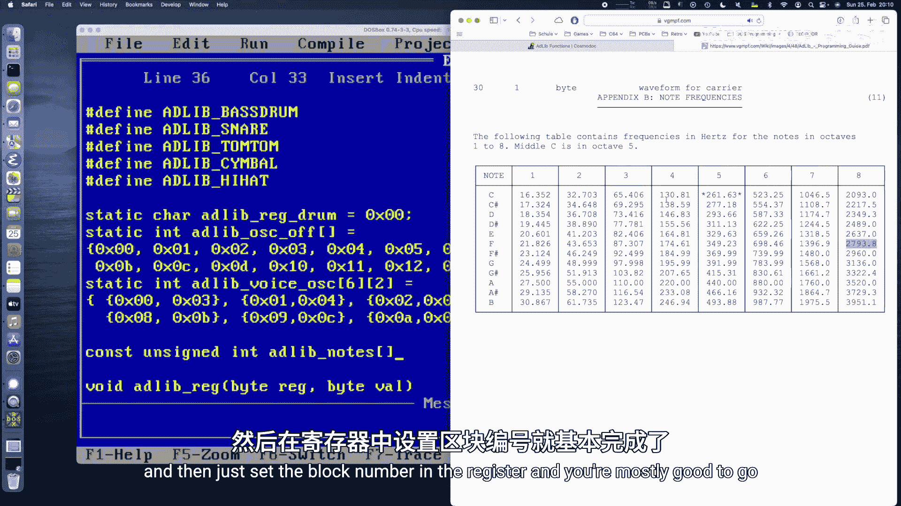

You can do a table with all the correct numbers， but I leave that to you to do that。

So if you write this program or put in the values into the formula manually， whatever you like best。

 the formula being this one here that we talked about。

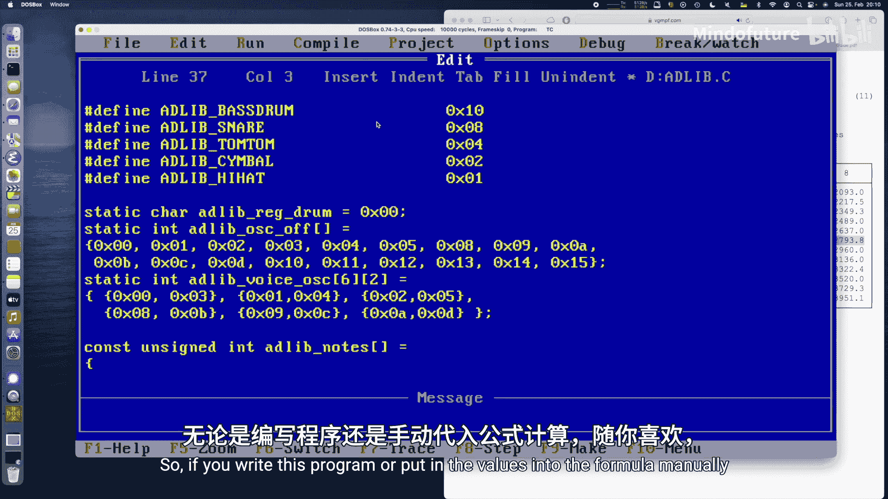

I think in the last video。

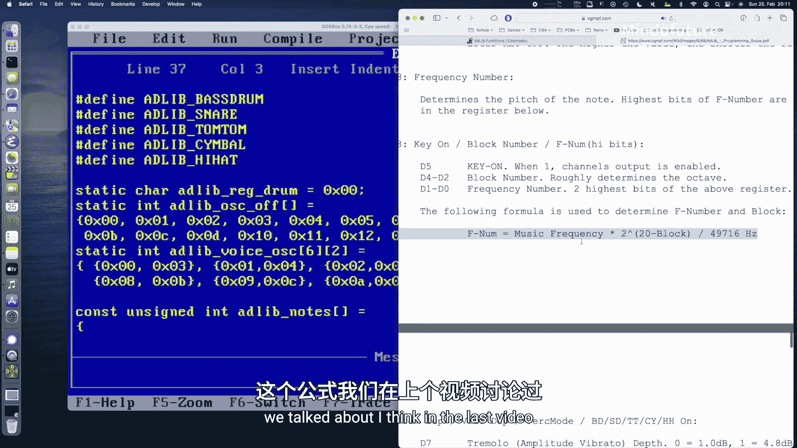

You will get S frequency numbers 172， 182。193。205，217。And I think I'm going to put a space in there。

 as well。And 230。243， 258， 273。29，307。And3 and 25。That's that those are all the notes that are in one octave。

 basically。And now we need to define a structure to store。哦啊。Oscillator options。

 So we called it Edlib。Oscillto。And this will have parameters for the。Attack rate and decay rate。

 decay rate。This is1 W， and the。Release rate。Then we will have a bit 1 B each for the A and the libretto if they are on off or maybe there are  two bits I forgot。

Might be also level for that， I'm not sure。But for these options， a cha is good enough。

There's also the sustain bit。 This is actually really a bit。

 which determines if the sustain level is actually used as long as the key is pressed on。

If the sustained bit is off， the sustained phase will be skipped and the release phase will immediately begin。

It's similar to pushing the sustained pedal on a piano basically before hitting the note。

So on a piano， it's if you hit the sustain pedal and hit the key， as long as you press down the key。

 the tone will sustain。And yet， it will eventually。Fade off on its own。

 but it will continue sounding。Because if you release a key on a piano。

 there will be a little damper that will stop the note from。电ing。

Continued basically by stopping the string from vibrating。Something like that。

Then we have the key sustain level， which is basically。

I think additional tennuuation factor for the sustain。And the total level。

 which is an attenuation on all of the ADSR。Making everything quieter basically。

And we can choose the waveform。 This is the wave select。And the code that I'm checking in。

 there will be comments which is which， but I'm going to skip that for now。

 you will see it in a moment。We used the oscillator。To define an instrument。

 So we have an adlib instrument。And one adlip instrument will have two oscillators。

Namely one called Car and the other the modulator。And will also have a bit for the connection between those。

 either having the modulator modulating the carrier or if the bit is set。

 you will have a connection where both are just added together。 This is additive synthesis。

 and it sounds much more clean and。Maybe even boring。And there's also the feedback bit。

 which means that the output of the。Combination of both modulators will be fed back in attenuated into the original signal。

 giving rise to some distortion， basically。Yeah， this， you can toggle as well。

Then we need to be able to do the set instrument call。And that's actually relatively forward。

 It's just a bunch of bit manipulation。 So what you need here is the let's zoom out a bit。

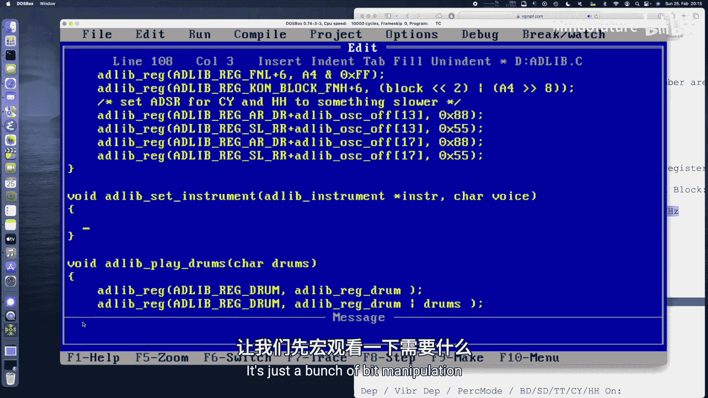

You need the registers here and always have a look where each of the。

Instrument and oscillator definitions goes。 So input is an instrument structure， and a voice。

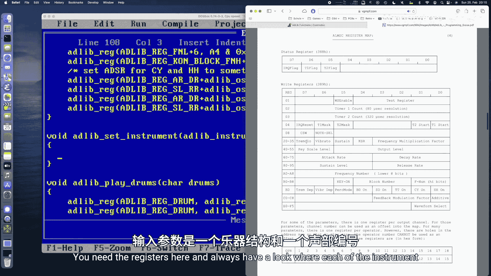

Number， basically。So first of all。We are setting the8 R for both。Oscillators。

We're doing this by calling the A Reg routine。On the ARDR register。

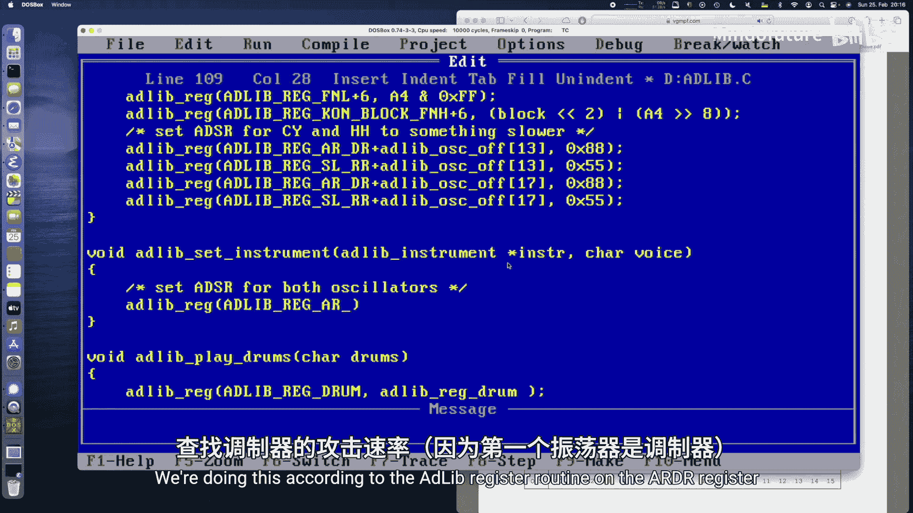

呃。Plus， let's check this at a rate and decay rate R 16 register。 So that's one for each oscillator。

 So we'll use the alib voice。

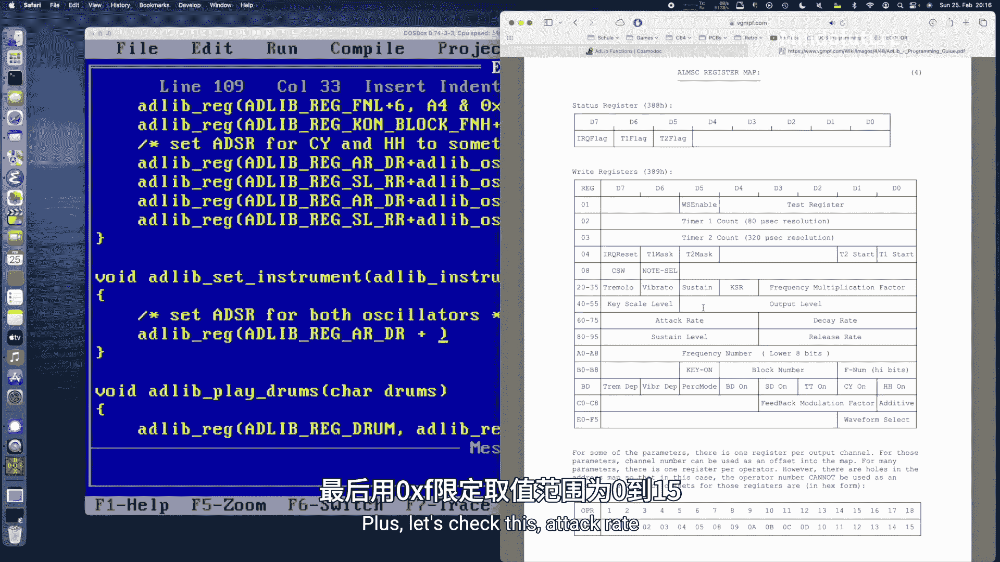

Oscillator。Aray that we just created and take that for the first oscillator。嗯。And we are looking up。

The modulator， because the first issl is the modulator， the attack rate， and we will。And this with。

0 x F to definitely limited to。The value is 0215。 if the user puts in a larger value。

 it will be clipped。And not write。 Garb into the register。

And the attack register is actually the higher four bits。 so we need to shift this by four。

And we need to combine this by using the operator with the decay rate。

 which is instrument modulator decay rate。 and this will also be limited to the value 0 through 15。

And those are already the lawbis。 so we can close that。嗯。We can copy of this whole thing。2 voice 1。

To get the same， basically。And we can copy it too much。Times if I managed to do that。

To actually also do the sustain level and release rate。For both， So let's。Do this here as well。

And for that， we obviously take， let's take a look。 What are the habits。

 the habits are the sustain level。So it's very similar to what we did before。

And the low bets would be the release rate， very straightforward。That should do it。

 That's the AR curves for both oscillators you can。Use different AR rates if you want to。

 but for simplicity sake， using one for both of the letters。Then， we're gonna set the。Sustain。

Ammplicitude modulation and。Tobrato。Which works in a similar fashion。

There's one register to set all of that。 It's the alib AM。The Bttle E G that sustain K R and multi。

Those are quite a lot of bits。 Here see， tremov they about to sustain。

He's a strain rate and frequency multiplication factor。

There's a couple of things that we don't set here that you can play around with select the multity。

 but not going to do this here， leaving this up to you to do as a homework basically。

Same goes for this， This is per oscillator， so we do alib voice oscillator for this voice。

And for oscillator0， first， foremost。And then we begin our journey。 First， we need to。Do the。Tremolo。

 which is the amplitude modulation。So we take instrument for a modulator。

And the aim value of the same shifted 7 to the left， because it is bit number 7， as you can see。

And I'm gonna kill this bracket and close it at the end。And then we or this with the。Inumment， oh。

 there's an  error。 We need to do the arrow because it's a pointer。Instrument Mo debrato is the next。

Shifting this sixth to the left， because it's the sixth bit。And combine this with。The sustain。B。嗯。

Which is the fifth bit。And that's all we are setting here。 We ignore the other values。

 We leave them at 0。

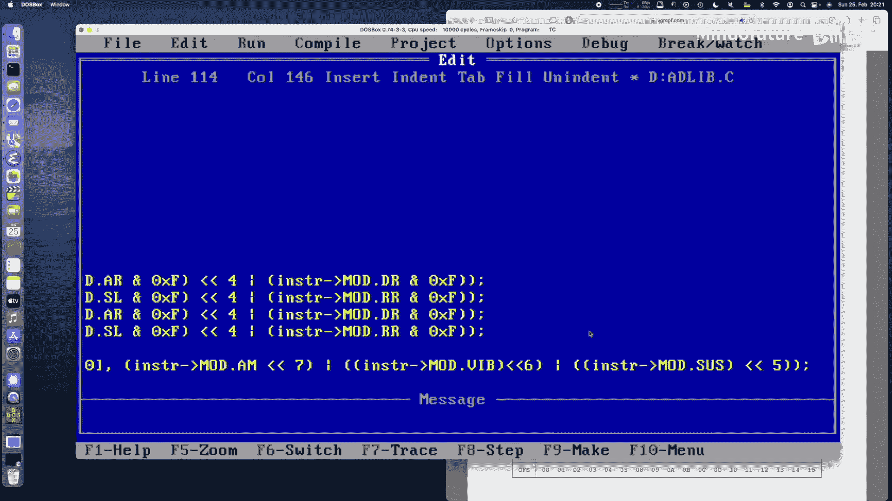

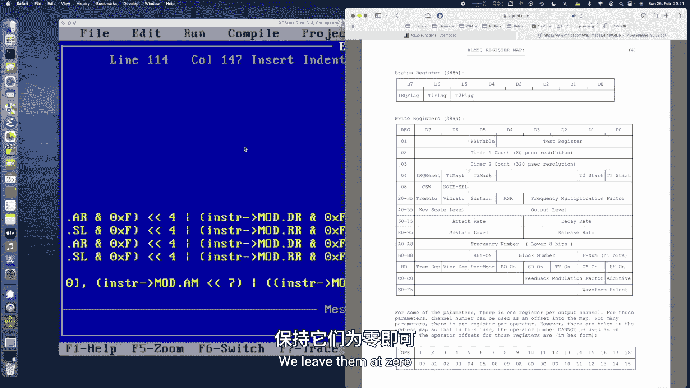

Then we can copy all of this。And I'm going do a little test compile in a second for the carrier。

Which means we have to replace all。Modulate our occurrences here with carrier。

 And then we have all the values for all。Different。Oscillators。There's two  errors。

 I have done something wrong。 except parameter call to addlib register in function， blah， blah， blah。

Oh， yes， because I put a comma in here。Which as that。Okay， we have some。Warnings。

 because we're not done coding yet。So far， so good。Those are prelong those lines。 So takes a bit。

U next up。We have。The key sustain level and。Total level。That he can adjust。II'm gonna use。

 I'm just gonna copy。Both of this， because this is also， I think， for both oscillators。

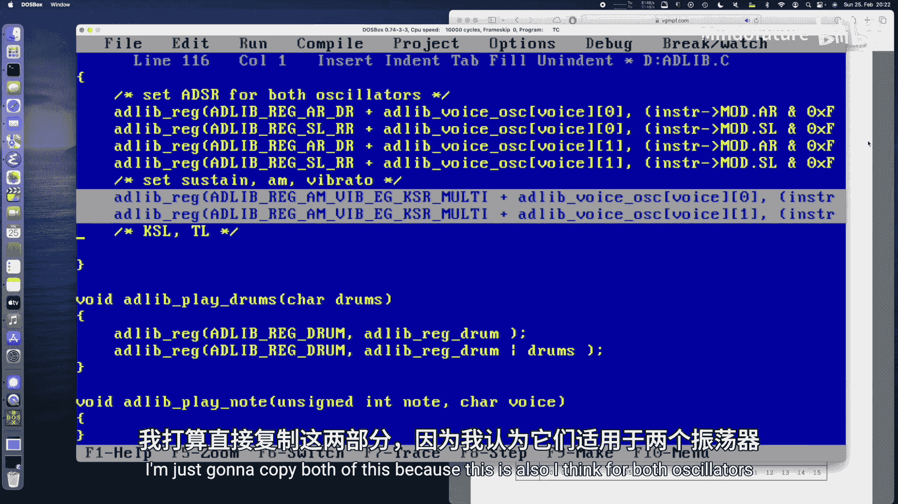

Key scale and total level。 Yes， although here we have multiple bits，2 Bs here and 6 bits there。

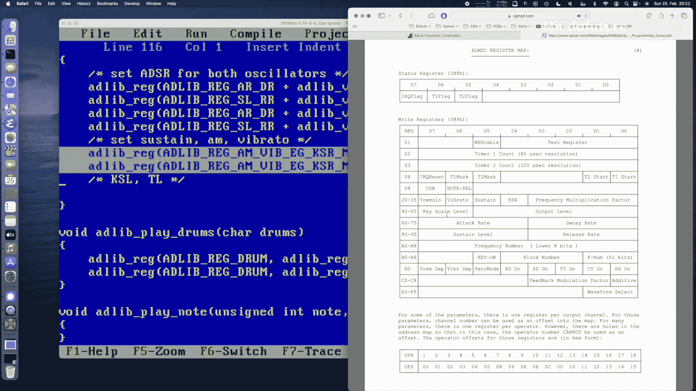

But we can use that。And the。Let's only copy one。The register is called of this lease slightly different。

 I think it's Ks L and T O。We need to use， again， the look up here。

And we are taking modulator case L shift to the left by 6 because we using bit 6 and 7。And then。

 we need to use modulator。Let's kill one of these instances， this。Instrument modulator， Tl。

Shifted by nothing。However， I think I'm gonna。Let me check。Yeah， I'm gonna enter this。

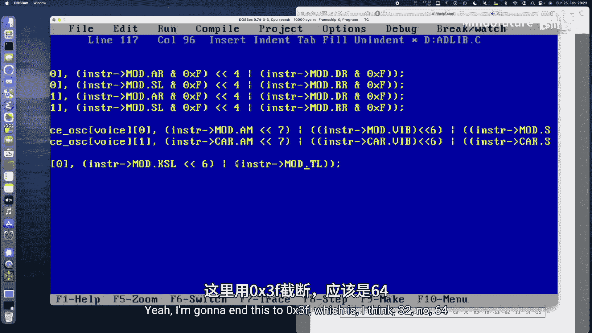

To0 x 3 F， which is， I think，32 no，64。Does that make sense， Does that make sense。

I think I should have used something different， right。

 Because because because because let us pick up a。Do I have， do I have。Binary here。 No， I don't。

 So I'm going to use my。So with micro Pro3 F is 63， which is actually correct。3 F is 63。

 That is all the five bits set to one。 So that's why I'm doing the end here to just mask it off。

 If you put in anything bigger than 63， it will be clamped。

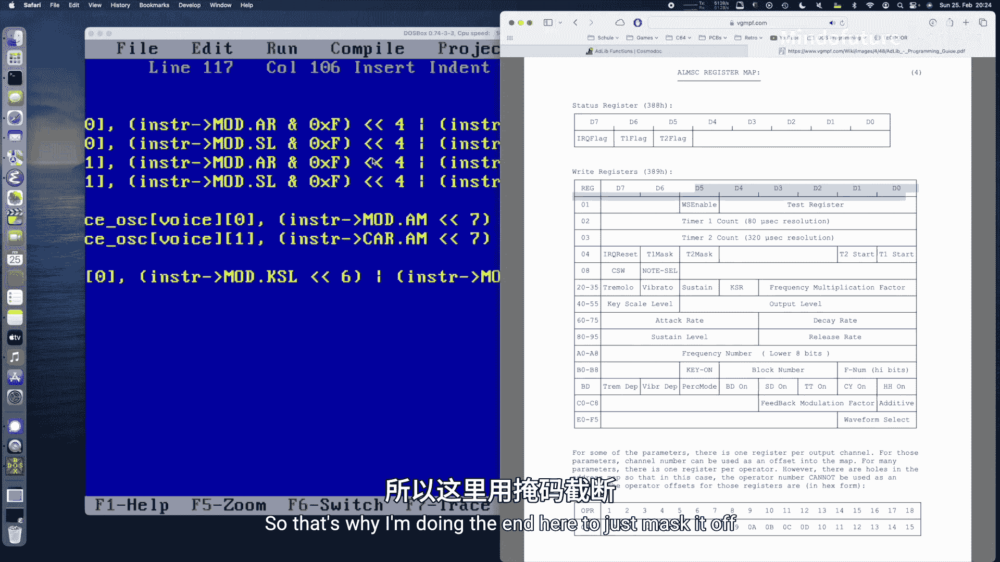

That's always a good idea。Okay， let's copy this。And do that also， for the second。

Oscillator for the carrier。And that's that Usually mostly you will not change this。

 but maybe you want to have the modulation a bit weaker。

 so you would put something different from 0 into the vertical case and Tl for the modulator if you don't want to have heavy modulation。

 basically。Then let's do the waveform， select。So headlib， register， headlib。

What is it called registergiar W。 S， That's actually pretty， pretty empty register。

 I think I think there's only two bits that are used。 The rest is unused。So again， Edlib。

Voice oscillator for this voice。And operator 0。We're going to take instrument。Dot， no， no dot。

Hearrow mot。W select。And we're using 003 to mask exactly only those two values。And that's that。

 And I think we don't even need the。Brackets here。And we're doing the same for voice number one。

And doing the carrier here， as well。And all the last bit is。Connection。And feedback。

Connection feedback are in。Which one and which one and which one， which one， let's see。嗯。Question。

 connection and feedback。Oh here。 Here we have it C zeros through C8 that is a per voice and not for oscillator。

 and you have three bits， D1 through D3 for the feedback。

 So eight different levels and the additive bit it's called here not connection well some some college connection here it's called additive。

 So it's the adlib。Register F PCC， that's what we called it above。

And we're using the voice as an offset。Because it's per voice。And we're using instrument feedback。

Shifted by one， and it should probably。And this as well。 But since the rest of the bits un useded。

 I don't care that much right now。And the instrument。Connection bits。

We will clamp that Otherwise it will。 It might interfere with the feedback。So that's that。

 that's pretty good。Should still compile。Yes， with a couple of warnings， still。

 because we have some empty functions。Fin note。That's relatively easy as well。

 but I will do it a little bit。Different。Let's begin， as follows the。Note on value， basically。Will。

Go something like this。 We will need to do。Adlib register on Adlib register FNL。

 which is the frequency number， the lower bit frequency number low， that's F andL。For this voice。

 because you can only set it for the voice。And this will be the lower。8 bits of the note。

And we will need to。Do the key on and the higher bits and block number。So this is the register。

 This is all in one go， register key on。Block。L and Fn H， the two hybrids。This is also per voice。

 so the keyon is 0 x20。 We already know that from the drums。

And we will combine this with the upper2 bits from the node。 That is。 this is just the node shifted。

8 Bs to the right。And that's that。All right， this will。At least change the frequency。

 but before you do the key on， you need to do key offers。 Otherwise you do some kind of bottommental。

 which is possible。But not wanted here。 So what we'll do is we do a。The on and frequency。

We do some kind of。He off event first， because you， the， the good。

Programming would be to use our low level keyboard interface and to see if we have a key on event or a key off event。

 I leave that as a homework to you here， I can only determine if a key wass pressed。

 and then the note will be on until I press another key。Wwhichhich is not very realistic。

 but that's how we do it right now。 So can you can change that to make it nicer。

And we will have to do something like this right again， right into the keyon block in FNH。Plus。

 the voice， basically。And。Normally， you would just toggle off the。Bit basically that was in there。

 The problem is it will also change the pitch if you don't know the pitch that it's currently at。

 So what we're going to do here is we are gonna introduce。A little static array。

 which will keep its values between function chs。And we will store the with frequency here。

 Basically， O， And since we only have one block， we're using always the same block。

 You can't change it。 We don't need to store it here。That's why we store only the frequency here。嗯。

Even though we can I think we can even do that here。Yeah， I think we even store the block here， but。

It wouldn't even be necessary。But we initializing this with zero per channel because nobody is currently playing anything on any of the channels。

And what we're doing is， we are taking。The voice is entry for this voice， shifting it to the right。

 just as we do down here。 and then turning off the bit for the keyon。

 This we can do by doing an andt with 0 x 1 F。 This is 220 hex-1。Which leaves all the other bits on。

 but forces the key on bit off basically， and the block number and the F Nm high will stay the same so that the pitch doesn't change。

 which would sound very weird。But once we have the new key on value， we will have to store。

Our current node that we have played。 So we just saw it here。 and that's that。

 And this will do a very nice turning off of the node， and then。Turning on the。

Voice with the new note， basically。And this is something you can also reuse if you use our low level keyboard interface to do。

Different Edlib plain node and turn off node functions basically then you will have one shared array for the voices the plain node function will set the frequency and the stop node function will use that information to not change the pitch and turn off the key basically because once you do the key off。

The release phase begins， and the note will start to gradually turn itself off， which is much nicer。

Alright。 does this still compile？ Yes， it does。 And we have less warnings so。On to the next thing。

 this is already all the functions that we need。We can now start to define more things here。

 First of all， besides the drums， we also need。An array to store the notes that are being played。

Again，5 and 12 notes at the most。And we will also have to initialize that to 0。 So notes commanda，0。

 commanda。Takes times。Size of an unsigned integer， because these are not bytes。

This will set all the nodes to 0。Then we need to define an instrument。

And I already put that up here at the instrument in。So first we define everything for the。

Carrier first the amplitude modulation or tremoor and set this to one。

And I'm going to tie it down here a couple of parameters。

 and I suggest that you play around with those。I'm not going to explain them fully here。Basically。

 mostly it。The higher the value， the shorter the time or the greater the effect like attenuation。

 things like that。 So a 0 x6 will be a relatively a medium a medium fast attack rate。

0 x1 would be a very slow0 x F would be a very fast or instantaneous attack and0 x6 will be relatively slow in the middle somewhere。

And you can play around with these numbers to make everything sound。More interesting。

 And get very different results。So I'm gonna。Type this down without comment and be back in a minute when we've done that。

Here here we are。This is it。 and I've turned on the modulator。

Sustain bit to get a sustain onto this instrument。 As I said。

 you can play around with these settings and get very different results。

 sometimes also a bit confusing， but it's always pretty logical if you think what these all effect basically。

We also should set up the。Connection， basically， I will put the two zeros to get FM synthesis and not the additive synthesis。

And the feedback I'm currently turning to0， you can use a higher value to get more feedback and probably a dirtier sound。

And then we it said。The same instrument for all the voices。

 basically the reason being that we want to have like polyphony that you can have six notess of the same thing playing at once。

 similar to a piano or something。And we are limited to six。

 obviously because there are no more melodic channels in here。

So calling the set instrument function here。And then we will have a ton of new keys。 Basically。

 after the drums， I'm going to insert here one example and then copy in the rest。 Basically。

 I will use the keys， A W， S， E， and D for the first five notes in the Ove， then F T， G， Y， H。

 U and J。To have the remaining seven nodes。So that he get the same arrangement like on a piano keyboard。

 basically。So。We're inserting into the nodes array。And we will have to。Sat the。

Block that I've said above， you can change that to get a different octave。

 obviously shifting that left10 bit because those are the higher ones。The bits 11 and 12 and 13。

 basically。And then。Using our adlibp nodes array。4 note 0。

And masking that to be on the safe side to the 3 FF， which is 1023。And that's that。

 And then we'll break。And now we can copy this and we only have to increment。

Our first put here our W， which is the next note， half note higher。And then do it like that。

 And Ill be back once I copied everything。Okay， that was quite a bit of copy paste。

 but it's all looking the same。And I don't think there's an easier， much easier way to do this。

Maybe with some other array for mapping the those characters to the number 0 to 11。

 that could have been done， but I was too lazy。 So yeah， you can perhaps update that if you want。Yes。

 the other thing that I had been inserting here is to show if the drums are playing。

 things like that。I think we。Can do something similar。For the notes。

So if there is a node at this position。We can also。Print something out so that you can see。

 are there something plain。And we ur me to call her lip play note obviously。

 because that was still missing。From the notes at this particular。Tick in time。

And I'm using this here this trick here to switch between all the six channels。

 depending on the Ticnama。 Basically， I should probably just use a。Rolling counter to get a。

An actual polyphony that works。 Now， let's do that。 I think that's， that's actually better。

Let's insert here something like。Current voice equals 0。 We start with a 0。We use current voice。

And then， we will。Do something like this。 current voice equals。Current。Vice， plus 1。Modulular 6。

 this way， we will always have something between 0 and 5， which makes sense。 Okay。

 I didn't think of this before。 That's a good thing that we do that now。

 And we also will print a hash mark to indicate that a note was plate。

 so you can see it flashing on the screen。When ain' no dis。Otherwise。

 we will just print an empty space so that the screen doesn't get garbled。嗯。And I think that's it。

Let's build this。 It works。 And we can also try it out。 I need to turn up the。

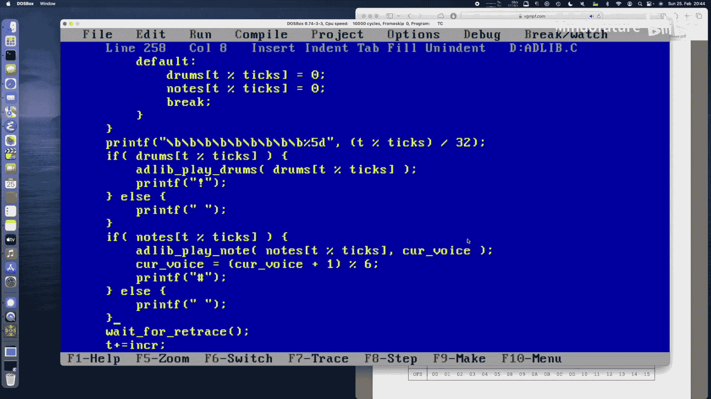

Sound here a bit。🎼。

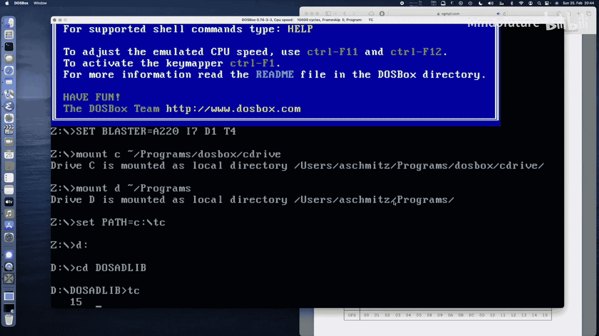

As you can hear it works。 also I compared to the last time I editor Ed Lib Bri said at the end because the notes were still hanging on after。

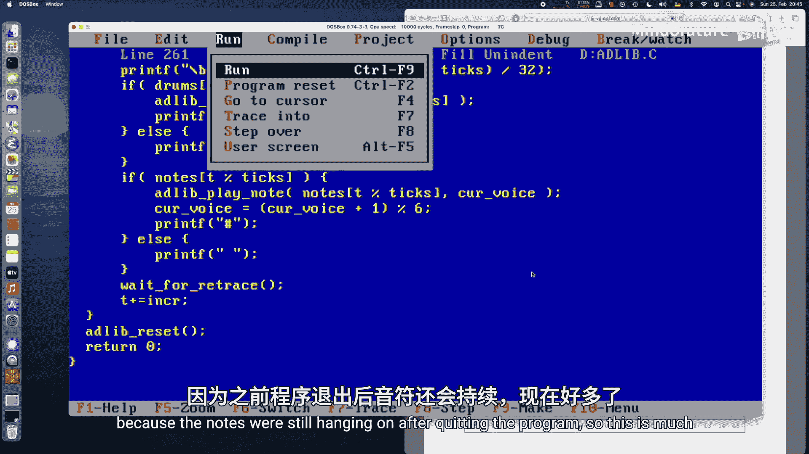

🎼Quiing the program so this is much better。 We can also try to play a chords。

 but you have to press the keys one after the other more or less because we can only detect single key presses with the low level keyboard interface you could also do multiple key presses。

🎼Yeah。

🎼Yeah， naturally I can't play some of the best I can do is probably this。

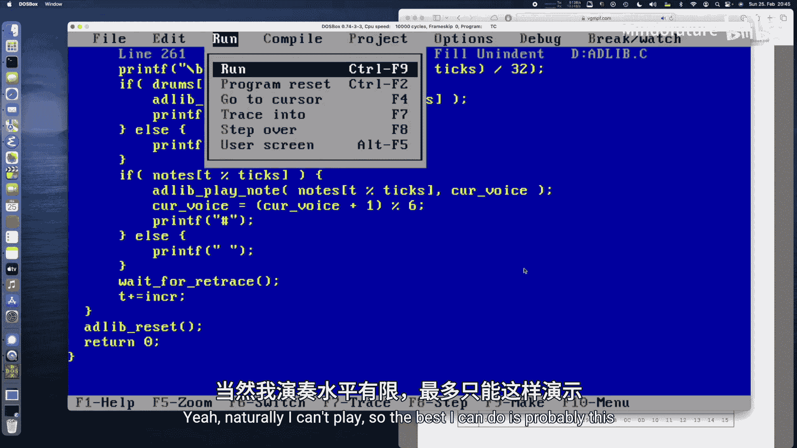

Good， I'm not gonna bore you with this anymore。 I think videos has become long enough。

 but you know all the basics now， you know how to set up an oscillator or both oscillators。

 You can put more of the parameters in if you want to。 You can play around with the waveforms。

 because they will change a lot how everything sounds。 For example。

 let's very quickly change the carrier to。

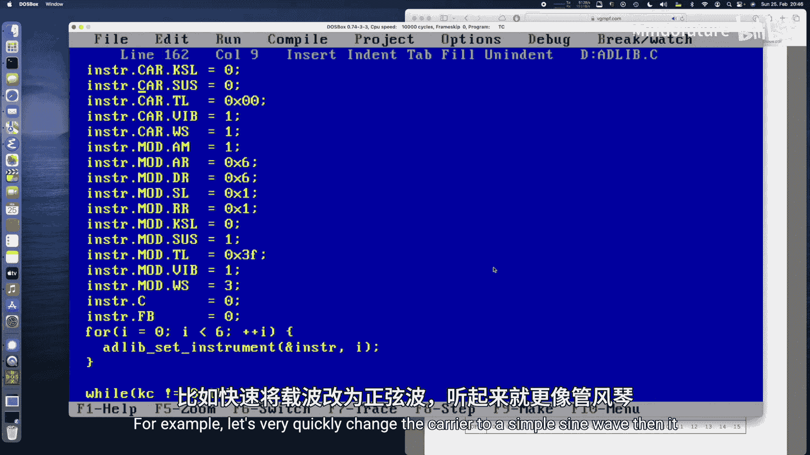

I simply sine wave。嗯。

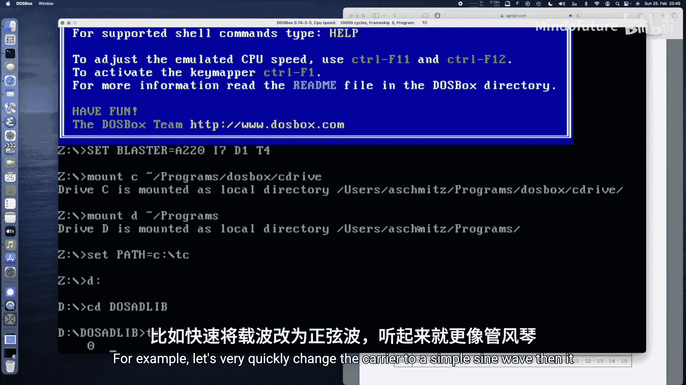

Then it's sounds more like an organ or something， or let's change it to。

 I think this is the planet the square wave。

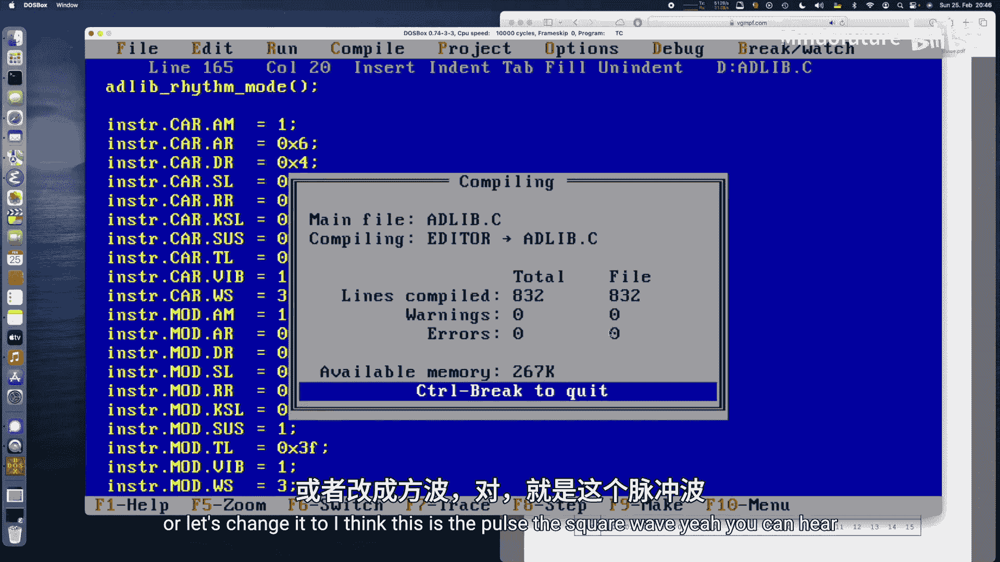

嗯。

Yeah， you can hear that or let's turn off the sustain， for example。

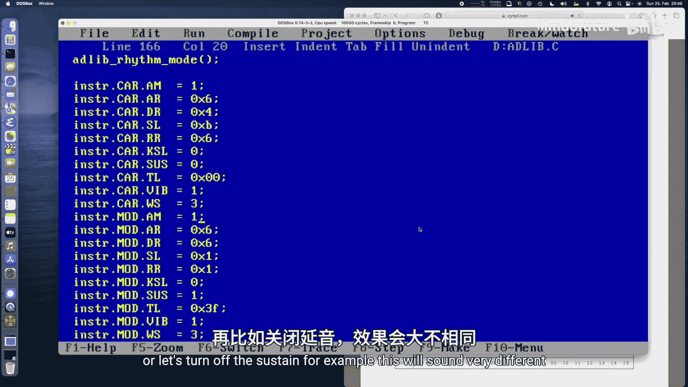

This will sound very different。

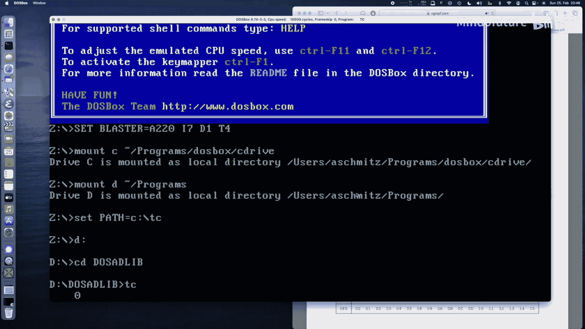

I know this actually continues pretty， pretty long yeah。There's probably some okay。

 the stain level here is probably very fast。 Let's very slow。 Let's turn this off。 and this off。

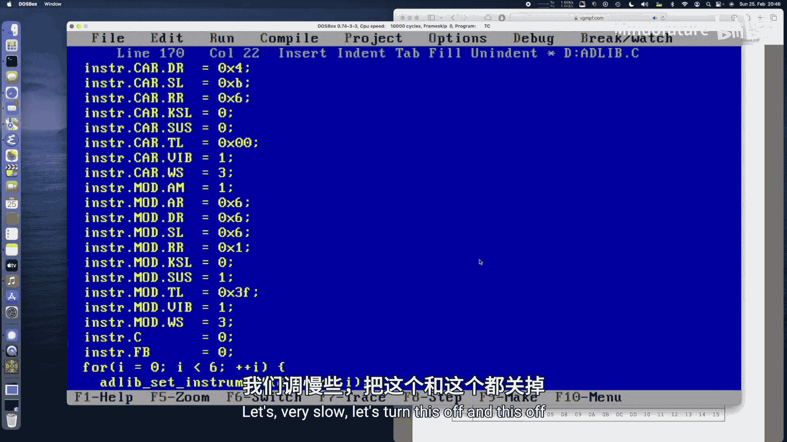

🎼。

Yeah， no， it sounds pretty different。 Yep， you can play around with all of these。

 You can perhaps even create a keyboard interface or an instrument editor to do that。

 But you know how to play notes， you know how to calculate the frequencies。

 how to set up the instrument。 and then how to play。 and know turning it on， turning it off。

 And that's basically everything。 that you need for doing music in Adlib。 Of course。

 you will need to be able to compose pieces。 There are editors out there that can。嗯。

Target the adlib card。 there's the adlib tracker 1 and 2。 there's playback routines。

 There's the rat player。Similar things， or you can code your own， obviously。

 And you need someone one with a bit of a musical talent。 That will be not me。

 but I hope you learned something I hope you will share like and subscribe the usual stuff。

 Leave a comment。And yeah， thank you very much for watching and see you in the next episode。😊。

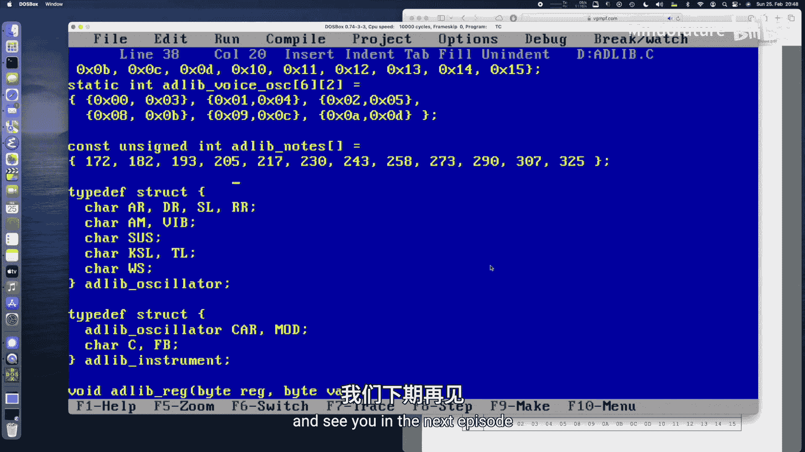

🎼。

🎼。🎼The。🎼。🎼Yeah。