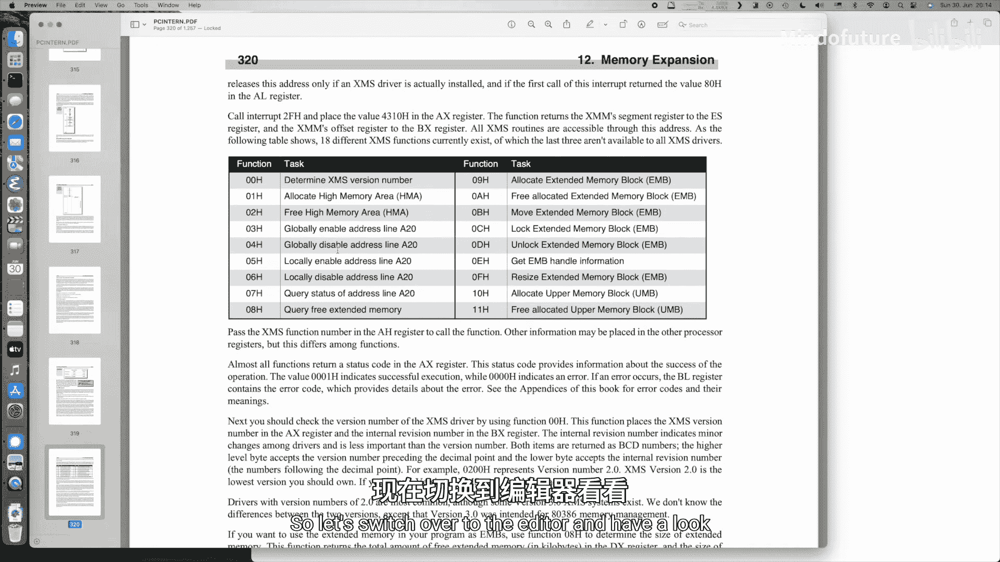
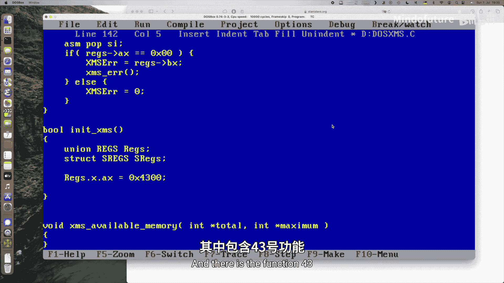
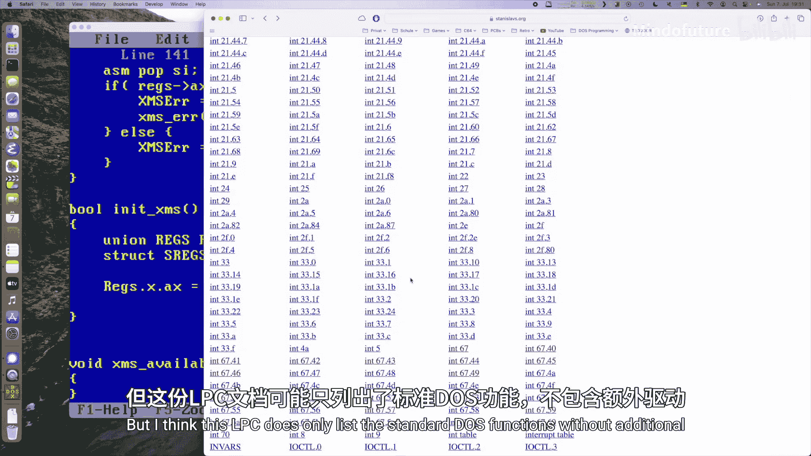
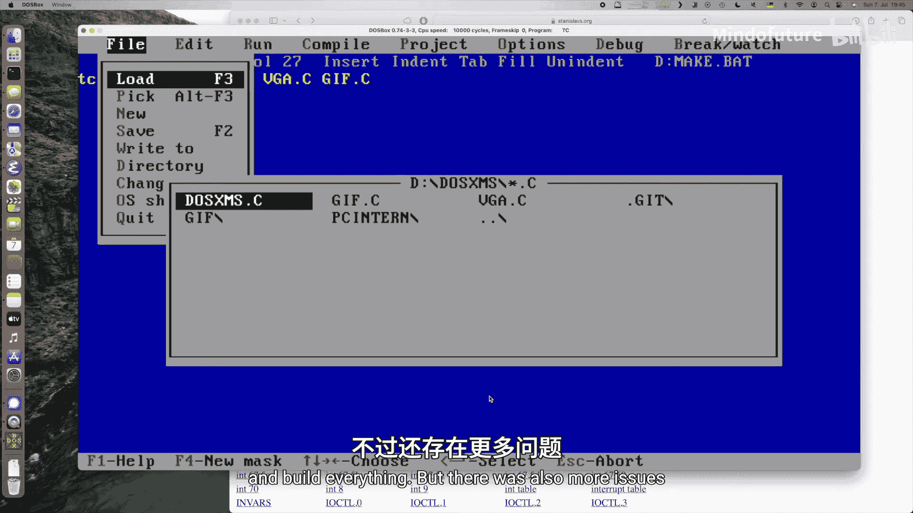
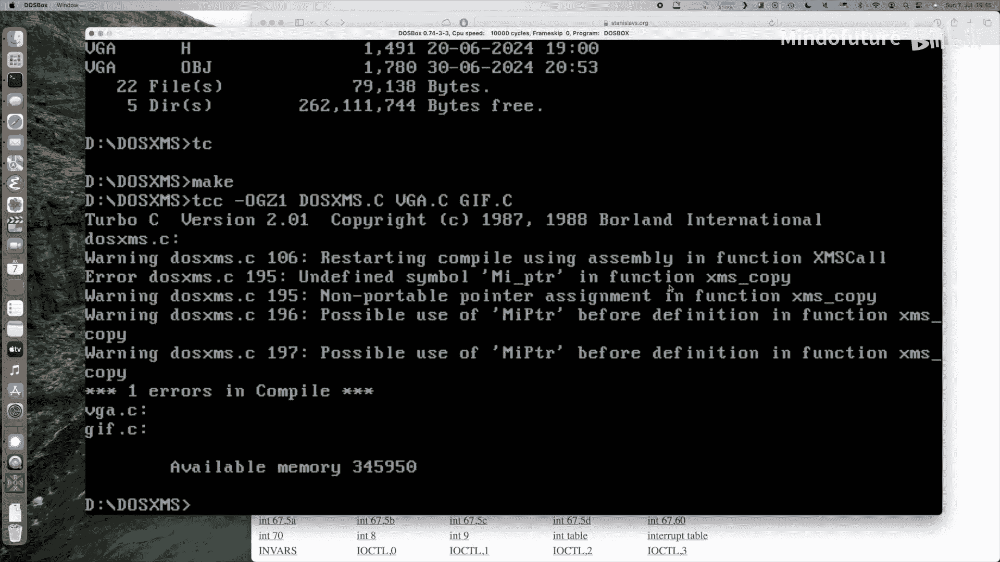
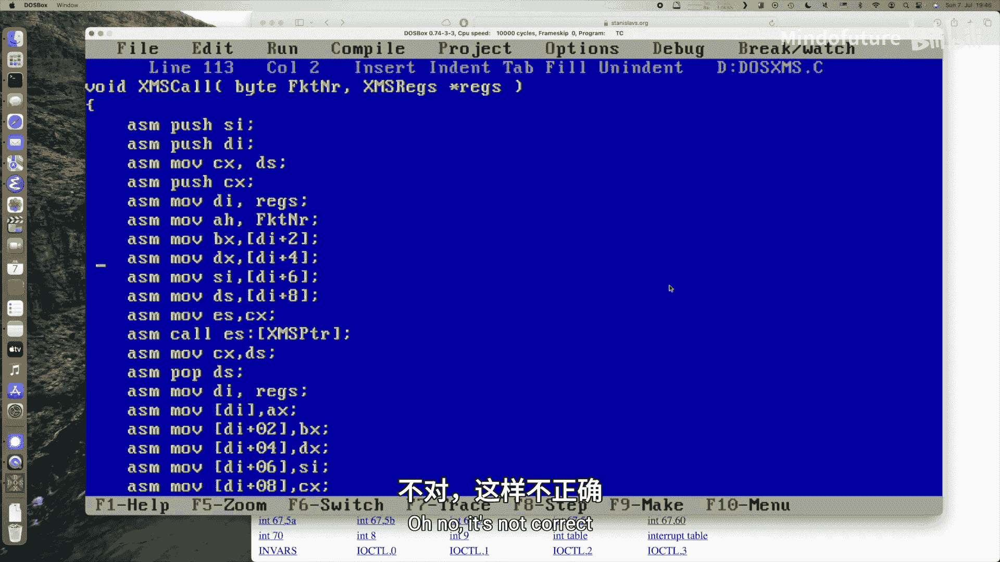
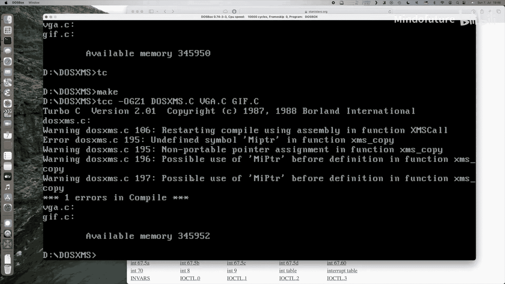
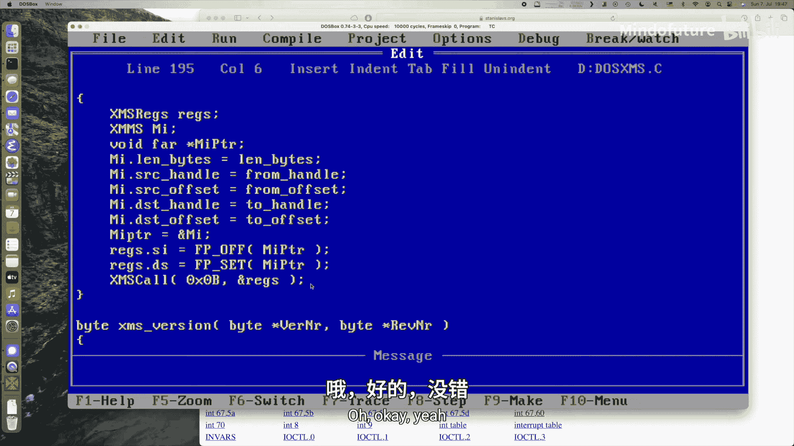
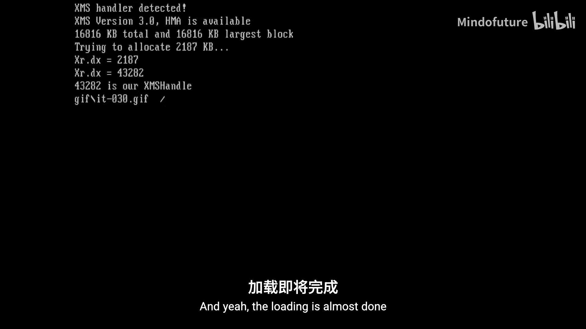
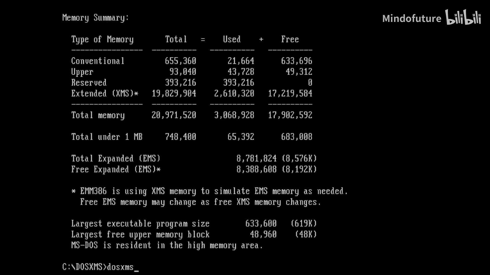

# 编写MS-DOS-系统-｜-windows-｜-操作系统-｜-汇编--｜-vga-｜-x86-p42-P42-Lets-Code-MS-DOS-0x29---Extended-Memory-XMS--BV1zs35zQEru_p42-

Hello， welcome N A。Excellent evening， indeed。With our second installment of the extended or expanded memory。

Serious4， let's go Amsdos， as you probably know， Amsdos was famous for its 640 kB barrier。

Which meant that you could access only between 0 and 6 and 40 kB。In a usual Misttos program。

 but even the very first PC by ABM from 1981 supported up to 1 MBby of Ram in total。

 which is the maximum that could be addressed directly by the 8088 in the PC and its brother。

 the 8086， the 16 B data bus variant。Between the 6 and40 kB and the 1 MBby would be， for example。

 the video Ram from the graphics card the bios rom and maybe other memory mapped devices or roms。

With the 8286， the memory size was the maximum memory size was increased to 60 MBbyte。However。

 due to the fact how the 8088 and 8086 addressed the memory in segments and offsets。

In the usual startup note， the 286 could still only address up to 1 MBby of memory。

It needed to switch into so called protected mode to use the so called extended memory。

 which was up to 60 MBby。 The 36 pushed that even further。 It had a。Every a space of  four GB。

 which probably was never utilized on a 386， all the main boards would never support that much。

Or probably you couldn't couldn't even build or afford a machine back in the day with 4 gigabys of memory。

Same goes for the 486。And so they had just more address's lines to address extended memory。

So there were a couple of ways to get around this 640 kilobyte or 1 mebyte limitation。

 and then last in storm we saw the expanded memory， which was basically bank switching。

 which used the blank space between the video Ram and the bios to page in or to bank in expanded memory which could be a couple of megabytes。

 but you would only see 16。2，64 kB。At any given time， the advantage， of course。

 was that the bank switching was relatively fast。 You didn't need to copy anything If you had like a hardware board with this extension。

Later machines like the 386 and the 286 could emulate that when software。

Which was slower because there was the need to copy stuff around， at least partially。And yeah。

 there were also a couple of other drawbacks， basically with the EM M S。

 But the definite advantage was that it was running also on low 8086 and 8088 machines。

Extended memory， in this sense， after the XMS S standard， actually。Works only from 286 and onwards。

 And there is even the possibility to do this directly with bio support， which for a long time。

 I didn't even know。 I also learned this。There are a couple of functions。In the Interop 15。

 the system bias routines， basically。For example， there is subroutin 88 hecx。

 which gives you the extended memory size。In1 K blocks， basically。

 and they extend memories everything that comes beyond the one megaby。limimitation。

 it only works on 286s and 386s and is basically returning whatever is set up in the CMmoss。

 basically what the machine detected at startup。There's also。An X switch function 89 hexismmal。

 which is the process of a protected mode。Which we will not deal with today。

 We will stick to real mode， but this is also pretty interesting。

 And you can also do this manually to switch to predict mode。But that's a whole different story。

 There's also function 87 hexodismal， which can copy blocks from or to extended memory。Depending on。

 yeah， which direction you want to copy， it's also a bit difficult to do。

And not the normal thing you would use。 But instead， there is something else。Called， let's see， Xms。

Which is a standard。By Microsoft， I think。That。Let's see if there's the。Here's the chapter。

 the XM S standard not by Microsoft， which gives you access to a couple of different areas in the extended memory。

First of all， there is the high memory area， which is the first 64 kiloby of extended memory from 1024 to 1088 kilobytes。

 and theres a neat glitch in the 8086 design。Which means that you can actually access this the first 64 kilobytes。

After the first megabyte， even when you are in real mode， no need to switch to protect mode。Also。

 there is the space between 640 k and 1024K if there's free space。And there is memory in that region。

 It's called an upper memory block， which can also be used。

 And you can also call or request this via the X M memory specification driver。And last but least。

 it's the thing that we can actually do that。We are gonna to use。

 not the extended memory blocks that they're talking about here。

 but the actual extended memory that you can allocate and copy to and from。

Which is what we are going to do today， because that is basically the alternative to the Em S。

And the main advantage is that you can have， I think， more Xs than you can have EMs。

And on 386s and upwards， it's the normal way to access。Extend a memory。In software， basically。

 without having to have special hardware support。Xm S is always being done by switching to protected mode。

 which is pretty fast on 386es。 You can switch to and from。Protect mode relatively fast On the 286。

 it is very slow to switch back from protected mode real mode because Intel thought that was never going to happen。

Their idea was that the system would boot up in real mode for compatibility reasons。

 so that dos would still run， but new operating systems like， for example， OS2 by IBM and Microsoft。

Or some Unix would basically load its kernel and then switch to protected mode and stay in protected mode。

They never thought that people would like to run old dos things as well and need to switch back and forth between。

Protected mode in rear mode。 So there are some clutchs and hacks to switch back to real mode and running X M S on a 286 can be relatively slow。

 and E， M S can be faster if there's hardware support on the main board。

Because the basically the 286 CPU gets reset every time you switch back from protected mode to real mode。

 And that takes a couple of milliseconds， which is ultra a long time， basically。

But we won't concern ourselves with that。 Basically。

 we will just assume that we are running on a 36 and have fast switching。More or less。

 we will test the program later on a 486 and show with that it runs pretty neatly。

And we'll do the same program that we did in the MS episode。

 so if you haven't watched that you can go back and watch it。

 basically loading 35 frames of an animation from VIT Ch into extend memory and copying it into VGA memory to play an animation。

And there are a bunch of functions in the XMS driver。 First of all。

 you have to determine if an XMS driver is installed。 but once you have done that， you can。

 for example， query the version number of the driver， you can deal with the high memory area。

 We won't do that。 We will just deal with the extended memory blocks， copying them and so on。

 we won't deal with the a20 line， which is the trick that you can use to address the high memory area。

 all that stuff is not very interesting to us here in this place。s of course。

 of historical interest and if you want to do real more programming and have this little extra bit of memory then yeah that could be pretty interesting。

 but we won't use that。 We will just concentrate on the extended memory blocks。

So let's switch over to the editor and have a look。

And here we are。 I basically copied the do ems dot C file and changed a couple of names because we are now dealing with XMS。

 I've already filled out the main function， which is very similar to the old one。

I'll skip over the variable declarations so you can look them up when needed。

What we are going to do is clear the screen and then try to initialize the XMS driver。

And if it's not found， it will print an  error into return。

It will also query the version number of the Xm S。Driver and whether the high memory area is available。

 even though we are gonna not going to use it， it will print the available memory of the system and also try to allocate。

Enough memory to store all the frames， which is done here。

 and you can only allocate in 1 kiloB steps。 So we divide by 1024 here。

And then it will store the X M S handle if possible。

 all the XMS S functions that we're calling here will have error guarding。 Basically。

 it will do an X M S call and then determine if there was an error or not and print the error。

We will implement all the functions  one by one。 So just be patient。

 We will come to it in a couple of minutes。Then， as usual。

 we will load the G files by enteringering of all the frames。 It will。Also。嗯。Load everything into X。

 S。If possible， and copy it over， basically。By using the copy to XmMS function and do a and copy of the pallet to store the palette。

Basically。Then we will go into graphics mode。Set the first pal and do a loop over all the images。

I infin them basically and copy from X M S into the VGA memory directly。 So there's no need to。

Do any drawing， but the driver will basically copy for us into the raw mode 13 buffer。

And we' will also set the palette。 And hopefully that will do the trick。 There will be， again。

 a little bit of plet flickering because we are not gonna do the double swapping double buffering stuff。

 You can tweak the program to do that so that you will get a perfect neat animation。

 There's a slight delay of 7 frames。 So we will get on a very fast machine。

 roughly 10 frames per second。On a slow machine， it will take longer， obviously。

 but there's definitely before every frame， there are seven refreshes that are being waited for。

And if you press a key， you will go back into text mode and free all the memory。So that's neat。

 and let's go to the top。I've already filled in the XMS error function。

 so we won't go over that because there's a bunch of error messages and things which are just tedious to type out。

Also， I blatantly copied this stuff and reformted it and made it a bit more into my style from the PC in turn book that you can download as a P D F or probably get。

Used at I don't know， one of the many used bookstores， either in German or in English。

 both available。 and I think there's a couple of other languages as well。

 and they should all have the XMS S chapters， at least from revision 3 onwards， maybe even older。

 from version 4 onwards。 The XMS S chapter is available only on the C of the book。

So your mileage may vary about that。 There's definitely。Something out there that you can pick up。

My hint is go to archive org first。 you might find the stuff there。 and otherwise。

 buy a nice used copy。嗯。Anyway， at the end of the XmMS error function。

 I'm going to check if there was a if the global XmMS error variable is not equal to the0。

 which means there was an error and I'm just doing a sanity check that there is an error between 80 hexademal and B2 hexademal which is all the error messages that I got hold of。

And then it will just print readable error message from this array up here。

 and then it will exit the program。All right。 however。

 there is a couple of other things that we need to introduce。

Mostly the Xmr registers and the extended memory move structure。

Because the X M driver doesn't use a software interrupt like the B interruptrup 15。

 but actually uses a far procedure call basically， and all the parameters are handed over。

In registers， it's always the same registers。We have the eggs register。BX。D X， and of course。

 I'm using astruct here so I can pass these things around easily。

 but you could also write assembly language and just put it into the registers as is。

 but one main issue is， for example， this year， the pointas to the memory in question passed in D S and S I and if you just manipulate Ds in pro here will nily。

 the whole program will crash for example， will see how to implement the X and S call itself。

And I tried it using the built in pseudo pseudo registers。 For example。

 you can do stuff like underscore score x equals 0， and it will emit code。Similar to Moth X comma 0。

Because this here signifies it to over。 Okay， the promo wants to。Rightite to the A X register。

 you can even do something like this word。Segment。E equals underscored yes。

And it will do something like Mov。Segment comma on D D， S， for example， Yeah， it will read the。

The S register， but you can't do something like underscore yes equals。What is it， I don't know。

 something like。My segment， which is a variable or something。

 which would probably emit something like Moftt S comma my segment。This will be done。

 But then as soon as you do something like。Myva plus plus or something。It will crash。

 because my vow will be。Try to be resolved in the data segment， which you just manipulated。

 So that's better idea。 Reading the data segment is O， writing to it。Just like that。 inside of the。

C code is bad， so we will use inline assembly later on。

 which also means that we can't use the IDE anymore to compile。Which I'll explain also in a minute。

But there' is also a reason why we have this register structure to move around on the data that we need for the call。

Also， for moving around data， the X M XMS S driver expects a bunch of values。 First of all。

 a 32 B value。Which I call length of bytes that are supposed to be moved around。A 6 inbit value。

 I could also write word。Which is the So sand。And another 32 B variable called the source offset。

Because the extended memory， of course， can be bigger than 60 bit or 64 kilobytes。

So that's another 32 B thing。Actually， I think I defined。Long as double word。 So let's just use that。

 It's， I think， better to read it like that。And then there will be a destination handle， because。

You don't get pointers to the extended memory because the extended memory might be def fragmented by the X S driver。

 So you get back a handle， like a number， which is in box， interestingly always incrementing from 1。

1，2，3，4 5， but in， it's basically random。 You can't predict what handle you will get back。

 which you can see on a。Real machine， actually。And there will also be a destination offset。

And the idea here is。If using。Real。Moode。Memory。Handle equals 0。 So that means if you have。

 for example， a source or destination that lies in in real mode memory below 1 MBby。

 you're not using an X S handle， but you're giving handle equal0 and。

Here you're using offset an offset like segment。Offset。Basically， you're constructing a far pointer。

Otherwise， if this is an X M S handle， of course， you just give an offset。

Just from 0 to whatever memory you allocated。 I think this is pretty， pretty easy。And as I said。

 we don't have a software interrupt， but we have a call basically。

 which is a far pointer to a function。The function we are going to call X and S pointer。

 a pointer to the driver。 It's always the same。And we will initialize it with a null just to be on the safe side so that the machine crashes。

 if we accidentally call it before initializing anything， we also need the global error variable。

 which will also ignore initialize with 0。 So that it。Says there is no  error yet。

And we will need our handle that our program uses， which is alsoized per zero because we haven't allocated anything yet。

Now on the calling of the XMS driver， right now， we don't even know if there is an XMS driver。

 but we'll come to that in a bit。But basically， what we'll do is we'll use inlet assembly。

 which iny 2。0 works like this。You basically just write simple instructions with the A M keyword。

 For example， we will overwrite or destroy all these registers。

 so we need to move them to the stack to be able to restore them。 So， first of all。

 we will save the source andex and just so that my other editors don't get confused。

 I will put a syncolon at the end。 but that's totally optional with the inland assembly。

I think I'll also push theI register。And I will save the E S register。

 I will not push it to the stack because I will use it in a minute。So instead。

 I will save it to the Cx register， which is unused in this call。

And then I will push it to this stack， this。Basically。

 I think push the S might not be possible on an 8086。

 It might be that this is only possible from 8186 and onwards。

But I'm not 10% sure I would have to look that up。Also， I'm going put into the destination index。

The address of our registers。That we've put there basically。嗯。Which is something like this。

 This gives us the address of the X S registers。And。Into the high bite of the eggs register。

 we will put the function number and I'm probably gonna。Switch to English here， function number。

Which is hopefully a bit more readable。And then we will load up the other registers。The B。

 X register was the second one in the。Strt， that you can see here were to be X。 it was the second。

 So as we have in D I now， the registers pointer。We can do something like this。ああ、あその。

I should use more here。Nobody told me I forgot them off。So as move B。

 X comma destination index X plus 2， because it was the second item。

 And we are adding 6 ins because we are having， we had 6 inbit。Entry here word a word B X and so on。

 So this is basically plus 0 plus 2 plus 4 plus 6 plus 8。 And that's what what we're going to do now。

 We are just gonna fill up all the registers。 The next one was Dx。And that was in address D plus 4。

Asm off。So an next。In D I plus 6。And。D S in D I plus 8。

And here it does matter that D S is now destroyed because we will restore it in a minute。

But first of all， we are going to do the Xm S point of。Which means on。That we're going load up。E。

 with the value of Ds that we saved in Cx。For the very simple reason that we can't use Cx to use it as a segment register。

 you have to use a segment register。 and now we will just do the procedure call。With yes。

 because D S is already taken by this call here and was destroyed。And C S， we can't use， so。

What are we gonna do， Were going to call E， column on。

X M S pointer and the square brackets will deal reference。

This segment with the offset of this variable。Which basically looks into。

Our global Xs point variable and takes whatever is here。Now， it's another pointer。

 but it will shortly become a valid pointer into the X S driver。

 and will jump into that subroutine and do its magic。After that。We have to。Get all the return values。

 For example， we will put whatever。Was in Ds into Cx again。

 because that is also a return value that we got back from the driver。And we will now， finally。

Restore。D S from the snack。 And now we could switch back to C and use all our usual tools that we know and love。

But instead， we're gonna do the reverse that we did before， we will。

Load up DI again with the registers pointer。And then start reading out all the return values because the functions will return stuff also in the Ax。

 Bx， and so on， and the register structure is basically an input and output parameter structure。So。

We can almost do it。Like above。We will。Rightrite to the first variable， whatever was in A X。

 That's a return value。 And then we will write to D I plus。2。Whatever was in Bx。And so on。

D I plus 4 will get the value from Dx。And D I plus 6。You can guess it。

We'll get the value from the source index register。If， for example。

 some memory addresses have to be passed around。And the last one is Cx。And also。

 we pushed DI and SI from on the S， and we have to pop them in the reverse order。So pop the eye。And。

Pop S。And that's it。 That is a complete XMS driver call。

 Take your time to try and figure out what we did there。The most important thing is。The A X value。

Should be。😊，0 x is 0，0。嗯。Or shouldn't。 I think if it's 0 x 0，0。

 we are having an issue here and the error value。That we can look up in our table will be in the B X register。

 so that will happen。And else。There will no error B here been lower， basically。

So we set the global error available to 0。Okay， which is nice。 And this should actually do the trick。

 I think。The next function is the in it XMS function。

 which initializes the callback to the XMS driver。 And as I said。

 this is done using a file procedure call and not。And interrupt as0， however we will have to use。

And interrupt to get to this point。So there will be two cons here。

 one with the usual registers and one with segment registers。

And the first will access the multiplex interrupt， which is an interrupt that gives you access to multiple functions in MSDs。

And there is。

The function 43。And let's have a look。 the multiplex interrupt is the interrupt to F。

Which is here and there should be a function 43， hopefully。Not really， Not really。

 It's not listed in here。Yeah， but the dos multiplex interrupt certainly has this feature。

 And if you look it up， there will be information about。Function 43， but。

I think this L PCC does only list the standard dose functions without additional drivers。

So yeah， that's not there。But you can just call it and trust me on this。So 2 F is the interrupt。

And we pause。Registers as input and output。As usual。And if you get back。Bing。The lower register A。

The value 0 x80， then the Xm S driver exists and is installed and you can work with that。And else。

 you can just return。Fs。Yeah， we can return。True and we have to fetch the address of the driver。

We can do that by another sub function， which is。Rxot A X equals 0 x 43，10。 So this is。

Driver 43 hex is the XMS driver sub function 0， and this is sub function 10 hex。

And we' are doing another call。 However， this time， we will get back the。Segment registers as well。

 there's a special function in To C format that， it's called in ADX。And 86 x。

 and it takes the normal registers plus it will return。

The segment registers exactly for this purpose， basically。And we can construct our pointer。

Farre pointer by using the MKFP， make far pointer macro。It takes a segment。

 which we take from the segment registers， the return value is in E。

And we take the offset of the function call， which is in Bx。 So ES Bx gives us the pointer。

And then we set the X M Sarrow variable to 0 because yeah， that was fine， basically。That's that。

Make up the available memory that we have in kilobytes basically。

And this will be our first proper to the X， M S driver that will work for all the functions in the same way。

 We have our X， M S registerars， quick。Jump back here， it's A X， B X， D X， S I and DS。

 those are the only registers that are manipulated or used by the XMS driver。And then we do the call。

 there's nothing to set up basically the function is 0 x08， so a hexsl。

And we just pass the registers。And then， the total。Amount in kilobytes。

That is available is in the AX mag。And the maximum free block that's still there is in the。

Dx register， so you might have like 60 megabytes Xm S in total。

 but there might be only like 8 megabytes free if for example。

 Smartri is already using8 megabytes for diskcaing。Or similar things。And yeah。

 allocation works similarly。We can do the following， Basically， we can。Copy the code。As we want。Yeah。

 let's call this rags， thoughtt。Dx gets the amount of kilobytes that we want to reserve。

 You can't reserve in bytes， but you always have to deal with kilobytes。

 So when allocating you have to round up to the next kilobyte， that's very important。

And the function is actually the next function， Xerx。0 nine。And。The handle is actually also returned。

In the X register， it's basically the input output register of this。Let's write this return。

XMS handle。This is basically just a number， random number on MSdos。

 an incrementing number on DoOS box。That is。So that you don't need to use a pointer or anything。

 but just a number that references to the block that you allocated。Same now for the free。

Once we allocated something， we have to also free the thing。嗯。

I wrote here that I'm gonna return a bo， but I think I'm going switch this to a void。

Because actually， we don't return anything。 And instead of the kilobytes。

 we put the handle in the Dx register。 as you see， the Dx is usually the input output register of choice。

And it's， of course， the next function，0 x0 A。 That's it。 Now you can allocate and free。Memory and X。

 M S。I'll just let's do something easy first before we go to the copy function。

Let's do the version that is actually not。That hard。Let's again， copy everything。

And this time we don't need the register here。The function number is actually function number 0。

 very simple。And we get back the digits。In。AX basically in a H and AL。So， the version number。Is an H。

 so we could do it like this。 we could probably just write。嗯。We have okay， we don't have the union。

 so we have to do it like this。Shift right by eight bytes， eight bits， oops， not bys bits。

And the revision number is in Rex dot Ax。And we mask out only the lower 8 bits。This will give back 3。

0， for example。So3 in the version and 0 in the revision number4。嗯。Dost box， for example。

And the D X register contains a one， if。I think everything was okay。 Oh no， it means no。

 that's actually true。 The X equals1， if HM A is available。Which is not available on Dos box。

 Dos box doesn't emulate the HMma。 It's too much hasssle and。

The Hma is usually only used by MSos itself， so there's no need in Do box。

But on a true dos with hinem dots， this will return one。Which is quite nice。Now， off to the copying。

 because that's。The most important thing so that we can also write the copy to X S and from Xms。

We write a generic variant here。Because this one here takes an from handle and a two handle。

 and if either of those is0， then the offset is not an offset。

 but a pointer with a concatenated segment and offset address as usual。

 the high word contains the segment and the low word contains the offset。

 I think maybe the other way around， but I think that's the case。So let's do that again。

 we need to registers。We need the Xm as memory move structure。Which we call MI。

 I copied these names from the PC intern book。Then we have need a far pointer。

 which points to the memory。嗯。Exactly for the structure。

Then weill the memory move structure M lens bys。Equals the number of bytes that we are trying to copy。

 that's the input parameter。Am I source handle， Did I call it source handle， No， I called it。Yeah。

 I think here it's called Soan in the structure， and it should have used the same。

Identifierifies here。 it's not very good。 You can， you can change that at home。

 So this is basically the from handle， Also the source handler。Not very clever of me indeed。

 the source offset。Is the from offset？So nobody has to deal with the outside。

Out of this thing with a memory move structure， that is totally internal。

And the destination handle has the two。Hello。And the destination offset。😔，That's the two。Pcent。

Let's do it like this。The pointer points to the structure。 We have to use the far pointer here。

 because that's what the。XMS S driven requires。Then we set up the source index。With the offset。

To the point here。So this， this point is actually totally。Or optionalional。

 you could just write and M I here， of course， and save this one variable。

And the data segment gets the segment address of that pointer。

And everything is passed to the XMS driver。Using function D， which is the next one in line。

 obviously。All right。That's looking good。This is the copy function。

And it's totally agnostic to whether it's copying between X， M S and X， M S。

 main memory and main memory or any combination of X M S and main memory。 This will always work。

 And you will have to pass in。The actual handle or a0 if you don't have handle because it's a main memory here。

Basically。And now we can also build the copy to XMS and copy from XMS functions。

 this is simply convenience， very， very simple convenience。So we use Xm S copy。

If we're copying 2 x mass， we pass the handle0 and we convert。Our pointer or far pointer2 along。

Just by casting。 And we use our global X M S handle that we allocated， hopefully， and the offset。

 which will be。Computered， depending on what image we currently want to access。

 it's basically just an image has n times 64000 as its offset。Naturally because it's 65。

 every image is 64000 bytes long。And that's our offset。And the size is 6400 입니다。

But this function is still pretty agnostic。Towards what were actually copying。 So I'm formulating it。

Like so the next up is the copy from Xm S。 there we have the Xm S and and the offset。

 and then we pass0 as the destination。And。Not offset， but I would say， rather say。Oh yes， offset。

 yes， offset indeed。But I would rather say the same thing casting the to a long value。

 the destination pointer。And that's the same thing。

 And this actually should be everything that we need。 We have everything else already in place。

So when I compile this。It should。Compile all this stuff here， initializing。

 printing the X M S version， loading everything and copying everything to X M S here。

And then copying from Xs the image into the VGI memory directly。If we were to try and compile this。

We'll get a whole ton of problems。 one thing here， but especially in assembly is not allowed。

And this is what I already said。 you can't compile this inside of the ID because this very old version of TobuC doesn't support inline assembly。

 You have to use the command line compiler， sadly。To do that。But it's not a big deal。

Very quickly to show you， I wrote a little batch file called make dotba。

 which compiles with the command line compiler Tcc and a couple of optimization options which compiles for 286 and a couple of optimizations all the three files that we need dos Xms do Cs on the VgaA routines and the Gi loader all into one file So that's no big deal。

 but it's a bit more difficult to compile than just hitting compile and build everything。

But there was also more issues let's type make。Seem we have done a couple of errors。

 which is powerful for the courses When I do this undefined symbol。 Yeah， that should be。

That should be easily fixed。In the copy function， I think there's just a mistyping here we go。嗯。Oh。

 yes。 Okay。 It's probably like that， right。That should do the trick， but all will complain about。

Only， theres something。Function number is not used。Did we forget something？😔，Yeah。

 I think there needs to be the function number that we forgot。That's a good point。Another ty。

 basically。Yeah， that should be actually that's actually very， very correct。Oh no， it's not correct。

 It's just because it doesn't know about the。

Assembly， that's why。 Okay， nothing wrong there。 Let's compile again。 undeeffinible。 Okay， okay。

 it's still not happy。No part of a point assignment， yes， that will be fixed。

So let's quickly check again。😔，Oh， okay， yeah。

We need to capitalize correctly。Breringing it again。 Okay， this is quite nice。

And another typo FP set should be FP Seg for segment。And。Yeah， here we are FP segment。Okay。

 that doesn't work。Alright， this is looking good。 There are no warnings except for restarting compile using assembly and function Xm S con。

 which is totally fine。 and then it willll call the Tobo assemb。

 which you have to have installed as well， which doesn't come with Toby C normally。

 but you can download it as well。And it runs Tolink。From probably tosmbr as well。 And there we go。

 So let's start it first on。Normal Dos box， and then we'll try it out on the 46。

And we'll take a while I will fast forward this， you can see XMSMS version 3。0 Hma is not available。

 but Xma has analyze the deed and we have 15 megabytes in total because 1 megabyte is base memory and 15 megabytes extended memory。

And it allocates 2188 kB in total for our program。 That's the 35。VGA images of 64 kilobys each。

And one more thing， the XMS handle is one that is also not the case on Do。And there we go， it works。

The video basically is played from X and S memory and it's decently fast on the emulation。😊。

But let's see how it runs on real hardware。Okay， here is the 4，86 D X 33。

 and it is currently equipped with 20 Mby of Ram， which is quite substantial。 I'm using for standard。

1 MBby modules， Sim modules， I think， and also for。4 MBbyte modules。

 which we made ourselves in a previous episode or stream， I forgot。

Which are the kind that bits and bolts designed。 So we have tons of memory。 And as you can see。

 there's total memory 20 meby，3 meby are used。 I think part is used by smartwi， I guess。

 and roughly 17。Mgabytes free of extended memory。There's also expand memory。

 which is simulated by EM M386， using Xm。 So there is。Roughly 8 MB of exponent memory here。

Let's run our tour。And yeah it also detected the handler， it is also using version 3。

0 of the XMMS standard， HMA is available which is different。

 and there are 16 mebys in total and 16 mebyte is the largest block and it's trying to allocate the 20187 kilobytes or there's still a little bit of debug output here and we have a random handle of 43282。

And yeah， the loading is almost done。 The Gi load is not very performant， but yet it works。

And there we go。 It works。 It， there's more screen tearing here， and the palette is not super synced。

 But I think part of this is due to the very slow Isaac card graphics card， obviously。And also。

 probably the OSSC is not doing a good job of the syncing up with the vertical re or something。

But yeah， it's definitely a proof concept。 This works。

 You probably couldn't stream this stuff this fast from。The hard disk。And as you can see。

 the G decoding is pretty inefficient。 So yeah， putting it all into XMS S memory works actually quite well。

 So now we have all the knowledge to produce Em and XMS memory in your Dos programs。

 which gives you access to a whole lot more memory without having to deal with all the shenanigans that is protect mode and switching back and forth from protect mode to access hard disk and do DMA transfers on the sound blastster card and stuff like that。

Maybe we will touch that in a future video， but it's a whole different kind of worms。

 especially if you code it manually， if you don't use a 32 bit C compiler like DJGPP or Wacom。

 but if you code this using normal toy or Tose， it's a very complicated thing indeed， not impossible。

 but pretty hard actually。So we won't be doing that right now。

 The video has gotten way too long already。So。I think it's time to say goodbye and see you in the next video share I can subscribe。

 the usual stuff Patreons usually get this stuff a couple of days early and also here and there a few more smaller videos of messages。

And if you want to join them， you know where to find me linksnk are in the video description other them that leave a comment and I hope to see you in the very next let's code video or the next regular whatever tinkering video using retro computing。

I do say thank you。 And goodbye。

🎼，🎼，🎼。🎼的。🎼Yeah。🎼The。🎼。