# 编写MS-DOS-系统-｜-windows-｜-操作系统-｜-汇编--｜-vga-｜-x86-p43-P43-Lets-Code-MS-DOS-0x2A---Background-Adlib-Music--BV1zs35zQEru_p43-

Hello， welcome and an excellent evening， and today we want to continue a bit with our adlibP programming experiments。

😊，Last two episodes about AdlibP， we did the percussive modes where you learned how to program the drums on the AdlibP。

 then we did melodic programming where we could play simple melodies on our PC keyboard and have them play back。

But this is of course， a far fetch from real music。And before I reinvent musical composer programs。

 I want to introduce you to this nice program here。

 The reality at liprecker by the demo scene group reality made in 1995。 This is a rather old version。

 but it has a couple of advantages。 It runs on a lowly 286。 Qui neatly。

And instead of the usual tracker programs like Pro tracker， et cetera， it doesn't use sampless。

 It used the opier2 of the alib。So we won't be using our own knowledge that we gain。

 but we could obviously and code our own player。 But the good thing about the reality at tracker is that it comes with a simple playback routine program in assembly language that you can use in your own programs it comes with the source code。

 Everything is fine。 So what does this program look like and you can basically。😊，Loud tune。

And edit it， you have nine melodic channels that doesn't use the Pcussive mode。 Instead。

 it uses different instruments， which are shown up here。And you can scroll to the instruments。

 there is a very useful help。4。Everything here， the pattern editor， then cement it， etc。

That you can call up using the question mark key and there's a quick help with the most important keys on the F 12 key。

So there's that。So basically， drums are used as melodic instruments。

 you have different channels that you can turn off and on with a numeric keypad。

🎼And you can just simply when I turn down the volume a little bit， simply play the whole song。And。

🎼Also。🎼For some reason I can't。Turn off the。🎼，🎼Oh， now I came to run off the channels。

 you have to press nulog obviously。🎼And listen to。Single channels， for example。For example。

 this one here is。🎼Baseline， plus some drums。And China two are more drums。🎼Change 3 as well。

 So that's。How this whole thing works more or less。A tracker basically stores patterns。

 which are rows of 64 nodes usually。I think 6162 or 63， Yes， exactly。 And it should begin at line 0。

 So 64 lines with9 channels。 and in every channel you can enter a note like E in octave2 or could be E flat or E sharp and then you have some effect applied a is。

I don't know。 You can look that up。 There's probably a help in the effect section， so。

A is a volume slide。 It slides either down or it slides up over the next lines。

 There's also portttomentto， a frequency slide pitching up。

 pitching down Potomentto to node so that you can slide between different notess。诶。Similar things。

 I have to press plus set volume jump to next pattern and order list to cut a pattern short。

 set new speed。Et cetera， et cetera。 So this is pretty basic stuff。嗯。

You can also edit all the variables that we also did for the melodic programming up here in the instrument editor。

 arrange all the patterns in a certain order。 you can reuse patterns if you have like repeating musical pieces。

 for example， pattern 4 is used both at position 8 and at position 10。And that's how it works。

The whole thing runs on a 50 Htz timer。 They are also a couple off。Slower older songs。

 which run on a 80。2 Herz timer， and while that is， we'll get back to in a minute。

But this is basically all that you can do here， and we can quit this。And we can have a look the。

Important thing about the aep trackatunes is that they are tiny。 They are really tiny。

 The biggest one is 18 kilobytes。 there are several ones around 2 to3 kiloBs。

And they are still pretty neat songs because you don't need to store the samples。

 You just need to store the parameters for the oscillators。 You can have very。

 very compact music that runs on very slow machines。 No mixing by the CPU required。

 So it's actually pretty neat。As I said， the whole system comes with a player in an assembly file here。

Player dot A M。 And there's also a test program red test。

 which links together with the assembly code to a red test dot E X。

Wch is fine and basically shows how to use that。 But we want to use C， of course。

 because we are doing always C programming here。

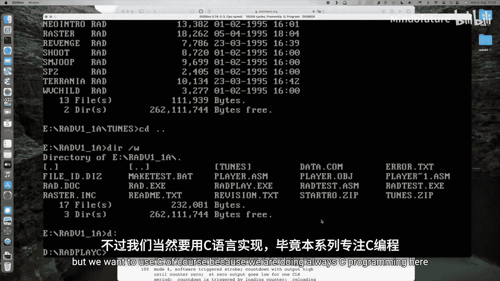

And we can actually load up a program that I prepared。

And we will have a look at this in a second and fill in the blanks。

But the main idea here would be to take one of the music files， Allo Run dot red， for example。

 but you could pick anyone up。Compose your own if you are talented mee physician。Loaded into memory。

 then call the assembly procedure in it player with a pointer to this music that we just loaded。

And it will return an error if it can't pass that thing， because it's the wrong version or something。

Or it will return success and then we can work on that。 And for our first test。

 we will simply do a busy loop waiting for the vertical retrace and calling the plain music routine which should be running at 50 Hertz。

 but as we are running on a VGA card that will're run at 70 Hertz so too fast。

 the music will be too fast。嗯。And when we press escape， we will be exiting and ending the player。

I will show you how to do proper 50 Hertz playback using the programmable interrupt timer in the IBM PC。

Which you can program freely to produce any kind of frequency more or less between one and roughly 1。

2 million or something。 I think it runs at 1。2 MHz internally or something like that。

But that's something that we will have a look at。 The load music is actually pretty simple。

And I'm not gonna code it from scratch here。 We have an in memory buffer that we're using an。

Which needs to be allocated。We have a file component that will be used for for opening a file by the given name。

 which well do here， and we will open it in read binary mode because it's a binary file and we want to read it。

And if the file return is now， then there was an error and will return in another buffer so it can be detected and we can say。

 oh， can't open the file or something。Then we need to figure out how large the file is and in standard Anzi C。

 there are no functions for that。But what you can do is you can seek in the file to the last byte by doing F on the file object。

With offset 0 looking from the end， then， then you can use F tell to determine the position in the file。

 The last byte gives you the size of the file， and then we'll seek to the beginning。

 which you can do with offset 0 and seek set as the origin。 See set means beginning of file。

And then we can allocate memory。 We're not using Maoc here。

 but a specific function from the Tobu C doss header called Aloc Mam。

 And the reason for that is it gives you memory located exactly on a segment boundary segments。

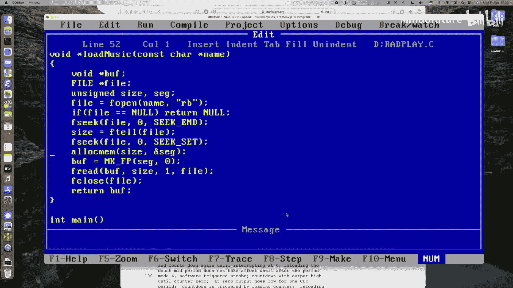

Start off at addresses divisible by 16。 and the assembly code actually expects you for the music to be allocated on a segment boundary。

 So that's what we're doing here and not using malloc。

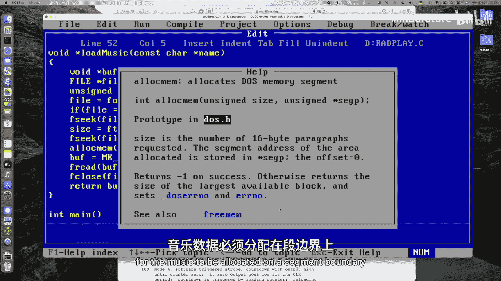

We can still build a proper pointer here by using make far pointer with the segment and offset0。

 That's fine。 Then we're going to read in into this buffer because every it doesn't want a segment but a proper pointer。

 so we use B as the pointer。Size as determined by Ftel。 and this is。

How many bytes how many objects there the size of the objects we are reading。

 We are reading size times one objects。Basically buywise。From the file。

 and then we close the file and return the buffer， very， very simple。And truly， and that's that。

Let's have a look at the assembly file。The assembly file is in player。t asM。

 I'm going to go full screen here。I put in my notice here at the top because I rewrote this。

To better。Compiled with the tablebo ass similarar。From Boland。

And I haven't finished refactoring this because to make it。Perfectly fine and clear。 we should。

 in theory， have three different so called segments in the executable。One should be called code。

Or of type code， one of type data for variables and one of type BS for uninitialized variables。

However， the original authors put everything into the code segment。

And we're also assuming that both the C S register and the Ds register for the code segment and data segment both point the same。

Text， code segment。I try to reflect that， but it's much more complicated than I was expecting。

Looking at the very bottom of the file。Here is where the code ends。

 right before the end are the actual variables， which I wanted to refactor out and into the data segment and the BSS segment。

But couldn't， maybe that's a homework for you。To try and do that。And yeah。

 here are a couple of variables like the Edlaport instrument point us into the mod file or the music file。

Then there is different values of the registers of the Elib card that need to be saved some basically global variables for the tone sliding and portamentto sliding and volume sliding。

 which is all fine。 then also the segment address basically for the music file the speed。

In basically fractions of 50 Hz。Of them of the music and the counter for deriving the speed。

 etc cetera， etc cetera， etc cetera。 These are uninitialized because they depend on the the music file。

That should be happening here。Yeah， that's more or less it。

 I would say pattern is pattern position line。 Yeah， that's all fine。

One important thing is that I reflected this， there's also no procedures in there， but just labels。

 I reflected this to use procedures， basically functions。

And I declared the init player and play and play music to be public and with underscore so they are callable from C。

 if you want to call something from Toby C， the functions are required to have an underscore in front。

 that's how the C standard prescribes this basically。

 and they have to be public otherwise they are not visible from outside of the object file after assembly。

Also， there's a special convention on how to pass arguments around。

Let's have a look at the very first thing， the init player routine。

It's a far procedure because we are compiling this whole thing in the huge memory model so we will not run out of memory。

 huge just means all the pointers are far by default or the procedure calls are far by default。

And here it still said， yes， takes the。Rat module in memory。Addres， which， of course。

 we don't use anymore， but we put it on the stack。 That's how C does it。

 We give it simply an unsigned integer， which is the E S segment address。

And the first thing that you need to do in a procedure in an assembly procedure is you need to save the step pointer。

St base pointer by pushing it to the stack and then moving the current stack pointer into the base pointer。

Not to mess anything up。 And then you can fetch the arguments from the stack。 First of all。

 you will have a far return address because this is a far procedure call。

 So4 bytes are already wasted plus you have the contents of the base pointer that you just pushed So6 bytes are gone and at address Bp plus6 you will have the first argument which is what we are putting into yes。

 and this was missing obviously from the original code I added this and yeah。

The next thing that it does is actually call also the endplayer routine。

 if there is any lingering nodes it will clear them out and make alib shut its mouth basically and be able to start fresh from a new。

Music piece， basically。 And then there's a lot of things happening that you can read at home。

 but it's basically setting everything up and getting ready testing。For example， here。

 if the file starts with A R and D in space right space。

 which signifies that this is actually a reality atcker module。And also。

 the version number is compared。 And if anything is wrong。

 then it will return something in Ax because that's how you return unsigned ins and top。

 If there's an error， it will return one in Ax and otherwise， it will clear Ax and set it to0。

 which means no error At the end， you just have to pop the base point again and return and this will clear up the stack。

The end player routine is similar since it doesn't manipulate the stack。

 it doesn't need to do the base pointer manipulation， it just works like so。

And it will reset all the voices from the alib。 That's fine。

 And the most complex routine is actually the plain music routine。嗯。

It technically should save the base pointer， but I didn't do that。

 It seems to be working fine either way。嗯。Yeah， that should probably have been a nice thing to do。

 But since it doesn't take any arguments， I think there is no harm done。

 it will do all the funky stuff and call many other subroutines。

 So this is actually what needs to be called 50 times per second， which。Is written yet？嗯。

And which we currently don't do。But first， let's have a last look at how to compile this whole thing。

 And I think there are still a bunch of ugly。Uix line endings here that it doesn't like。

 I need to redo this。Like so first of all， we are going to assemble the player code。

And outputting only an object file， which is this slash M here。

 Then we will manually compile the player code that we are implementing。

 calling calling the assembly code in the memory model huge and we are only doing the compilation。

 So only producing the OBJ file。Because the linking is a bit more complicated。

Then just letting TCC do it。And the why I forgot maybe that' debug info or something I forgot might be。

Same here for tilling， I think the slash L also for debug output， I think。

And first thing that you always need to do with tealink is to link the C runtime startup。

 and this is called C0 and then a single letter for the memory model。

 So C 0 H is for the huge memory model dot OBj。 It's always delivered in the top C installation directory on the lip。

And then you link the main program Raplay。obj also player。

obj from the assembly and then with separate by comma the output ex file is Raplay。

 EX and the map file which we don't need but have to specify anyway and then any additional libraries if you're using the math library for example。

 we just need to see runtime library which is C H again for model huge nodelib。

 there's also things for a compact small and similar things。So that's how that works。

 that's just a batch fire。

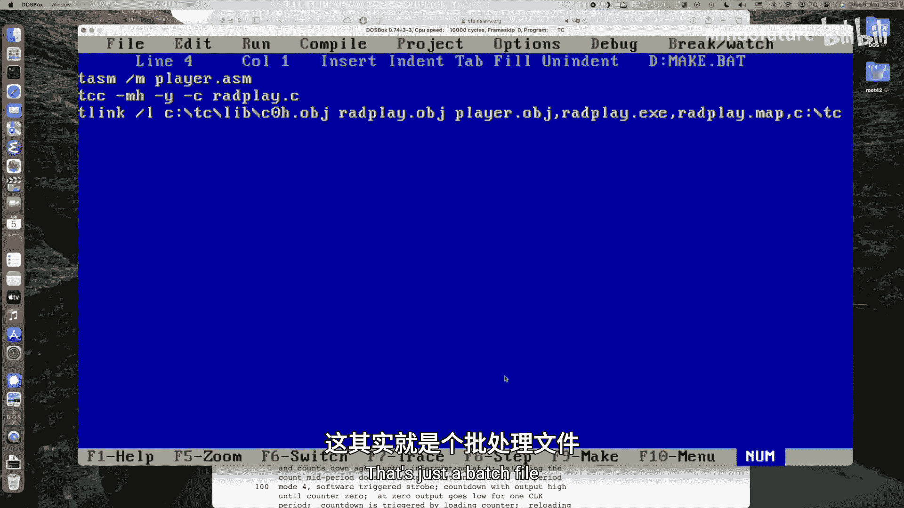

Weick can type make。And it will at first run the O Tobo assembly with three parcels because we have four declarations basically and it needs to have multiple parcels to know of all their things。

Oh， that's actually the slash M yeah I do remember if your assembly file doesn't assemble because it says oh there are forward references。

 then you need to add slash M and it will do one pass to one or two passes to get to know all the declared symbols and things and then it can actually assemble everything。

Then the top C compiler is called to produce the rapplay dot C。 We have， of course。

 a warning because we have empty function stops still。

 and then we are linking which also works and then we have the rapplay dot Xy and I'm going to play it and you will listen to it and see that it's a bit fast。

Okay， that's enough。It's extremely fast because it's like 50% faster than expected。Which is。

 of course， not what we want。 We could do more waiting time here or do sleep or something。

 But the issue with that is。

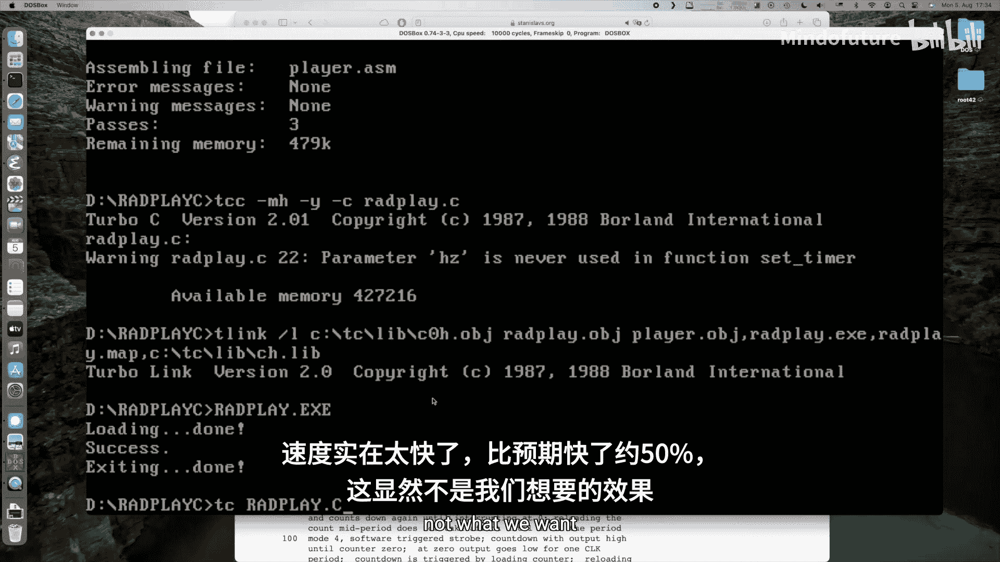

That will always be very inaccurate。 So we are not gonna use the play music routine here。

 But instead， we will introduce a。Time interrupt。Which is a feature of the IBM PC and many other systems For that。

 we will write a interrupt handler function， which intro you do by writing your function。Signature。

 which always is returning void and also taking void because it's an interrupter reacting to an interrupt doesn't take input or output。

 but it has the interrupt keyword here。 We will also have a variable called O timer handler。

Which is the currently installed interrupt handler。

 And you have to call this because there might be some important thing like datekeeping or maybe some disk cache that regularly checks things。

 And there are there's basically a chain。Of handlers that get called。

 And the newest one calls the previous one， and so on and so on。

So this is where we we will store the address of this function。And basically。

 what we can do is inside of a time interrupt， we always have to do。

Or should do a dis to not be interrupted by any other interrupts and an enable。

 This is also something that is in the do header file。 You can look it up， disable and enable。

 disable all how to interrupt， except the non maskable interrupt。

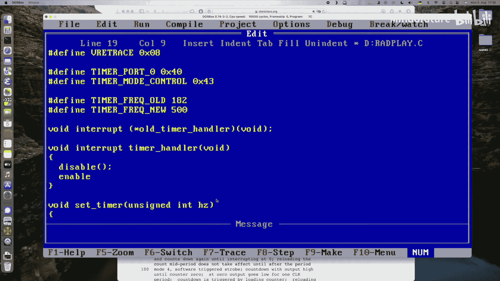

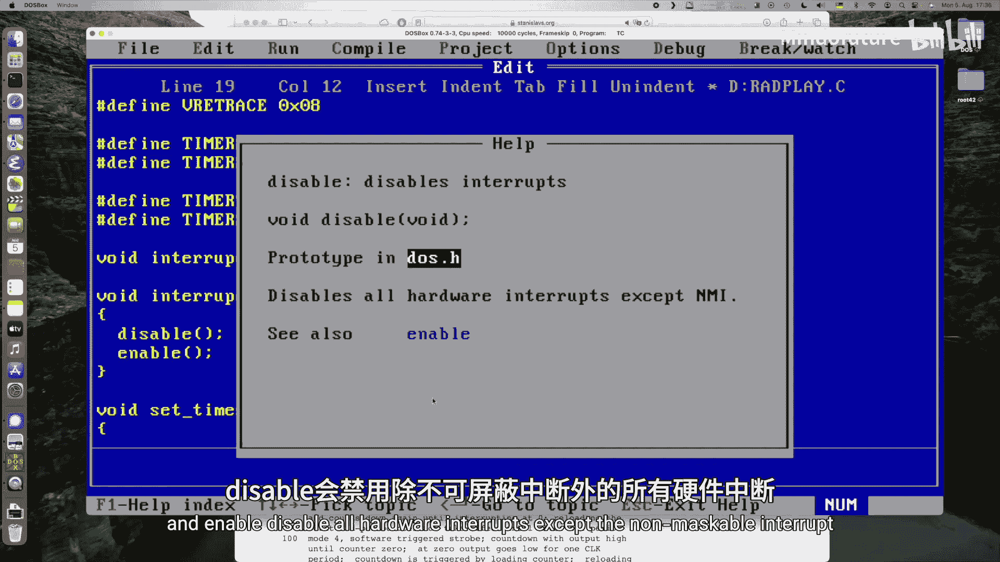

Se goes for enable plus the opposite。And inside of this。

 you should do something like old timer handler。Brackets。But。

You will see that we will have to change something here， basically， we will call play music。

And then this this will call the new timer handleler eventually at 50 Hz， which is also way too fast。

 So we will have to do something about that， but。

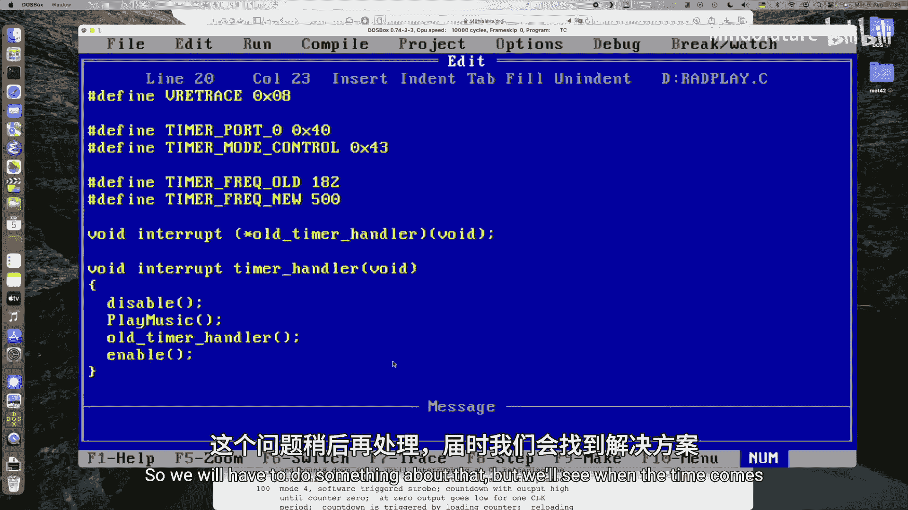

Well see when the time comes。 So when we have a look at the help PC。

Website and look at interruptt 1 C hackx。 It's the system timer take。Which is a software interrupt。

 and that is actually triggered by a hard to interrupt， namely interrupt8。

Which is wired to the A253 programmable interrupt timer and has a documentation on that chip as well。

 and we'll need that in a second。And usually this thing is called 18。206 times per second。

And we will tweak that to be called every 50th of a second with 50 hertz。

 because that's what Raplay wants to have。And yeah， the default interrupt is empty。

 but you might already have things in there for timekeeping， for example。

 and we need to call this thing as we've seen。

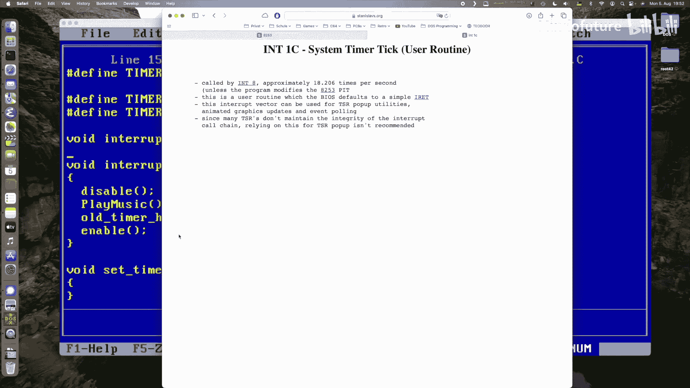

The question is， how do we set an。You interrupt， basically。That's the function set in。

 and in there we need to disable all interrupters as usual so that we don't get any side effects from other interrupts。

First of all， we will need to store the old timer interrupt。

 which is why we created this variable up there， and we can use the getva function。With the。

Time onrup 1， C。

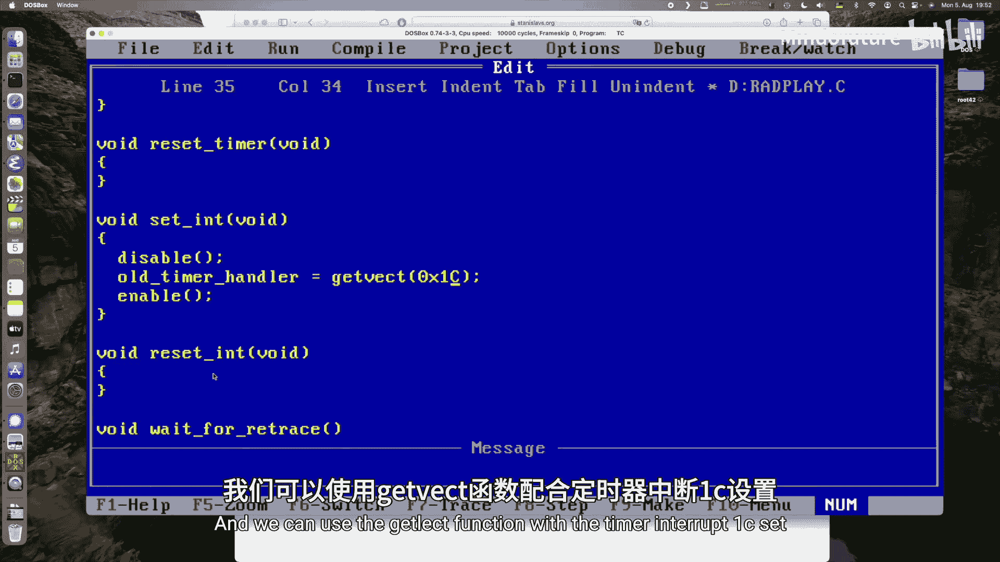

Set， and this is another thing that you find in the Do header that you find the get vector。

Pretty simple。 The return type。 it looks a bit weird because the return type is。

A pointer to a function。Gettvaed takes the interrupt number and the return type is actually enclosing the whole function name。

 white interrupt。Pointer to a function。So if you're not used to function pointers in C。

 it's a bit tricky。 but as you've seen， basically a pointer variable to a function looks。

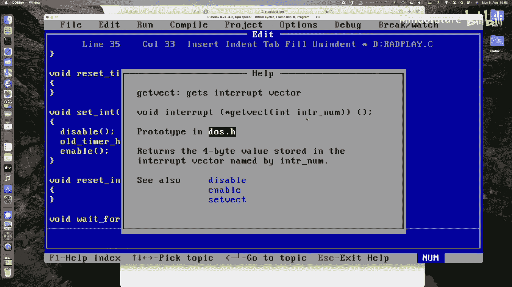

Like return type， and then an asterisk in braces or in parenthesesis， bettertter said。

 and then the name of the variable and the parameters that this function takes as it's an interrupt function that takes void。

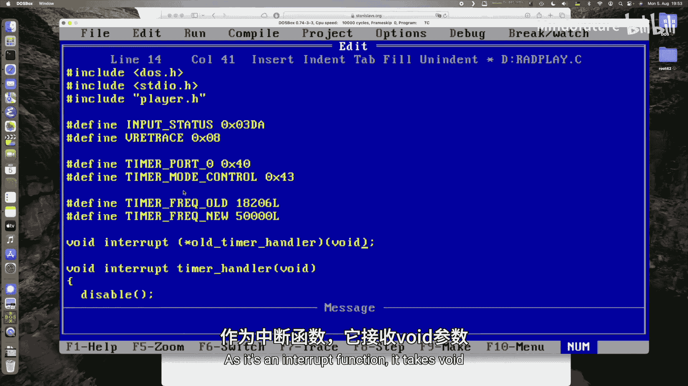

And。I think did they specify void here or just empty。I think they're probably specified void。 Yeah。

 this actually a little bit。Incorrect， but back then I'm not even sure AnZC was a thing。

 It probably still was coming in Richie sea。But AnziC says if you leave that out。

 it's actually unspecified what parameters go in there。

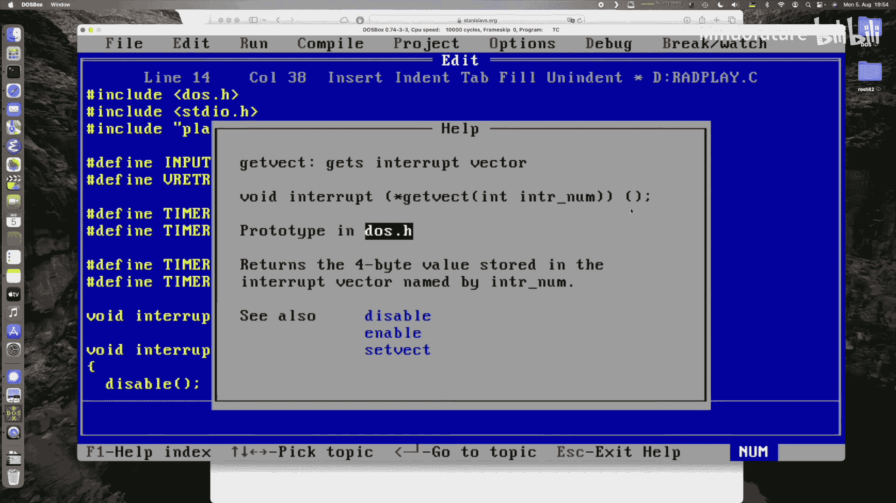

So it's better to write void。Explicitly。Anyway， this is how we get the old intratro vector and we can。

 of course， use set vector。On the same interrupt。With our new timer handler。

 which is just called time handler。 and the name of a function gives you the pointer to that function。

And then we will call another function that we have to implement still set time of 50。

 which sets the time of frequency to 50 hertz。The reset interrupt。

We need to clear up the interrupt vector later。When we quit the program so that our code isn't caught anymore because it will not be there anymore。

 it will be cleaned out by us。And here we just call a set ra。With the time I interrupt。

And the oat timer。Handler， so to speak。And then we also reset。The time interval that it gets called。

An appropriate amount of times。And I would even go as far as putting that here。

 but it shouldn't make much difference。 So we need to implement set timer and reset timer。

 And I've gone ahead and change the frequencies here。 I put 182 before。

 but we can also work with 18206， which is a little bit more accurate。

 So you might experience less adrift。Yeah， but let's take a look at the set timer。

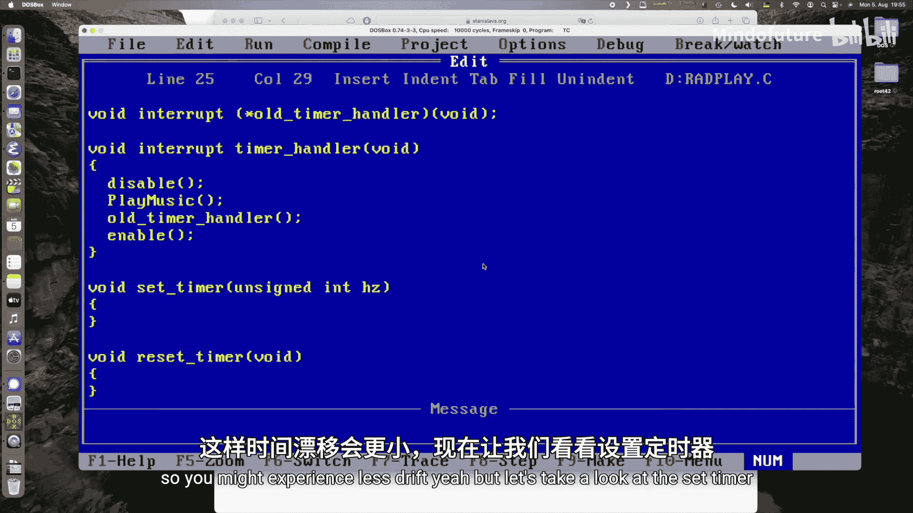

For that， we need to know a little bit more about the A253 which is intel chip。

 but there's tons of clones and in later PC it's integrated into the chippssat。

It actually has three timer counters basically that you can program and that can produce certain things。

 It can produce， for example， pulses or square wave pulses。It is， for example。

 the counter number two is used for the speaker， the beeper。

 and you can produce very interesting sounds with that。

Counter number one is the refresh counter for the run refresh。As the PC and it is。

Deerived machines are using dynamic RA。 It needs to be refreshed regularly。

 and the counter that were interested in is the time of day clock。

Which is normally running in mode 3， which you can see down here。

 Mo 3 is set by setting the mode control register register。Namely the bits 3，2， and one， I think。To0。

1，1。 And what we want to have is basically。Set this whole thing as follows in the set timer。

 First of all， we will write to this using the output by function。

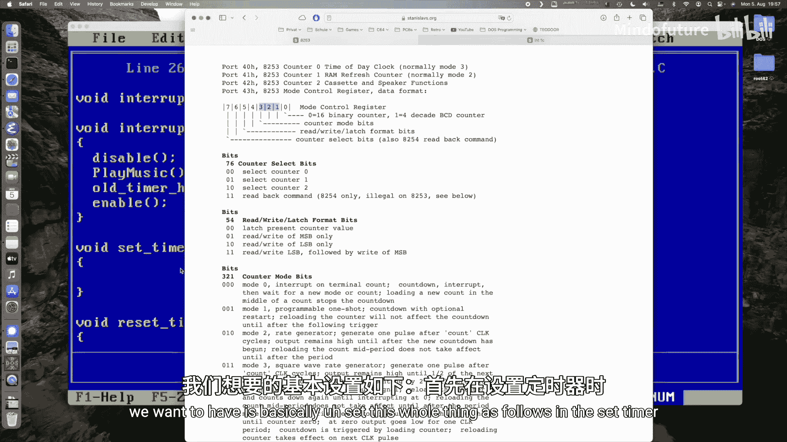

And I've gone ahead and already defined constants timer port 0 is port number 40。

 and the timer mode control is 43， both extra decimal。So we can right to this。Timer。Moode control。

And。We will select the following， and I'm going pull up。 do， can I do that with the calculator。No。

 that doesn't support binary。

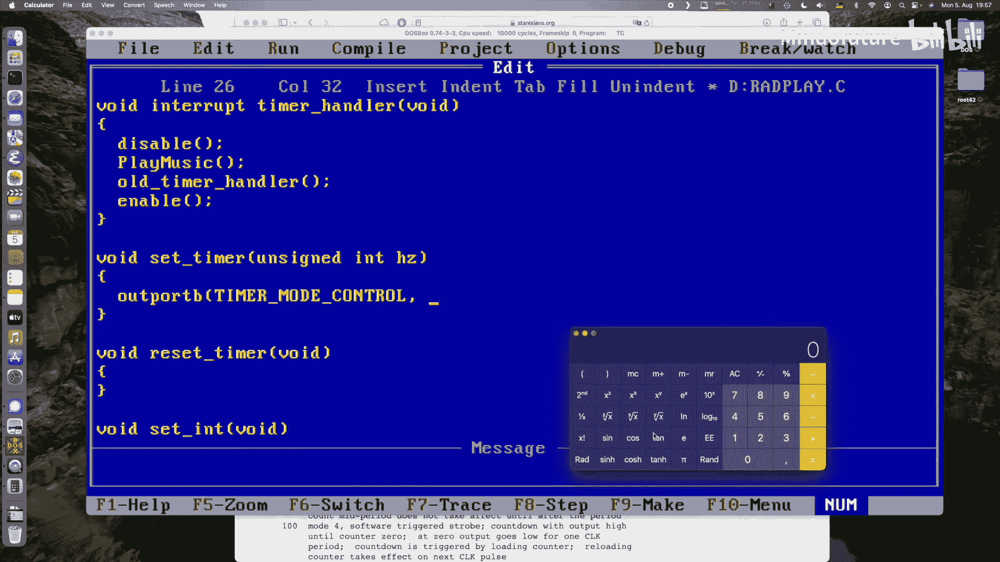

So let's quickly grab a hex to binary converter online。Something like this。Let's go and type in。0，36。

 And this gives us 0，0，1，1，0，1，1，0。 This here is the mode 3。

The last bit signifies that we're using a decimal counter and then we have 001，1。 Let's look that up。

 00 is the counter that we are choosing because were choosing counter 0。

 we need to put in 00 and then the read write ledch format bits which are5 and 4 we're setting to it to readr LSB followed by right of MSB because。

We are going to write the frequency that this thing should have。We need to set send a 6 inbit value。

 so we need to do two one byte rides， which means we send first the least significant byte and then the most significant by。

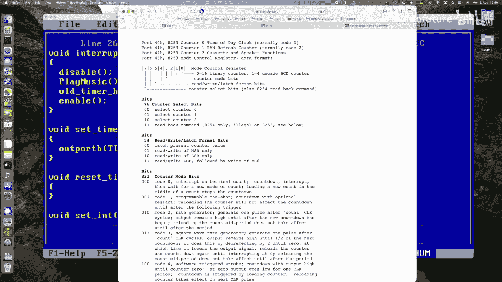

That's how we come to the 0 x 33。36， exactly。Then we will write to the timer。ポン0。The value。

 which I call counter。Which well have to specify still。

 and we will derive it from the input Hertz value。嗯。And we will take the least significant bike。

 That is just by using mo。Or you could also actually just do an end。It's here it's the same thing。

And we sent the。Most significant。By it。By doing。The same thing we could either do a diff by0 x F。

Or you could shift right by 8 or something like that。 I stick to this here。

Because I read it somewhere like that。 so but yeah。

 there's different ways to extract the least and most significant light。

You may pick whatever you like。

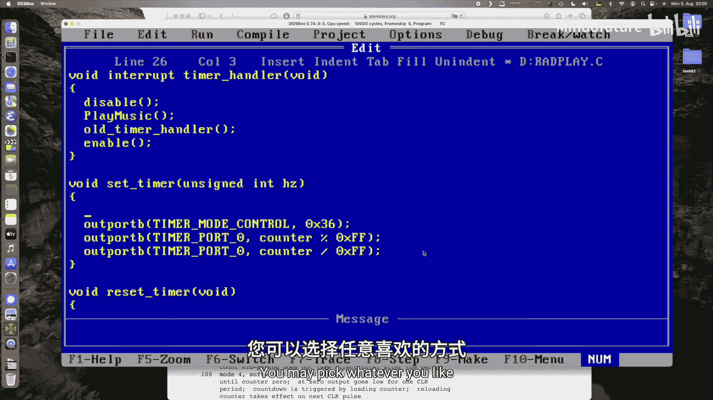

The interesting part here now is how to program this。H。In our mode， we generate square waves。

 we generate one parts after count clock cycles。And。Does it say somewhere？嗯。This is， I think。

 the frequency。

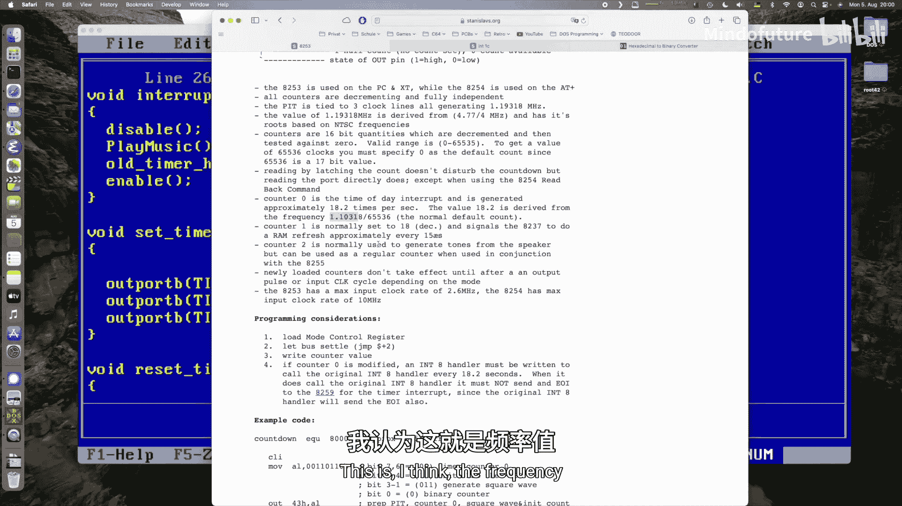

嗯。In actually， in megahertz， I think。Let's see if we can do rife this here here it is。

This is the actual frequency that this thing runs at。

 So to get to 50 Hertz we need to divide this clock clock fuel frequency or counter they call it by the number of hertz that you want to achieve。

 So we are going to use an unsigned in here。Actually。

 an unsign long end because it's too large for a 60it value， call it clock。And that's 1，1，9。

3181 Hertz， exactly。And we will get an unsigned int out of that， which well call counter。

 And that is the clock divided by the number of desired hertz。

 This gives us the exact number of ticks， until the next pulse happens。Which makes sense， I guess。

 right？So that sets the timer。Rettting the timer works pretty much。嗯。Accordingly。

The very same thing here， but we don't need to do complicated things。

 We can simply set everything to0， and it will fire。In the regular fashion。18。2 Hz。Okay。

 that's that We have the setting of the timer。Yeah， one thing is still missing。

 We are calling the old timer handler way too often。And that's a bit annoying。 We need to。

Call it only when like， how much is that we have 50 Hz， and we want to achieve 18 point。2，0，6 verz。

I should write it like so， I think。Every 2。746 iterations， which we can't do。

 but we can do something similar Shiing around the error by taking a time variable unsigned。

Let's take a long， I think， because we have a。We are almost touching the 6 in bit here with this resolution。

 if we want to have high resolution unend along T and we'll in initialize this with 0。

 This will start off with 0。 and as it's a static， it will。Keep its value in between interrupt cards。

And what we'll do is we will increment this by our timer frequency。Old， so we will add up 18206。

And whenever。T gets bigger or equal to timer frequency new。 and this will happen on average， every 2。

74 times。Then we will actually call this thing and reset T to0。This is very simple。

 the first time it will happen。On the third iteration。Because。18206 times3 is the first value 54000。

 roughly， which is bigger than 50，000。And after that。We reset it。 Oh， we actually don't set it to 0。

 but we have to subtract the new time of value and start off with the 4618。 Okay。

 so that was a little bit of a mistake。We subtract time of frequency， new。

And so since we were a little bit too early， we are too too late， Basically。

 actually we were too late， we should have happened on the 2。7th。Iteration。

 but we happened on the third iteration。 We will take this error and push it into the next iteration and now the iteration will happen a little bit earlier in theory。

 probably still on the third run， but then on the third it intereration it will happen on the second try basically and so on。

 and so we will shift around the error。But that is actually it。 We have everything here。

 The only thing that you actually need to have as well。

To be able to work you need to define a header with the assembly functions that are made public in the object file and their C signatures without the underscore scores because the C compiler will generate the underscore score。

 So our in player function returns an end and。

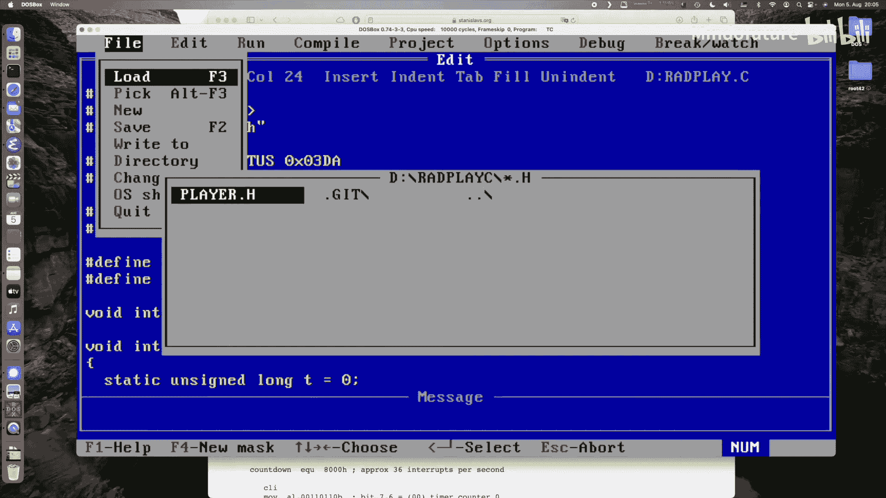

Which is passed back in AX and it takes on the stack an unsigned in with the music segment and play and play music are both void functions。

 So there's nothing happening there。And let's quickly check here， we have the old handler。

 we have the new handler， and it's calling the old handler in the correct amount of time。

We are setting the timer using the clock rate divided by the number of hertz that we want to use。

 we're programming the mode control register and writing out the new counter。

Reittting the tunnel works by setting。Moode control to0 again。And then other than that。

 we have the interrupt set routine itself， which stores the old handler and the reset restores the old handler。

 And other than that， we have disabled， hopefully the。Play music and wait for rese loop。

And we already have the set interrupt and the reset interrupt。And that you do it。

 we are freeing the memory and then quitting。

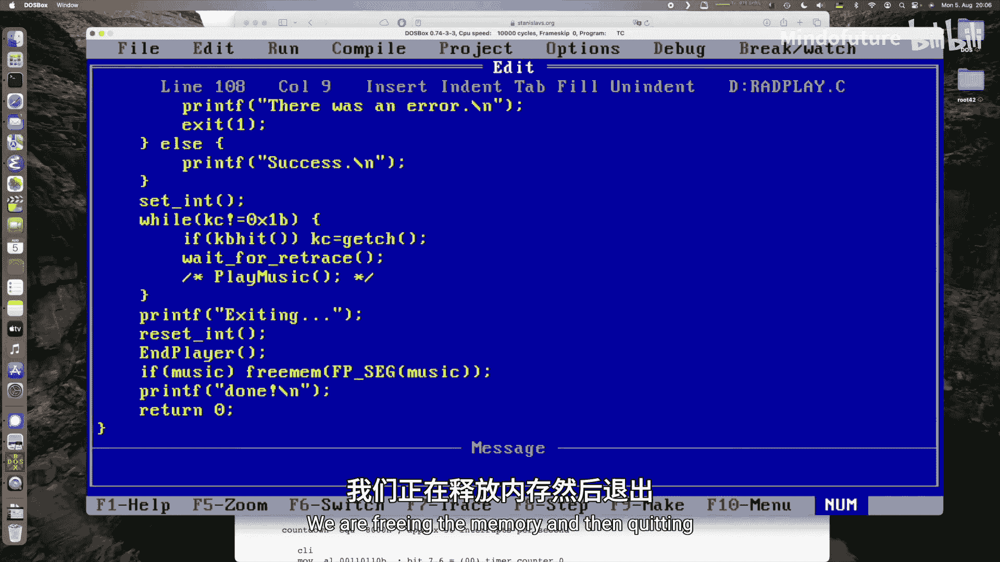

Yeah， let's try to see if this will compile。There are no warnings and no errors。 Yeah， what's。

 what's our volume doing a little bit。🎼There you go。Music is。

🎼I think it would be possible to do something else here to run a game， run a demo。

 whatever you could even call up a system shell or something and we can work around。 Actually。

 maybe we can do that as an additional。

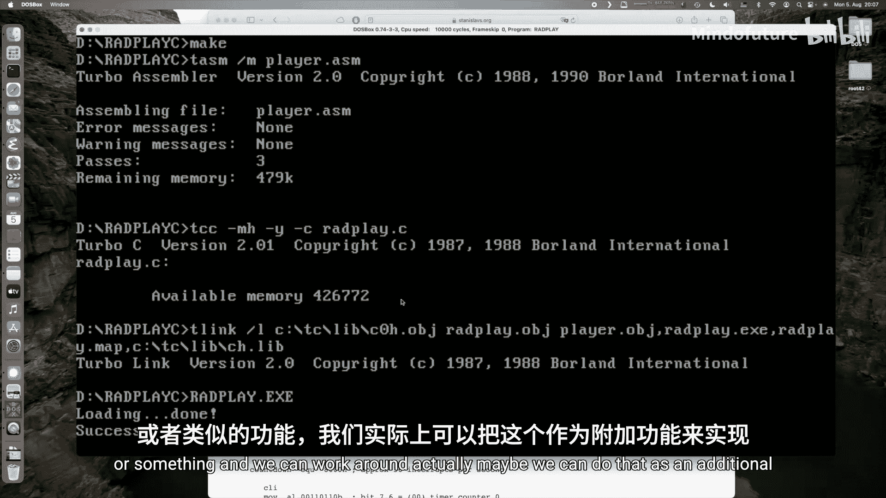

Thing here。嗯。Instead of。Doing this。Let's do the following where comment is odd with an if0。

 because we have nested comments otherwise。

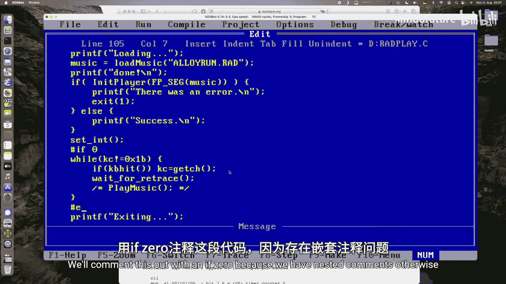

And I think we can just call system。If I remember correctly or。Something like that。嗯。

Maybe not in the dos file。I will find it。One moment please Okay， found it in the process dot H。

 also instantt H， but that is， I think not part of NZc， so process dot H for NSsdos。Ent system。

 And I think we can just run command dot com。 Probably。 let's try that， actually system。

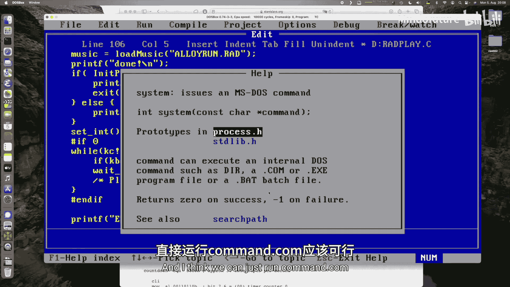

And then we run command。Dot com。Me。Should， hopefully work。Let's include。Process that H。

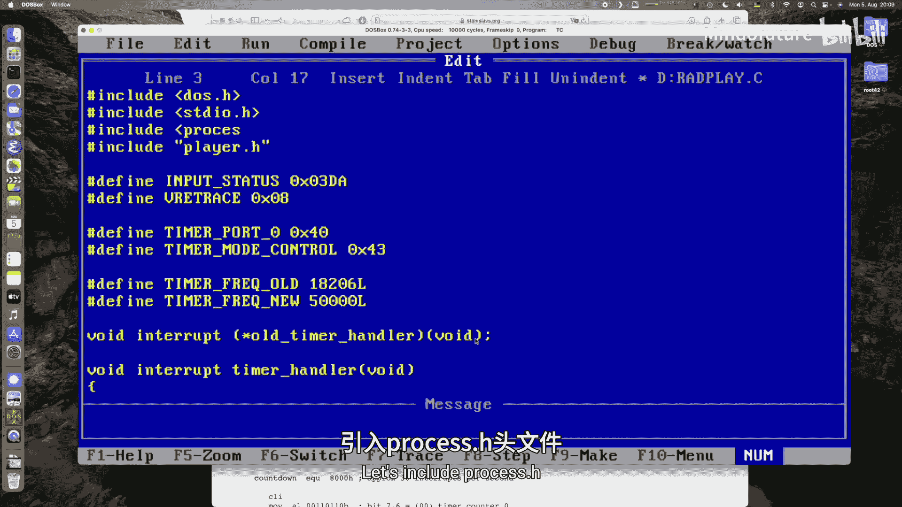

Illegal command， commandcom。嗯。Okay， this doesn't work because we're in dust box。Which is interesting。

Okay， we need to run Z。

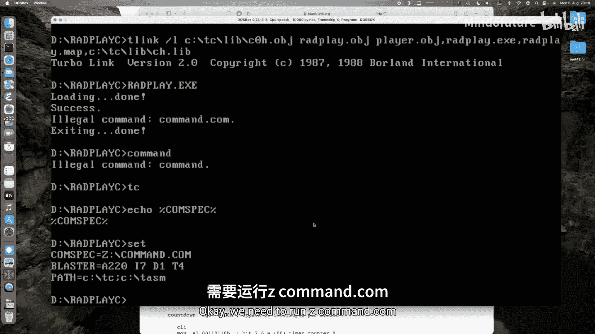

Come on dot com。 Okay， good。Let's do that。

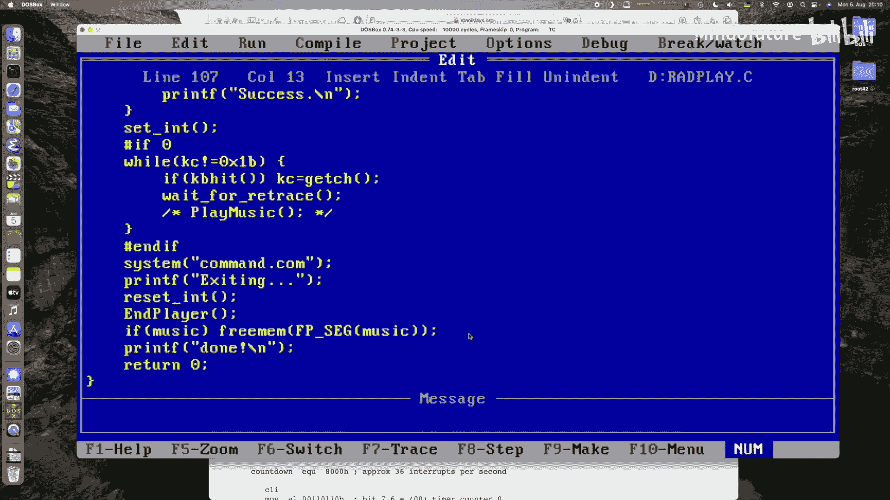

Yeah， there we go。We can just move around and do some things。🎼We need to be a bit careful。

 but for example， we could launch。

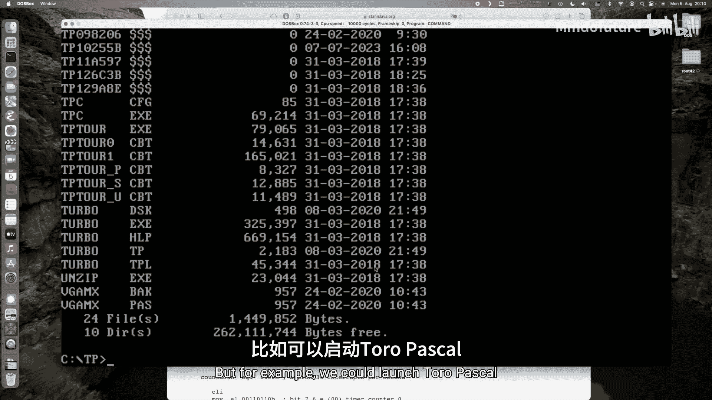

🎼超バスか。🎼Why not and have？

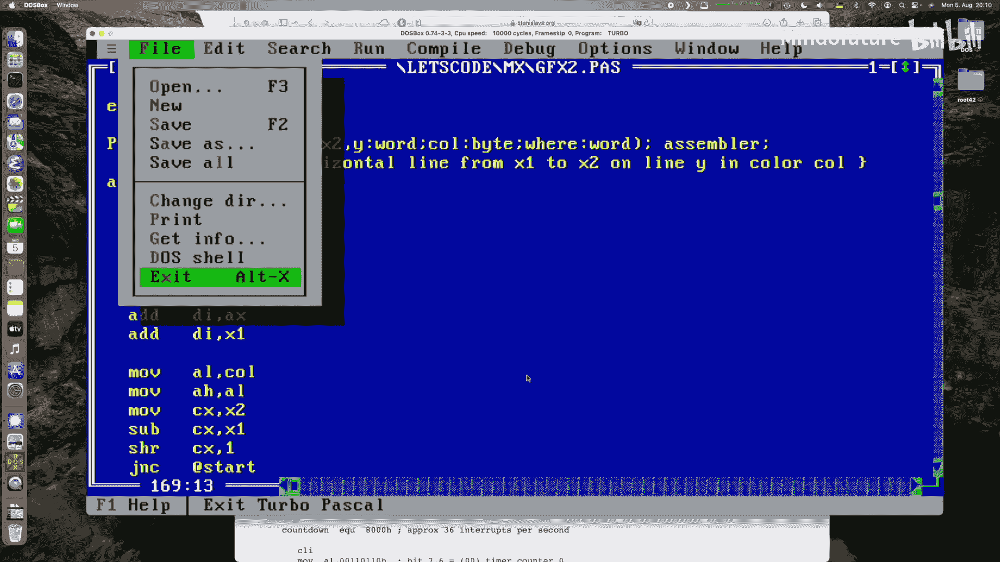

🎼Rrap play running in the background， if we exit， then it's gone。

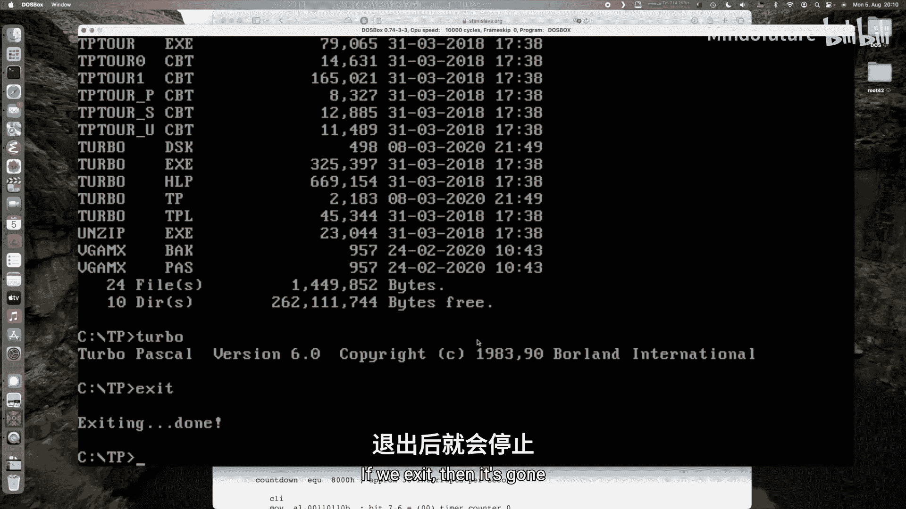

I think that couldn't eat。Yeah，m I'm going to disable that again， but if you want to。

 you can do something like that。And we are just gonna make this optional。

And you can play around with this by putting in0 or one here。

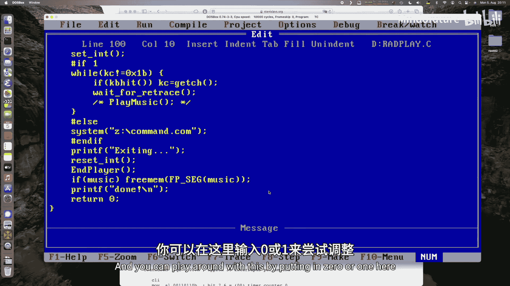

And that should do the trick。Yeah。🎼I think that's it for today take the source code。

 play around with it and make some great music in reality at a tricker and shallll I can subscribe the usual things。

 thanks a lot to my patrons who support me in a spectacular fashion。🎼And yeah， share your thoughts。

 your comments in the comment section below， and I'll see you in the next video by。

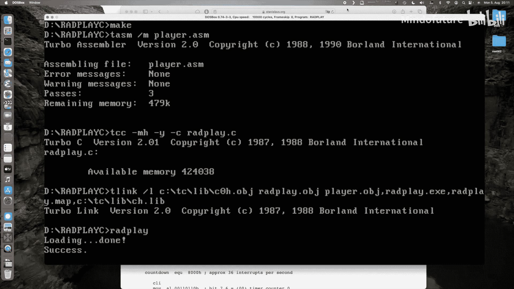

🎼，🎼，🎼，🎼。