# 编写MS-DOS-系统-｜-windows-｜-操作系统-｜-汇编--｜-vga-｜-x86-p44-P44-Lets-Code-MS-DOS-0x2B---Memory-and-Pointers--BV1zs35zQEru_p44-

Hello， welcome and an excellent evening。 and today I want to talk a little bit about memory on the IBM PCC and compatibleibles。

As well as pointers， because I got a question on one of my last videos。Where that person said。

 I'm lost as the part when you use pointers。 Could you please elaborate a little bit next time， when。

 how and why you are using them， thanks。Usually， I。Answer these questions under the video and say。

 I'll put it on my list。 And my backlog for topics is。

Extremely long because those questions are often very specific on certain topics。

That take a lot of time to prepare。And are not very general。 However， as this series here。

 let's go inos has been running for quite some time。

 I thought it might be necessary to do a few refreshers for people who。

Just joined us like a couple of episodes ago or something or want to join us。

Just seeing this very new video or at the time of really this very new video。So。

 it might make sense to。Go back and see how IBM PCs used to handle the memory in the so called real mode and with the limitation of1 MBby and maximum and how point us actually work。

 because some languages hide away point us， for example， basic。Java or some list variances there。

 you will never see any pointers。But if you go to languages like Pascal Anddoos， or。

To see here or any C variant。 Actually， you will have to deal with pointers。 And the question is。

 what are pointers， How are they used， When are they used， And yeah。

 So let's talk a little bit about that。 Here is a little memory map of the IBM PC from-0 degrees do net。

 which is a great resource for everything IBM PC。And it only shows the upperar 384 kB。

 because the law。Lower 6 40 kB is not super interesting because that's actually mostly free。

 There will be some parts of doss in there， and some。System variables basically。

 But most of that6 and 40 kB is just free for usage。

The original IBM PC and X T were using a CPU called the 8088。

 which could only address up to1 megaby of memory in one go。

 easily at least and the upper 384 kilobys that you had was also already used by certain things。

 for example， video Ram。Depending on which car you had bio expansions and the motherboard bios。

 including basic on VIBM PCcs。So that's something that you should know。

 And you also see that the address here is written in an interesting fashion like F 80，00。

And this's actually not。Quite how addresses work if you're programming under MSdos。

 because the 8088 and 886 use something called segmented memory addressing。

Predecessor of the 8080 and also its's clone the Z 80 and similar machines like the 6502 based computers like the C64。

 Pe 20， etcter。They were using basically flat memory model with only 16 Bs of address space。

 which gives you access to only 64 kiloB。Building larger address lines would mean that you have to build logic that can support wider numbers than 60 bits。

Intel didn't want to do that because it would have been expensive at the time。

 Use a lot of transistors。 So what they did。

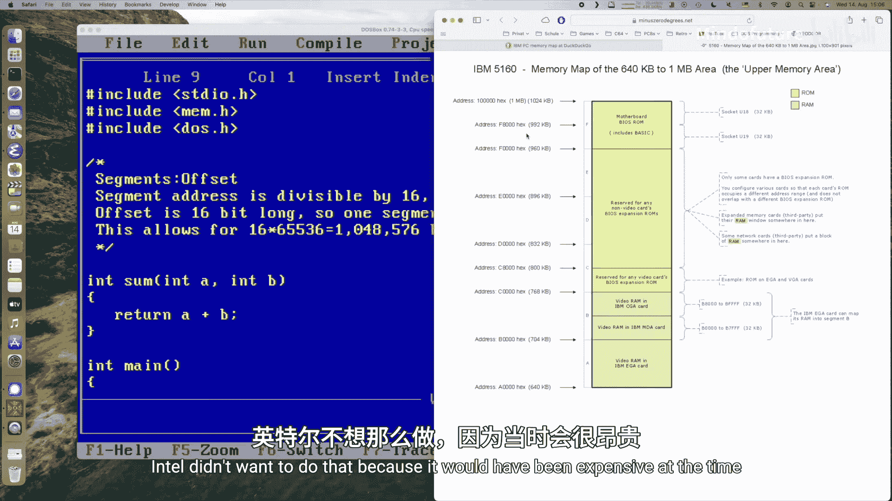

Wass to invent this or probably not invented it， but use the segmented and writing。

You would have some segment address and some offset into that segment。

Every segment address is divisible by 16。So。Every 16 bytes， a new segment starts。

 and it's 16 bys long， so every segment is exactly 64 kilobytes just as it was on the 80808080 and the Z80。

The offset is also 16 bit long， so。As I said， you can point into that segment。Any way you like。

Since every 16 bytes， you get a new segment， you can in total address 16 times 65536。Btes。

 that is exactly1 megaby。So it's a bit annoying to deal with this。

 as especially on a machine code level， you have to rethink a little bit how all this works。

 later processes like the 286， and especially the 386 introduce different memory。

Addressing modes with the 3，86， having kind of flat addressing again with 32 bit pointers。

But that's not a topic of this video。 Maybe we'll touch on that at some point in the future。

 But here， I just want to make sure that， you know。That there are segments and offsets。

 which are currently invisible to you in C， but they will become visible in once you need to address certain amount of memory。

That being said， let's get back to the pointers。Ive written down a very simple program here that doesn't require any pointers。

 We have a function called sum that takes two integers and calculates the sum of those integers and returns that。

The main program will initialize to variables called A and B， clear the screen。

 and then print out a plus B equals and then calls the sum function。

So we would expect there to be an output of a plus b equals 3。And then wait for key。Let's run this。

And indeed， we get a+ B equals 3。Now， what if we wanted to pass an arbitrary number of。Integers。

 let's say， how could we do that。We could do that by passing a vector on array， and。A number。

 how long that area is， and we could， for example。Then， write a loop。Let's do that here。 We need a。

Running variable here。L variable。 I will do something like I equal 0。I is smaller than N。

Beingcr and eye。And then we will do something like， what else do we need， We need。Some。

A sum variable， which is this year。 Well initialize that with 0。And we'll do S plus equals。A of I。

And。Then， turn the sum。Let's do this here， as well。So。A is。Some kind of vector。And it contains one。2。

3， let's say。Some。A， let's a。And this year takes currently three。

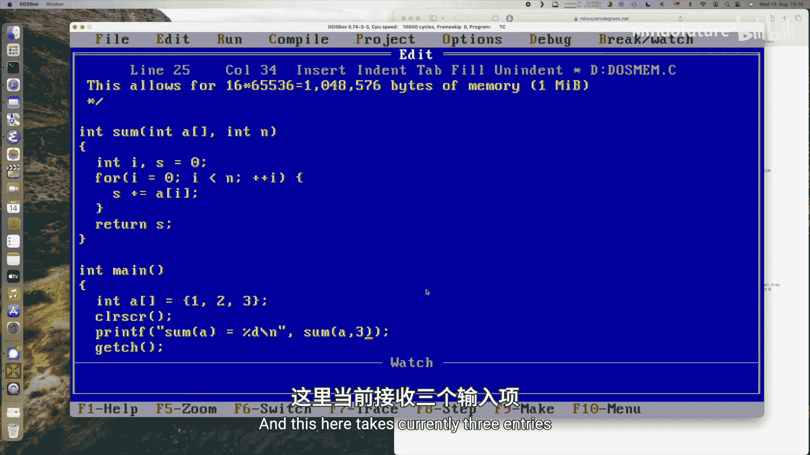

Entries， so I just write it like this。

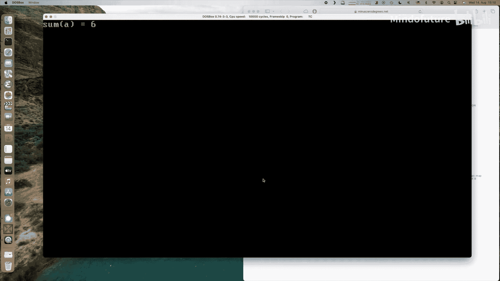

And the sum is6。 Okay， cool。 Now， where are the pointers you might ask。 Actually。

 we are already using pointers， but they are currently invisible because every array in C is actually also pointer。

This notation here， a square brackets means this is pointer to a certain number of elements of type int。

We could have also passed this to a function which doesn't have this signature。

 which says Im taking an array of ins。We could have also said I am taking a pointer to integers and。

A certain number N。This will actually work exactly the same way。

 even with this subscript method here of square brackets。

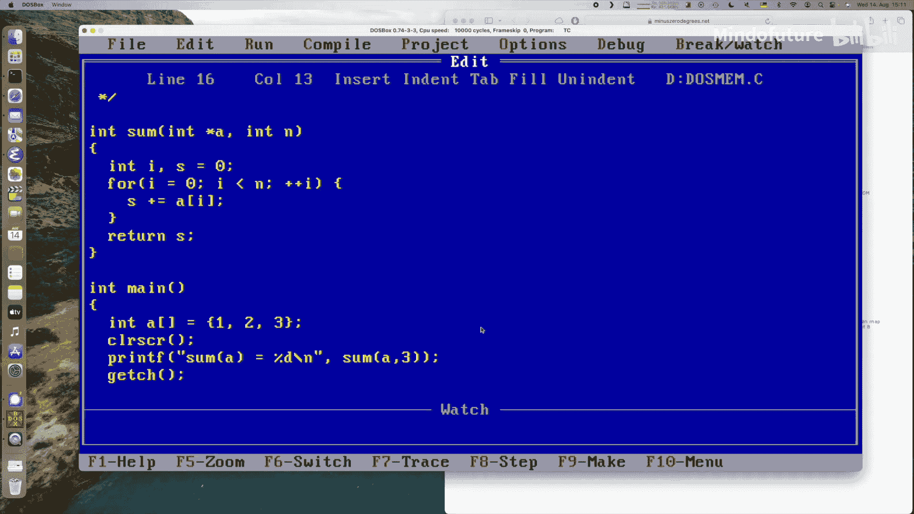

It will still use this information if we can prove this by running this。

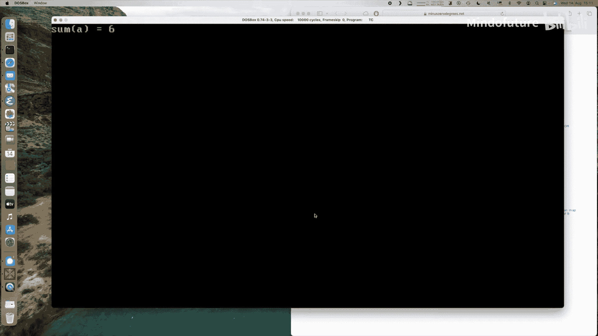

Again， get6， there's no compile error。So what does this actually mean， the star。

If used with a type and C means this is a point instead of the usual type。

 You could also format it this way。 Some people like this better。 it means。

 and this is a pointer to an integer。What is a pointer， A pointer is simply a memory address。

 So we already know that。An address in Tobo C， for example。

 contains a segment part and an offset part。We can actually print it out and see where this thing lives by using the printer function。

 and we can write segment。嗯。Offet。Equals。Percent， let's take， I think percent x should be hexademal。

Pson X。And then a big slash n。And there's a function called。嗯。FP segment。Of a and F P offset of a。

 this will give us the segment and offset parts。 You can look that up in the help file。

 It should be in the dos header， which I included above。 And there are the two functions。

 or actually the macros。FP segment and FP offset。Ignore the far pointer here。

 and we will probably also get a warning。 Oh， we don't。 That's nice。 We can run this。

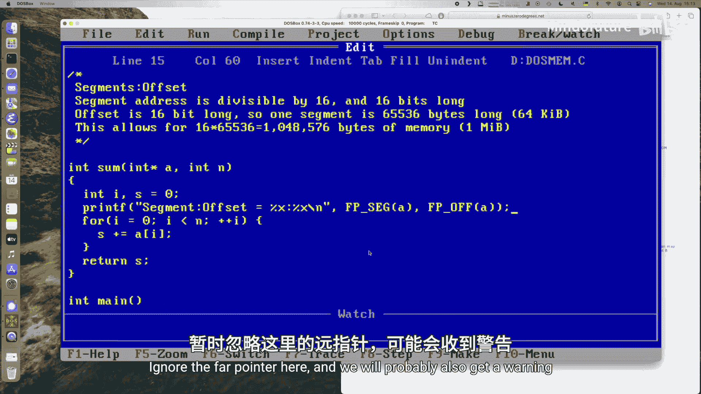

And this will output the actual。Segment and offset values。

 which depend on how large the memory is when it is launched。 For example， now， we have 5，5，2，2。

 F F D4。 Let's see if it's the same when we run this program directly from Dos。

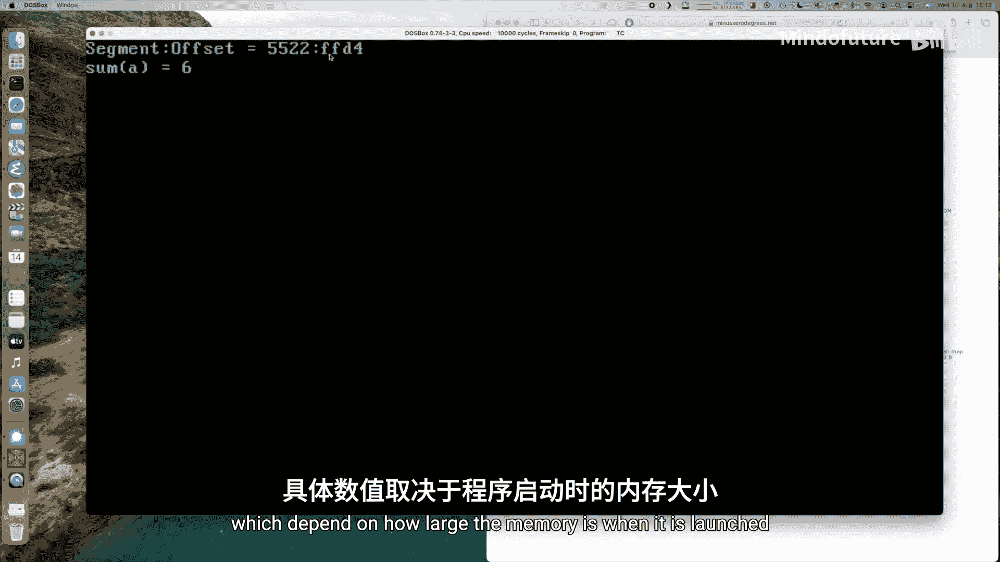

And indeed， it changes because tobui is not loaded。 The offset is still the same。

 because the program is always loaded into a certain segment， but at the same offset。

 So the offset will always be FF4 for this special variable。

 but the segment changes because now Tobui is not a memory， and we can load into a lower segment。

Let's open this again。Just prove it。

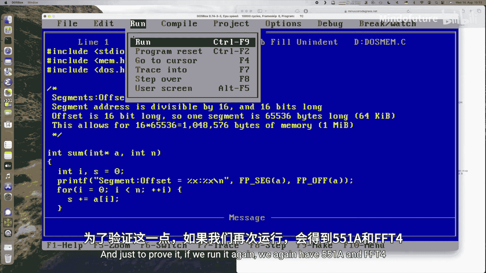

Now if we run it again， we again have 551A and F54。

Okay， so indeed， arrays are pointers。And we can use them interchangeably。In most cases， at least。

 and they basically contain an address to one or more objects。

They are basically just pointing into the memory map somewhere down here below the 640 k line and are basically the house number of a memory cell。

 Now， why do we want to do that， The thing is， this is very useful for variable length data here。

 we have still a fixed number like3， But imagine that you read in a data file and want to。

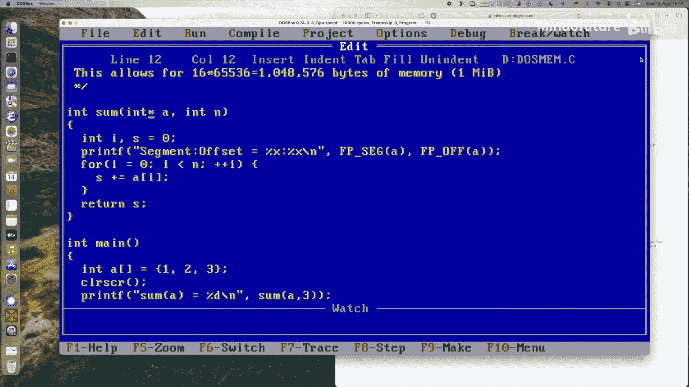

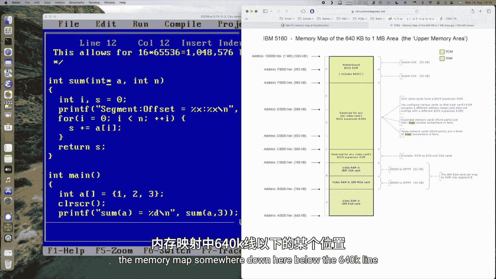

Compute the sum of a lot of lines， or maybe the average or something。

 And you don't know in advance how many of those will be。You can't write a function， having。

Like 1015 or 1000 arguments that wouldn't work very well。So instead。

 you can use pointers and allocate a flexible amount of memory and fill that with your data and pass it around。

 That's exactly what we are do now。 So what if we were to make this dynamic， basically。

 then we would actually convert this al into a pointer。

And we would need to allocate actually some memory because right now。

 this pointer here points to some random value。 We could initialize this with the socalled nu pointer。

 which is an embedded pointer， or there would be just some random garbage in here。So instead。

 what well do is the following， we will。嗯。Pick a random number。 I don't know， let's say。

We are going to use 123 different numbers。Those are definitely too large to pass them individually。

Into this function。We would need to allocate memory for this because right now we don't have any memory space here。

And you do that by using the standard C function called Meloc。And we can also have a look here。嗯。

M dot H， there should be oh no， sorry， that should be the standard lip， I think。

There should be a function called malloc。 It takes a size argument and returns a pointer to void。

 which is basically。Apointed to not a specific type， but to a number of bytes。And yeah。

 that can automatically be converted into a point of integers。So we want to allocate 123 integers。

 and we do that by writing 123 times。And then there's a built in function or operator called sizeof。

Integer。And this will return the number of bytes on this platform that an integer takes on Dos andy。

 This will be2 bytes， So it will allocate 246 bytes。This will be done like so。

 and we will also need another run variable， and we will。Fill this with numbers。

 So we will do something like4 equals0。I， smaller than。And。

And we could actually use N here to make it。More pronounced。And we will fill。V。

Element with the number itself。 Let's say something like that。This way。

 we actually use a pointer that was initialized with a null pointer。

 which would crash the computer or the runtime system if we were to try to access it。

And then we allocate the memory， initialize every memory cell in there with a useful number。

 and then calculate the sum。

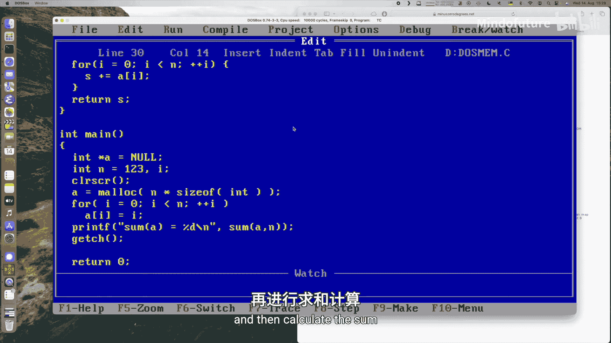

怎么 look。And there is our new memory。And it's now the summer 7503， which is probably correct。

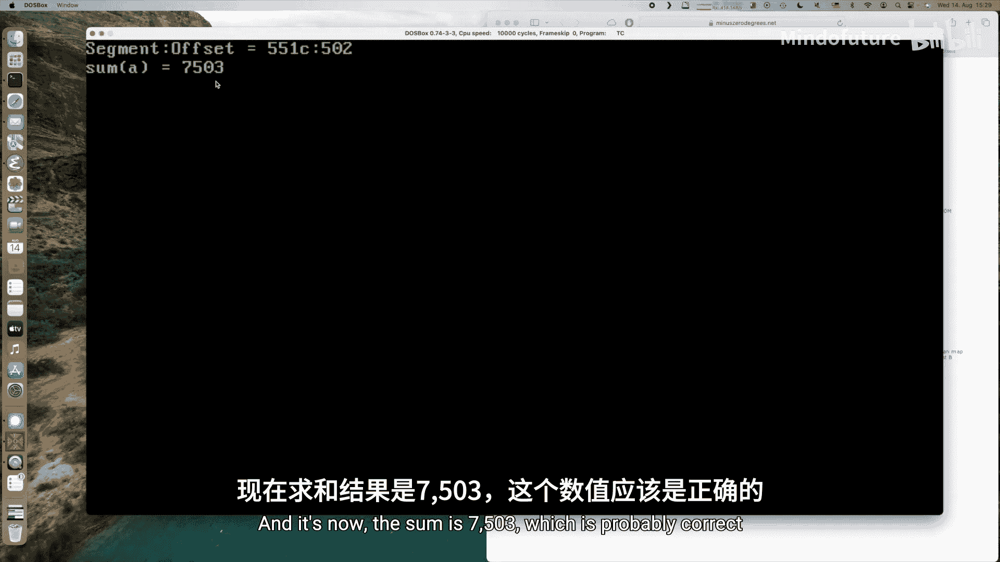

However， we are now leaking memory。Amount of memory that is available to Dosorby。Less than before。

 perhaps。Might be， I'm not sure if the memory is free。

 but at the end of using something and before you quit the program。

Youre supposed to return the memory by using the function free。

So if we look again at the standard library。There should also be a free function that takes a pointer to the allocated block。

And it doesn't return anything， and it will free the memory that was allocated using the melock function。

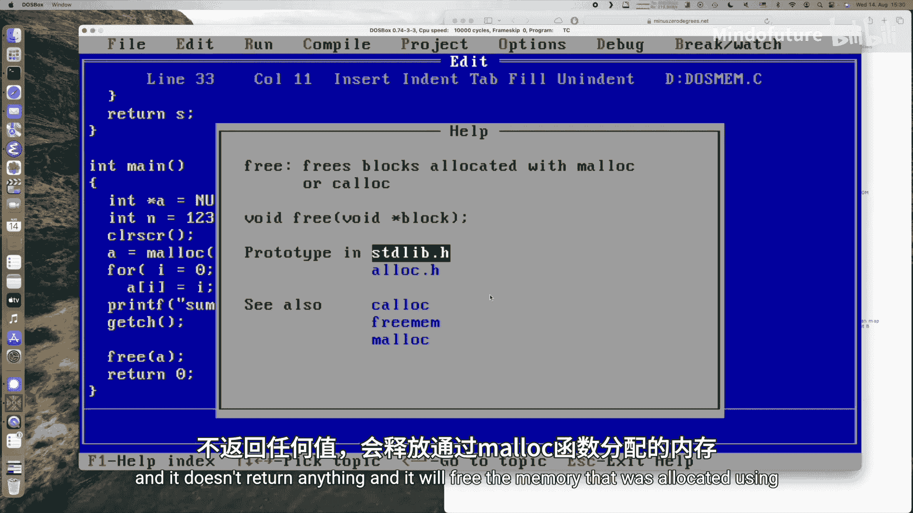

So this year will be a little bit more of a correct program。

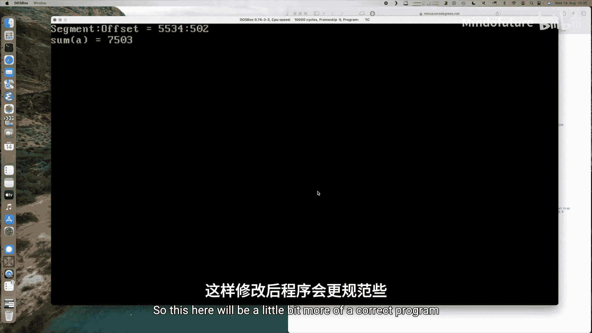

Still， it produces the same output。So those are very simple waste on how to use。Pointters， however。

As you've seen， there's。More to that with the segments and offsets。And in Toba C。

 you can find different options for memory models。 Currently。

 we are compiling for the memory model small。 If you press F1 here。

 you will get a help about all the different memory model models。 There's six different models， tiny。

 small， medium， compact， large and huge。And as the name suggests。

 they are for programs that have different memory requirements。 The smallest one is called tiny。

And this model has a total of 64 k for all the code data and stack in your program。

 All functions and data pointers are near by default。

 Ti model programs can be converted to dot co format instead of dot X files。

 you can convert them to co files， which。Might be useful for certain things。

They mentioned pointers are near。 Let's have a look at one of the other。Models。

 let's say the large model， large model。 This model has up to 1 MB for code。

6 k for stack and static data and up to 1 MB for the heap。

 Heap is everything that we allocate via a malllo。And all functions and data pointers are far by default。

 Okay， and that sounds interesting。 What are near and far pointers。

We can actually force the pointer to be near or our in Tobu C。

We can't do that in regular NZ if you have coding in Linux， for example， with GCC or ceilinging。

 you won't be able to to do that。 This is something specific to Dos C compilers。For example。

 I can have two pointers called。Near pointer， and。Far pointer， maybe。And we can now add。

Another keyword， near and far to this。We have now created two pointers called near pointer and far pointer with the extra keywords near and far。

 And they declare those pointhouse to be near or far， actually。 So what's the difference。

The near pointers will be smaller。 They will only have。An offset。

 and well be using the current data segment that the program has for。These variables。

So there will be only an offset。Let's say，16 bit offset。

And if our pointer is actually pointing to further away segments。

 and this will be a segment offset style pointer。So in theory。

 we should actually be able to see a difference here if we were to do something like。This。

 let's write。Near colon。Person D file。Colon person D。And then。Pexition and do something like size of。

And near star。And。Size of。And far star。We'll get to why this， actually。

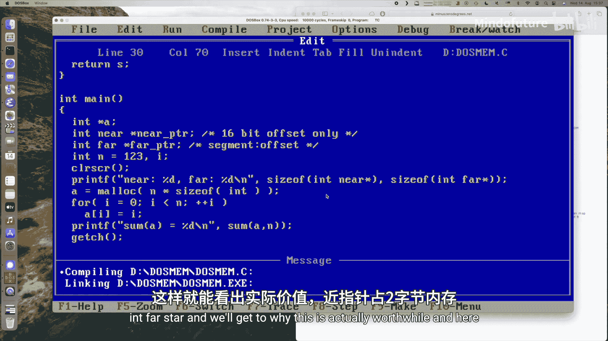

Worthwhile。 And here we can see it。 a near pointer consumes2 B of memory。

 and a far pointer consumes4 bys of memory， so。The idea here is very simple。

 If you know that you can， that you will be using stuff in the current data segment。

 that you don't require malllo that。Is going beyond to 64 kB of your current segment that you're working in。

Then an E pointer is sufficient， and you will save space on memory， obviously。

 because if you have multiple pointers in a more complex data structure。

 this will be half as expensive as a file pointer。

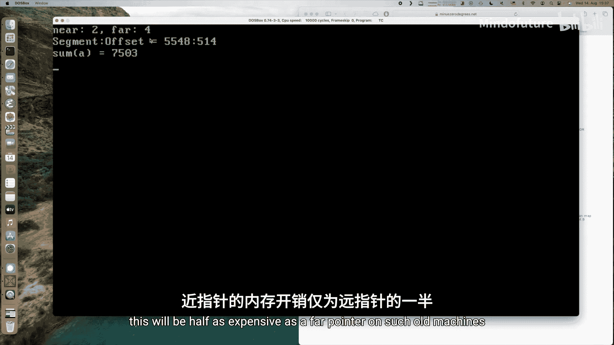

On such old machines that actually makes a difference plus。

Taking the address basically or the the and taking the contents of this address might also be faster due to the way that the machine code works。

If the up codes are， for example， smaller。So that is the difference between the near and far pointers。

There's actually function， also in。One of the headophiles in aoc at H。

 there are specific functions Malock will probably default to whatever your memory model says。

So typically for tiny and small， that it might return a ear pointer。

But you can force it to actually produce a fire pointer by using the fire malllo function， which。

 as you can see returns a void pointer and avoid fire pointer。 So that definitely should work out。

Just as expected， let's try to do that。 Let's do a near pointer。

Will be and do we need to add this at the top here， include a dot H。And we can。Do a regular malllo。

 perhaps of， I don't know，100 bytes。And we can do a。Another melock。Far me lock。Of also 100 bytes。

And then we can try to print the address of those。 so we will。Used the same thing that we had before。

The point on。Equals person x。Let's see if what the， what the segment here returns。

Let's do FP's Z off near pointer。And F the sec of Power pointer。

 And you might ask of thepointer obviously。You might ask if it only contains an offset。

 what's returned here， So probably it will return。The address of the data segment of which might be the code segment here or a different segment。

 depending on the memory model。But， that should。Work。

 there will be one warning because we didn't use file pointer。There yet。So， we were。Do that as well。

 I'm gonna put in a couple of。New lines here to make it a little bit more readable。

We will do the same for the far pointer variable。And we'll have to。Also， release the memory。

 We have a far free， which takes a far pointer。 and， of course， the regular free。

 So we'll do that here。 far free far pointer。And also， free the error pointer。

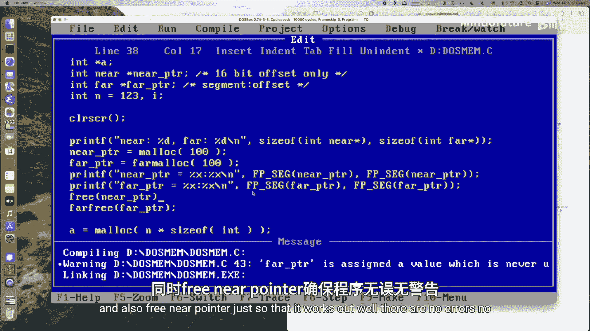

Just so that it works out well。 There are no errors， no warnings。And there you see it。

New pointer is 55 V E and offset is also 55 V E， which is interesting。

 so it seems that the segment and offset are the same here or did I mis right， I didt misr。

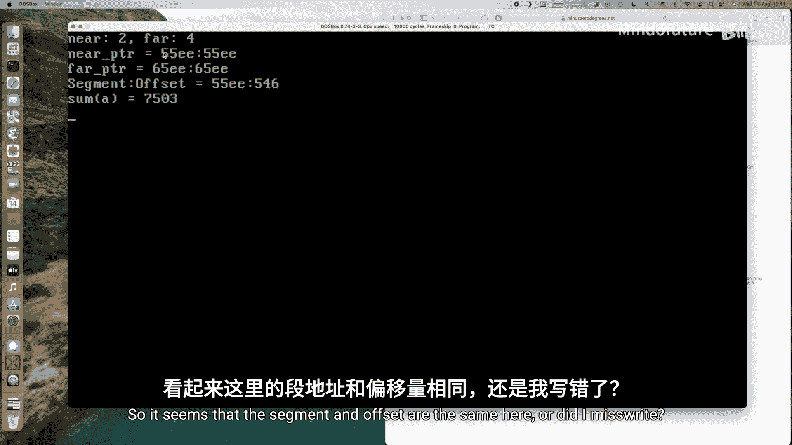

I was just。Copying myself。

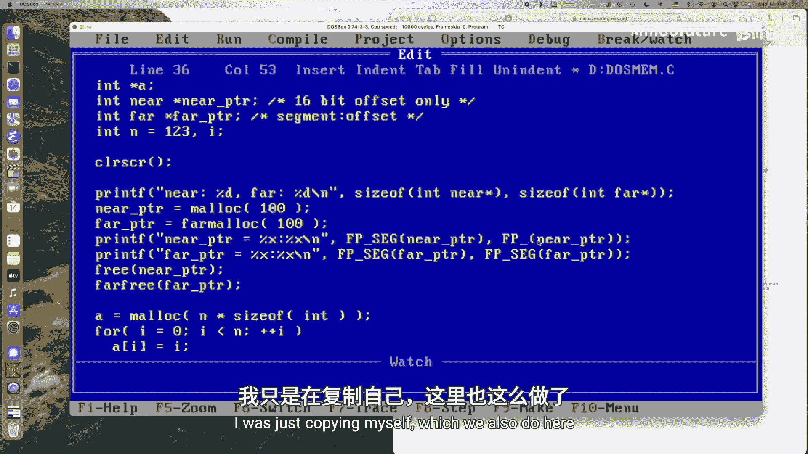

Which we all want to do here。That should work out fine。 This is much more sensible，5，5， F 0，5，4，6。

 So this seems to be the default。Data segment in the small memory model here。

 And this seems to be one of the far segments Basically， as you can see。

 it's exactly 1000 hexadeadecimal further away than the near pointer。

 We can also try and put something here on the stack basically what we already have， For example。

 we have n here， which is an int， So we can try。

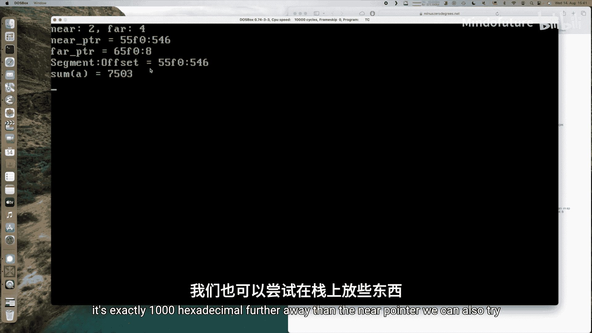

And。Print out the segment， and offset of。The variable N。And how can we do that。

 We can convert this into a pointer by taking the address of it， which you do with the empersent。

Operator。So this will give us also a pointer to int and especially to this variable here and variables that are declared inside a function such as main will not reside in a far segment。

 but on the stack segment。 So let's see what the stack segment looks like。

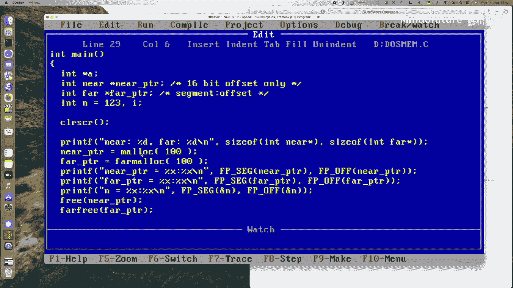

And you can see it's actually the same as the one for the near variables。

 We have 55 F2 as a segment for the near pointer that we allocate using malllo and 55 F2 as well for the local variable that resides on the stack。

 but you can see that the offset here is 550， so it seems that probably the first couple hundred bytes is code and after that are the malllo variables inside this little segment。

And the stack grows from the top。 So from F， F F F。

 And there are a couple of things on the stack already。 But here at F F D D8。

 we suddenly have the variable n。So that's how all these things function。

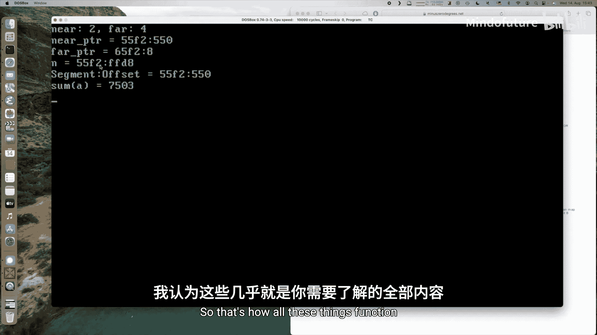

And I think that is already almost everything you need to know。 The question is。

 why would you use stuff like that well。It gets even more interesting once you have structures。

 which are more complex data types。 You can have something like a structure。Let's。

 let's say we call it。Player or something。Which has perhaps。Some variables， X and Y for position。

Position X， position Y。An integer for health。Et cea， et cea。

Structures like those cannot be passed around in a。Regular fashion。

 like if you would like to draw the player character， you can't write something like。

Play a P or something。What you would actually have to write drag player P。 actually in in C。

 you would have to write star P。You have to pass a pointer because C will only copy things into a function when they are primitive data types like in or load or char or something like that。

 More complex types like arrays。Get past round Ean as a pointer。

 as you've seen here in the sum function。嗯。Which you can actually still write as this， right。

 So this is the very same thing。 I'm gonna。Disable this for now， because this is not complete code。

This should also work。 just find there's no error here。嗯。

So if you were to have more complex things like vectors， arrays or structures， then you need to use。

Point us to pass these things around。And yeah， that's。

I think the most important stuff that you need to know about pointas。

The very important thing is that you have to keep track of when you allocate something and when you free something。

 Otherwise， you will have memory leaks。 And over time。

 the memory will fill up and no free memory space will be left and your program will get errors。

 because once there is no more possible。Stuff to be mallloed。

 then Maoc will turn nu pointers and your program or computer will crash。

So that's for you to keep in mind。 C is a very low level language compared to other more modern languages。

 So you have to keep track of this。Yourself， basically。Okay。

 I think that should suffice for you to have a small refresher on how Dos memory management works in real mode。

 what we are doing here in let's code see。On Mtos。So I hope you enjoyed this。

 You learn something and make sure to like， share and subscribe the usual staff。

 leave a comment if there are more questions。 As I said， very specific questions will。

Probably not answered in any reasonable time， but I take these as ideas with me and write them down。

More general things where I see， okay， we need to have another refresher。

 I might do that in a couple of episodes。But that's it for today， as usual。

 all the links for supporting me are in the video description。 and yeah， see you in the next one。

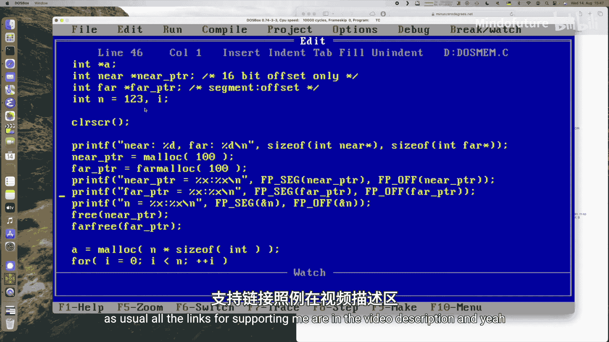

🎼The。🎼当だ。🎼。🎼，🎼，🎼。