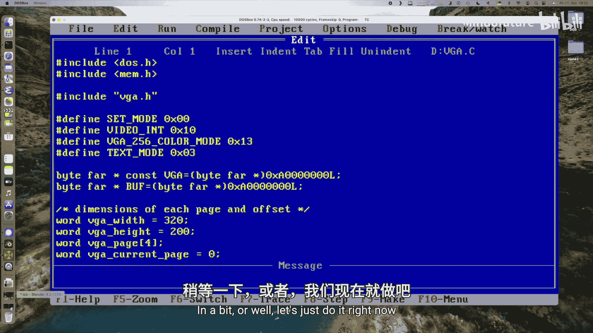
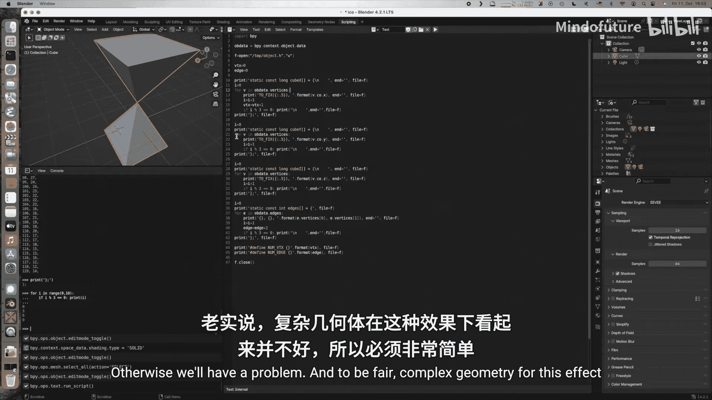
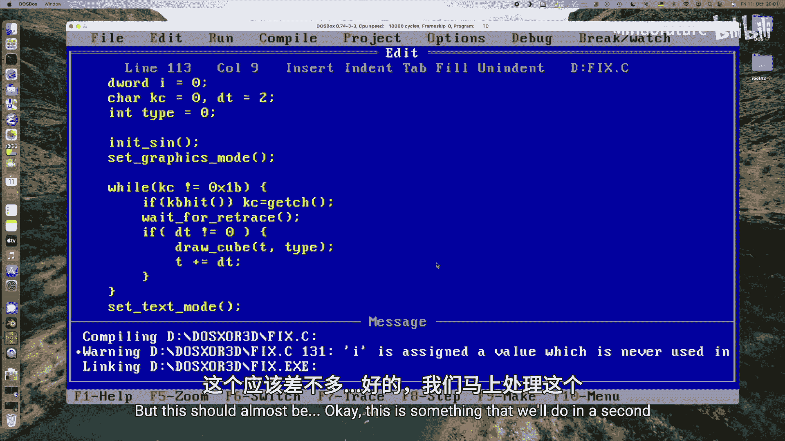
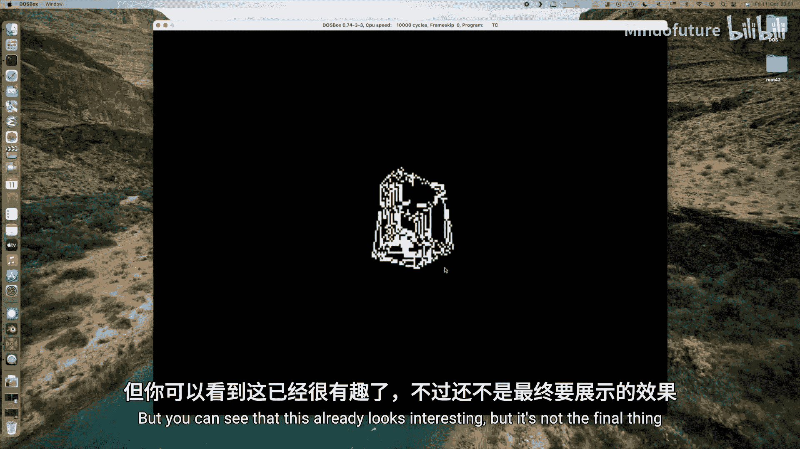
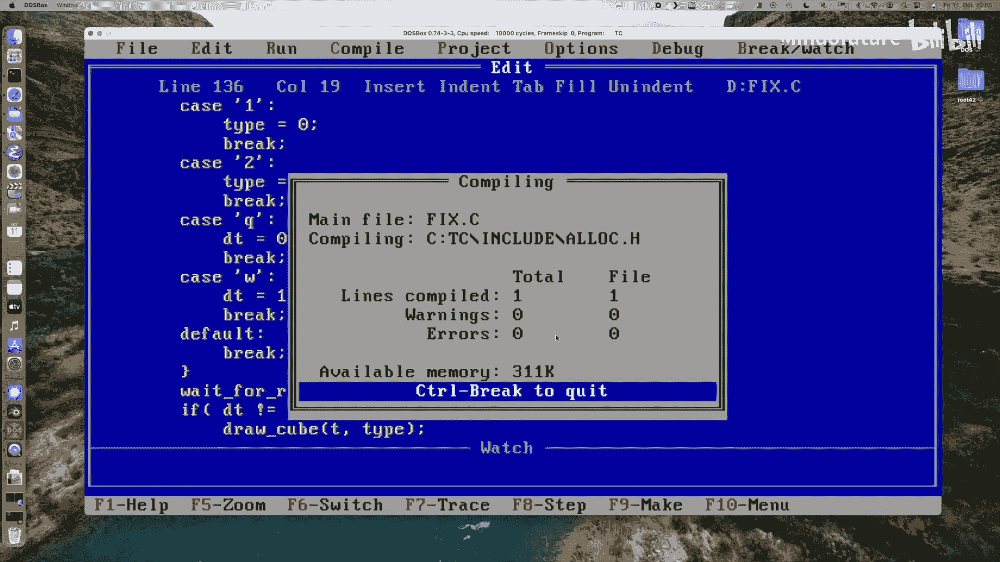
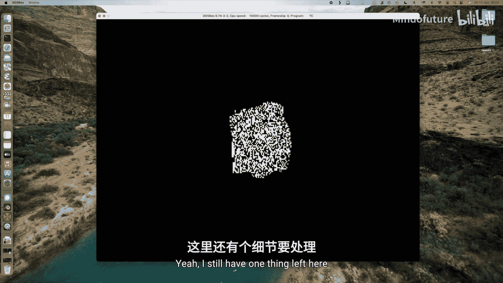
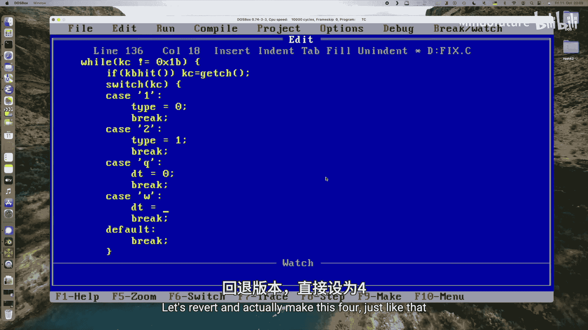

# 编写MS-DOS-系统-｜-windows-｜-操作系统-｜-汇编--｜-vga-｜-x86-p45-P45-Lets-Code-MS-DOS-0x2C---Noisy-3D-Animation--BV1zs35zQEru_p45-

Hello， welcome and an excellent evening， and today I want to revisit an older program that we did and I'll try to link to the previous episode。

And that was the fixed arithmetic 3D rotating cube， which doesn't use any floating point。

 That's my fixed arithmetic and looks quite decent， I think。And a while ago。

 I saw something an interesting demo effect where I thought， wow， this is pretty， pretty simple。

 but looks quite intriguing and has some interesting properties。 So let's do that， I thought。

And that's what this project here is。 And it's based off of the same thing that we just saw。

 but well heavily。Change it。 Basically。 I， first of all。

 I created to include files for the geometry instead of having these。Areries。

 the static areasries here in the drop cube function。

And that contains the vertices and the edges of the 3D geometry。 And we'll have two different ones。

1 I call permit。 actually， it's a little bit of a。Different thing， actually。

 two pyramids stuck together。And something called cube that H， which is just the cube。

And we need a constant because it is very old C code。

 and we can't use a constant into something for the size of the arrays。 And at most。

 we can have 64 vertices。 We don't even use that much， but。Either way， that should be fine。

Then we're going to start and clean up this function。A lot of stuff will be kicked out。 Basically。

 First of all， we will have， instead of the geometry。

 we will have pointers to the geometry point us to the vertices in x。Y and Z direction。

And that is pretty important。Also， we will have pointers to the edge edges。

 which is basically connections between the things。The vertices。Then we have a size T。

 which tells us how many vertices are in or how many vertex coordinates are in there and how many edge coordinates。

Are in these arrays。And this is actually all within the。嗯。File here。

 there is something like Per Vertices 12 and Per edge is 40。And this stuff。

 And I will show you how to get these coordinates， actually， using blender。So you can model your own。

Simple geometry。In a bit。 or well， let's just do it right now。 This is the object that I modeled。

 because it looks interesting。

And this is the quote。 I took inspiration from a stick overflow。

Answer how to access the object data in blender， and I will put this also into the Gitthub or into the codeberg repository in the Git repository。

And it basically creates a file st slash objectject dot H with these arrays pre populated。

 and you can just move it to a different name and include that into your file。

To get different geometry。It must not have more than 64 vertices， obviously， or edges。Otherwise。

 well have a problem。 and to be fair， complex geometry for this effect looks not great anyway。

 So it must be very simple。

Alright。 oh， I didn't want to open this。 I wanted to open the main program。So that's that。

 Then we need to adjust this because we don't have 8， but。These max vers size。

Arays for the rotated coordinates。 I won't rename them now because that will take a long time。

So it will still be called cube rod X， et cetera。 These are the rotated coordinates。

 You can check that out in the previous video how this is being done and the projected coordinates。

 that's the same。 We need to have more than 8 for the pyramid。And I think that is more or less it。

 I think I adjusted this scale factor here or this moving into the Z axis a little bit。But。

 that is fine。Also， the new function will take a type， the type of object， which is just 0 or1。

 depending on if you want the pyramid or the other。So， we will put in a。Little switch statement here。

For the type。And K 0 is that we want the Q。Let's do it like this。 So we save the cube。

Coordinate array into the。Geoometry pointers。 And this is pretty straightforward。

 This is just taking the address of the cube geometry array and putting it into the pointer。

And the same goes from the edges。And we need the number of vertices。We' just call cube vertex。Oops。

 and。Numb of edges。And this is called nu edge， equals cube edge。So that's not。 then break。

 And every other case， we will def to the。Pyerramids， you could put in more。

Gemetries here and switch。And that's maybe an interesting thing to do to see how it will look。

Vertex y equals permit y and vertex Z equals。Pyramid， Z。嗯。Same goes for， let's just copy this。

 This is too tedious。But we must rename this here。Committed。And just。Maybe I should have used a。

Struck here。 And that would probably be better。 That's also something you could to reflectfactor。

 put everything to astruct。 And then you just have a point to thestruct。 And it's all called X， Y， Z。

 edges， purchases。And or number of it is now just。Something like that。I think that would be better。

Also， we are not doing only8 transformationency about the number of vertices。あ。The rest， I think。

 stays the same， but I also thought that it might be nice to have not only a fixed distance from the screen centre。

 but to varyy this with a cosine or signine。 It doesn't matter。Modulular the time。

So basically we will zoom in and out of the object in a nice， smooth fashion。But no。

 I think we're done。Also， we won't be doing a proper draw line， but we will use an X or operation。

And that will be quite interesting。Which means in the VG8 do H。Is now a。Prototype for a drawline X。

 or function， and we will need。A set pixel routine， which can do an X or operation， actually。

And we would do this very simply。The process I will do this instead of just taking the color that we have here。

 we will。So the colour or X or the colour with whatever is already on screen。

 And you can do this with this operator， which is basically the same as， for example， plus equals。

Which is basically a equal。Let's say， let's say like this。 Let's put it here。 A equals a。

Plus B is the same as a plus equals B， and the thing for a equals a。X or B。Can be written as a。

X or equals B。 So that's why we do it like that。And this is our set pixel X or。

And let's also implement this very quickly。 This is very simple。

 since we don't have templates or anything like that。We could use her。Probably a function pointer。

 but that's a whole another level of interactiondirect。 So it's much faster。

 if we just copy of the whole thing。Much， much， much more efficient for this old compiler。

 And then we just call set Ps X， or， basically。And that's already everything we need to do there。

This function now is more or less complete。Down here， we already doing everything that we want。

 and we can have a little look if this already compiles。 No， there's a bunch of warnings。 Yes， okay。

 I think I mis typed something here or forgot something up here。嗯。Whi。Was it okay。

 it has to be edges。And I've got。Bunch off。Warnings， which is。Good， because。We should be using that。

 Oh， this is also still a mistake。 We don't have this， but edge。It should be。Obviously。

 because we now have not a fixed set of edges， but depending on the object。嗯。What else， What else。

 What else。Oh yes。 right now， we're still using the cube X， et cetera。

 but this needs to be verex and。So on。Very quickly changing that。 Otherwise。

 we will always have the same。Object， and we want to be able to switch the object via keyboard。

 We will do that in a second。But this should almost be。Okay。

 this is something that we'll do in a second。

Okay。Here it is already。 It looks still a bit weird， and we can't switch anything。

But you can see that this already looks interesting， but it's not the final。

 final thing that I want to show you。

嗯。But it gives a hint in what we are doing。 First of all， let's try and make us able to。

Switch around the。Object， actually。So when we get the key press。

We will do a little switch statement here， with a key code。And we will have a case。

 something like one。With。Break， and well copy this a couple of times。With the keys1 and 2。

 I will switch between the two objects and with keys Q and W。

 I will start and stop the animation because that will become very important in a minute。嗯。

If we type one， we want the type to be。0ero， and we will give the type to the draw cube function so we can switch between the two different geometries。

This is just for， for fun that doesn't have anything to do with the。Actual。Effect， basically。

And D T equals 0。 So pressing Q will stop the animation because D T is our deelta T。

 and we draw only if Delta T is not 0。If the animation is stopped， we won't do anything。

And otherwise， B T equals one， if we press W。We should put in a default statement。

 Every other key press is just simply ignored。So， we' are not doing anything。And that's that。

 Let's see if that works。

Yeah， I still have one thing left here。 and we can already switch between the two geometries。

 Here you see the second geometry。

Being used。And it's interesting how it wipes away the previous iterations。

 that's the power of the XR actually， and that's pretty neat。And we can switch back to the cube。

And you see already that the 3D object looks quite interesting and quite weird in a way。But yeah。

 let's do something more interesting。 Let's call the randomized function。

 which initializes the random number generator。 It is， I think。Maybe in the standard library， no。

 not， but。It is。Oh， it is in the standard Library， but it is in listed per se。

 I think it's not a an anzi function。I think eron might be。

Of the randomized function uses the time I see you get different result every time you're on the program。

 which is nice。So we randomize this and now we will fill the screen with totally random numbers。

 This is the Tword I variable that he was the competitor was complaining about。Actually， so。

We will compare to。Screen height times， screen width。Because we need to。Write a lot of stuff here。

And what are we doing， We are basically just setting with the buffer。

 we could also use could have used set peaks， what we are just doing like this。

We put a random value in there。We take the modular 2 because this will give us。

 give us either a0 or a one。Moular2 does that。And we will multiply this by 15。

 because that will give us black and white， Very simple。

And what happens if we do this now now the program is actually already complete。And as you can see。

 there's a lot of noise， and you can see the cube。The cube is there， but let me stop the animation。

The cube is gone。 You can do the same， actually， with the YouTube video。

 You can go back and I will reset the information and stop at any time。And I think I。

Did something slower now， but it doesn't matter。 We can also switch to the other geometry and stop this。

 It will disappear Every time you stop the video， the thing will disappear because this thing is only there due to basically two things。

 the flicker that we get from the slow movement。But we can actually， I was using D T equals2。

 So let's do this here as well。One thing is the the flicker basically。

 that you have that makes it visible。And。Nothing else is actually there。 It's。

 you're just seeing the change between black and white pixels and your brain forms the image from that。

 And that's why if you stop this thing， the whole thing disappears。

 And I saw that I think in some demo or on the at the revision， I don't know any more。

 And I found this。Very simple， yet quite fascinating because it's kind of like a little bit of an optical illusion。

And at the same time， of course， it is not quite an optical illusion because during the animation。

 there is like due to the flicker， an intermediate value， a gray or something plus your。

Brain art interprets the movement and makes that more visible。

 We could probably make this go even faster。 Let's try this by。Maybe we can， maybe we can actually。

Do it like so。We can do G T minus minus， and。Dt plus plus。And something like FDT。

What is D is D T signed。D T is maybe， maybe unknown。Let's do it。 I'm not sure if cha is signed。

 Let's do it like this， if D T。Greater than 0 than we decremented。 And here a similar thing， if。

D T is smaller than let's say 1，26， because it will be plenty fast。 and we are。

 we are safe with signed charts than。Okay， this looks like so。 And what happens if we。

Make this faster。 Can it make it go faster。Can I make it stop， I know， I have to press it like this。

 Oh yeah， that that's way too fast。 Okay， that doesn't really happen。ok。AndNo。

 that that actually doesn't doesn't work quite well because。Something exploded。😊，And the。Actually。

 the。Yeah， this is way too fast。Okay， this is super fast。Interesting， interesting。ふんうん。Yeah。

 this doesn't work as expected。Let's do it a bit simpler。😊，Let's revert。And actually make this。4。

 just like that。

Once we stop and then redo it， it's faster。 Now， the gray is not as visible。

 but you still have the movement basically of the swapping pixels。

 and your brain will interpolate it。 I hope this makes sense， in some way。

But what I love is that everything disappears once you stop the video。 and that's pretty neat。

 That was。Already what I wanted to show you， a very nice little effect that I think is quite interesting。

 I think this could be still improved upon and make more interesting。

 But I already like it because if you were to stop this and ask， isn't there an object here。

 People say， no， that's just noise。 And you say， he， there's one。

 But it's its stop moving and it's invisible。 So， yeah， thank you。

 next time I will hopefully have something。More complicated again。

 But I thought this was a neat little intermediate episode。

 So thank you for watching and see you in the next video。🎼，🎼当哒。🎼The。🎼，🎼。

