# 编写MS-DOS-系统-｜-windows-｜-操作系统-｜-汇编--｜-vga-｜-x86-p46-P46-Lets-Code-MS-DOS-0x2D---L-System-XMas--BV1zs35zQEru_p46-

Hello， welcome and an excellent evening。 It is again， Christmas time， roughly。

 So we are back with a special Christmas episode for Let's go Msdos。

 where we usually take Dos box or Real Dos PC and program using To C 2。0。😊。

But during Christmas we switch to power basicic， so if you want to play long at home。

 you have to have power basicsic version 3。2 or Haya， I think there's also 3。5， but I like 3。

2 the best at the moment。It should be available online somewhere on certain sites。

 there's definitely a demo version that works as well。

 it just doesn't produce ex files but compiles into memory。So for testing this stuff out。

 it's definitely good enough。And if you have an older version like version 2。

 there might be certain subtleties with the basic syntax， for example。

 when I'm using variables here and there。Typing on those variables will be different。

 so you might have to change the code。

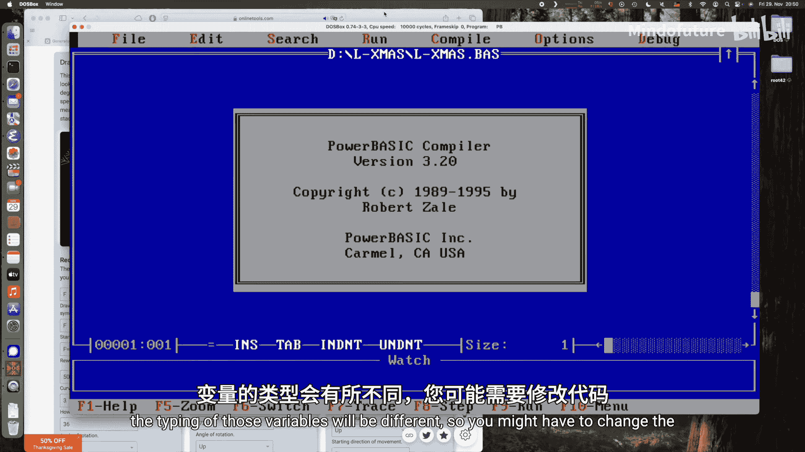

And during Christmas， we also take Christmas topics， and we already had。

Snowflakes produced by so called L systems。 Those are iterative fractile systems or function systems that can produce toughlike。

Trees。Plants， but all kinds of weird geometric shapes。 And we use the cock curve to produce。

Interesting snowflakes， basically。But today， I want to produce。These nice Christmas trees here。

 And I think this doesn't look like a Christmas tree in this direction， but if。

We are turning the thing upside down and maybe produce a little bit more iterations。

It looks quite Christmas tree， like to me。I would say。And we can reuse most of the code。

 but I will type it from scratch anyway。With Al systems。

 you always have a starting axiom with which to start here it is just the simple F if we take two f's。

 we will get two trees or three or four， etc， you get the idea。

And there's a term replacement happening， every F is replaced by another F。

The square brackets mean a push and a pop of the current state of the machine。

 and the state is always the current position in x and Y coordinates， plus the angle of rotation。

And in the end。F means to draw a line， a certain length。Which is also a parameteromaly。

 It is not used here。 It's implied。But we have it as a special parameter。

 so this means actually forward， draw forward。And。If you choose to stop after five iterations。

 after the first iterations， you first apply all these rules with a push in the pop and plus and minus mean turn left or right by this amount of degrees。

 So 36 degrees。 And if you apply this， you will get this nice fractal shaped tree or tree shaped fractal the other way around。

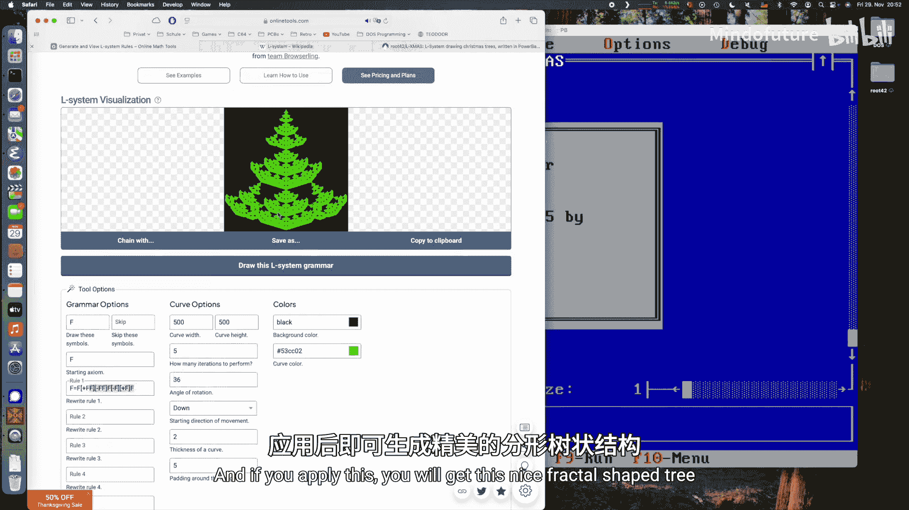

Well， enough talking， we will use a lot of global variables， which is not good in a general sense。

 but it makes reading this particular code much easier instead of having us to pass around ton off parameters。

In real life， I wouldn't do that， but for this demonstration， it is actually pretty apt。So as I said。

 we need a。Perrameter length。Shart means it's a global variable and it's a double。

 I could have also just written it like so。 or I think like this is a double variable。

 but I like to write out the data type exactly。Co as the color。

Which is obviously an integer from 0 to 15 because we're using6 in VG high risk mode。

We have a scale because this will be like a screen saver and we will draw a bunch of trees with different scales。

This is， again， a double。Then， we need the。Current state。Of the out system， as I said。

Something that can can be pushed onto a stack if needed， is the angle， which of course。

 is again a double。Then we have the position and the x。What's a double。And deposit position。

And the why heart has a double。That's pretty neat。嗯。Snacks for pushing pop。

There's no stack structure。 The only usefulful structure that we can use here is an array。

 so we will have three different arrayries， a position stack for x。From0 to。

 let's say 16 doesn't really matter if we are using only five iterations。

 then maximum stack depth that we'll get is 5。But you could technically use more brackets。Or。

Brackets inside of brackets， and then it could get bigger。 I'm keeping it small here。

 For this example， it's enough if you see an area out of bounds。

 then you might want to increase this。And remember， it could。Increase exponentially。

 depending on what kind of。Formula you put in there because let's face it。

 you could also produce anything that's in here， but you would have to enhance our code to support multiple rules。

 for example。

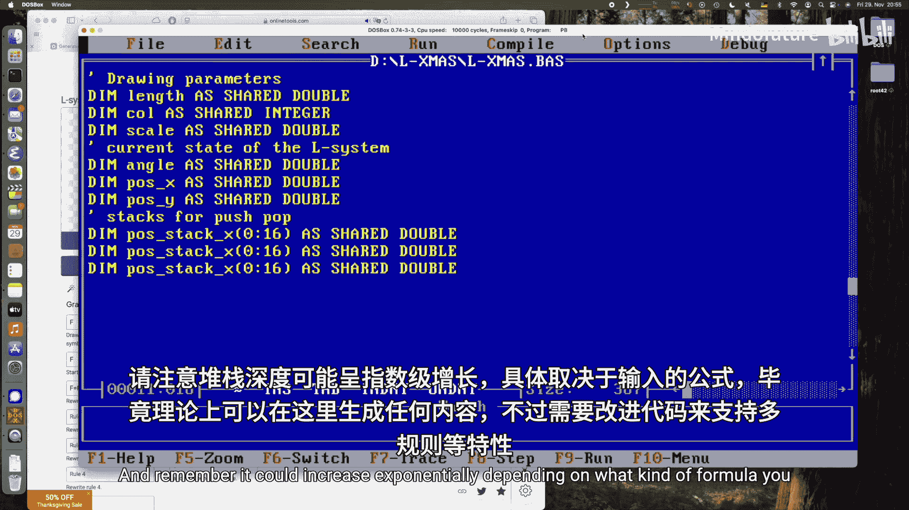

And yeah， different， different axioms。For example。So we're not going to go into that。

 that's maybe for some other other video that would take way too long to explain and implement。

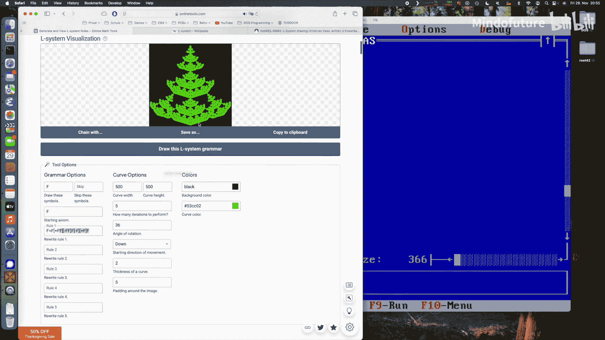

And we need a。诶。Stack for the angle actually， which we call the angle stack。

So that's that those are all our。Variables， except for the stack pointer because we need to have a stack pointer。

 which we call。AndSP， just like the stick point on the。886 CPUU。And that's just the simple integer。嗯。

Then， we can。Implement the different functions that we need， or subprotes。

The first function is the push， which is called when we encounter the square opening square bracket and we。

 we will just code it as as push here。 and as an exercise， you can。For example。

 also try to pass the string and produce the function from that， but we will just hardcode it。Easier。

So push works like this， you take the strength that you're currently having。And put。

We value that we want to push。Into the position of the stick pointer。

 And then you say stick pointer is stick pointer plus  one。Now we push something onto the stack。And。

 of course， the same goes for the。Other two stacks。De position Y and the angle stack。

And that's already our push function。And the pop， obviously。Very。怎么了？But the other way around。

 first of all， before doing anything， we need to decrement the stick pointer so that we can get the correct。

Thing here。 And， of course， the roads are reversed。 We are taking something out of the stack。

Which makes much more sense if we write it like this。And。That is already， and basically。

Oops basicallyically everything we need for push and pop。

 And this is something that we didn't have in the old code， basically。That was not。There。

It's still compiles， and that isn't good news。Then。

We have the function that actually draws something。Draw。One step forward。That one didn't change much。

 except with the push and pop， I needed to actually take care of the。Coordinates explicitly。

 which we didn't do before。This needs the length as a double。And the color as an integer。

AndWhat we're doing here， I like to declare all the variables， even if it's not needed。

we able to have a new position？Which is a double。and。new Y position。我吃道。And the new position。

Is the old position that is currently there。Plus。The rotation around the angle。For the x。

 that's the cosine。Times the length， which is the scale times the global length that we defined。

 but you will see that in a second。Same goes for the Y position， but this time， of course。

 with the sign to get the rotation。And that's that。

And then we can draw the actual line from the old position。And in basically。

 you take these two pulls and write the dash， so it's line from01 to point B。Very intuitive。

I would say。Using the color that we got。And then we have position X。Is the new position X。

And the same， of course。For the Y position。Does this still compile， oh， I accidentally quit。Yeah。

 it still compiles perfect。 That's very nice。 This is still a complete program。😊，The turn。Is。

As it was before， turn degrees。Ands double。And the angle gets updated by。

Adding the new degrees times。3。14159。2，6，5 divided by 1，80。 This is basically converting form。

Degrees to raance， I'm not going to explain that。 that should be obvious， hopefully。

And then comes the actual function， that is the function F。

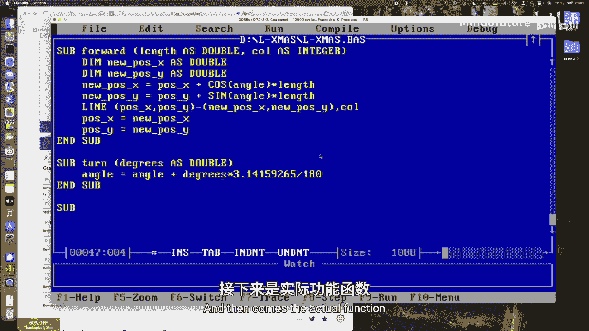

Which is this substitution here。 So we want to write whatever is right of the equal sign into this thing。

 right， So this takes only n as an integer， which is something that I improved upon from the last implementation where we had to pass quite a bunch of parameters。

 But now we only need our recursion parameter n。

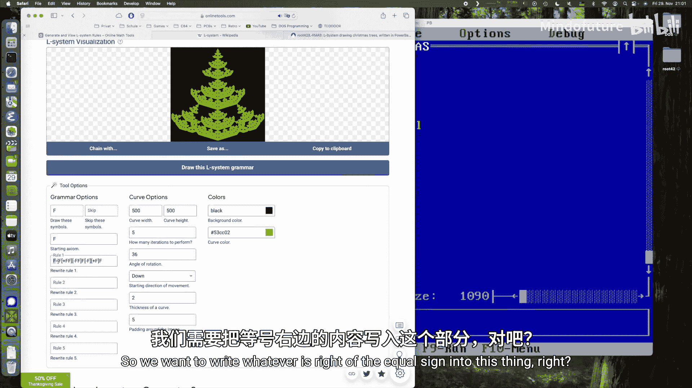

And our。Formula is supposed to be。F push plus F F。Pop。Push minus Ff top。Then F pop push minus F。

ポップシポッかな。Push， cop， push。I think， yes， plus F。And F， okay， how do we code that very simple？

Every F is just fn minus1， so one recursion step。Then opening Bra or opening bracket is push。Plus。

 his。Turn by。Plus， 36 degrees。Then we get F -1。And minus-1。And pop。 and again， a push。

Then we get a turn minus 36 degrees。F and -1。F and -1。Then next pop。F n minus。1。嗯。Next up is。Push。T人。

in-36 degrees。Fn minus-1。Pop。Push。No， I have to。Look up or push， then。Turn plus 36 degrees。First。

 fn minus1。Then the pop。And then one more F N-1。Is that correct？ Yes， there's an F at the end。 Okay。

 this should。Still compile， yes， it does because there's nothing that we depend on that's not defined here。

So as I said， an exercise could be to have this as a string and create automatically this code or interpret it。

Has called， basically。We're pretty far already， this does it。

 then we need the axiom with the start basically， I call this X mass。

And it gets the maximum iterations as an integer。The higher the number， the more detail。

 but also the slower everything will get。And since we're drawing many trees。

 we have to reset the angle and stack pointer。So angle。Is reset to 0。And we to。0。

And to have the tree。Point the rightway up。We do an initial turn。

 We could have also initialized the angle， but I was too lazy。And this is more readable， I would say。

 if you say turn 90。And then we call F。Just in the usual name。

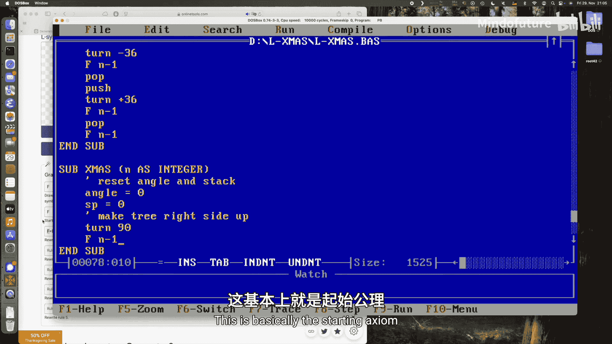

Basically， the starting XM here， you could also write Fn-1 and F n-1 to draw2。

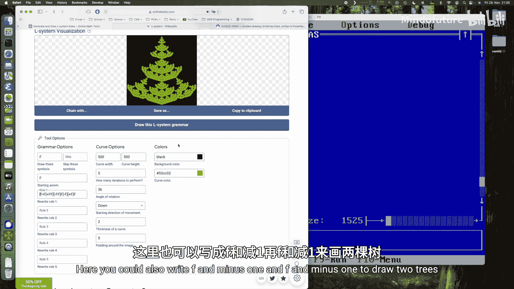

Trees， obviously， and you can play around with this near truly。Okay， then we switch to graphics mode。

 And so we don't forget it。 We also switch back to text mode。This is 6，40。By 4，80，16 colors。

So you can actually see something and have a couple of colors on screen。Then we initialize the angle。

The first time， actually， that's actually not needed。Because we have that here in the Xma routine。

 So let's leave that out。Might be in the final code that I post online， but yeah。

Then we need a count variable so we can clear the screen every once in a while。

And we do an infinite loop。Which is only infinite as long as they don't press a key。

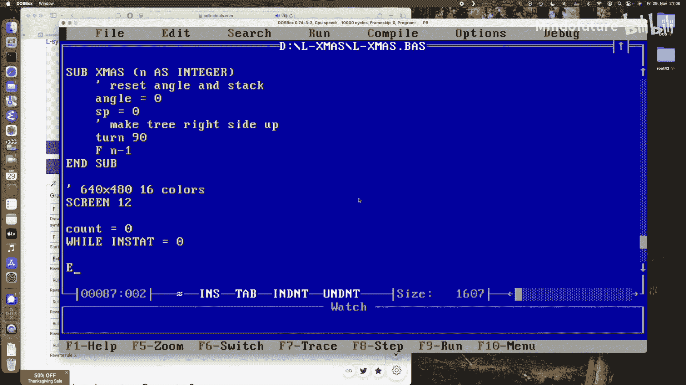

Which works like this while install equals0， you can look that up。In the online help。

 which is very nice and this is a German version So we have a German text。

 but it says it gives you the input status of the keyboard and it's0 if there was no key pressed。

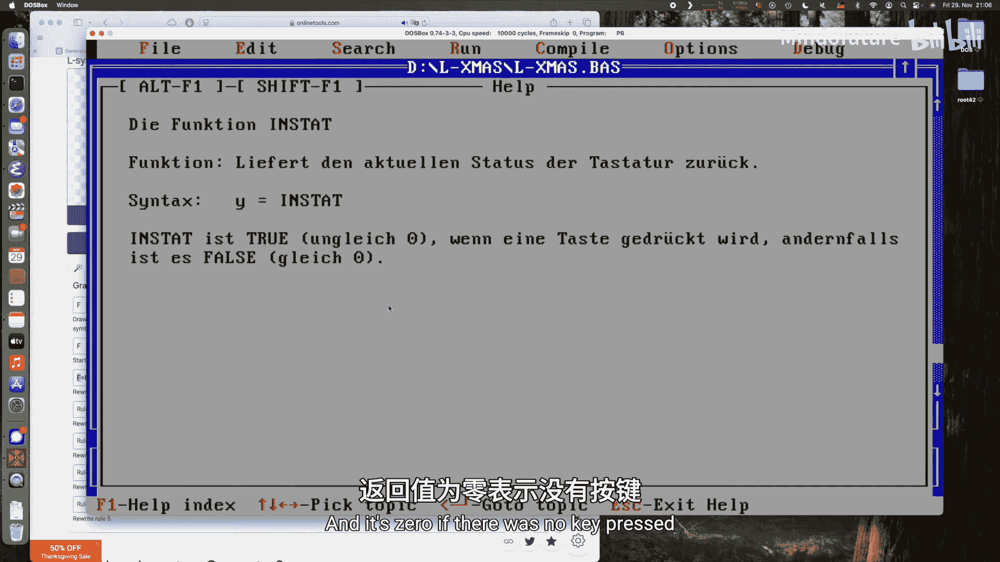

So this continues until you press any key。And if the count is greater than 10。

Then we do a clear screen。And set the count to zero。 So every 10th。3， we do a screen。If I would say。

Which is not quite correct， and there must also be a。Else， where we increment。The count， obviously。

Does this two compile， it does very nice。Then we need to compute a scale factor， which will be。Oh。

 we should。 We should randomize the timer。randomandized timer。

 which means that we will get different trees every time we start this。

 it used the timer of the machine to initialize the pseudo random number generator because we need it here。

So minimum scale is 0。5， so it doesn't get too small。 You can play around with this obviously。

And yeah， we take R And D times2。 I think R And D gives us。

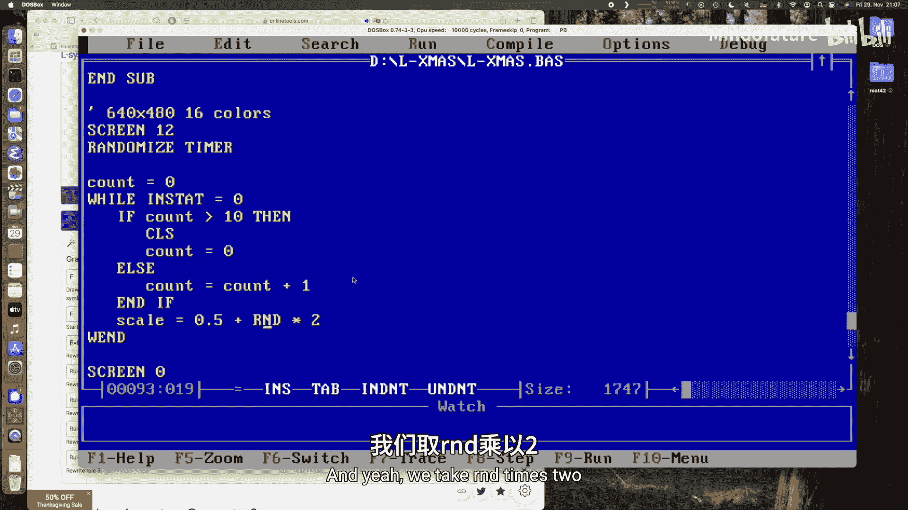

Something between 0 and1。 So scale will be 0。5 to 2。5， which is。From experiments。

 it looks pretty nice。Where is R And D here。It is between0 and1， yes， all right。

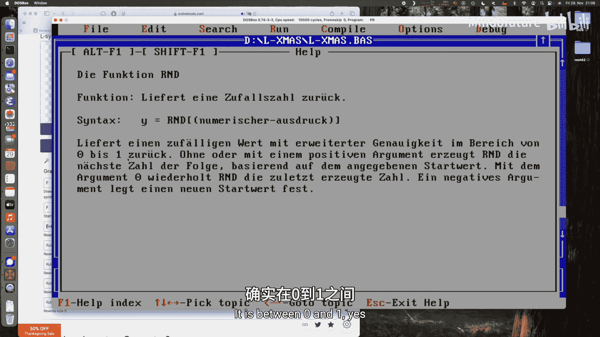

That's good。Then we have to also create a random position。

We will take -160 divided it by scale plus R and D。Times6，40。Which is obviously。

Randomizing the position over the whole screen， more or less。

And -120 divided by scale plus R& D times。For80， this leads to the fact that the tree might also stick out。

To the border。Overhanging over the screen basically so it gets cut off so you get like nice。

 evenly distributed things。But you can play around with this as well。

Color is R And D times 14 plus one。Plus，1， not S 1，1。This gives us the color between 1 and 15。

Because zero is black and that would not be visible。Length equals two。

 This gives us a pretty nice length。And then we call Xs with five maximum materations。

 and that's already it。Let's see if it still compiles。

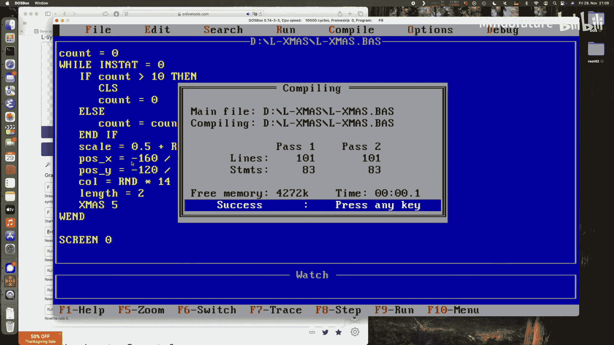

Looking good。And nothing happens。And actually， I managed to。

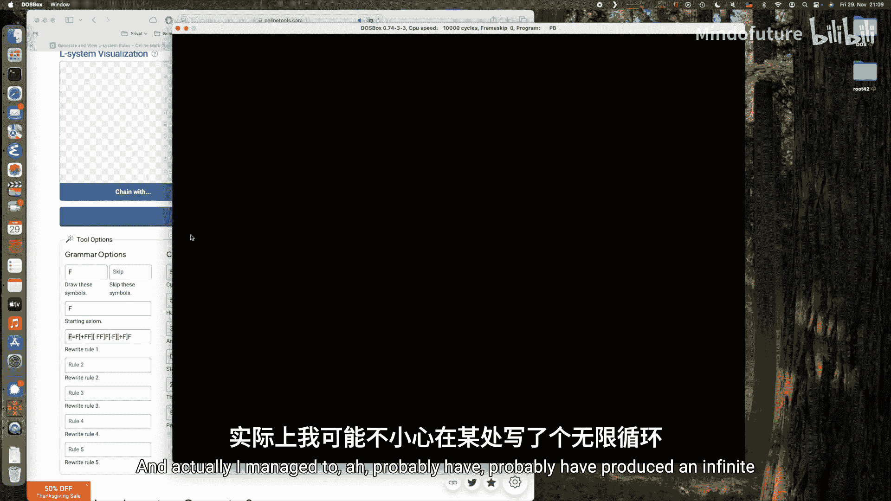

Pro have。Probably I produced an infinite loop somewhere。Okay。

 actually in horse pretty simple because of course this is generating an infinite loop because we don't have a end of recursion。

So if n equals0。We actually have to draw something， we have to call the forward subr。嗯。

And I should keep in style here。A doing this？So we come forward。With the arguments。Length time。

 scale and。Color。Which is also global variable， So I wouldn't have needed that。

 so there's an else there and then there's an end。And this way we don't get an infinite loop and I'm wondering why we didn't get any stacoflow here we should have gotten。

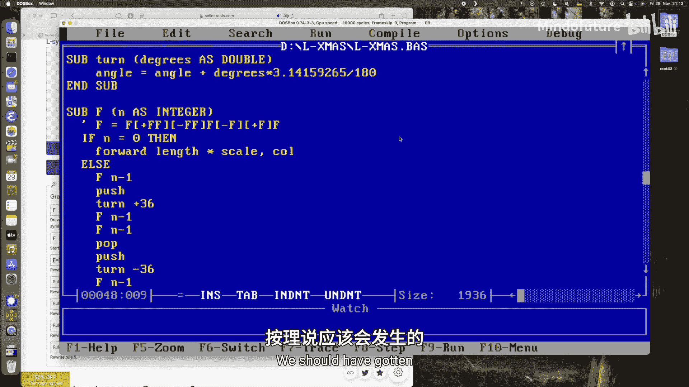

It seems it was very， very impressive here。And there you go， it works， let you get nice。Very。

 very colourful and quite detailed。Christmas， please， I would say。

And I'm always amazed at these al systems， what kind of things they can generate。

 they also work in three dimensions。You need to change the angles， I guess， to 2 d angles。

And stuff like that。 But yeah， it's amazing。What they can do。

 and I think this is a nice little screen save。I would say we are currently running on the speed of like a mid range 486。

 I think。And yeah for basic， there' is actually pretty decent speed。

Because the recursive nature and all the line drawing， these are like thousands of lines。

 it's always drawing。It was pretty pretty nice， pretty decent， I would say。But yeah。

 that small is it for today。Thank you for watching。 I hope you have a great holiday time。

 and I think if I manage， I will also put out another regular， let's code this year。

It's already prepared， the code is there， but it's quite a long video， I think。

Because it's quite a bit to explain。So if we are lucky。

 we will see this as well this year and if not， then definitely in the new year。

But thank you very much for subscribing for liking for commenting。 Yeah。

 please post your own improvements on this program。 code some other L systems， I don't know。

And I think this even looks a bit like a skull or something。 It's Halloween mixed with Christmas。

 I think I heard about that somewhere。Anyway， that's it and see you soon， bye。

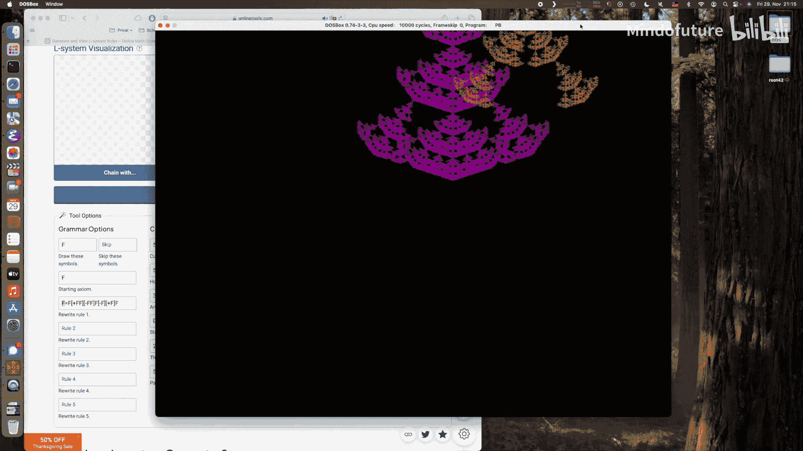

🎼，🎼，🎼当。🎼Yeah。🎼，Yeah。