# 编写MS-DOS-系统-｜-windows-｜-操作系统-｜-汇编--｜-vga-｜-x86-p47-P47-Lets-Code-MS-DOS-0x2E---VGA-Redefinable-Charsets--BV1zs35zQEru_p47-

Hello， welcome and an excellent evening。We are back with let's code MSDs。

 the series where I present little projects that are coded for MSDs in Tobu C 2。0。Real Mo， 160 B。

 VGA， stuff like that。And yeah， we're back making a plasma my effect。 but this time we did this。

Coably years back， I think。This time we're not going for a graphics mode。

 but we are trying to do this in text mode because the EGA and VgaA cards have interesting capabilities。

In text mode。For example， redefinable character sets， that's what we will use。

 and the VGA card also supports changing the palette， the VGA card as well。But to a less extent。So。

 we can actually。Use a completely different palette here。

And I'm going to switch down to the main function。To walk you through it。

 and I have a lot of steps here and a lot of empty arrays that we will have to fill。

So hold on to your heads。 we are starting now。 Well， as usual。

 we need a couple of run variables T as usual our time step So this encodes where we are in the animation。

I forgot what I use the C pointer for， I think I can throw that actually away that was probably for something different。

Anyway。Something that we definitely need is the seer is the palette， the palate。It has 16 colors。

 so 48 entries。 and this is basically just the subseampling of the fire palette that we are using for the graphics mode。

 It does the same color run from black to red to yellow to almost white。And looks quite nice for。

Casual purposes， but its subsle  to 16 colors。The 16 colours can be set directly on the VGA card because you have to go through the so called palellet registers。

Which is what we are going look at now。 We need a mapping for the 16 colour to the different。

Color palelleette registers， which is pretty。Straightfor for the first six。

So that's actually one to one mapping。 So color 0 goes to register 0。

 color1 goes to register  one and so on all the way up to five。So here we are with HexodsL 5。

 but then we are not going to use register number6， but register number 14 hexodsMO。

And then we switch back to the normal ordering 0 x07。For the9 color， we are using。Register 38。

And then it's actually， again， pretty straightforward。3 a。3D。Well，Come on。3 C。

And all the way up to3F。Why that is the case， I have no clue。

 I think that's probably due to the IBM designers who created the VGA card。So， yeah。

 it's a bit weird。 The set palette function is very similar to what we would usually do， but we。

AndNe this indirect by the palette register。So we're just simply doing。A loop。Over all。

 the text colors。Which is defined as 16 further up。And。There we go。嗯。Something like that。

And then we will have to write in every loop， the pallet index。

Which is the number of the color that we want to set。

 and we're actually setting the paled register here。嗯。And for the usual 256 color modes。

 it's just one to one mapping because there we have 256。

Color registers on the VGA card and for the 256 color modes， that's exactly what we're using。

But for the 16 colour modes， we will have to use。This year。

And that's actually quite the difference to how we usually set the palette。

 And then we are writing to the pallet data port。 All these constants are defined in the VGA headerophil。

So if you need to look that up， that's also from earlier episodes。

 I will check in all the source code as usual。So there you can look everything up。

But it's just a shortcut for one of the VGA pos，3 C 8 or something in 3 C 9。

 I don't know from the top of my head， but I think that might be pretty similar。 The sign table is。

 as usual。 I'm not gonna touch this。 We will use that to create the。Actual。effectff。

Then we have a bunch of things here。 let's go back to the patch interrupt in a second。

 We will initialize the sign table。 We will set the text mode， which is already done。

 Then we'll disable the cursor， which is a function I will explain。

 then we'll set the character with to 8 to have not nine column characters as VG usually has。

But instead have eight pixel characters because it makes for nice oring。

 but you can play around with this， you don't need to do that。

This is most obvious if you use the block drawing characters that are something like these。

There you see in nine column mode， which were currently in that there's a gap in between those things and in eight column。

rendering mode， there isn't。VGA is usually9。9 times16 while。EJ is usually  eight times 14， I think。

And switching between the nine and the8 column mode does exactly that。

 The ninth column is always repeated from the eighth column。Or left blank， depending， for example。

 for the line drawing characters like the borders here， you need to duplicate it， obviously。

Then we set our custom characters and set the palette。And afterwards， while no key was pressed。

 we draw the plasma， we draw a little scroller and we do a page flip so that we don't have any flicker because text mode supports multiple pages so we can do double buffering and then we read the character that was just hit on the keyboard and set the text mode and quit。

So there's a bunch of things。😊，I'm going to talk about Pe and trap later first we're going to do the disable cursor。

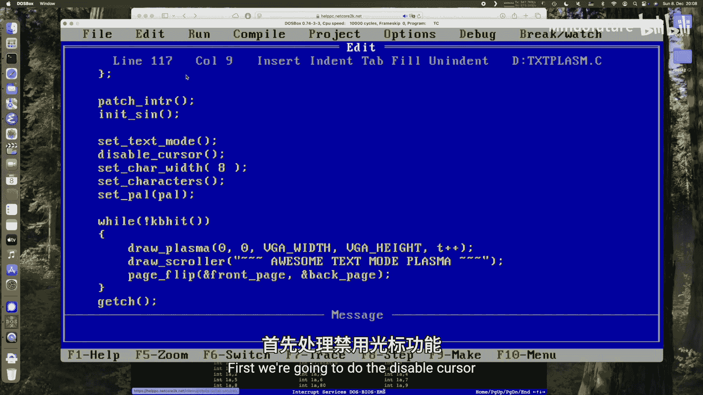

Disable cursor is a function of the interrupt10， namely。The function。1。

 I think set cursor type that's not only for disabling。

 but to basically set the height of the cursor how thick it is basically。

 And you can turn it off completely using that as well。 So let's exactly do that。

 Where our dummy code here。

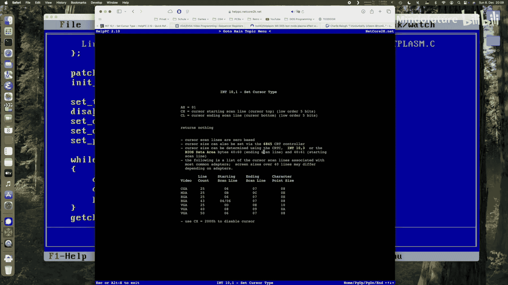

Mempty thing。For calling an interrupt as usual， we need a union called Reggs。

And a union is basically multiple values rolled into one because an Ax register is。

Composed of the high register concatenated with the loaded register。And we can。

Address both of these using the union， as you will see in a short second。For example， using the。

X substructure in the union， I can access the Ax register and set it to 0 x01，0，0 because。

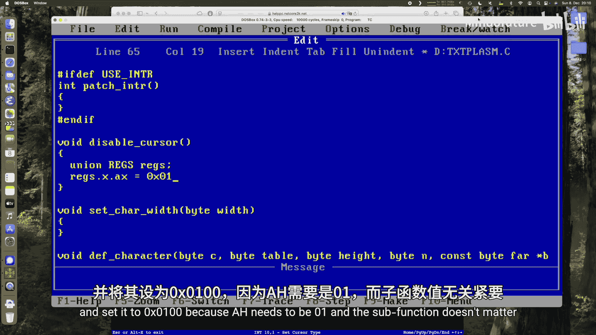

AH needs to be 01。

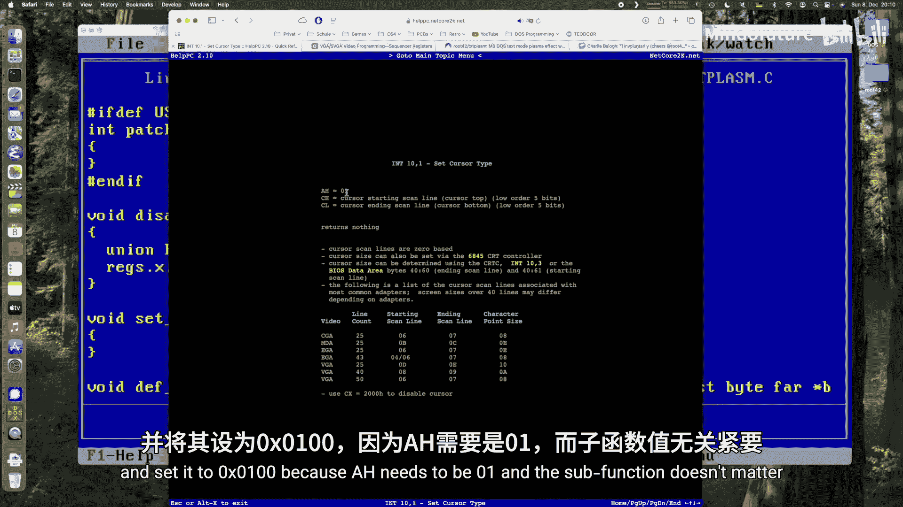

And the sub function doesn't matter because there's no AL。

 So I could have also said it to FF or something。

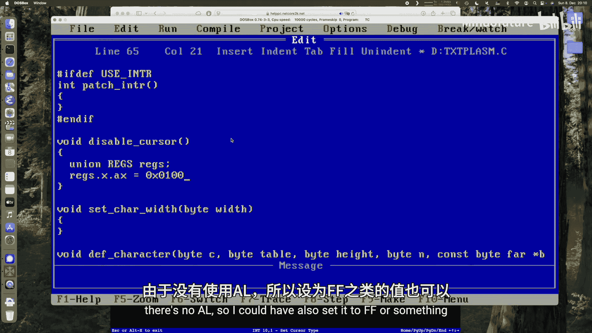

But instead of that， we can have a look at the dos header file and have a look at the end 86。

And there we have it， there's also a structure by registers in the union regs。

 which I could have accessed like so I could have written regs。

 H dot ah equaled 0 x01 That would have been the exact same thing。

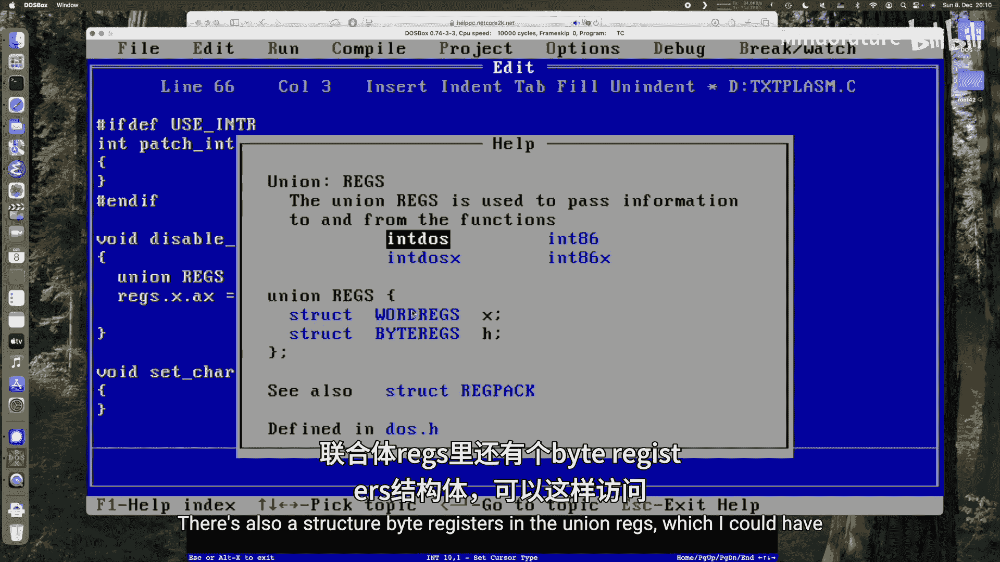

And I could have kept。The A L register， as it is， whatever it was defined with。

 So according to this here， that's probably fine。 And we can do the same。For the C X register。

 so we can do rex dot H dot C， H。

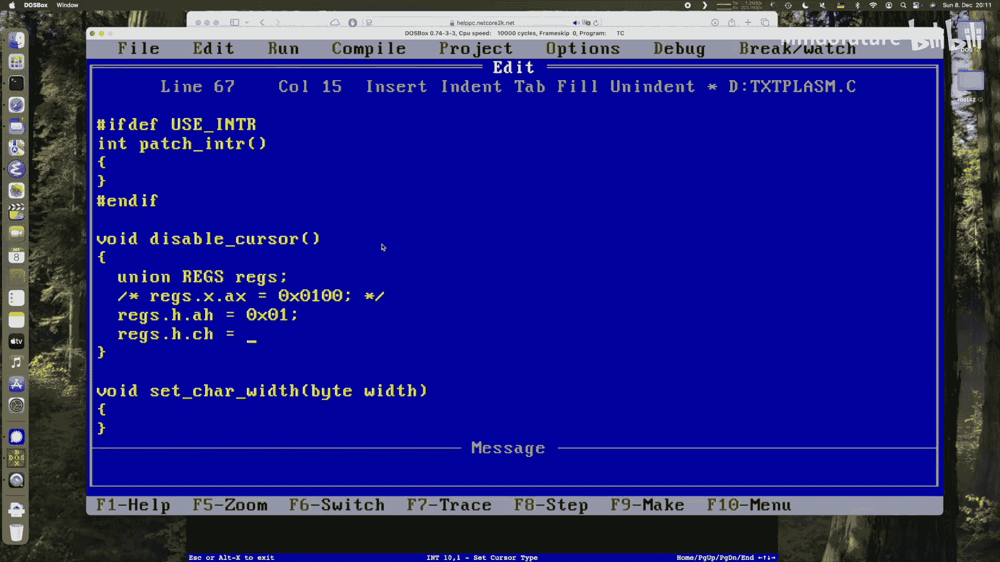

And。C， H will have the cursor starting scan line。 low order 5 bits。And if you set this to0 x3 F。

 this will basically disable the whole thing and the C will be the cursor ending scan line。

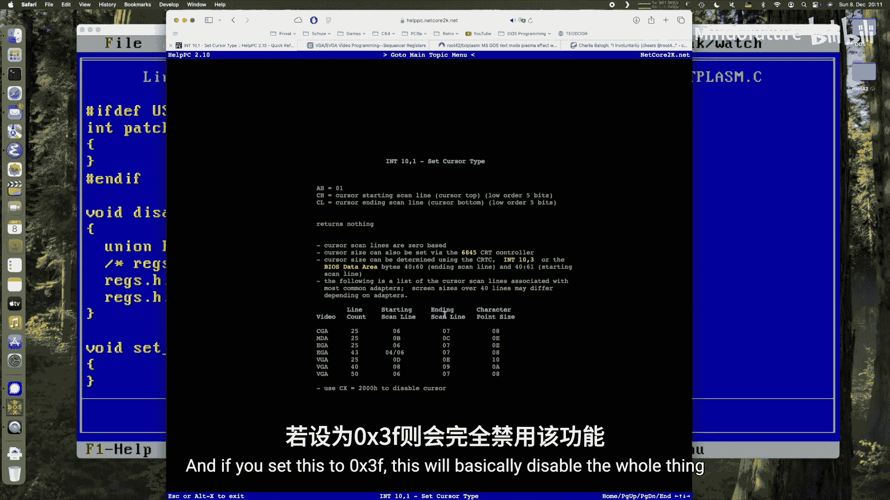

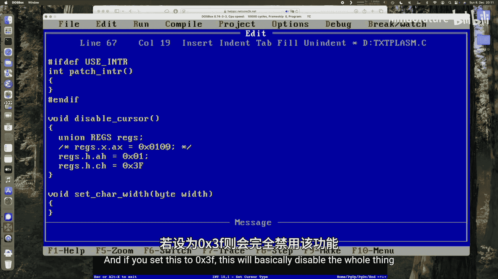

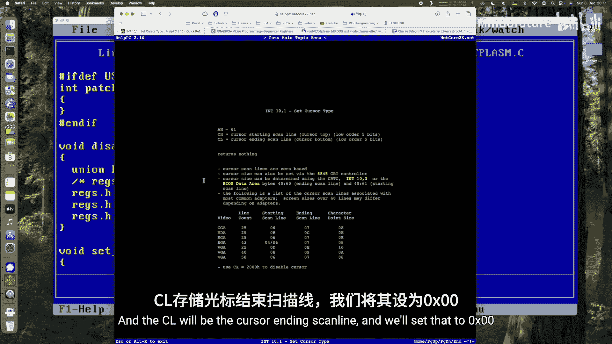

And will set that 2，0 x，0，0。That should actually already do everything that we need。

Does it comp all this to an  error because we haven't defined it yet here， the character table？嗯。

Which is okay。 I am gonna disable that just for now。Better。And we actually still have a。

Cerson because I forgot to call the interrupt， that is totally understandable。

 So we'll call end 86 with the video interrupt， which is 10。And then also， we pass the registers。

As a reference， because there's also the output registers andstructs can only be passed。

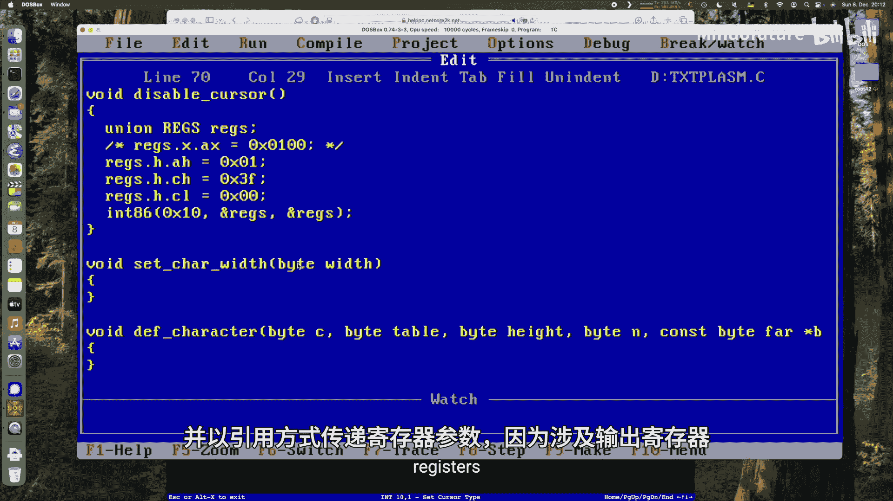

That way。And there we go。 We have a black screen， obviously， and the cursor has been turned off。

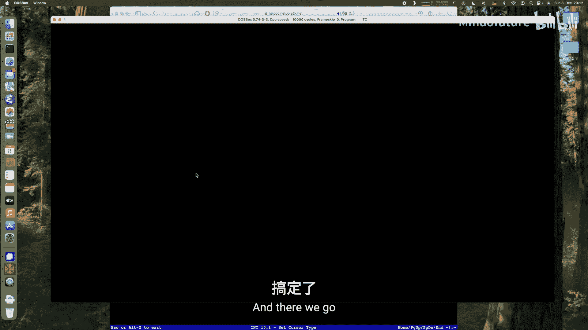

Which is fine。So now we know how to do that。Let's get on with everything。

After we dis the cursor we need to set the character with， we don't need to。

 but we want to because we want to learn how to do that。And there are。

Following things that we need to do。That's a bit of。Low level VGA programming。 We need。

A temporary variable that we need。We call it X。An X will be filled。

With a byte that we read from the maceus output。Read register。And we end with00 x F3。

Because here we are selecting。The bits。01 and 6 because we need to preserve those Those have to stay however they are you can look up all these things and registers in different books but also online and the VGA and SVG video programming manual and the miscelllinous output read register let's quickly look it up in our VG header file。

 the output read is 3cc misceous output read Here we go。

 the miscelinous output register is being read via 3cc and being written to via 3C2 and the bits are the IO input output ever select the ramenable and the horizontal Sity that needs to stay basically。

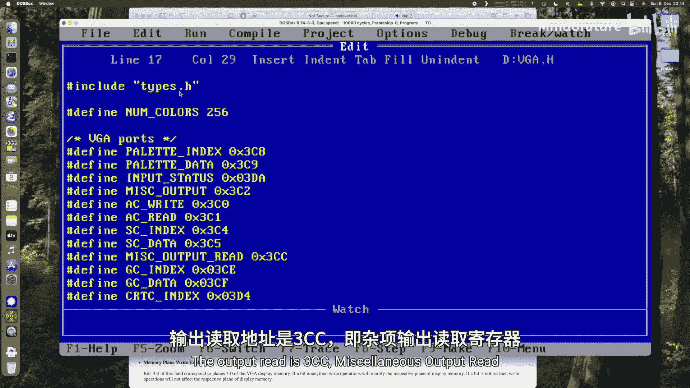

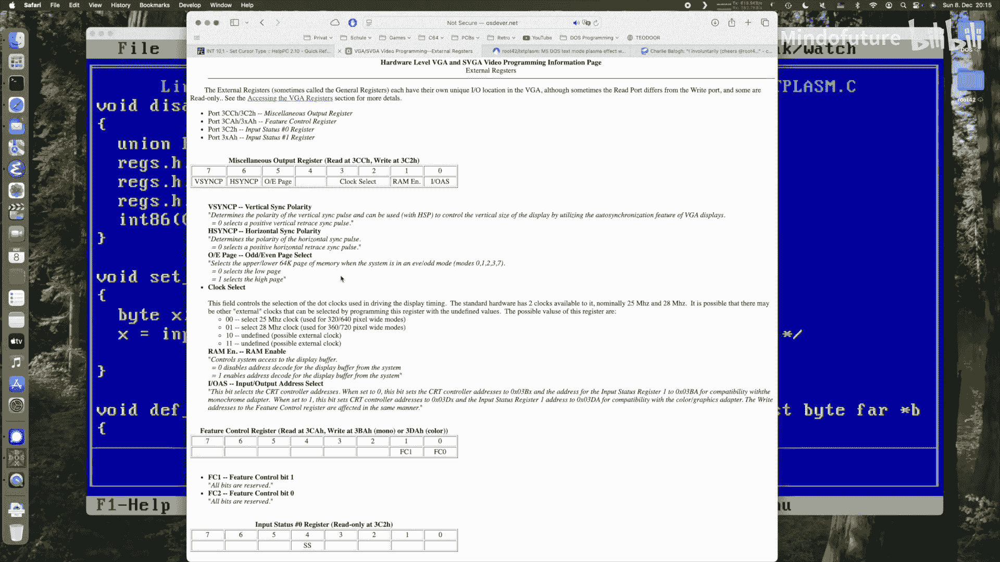

So that's what we are keeping。Then as you can see there is also the clock select， which defines。

 for example， if we are in a 640 or 720 pixel mode。

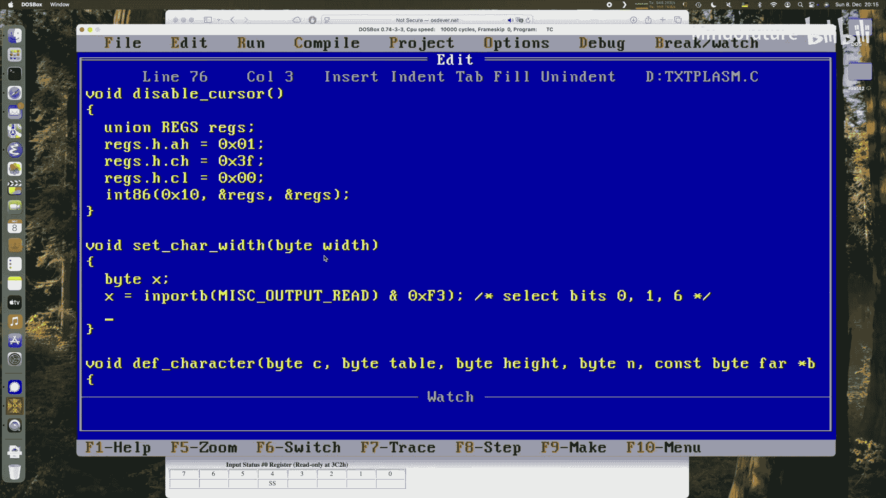

Eight columns is a 640 pixel mode， obviously because 8 times 80 is 640 and 9 times 80 is 720。

 and that's basically what we need to set bits2 and3。

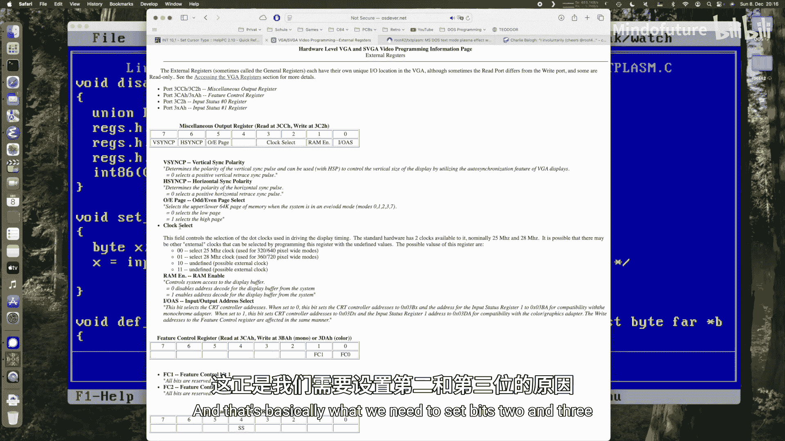

So that's what we're going to do now。With。Equals 9， we want to switch to a 720 pixel thing。

 so we turn the appropriate bit on x or equals0 4， sorry。And we are writing。That。

To the Mi output register。And we're done with that。After this， we are disabling all the interrupts。

 We are going to enable them。A little while later， so we don't get any issues of flicker or weird behavior due to an interrupt happening。

Then the next step is to go to the sequencer and。The first thing is， we are gonna select it to reset。

You can look that up as well， and we are also going to reprogram the sequencer。Toz。

Equally nine columns because it has to know about this as well。

 So this is really a bit more intricate as usual。We are going to look up this particular setting。

In a moment。So we're going to go back here to the sequencer registers。

And we are selecting which one here。嗯。I think we're setting the clocking mode register with an x01。

That should be the low by and there we set or delete the zero bit。

 which is what we're doing here in the high B。With equal zeros， obviously complete garbage。

 I wanted to have a nine here。

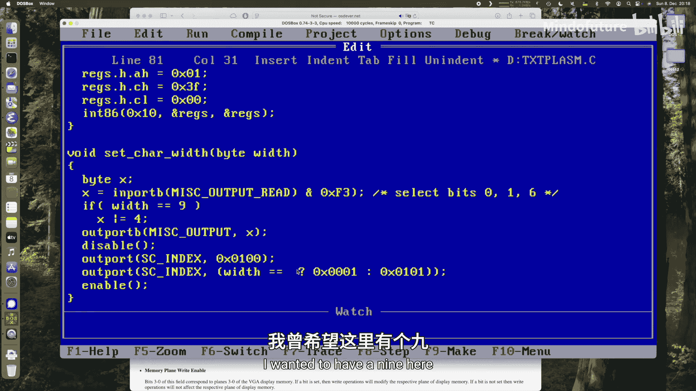

Exactly a0 selects 9 dos per car layer。 That's correct。 that's in the high light。

 and that's fine then。

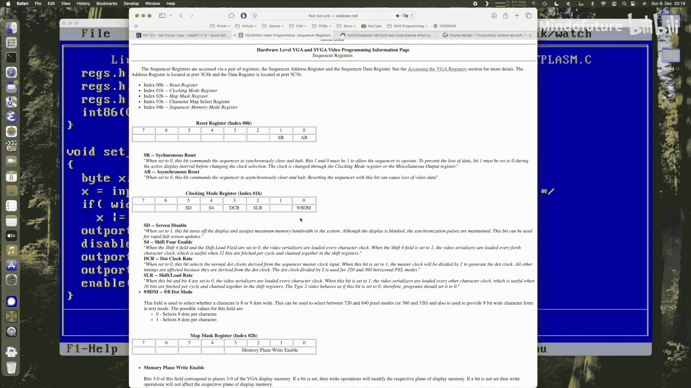

Okay， let's selects this one here。And there's also one more thing。

 the character map select Reg where you can select which character set。Is being used， Rigonna。

Weet that as well， just to be on the safe side。

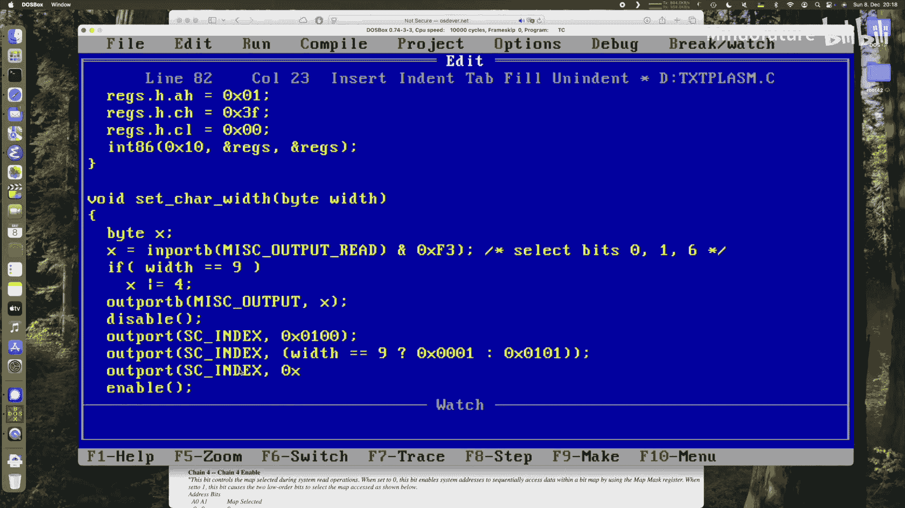

And。We basically select character set。Default zero， everything zero is I default。

 so that should be good。

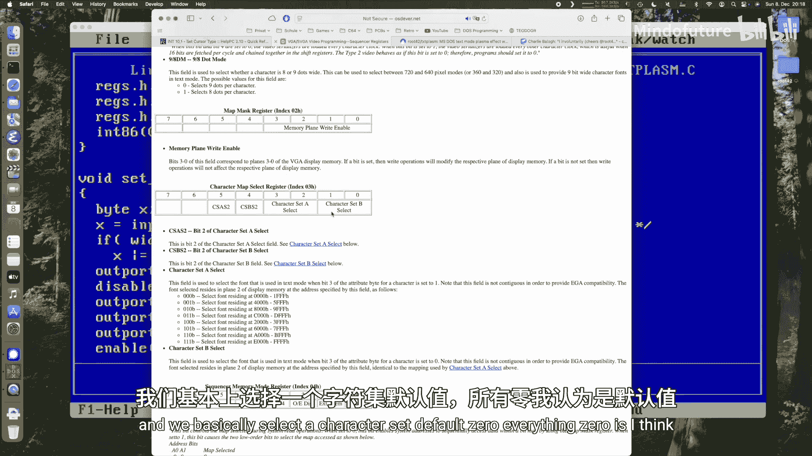

嗯。Then we need to make sure that the attribute controller is in。Read mode， I think。Into actually。

Andfor that， we read one byte from the input status register。

 which toggles the attribute controller to be in read mode because the attribute controller is a bit weird。

 It doesn't have read and write ports， for example， like the Masonas output register。

But it has a flipflop basically that targets between reading and writing。

 and you can force it to be a certain way by reading the input settings register。

 which is completely weird， but that's how it works。So first。

 we're gonna store the status that we do have in there。 So we read from the。Attribute controller。

And save that。Into our temporary variable。 And then we're going to write to the attribute controller。

And we're going to write the value of 0 x20。嗯。And we will turn on the pixel pan register。

Bit basically， and we can have a look at the attribute controller。

So the way that this works is we have to set bit5， which is the 20x SML to one。

 otherwise we are going to use the palellelet error resource。But we don't want that。 Basically。

 we have to set this bit to one and then use the lower five bits to set the attribute register that we want to manipulate。

 and for the case of the pixel pan。It's 13 exod amal， which is what I defined this constant to be。

Basically， so writing 0 x20 or Pll panning selects the Pix pan register so that we can write to this。

This makes sure that the pixel panning is correctly aligned basically。And。We need to， well。

 it's not explained very well here， but we need to write0 x0 8 in here。

 which means zero pixel offset。Interesting enough，0 isn't the zero pixel pen offset， but08 is。

Basically， it's eight minus whatever you write into this if I remember correctly so you can play around with this and have the screen shift around a little bit up to eight pixels。

Also quite nice。 I think I do another video about that feature in the future。

And then we have to restore whatever。We found previously in the attribute controller。

 so we'll do that。And we will toggle the。Ltch again or the the。

Flip floop so that it's back into read mode。So I think that's good enough。Here。

And we are done with that。That should also do the trick。

 It has a couple of errors because I forgot something it seems。

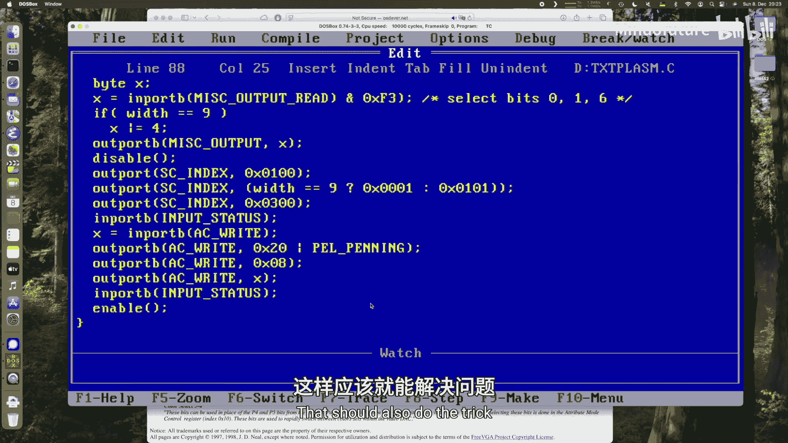

Oh， yes。 that should。Have nothing like that。There's another arrow here。Unfined。Pning， yep， okay。

 that was just a typo。Okay， we are good to go。 And if you notice。

 take a look at where my mouse is right now。 And if I run this。

 suddenly the window becomes smaller because we only have 640 pixels。

 It's hard to see with a black screen， but it definitely get smaller。

 So we definitely switched to a 640 pixel mode。 That's good。😊。

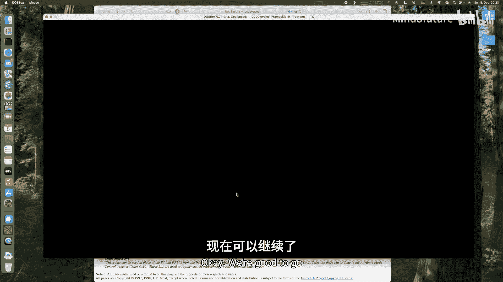

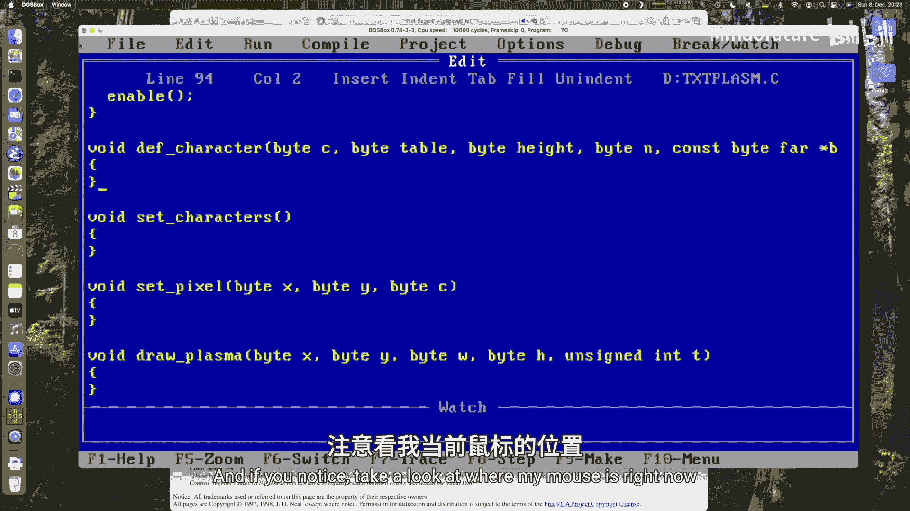

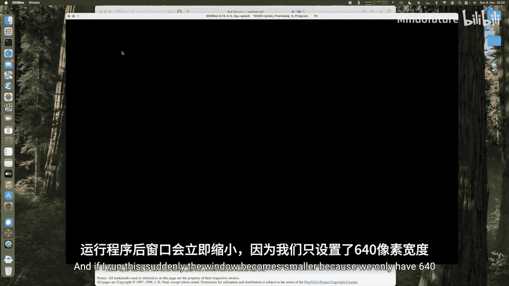

Okay。Long story short。 We need to set some characters。 We need to define custom characters。

 How do we do this， I will have a function called set characters。

And it's just a thin wrap around the other function， actually。

 so we don't need to call it from the main function。

We will call define characters with the number of characters， the index where we want to start。

 redefining Anna chose arbitrarily 128， so we still have all the basic SI characters to play with。

Then。It wants to know which character table we replace。

 we will replace character table number zero because you can have multiple character tables。

On the VGA account， and。In a future video， I might also show you how you can use two at the same time。

 which is an interesting feature。And。We have a certain height。

And a certain height of the characters and a certain length of the whole table that is the how many characters that are in there。

 and we have the character table itself。That is not actually filled yet。 And my idea was to。

Define those characters in。Two squares that are getting larger and larger。Basically。

 the very first one will be only zero。The height is 16， so I need to。Copy。This。

 if I can do it correctly。16 times 1，2，3。 And that's a bit annoying。 Oh Okay， let's， let's skip。

 let's skip these spaces。 Who needs spaces anyway。 So now we have four。eight。1216。

 So this is 16 characters。And we have five different squares。 So I'm gonna。Copy of this five times。

 So every line represents one character and every bit。Represents one pixel being set。 And right now。

 the first square is empty， which it should be its legacy a space。

And then we're gonna go into the middle and pick。Almost in the middle two or right in the middle two values。

 so there should be one，2，3，4，5，6，7，8 exactly。8 to the right。 and I'm going to draw a。

Little square in here。 If you translate the 0 x 18。From hexadecial to binary。

 then you will see that the middle two bits are set， you have 0，0，0，1，1，0，0，0。

 So this will be a little square with two pixels。On each side。And the next that we'll do is 3 C。

 That is a slightly larger square with four pixels on each side。And then， we'll have。70。

And that will be。Six pixels on each side， which means also that have to put in six values and the last。

 because we have eight characters eight columns per character。It will be。FF， obviously。

And this will be 8。Pixels on each side， you can generate。Any kind of。Custom character this way。

 use a character editor or something and convert that to binary。

Let your imagination go wild and produce something interesting here。That should do the trick as well。

But we haven't defined the character yet。Now comes a whole lot of interesting stuff。

We don't need to program the。

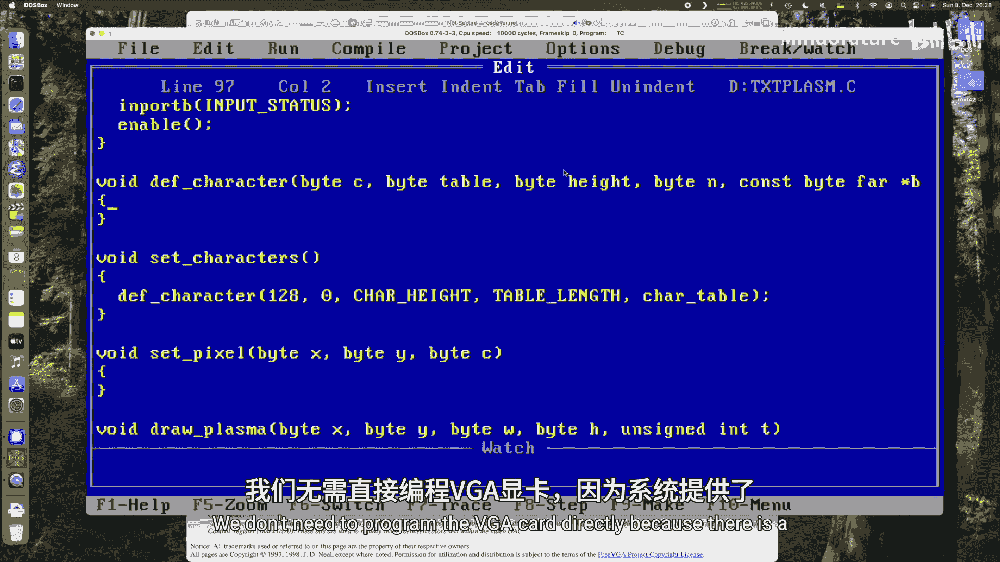

VJ cut directly， because there is a。Function for that。 And I have to think about it。

 I think it's function 11。Exactly， function 11 of the graphics droppers character generator routines。

User character load。 That is A H is 11， A L is 00 will。

 It will take the number of bytes per character。 It will take a table in character generator M count of character in the table。

 As the code of first character defined find。 and there will be a pointer in E SB P to the user table。

 And this B， P will become very interesting。😊。

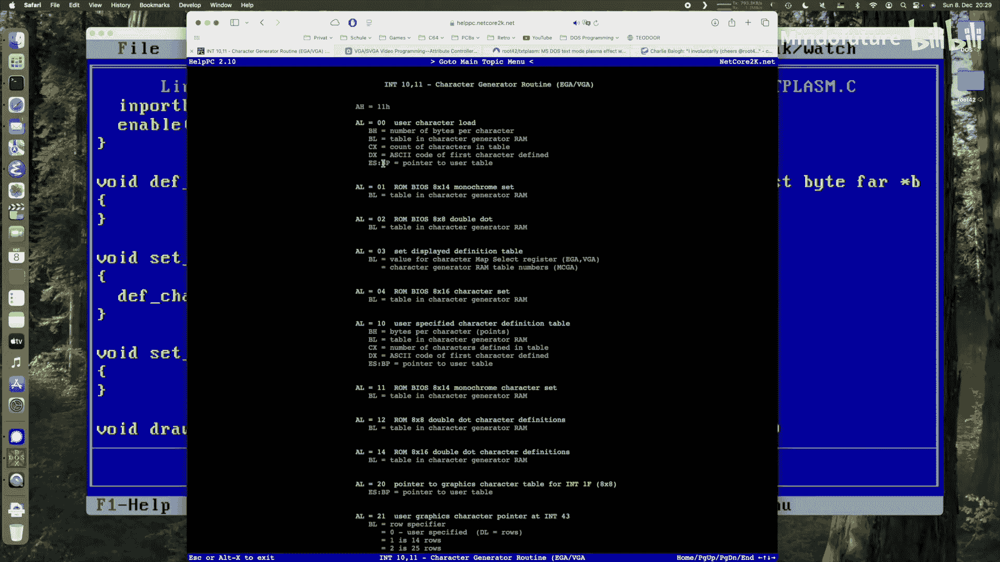

All right。I'm going to coat this。In the at first， in the usual line。

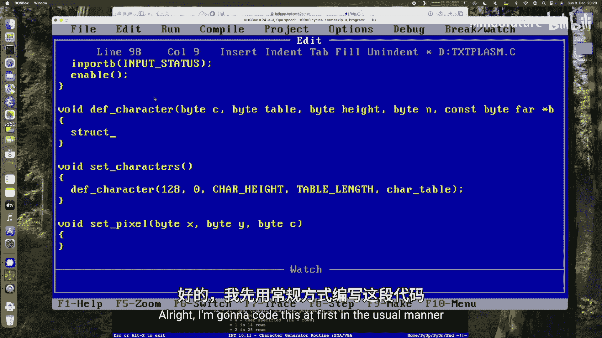

The usual dose interrupt function in 86。Doesn't have。

Anying in the word registers to write to E S or B P。 It's just not possible。

 as you can see we have A X， B X， C， X， D X， S， I， D I， C Flake and flag， so。

It's not possible to do it like that， however。There is。Something else in there。 Let me quickly see。

Which is called the function。Inter R， interrupt。That has a different structure called Repack。

 I don't know why they did it like that， but the Repack function supports R X， R P X and so on。

 and it definitely also supports R， E， S and RBP， those。Registers together with the。

 Yes register were not usable。

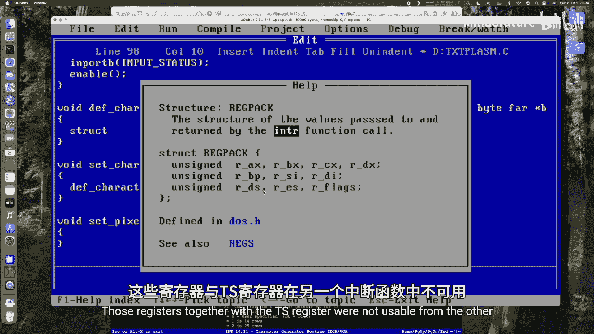

From the other interrupt function。 So we're going to use that。

We are going to define our rack pack structure called Regs。And。

We will fill it with all this good stuff that it needs to be。

 so we learned Ah needs to be 11 and the sub function is0。Then the next thing is B X。

 We will have the number of bytes per character in B H and the table and character generator on VL。

 so we will take。

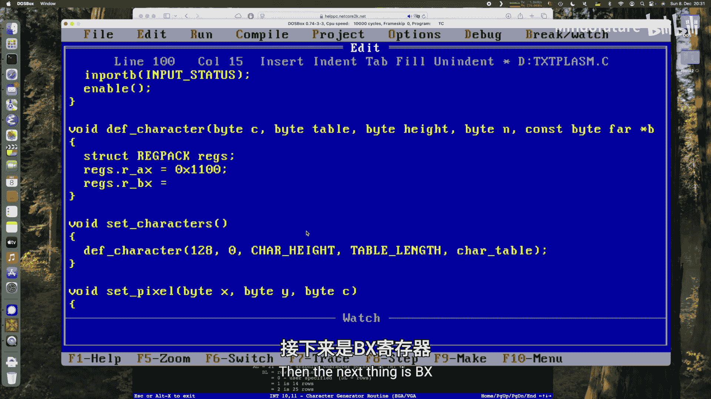

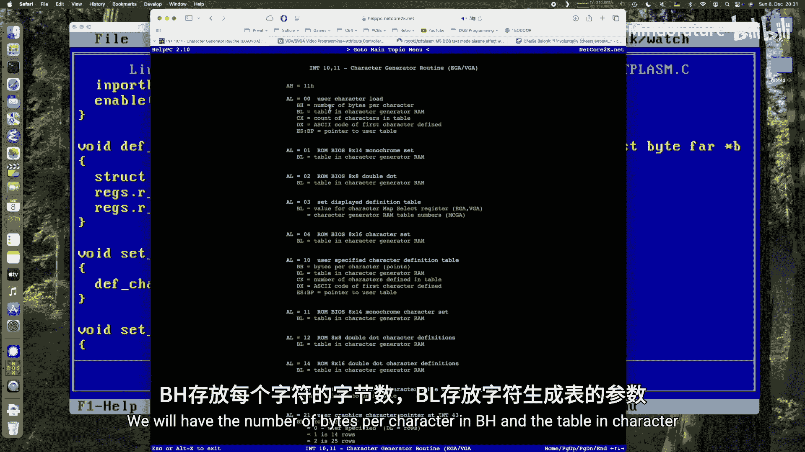

The height， which is the number of bys shifted。By8 to the left to get to B H。

Put all this with the tabled parameter。All fine and end。And。Then we write to Cx。That's just Hawaii。

And RDx is our C。嗯。Last but least the。Pointter。We can take that by taking the segment。

Of our variable。I think it's called Buff， yeah， it's called Buff。

And the base pointer will be set to the offset。Of this pointer。 Okay， that sounds pretty decent。

 doesn't it？Well。Let me demonstrate this。 Let me demonstrate this。In the following way。

 I'm going put。Something here。 I will just write。Printf。And I'm going to put in。120。Can I do this。

128， 129， 13，131，132。 those should be the characters that we redine。

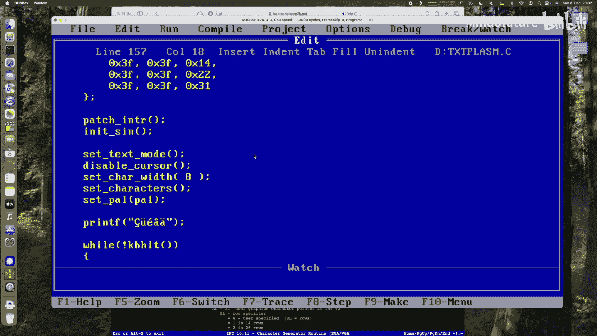

However right， but if we do this。Heいやいやい， it looks。Very terrible。

 The flickering is due to the double buffering and there's nothing on the second screen yet。

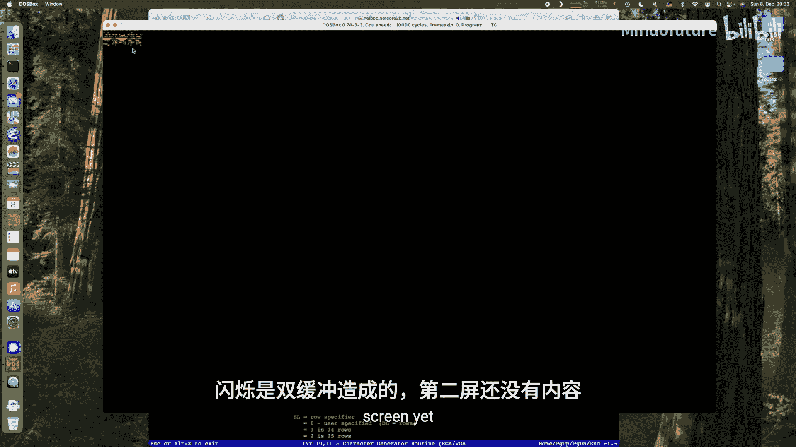

It's totally garbage。The reason for this is strange。

There's a bug actually and I posted this on Matodon actually you can follow me there。

 I'm Route 42 at chaosos。ocial this is mostly the only social media that I use so please come over and follow me。

And Charlie， who is actually a patron and。Also。Very much into retro stuff and he organizes a lot of things around demo parties taking care of old hardware。

 He saw this bug and thought he could fix it he figured out H after a long long time that there's actually a problem with the core generation in Tbui and they are generating a wrong offset looking into the rackpack structure basically。

 and they load the BPp。Register not correctly or not at all。 Im not quite。

 I think probably not correctly， and it points to garbage and memory。

So he wrote a little interesting function called it。Pench interrupt。

 which overrs the in R function and patches it by replacing one byte in the sequence because you need to look for c6。

4，6 F4 E2 in memory and change the E2 at the end to D E and this will generate the correct offset and it will fix everything。

 So let's do that。 And that's totally magic and it's awesome that he disassemled everything and manage to fix it。

That's why。We got this patch interrupt function。So basically we need a running variable。

We need to have the patch。That can be defined， very simple。By using hex values in the string， C6。4，6。

Have for。E2。 And what I find most amazing is that this software is 35 years old and it finally got patched after 35 years。

 It's awesome。 And then we get the pointer to the function。 you can just。😊。

Just manipulate all the functions， which is very nice。By doing this nice Power pointer cast。

And just taking the address of the function。And now inside of this function。

 it will search for the pattern。Very simply。And it will do something like this。If。

We find a match by doing a man comparison。From the current pointer to the patch of length4。

And if this results in zero， then it means yeah， we found the perfect match。

Then we are going to replace the fourth byte， which is P3。With0 x D E， which is the correct offset。

And we can print something out。 We will， we won't see that。But this will。

Give something for all the user if we don't clear the screen beforehand， but we。

 we won't see it because we clear the screen right away。 But this is the way to do it。

And we'll say at which address we patched it。And also return that if anyone wants to check on the calling side。

And otherwise， we just increment and go through the whole function until we find。

Our patch thing and if we don't find a match， then this is already a per version or we can't patch it。

So we return minus1。

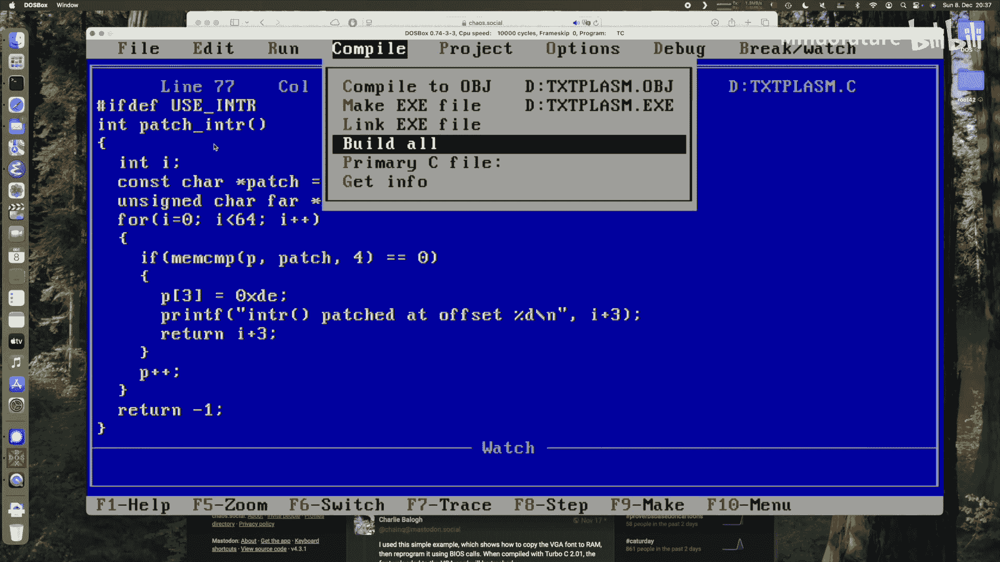

Let's build this looking good。And suddenly， we get our squares our custom squares。 You can see that。

😊。

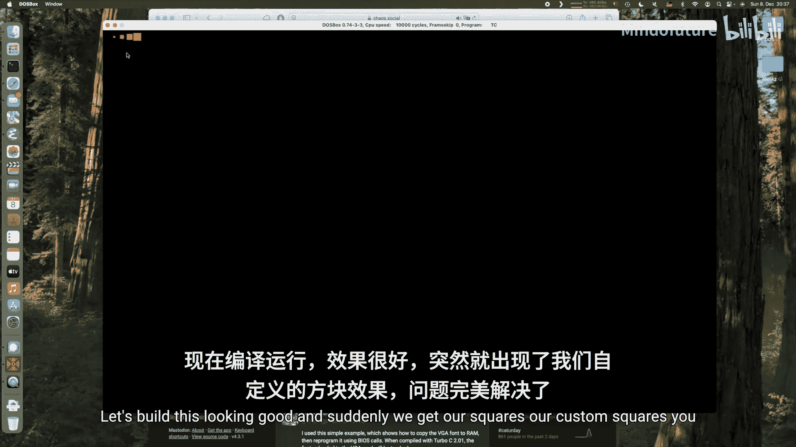

Brilliant， now it's fixed。And as you've seen， I put this into something called in if F guard。

 use int R。 There's also a different way we could have done this。

 We don't need to use this interrupt。 So I'm going put this in here， use int R。

And there's another way， so we'll do that， but this other way means we can't use the ID anymore。

 so I will stick to what we have better write to tone anyway， we can use inline assembly。

Works the same way。But then you need to switch to the command line。Compilr， because to C 2。

0 can't do that the later versions can， but this one can't。Basically。

 we're just loading the registers， the old fashioned way。And。It's， it'， it's working just fine。

 Then you don't need。All this magic pitching。But I think the patch is actually so cool that I will leave it in。

I like to see this great software being being fixed basically after such a long time。嗯。

Something like this。The soaring actually clears the thing is basically the same as Moth C comma0。

 but the shorter regarding the op code that is being used， so it could generate smaller code。

And L S loads EBP。With the pointer， which is also a nice shorthand。And much。

 much shorter than any other coat。Not a could type。 And that should do the trick。

 That's the same code， but you can't compile it from this IdeE。 Okay， we've got a lot already going。

 I'm gonna delete this now because we are ready to draw the plasma， actually。All the。

Scroroller depends on what we want to do first。I'm going to draw this scroller first because that's more interesting because we already did a lot of classs in our days。

So嗯。I'm going to define a static variable that doesn't change from call to call called time step。

Which is。VJ， with times 2。And。Yeah。That just slows down the scroller a bit。So， yeah。Otherwise。

 I would just use the time。Index itself that we're using T。

But I can do that we need a bunch of variables called index x。Lent for length。Offet。Which is。

Half of the。Time step。So shift to right by one。Then we need another static variable for the Y coordinate and I'll set that to the middle of the screen at first。

 but it will be randomized。The length is。The string length of the text。Very simple。

 so we don't have to recompute it all the time。Because we use it a couple of times。

 we could make this also constant or just pass it to the function。You can probably do。

Some improvements here， Then we count down the time step。

And we have an offset into the string basically or into the screen， actually。And if that。

Gets smaller than minus length， which would mean that the whole score takes moved out of the window to the left because we are scroll from right to left。

And if the offset gets too negative， we left the screen。

And then we will need to reset our time step to make everything appear to the right again。And also。

 create a new。Random Y position。From zero to 24。So every time this thing gets out of the screen。

 it comes back in at the other end at some other position。

Then we need to iterate over the X coordinate to。Draw the actual scroller。

 We will take the maximum of0 and offset。So we actually start on the screen and not to the left of the screen if it's running。

To the left side out of the screen。And。We draw this until we reach at most the video width。

 which is 80， right， we can't go further than the right edge of the screen。

And the actual position that we end is offset plus the length of the text。

Offfet is always the starting position on the screen or to the left of the screen if we're scrolling out of the screen。

And then we just increment X。And then we write to the VJ buffer。

Directly and the first thing that we write is the actual character。

To the position X plus y times VGA width。Plus， the back buffer page。

 because we're right into the back buffer。In our double buffering context。

 times two because every character takes 16 bits in text mode，1 bit is the character。

1 bit is the attributes like foreground background color and blinking。Plus zero。

 so that it looks nice because we are currently writing to the character。

And we take 1 B from the string and position x minus offset。 That's our indexing。

And then we are also writing the attribute。At the same position。

We probably also could have used a pointer and increment that probably would have been a bit more elegant。

 if we simply write the colour white or whatever is currently the white colour。

 This should do the trick， and。

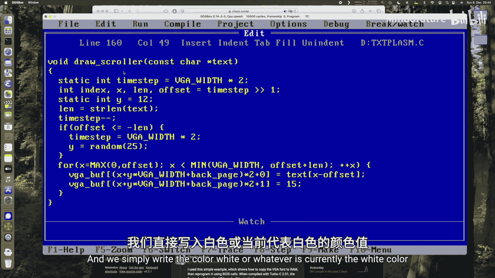

There we go。We are still doing a little bit of a trail here because we're not clearing anything。

 but this will disappear once we draw the plasma。 So this is trailing because there's no space at the end。

 but only the tilde。

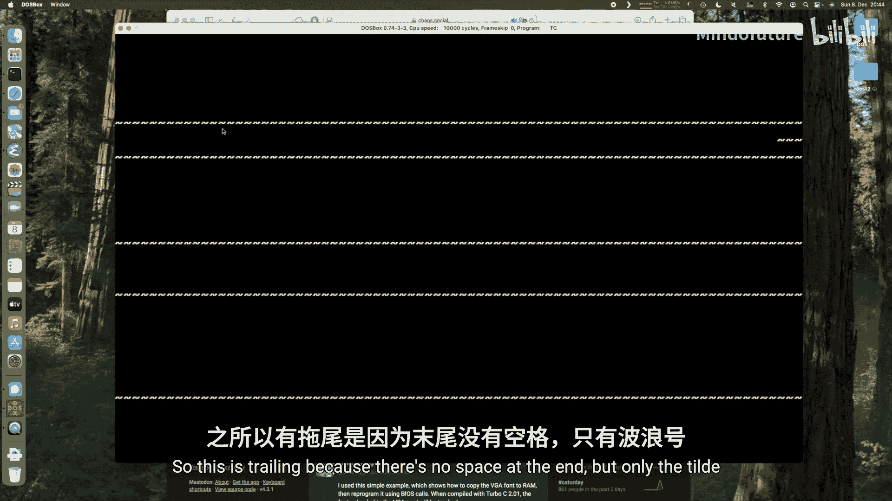

Yeah， but the score itself。Works， kind of。The draw plasma function is。

 as usual we know what this looks like。 we can actually copy the printing routine here to our set pixel。

Actually， we could have used that pixel。Here。But yeah， we didn't。 So I'll copy that。 This will be。

Which。Well take the color as one， we integrate the color also as our shape that we want to use and we started at 128。

And we will use colors from 0 to。4， so 128。Plus C divided by 51 because we will actually get colors from 02255 and 255 by 51 is exactly 5 so we will get something from 0 to4。

And the color here will mix。 very interestingly， we will use combinations of background foreground C divided by 16 plus。

C divided by 32。Left shifted before， this is the background color。

We will have256 developed by 1616 foreground colors and 256 divided by 32 is8，8 background colors。

So that's already pretty neat。Does work， but we need to。Implemented plasma drawing。

 which we did already before。 I won't explain it in detail， but we need a bunch of variables。

We need the final color， and we need a lot of intermediate values called C1， C2， C3， C4。Yes。

 and V1 and V2。Which are the sign values that I will cache inside of these。

 plus we will need index variables I and J。Which we iterate over。

And v1 will be equal to the signine value at position T。Modulo  to 5，6。Otherwise， we run out of the。

Sme table， which we want。And you can play around with these parameters and make different patterns。

 but I found these to look pretty nice， 32 plus t times 2 modular 256。 Don't forget this。

And then we're gonna iterate why。From oh， no， J from Y position。J is smaller than y plus the height。

And J plus plus， that's great。And for the Y coordinate。

 we already take a color value or a sign value to modulate。Of J times 6。

 this gives us a higher frequency， basically plus T。To animate this。Again， Moular 256。

 never forget that。And for I equals x。I less than x plus the width。Plus， plus。I++ doesn't matter。

If you do it this way or that way。And inside of that， we define C1。Equal to。Higher times 5。

And as I said， these are all things that are tried out。That do look good。

But you can try to find better ones。Especially the part that tries to produce a rotating bar。

 I'm not very happy with that because that's just flipping backward and forward。

 but I want to have like a full rotation would be nice， but I didn't manage it in time。

And C2 is i times V 1。This， I think， produces some kind of rotationation plus。J times v2。

Divide by H plus2。 Yeah， you don't have to understand that right away。

 but you can turn on and off these components and view them separately。

 Just use one of those components to plot make sure to normalize correctly because we have no four components and will divide by4 if you only use one component don't divide by4。

 Otherwise， it will look weird or too dark or whatever with two little information there。

NC4 equals signine， and that's， I think， almost the same。 so I copy it。That was。Just a minus。

To generate something akin to a rotation。And then the whole thing is cast to bite。

And I'm going to just add up C1， C2， C3， C4， and divide everything by4 or shift right by two bits。

And then we just set the pixel at this position， I comma J comma C。And that's it。 Yeah。

 so make sure to。Try all the different color values here and just use one of them without shifting。

And then you can debug what the things actually look like。And there we go， that is the plasma。

 and I think that looks actually pretty nice。Especially the squares getting larger and smaller with the intensity of the color basically。

And these are redefin characters in eight columns， so you know now how to do that and you see the training is gone because first we draw the plasma。

 then we draw the scroller and on the back buffer everything gets overdrawn by the plasma again。

This is currently running emulation wise like a 486 or something。

 but I guess this will also run pretty decently on slower machines as we have way less pixels than in the graphics mode。

 and that's pretty neat about the text mode you can do quite nice effects without having to draw all the pixel pixels by hand but。

The character generator will draw like a ton of pixels for you just by looking up the value and mapping it to a user defined find character。

And that's pretty nice。Let's quickly have a look how this would look when I take out。

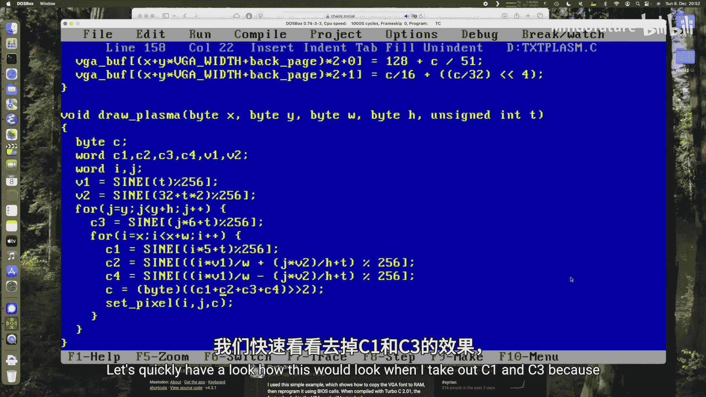

C1 and C3。Because those are the C2 and C4 are the ones that are for the rotation。

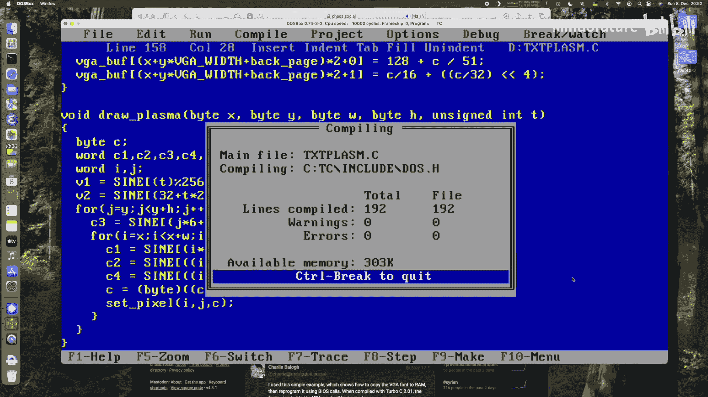

Oh no， they're not， theyre actually these wobbly things。I thought I tried to do a rotation with that。

m interesting。Let's look at each in turn。 C 4 looks like this。 Yeah， this is like kind of a rotation。

 but it only rotates like。A little bit and is also modulated by a sine wave in its。Size， let's say。

C2 is very similar， but leaning to the right instead of the left due to the different operator like minus instead of plus。

 I think。C1 looks like this。It was basically just horizontal bars moving across。

And we could also modulate those in frequency， but we don't。N C3， let me guess。

 is probably vertical bars yeah。And everything added together。

Gives us the nice reason it you just saw。Times2。Okay。But that's it for today。 You learned， I think。

 quite a lot。 I love the interrupt patching that Charlie did。 That was actually pretty， pretty wild。

 and it does help。😊，Programming auto， I must say， there are only few interrupts that require ESBP to be loaded。

 but there are a couple of。Things where you need to load strings and stuff like that point us。

So it's pretty nice to have this patch and it works。It doesn't even patch the compiler。

 but it patches the runtime。 This code is in the executable。

 and it will patch away the bug from the runtime executable。 And that's pretty wild。

 This is like self modifying code， basically， in a very simple form。If that's it。

 leave a comment like share， subscribe all the usual stuff。 visit me on mustard on。

 there are ton of nice people on their Route 42 at chaoss。 social。 That's where I'm。

I post all kinds of stuff or booth stuff retro related I'm not retro at the moment。

 The advent of code is running。And you will find a lot of other nice people such as Charlie and tons of other retro people on there。

And the best thing is there are no advertisements， there's no tracking。 Everybody is mostly frankly。

 and if not， then you can just。Ignore those people。But that's it for today。

 thank you very much for watching and I'll see you soon， I hope。😊，🎼不要不。🎼我我。🎼哒哒。🎼Yeah。

