# 编写MS-DOS-系统-｜-windows-｜-操作系统-｜-汇编--｜-vga-｜-x86-p48-P48-Lets-Code-MS-DOS-0x2F---Mandelbrot-Fractal--BV1zs35zQEru_p48-

Hello， welcome and an excellent evening。 Today， we want to do something quick and nice。😊。

And we're gonnana write a fractal generator， namely for the mandbro set， which is this year。

 and I guess。This probably needs not much introduction。 I guess everybody has seen this。And yeah。

 it's actually relatively easy to implement。 And， of course。

 we're going to do it on Anaals using Torbbo C as usual。And on Wikipedia。

 you can read a lot about this。 And there are also a bunch of。Plotting algorithms。

 That is algorithms。 how to draw this thing。And yeah， it's， I think。Pretty trivial。 Actually。

 the theory behind it is more complicated， involves complex numbers， but。Actually。

 we don't need that。 The algorithm is pretty short， However。

 we will use the optimized version down here。Which is no big difference。

 But the idea is that you iterate over every pixel of the screen。

And then scale the screen coordinates， which go from 0 to 319 and 0 to 199 in VG resolution。

You rescale that to lie between-22。47 on the x axis and 1。12 to 1。

12 on the y axis will scale this a little bit different。 As you can see here。

 This is already the main program which does nothing， apart from setting the graphics mode。

But you can play around with these coordinates actually。

 And that's the basically where you are currently in the Man broad set and a magnification factor as well。

 which doesn't come into play here。But basically， it's。Implied here in， in this scaling。

And then you will have two variables called X and Y。And an iteration counter。

 because it will do an iteration and Y loop。And the maximum number of iterations。

 which we will keep to 256， because that's the amount of colour that we have。

And if you don't zoom in very much， you don't need that many iterations。 if you zoom very。

Much into the f。 then you need to up the maximum iterations to get more detail。

But it also takes longer， obviously。 And the iteration itself is very simple。 It's the wire loop。

You look at x squared plus y squared， and that needs to be smaller than 4 or2 by2。

 And detereration count obviously has to be less than the maximum iterations。If that's the case。

 then you compute a new x value into a temporary variable。

 which is x squared minus y squared plus the x0， which is the current pixel。

Coordinate and y equals 2 times x times y plus y0。And which is also the pixel coordinate。

And then you can restore X from X temp。 and that's it。And at some point。

 the coordinate that you calculated will escape this circle of radius 4， I guess， or two。要 true。

And then。This will give the colour， because the colour is the number of iteration that it took。

 The longer it takes， the brighter the colour， so to speak。Yeah， anyway， that's how this all works。

 And you can optimize a little bit to make it bit shorter。

Not quite sure why they put that into a different variable。

 Main optimization here was to get rid of one multiplication by writing2 X， Y。嗯。

And replacing that as x plus x times y。 So yeah， let's see。Let's look at the code， actually。

So this is the main program， our regular main program。

 very similar to all the other things that we did。 We set the graphics mode to initialize a palette。

 which will be a special palelleette this time。 I tried it with a fire palette that we use。

At other times。But， it's a bit。Not that nice here。 So I will introduce a new one。New palette。

 And we set the palette and then draw the manboard fractal。

 and we will play around a little bit with the。Coordinates later at the Zoom factor。

And then while there was no key press， we will wait three times for rets to get roughly 20 frames per second。

And then do a colour cycling to animate the fractal colour cycling， I think we didn't have so far。

 but it's very nice for giving。fractile's a little bit of movement， let's say。

Looks quite psychedelic。And that's it。 So we need to fill in the in it palette the colour cycle and the draw metal board。

 We'll start with the draw metal board， because that's the actual。嗯。Interesting part， let's say。

 or most interesting part。And before want， when we introduce the colour cycling。

 if you're sensitive to flashing lights， etc cetera。You should stop after。

We drew the underbro or turn off the screen and continue listening because it will。

 there will be flashing images later on in this video。 So that warning out of the way。We will need。有。

Wrong home， home keys here。 We will need a couple of。Pixel coordinates， which I call Px and Py。

These are the。Actual pixel coordinates that we iterate over。

Then we need a bunch of floating point variables， double precision because you really need a lot of precision here。

X 0， y 0 will be our。嗯。What you call it， this will be our actual X and Y that we're using here。

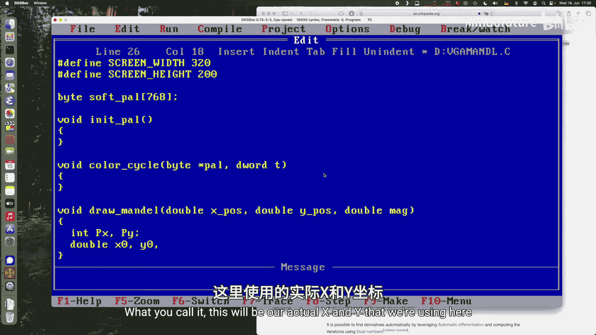

嗯。

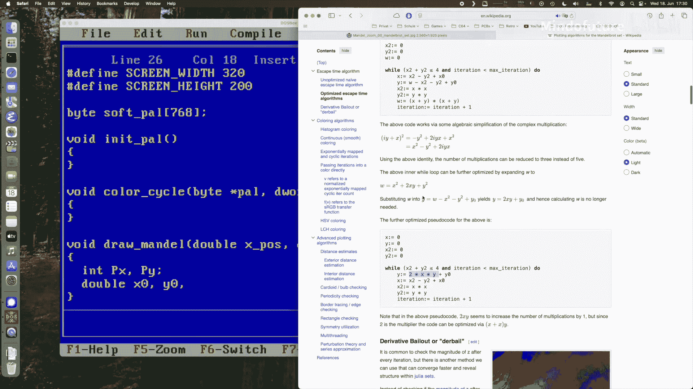

Which we called all of these are the scaled coordinates。 exactly。 Sorry。

 I'll try to name this exactly as it was named here。 and in the optimized。Version of the。

Simple escape algorithm。So x y and x0 and y0， then we need some Ha variables x and y and x x2 and y2 which are x squared and y squared。

And we need need to initialize them with 0， so。Yeah。All of those actually。

 and so almost all of those。cept窗。The pixel coordinates。So， let's do just that。Then we need。

Our current iteration。And。A number of max iterations。Which we say will be 255。

Then we have our main loop。You can do that， either in。Yhy direction first or X direction first。

 X direction first will scan vertically over the screen， which might look nice。 So let's try this。

You can swap that around and see if that makes any difference for you。

Screen width screen height are defined in VG A dot。Hged， which is our header allus。

The J graphics functions。And then， we take P Y。And that has to be smaller than or less than screen height。

It's also implementeded this way we scan over the the whole screen， which is fine。

And now we calculate the scaled coordinates， which is the exposition that we wanted to look at。

And our pixel coordinate， scaled down by screen。With。Times our magnification factor。

That's pretty straightforward。And you can adjust this magnification factor when you call the routine。

And that's maybe a little bit of homework to implement kind of like a mouse versus a selection or something that you。

H。Can choose the coonenet that you want to pick。And of course， here it has to be screen height。

I'm not gonna do that here in this video because it would get way too long。嗯。

But you can do that at home。Then。Actually。What we wrote up here is。What we need again down here。

 because。We have to initialize these variables after every iteration of pixels。So， we will。

Quickly0 out on the variables。Could have。Let's result of the top part。

Doesn't hurt either to0 on the variables。 Iterations。 current iteration will be 0 as well。And then。

 we will have our。Iteration itself。And that was that x squared plus y squared。Is less than 4。

 Was it less or less than or equal。Probably doesn't matter with floating point。 So let's do。

Le or equal。And， of course。Iteration。Less than max iteration。Probably we can up this a little bit。

 256， because we are using less than here。Let's see if that breaks down。 I didn't test that。

And now the y is x plus x。Times y plus y 0。 That is the optimized algorithm from down here。

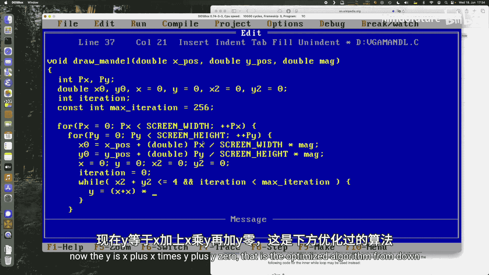

This one here。And the two。Times x plus y can be written as x plus x times y。

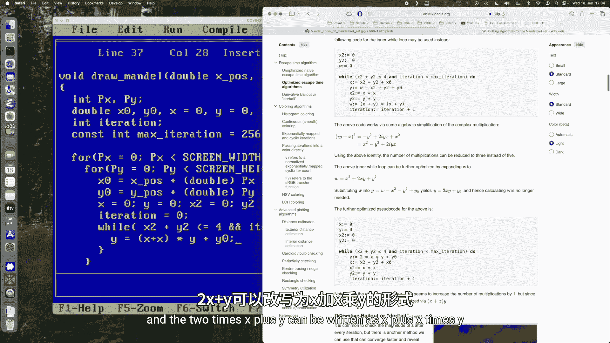

And x equals x to。Minus y2 plus x。0。And this is where we save on multiplications， obviously。

 because we can reuse that。And multiplications are expensive， right？By the way。

 I will increase the on our account。Let me me quickly。Remap the。Buttons for。The cycle counted。

So I should be able to up the cycles now。 let's do like 25000 cycles。

 that should be a pretty fast x 486。X2 equals x type X， obviously。And y2 equals。Y times y。

So as I said， multiplications are expensive， so we will try to avoid them。Divisions are worse。

 usually， but yeah。So， and that's it。 And the number of iterations is actually our color。

 So we take our pixel coordinates， the real ones。And usually I would just write iteration。

 but it could overflow here it can， but you can increase the next iterations to， let's say。

1 thousands or something。 and then it would overflow。 So we say mod 256。And yeah。

 I think that's good enough。 You can try to。 You can also。Invert。The colors。

Which we'll have a look at in a second。 we might actually do that。Depending on how you want your。

M brought to look like。So， but that should already compile with a couple of warnings for unused parameters。

 which is fine。

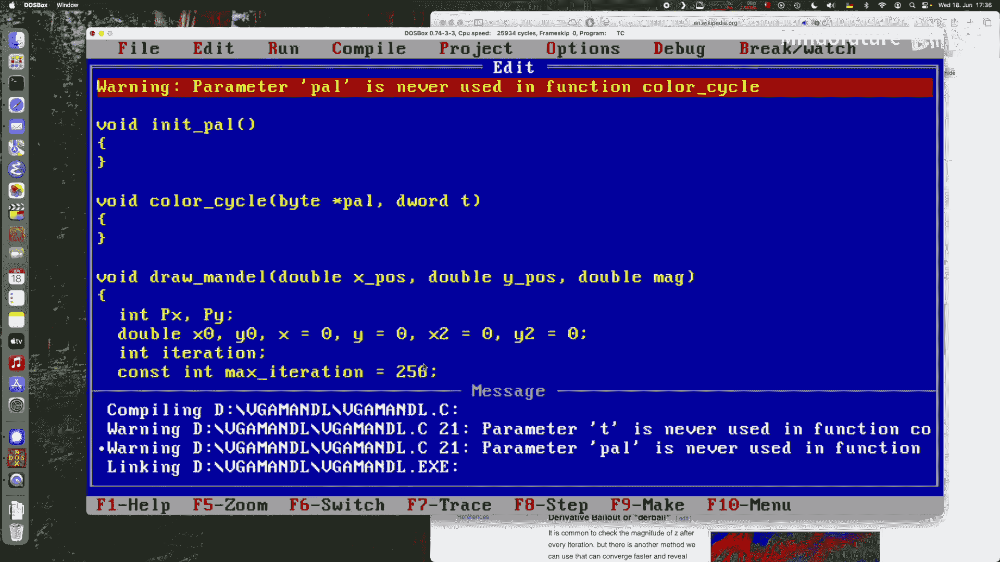

And we can try to run it。It doesn't work。Okay， debugging time。Okay， very simple bug。

 I set a black palette， which is red。 but here you can see。

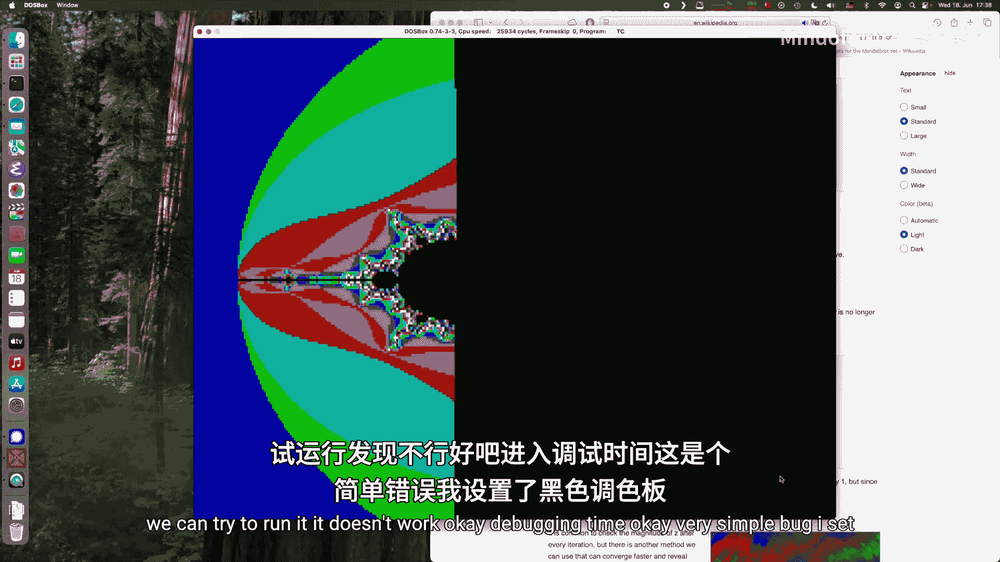

It already works。 lookss quite decent。 The colours a bit weird because we are mostly using the EJA colour。

So that could be nicer， but you can already see a little bit of more colors in here where iterations count get higher。

But that's already pretty nice， I must say。 and we can already try a。Different set。

 I wrote down a couple of coordinates。And。We can test those。I will enter them， now。So if we take1-1。

4。-0。5， and。0。4， which is higher magnification。

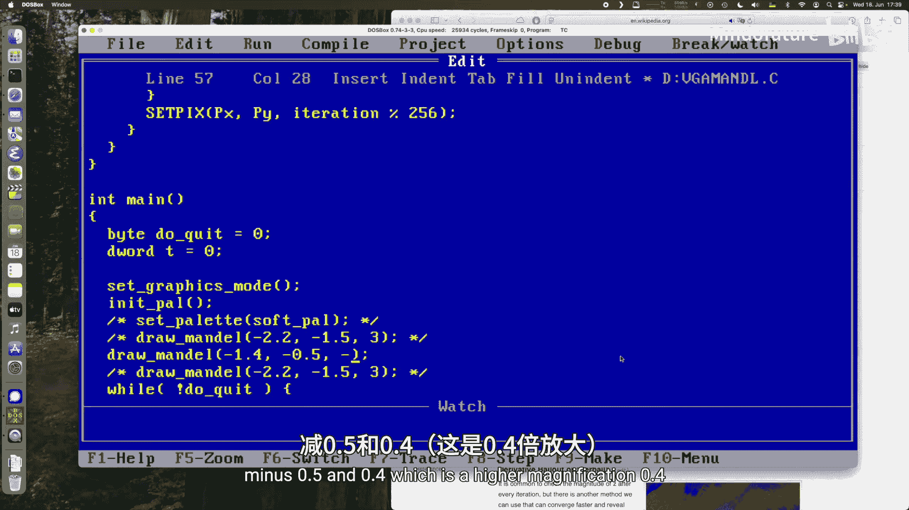

0。4。

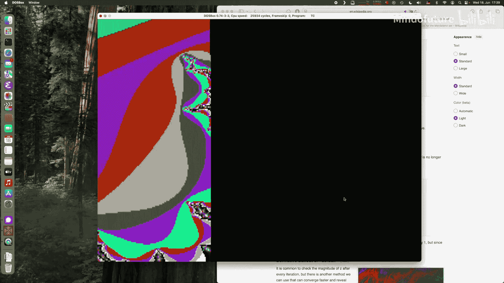

That will give us an interesting part of the fractal。And you can already see。Quieite。

Interesting structures here。 Of course， VGA 320 by 1 is a little bit rough for that for this。

 you might even want to use super VGA or something。 But we stick around with this for now。

And let's also look into a different part。And this is for the light sensitive people。

Out there so that you can also see this stuff。Without it flashing around。

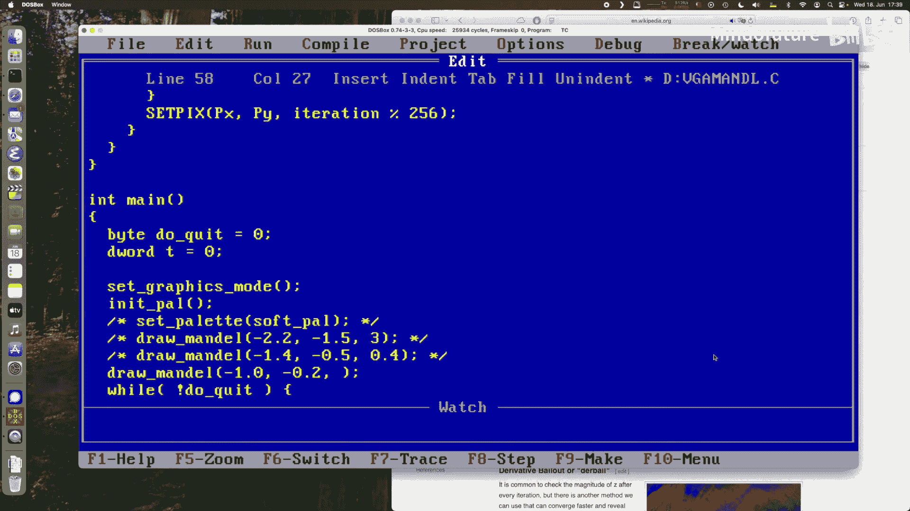

0。5。Okay， this takes relatively long because it's zooming into a part where the iteration count is really high。

 which you can see here due to all the detail that you're getting here。

And the black parts are where the count hits the maximum， basically。And there we go。

 That looks quite interesting， doesn't it， And it also shows the colour palette quite nicely。

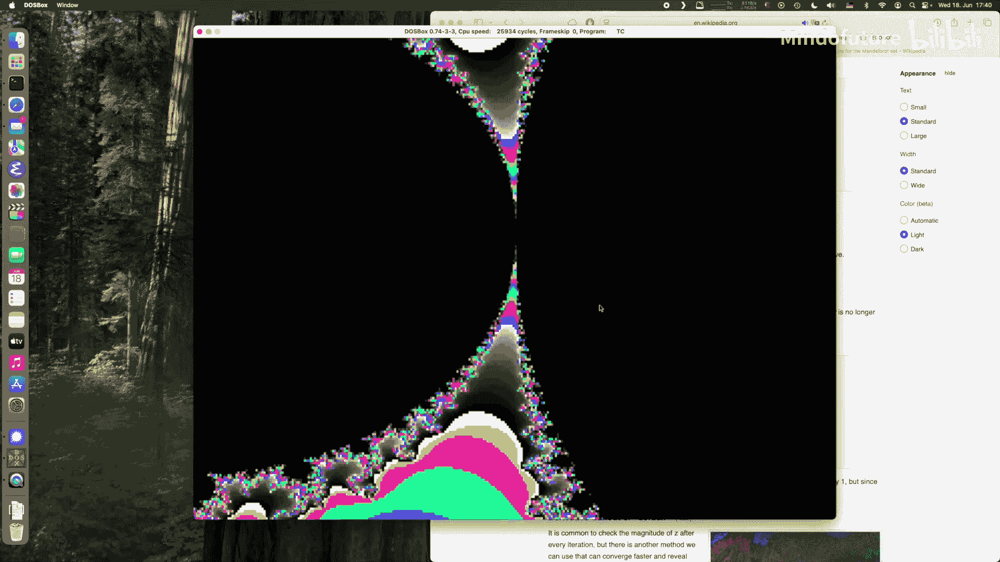

And it's still calculating， I think， okay， it's done。So super slow in the in the black parts。 Okay。

 so that looks pretty nice。 I think now we can start。Implementing the palate。

 everyone who's sensitive。Please look away or turn on the monitor brightness or whatever。Okay。

 the pelleette。Is supposed to be something very colorful and smooth， so。We need signed character。

Variables RGB， which I'll initialize with 0 immediately。And we need directions for these。

That because we're making color ramps， we let red ramp up very slowly。We let green ramp up。

ItA bit faster。 and we let blue ramp up really fast。And also， we need an iteration variable。

 and we need to iterate over all the pelleette entries。Which are 256 times 3 for RGB。But we。

Use I here as and the pure color index， not the。RGB and X， basically。 So it's。Goes up to 255。

And that's that。And then what are we doing， We are setting our palette。

 which are called soft palelleette。At place i times 3 plus 0。 This is the red entry。

With whatever is currently in the。Red variable。Converting it to unsigned， So that。

There will be no garbage。 and then the green and blue look exactly the same。

Just with adjusted inices。And then if the red plus our direction。Is bigger than than 63。

 which is the maximum。Value that a VGA pilotlet register can take。 It's 6 B wide。

Or if the red plus the direction。Value is smaller than 0。 So if it under flows basically。

 Then we invert the direction， basically going up in the opposite direction。

This will produce color ramps that are cycling really smoothly through。Our palette。

 And I will copy this line and just for RGB。Don't forget the direction variables， otherwise。

This will look not very good， or pretty monochromatic。Okay， that's that。

And then we have R plus equals D R。Zi。Plus， equals Dg and。Blue also gets incremented。Okay。

 that should already set the palette， actually。

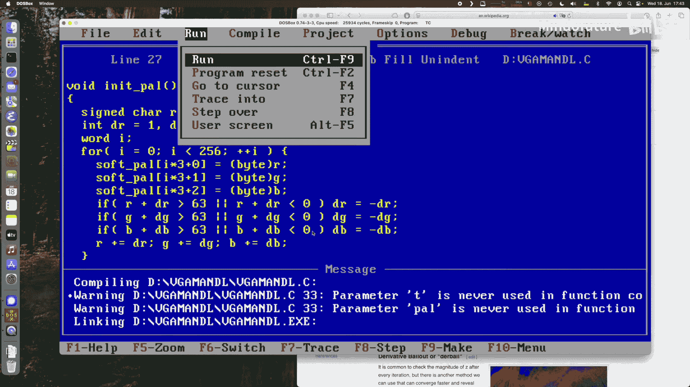

And yeah， there you go。 This is already the palelleate。

 And you can see we start or finish with green and a dark。

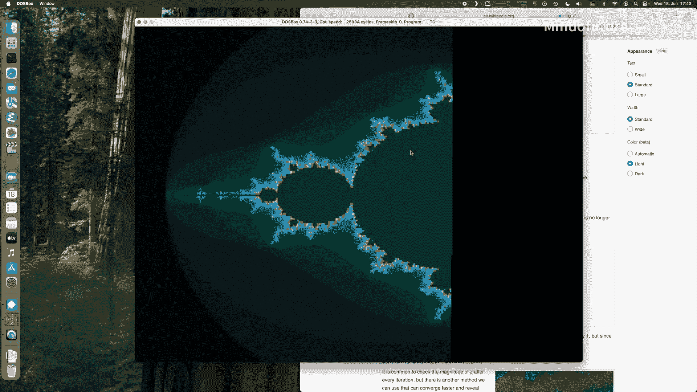

Blue on the outside。 And that's where I said it might look nicer if you。Invert this thing。

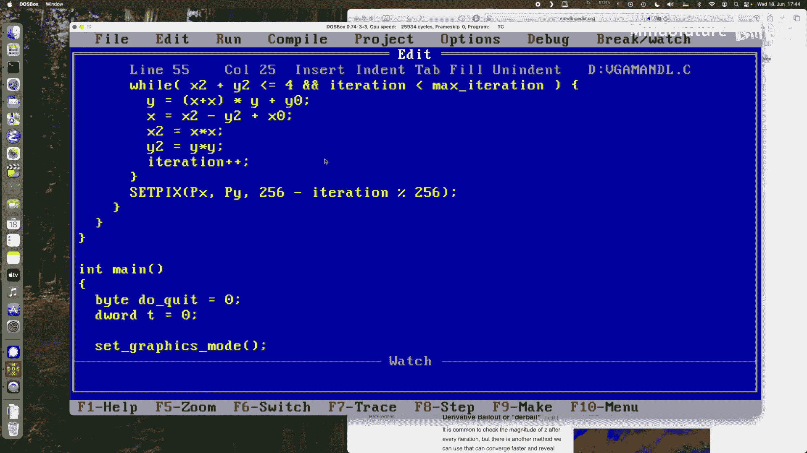

Which would look like this。 Now， we have green on the outside and black on the inside of the manbro head。

 which is probably something that you more often see。

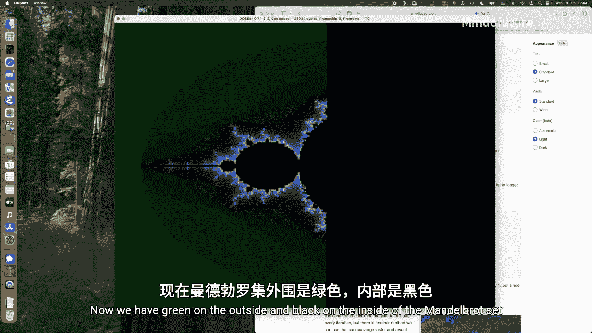

But it's up to you。 You can manipulate the palette all you want。

 So this is still not flashing because we' are not doing the colour cycling。

But now we go to the class cycling now comes the dangerous part。We need another iteration variable。

And we already know how to write to the palette。 So we write to the palette index registerar。

 which is defined in our VGA header。Pelleette index。

 we write to the register that we want to start writing at color index 0 because we want to set the full palette。

And we get a time stamp， basically， which gets。Counted up every frame that we render。So at first。

 it's0 then one， et cetera， et cetera。So we can iterate over all the palette ins， which are 7 and68。

 because that's2 three times 256。And。Who will output this to the palette data register also defined on the VGA header。

And we take the RGB values from the palette。By taking our run index， plus。

The time index times 3 so that we skip over every third entry。And of course。

 this will grow larger than 256， so we have to or 7 or 68 actually。

So we have to do modo 79 68 to still end up in the validale palette。

 And that's already the colour cycling as easy as that。Just setting the palette data on every pass。

 So let's have a look。

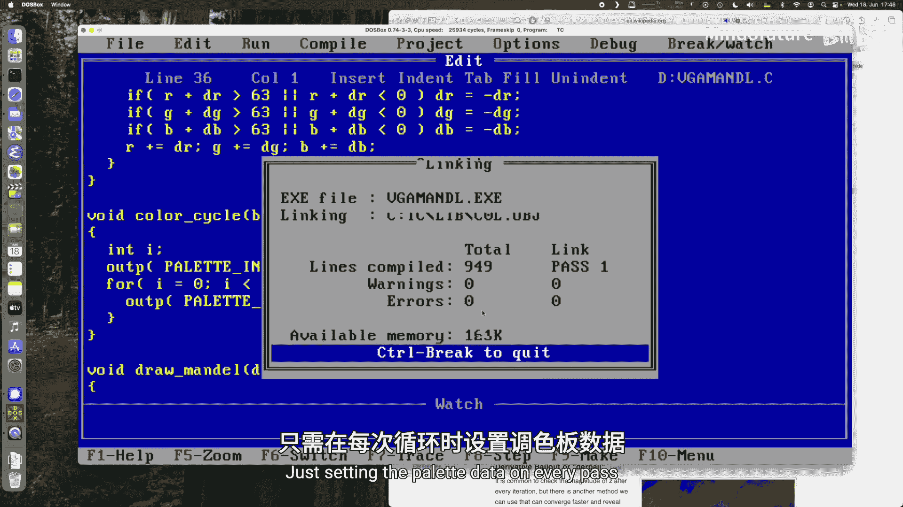

Here comes the thing and be careful Fing images coming now。

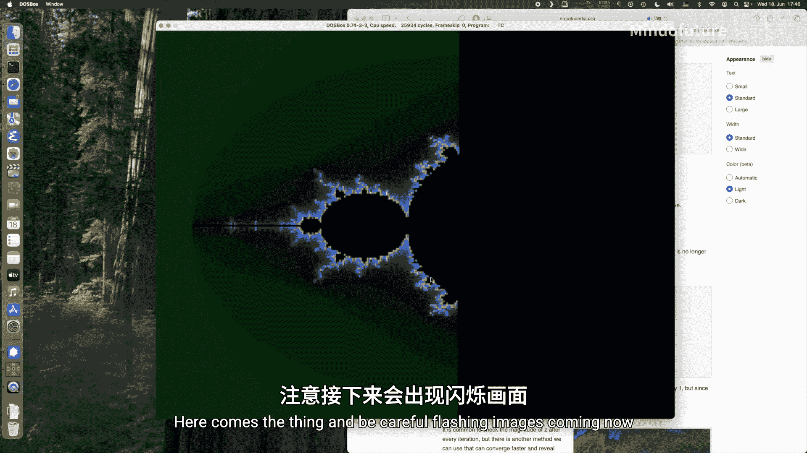

每一个。Well， that looks pretty neon like， doesn't it。 And also quite nice。

 I think you can also reverse the direction。 Obviously， you can do a minus， I think。Here。

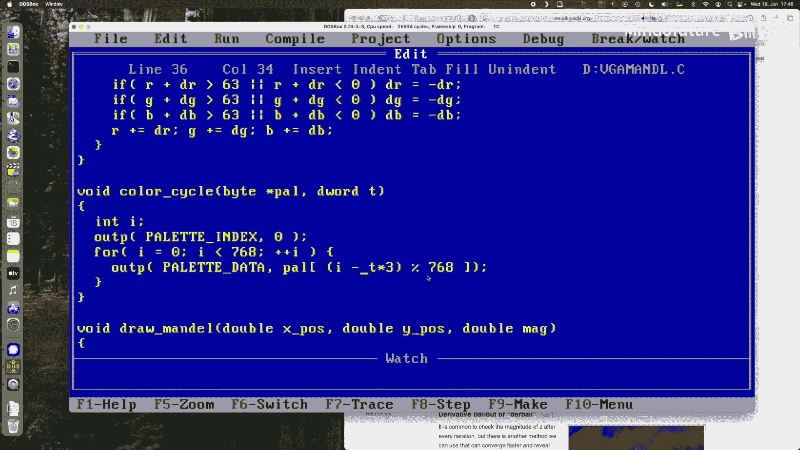

Let's do the here。 Let's see that should actually in invert the direction。

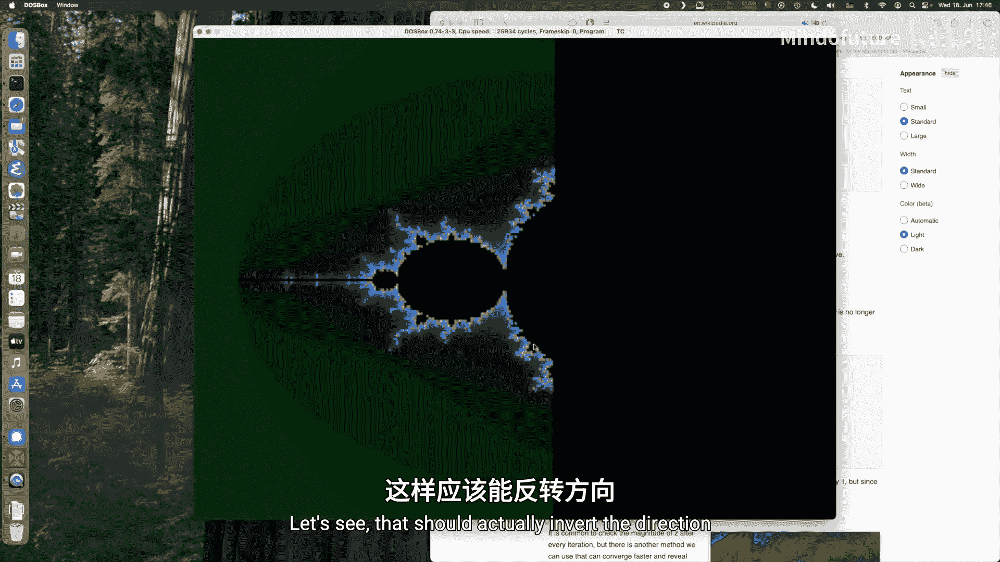

See if that works。Yeah， now， it seems to go outwards， let's say。

That might also be something that you could program。

Key vson that you can switch between the colour cycling direction or turn of colour cycling。

Completely， there was some useful features back in the day。

Let's have a look at the other image that we had。

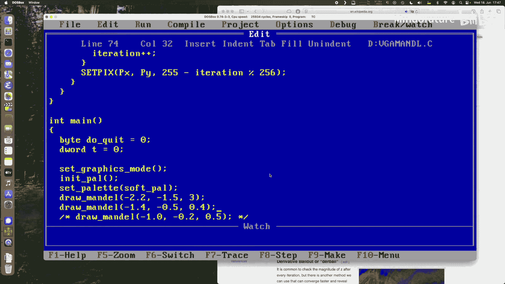

Oh， and probably not draw this one here。

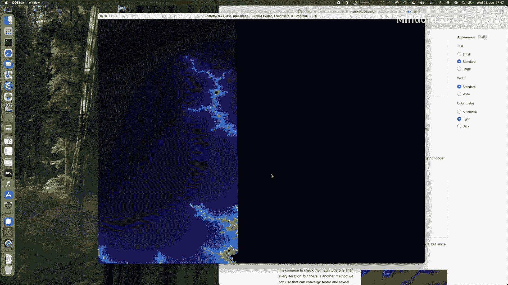

I guess， there we go。 I think this also looks very nice。 This looks like deep blue sea or something。

 maybe coral reefs or something like that。And then the invention looks quiet， crazy， doesn't it。Yeah。

 so very simple， a very simple and short program。 much simple， I think。

Then some of the other problems that we did here。 But the math behind that is， of course。

 much more complicated。 And it's very difficult for the layman to understand why this actually works。

 I never tried to understand it。But yeah， I think that's it for today。

A link to the source code is in the video description， as you usual share like and subscribe。

 You can follow me on master on Cato socialal forward slash at Route 42。Don't even have to register。

 You can just read my stuff there。 Patrerons also up， of course， if you want to join。And yeah。

 stuff like that。 See you in the next video。 leave a comment。 What was your favourite fractal。

 Can you。Make your own ftals by adjusting the formulas， maybe do a Julia set or something。 Yeah。

 I'm looking forward to your results and see on the next one。🎼，🎼。

