# 编写MS-DOS-系统-｜-windows-｜-操作系统-｜-汇编--｜-vga-｜-x86-p49-P49_Lets_Code_MS_DOS_0x30-VGA_3D_Textmode--BV1zs35zQEru_p49-

Hello， welcome。 and an excellent evening。 To。 we want to do some more。😊，Let's code MSDs。

 and we' are going to continue with the tricks that the EGA and VGA graphics cards have up their sleeves regarding the text mode。

A couple of episodes back， we already had this funky program here displaying a plasma effect in text mode and redefining characters to display varying sizes of squares basically to get some kind of dithering effect。

We do this by calling an interrupt， I think that's here exactly。

Interrupt tend to be precise with sub function 11， I think。To redefine certain characters。

And this is all fine and great。 but if we want to update the graphics。Inside of the text。

We might not want to do this by an interrupt because it's relatively slow。Plus。

 we lose certain characters， and we want to make a graphics effect。

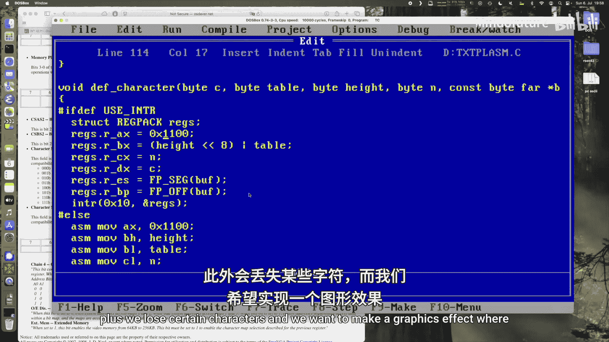

Where we can draw arbitrary 3D graphics in a little window on the screen。Next to regular text。

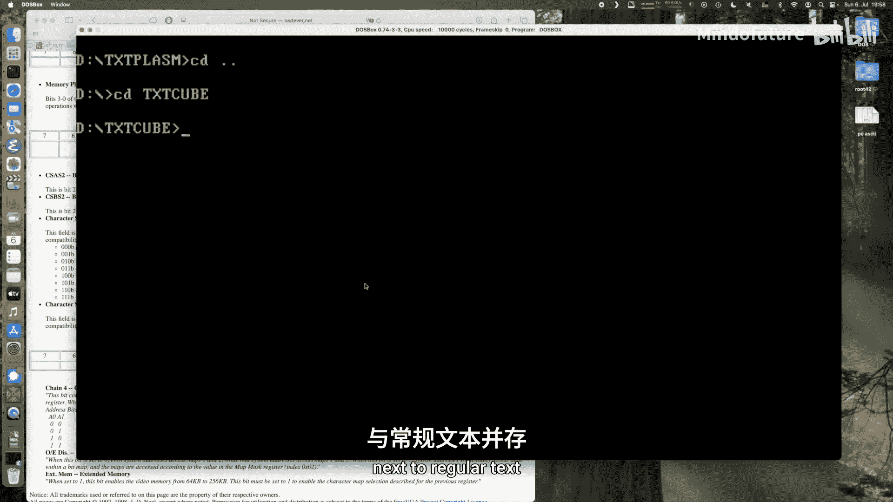

So I prepared a little program called TexQ and it's mostly empty。At least in certain parts。

Oh forgot to lead one function for you， but that doesn't matter。 So we get that for free。

 We already know the dis cursor function and the set character width function from the last video。

 So check on that if you need to we also know the file cube dot C。

 which we used in a different video as the main program。

 It draws a rotating cube using fixed point arithmetics。

I also not be talking about that you can watch that video as well plus we have the VGA C and headerophiles for regular VGA stuff。

 some definitions of ports and terminalmin things。

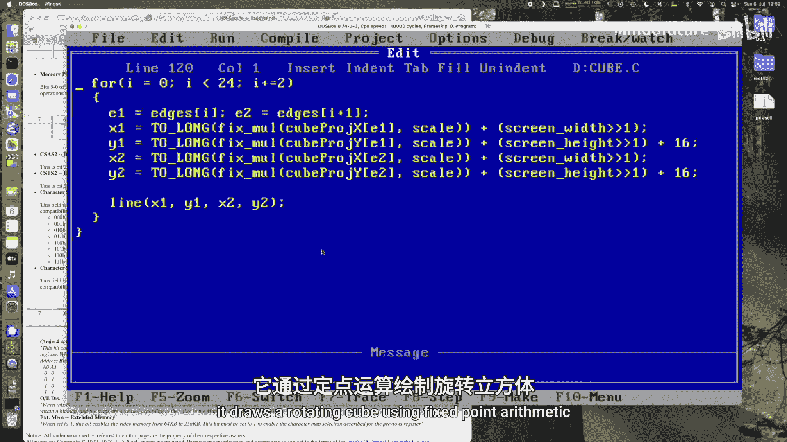

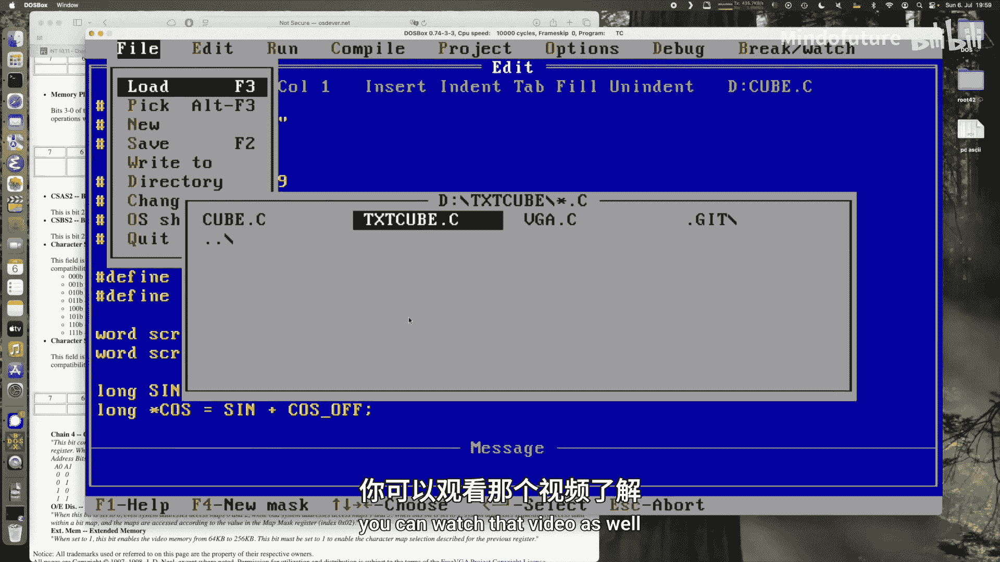

What we're going to talk about today is how the EGA and VGA graphics card can actually not only use 256 characters as you have on the IBM PCC。

 this the lower 127 are just the regular alphanemer characters and then this extended set here is basically the stuff that。

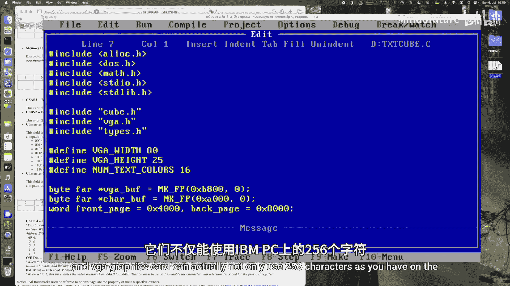

IBM defined for their PC。And it has some international characters， German Umlas。

 Spanish and French characters。Similar things， some international currency symbols。

 as well as block graphic symbols that we use， for example， to draw frames around textware nose。

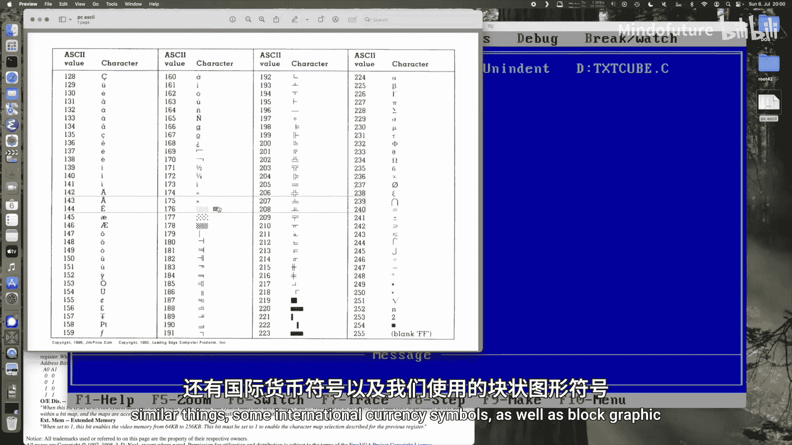

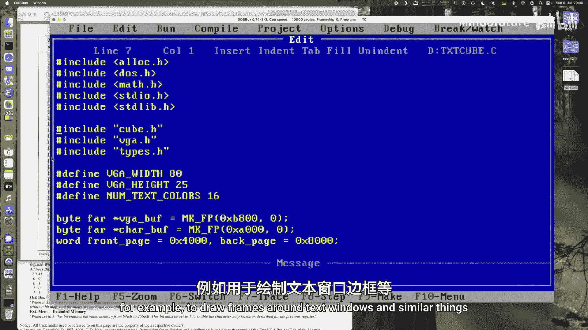

And similar things。And that means we have 256 characters that we can use。

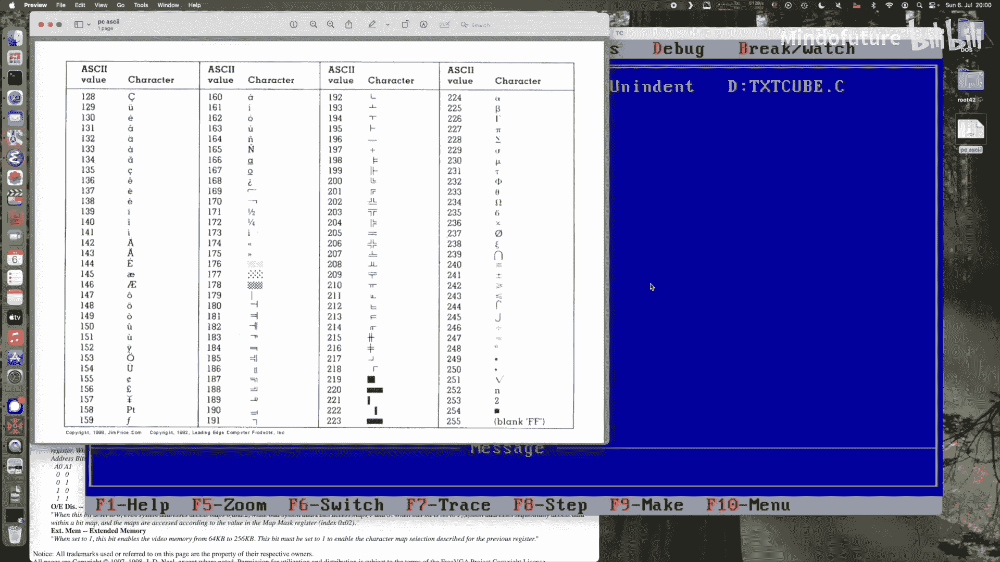

But we might also really want to use them， not redefine them。But。On the VGA card and the EGA card。

 you have a second set of 256 characters that you can enable actually。And for that。

 we need to talk about attribute bytes。In VGA memory and EGA memory， starting at B 800 hexademal。

You have interleaved。A character and an attribute bite。

And another character and another attribute by it and the third character and another attribute by it。

 and so on up to 80 columns in regular modes。 there's also different other modes。

 but we're talking about regular modes。And an attribute。Look something like this。

 The attribute bit by it has， of course。うん。Eight different bits。

The lower four bits encode the foreground color。And the。Next three bits define the background color。

And then we have the eighth bit， which is blinking bit。 if you turn this on。

 then the text will blink actually。Okay， so we have four bits for the foreground。

 which gives us 16 colors，3 bits for the background， which gives us 8 colors and an 8 bit。

8 bit for blinking。 And it would be superb if IBM had said， well， we make the8 bit。

Optionally to toggle between two different character sets， but they didn't。

They said we take the fourth。Bit in the foreground color， reducing the foreground colors to8 colors。

 which is a bit of a shame， I think， but that's how they did it。And with this。

 you can switch around between the two different sets because you only have8 bits， of course。

 for the characters and you would need 9 bits。 So this is basically becoming in the ninth bit to select from 512 different characters。

Okay， an offset。I'm going to delete that again。First we define a couple of constants VGA width and height。

 80 by 25 number of text colors that we have 16， I'm not sure we' we even need that。

 but that doest matter。Then the location of the VGA memory buffer in text mode。

 which is segment B800。And offset zero。And the regular graphics memory buffer， which is a 0，0。

0 and of  zero。But it's also where we can access and manipulate the character data if we want to do this directly。

And the zeroth。Offset here is actually the current character set that you are looking at。

And then the E G A card has multiple character sets。 So0 X B 800。0，0，0 is the first。啊。Character said。

 let's call it that。 not font。And then you can have four more。For the。E GA card，4000808，9， A B。

 and then it's C。C000， this， these are the next ones。 Let's say here。

 second character just had third。And fourth， and let's keep this here as a reminder so we can look it up。

And that's off very fine。 And you can actually set via this。Interrupt on here。

 we' going talk about that in a minute。Which。Character set you're actually using for the first map。

 character map and the second map， character map。 So you're completely free。

 You can pick any two of the four that are available。 The VGA card has even more。 It has even。

Double amount。So on the VGA card， VGA only。Your what I have。2000。Which is the fifth。And then。

You have。6000， which is the sixth character set。And so on。

 you can probably already guess what it's going to look like。8000 is the seventh。And then you have。

E000， which is the A character set。But we're not going to use that because it's also tricky how they hit the third bit to select the map inside of the register。

So we'll keep using only。One second， only these three character sets。

 the first character set will just be our working set that we are printing characters with and the second and third will be the front and the back buffer for double buffering and we'll swap them around so that's why we have a socal called front page which is in the beginning 4000 and a back page which is 8000 and then we're gonna swap that and display only one。

For that， we have a swap macro。 I not going to talk about that。 You can Google that。

 It's a nice trick。That you can do and see， but yeah， that's fine for the moment。Then we will。

Print out a little frame buffer on the screen made from 32 by 8， not exactly 24。

That's actually not correct。24 by 10 equals 240 characters。

 We will have 16 characters left over that we are not using。

You can also do something like 16 by 16 for a whole 256。

 but I think 24 by 10 has a nice aspect ratio It's almost square。嗯。Let's type it here。

 It's almost square。 And that's what we're gonna print out。

 You can think of this in the following way。 You have basically ABC， D， E， F，G， and so on。

Let's go to。The W。And x， that's 24 characters。 and then y z and I don't know，0，1，2，3，4，5，6，7，8，9。

 and so on。 and the same goes up here。We're not starting at A， but at。

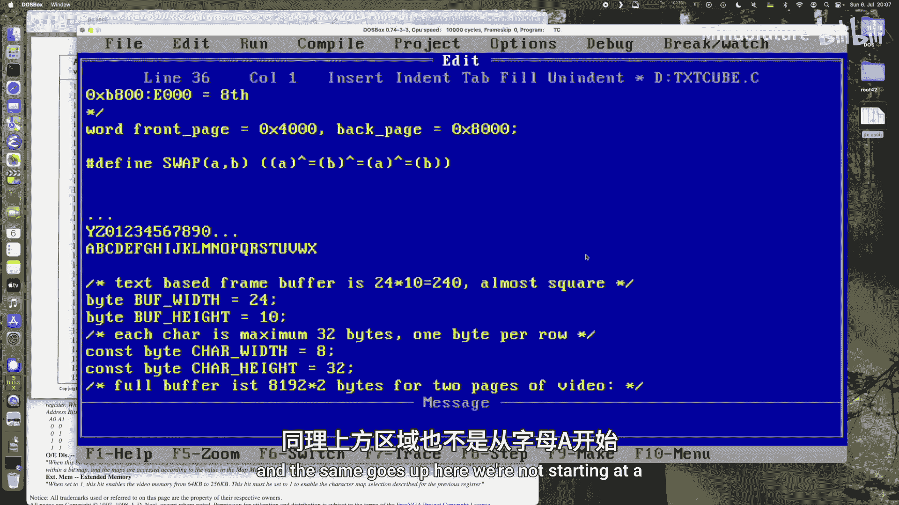

The character zero all the way on the other page that would have been here if we had a complete escape table here。

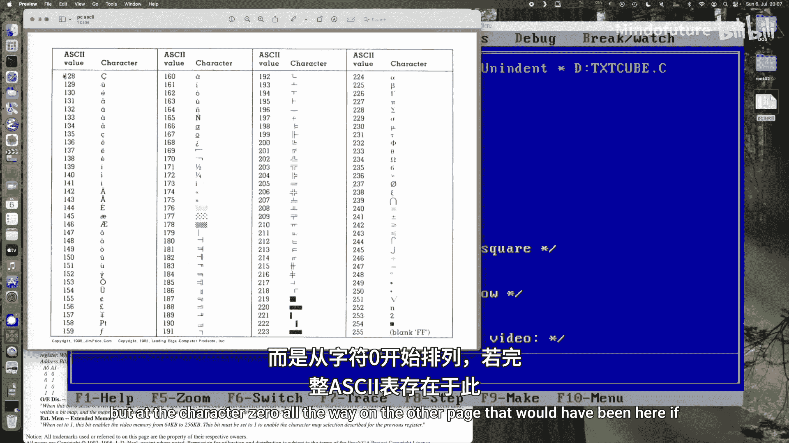

But basically from the bottom left to the top right， we are incrementing the characters one by one。

 and that is our frame buffer because then we have every single character from the second set on the screen in our little window and we can manipulate each pixel inside of each character cell to draw arbitrary graphics。

 many of them will be empty most of the time with a rotating cube。

 but some will have some line parts running through it。So that will look quite nicely。

And each character is8 bits wide，8 pixels， the ninth character on the VGA cut that we dis is just repeated and the character height。

 the maximum height is 32 lines， so each character is at most 32 bytes。

 but we are using only 16 lines from that because the standard height in this mot here in 80 by 25 is 16 characters。

So。The full buffer is 8 kB times 2 B for two pages of video。 and we are having the。

Point a here of the character table。Which I think we don't need because we already have the character buffer here。

So I think this is redundant， I might want to delete that。And just use character buffer。Okay。

 let's give a。Cross these two functions， because we already talked about them。

The thing is we can't access the graphics memory at0 x。A 0，0。From the get go and text mode。

 it's not accessible。 And to explain a little bit more。

Graphics memory of the EJ and DGA card outside of the chunky modes is actually using bit planes。

We have four bit planes。On the EG PGA hardware。嗯。And we have。In text mode， bitplain 0 is the。

Characterters。So。8 bits in row give us one character。 B plane  one is the attributes。

8 Bs in row give us one attribute by it。 And bit plane 2 is the character data so and。

Bplanin 3 is not used。So what you actually want to have is access right access and maybe read access to bit plane2 to manipulate the data in there when you access。

0 x， a 0，0，0。How many your layout。When you access this you want to be accessing bitplainin 2 and pay default。

 you would be first of all you can't access anything text mode at this position。

 but if you switch it so that you can access a000， of course you first maybe access bitplain 0 or whatever the。

Moode register says， So we first need to open the access to bit2。And for that。

 we need the sequence controller。And it has a couple of registers that we need to write for in total。

嗯。Let's do it like this。The first is the reset。

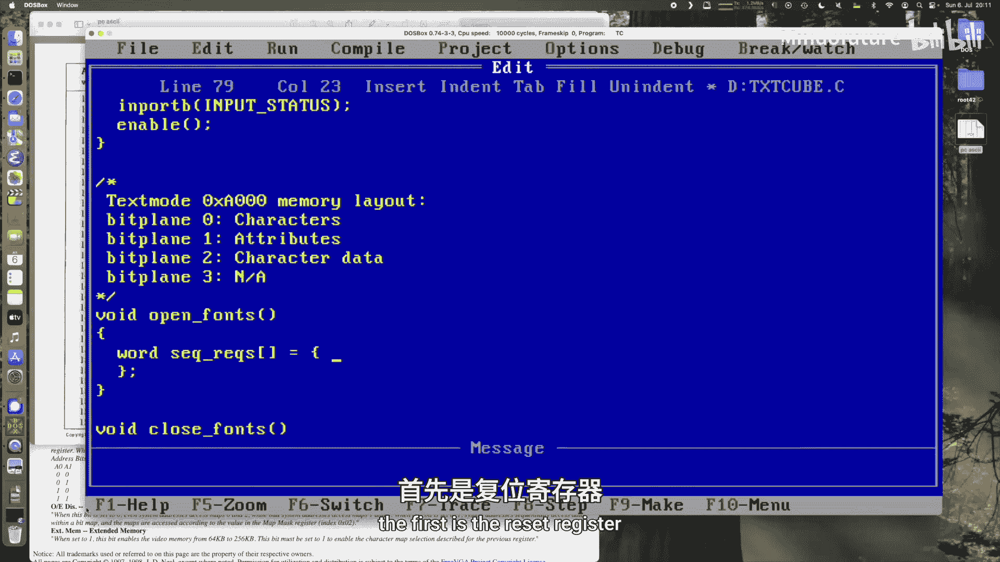

Register， let's see we are here at the exactly。 This is the sequencer registers。

 The reset register is index 0，0， and we will have to do a asynchronous reset。

 So we are setting this register to 01。 And the way this works is we first write。

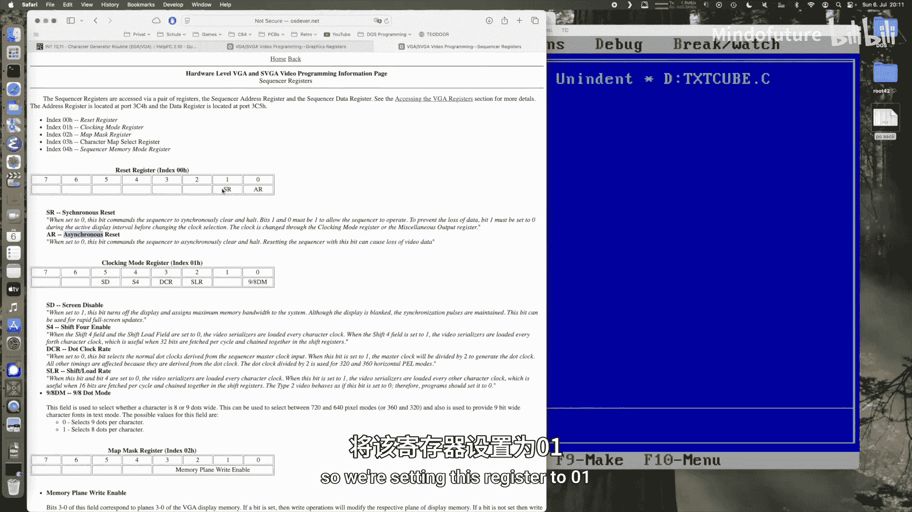

The register number， no， the register number is the low by， which is 00。

 And then the value that we want to write， which is 01。 And we can put that in a word。

I'm gonna put here。0，0， reset。Research。And we were writing 0 x1， reset the sequencer。

 something like that。嗯。That's exactly correct。 And we are gonna do the following。

 I'm gonna already write this out for you because there will be a couple of other values that we need to write。

 We will disable all the interrupts so that no interrupt can mess up our VGA setup。

And then we will enable them again， very important， otherwise， keyboard will stop working。

And we will iterate over all the values， and we will put four values in there because we need to write to four registers。

And we will simply。Write a word to the sequence controller index register。

 and a 16 bit right will also write to the next port。 So sequence controller index plus one。

 which is sequence controller data。And it royal right， both bys。In one go， registers index I。

So that's very nice。And we will also have the graphics controller。 We will look at that in a second。

 which also controls the layout of the memory。Of the VGA card。And especially， selects the。Bit planes。

 for example， that we want to write， and there will be three registers that we need to write。

 and it will be the graphics controller index and very similar。 But with the other registers。

 So what else do we need to set up。

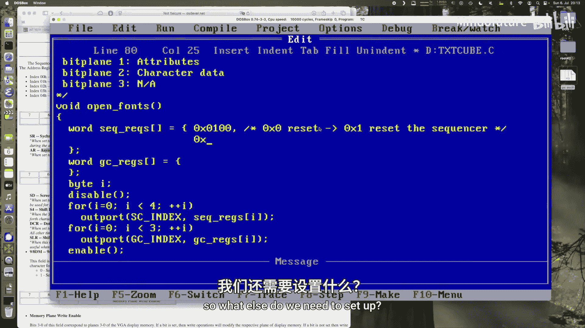

Next register that we need to write to is the map mask register。

whichch is the memory plane write enable and this is memory plane 0，1，2， and3。

 So what we want to write to is enable bit plane2， right？And。Which would mean that this is value 1。

2 and 4。 So we want to write。

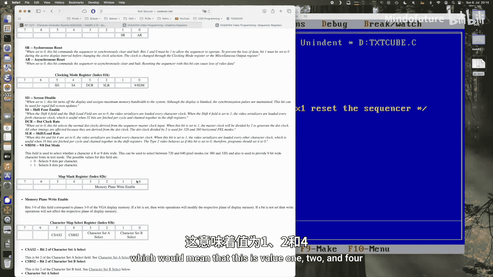

A4 into register number two。So let's write the down map， what is it called net mask。Register。

And0 X4 means right to the plane2 only。

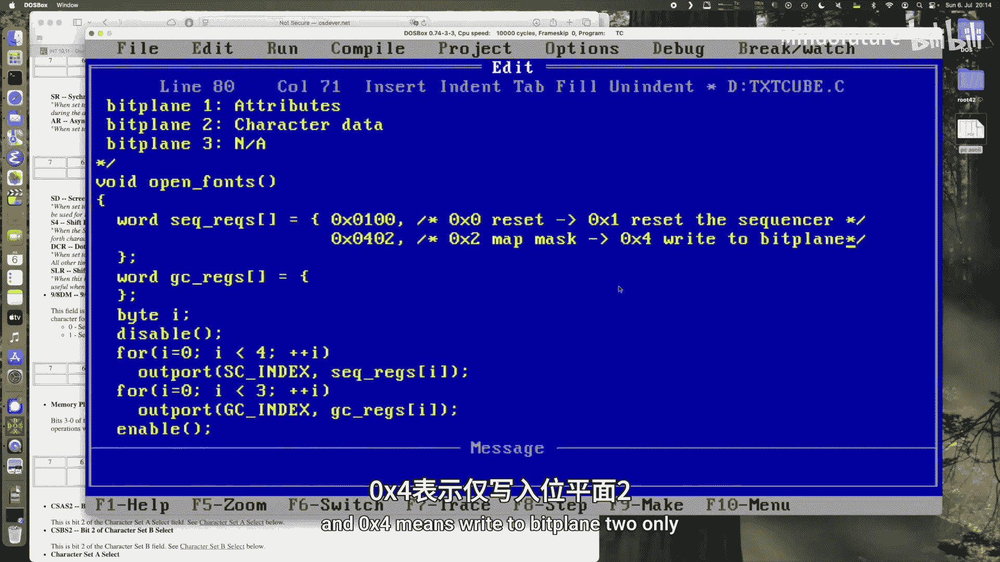

Every bit that you set will be enabled for writing and this way we only write two bit plain2。

 which is exactly what we want。

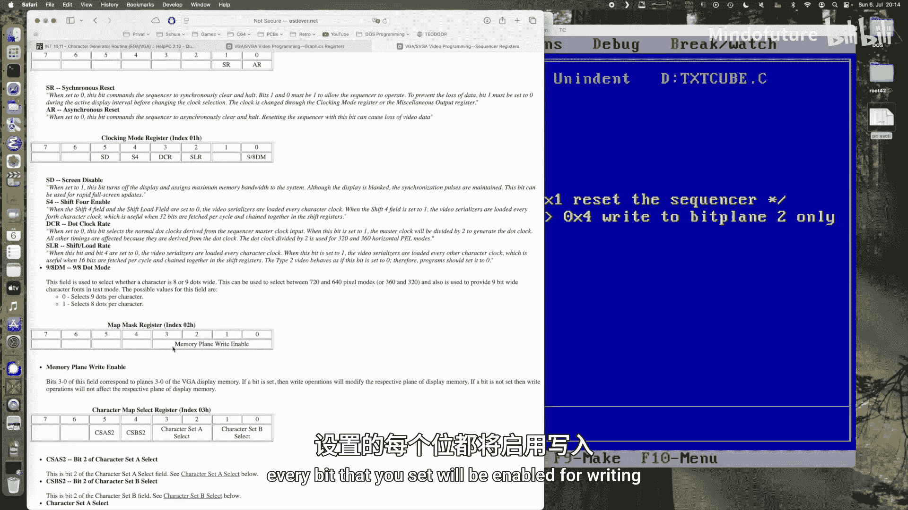

Next up， memory mode， memory mode， memory mode。 It's down here。

 The memory mode register can enable the extended memory so that you can access the whole 256 k off the E G N VGA cards。

 Otherwise it will behave like a。

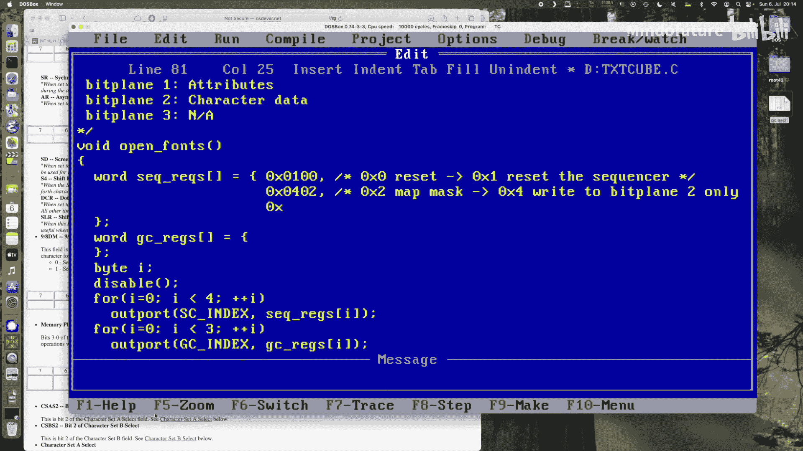

CGA card or NA card and only give up to 64 kilobys。

And the odd even chaining for the character attribute interle is also there and the chain for the VG8256 color modes。

 which we don't need。

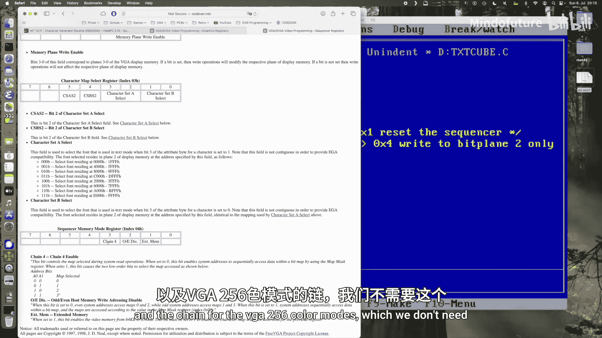

嗯。But here we want to said。Everything to00 x。

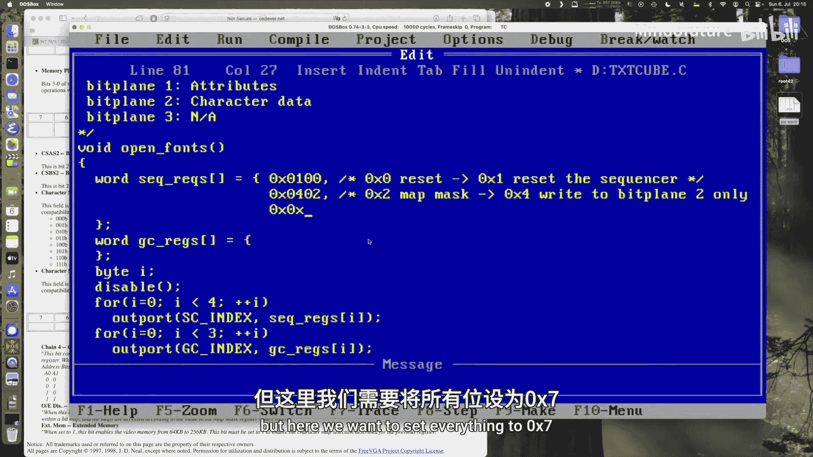

7even。Which is enabling the enabling the or even disable， So disabling or even mode。

Enabling the X memory and this one here is not documented but also important。

 but I haven't got my book here to tell you what it is so you can look that up somewhere else。

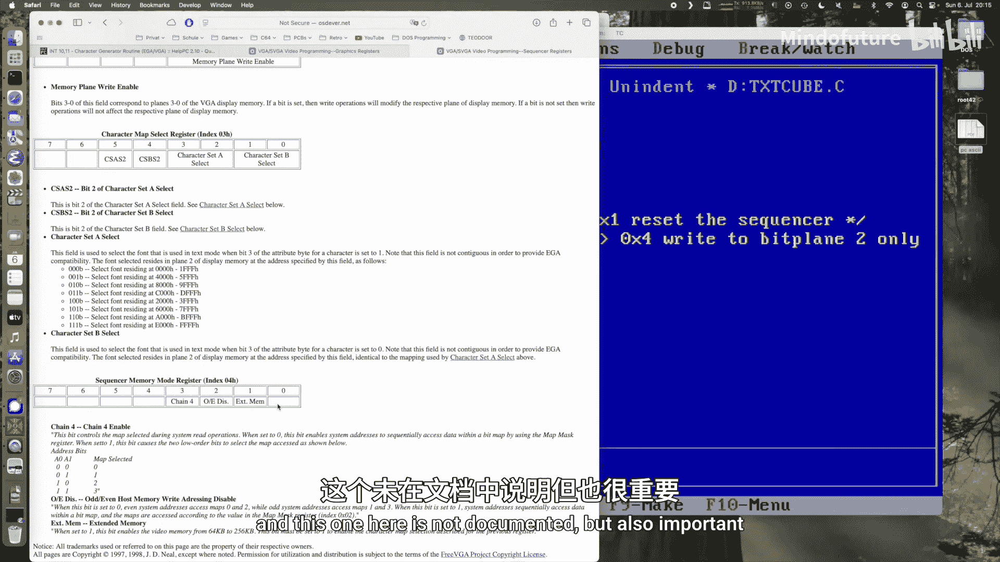

The register was 4。 Let me write2。 So 0 x 4 is the。呃，Memory。More register， There are 7 means。

 or even disable。Extended man memory， basically， that's the important stuff that we need。

And then the last thing is to get the card out of reset。And that's done by writing a。3 into it。

 Disable reset。And we're going to take away the x are comma， which shouldn't。Heurard， but。

It hurts if I press return， let's take a look， I think this is exactly。

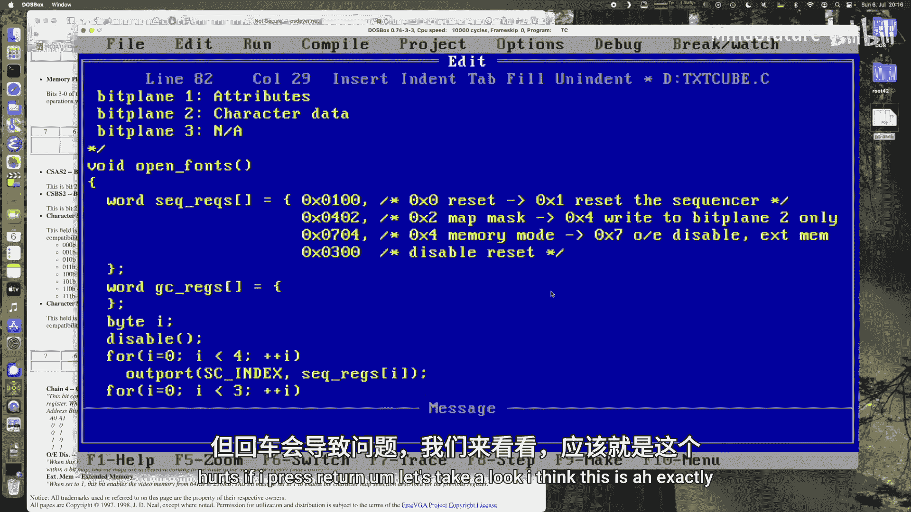

Actually， we did synchronous reset because this is active low。

Which is why when you put a three in there， we get no reset and if you put a zero in either of the bits。

 you get a synchronous or asynchronous reset。I'mNot sure what the difference is， but。

To the loss of data， but one must be set to 0 during the active disable before changing a clock switch。

 Okay， never mind。

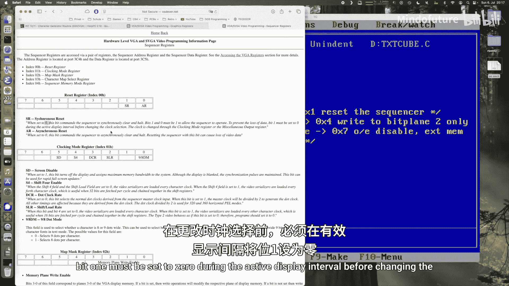

The graphics controller also has stuff going on。And。No， this is not what I wanted to see。

And let me fetch the。Documentation from that。So here is the graphics controller registers。

 First of all， we need the grid map select register。

 which is the counter part of the sequence controllers， no idea why they put it there。嗯。This will is。

Of this sphere is used in read mode 0 to specify the display memory plane to transfer data from。Yeah。

 interesting， interesting。

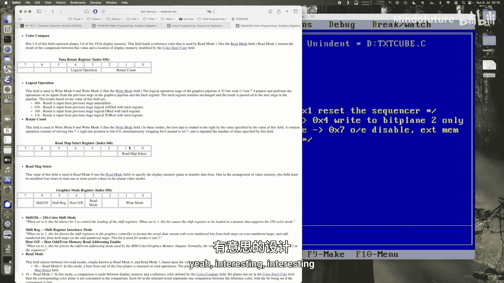

I don't know why they designed it that way， but that's what IBM did。 So this is Regar 0，4。

 and we want to have a bit playing2。 So here because it's condensed to actual。

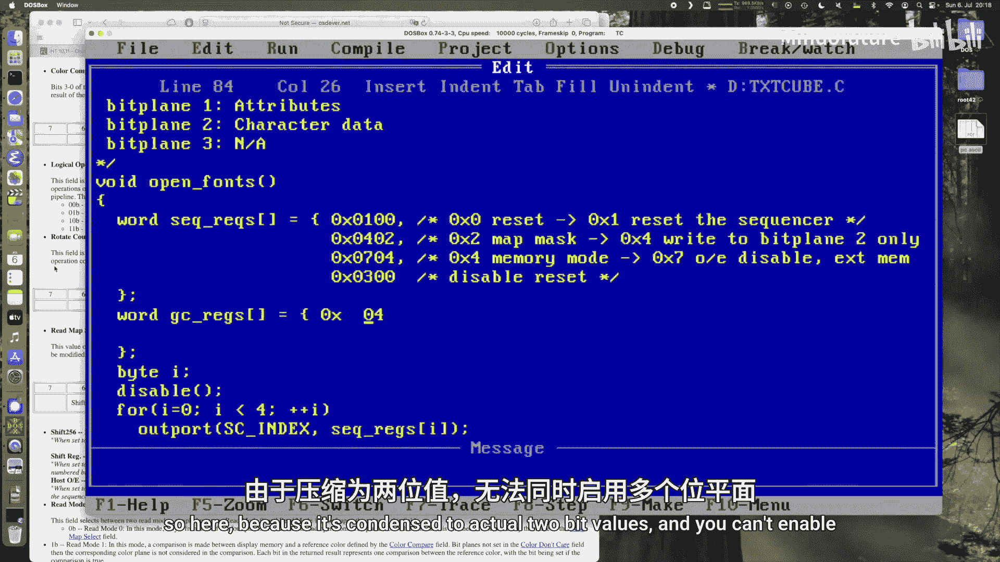

To bit values and you cant enable multiple bit planes。

And as also says due to the arrangement of video memory this field must be modified four times to read one or more pixel of values in the planar video modes。

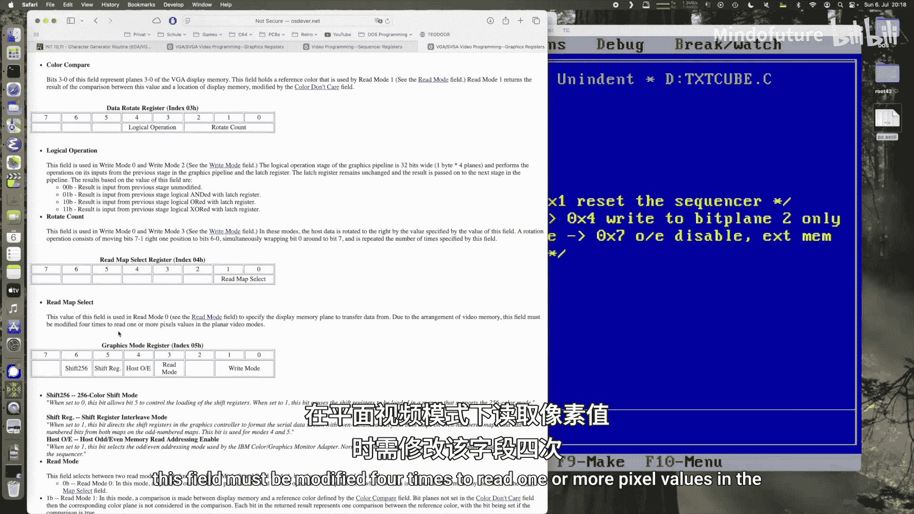

Terrible， so we have to write a two to it， and we can only read from one bit plane。

 So that's actually pretty inefficient in this mode。But you can read multiple pixel。Pixels and one。

 but only one bit at a time。So you always have to think about that when programming in planar modes。

So this is the read。Moode， read， read map， select。Register， which is X 4。Select bit plane2。

That's that。 The next thing that we want to do is setting the mode register。

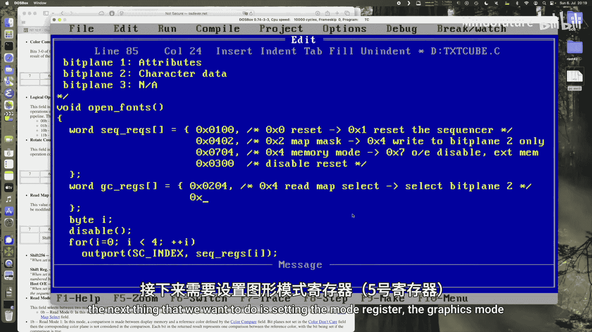

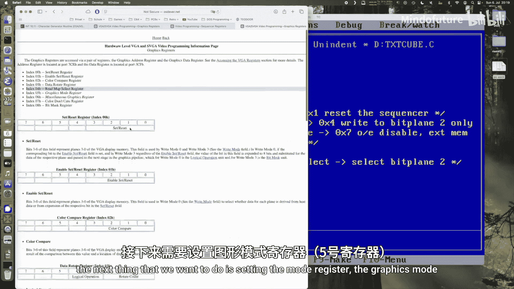

The graphics mode register， which is5。And here we， I think， have to clear everything when set to 0。

But but 256 colour shift mode， we don't need that。Okay， everything has to be set to0。

 It's also the exactly the odd even mode when set to one。

 the split selects the odd even addressing mode。 now we have to disable that。So0，0，0，5。This is the。

Moode register。And most importantly， dis。Or even addressing。Last。

Value here is the miscellaneous register right below here。It has the memory map select in there。

 and we want to be able to access the。A 000 plane and I think we could either write a 00 or a 01。

 but the documentation I got set to just enable the whole 128 k region。

So let's do that by writing a zero in there as well。And also。

 it's another control bit for the odd even there's like three different bits that enable the odd even addressing。

 which is so weird but it is like it is。And yeah， that should be fine。

 And the alphagonomeric mode disable。But we are not in in graphics mode instead to one this bit select a graphics mode。

 so we keep this at zero。Once more。0ero x6 is the miscellaneous regiistant。This 앱을 어린이。

Enable zero x a zig segment， I would say。Okay， this is for opening access to the fonts。Furthermore。

 we have to do the reverse after we are done with all our shenanigans。Otherwise。

 people can't use the text mode properly。So we're going to do the reverse basically and I'm going to go a bit quicker through this。

Hopefully， because we still have a lot of stuff to cover。First of all。

 we are going to go back into reset that's the same and also go out of reset that stays the same。

The map mask register gets a3， which turns on bit 0 and1， so。3 means ride to bit planes。0 and one。

Which is the characters and the attributes。The memory mode is being reset to 03。

 and we can have a quick look。

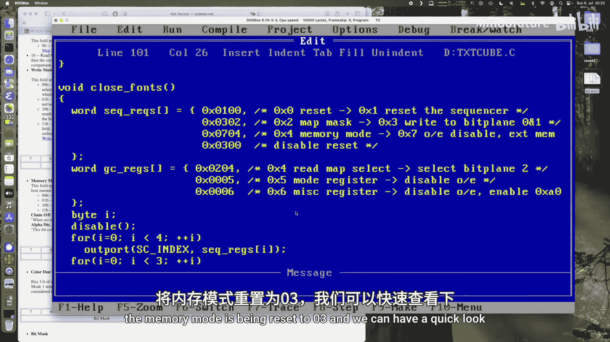

And。Oh， is this correct？😮，Should have looked at in at at4 here。 We have to enable the。O even again。

 So this has to be set to 0。 The extent memory gets set to one， actually。

 it seems because we are writing a3 into there。 So memory mode。

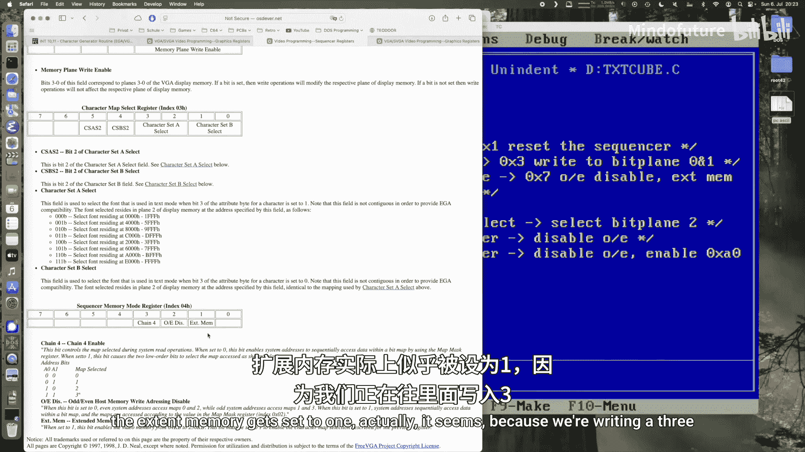

And or even enable and we keep the extended memory it seems。And then the dis set。

 the graphics controller looks similar。The bit plane by default that we want to write to is the zero。

Zeroth bit plane because everything is in art even every other right will go to bit plane1。

The more register goes to。1005 because the fifth register is our Read map select。And。Butッパプ。

Let's have a look，10 in hexadeal。Is in binary one with4，0。

 so we enable the host on even and put everything else in zero， including the right mode。So。

This is basically enabling not even again。And similar here。

 we write an E into the miscellaneous register。Which means。In binary， we set。Memory map select to 11。

 which gives us the B800 region， which is fine， which is exactly what we want plus we are enabling the art even and this stays at zero so we keep the text mode。

So we。Enabling or even and enabling access to B 800， basically。O。Who。Let's take a quick breath。

 We now know how to open up the graphics card to reveal to us the different bit planes。

With the character data and we know where the character data lies。

 namely at the offsets that we have here for front page and back page。And that is now。

 hopefully working。Now we need to set up our screen and be able to flip the character sets。

I'm going disable drawing the cube right now to。Show you after the setup screen what we can actually do。

And I'm gonna。Turn off this loop here for a second to make this a bit easier to show you a special feature of graphics in text mode。

So we're going write a setup screen routine， which will draw。The frame buffer。And yeah。

 that should be fine。 We are also filling the background with a ton of characters。

 and that should actually already be working。But。Yeah， there's the table。Let us try， and。

Run this program as it stands here， whereas is our error undefined symbol chart table， Okay， yeah。We。

 werere gonna call this jar buff。Okay， so this is our backdrop。

 This is the whole aski Taylor repeated all over here。 It starts with character 0。

 and then one and two are the smileies。 And then all the other graphical characters。

 E American characters going into the Greek symbols， other。Mathematical symbols。

 And then here the square is the last。 That's a character 255。

 and then it repeats all over again so that you can see you're in text modet and every graphics character does still work even when you're manipulating。

This stuff。Actually， we are already opening up the font。

 doing our draw loop and closing the fonts here。 You can't do that inside of the loop。

 or you will get。In those box， it will work。 But if you test it on a real machine， it will。

Throw your monitor into crazy mayhem because the monitor loses sync during this opening and closing of the funds。

 So you should do this。As rarely as possible， okay。Good。That being said。

 we are gonna draw our frame buffer， which should be very nice。And it's a bit tedious。

 so bear with me。We need。Some coordinate variables， I call them X and Y。And we need a。

Put character function。 Let we fill in first。The put character function directly writes to the BJA buffer that we defined above。

 which is the one at B 800。And it's simple arithmetics。

 every scanline is 160 bytes and width 84 characters， 84 attributes。

plus our offset needs also be multiplied by our X offset also needs to be multiplied by2 because every character attribute again。

Plus0 for the characters。And that will be our character。 and then we can copy this line。And。

Basically， this year and put the attribute by in there。

 So now we have a very fast put character root routine here。And that is actually great。 so we can。

Start drawing characters。Not gonna explain this in detail。 but here we are drawing。

To the upper left border or the top border， then the side borders and then the bottom border。

 basically we're drawing this here first， and we're drawing this and this part here and then the bottom border with the corners so you can figure out the different things here。

 The first character that we need is a upper left box。

 which is this and you can look this up in such an ASI table here。

 and I put in character 2001 and you can type it in by holding down the alt key and on the numpa not on the regular numerics。

 but on the numpa you type 201。

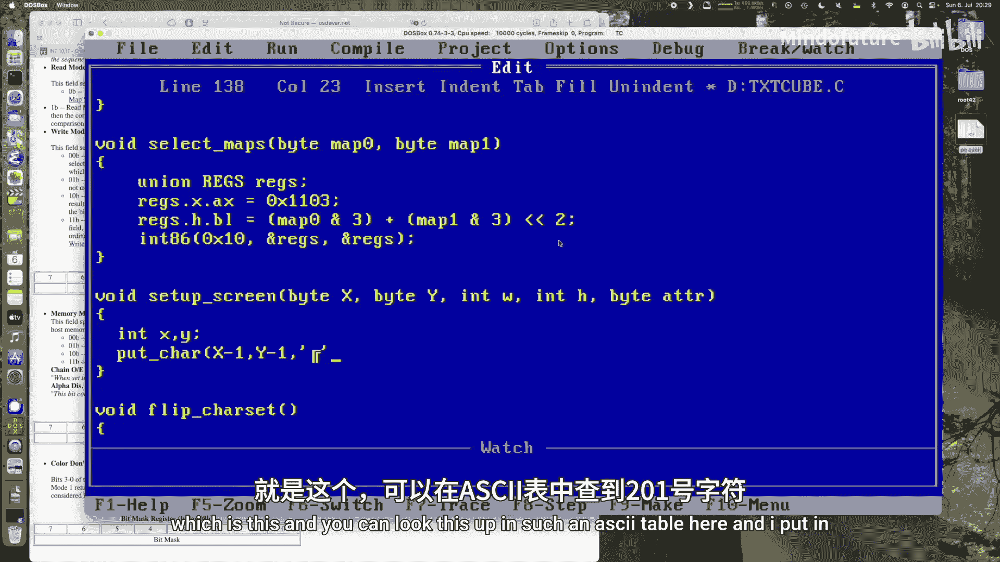

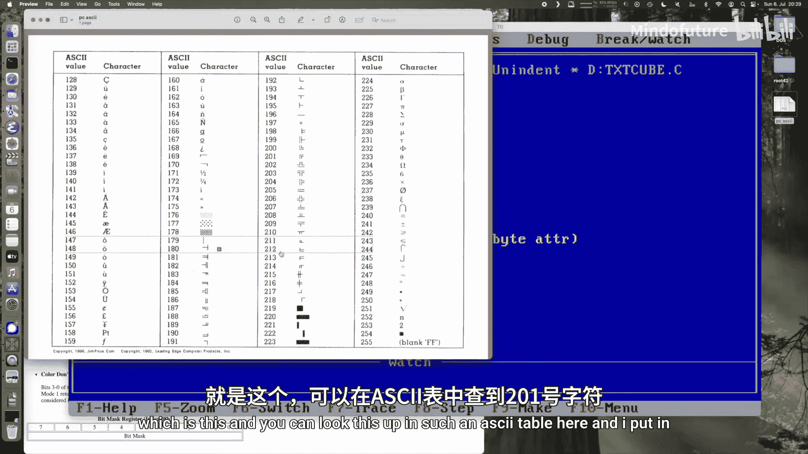

啊。Should come here。And similar， you can do 202， 203。

 204 and figure out all the characters if you don't have an ASI table。

 you can also type something like 64， which is the Atem or 65， which is the capital A。

 you can type in any characters that way， which is nice。And yeah， that's fine。

And we also write the attribute。And then we will write a very long line。Across the screen。

 so x equals big x， x smaller than big x plus the width of the frame。Plus plus x。 And we're gonna。

Take us the。Put character routine。Replace this with x and y -1 is correct。

And then this here should be a 20，5， which is the horizontal line。And then， we can write there。

Right side of the box。The right corner that should be， I didn't write the down。

 The right hand side is 1，8，7。1，8，7。 There you go。And。

Running this already gives us Yeah kind of the right thing。

 because I forgot to update the X coordinate X plus width， I think。Yeah。

 this is looking good now we have a part of a box coming up。Very nice。

Now we can draw the left and the right side of the border。

 So this time we are running over the Y coordinate， Y less than y plus。Height。Plus， plus y。

W you give us。Two different characters that we need to put down。Good character at。X minus-1。And why？

And this will be the character 186。 I think yeah， that's the vertical bars with the same attribute。

 of course。And then we can also put this on the right side of the。Box， if we do this correctly。

That should be plus width。And that should give us， yeah， this gives us。Almost the whole frame， right？

 So we only need to copy。This will block up here and change out a couple of characters and a couple of coordinates。

嗯。Namely， this will be plus， no， minus-1， and this should be。Plus， height， I think， right， yes。And。

Here as well。 we are drawing the bottom one。 And， of course， the。

 the box will be wrong because it has these downward facing thing。

 So we need to replace them with their counterparts and the counterparts are。2，0，0。And2，0，5， No。

 that was less1，1，88。So we drew a box。Now we have to fill it in with the alternate character set。

Let's try that。 That is actually。Double with another loop， let's go from y equals 0。

While smaller than the height。パス plusスワイ。And then。The x also xs less than the width of the frame buffer plus plus x。

And now， we fill in the。Did you able above phone？First， only the character。

 And then I'm gonna to fill in the attribute with the second with the with the fourth bit enabled。

 So we switch to the。Second character set， basically。

So the Y coordinate is kept Y plus our current offset。Again， times 160 plus。X plus6。

Times 2 plus the0。I want the characters。And this will be a small formula to get the and character in our loop。

 We could also have a running variable that you always increment if you want to do that。

 but you can also calculate it like so， it's totally up to you。This gives us。Character。From0 to240。

 basically。At this exact location， but you can also have the run variable as you wish。

 So this should fill in everything like so， yes， here's character 0，1，2，3， and so on。

And you already knew， for example， this is the 64th character， 65th and so on。

 going upwards and here you see all the border things。And here you also see the problem。

 If we were to redefine these also the border would break down。

 So now we will enable the fourth bit in the foreground color。For these， so we will copy。

We will copy part of this。Up to here。To。Write the attributes in the next bite。

And the attribute will be the attribute。And then we will turn on the third bit。

 which we get by left shifting one by three。So this will enable。The next。And at the moment。

 it just looks bright because， of course， it's color white。 This is gray。

 And if you turn on the third bit or the fourth bit。If you start counting by one。

You will actually get color number 15 and that is a bright white。

 but it also signals to the VGA how to use a different character set。

 but the character set still looks the same because we didn't really find it。All right。嗯。

Then we also need to implement setting pixels and flipping the character set。 first。

 flipping the character set for the double buffering because that's actually relatively easy。

 We must only do this when we in retce。 So we do wait for retce。Then， well sop。

The front page for the back page。 so the pointers will get swapped。

So now we're drawing into what was formerly the front page。In the double buffering context。

Then we will call the select mapps routine， which I'll talk you through in a second。

And our regular character set stays character set number0。And if the current front page。

Is equal to 0 x 4000。Then we'll pick character set one as our current front page。

 otherwise character set2 in the VGA memory。And that's that this will toggle after the swapping between0 x between 0 x 40000 x 8000。

 which are signified by the numbers  one and 2。For the VGA card。

And we will clear the back buffer so that we can draw again。 So we take the character。

Did we call it it character b， right， character buff。嗯。Plus the back page of that。

 otherwise we ought to clear the visible portion that we don't want to do。Are we setting it to0 bits？

And we have to do。Exod doesn no。20s to clear everything in that。Page， okay。

 this should actually give us a。Clear screen exactly。

 now it's swapping back and forth already and drawing nothing yet。But it cleared out the second font。

 it's still white， but you can see it because all the pixels are clear。Good。We are almost there。

 Now we need to figure out how to set a pixel， okay。

And then we will set one pixel and after that will enable the cube。38 pixel。Well。

 it's a bit trickier than normal。 We need to calculate the character number and the row number in the character。

We also are gonna pick up a far pointer for the character itself。 so we don't have to handle so many。

We have formulas around， we'll install the pointer actually there。

We'll do a sanity check if x is smaller than0 or x is greater than the buffer width。

That we have allocated， and we need to left shift this by three or multiply by eight。Or if。

The y coordinate is too small or the y coordinate is too large。Buffar height times 16。Time 16。

Then we return because then we're out of bound， nobody can see the pixel。

Now we calculate the number of the character in the map that we're going to draw in according to our frame buffer layout。

That is actually。X divided by 8。Plus。Why divided by 16。

 Because this gives us the number of the character。

Because every character has 8 bits wide and 16 bits high or pixels， so to speak。嗯。

Times the buffer width。Of our frame buffer that we allocated on the screen。And of course。

 for performance reasons， we will write this as a write shift by3 and this as a write shift by4。

And this would give us the character number。The row number is actually also pretty straightforward。

But the rows are counting up from the bottom of the screen to the top。

 so the bottommost is row 0 and the top most is row 16。

 so we have to subtract from 16 to get the right row number minus the y coordinate modular 16 and then we willll be off by one so we have to subtract one more。

Then we can calculate the pointer in memory， which is our character buffer。

Close the character number that we just calculated。Times， whatever height all the characters have。

 which is 32 lines， even though we are only displaying 16。

 the VGA card always takes into account 32 lines in memory。Plus the row number。

 row number plus the offset for our back page because's that's where we're drawing。

 otherwise we're drawing to the front buffer， which we don't want to do。And if so。On by here is true。

 We want to sense a bit。 so we are taking a character pointer and。Doing an or on that。With a one。

And we left shift this by。Character with？This is the same， basically， as。This computation。

 the row number， basically we're calculating now the column number。

 we could also call this column number。Actually， maybe we should。Let's call this columnum。

And also calculate this。この。Is equal to the character width。Which should be8， I think。-1 minus。

X modo the character with。Great， three closing braces should do it。 So here we're doing。好。

One left shift by。Call no。 Okay， this should shift our one to the correct position in the character。

 And if we want to clear something， it's very similar。But then， of course， we can't order this。

 but we have to enter this。With the negation of exactly what we just did。

Because this word said everything but that pixels them。O。W， quite a lot of stuff。

Let's try to do a set pixel。But。10， now let's first to0 comma 0 comma 1 for on。That's should。

Said something。There's a。This is wrong。There's too many closing braces， right。And here。Yeah。

Of course， I wrote garbage。And there we go， and we don't see anything。Brilliant。

 quick debugging time。😊，Okay， very simple bug。I had to move the set pixel， of course。

 inside the loop。 Otherwise it would get deleted or straight away about this here， this pixel。

 that's us drawing something。And。We can perhaps do T modo。What size do we have， I don't know。

 let's say 64 and T modular 64， it will quickly draw a diagonal line， it should。

Draw a diagonal line if we do T plus plus。There go。Or it traces out。 It's， it's even an animation。

 right， so we can draw at any space inside here。 We can even do something like。256 and 256。😔。

And get it moving all the way up here before disappearing and then reappearing here。 So awesome。

 yeah， great。 which means we can enable the draw cube protein because that's already done。

 We already did that in the previous video。 Let's quickly talk about the select maps。

 I did this by using a register not a not a direct register right， but an interrupt。😊。

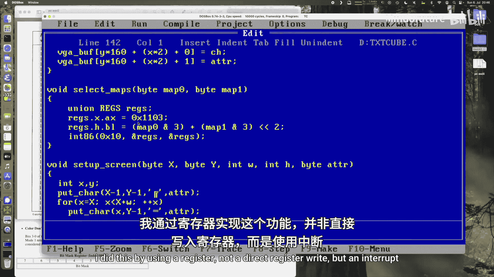

Because we haven't interrupt for that。

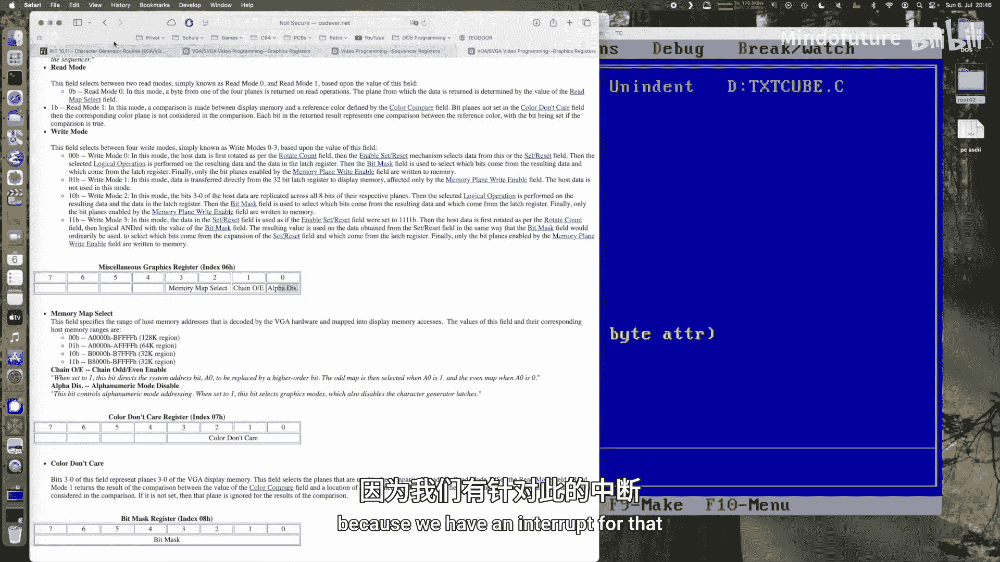

And it is part of interrupt 10 and sub function 11， which are the character generator routines。

And here， we're using the。Function 3 of this sub function， which is set display definition table。

 and you have to pass it the value for the character map select register。

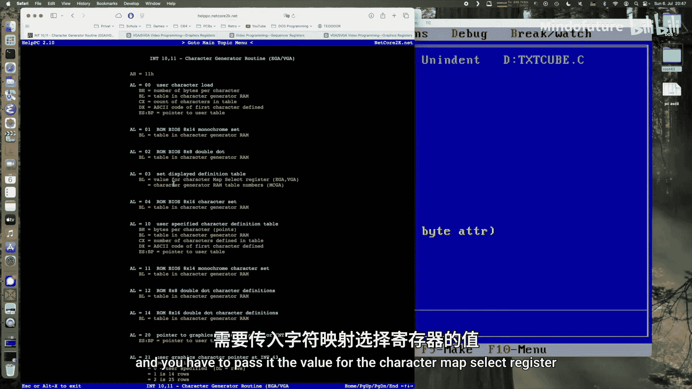

The character map select register is part of the sequencer。

 its index 3 character map select register。And for for the EJ accounts you have two bits to select character set A and2 for character set B。

 and that's what we are doing here。 we're basically taking whatever here map zero has and limiting it to the lower two bits and the second map as well。

 but left shifting by2 and then adding this you could also have used an or here。

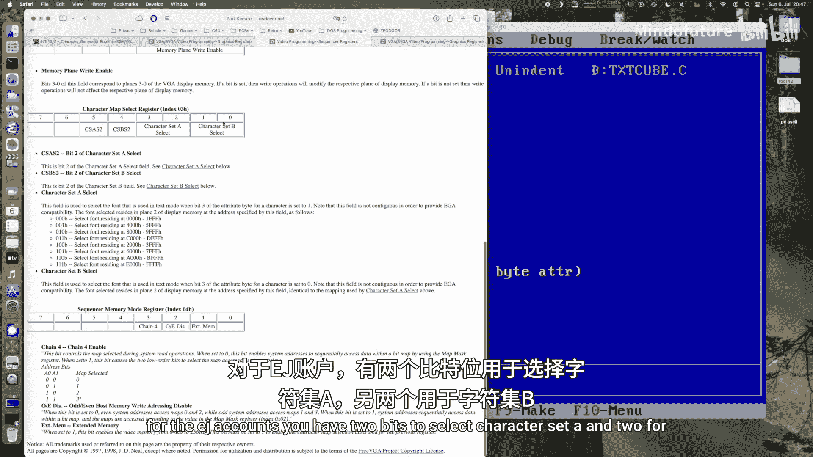

And this will give us exactly those two values。 And these are actually， the two。

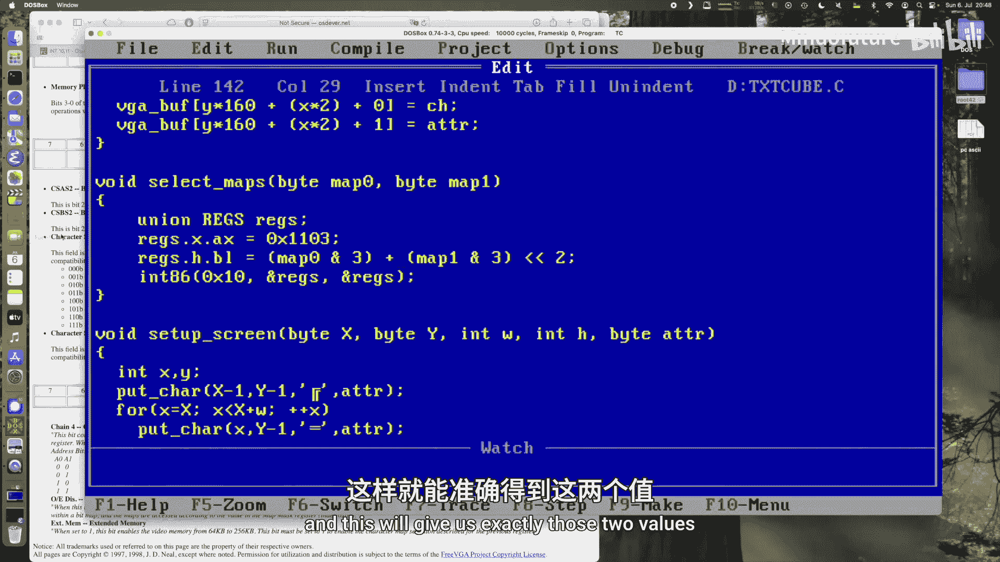

Additional bits for the VGA account， but were ignoring that here and then passing it there so we could have also done an out command on this register so you might want to try with doing that as well。

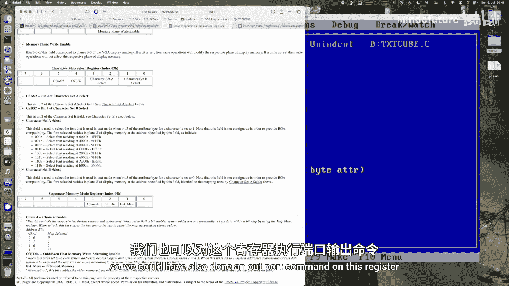

But nevertheless， enough talking， we have set up the screen。 We are opening the phones。

 We are drawing the cube and flipping the cha set。 So that should give us a rotating cube and bright white。

 And isn't that neat。 There is a flicker here， which is not due to the double buffering of the text mode but a bug in my fixed math。

 I think So every other frame gets dropped。 if you hit the pulse key， it will really disappear。Yeah。

 but I don't care right now， we have a rotating cube that's very nice。But if you remember。

 these are actually all the characters from 0 to 240 and nobody's stopping us to。

Put them somewhere else on the screen as well， because we're only updating the bit plane containing the font。

We still can put this somewhere else on the screen， and that's where this follow loop comes in。

It will copy。They set up five times in different colors。

 so we can just enable that and get five rotating cubes。For the price of one。

 because the screen is actually drawn only once upon setup。

And then we only ever update bit plane number two with the graphics data。

And well need to do it once to get five copies， even with this nice。

Laying on top of each other basically because we just obscure the invisible parts。

 but the drawing commands don't mine because it's in a different dipbit plane anyway and the whole screen gets assembled by the VGA card on the fly。

Isn't that great。 That's something that you can't do in graphics mode。 In graphics mode。

 you would have had to draw this five times。 Your graphics thought would get five times slower。

 But in text mode， you get this functionality for free from the graphics card， because basically。

 it's a very simple。Tile based graphics engine， similar to what you have on consoles。

 on like8d consoles or 60 consoles， master system， mega drive。N S or something like that。

 but very limited because you only get 8 foreground background colors per8 by 16 cell。

 or depending on what size you make your font， because you can， of course， do。8 by 32。

 or you can do a smaller 8 by 8。But then you also only have 256 tiles， obviously。

But with these tiles， you can do quite a lot of things。 And I think this is quite a neat example。

Of things that you can squeeze out of the VGA card that you can't do in graphics mode。

So I hope you enjoyed this。 This trick was not used super often。

 Sometimes it was used to create a graphical mouse point as like the one you're seeing on the screen here。

 but in text mode， otherwise people would just invert the attribute that the mouse curl is currently over。

 but with this you could manipulate the four overlapping text characters so that you draw a mousecur inside of it。

But other than that， there was very little usage of this fancy trick that the VG in and also the E JA card could do。

And。I hope this was not too long。 It was a bit longer because it's a bit more involved。

 The most important thing was understanding how the bitplans work。

 that they are only accessible in the graphics segment actually。

 and we had to reprogram the sequencer and the graphics controller to disable the whole odd even thing in text mode but still keep the VGA card in text mode halfway。

 but also to enable access to bitplain too and then do the reverse and enable the odd even and all the other stuff when closing this thing。

And， of course， setting the pixel is a bit tricky because you need to calculate in which character have to write。

 But once you add that。The sky is the limit。 You can do almost everything that you can do in monochrome graphics。

 You can do a little bit of color， of course， but only on an 8 by 16 grid。

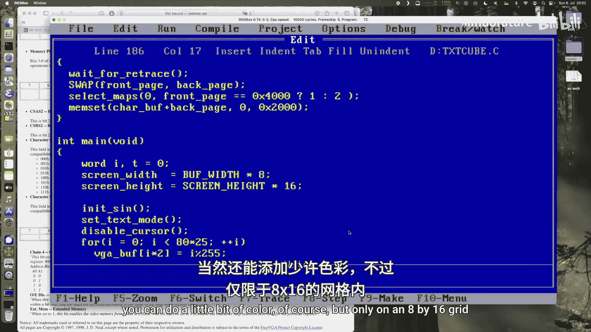

Yeah， so that's it。Thank you very much for watching please share like and subscribe。

 put in your comments。 Maybe you have other nice text mode hacks that you know about。

 please share them。And yeah， you can also find me on Masteron k。 social forward slash at Route 42。

If you want to connect with me and Cofi and Pat is also available and on Pat。

 I usually post this stuff a bit earlier。But that's it。

Thank you very much and see you in the next video。😊，🎼。

