# 编写一个基本的-LLVM编译器Pass！--BV1XUGmzME55-

Hey， everyone， I'm Nick。 and welcome to a new series called Advanced Topics。 So in this new series。

 we're going to be going over some more upperdi topics。

 maybe later undergrad or early graduate school topics in computer engineering and computer science。

 So to kind of start things off we'll be looking at a tutorial from LVM org。

 and it's about writing your first compiler pass within the LVM compiler infrastructure。

 So for this example as far as the things that you'll need。

 you'll of course need to go ahead and download something like LVM from source because we're going to be making modifications to the source right and you need to go ahead and build that and then you'll also need you know say some front end to go ahead and spit out the LVM intermediate representation or the LVM bit code And so for this example I'll be using Kang8。

 But whatever works best for you for a frontend for generating that representation。😊。

So as far as building LVM is' pretty simple。 all I did was clone the repository。

 make a directory called build。 And then I just went to the build directory and did CMakeake dot do slash and this basically willll generate the make files you need to build your project and then you can do something like CMake build dot in order to build all of LVM。

 there's more compiler options to set which parts of LVM you care about whether or not you want to build all of LVM if you want to install LVM etc ce。

 So on the LVM website there's plenty of documents as far as know how to get started with building from source So that won't be in this video especially because it takes it can take quite a bit of time to do So we'll go ahead and just assume that you've got LVM already build。

So， and we'll be rebuilding LVM at least parts of LVM as we add our first compiler pass。

 and I'll have， you know， all of these things listed as far as the mirror and this tutorial itself below the video。

 So let's go ahead and get started right and we'll go through this tutorial So first of all。

 what is this pass right So these passes are one of the more interesting parts about the compiler right。

 So these are the things to do the transformations and optimizations to our code。 So if we want to。

 you know have a pass that does come kind of vectorization。

Or a pass that maybe does some instrumentation， or maybe another pass that does function inlining or something。

 these can all be implemented within the Lium infrastructure。So， you know。

 all of these passes though， they in from this pass class So we've got a great place to get started here。

 And depending what our pass does， we'll init from different classes。

 and this example willll in from function pass。 But if we had something that fits more with loops we might be using something like loop pass or you if we did something else。

 maybe this callgraph SCC pass。 So we'll go ahead and get started with writing our own hello world pass。

 Now this is already this comes with the LVM source。

 So we'll be basically creating a new example for this hello module or this hello world compiler pass with a different name。

 So let's go ahead and get started。 And the first thing we need to do is we need to modify the C make lists text file files and so this is basically what LVm will use in order to build all the shared libraries and all things like executables that you know come with LVM。

😊，So to get started， let's go ahead and we'll go to where these are actually found。

 so let's get out of build and let's go to LibB and then transforms right so that's where we're going to put our compiler pass。

So inside of here， we can go ahead and make a directory， and we can call it something like our pass。

 right， So this is where our compiler pass is going to be located。 Now。

 in order to make sure that sea make will go into this directory， right and treat it as a dependency。

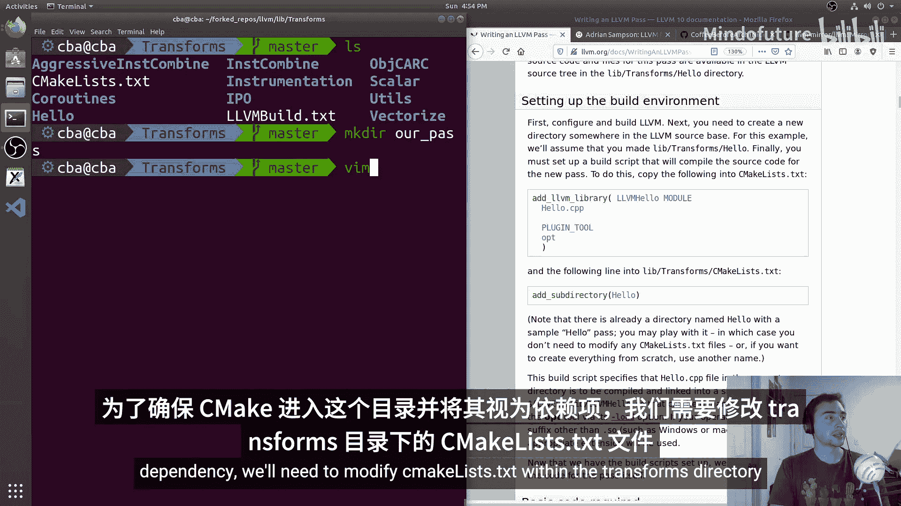

We'll need to modify C make lists do T X T within the transforms directory。

 And all we need to do in here is add the subdirecty for our compiler pass。 So in this case。

 you know， we'll add our pass to the different dependencies here。

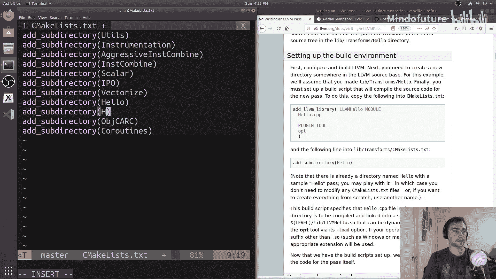

RightSo that just makes sure that whenever CMake goes through and starts generating to make files。

 it says， hey， go ahead and look in this directory hourpa。So now that we've got that settle。

 let's go into our directory。 It's empty。 We just made it。

 And we'll need to copy and paste this code。 right， This basically just says， you know。

 what are my source files going to be， I'm going to be loading this。

 This is going to generate a shared library。 It's going to be called Lib LVM hellello or whatever we call it dot E O。

 And it's going to be loaded by opt。 So what is opt。 That's a good thing to get out of the way。

 So optt is the mod LVM optimizer and analyzer。 So basically。

 we're making a shared library for a compiler pass that will be loaded in into opt。😊，So。

 let's go ahead and make a C。

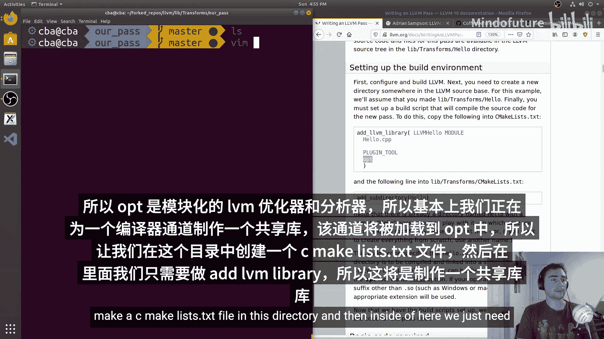

Make lists TxT file in this directory。And then inside of here。

 we just need to do the add LVM library。 So this is going to make a shared library。Library。

 and then we'll call it something like LVM， and then let's call it our pass。

And then we'll make itll pass module。 and then from here we'll set the source file。

 Now we can just call this source file something like our pass do CBP， right。And then down here。

 we'll do plugin， tool， and then opt， right。And that's all we need to do for as far as setting up our build。

 right。 So from now on， we just need to focus on actually writing the source for our。

Rrit the source for our compiler pass。 right。 So we get started right， and we named our pass。

 If we go ahead and just cat sea make list， we called it our pass。

 So let's make a file called our pass do CBP。 We can say that。

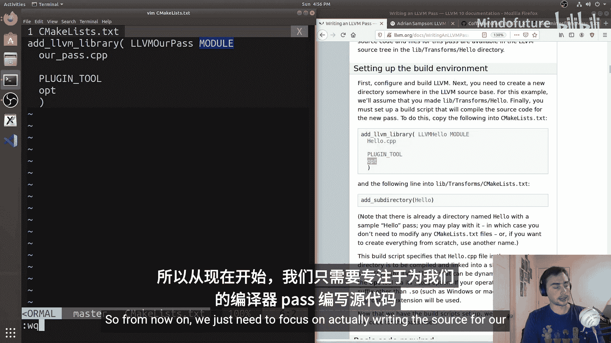

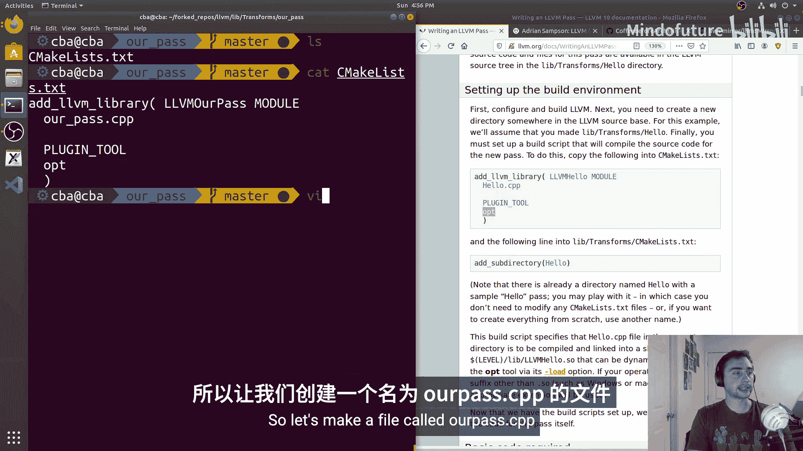

This file implements。A。Hello world。Compilr pass。Right， and it's。Bye。Nick， from。Coffee before。Arch。

 all right。So now we can go ahead and get started with the rest of our examples。

 we'll need some things to start out with。 So we'll go ahead and include this LVM pass dot H。

 write the interface for this past class that we're going to be inheriting from。

 So let's go ahead and include。LVM come or slash pass。Uppercase pass dot H。

 And then we'll also include。This yellow。LVM slash IR standing for intermediate representation and then。

Function dot H。So this is going to be where that class function is that we're going to be inheriting from or basically what we're going we're going to be using as far as you know we're going to be working with functions in this class or in this compiler pass so this is we're going to be basically making a function pass here。

And then finally， we're going to include this raw O stream thing。

 and I believe this is what we're going to be using for printing some things out within our compiler pass。

 So LVM slash support s raw o stream do H right。And then we can go ahead and get started by using namespace。

Namespace LVM， right， so that's where all everything is going to be prepened with this LVM。

 colon colon。 so just to avoid that， we can go ahead and just use using namespace LVM。Okay。

 so the next thing we're going to do is we're going to have this anonymous namespace here。

 is just to make sure that we're not going to conflict with anything in the outer namespace。

 So we'll just to get anonymous namespace。 We'll just do namespace and then some brackets。

So then inside of here， we're going to make a struct right And so this is going to be our actual pass right So you know in here we're going to be。

 you know our pass is going to be called something different instead of calling it hellello。

 let's call it our pass。So we'll create a struct called our pass that will inherit from function pass。

 right。 So function pass is kind of this generic function pass。

And we're going to be basically overriding some of the virtual methods within that class。Right。

 so now you know， in this case， our pass is a subclass of function pass and we'll go ahead and add some things here So we'll add the static static cha ID and then this you know this thing this hello。

 basically the constructor right here。 So let's go ahead and first do static。Char I D， right。

 And then let's we'll initialize it later on。 And then let's also have our constructor。Right。

Function， pass I。 So we'll pass I to it， and it'll just be blank and won't do anything。

So this is going to declare a pass identifier， so this is how LVM is going to distinguish between different passes。

basicallyically， according to the docks， right， it allows eleva them to avoid using expensive C++ runtime information。

All right， so the next thing we need to do is actually specify what this pass does。

 So we overload this function or override this function， this run on function。

 So basically what happens when we find a function。So in order to do that。

 let's go ahead and go ahead and just do Bo。Run on function， right。 And this will take a function。

 which is just a some class that comes with LvM， right， the representation of a function。Right。

 and we'll put override there。 And then what are we actually going to do whenever we find a function and we should rename this from hello to our pass because we we've called this class our pass。

 not hello。All right， So on every any function， right， we're going to use this errors to go。

 It's kind of like see out as far as a stream object goes So we can go ahead and print out something like。

You know， we've got our pass here， so we'll print that instead of hello。

And then we'll go ahead and get the name of the function。So we'll do errors right。Escapeed。And then。

F dot get name。 So function right here has a method for getting the name of the function。

So we'll call that。And then we'll also print out a。

We'll print out a new line character as well that way it goes to the next line。And then after that。

 you know， we'll go ahead and return false from here。 and I believe we return false if we ever。

 if we return without modifying， say the original code or true if we have modified the original code。

So we've declared this run on function method， which overrides the abstract virtual method inherited from function pass。

 so we're basically just giving an implementation for function pass。

So all we're doing is basically printing out the name of each function here。All right。

 So then outside of all of this， we can go ahead and initialize our I。 right。

 so we'll initialize our pass I。 And so this is what LVM use uses Is to address。

Uses IDs address to identify a pass。 So actual initialization value is not important。

 but we'll go ahead and do that outside of all this。 So we'll do char。In this case， it's our class。

Scope resolution operator ID D， and we'll set it equal to0 as well。

 And then we also actually need to register our class。

 So that's kind of the last thing we need to do。So basically giving it a command So in this case。

 we say， you know what are we going to use in order to call this pass。 So here they're using hello。

 but we'll use something like our pass。 and then basically you know what gets printed out as far as you know like a description of this pass。

 So this just as hello world pass。 So we can do something like that And then the last two arguments described the behavior。

 So if a pass walks to CFfG without modifying it， then the third argument is set to true right if a pass is analysis pass。

 for example， a dominated tree pass and true is supplied as the fourth argument。

 So we can just pass both of these at false。Our asphals。So let's go ahead and do that。

 so we'll go ahead and do。Static register wass register to the pass。 and then it'll be our past。

 right， So the template parameter right here is our pass right instead of hello。

 just because we named our class orstruct our pass。Then X。

 And then what do we want this to be called from the command line， We call it our pass。

And then we can also say， you know。A simple。Hello， world pass。And then from here， again。

 both of these next arguments are going to be false， and then we'll add a semicolon at the end。

All right， and then we can go ahead and do clang format there。All right。So let's see。Oops。

 we call it our class here instead of our pass。 let's go ahead and go back and fix that。There we go。

 That should fix that that warning。 There we go。All right。

 so now that we've got all of this set up the last thing we can do is this last part here。

 So if we want to register the pass is the step of an existing pipeline。

 there's some extension points。 So like if we wanted to do this pass before any optimization。

 we could do this pass manager builder at Ep underscore early as possible or if we wanted to do it at the end right。

 we can say Ep full link time optimization lasts to apply it after a link time optimizations。Right。

 so we can go ahead and add this as well。 So save everyone for me having to， you know。

 basically just copy this text。You know， we can go ahead and just paste this in here and then run clk format on it。

 The only thing we need to change here is instead of doing new Ho here， we'll do our pass instead。

 right。So you may see a number of errors here， and that's because what it hasn't shown here is that there's some additional headers made to include。

So if we go back up here to the very top， all we need to include now is the thing for this pass manager。

 So we need to just go ahead and include。For this example， LVM slash IR slegacy pass manager。 H。

 And we also need to include LVM slash transforms s IPO。Slash pass manager。Buildder dot H， right。

 And those are the only things that we need to include here。 So now all those warnings are gone。

 I call clk format on this。 So let's kind of clean things up by， you know， zoom out a bit。

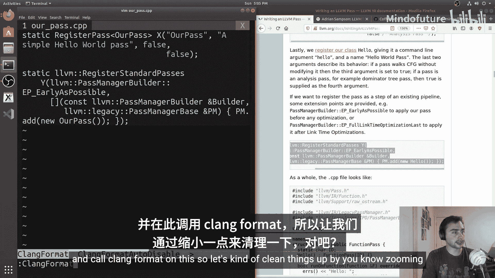

Right。So here， we can say。Go ahead。 It's always a good idea to kind of annotate whenever you've got a bunch of curly braces ending all in a row。

 so we can say end of our。Pass， and here we can say end of namespace。 right。

 So now that's all we need for our basic compiler pass。 So let's kind of run through everything。

 So we have our compiler pass ithers from function pass。 And then over here。

 we're we're overwriting this run on function。Coming from function pass。

 and what we're doing in here is we're just printing out our pass and the name of the function any time we see a function。

Then we're registering our pass， using this register pass and register standard passes。

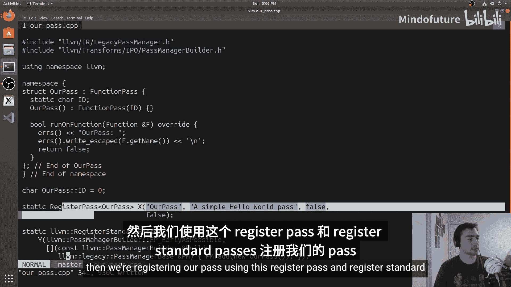

And the next thing we need to do is actually build it。 right。

 So now we can go ahead and go back and we can go back to。Inside of。Inside of our route director。

 we can go back to build。And then we can do， you know， See make dot dot slash。 right。

 So this is like what you do， you know， at the very beginning whenever your。You know。

 whenever you're first building CMake， you'll go through this step and then the next part you'll go through is also this CMake dash build dot right So when you do that。

 you'll see that it's not actually having to build any of these because they're already built because I've already compiled this but it will go ahead and find。

 you know， hey， it found that there's a new dependency LVMR pass。

 So that's a compiler pass to be created。So we'll go ahead and try to build LVMRpa。 SO。

So then it goes through the rest of everything。 And hey， look， complete without any errors。 right。

 So we've built our pass。Now to load our pass， we'll go ahead and use optt right。

 and you can find that within， you know， bin right within this directory inside of our build directory。

So the next thing we need to do， though， is you know， we've got a compiler pass now。

 but what do we actually do with it， right， weve we have to have some code to run this compiler pass on right So running it with optt。

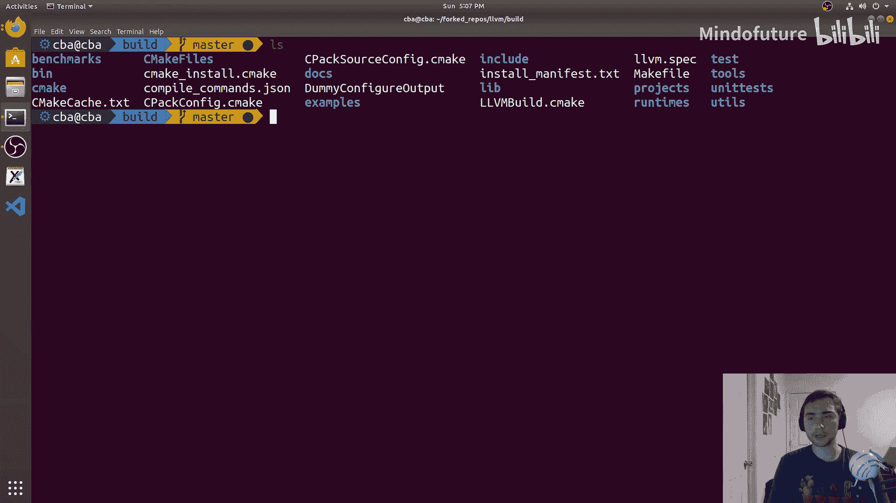

Let's go back。 Okay， so let's go ahead and， you know。

 write a quick program so we can write Hello world and see。

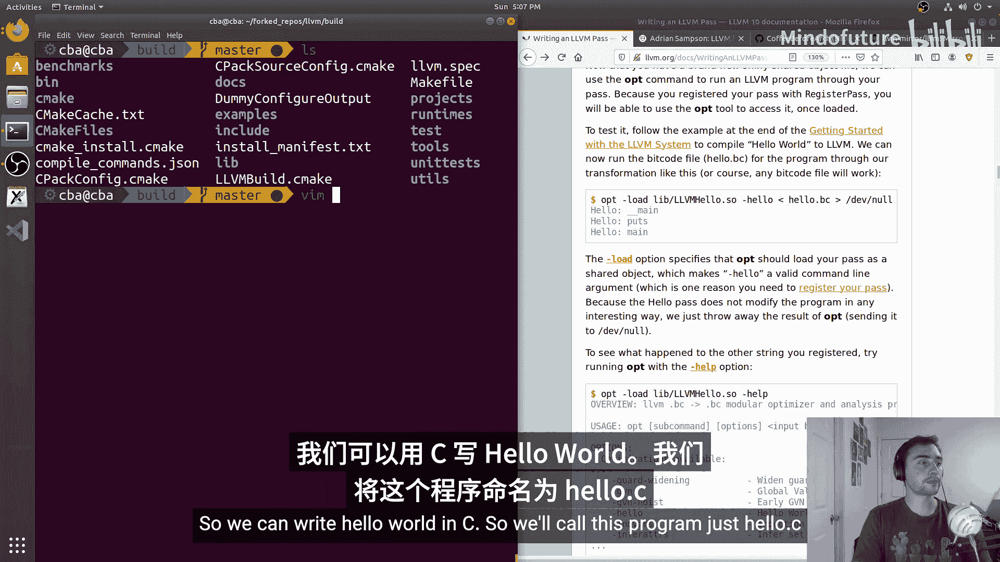

So we'll call this program just hello。c。And very simple， we'll just include S TD I O dot H。

 We'll have a main function， right， So we'll just have one function here。

 So we should just see one print from our compiler pass。We'll just do print F you know。Hello， world。

With the new line character。

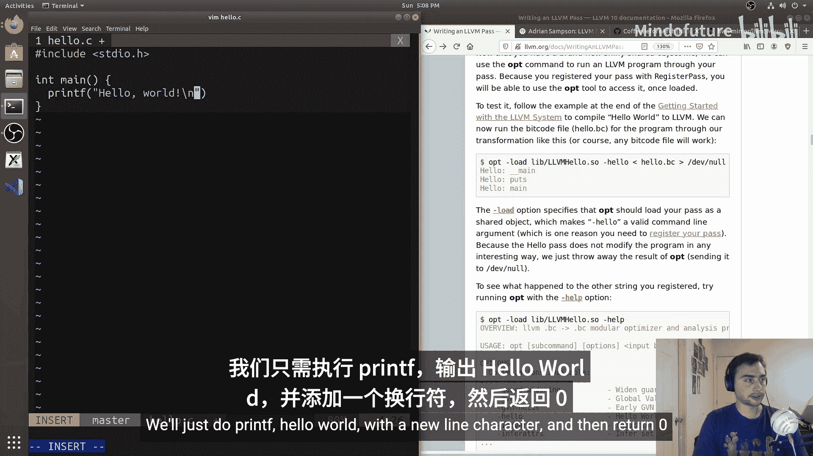

And then return0， right， and that'll be our simple program。Now。

 you know what we need to load into opt is the LVM or is the LVM like IR or the L bit code right in order to do that。

 right we need to generate this bit code file， right， something like hellello do BC。So to do that。

 I'll be using Kang or Kang dash 8 as a frontend， and I'll just pass in the parameter， you know。

 emit。L VM， right， That's all I need to do there。 And then dash C。 And then I'll pass in hello dot C。

 And that's all I need to do。 So now I'll have this hello dot B， C here。

 I could specify an output file name if I wanted to。 But in this case， it just generates Ho dot B， C。

So now I can go ahead and load this in using opt， right。You know。

 first thing I can do is I can just do， let's go ahead and make this full screen。

 I can do something like I'll use the one inside of LVM we just built。 So I'll do bin opt。

 and then I'll do dash load。

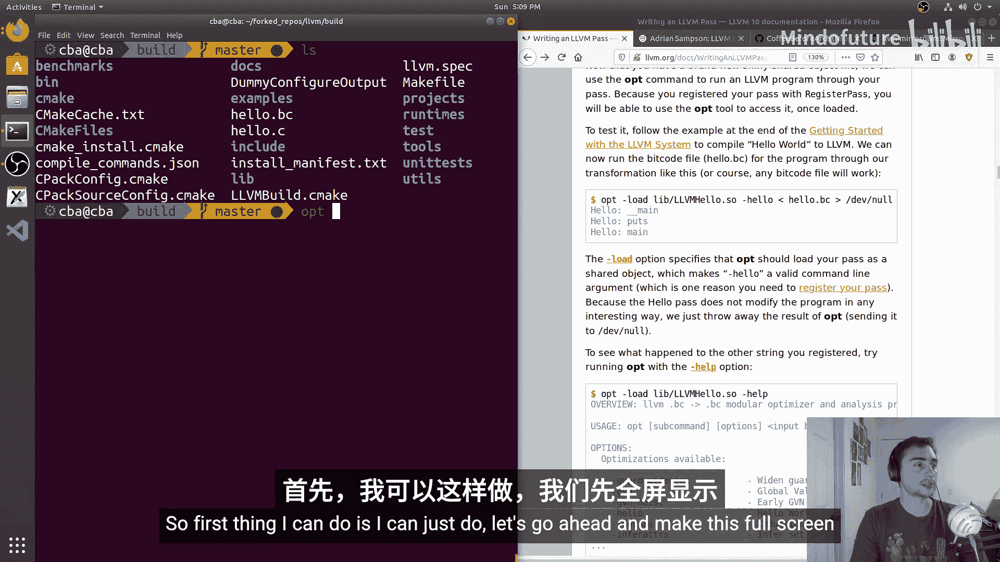

And then from Lib， I'll load in LvM， and then ourpa。 SO。

 and I can also type in dashhelp here and so we can see a whole bunch of different things here as far as you know the things that we can specify that we want to do as far as passes go。

So， you know， let's go ahead and just kind of parse through this real quick and I can say， you know。

 I can grip for something like our pass， right？And look， we are able to find our pass。

 which is a simple hello world pass。 So that's the one that we made。

 So it's located within that So file or within that shared library。

So let's actually run it on a program or on our bit code， right。In this case。

 we'll load in LVM R pass into that will pass in our hellello。 BC。

And then we'll go ahead and redirect you know， the output to this to slash dev null， right。

 And then you can see that when we go ahead and do this， right， let's see。 Oh。

 we didn't specify the pass that we want to do。 So we'll have to load LVM。

And then we'll also need to pass in something like our pass right So we'll do something like this。

 right， so we need to specify the pass we want to do。 So we'll load this library， specify our pass。

 pass in our bit code， and then redirect the rest of the output to dev null And that just is so you know。

 it just goes someplace goes to something that you know is gone forever。

 because we don't care about that output。So， oh。Sorry， not Helloorld。 BC。

 that was from an earlier test。 It's just helled。 BC。

 And you see that prints on our pass in Maine exactly what we have in our compiler pass。

We can go back into Hello dot C if we want to make this， you know。

 maybe a little bit fancier So we can have a void function called， you know， print funk。

 doesn't take anything， but maybe it just calls Hello world for us。

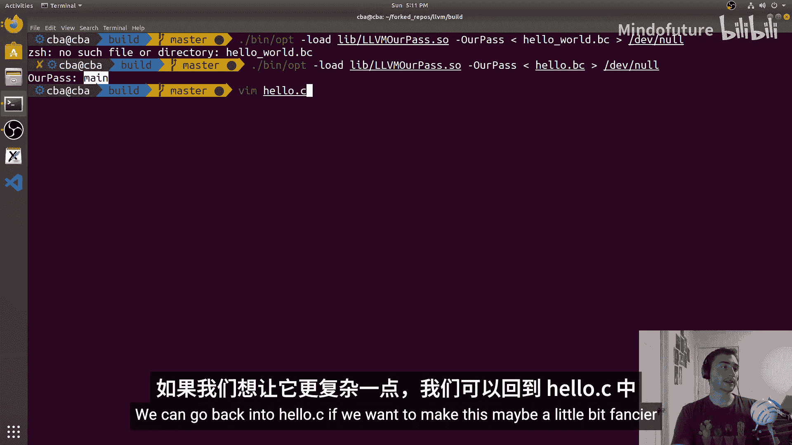

That way， we have more than one function here。 And then from mainine， we can call you know。

 print funk。

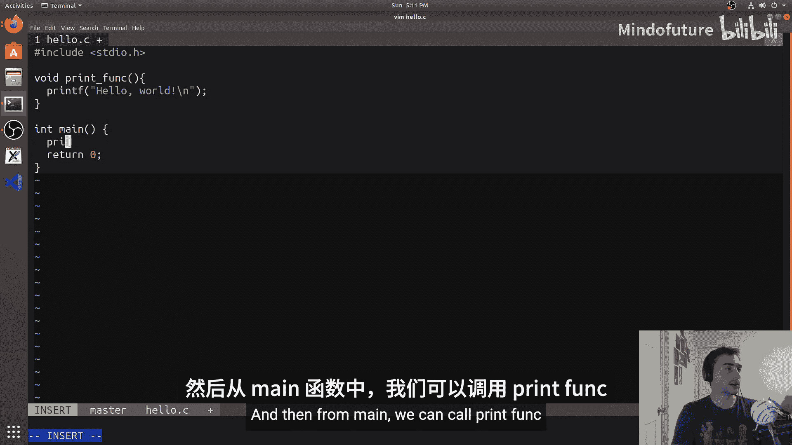

That's all we need to do here。 We'll just rerun clang to emit the LVM。

 and then we can go ahead and run our pass again， and now you see that it finds。

 you know print funk and main。And then we can also do。You can also run time pass right here or sorry。

 time passes And you know， once we get more complicated passes。

 it may take a significant amount of time。 So it's not a bad idea to maybe measure how long they take right So if we're going to introduce overhead overhead head can be a compile time or run time right So it might be something that you need to measure。

So now you can see that how long the bit code writer took the module fire took and then even our simple hello world pass。

 How long did that take right So you can get some statistics about your own compiler pass So that's kind of a basic example of getting started with LVM kind of writing your first your first compiler pass So this one's pretty simple。

 all it really does is you print out the names of functions as we see them So there's a number of things you can do and there's a number of different classes you can overload so immutable pass module pass call graph Se pass depending on what you're doing inside of your program we may look at those in later videos also link a link to this leave a link to this Adrian Samampson's blog So this is opposed in 2015 called LVM for grad students and it has more or less the same example in here。

 but it also has another one where it says you know replace all the binary operators with say multiplication So it actually it does a little bit more and actually mods our code。

 So we may do that。

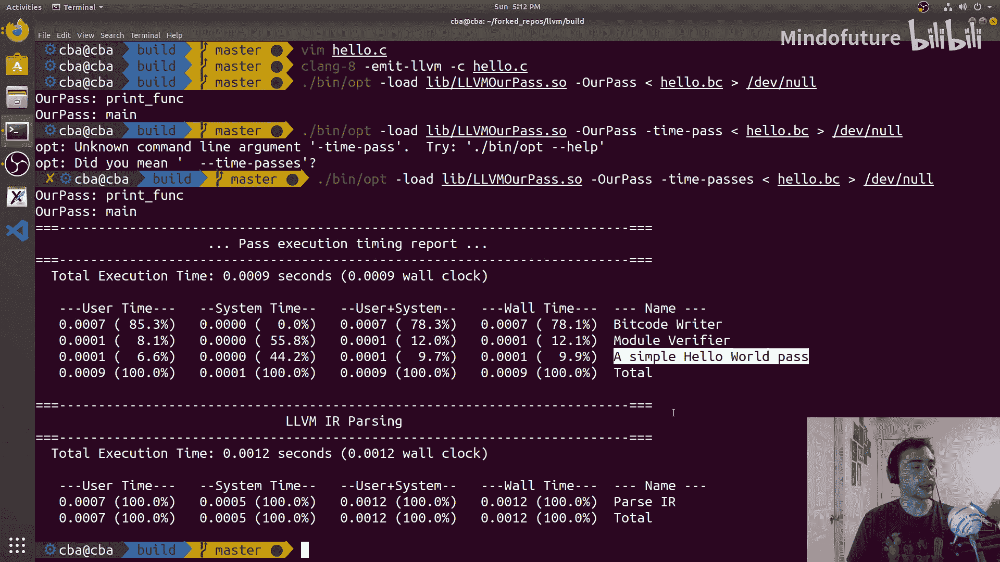

A later video， or we'll just leave it as something that I'll link below this video。

 But that's going to go and do it for today， as always。

If you're interested at any of the code that I have。

 it's available at Github do com slash coffeeoffbearchs。

 We've got a number of series on GPpU programming， CPUU programming and optimization。

 And so in this series in later videos， we'll do stuff like looking at microarchitecture simulators in more advanced topics like that。

 But that's gonna do it for today。 Again， I'll leave all these links below the video。 But I'm Nick。

 And I hope you have a nice day。😊。