# 编程实战：-编写一个网络模拟器-p02-P02-用C编写简单的网络映射器--BV11uKozNEKf_p2-

Welcome back everyone In the last episode we started creating a naive version of the network Maper。

Which is basically a tool that will。Discover servers and network nodes on a network and check the version of their services and stuff。

I got a lot of comments about the last episode that I was only using part of my screen。

<|OTHER|>And I'm sorry for that， unfortunately， it couldn't be sold。

I usually record my videos exactly like that， but I crop away the rest of the screen so I only use the bottom right corner of my screen。

 which is 1080P H。But my Adoia account got locked so I couldn't edit the video with anything else than。

The Quick time player and it didn't have any zoom and it didn't have any crop。

 So that's why I published it as is。Anyhow， I did publish it in 4K resolution。

 so you should be able to zoom in on your own without losing anyality at all。

But today I will fix that so no problems。Okay， so last time we only。

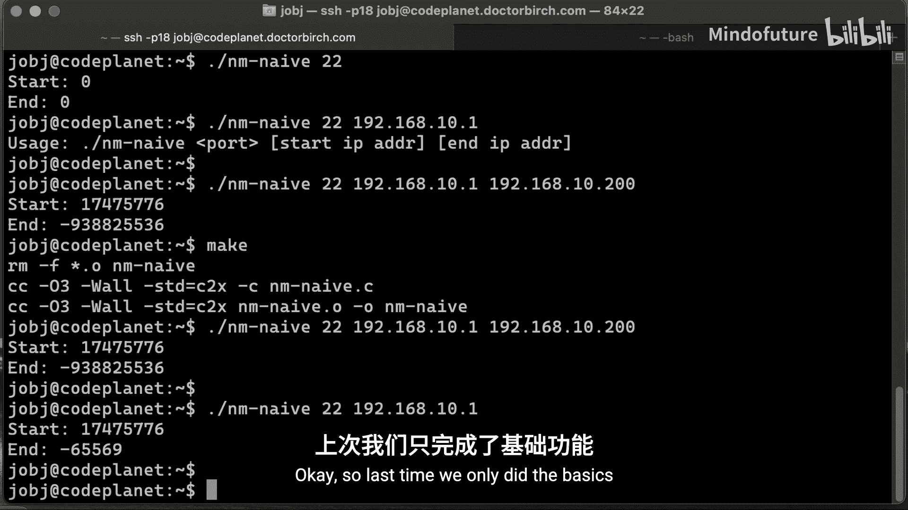

Did the basics， we create a main function， which takes an argument in the form of a TP port number。

A start IP address and an end IP address。And we will scan this range of IP addresses。

If we omit this N IP address， we will start with a starting point and we'll go all the way to this D network。

Address， so we will not scan the multi car range。And if we omit both of these。

 so we only give the port， then we will read the IP addresses from the standard input instead。Okay。

So。Let's see。Perhaps， we should。Have a check for that as well。 I'm not sure。

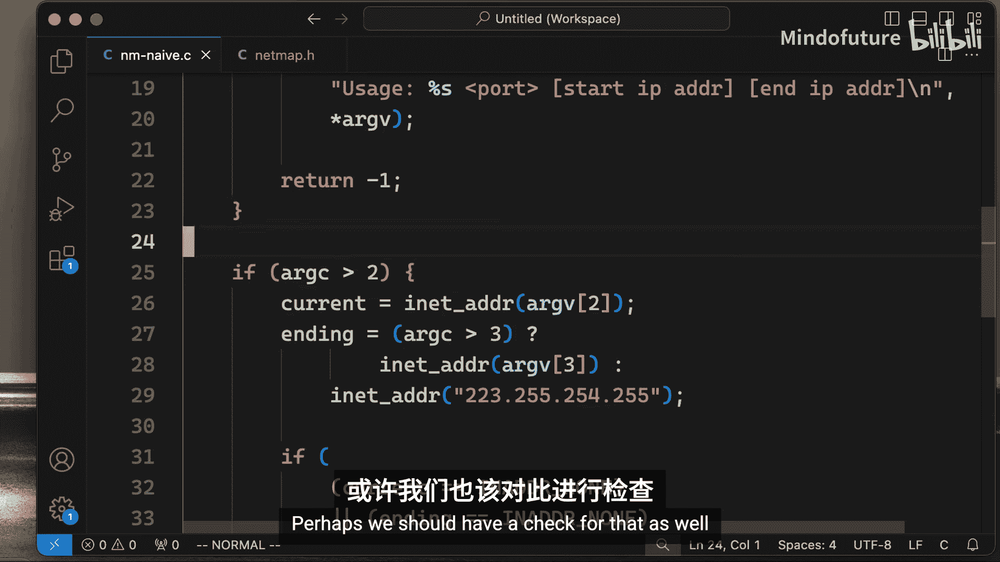

What will happen if we simply run this？😔。

来。

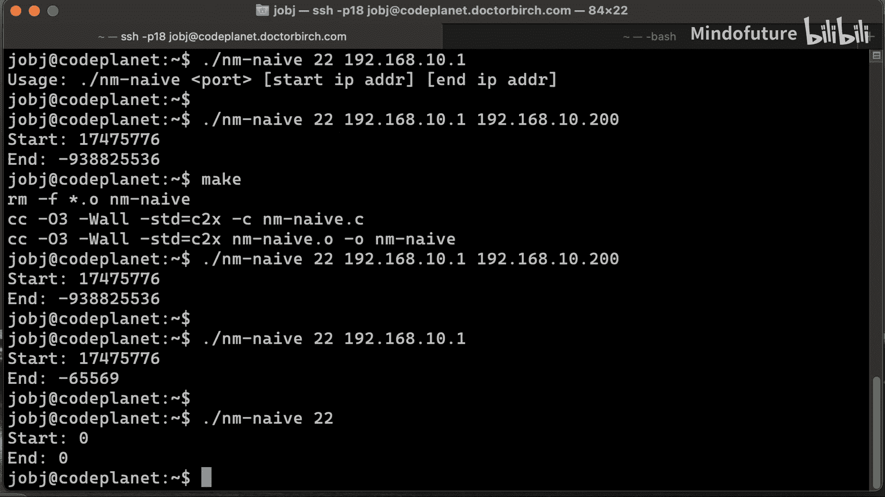

Okay， both of s。Alright， so if that is the case， then we want to read from standard input instead。😔。

So let's make it a little bit easy for us。

Let's see。 We have current。 We have ending。Perhaps， we should have a。Let's see。Yeah。

 let's modify this generate function。And check for the condition where。Current is 0。And。Ending a0。

So in this case， we should read from the standard input instead。 So let's create a buffer。

 I will make this in8。嗯。嗯。Buff， and let's read。How much should we do？Let's see how big is in a Pi。

It's maximum， so one，2，3， one，23， one，2，3， one，23， it's four times 3， which is 12， three dots。

 which is 15， and then we have the0 at the end of 16。アきそ。And I do also want a0 function。

 but let's say。The zero function， I usually。I usually am。Use in almost every project。

 Let's add that to the bis。Library instead。So that can be our first function， it's very simple。

 we will have a void function， which is called zero。And it takes two arguments。

 The first one is an in8 pointer。For。Let's see。We can call this the。String。And then we have an in 16。

😔，For this size。And we also need to have a pointer like this。😔，And we will set P equal to string。

 So we will parse every character of this。It we will go through every character of this string。

And it doesn't have to be a string， it can be any memory place， actually。

So p equals string from the beginning。We want to loop as long as two conditions。Amen。嗯。No， only one。

 actually。So， let's create。In teacher as well。And let's set this integer to0。The beginning。

And as long as N is less than size。We want to。Increase M。 and we want to increase。P。

And at every iteration， we simply want to set the current memory address to0。

Which means we will zero out this entire thing。And then we turn something like that。

AndI do also want to include。And this will be。In our library。

 so I would do like this and Bch you to that age。But during development。

I'm going to comment that out。And I'm gonna grab it from the local directory。Instead。So。

And in our virtues， what do we need here， we can put in。

Let's just add the SD IO for now and maybe string as well。And I also want to have let's do。

 by the way， something like this。If not。Defined。And。Birch utles。If not defined。Okay。

Cause let's do like this instead。So if we had not included this file before。Then we want to define。

Birt your di。We want to include this stuff， and then we end this。😔，不吃。This is so in case we。

Include this burst due useless sources age from several places it will only be read once。

Because from the beginning， this will not be defined。Then we define it and include all the stuff。

And the next time this will already be defined， so nothing of this will be executed。

And I also need my sorry I also need a different integers。So let's define them here as well。And。

It will be。台て。And we need an unsigned sha， which is in date。We need an unsigned short end。

 which is in 16。And we need an。Unsigned。Int， which is in 32。

And I have got a couple of questions why I define this myself when there is an include which you can do。

 I think it's STD I， so something like that。The problem is they are not named in8 in 16， etc ceter。

 they are named something of the sort。You。イツ。8 T or something like that。

 And I really don't like underscore in function or。Variable names。

 So Id rather define it myself the way I want it。Okay， O。

 so now we have this and this and to make it a little bit easier during development again。😔。

We will add。As an LD flag， I will simply。Let's see。I will do something like this。好美。

My username code Brch， you deals。The。子球っていう。Oh， I will just include it like this during development。

Like so。

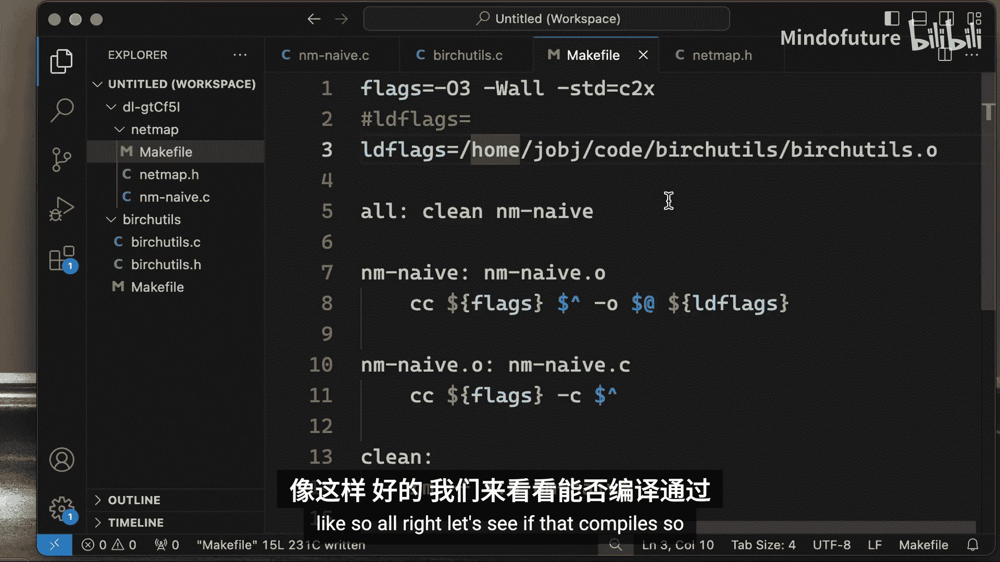

All right。Let's see if that compiles。

So。I will make。And now we have both the O and the S O。So if I go back here。

I should be able to use it。Does this compile at the moment in8 bath。Unused variable。

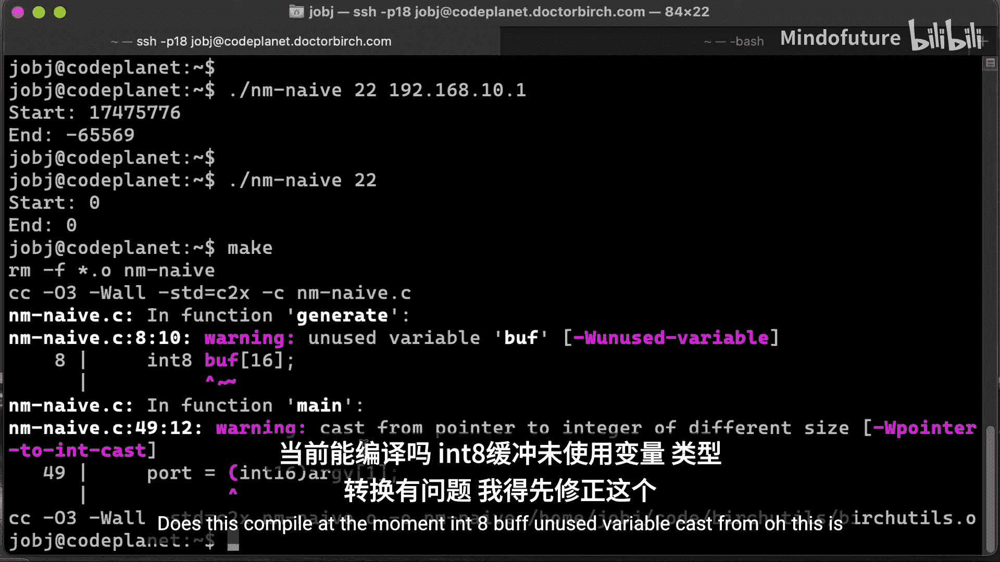

Cast from oh， this is wrong。

I better fix that before I forget。Let's see。Yes， this is a string。

 so we need to call a to I in order to convert this to a。To a， to an integer， integer。

So let's see if we save this now and compile， I will just see if it compiles。

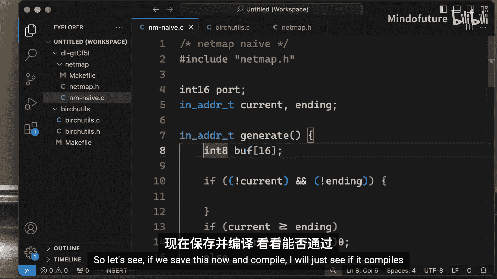

clean can a little bit clear and make boom。Yes， it does。That's great。And if you。numberumber mind。

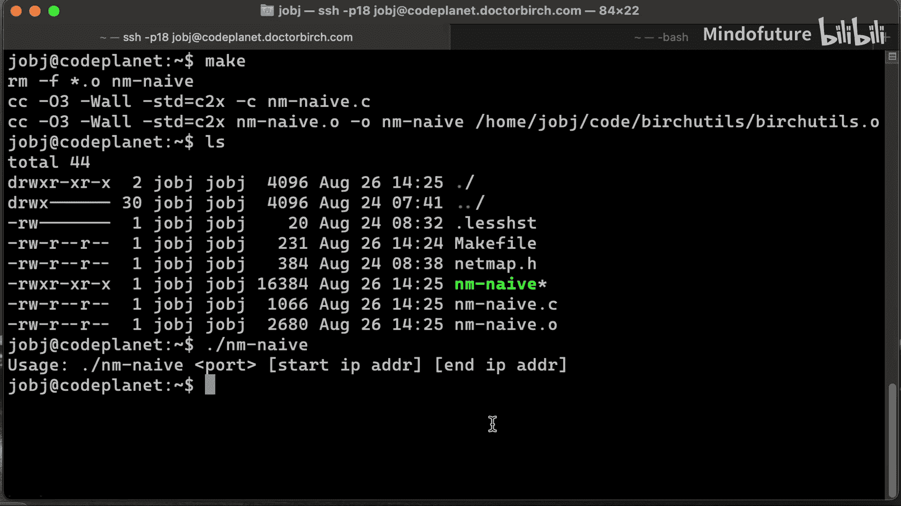

All right， so let's continue this down。We haven't specified range。

 We want to read from the standard input each time， and I will make it pretty simple。

 I will just use the F S。Fengctioning。So， let's do。First， we0 without。So we use our new function。

0 above。え？16。Then we use F get S。And the first。Argument is the buffer， I believe。

And how much we're going to read at maximum 15。 and then the file descriptor and standard input is always open。

 We don't need to open it manually。Let's see that I got the order right， by the way。

 because it differs a little bit between similar functions。

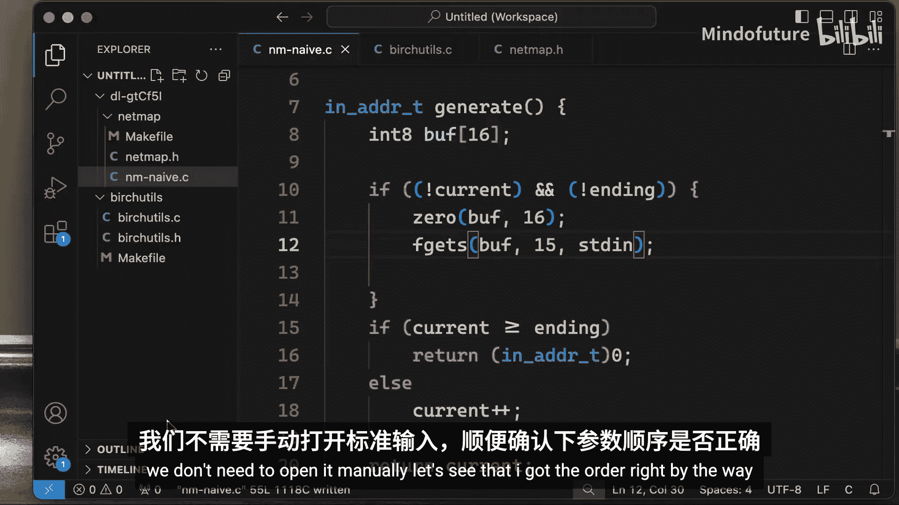

Read， for example， has the。Find descriptor in the beginning。Let's see Char S In size stream。 Yeah。

 this is correct。

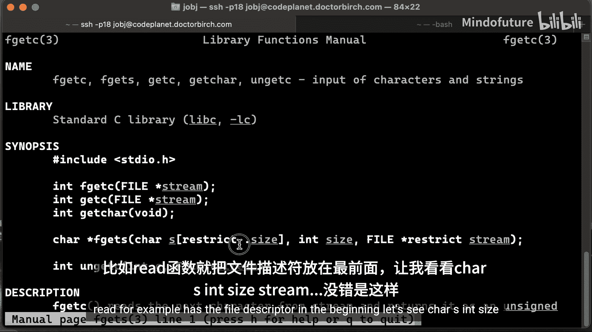

Okay， so now we have an IP address read from the standard input。Perhaps we do， at least。嗯ん。Let's see。

Let's create。美しく？Size variable。Now we'll set size equal to the string length。😔，Or to the in。

Streaming。Of。A sharp pointer casted。Ced above。So， let's see。There is a couple of possibilities。 Now。

 it can contain a real I P address。And it will end in a new line。Most， probably。

It can also contain only the new line， or perhaps nothing。😔，嗯。Yeah， that's basically it。

 And what is the most。The smallest possible。Barid I P address should be this， right。

And then we have one， two， three， four， five， six。7even。And8， if we have a new line as well。😔。

Which means if size is less than 7。Then we should return0， and it should be。In。Addres。T。おすよ。

Because that means we have read the last。I address or at least an invalid IP address。And then。

 we are done。Anyhow， if we didn't read that。We want to decrease the size by one。

Induce it as an index instead。So we want to check if let's create a variable so it gets a little bit。

え。A little bit easier to understand。So let's create an image。In the sea。Let's make it a pointer。

Let's do like this listen。And let's。Point。This pointer。To the buffer plus。Size。So。

 let's see if it contains。Let's see if we have something like。ABC。

 it can't be since it's less than 7， but just as an example， so I get the indexes right。

And then we have this and we have this。嗯。Which means the in indices will be01 to。And then3。4。

So if we want to grab this new line。It will be index 3。And this。This size will be 1，2，3。4。

 which means。The index is size -1， and that is why we。2 minus1 here。え。

So this p now points to the possible new line。And if。P is equal to new land。Or。P is equal to。です。

Carriage return， window style thing is。Then we want to set p equal to0。

 So we overwrite that new line with a0。Which means the buffer now contains。え。The valued I address。

So now we basically only need to convert it into an in address T type and return it。

And the easiest way to do that will simply be to do turn。Ilet address。Of。嗯了。Like， so。

Let's test this function。 So instead of printing out ports and all this stuff。

I want to create a temporary ionod T variable。Hello， set this to。Generate。And then let's print it。

 We need to print it as an integer at this point because we don't have a function to convert back。

But that's okay。So。Let's see。Perhaps we can print it as a hex value instead。

I think that would be a little bit easier to read when it comes to IP addresseses。嗯。So。

Maybe we can just。Can we do in， and then1。But this is some kind of structure， isn't it？😔，Well。

 let's see what happens if we do something like this。And I want to call this。Twice。

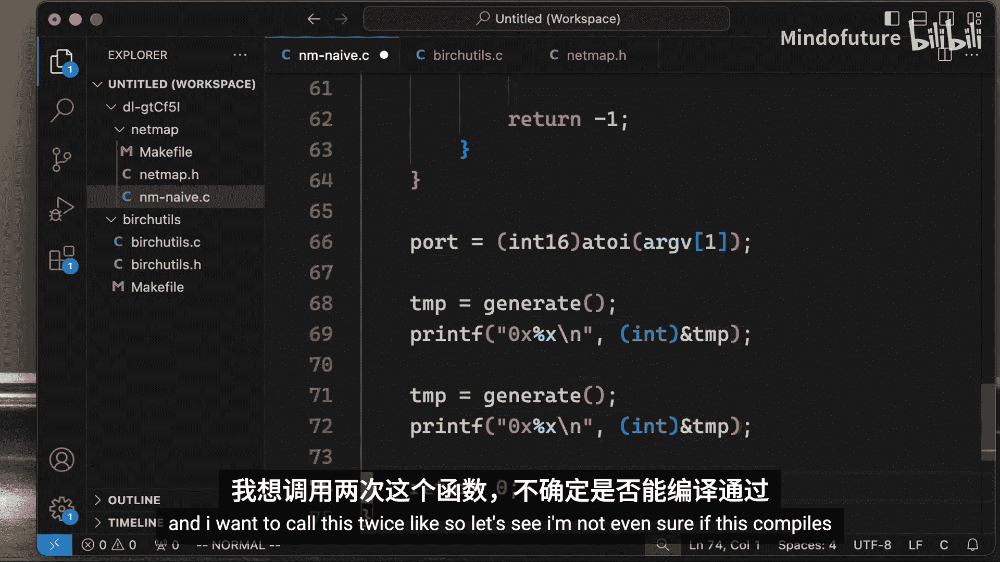

そ？Let's see， I'm not even sure if this compiles， actually。No。Let's see。

 in place declarationlaration of function 0。 Yes， I need to。In。

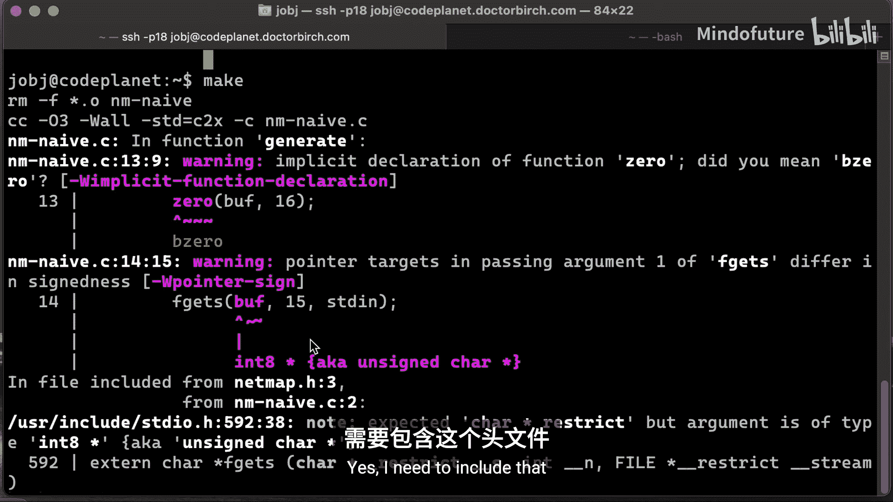

So， that should be in our。Let's see。I think I will create a small H file for this。And naive version。

As well as a common one。So let's do an N M。😔，The意。the一。And what do we have inside of the。

This thing we have， okay， we can。Let's move these two。And put them here instead。And。

We want to include。Not map age。And in this one， we want to include。And难以的开。Like so。

And inside of net map， we can include our temporary。Full Perth。2。うん。UseTo name code。第ち。言ってう。And。普及？

エッチ？This ought to do with I think。

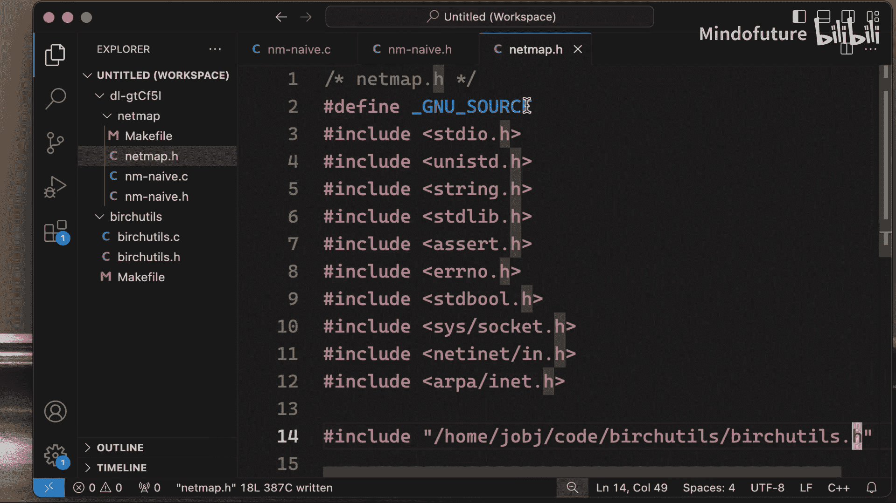

Let's see。Stillte the。Imp place declaration of function 0。😔，Clment。H。Include this one is a path。Yeah。

 if not defined， but you define。気ちれてんです。Okay， I need to add the。

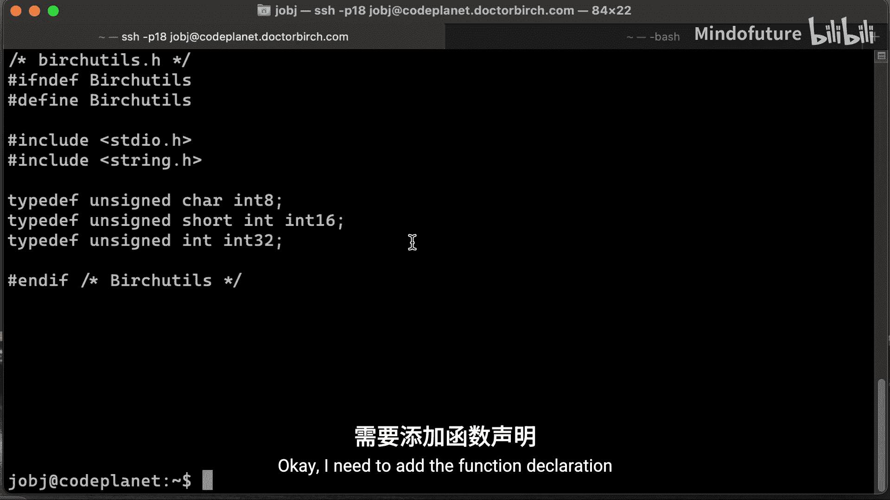

The function declaration。Inside of Btus of inch。We need the void0。

 and it takes an in 8 pointer and in 16。

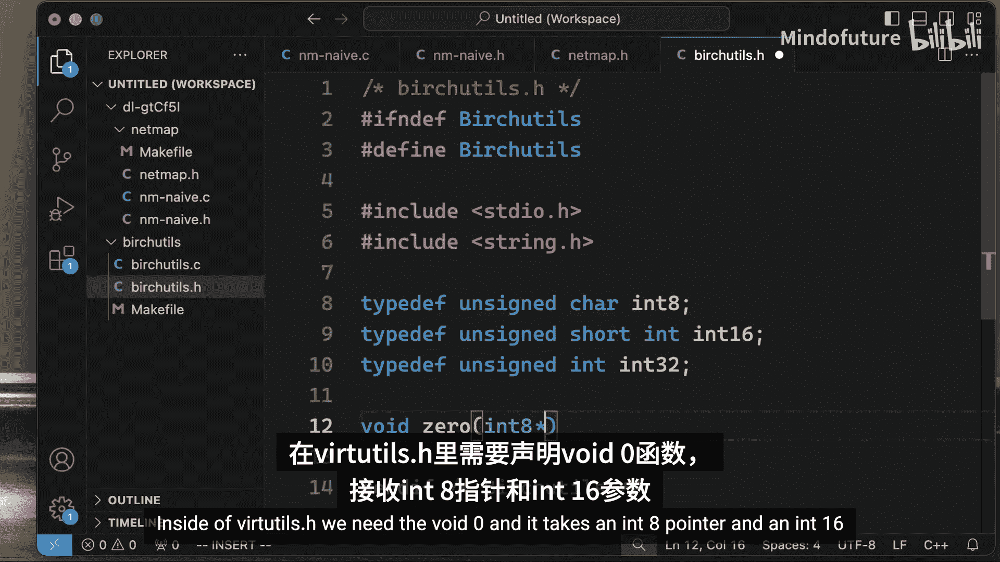

Pointer to our guests in passing over one of if it has differ in sign is right， I need to cast that。

😔。

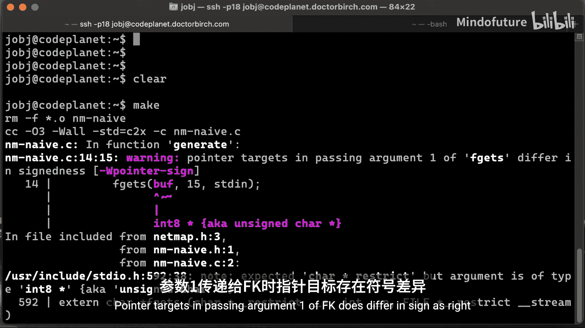

生了气。😔，You need to send this as HR pointer。

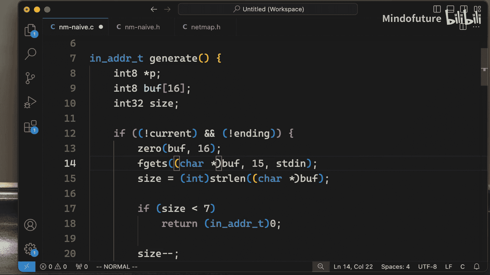

And the rest is fine， I think。Point to targets in passing saying different sizeness Ok， same there。

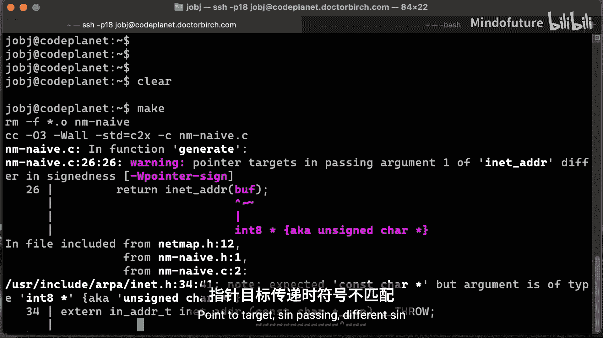

This is the downside by using your own variable types in see。But the。Yeah， it is where it is。

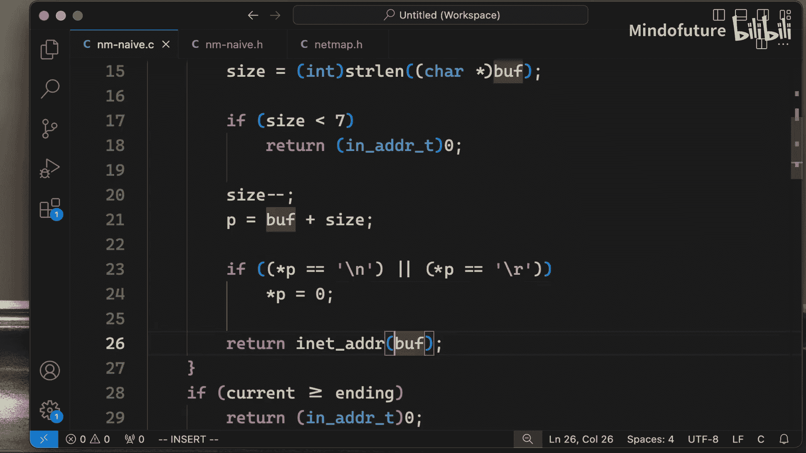

It has。Positive features as well。

I like when the type system is expressive。😔，And things aren't just ins and stuff like that。

 it really is an IP address instead。AWning cast from pointer to integer of difference。😔，Size。Y。

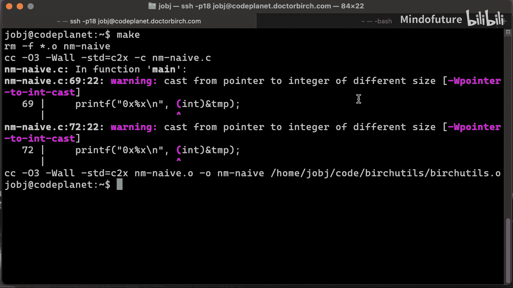

Alright。Is a。64 bit。Point or I2。Useed to working with 32 bit processors， I think。So， let's see。

It's just our print F code。 that is。Buggging us， let's do this unsigned long in。And。Concern。

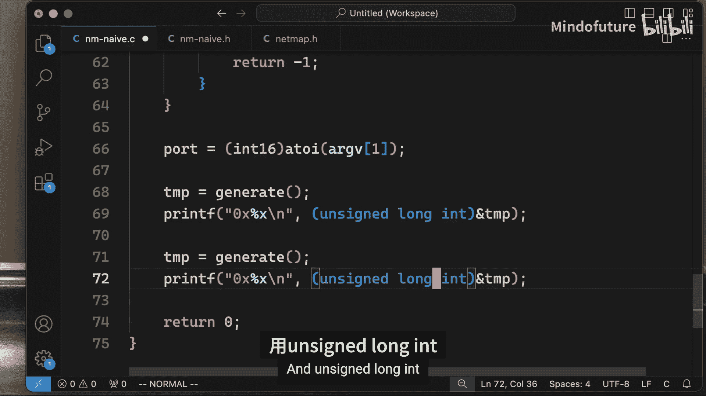

Okay， I didn't like that。Forimate percent x expect arguments have un signed in。

But argument 2 has type long and signed in。Should be L expert。

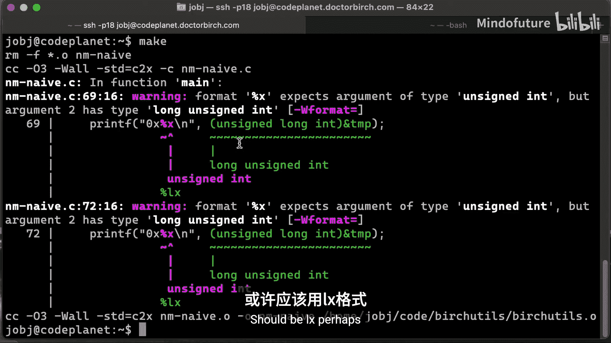

But it is a 32 bits。Thing we won't， right。Maybe we are going the wrong way here。

Let's remove this stuff。李辉。😔，Do this， it will probably complain。😔。

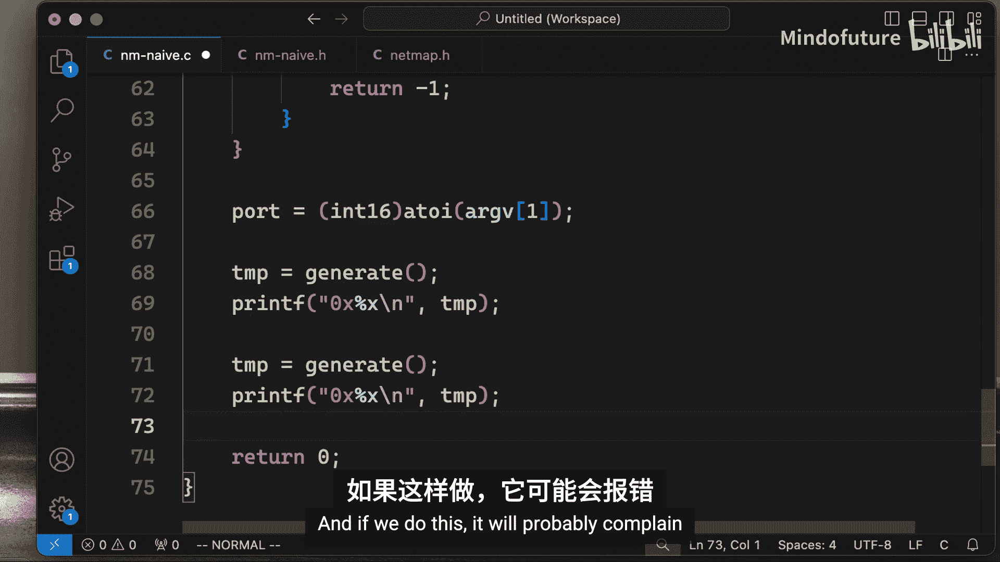

But let's see how this in thing。

Does it have a man page， perhaps in August yes。In address T， in address T。Okay， it isn't a structure。

 It's just a simple。Interter， okay， then I think this would lot of work。

They clean and clear and we you make， and it comps。Perfect， what happens if we're on this？

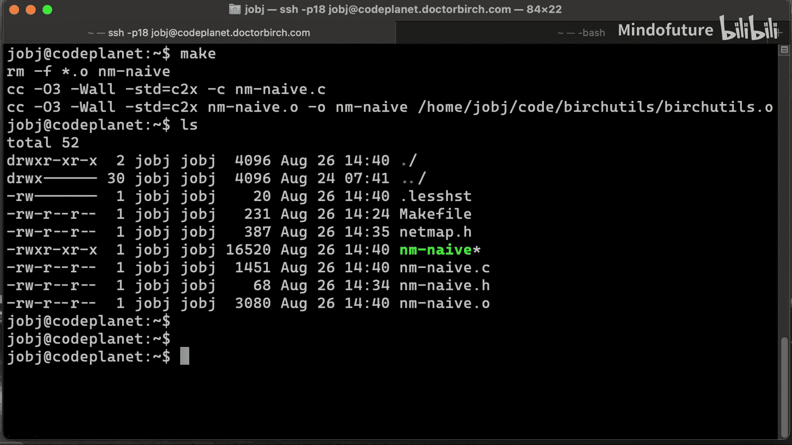

Did you learn anything useful today。And do you want to support this channel。

Go to Doctor Birrch dot comlash support。 You can also click the button， Be a member。

 Thank you for your support。

Andです。Nothing but if we do something of the sort echo。1，92，1，68，11。 and we pipe this。2 M 922。Okay。

 then it produces a。<|OTHER|>And I paired with in Hex， which looks right， I think。

And it gives us a0 the second time。Good。Let's see if we。Use the start and end thing instead。

 So let's create an IP address of 10，0，0，1。To10，0，0。2，5，5。Yeah。The range seems to be working。

 and this should work even without this， right， yeah。And if we were to do two by5， two by5， two by5。

2。25。3。In25，25。2， five，5， two，5，4。This looks a little weird， though。H。What about。

Perhaps it's because it's in。Multicast range。I don't think we should go any further than this。

Let's do this here real。Okay， yeah， it seems to work。

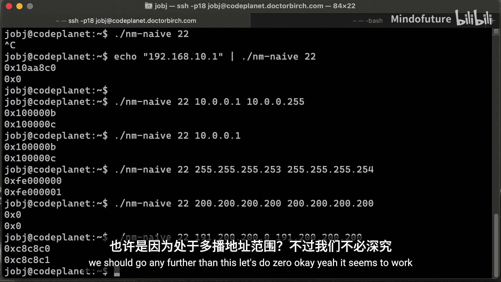

Great， so now we have a functioning。I P address generator。

Which reads from standard input and it reads from a range。And each time we call generate。

 it returns either the next IP address or it returns a0， and then they're down。うん。😊，Pretty good。

And this base code we can use in all our different versions。

 because this will basically be the same everywhere。So what do we need next。

 we need a way to connect to that IP address， right？And since this is our naive version。

 we will simply do a very simple function which does a standard blocking TP connect。

So let's create a function like that。😔，We can call it。What should we call it。We can even， let's see。

 we can make a bowl out of it。And let's call it。Tp。Coect。And it needs an IP address to connect to。So。

 in address T。诶。I批。And it needs a port number。That can be an in 16。Something like that。

And before I forget， let's add this to our N9。😔，So this is a bull， and it's called TC P。

Takes an in address。T。And a。キクティン？Like so。And this is pretty standard stuff。

 We have done it in a couple of videos before， though I will not explain it very。Deeply。

But if you want to know more about this part， you can always watch my video creating a TCP client and connecting a TP server。

bunchunch of others。So what do we need， we need a structure。Which is a so。So address in。

Which will take care of all the set things。We do also need a file descriptor， which I'll call S。And。

Yeah， let's start there。So we initialize our socket by calling socket。And we give it an I AF E net。

Which is basic internet。Socket， and it should be a sock stream， which is TCP and 0。

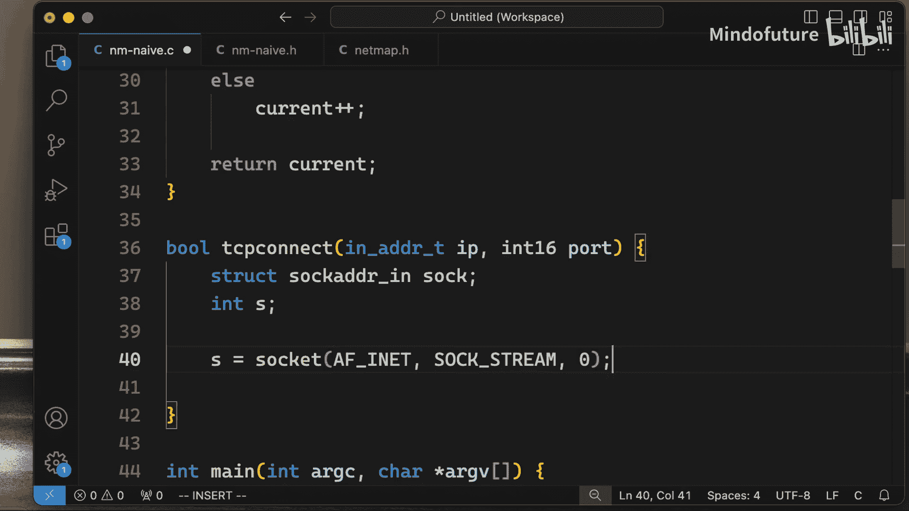

And let's check the return value of socket。Think it gives us a。0 or minus1。

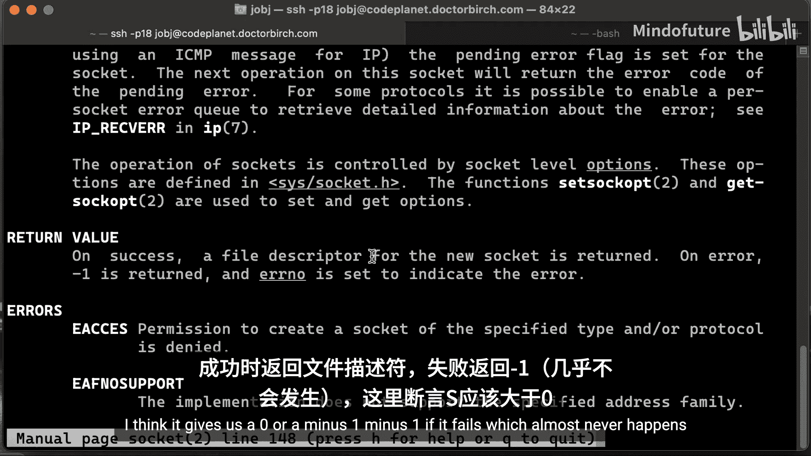

-1， if it fails。Which almost never happens。But， let's assert。That it does work。So。

 S should be bigger than。0ero， basically。It should never be zero。Okay。

 so now we have initialized the socket。 Now we need to fill out this socket address in。Structure。So。

 the first is。Let's see。 S family。And that should be A FI呢。We also need to have a port。😔。

Which is H tone S。Of the in value。Aport。And H to S is a function which basically takes this。

Port number reverses the bits。 So the most important bits are sent first。Network back order。

 it is called。And then， so S address， S address。Should be equal to the I。

And then we do the actual connection。AndPerhaps， we should。Have a structure for the return value。

Or a variable rather。So let's set red equal to connect。And let's see。

 The first is the socket filescriptor。And then， we need to cast the。Add。And give it。

And then we also need to have the size。The size of。true。そう。あクラス。Right so。

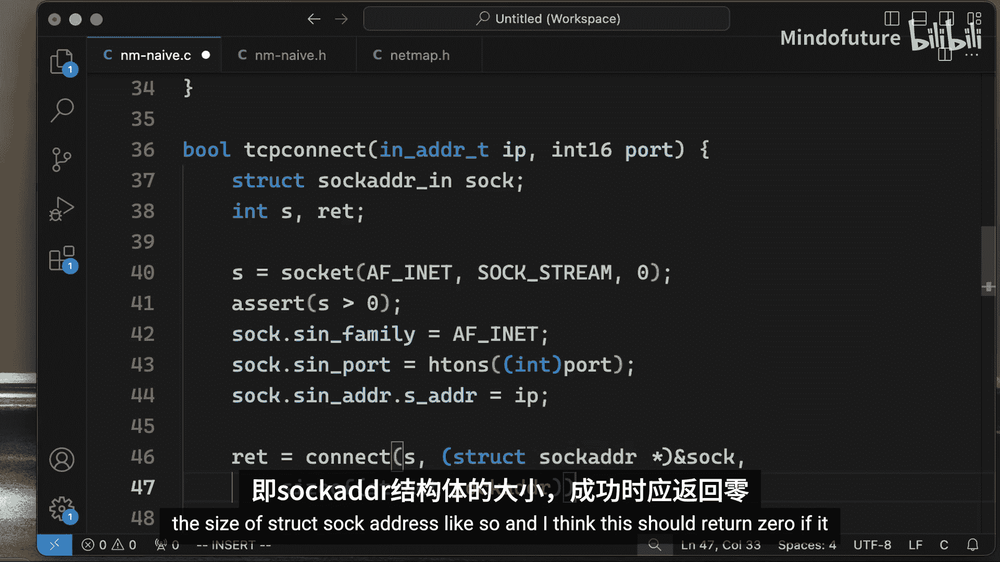

And I think this should return0 if it works， but let's double check。😔。

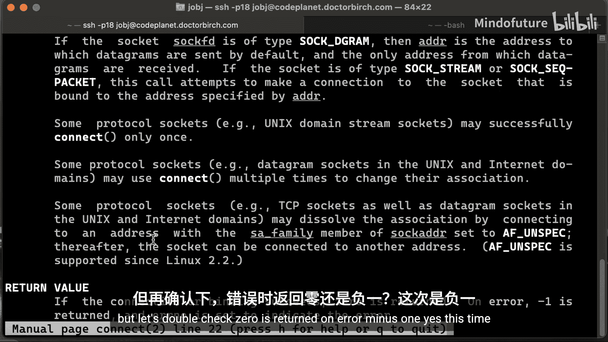

0 is return on error minus-1， yes。

This time， however， I don't want to do an assert because。

That socket fails that should end the program， I think， because it's a very unusual error。

But if the connect fails， that simply means that this port isn't opened or we can't connect to it。

Which means we should just carry on。So no assert here because assert means that if。

If this is not true， then the entire program。Exits。So let's do an if statement instead。If red。

So if red is not 0。Then something is， then we weren't unable to connect。And in that case。

In that case， we were just close down this stuff。We will close it down， and we will return。Fals。

However。一。If it's okay。And I know the L statement is necessary here， but I。I like structure。😔。

In this case， we were able to connect。So what do we don't want to do then we want to。

Check the header of the port in case we have like a version or something like that。Here。

And I think we should do this in the。In its own function。Right。So， let's just call。Have对。

And we send S。Then， we can close down us。And me return true。Something like that。😔。

And you should then come。To this start。 But let's return falses， just so。

We have something at the end。Okay， quite simple， the most possible simple solution to this。うん。

<|OTHER|>And how should we do this header function。

 I'm thinking a little bit how we should log stuff。 I think we will just log it to standard output。

At this point。Then I think we want to do something more of a log file or something like that。

 but at this point， there's ought to be enough。嗯。Did we connect， can create the， Yes we did。

 So let's make。Something for this， as well。嗯。This should be an in a。Pointer。

And we call it tenderer and all it。 sorry， all it needs is an。Aim for the。So just file script。

So at this point， we already have。Vid。Connection。And all we need to do is check if there is data to be read on that。

Socket。So， let's create this in a。And we call it header。 And we have an in S。This argument。

And same here， Basically， we need to have in8。嗯。Let's make it。A little bit bigger。

We want to0 out this buff， entirely。And then， we want to read。From the S。Into a。C version of the。

And at maximum 2，5，5 characters。We like before we also。Wanted to。An index。

Let's call this index this time。So， let I be equal to。Or perhaps we can do this。

That I be equal to read because read will return the number by its red。And let's say if。

I is less than。m。Maybe we should。Maybe we should include the IP address， by the way。The in address。

ピーアイピー。The same here。嗯。In address tea。And when we call this function。We give it the IP as well。

 because that will make the logging a little bit easier。So， let's see if。I is less than one。

In that case。We'll just print F。The I P address。On its own， I think。Yeah。

 let's do that and as we don't have a function yet to convert this into a real IP。So。

Let's do the hexodadeimal until we have created that function。So basically like we did before。

And we give it the。The I。いきそ？However， if I。エス？Reading something。 It has a value greater than。

greater than0。Then we're want to turn it into an index。Let起。Let's do two here instead by the way。

It would make stuff a little bit easier for us and why would we read one？But that's not really。

Interesting， right。So， let's see。It's。Take this -1。And。

Let's make a point here as well I like dealing with pointers。 it makes the code easier to read。

 I think。So p will be equal to the b plus I。That is。P is equal to a new line。Over。If P is equal to。

This window style carriage return。P will be equal to 0。Then we'll simply。Print F。The I address。And。

String。So let's see we have the IP and we have the buffer。😔，そ？And when this is done。Yeah。

 we should return。To date。Okay， let's make this。Let's make this staical。

And we'll still be printing it here， I think， at least for now。😔，And then， we will return。

A buffer like so。I think that would be good enough。

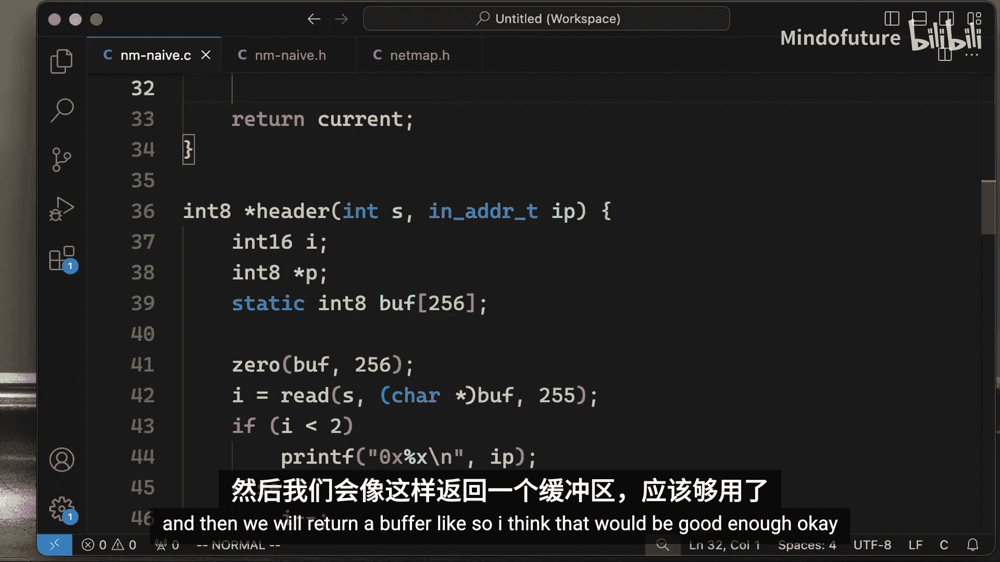

Okay。Unused variable TM P。

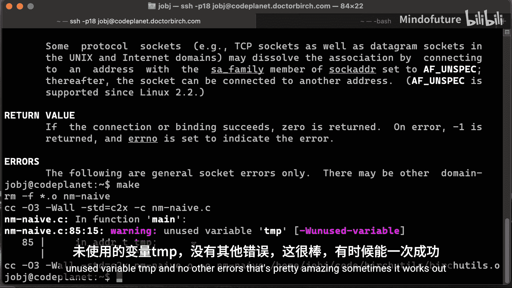

And no other errors。

Pretty amazing。 Sometimes it works。Out of the box。We don't know if it works， though， but let's hope。

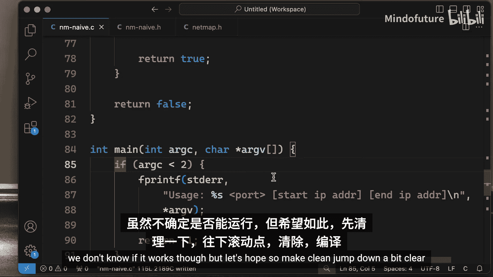

So make clean。Jump down a bit。 Cl make。And run this thing。

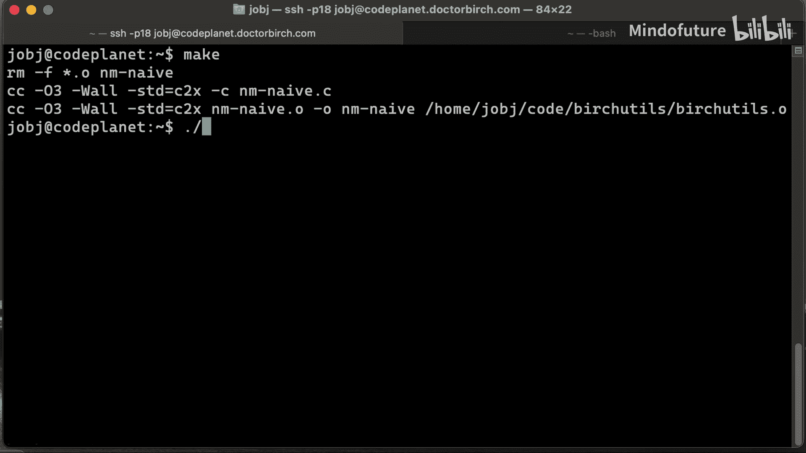

We have something left right。Because we haven't really called our。Conectect。

<|OTHER|>So we need to have some kind of main loop。Or maybe just a loop right here。Let's see。Its。

Let's create the variable， after all。😔，Let's do。In address， T， I P。And。W we do。I P is equal to。ジル8。

As long as this is not zero。😔，We wish to。嗯。1 T C P。くねき？Against the I P and the poor。

Did I give the correct order。TP connect E IP P port。IP ports。And when this returns0， we simply exit。

 we don't even need this。😔。

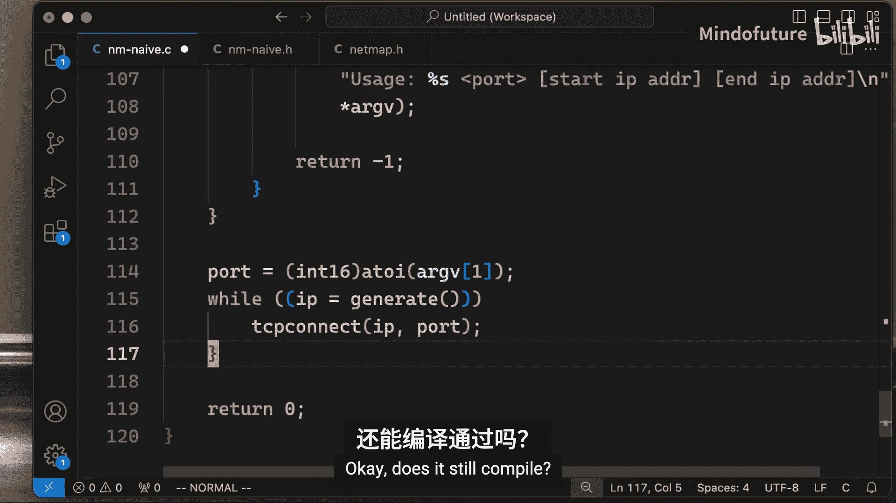

Okay， does it still compile， make clean， jump down a little bit to make。 Yes， it does。

Okay， so let's try it against something we know is open。😔，If we connect to。Local host at port。18。

Then we should get that string。So， let's see。Let's echo that A P address。

Let let's pipe to our program at port 18。H， it worked。So this is the IP， this is the header。

And what if we don't have the head or do we have any other open。これ。Quite few。 Well。

 let's connect to the IRC server because that is not。Giving any output until we send stuff。

So that would be a good example， I think。let's try it against。6，6，7。 And I think in this case。

 if everything goes as planned， it should report。The I address， which may means the port is open。嗯。

But it will probably take quite a while for it， before it。Turns out。So while this is running。😔。

Let's go into this。Cold。And let's try it again。Against the port， which will not be open。

So let's take something like one， two， three， four， four。In this case。

 it will probably try to connect。Either it will wait until the time's out or it will receive a connection refused and terminate pretty instantly。

I think it should be the second。Option， in this case。Yes， terminates instantly。However。

 if we were to connect to something which is。Which is firewall。And what should be。我去 be。

I think we can try something like。嗯。My web server， because。It's behind the firewall。

 and shouldn't be able to。Be reached from here， I think。I need result。 That's。

 that's a doctorberd dot com。Theこです aピ。And。Then we run our program against。What port should we do。

 Let's， let's try 23。Okay， now it's trying to connect。And this。Okay。

 we did guess actually the error message when it disconnected us。But in other case。

 if it were to just disconnect us。You should just get this。So our program worked。

It would be canonized if we could try this program against some real network or at least a simulated network with different IP addresses。

And different services running with different versions and stuff。

 So we tested against something which is more like the real life internet。

We could port scan like a range of servers somewhere。

 but it's no good thing to do that because we will probably get abused mails and stuff。So。

Let me think a little about this。If you have any ideas， please put it in the comments and I。

Might have an idea how to create a simple。Simulated。Network。

I'll talk more about that in the next episode， by the way。If you like this series。

Please like and subscribe， there will be more episodes coming up and the next one we will perhaps create that simulator network。

 but we will also create the version 2 of this scanner which will be much faster because we will be using nonbing sockets instead of blocking sockets。

I will also try a different way of using the blocking sockets we're using right now。

 but by altering the timeouts， so it will also be faster。And。

And I will also try to do some tests so we can see how many seconds it takes to scan our test network with the different versions and stuff like that。

And I also intend to do a lot of more cybersecur stuff in the future， not only， but。

Me more than before。All right， thank you for today and thanks for watching， take care everyone。😊。

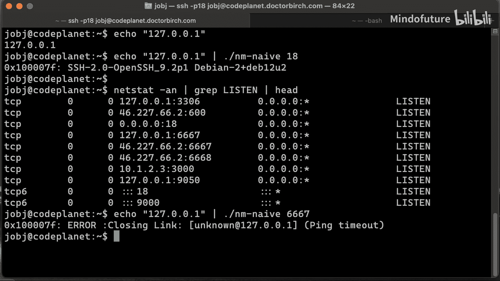