# 编程实战：-编写一个网络模拟器-p03-P03-编写一个网络模拟器--BV11uKozNEKf_p3-

I to take a little break from the network mapper。Because in order to continue with that。

 we need some way of simulating a network， so we have something to port scan when we use the tool。

So that's what we're going to do today。 we're going to create a network simulator which allocates a lot of IP addresses and it will。

Create dummy services on different TP ports and it will。S some data when you connect to it。

 So like in the SH version and stuff like that。So this will be。

 you should always select the easiest code language for the assignment at hand。

 so I could code this in C， but that would be a rather advanced and big project。😔，So in this case。

 I think I will be able to write it quite easily in Linux She script， bash。

So that's what I'm going to do。 But before we start with the network simulation project。

 I just want to add a little thing to our。To our network mapper。

 because we finished the naive version， pretty much finished it anyway。

 but there's one thing that I forgot to do。So let me just connect to my screen at code planet。

And this is 3，6，9。 ugly believe。 No， that's not it。え。5ftィプ。Yes， this is the earth。Allright， so。

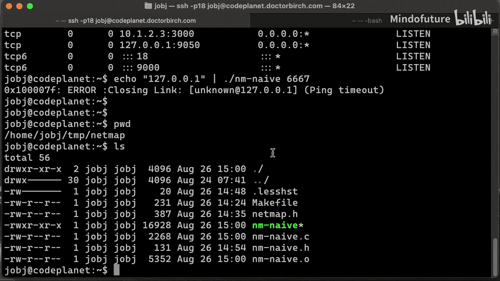

What we have this far。Is。This code， which basically connects to different IP addresses at a specific port。

And report the。Yeah， they had her from that port。But。When it logs the I P address， it gives us。

 Let's see。 Where is it。嗯。It gives us this format。So it shows the IP address in hes。

And the network by to order。And that's because we do have a library function。

 which is called INus address， which takes a IP address in the doed decimal type and it creates。

A number out of it。But we do not have a function which does the opposite。

Which takes this number and returns a string。So that is what we are going to build。

s quite it's not a very huge function。And after that， we will create our network simulator。

So this is one of the functions that I have written many times， and I have。

Needed to rewrite it in several projects。Due to my copy paste rule， which is never to copy paste。

So we will rewrite it last time， but I will do it inside of the context of bird dutiess。

And if you remember， that is my library。Where I will put all the different functions that I plan to reuse in different projects。

And this is an example of that。So， let's call this thing。嗯。You just make some room。

And what should we call this function？ Well， it will return in8 pointer so。😔，Our string。And。

The other function。In the other direction， is's called Enet address。But。We can't really just shift。

Let's do。Let's call it  to。Dted。Because this format is called do de decimal type or do de decal format。

So， too doed。Would be a good enough name。And the only thing we're going to give this is an IU address。

Tea。With the I P address in the number format and also in the。What's it' called？

That through back to order。And that basically means that you are sending the most significant。

 the most important bits。First， when you。When you send it over the wire， for example。Right。

 so let's create the。Function definition right away， so we don't forget。It's called two doted。

 And wem an in address he like so。Okay， so how do we do this。Gna have to do some。Bory operations。

So basically， if we have something like 10，0，0。Wean。This in a numbered hex format。

 will be something like。0，1。0，0，0，0。10 something like this， I believe。Let's。Just。

Add something too temporary to our code。So， let's do。Let's just do like this。So， let's print。

0 x percent。And then we take the edit address of。Or the one like so。That return0。

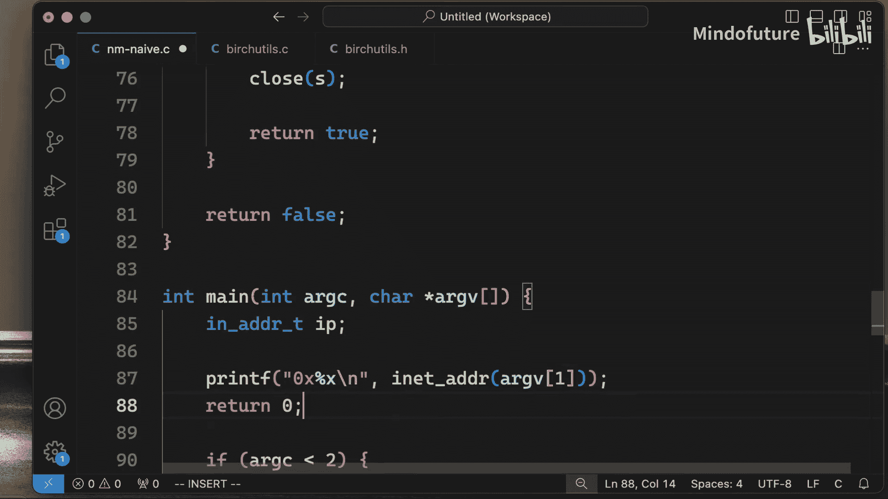

And if we make this project， we should be able to just。Run over programme with 10，0，0，1。And yeah。

 basically the same。 Let's see。The initial zero didn't show up here， but。As you can see。🤧ううん。So。

This1。That is 0， a。Because a is 10 in the X。And then we have two zeros。 So this is basically like。

Like this。0，0。0，0， and then。Okay， so this is what it is。And they were hotel。So basically。

 we just need to take these four parts and put it into a variable using binary。P operators。

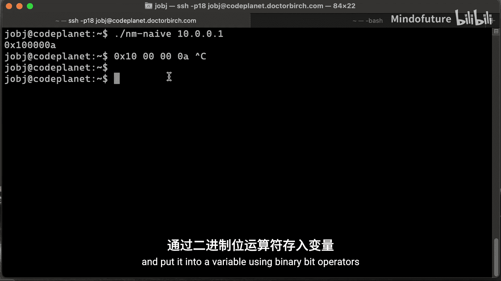

And it's usually a little tricky to get it to work。

Sometimes it takes a couple of tries， but let's。Let's go for it。So what do we have， We need。

A couple of is eight。A，BC，D。And this will correspond to。If we have this number。This will be。Indeed。

 see。BB and AA。So， this a should contain。The right most of this hex string。

 which will be the leftmost of this。All right， so how do we do that？First， we need to。

Select what we want to。Extract。So， let's begin by extracting。Those two。Dli。Let's see。Yeah。

And you do that by creating a mask。所以。Select something by putting。エ。

And if you convert this to binary。There are zero ones， and the ones。The select。

Which means that we need this whole D thing， and then it will be the maximum number， which is F F。

And the rest。Will simply be0s like this。 So 1，2，1，2，1，2。

So this basically means that those things that correspond to these zeros， which are all these one。

These ones。Will not be copied over， but。Since we have the Fs here， this will be copied over。

Which basically means that， after the operation。We will have。0， DD。

And the rest will be zeros like this。So that's our step one。Let's do that。So we'll set D equal to。

And then we will take the I P address。And we will use a。Let's see。 an end operatorer。

And then we will have a mask。 So that will be 0 x and then F F。 And then we have 1，2。th3。Double zero。

This means that D at this point， should be equal to this。Or rather， these parenthees。

Is equal to this。 This D is only in a， so it can hold all this。

So the next step is to remove these zeros。Because。These hex addresses。

 the lowest number is the most to the right。So what we want to achieve is having something which is。

The doubleuble0， double 0， double 0。 and then the D D。 So we want to push this D D。

All the way to the right。And these heroess are optional。

 which means that the contents of the D variable will be this。D弟 thing。

And that fits perfectly fine inside of an in。So basically， let's create another parenthees。

And we will use this operator in order to shift。All the bits to the right。And we want to shift them。

24 Bs， because a double 0 in this case is a B， and a bite is 8 B。 and we have three of those。

 three times 8 is 24。 And that's why we move them like this。And if this works。You should be able to。

Extract。え。The one。So， if this works。This should be equal to。The number of1。likeです。And let's just do。

Very far。That it works。Because if this works， it will be quite easy to take care of the other parts of the IP。

😔，Let's see。 So we wna call instead of just E address。 We wna call toducted。

And we will as the added address of RV。我。する。And we need to recompile the。

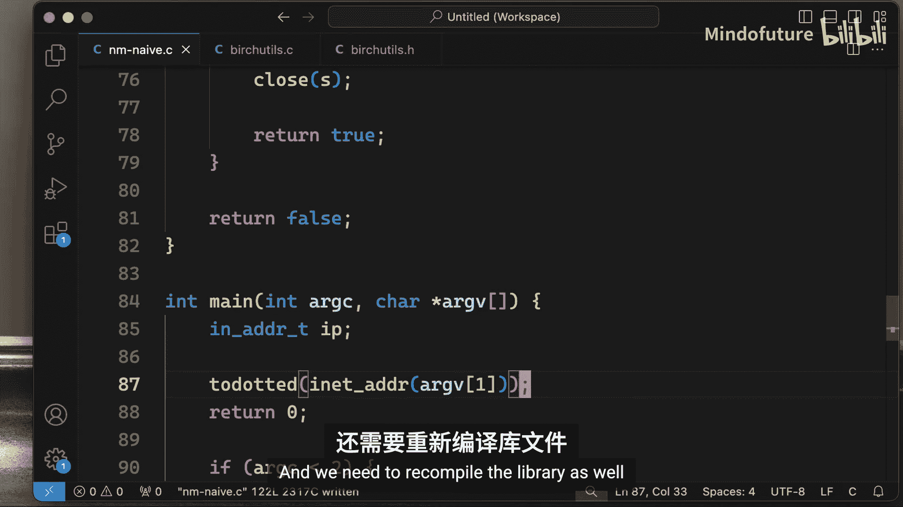

Library， as well。

This word。Okay。Yeah， we need to have an clue。😔，In the address。T。S so at age。

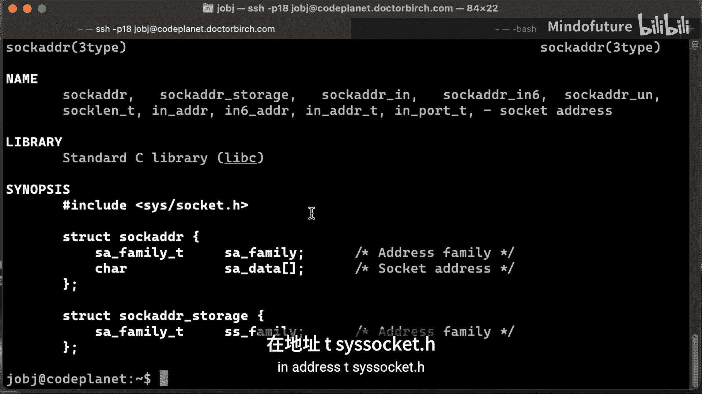

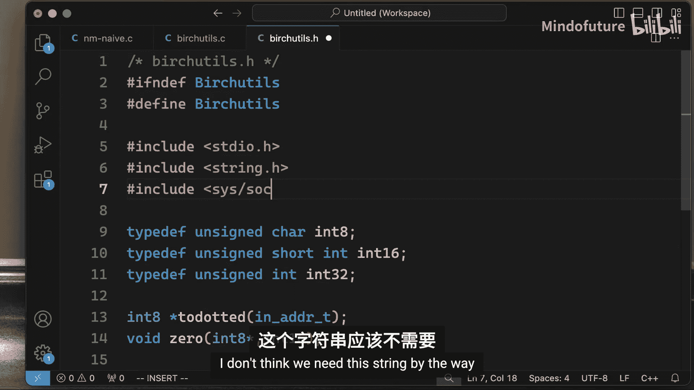

I don't think we need this string， by the way。

Permmeter names without type。Without type。In function declaration。Perarameter names。Without types。

In the function declaration。This is a type。 This is a type。

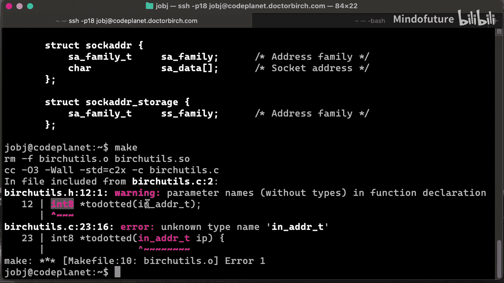

What's it saying。Is it because we have the function declarations above？

The declarationlars。In the。Yunfei。That's weird。😔。

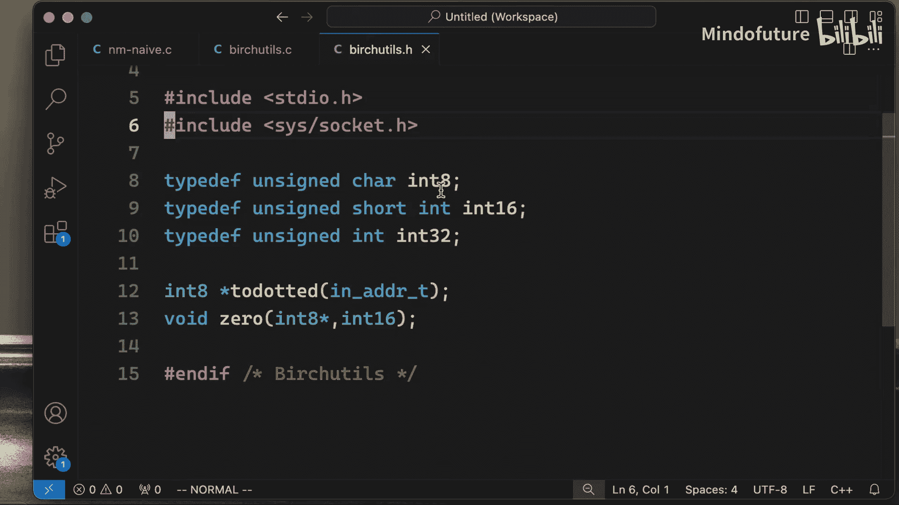

Due to upload。九ゥと age。2 doed yesterday I6 soet。8。S so dot age。Why do we still get that error。

Unn type name in address T。

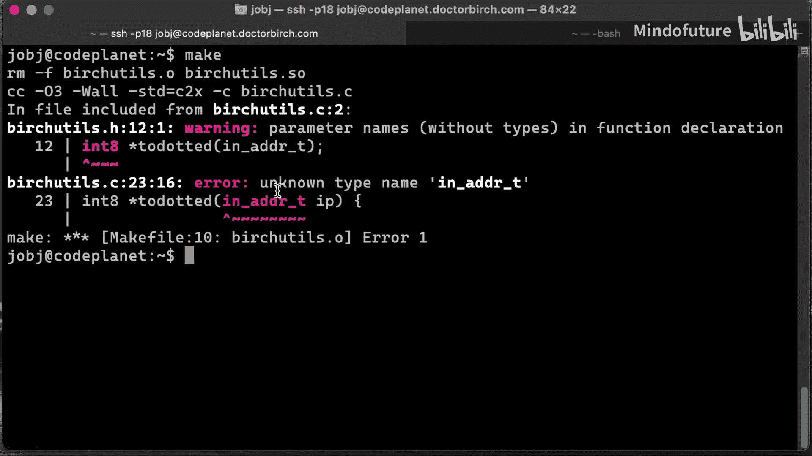

Let's copy some of the other socket related includes then。

From。😔，The flip of age。So。Perhaps we need these， too， as well。

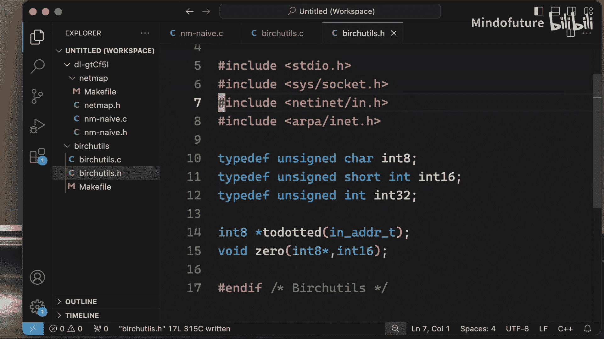

Okay， so now it compiles unused variables I don't care too much about。

 And now the first thing didn't error out either。All right， so let's see if this one compares。Yes。

 it did。😔，And if we run it。If we did everything right。We should get a one， as al。

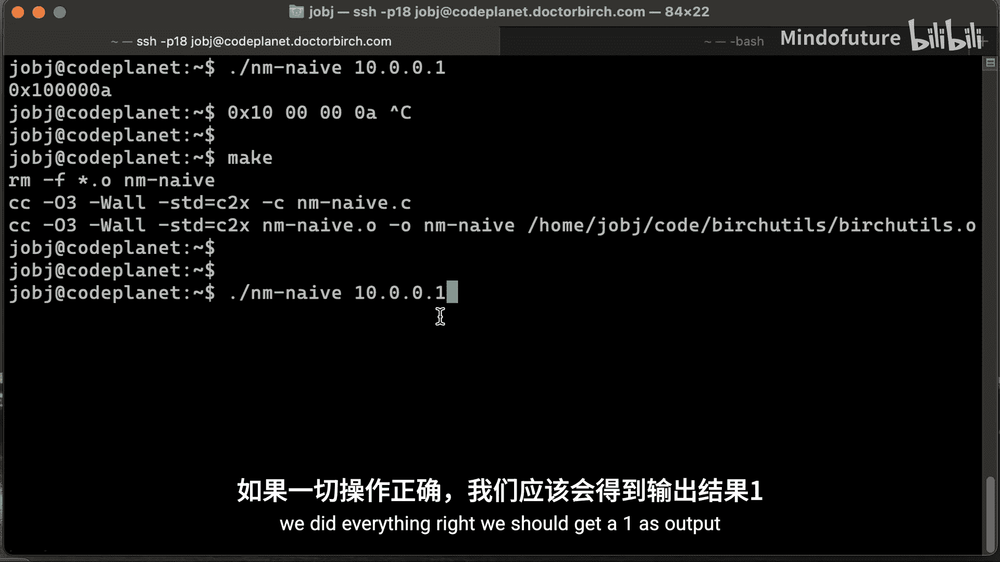

And we did。Worked at the first try， almost。

Which is kind of great since this is kinda。😊，Advanced stuff。But now everything will be easy。

 We will just do the same， but changing the mask from this。To this。Which means we will。

Instead of grabbing。The Dd。Or the one we to grabvi the C。And the zero， in this case。So， let's remove。

This nice。We will do C equal to。I P and。0， a。0，0， F， F。0，0，0，0。Like so。And this time。

 we only need to shift at 16 B。And then we have the B。And this time， we take the I and the0。0，0，0，0。

 F， F。Cal，0。And we shifted eight。And finally， we do the a。And now， we just do I P and。0 FF。

 And we don't need to shift anything。And we can remove the initial。Zeros。

 because they are not necessary。So now we have the four variables。Which contain this stuff。

And like know would just need to generate a string out of that。So， let's create。Let'sSee。

 let's create a static。And a。16。そうです。Every we 0 out the bath。And then we can use a simpleprint F。

To the buff with a maximum size of 15。And then， we just put our。Let's see。Percent D， dot， person D。

 dot。 person D dot。这是机。And then we give the A， B， C， and D。Pally， we simply return。Goodッバ。Like so。うん。

And in this case， we can do。Yes。嗯。P。嗯。This。So now we should get back the same I P address at that we send。

 but it has been converted。

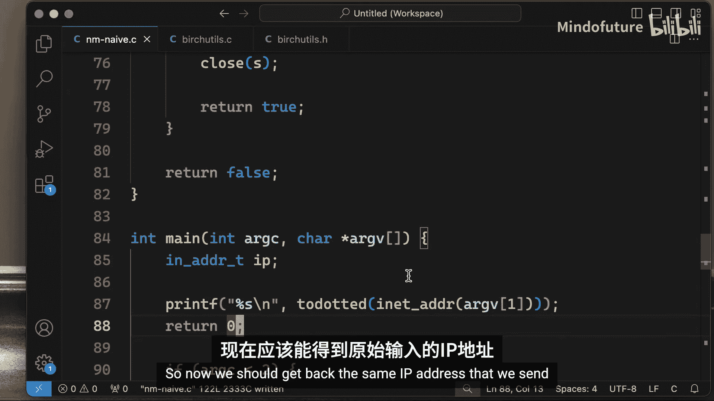

Back and forth。Oh， that's quite there。Different sign right。

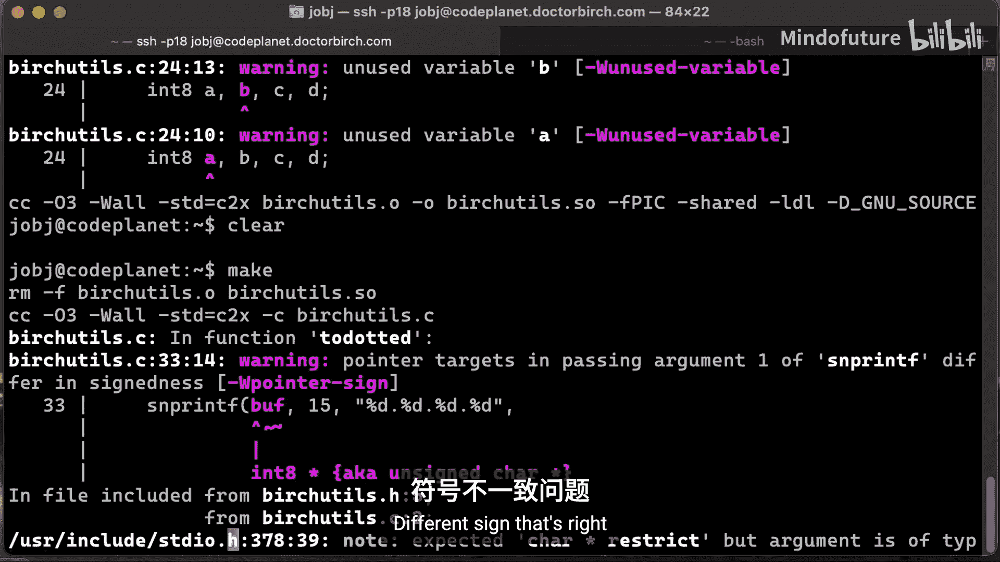

そち。When we use the Sprint F， we need to make this a cha。Probably， that's the only thing that。

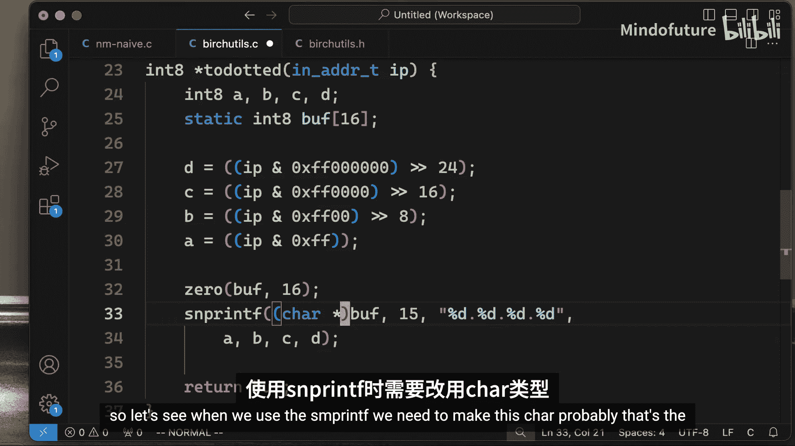

Fed。Even though we got a full screen of errors。Almost。Let's see。Output may be truncated。 No。

 it will not。😔，<|OTHER|>A simple de output between 8 and 16 bys into a destination of size 15。Well。

No。Since we say 15， it will still be okay。 I don't like these words， actually。In this case。

 I know perfectly well what I'm doing。 And I don't think this is really helpful。

 This is just annoying。え。Yeah。So I don't care about this。And let's compile this。And then we run this。

 and we get the I address。 Very nice。

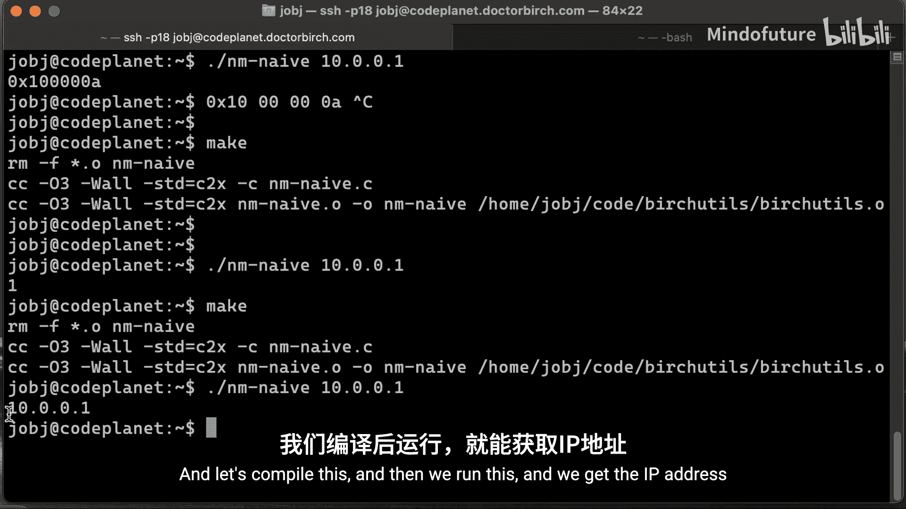

I like when things work first。呃。The first round was。Okay so let's remove this stuff。嗯。And。

Where do we print out our。😔，Result from the connection is that only in one place。Let's see。

If it's conducted， it will send it to the header。And the header will print it。

 even though it doesn't get any data， right。So instead of this。We will seem to do a present S。

 and then we send this I P address to our2 dot。And we do the same in this case， when we have。

An output。So，2。2。

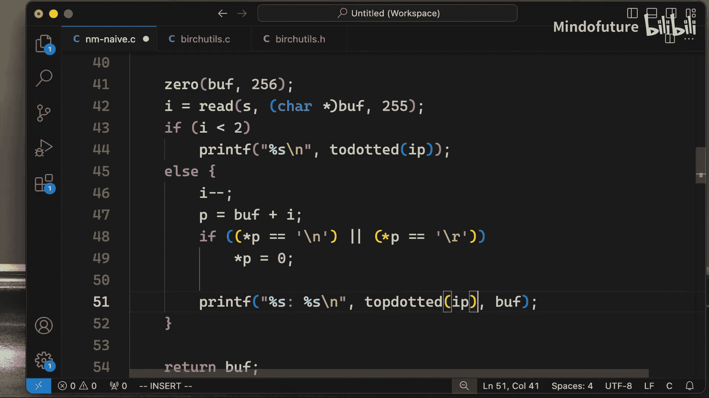

Like。せ。

And we pile。K lower。と不了。

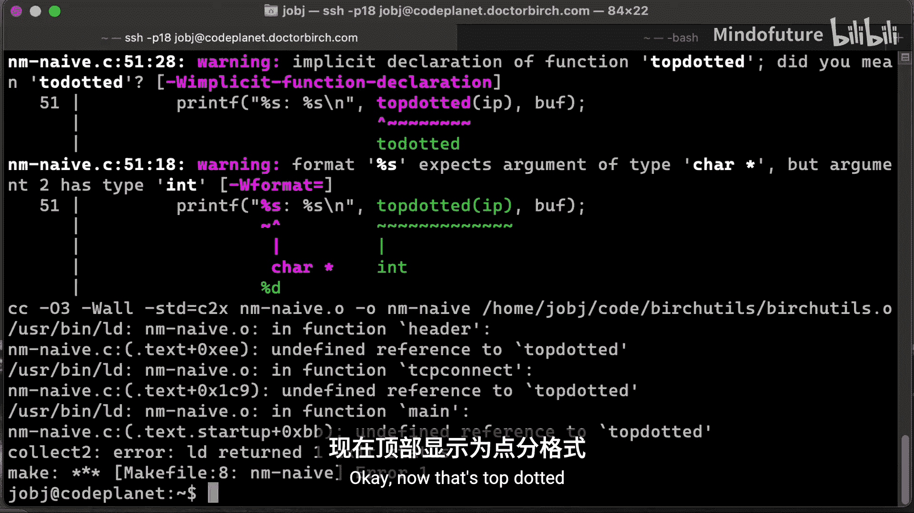

Well。

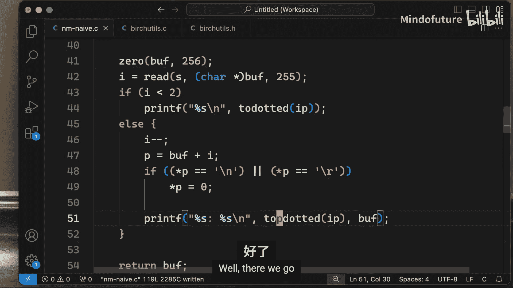

There we go。And its compact， just fine。So let's try this out though。Let's just echo1，27，0，0，1。

And let's pipe this to this， and we would run it against port 18 again。And this time。

 we do get the real IP address。And the version of this。Perfect， so now our first version。

Of the network map is done。え。So the next step will be to improve to rest and improve the performance of the scanner。

But in order to do that， we need to have some network to scan。

 and that's what we're going to focus on today。So。Let's coming up next is we're gonna begin coding our。

Network simulators。Welcome back。Let's start building this network simulator in bash。

Since I don't want to mess with AI addresses of my code Planet server。I'm gonna connect to a。

Different。Solo。🤧I created a sorry。I created a server Roer called Intel 32。Which is a 32 bit。Server。

And that doesn't really matter in this case。😔，But， I want to。Use this one for our project。

And we need one dependency in order to code this because since'm I'll be used in Bsh。

 which is Linux Shell script。I need a program to call to modify the IP addresses。

 And there is a new function， a new。Command in Linux， which is called I P。

 which you can use for this purpose。 But I feel more comfortable with if the old IF config thing。

 So you need to do。I could get installed net us in order to get this， if confi。So。Let'sxi。

Do I have a cold。I有 asency okay。So， let's create。A directory， which will call。

We will call this that seemsim。😔，And I will set this to my。ほ。AndLet's create。One additional window。

C and let's same。So we have one window to code in and 1，2。Rund the code。 And this will be pretty。

Small project， I think， at least， I hope。So I will be doing this in V。V。So， let's create a。And。

That seems。Sage。Network simulate。And let's begin by creating a。Function， which we will call failed。

Which basically will。Exit everything。So we will be round a couple of。Not threads， but forks。 And we。

 when we fail， we want them to be killed off as well。 So we'll simply run。Kill all。

And what do we want to kill， We want to kill。In。Let's see。We are going。

 We are going to use a pro called Net catt。So that will be killed off， and we will also。I think。

And if we are still alive， we will exit with an exit code。And before that。

 we want to send a message to the screen。To the standard error。 And that's why I add this to there。

Because0 is standard input。1 is standard output， and this is standard error。Okay。

 so now we have a fail function。Perhaps we don't need to。Get any output from this。

 And if we want to suppress all the output， we can pipe this to Deb now。And then we do。This。

 so we take both the standard in standard output and the standard  error。

 and we pipe with everything to this stepile。 So we don't get any output。Except for this。

Exit message。And this function is just to make things a little bit easier。

I will also have a usage function。If we supply a wrong number of arguments or similar。

This will give us the output。Thatest we should use。So this would be something like。Yeah。LetSee。

Maybe I will do。I think I'll do it like this。I will run a cat。😔，And I will as stuff。嗯天。

We give an end of file。And I want to send this to。This。So start to standard error。And。😔。

What do I wanna。So I wanted to do。See。Usage。And this would be called that S S H。

 And there'll be a couple of different。Usages， so perhaps we should do something like。ちてないって。

I wonder if we can add a tab like this。 Let's try that。Let's do a space as well。

So that's end up at S H。 and let's create a couple of those。

Because we will be running different types of commands。The first thing will be something like。

Something that initializes all the different。IP addresses， or it allocates them。

So maybe we should call this ao。And the arguments for this will be， we need an。An IP network。

I P subnet with。And。We need a number of I addresses。😔，First， I P address。And this would be like。

Spread the away。Because if we don't specify。One or both of these。Will have default values。

So the default value for first digits。Will be。Let's see。 It'll。 It'll be a one。And。

The number of addresses will be 10。Okay， so this is。One of the commands the other one will be free。

And this will basically remove all the。アイピー addresses。And then we will start the simulation。

Let's call this。Simulate。And what do we need to do here， We need a con config file。え？File。Lets， and。

An example for each of those。So。Do this。So an example would be。1，921 68，10 to 0。

First digit will be 10， and number of addresses。15。Maybe we should do the the default set things。So。

And this。Will simply。Fe。This is。We don't need an example here。Andです。Will。嗯。Here here。Third good。Nシ。

Meat。可以。fi。在 the朋友们。And this will simply be。Pt number。Thank you。可能。Thank you。

And then we will have them。Exampプ。Which would be in that sims。Simulate。对。Ss。cool。Something like this。

And we will also have。せ？それ。航通。嗯了。P22。So we can grab one of these headers。And。Let。It's an F0P server。

And the third is that this will。Randomize。So let's say we have 10 IP addresses and we have those too。

Each time we will start simulation with one of our IP addresses。We will simply。Randomize。

One of the lines from the cofy file。And opened this port。On that I P address。And when we connect。

 it will show this。Data。So we need to install less cattle if we don't have that already。Which I do。

Otherwise， I think it。U to gets installed。N C， or perhaps let cat。 Try both if you don't have it。

And that's on Deian， by the way， if you're using red hat or another Linux distribution。

there is another command， but you probably know how to install things already。Otherwise。

 Googles your friend。Al right。 so let's see if this is working。

 It was a while ago that I did stuff like this in bash。Like input output。Those kind of things。え。

So let's see。 after we have done this。We wish to。We wish to fail。Cat from。Yeah。

 let's remove this empty line， and then we will fail with a one and empty string。So。

And let's just test this out by running usage。And we need to give this the permissions to run。

 So change mode 7，5，5。 that s。 And now it turns green。Perhaps you don't have the colors initialized。

 but it should。Get this asterisk。The right， and you only need to set the permissions once per file。

And then we simply round it by the dune dot slash that sense of S age。Okay。

 so everything seems to work except for this。Tea kind of thing。嗯。So， let's replace that。

We can create。A variable。Yeah。Let's call it tab。Which would be equal to。Print F。And then， the tab。

いきそう？And。Then I want to replace that thing。 So present S。They want to change。Qi。😔，2。Dollar cab。

Everywhere。Okay， let's spread out。M。It didn't really jump out。有度。Dollar tab。Tab equals。Oh， change。

This， that's why。This should be right。All right。That looks a little bit better。Bs。

I will not focus too much on this。Visualally， you can give it a little more time。

And to structure it better， but。I don't think I would have have。For these lines， by the way。

It's like so and。Yeah， just the。The do slash lines。

Because that is kind of the headlines in this case。So， that will be。Yeah， let's see。Okay。

 this is good enough， I believe。Alright， so we have the documentation done。Let's start by。

Creating the first function， which will be the allocation function。

And if we think about it a little bit。And what do we need for what kind of information do we need in order to create this stuff。

Well。If we run a spin if con。We see that we have two interfaces， we have the network interface card。

 and we have a look back interface。So we need to get this interface name。

 which is basically different on every。Machine， pretty much。And then we wish to run。

We need to create one interface。With sub interface for each， the first will be column 1， column 2。

 column 3 is et cea。And then， we will specify the。Virtual host， IP address that we wish to use。

So this is the command that we want to run when we allocate the addresses。

So we need to follow the range and increase this once per everyone。But first of all。

 we need to grab the interface and。The output， the input that we give this is the I subnet。

 So from the subnet， we need to get the address。And that's pretty easy to do。

This is the eyes of the machine。And that means that a0 at the end， will be the network。

And if we run the command， E I P address。S。And then this network。Perhaps， we need the。Sder as well。

I P address。S。😔，Devicice。Hy show。We thought this was right， I P。Ipe address。No， I routeed show。Okay。

 we do need the cider as well。So， let's。Edit this。LikeP的。Slash cider。

And the cider is the size of the network。So slash 24 means it's a 24 bit network。

 which is basically 256 different IP address combinations。So if we're on this command。

We will get this output， and the。Third word。Is the interface。So， let's create a。Function。

 which returns the interface。 If we give it a I P sumnet and a cir。So。Let's call this。Grab。

In thef blows too long。Grab， I S。For interface。So first， we need to。 no。

 we don't actually need to break it。Let's just do。I F equal to。And then， we run I P。R。So。

And we gave the argument to this function。And this is not the I F。 this is the。Oh。

And then we get the interface。Bye。😔，Running cat。Which divides this string into different words。

 that we will the third word。And if we do these three。Yeah。The science operators。

We can give this a string to work with， and that is our output。Like this。And if。

Interface is equal to nothing。And we fame。6。对。Otherwise。We will。Simply。Echo this interface。

There is not really a good return function when it comes to strings in bash that we can just echo it to the screen and hdle lift like this in the calling function。

So let's try this out instead of running usage at this point。We will seem to do。嗯。Lets see。Yeah。

 let's just do this temporarily。 We will only give it one argument that that is the network at this point。

The network equals。Another one。And。The I will equal。Our。Drab I F function。Supplied with。有点腿儿。

And that will seem to do something like。デバイで。So let's try it with a bad IP first。 So 1，2，3，4。

 slash 16。No such network。 Its still rounds。But very name， I don't think we need to use。Exit here。

 We should。Let's see。Because we run this failed thing。Exit should。Do the whole script， I think。

Why do it， Does it。Go through with this， anyway。Exits the shell。

 Ex show status and is made to death status。Instead of the last cls。Though such network。

 the device name is。Sa。F to know such that。Hello and seen that seemsim。え？Still didn't。

<|OTHER|>Exs the fore while until youop be finished with5。くるい。😔，Suspend really。

Suspenenseial executed。<|OTHER|>Until it receives a same countt signal。

 unless forest luggage shell it without job control can be suspended。Force， this has been。

But this probably pauses it。😔，Q。😔，可能。It's weird that X it doesn't just。😔。

And I think the kill command would solve this， as well。What if we were to do。This is the。Okay。

 this is good enough， I think。Yeah。Alright， so where were yeah。

 we need to test it with a real I P as well。その場であ。To begin with。So the I P is 10，1，2。5。And。

That means the network is serial。And if we check the。レバ好。We know。That。The first。3 fields。A set。

 which means that we have a slash 24 network。The device name is bblla。 Okay， so far so good。

So now we get the interface。And。Now， we need to turn this。I P network into the first。I P address。嗯。

So， let's see。The of just。I it like this。We were。Createative command。

Which would be the first argument。And then， we need to。Lets see。

A select case would be kind and nice here， but I don't remember the syntax。Hell。😔，To select name。

Inward。Do。It would be beneficial to have a。An example， case word。Yin。Pattered。😔，Command。😔，And then。

 double。Okay， I think it can do。So， let's see。Case。嗯。B。Which order is it。That's better。Word in。

Where is the。C。This should be closed。 And here we are。Okay， so case in。Our first command is Alllo。

Case a look in。CMD。And then there should be a parenthesis。ででくな。😔，好き？先部に。きて。And。

Then we want to run the aoc function。We don't want to send the command。

 but we do want to send the network。Network。And it did。And the addresses， potentially。

So let's just do。I。嗯。And then， we pray。Then， we are done。In this case。And the next case to is。Ptter。

Blah， blah， blah， command。Commans。Then we have this。And then a couple of dos， so。

Then we have another of this。えっていん。Separate multiple。Patterns。So。Ks we're in。

 and then we have pattern。 We have commands。

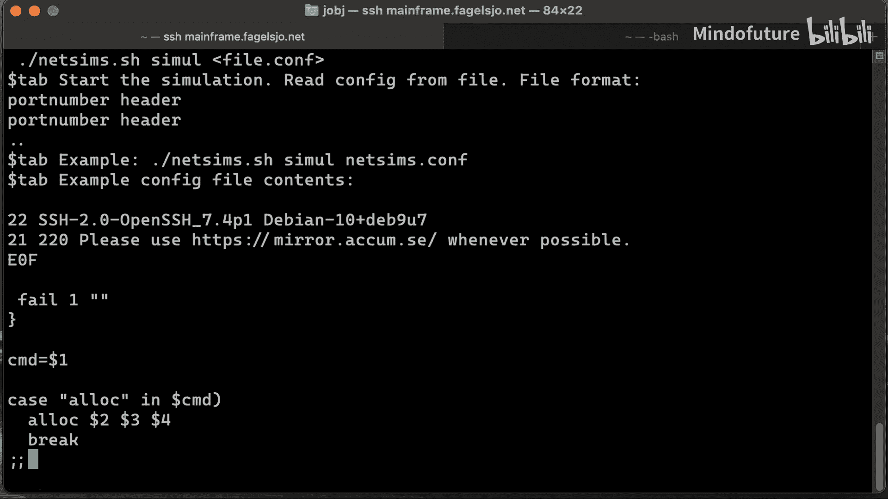

Let's do a quick Google， in this case。え。Case。对。I just need to see an example。

Look a case expression in pattern1 and this and then statement and then that。And then we do it。

Next pattern， so we don't write。😔，Case expression in again。Allright。

 so I I did it in the wrong order， then。

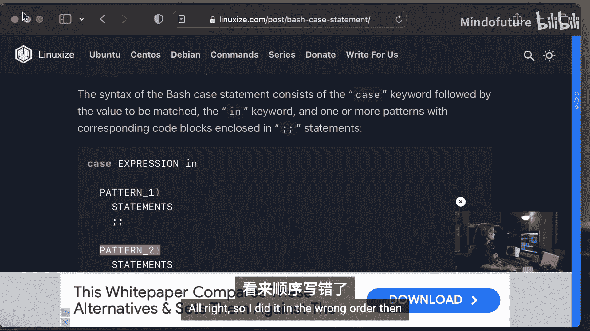

So， it should be case。CNB。In。Hello。then。Should be here。And then， the next1。

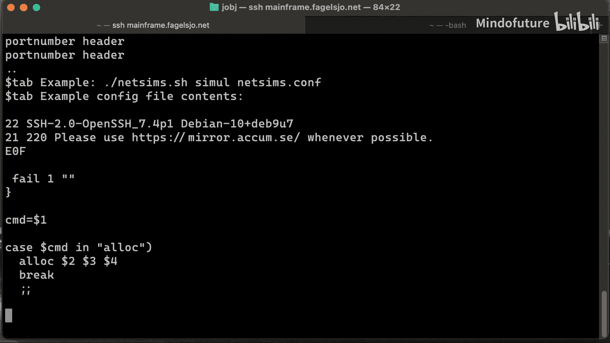

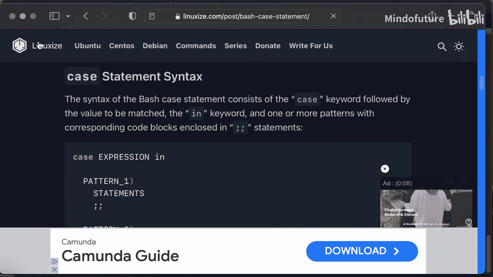

Right。No， I think I know it。K心李。Let吃。Then we have something。And we probably don't need this spray。

Either。And then the E。电。Something like this。If we don't have the lock command currently。

 Let's just add something temporarily。So we know what's going on。Let's see if this even starts。

synyntax error expect a tokenken something on 63。The three is this。Maybe we don't have in。

Kase C And in。哦。Tread again kind of thing。 And if you do AB，C， the thing if you do。Works。

 if you do something。All right。 So now we have learned something new today。 We have learn how to do。

Basically select， but inmer。Okay， but let let's focus on this a thing。So。

Well make a function for a look。And we have three arguments。跟。The first one is the。と。

The second one is the first IP。And the third is the number of Ipiece， amounts of Ipiece。😔，And。If let。

If we don't have amount。Then， above。Will be equal to 10。And if we don't have。First。

There is at first one。And let's use left here as well。 so we are consequential。And next。And。1。Man。没。

First equal world。Or two， perhaps。In case we have the first。😔，部やが続いて。And if we don't have a network。

So， if。没。S said nothing thing。Then we need to fail。Right。And as you can see。

 there is different syntax when we compare a string。And when we compare an integer。Good to know that。

Okay， so now we have all the information that we need。No we just need to。

No just need to look through these and create the IP addresses。

We also need to see that we are having road access for this command because it is necessary。Actually。

 that is necessary for all。Our operations。 So let's see if we run I D。And we gripep the first。

Let's see。Perhaps we could give a switch to this world。Okay， I did dash you。

So let's put that at the top of our program， which is。嗯。It's right here。So the U I will be equal to。

I did you。え。Yeah。U。Which means if this is not0。B。They。いって。ても。Let。

So now we can be sure that we are having remote access。And。😔，Then we need to grab the。Interface。

 So I F equals。Rrab。哎呀。And we send the。The2。We do also need to。Get the first three。

Things from the network。 So if you have。10，1，2。0ero， 24。We want to grab these three fields。😔。

Let's call them。ABC。For the A and B and C network。And in order to get these。

 we need to divide this into。得。And we want the first to the third。And what do we w to send。

 We wan to send the。And now we can easily construct A addresses out of this。嗯。

Perhaps we should figure out our own I as well。If we do IP address shown Unius 192， what do we get。

Okay we get this。And if we draft it for I。And then， we。Let's see。If we said this。So， we looking at。

来呢。Space。And then we want to grab these things。These things。

So the thing we set inside of these parentheses is basically what we want to grab。

And then this is space after。We wna change this。To back slash1， which is the first parentheses。

What are the things inside of that？Think this will work。もたして。Cl Iで。And。😔，ててる。😔，Or。Yeah。

 we need to take everything else as well。And。We don't want the6 afterwards。 So let's do。ピ。

Or dash E if we wanna have eyelet。But it should look。Except to。So。

And we would to grab everything before。And。Every。Iect。😔，The this parent。

Why do we get the entire line， I think we should be able to。Everything inside of these parenthees。嗯。

What if we were to do。です。And we add a slash。And。うラブ？Or the two numbers it should be。Yeah。1 or two。

And an option to S。Okay， let's do this instead done。 And then we do the cat。

And we remove everything after the first。Okay， there we have it。

 and then we need to remove slash as well。Okay， quite the command。

But sometimes this is what's necessary。Probably is an easier way， but。That'll do for now。So。

After we have gotten the interface。And then that。We can。Get the。Own a P。

The only thing we need to change is this。Interface。Which will be our。Yeah。So then we have our own IP。

And if we don't get it， we shouldn't fail just because of that， let's just do something of the sort。

If。Oh。I P then equals nothing。Then。Let's just set OI to something。

Which is cannot be like an I P address of all 300s。

Because then it won't mess up the rest of our code。If it's an invalid by Paris。Alright。

 so now we have all the pers we need。 now we're going to create a loop。So， let's see。For a。In。

And we want to do a sequence from。Let's see。From first。2。也。😔，From first。Okay， so we have the。First。

 then we have the amount。We need to calculate the last。So， let。Last equal。First。Plus， among。in-1。

 right。Because the first is 10， and the amount。Or two。That we should do。10 and 11。

Which means the last in this case， will be 10。Plus，2-1 equals 11， yeah。Right， so from first to last。

2。And we will create an IP variable。😔，Which will contain。嗯。Let's see it will contain the ABC。

 which is the beginning part on the network。And then， our current。I ending digit， which is I。

And then we have the IP， and for now， let's just echo those Is。To the screen。

 So we see that everything is working。And let's also do it。Toller I P equals。O对P。Then。The。So。です。fi。😔。

W did do have two still。Alright。Get down here。And let's just。就说。エキスロ。So if this works。

 we will be able to print out the IP addresses that we are considering to。Create。

So let's run number two。And。We will give it 10。嗯。First， we need the command。And the command is。Iello。

So，11。2，0， slash 24。Our first IP address will be 10， and we want to create 20 of these。😔。

C to clarify 5，45。嗯。Then。Ro taxes is needed。 okay。And there we go。It almost works。 too perfect。

And we also need to have the。The interface。The sub interface。So， let's create。The new variable。

We said X。Equal to。Let's see。Let's begin a two。And we have the I， but we also want to have the。

So by F。Which is basically the。大変。Followed by colon。Followed by the。いス。

And then we can do something like this。Dollar。やば。Okay we need to increase it as well。そう。

After the fight， we will do。スプ。No， let's do。嗯。Because we don't want to increase this if it's our own IP。

 then we will just skip it。So， let's。Toldda。Otherwise， we want to increase。エキス？And then we run。Okay。

 that looks pretty nice。 And if we were to run this from。The beginning instead。Okay。

 it wants all the。嗯那不。But let's see if we run from 1 to 10。

Then it will identify the O IP address so we don't overrite this and create a collision。Okay。

 so far so good。 The only thing we need to add with this command is the。

The I con command in order to actually create all these interfaces。

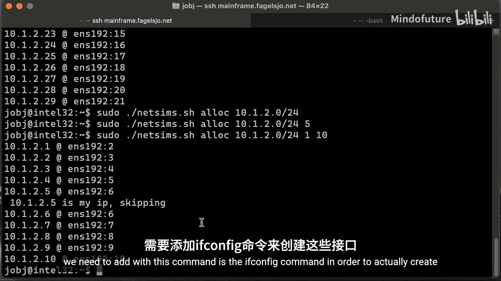

Did you learn anything useful today。And do you want to support this channel。

Go to Doctor Birch dot comlash support。 You can also click the button， Be a member。

 Thank you for your support。

welcomele back here， everyone。

Let's continue building this network simulator thing。So。It's see。Before we continue。With。

The next function， I'm going to fix a couple of bugs。As you can see right here。

It doesn't really work。 when giving。Few arguments。So it should use the default settings in this case。

So let's see where that is。I would say it's。Either because it doesn't。Quite work。 when you send。

Several arguments that are empty。I don't think that is the case， but it's one possibility。

 The other one is， it simply doesn't interpret。My？Left the like this。

So perhaps if a amount is not zero but empty， it doesn't。

Value it to true when we use this not operator。So。Let's。Do something like this。嗯。In the amount。

Is equal to nothing。Then。We will set them out。2。0。And if。嗯。Yeah。If first。Is equal to nothing。

Then we will set first。Equal to 0， as well。And then it'll trigger these parts。

And the default settings should work， I think。Let's try it out。First， we will just give it a network。

No。And this does not work either。 Okay， then the problem is。The argument lists。

So let's copy this part。😔，AndLet's go。Here。😔，嗯。I didn't really want to tab there。 I wna just。Spー？そう。

Let's do something like。First。Is equal to。第一。😔，Let's see。Third arguments。 No， the second。No the。

And then the amount is equal to。The fourth argument。Okay。And then we she if thealtius。

Nothing than we said 0。 If first is nothing， we said first 0。And in order to make this in。

More expressive， I will also do something like。Lets tour。Which is argument 2。

And now I'll just give these。Name variables。As arguments。So let's see if this works。Hm。Okay。

 the program starts here。 The command is this。And then， we have the。wish check for this stuff。

We it networked to2， with it first to3。With the amount of 4。If a milk is nothing。We will send it is0。

First is nothing w it first。20， and then we will call our functions using these arguments。

I'm going to go to the function。We will set network to1， first to2， amount to 3。And if amount is 0。

 then we will set it a 1。And then we go ahead with the rest of the code。

Think it's a little bit weird that it doesn't give us an error message or anything。I wonder where is。

Stop。Mmhm。Let's see， Does it go all the way here？Yes， it does。What about here。Yes。M。

What if we were to？It go the。The first， and the。うま。5 and10。What am I missing。

Is it something about the network。Seems okay， as well。Grab into face。To。Do we get an interface。We do。

So， that's not it。Either。And then， we。Extract the I， we。Create our own I， if that is。This。

 we said it to death。Iit X2。And then， we。Looked between first and last。 And what is last。

 did we define the。な。Yeah， right here， last equals first okay， that makes sense。So。

We need to move this down a little bit。😔，Because we can't really use our empty first and amount。

When we haven't set。Variable so no I believe it should work。Right。

 so now it defaults to 10 different IP addresses。And。It will start with the second I。

And it will jump right past our own eye， so we don't collide。

One more thing I'd like to add before we go on is we don't want to。Reuse our own IP。

 but we don't want to use the default， the gateway IP either。So if we run a I P route show。

And we round it against the zero road IP P address。

Then we get the default via and our default gateway。So。We do want to skip this one as well。

 so we don't disconnect us from the Internet。うん。😊，So let's see。 How can we do that。

 Let's just copy this whole， grab I P。不ello。And。Let's call this grab。给腿。And with an eyebrow show。

In this case， we will use。やって。嗯突然。And we want to cut out the。1，2，3。The third word。

AndLet's don't call。 Let's not call it。I， let's call it。G it way instead。こで echoア。给推了声。

And then we'll do a similar thing in our。A look function。So。Instead of just doing the IF。

 will the gateway equals。We want to grab gateway。Let's see。If it's our own I P。We'll do this。Else。

 if。If I P is equal to。Ga to away。Let echo go。The I is。ま。き？Otherwise， we wont increase this part。😔。

Sa。Run this again。 But this time， we want to start。Let's say zero。Doing plenty。

And if we screw up a little bit， no， it did not catch that。Let's do5 instead。 And let's do one here。

Okay。So this is our default gateway， but we still do 1，2，3，4。I wonder why I didn't do。5。😔。

It always starts at 2。 That's not right。But this is the interface。起。IfP is equal。

 Perhaps we shouldn't do I。Yeah， we should do。And this is increasing the interface。Well。This is okay。

 by the way， it will simply do。It will simply try to do 1 my peace， if we ask it to。

And it doesn't necessarily。Succeed in that endeav。So at the end here， we could type something like。

No， I think we want to count them。And how do we do that， We should do something like。是A。We we done。

Theyt need， actually。Let's just run。This en  for。The interface name。Followed by colon and。Let's。

You know。And then we'll just count the lines， basically。So， let'。です。嗯。でん。B is equal to。

And let's use a function。ちゃんとよ。And then we give it the。Interface name。And then we'll simply echo。

Successfully。え。ど。No。And对。Something like that。And we need this function， now。So， count I have。

With a function。嗯。If。We don't have。Do this in I F equal to。W one。And if。Dolllar I呀。です。M定。Then。对。

And otherwise， we create an additional variable， which will be the。Cot。And then， we'll simply do。

I preferfi。And。So。Let's see。Interface， followed by column。And let's count。It's still like this。

 so it looks a little bit more structured。And then， we'll simply。It go out the。The result。Thecount't。

こっちる？Like so。So if we rerun the last command， we should get something like。3 or 4， I guess。Wen。😔。

That's because we are not currently creating these IP addresses。 We are just。Echoing the result。

But this should be okay，1，2，3。For， no， not for。Yeah， so it should。Give us。3。

 when this is up and running。Okay， so the only thing left。For this part of the program。

Is to create a function， which actually creates those。Interfaces。

 or maybe we don't even actually need a。Specific function for that。Let's see。Instead of echoing this。

We wna create the interface。And we do that by running two commands。First， we run I F config。And the。

えし？Only subber。And we also need the。Current I P address。Which is I P。And then we need to activate it。

 as well。And then we run。ま like this。And we want it in the up。😔，And that should be。

It doesn Thank you。Let's try it out。Successfully created four I P addresses。 And if we run the。

If config command。We see that we have a couple of interfaces with different I addresses。

 So let's see if they are actually。Working。Yes。Great。嗯。

And I recommend when you do use this in order to create IP addresses like this。

Only use it on these local IP addresses， not on your public interface。

 because then if you are unlucky， it will successfully steal those real IP addresses from your internet service provider。

 and that is not recommended。All right， so now we can create our IP addresses， that's step one。

Step 2 will be to。Create our services。 But before we do that， I w to create this。This free。Function。

So。Let's see。 How do we。Know which interface is to bring down。 It always starts with。The number 2。

And then。It calculates upwards。Right， so we can use our count IF。But we do， however， sorry。

We do however need to give it one argument。We need to give it the interface。Or， let's be。be。Oh。

 I don't remember the word now， but let's do the same way as we did there。So we give it the subnets。

And then。In free or the I address。あやつ。Really so。We will create another case。Okayケ。B I pick。

Do it like that。 I I think we。We say free like this。And we need a network。

 which is the second argument。And then， we will simply run。Free。Perhaps we should name it three IP。

 so it doesn't collide with a Unix command free。So free I is and we give it the network。Bned。

That's it。The only thing we need to do is create the function。We called free Is。

And we have two arguments。No， we have one argument。 And that is the。对。Which is the first。And only。

And then we will have the interface that we get by running in grab。大人。Youing the network。

And we also need to know how many it is。 So the count will be equal to。Count。I。嗯。

And then we give it the interface。And。If。い？To do nothing。You can。Is equal to 0。And if。

The count is equal to 0。等你飞。Otherwise， we need to do a loop。So。We know that the。First is equal to 2。

And the last will be equal to。First， plus。Noello。Where this one。嗯。What else。

Don't think there is much else。So， let's do a for loop。So， for I。In。The sequence from。プす。乐。To you。

I'm gonna run the S spin I conflictfi command。 I we need to do the sub interface， as well。So。

 subi by F will be equal to。The interface。Followed by。The current value of I。🤧うん。

And then would give I config the sub interface。And well set it to state it down。Dun。

I will just echo something like you。I， P address。Interface。这。的。turn0。Okay。

 I don't think there's much more than that to do there。So。Let's run over 2。嗯。Okay。

 this is probably due to the ordering。So let's take this。 Let's see。This free A is function。

What exactly did it say，9，29， free I man found。嗯。We got the parenthees。And5 from matching，1，83。Okay。

です。The case command in that。 Then we run a couple of things， and then we have those。

Then we have this next。 Do I have to have space here。3 As。Net to。等得。Noello。結構？

That will looked down to。If we give arguments， that is， yeah。

Unexpected end of fire were looking for matching。So I probably missed。😔，Quote somewhere。

Let's gr this file for every line with a quote in it。

Now let's go from the down and upwards and see if we have a matching one。Each location。

Perhaps we should go in the other direction。Because most of the things I added。

 I added on top of everything。So， let's see。Maybe I can create a redx。Which searches for。

Anything followed by a quote。Followed by。Anything which is not a quote。

I think this should find every occasion where there's only one。Qull， right。No。Did do。

Do need escape them。Because I'm looking for。Any character， which is not。苦。Yes I can't do that。

What if we were to。Replace。The first quote on every line with。え。Let's do。Single quilt。

That's only one per line。つけです。ッケす。だいと。And then， we want a grab for。Recruit。Okay， so now we get。😔，🤧。

A quote， which is。Single quote first， And then with a book quote。

But we want to find something which does not contain。The double qua right。 So let's do dash。V。Okay。

 but it still does need to。And the single question。And， there we go。Some。😔，Grade a。Troublehoot thing。

 don't you think。So let'起。This is probably somewhere in。い。In the Lou。We created just now。

So inside of three I Ps， we have a move。This should not be a quote。 This should be a parents。And now。

 everything should work。We need to be moved。And we need to be able to spell pseudo。🤧う。Okay。

 no error this time， but we still don't。We don't get any output。How is that possible。Because。

Let's see。 case command in。Maybe we did never add the。

I wonder if there's some kind of default thing to use when using the case。status。What if we were to。

Just create。Something like this。And in that case， we run the usage。That's possible。Nope。

What if we don't use the quotes。There we go。O。So we do have a couple of interfaces now， right。

Which means。We should be able to。Remove them。🤧うん。By running free， and we need the I P network。See。Hm。

嗯。So this is the network。And we will run free。And we give it。いい。Not work like this。No， I。

 can't I pe command not。😔，What did we call it？Count I F。Cing。Cannot assign requested address。对。

Let's create an echo here and then Zealand with what's happening。Isn't that right。Andd。Maybe。

Change somehow。Up down。And this is the。Lets see。Interface of。Interface。To。😔，Yeah。

This is exactly what I did， right？😔，All aes are deleted， okay。So， that's it。

Then this became much easier， actually。嗯。Let's see。Let's comment this out in case we need this code。

Later on。Will the I F， we still need。The count we don't need。We don't need first。 We don't need last。

 We don't need a loo。And the sub I F will always be 0。And this is a大。Yeah， and we can remove it。

Let's see。 Hyy address interface is brought down。😔，We got an error， but it worked。😔，So。

In case that will happen been again， let's just。I this， too。Den。Okay。

 so two out of our three commands。Are done。The only thing we have left is。Lets simulate command。

And all that will take is a config file。So， let's replace this something。With。え？Simulate。

And will set the。Confi。Second argument。And we will run。Simulate。With that。Andello we need know is8。

Is a function。For the simulate command。And that is。What we do next。Okay， guys。

 let's finish this thing， shall we？So。Let's see。Okay， there's anarrow somewhere， line 8。

That's because I have an empty。Function， let's just return srup for now。We need to be rude。All right。

 so we have done the allocation function and free function。

All that is left is this simulate function。So the first thing we will create is a config file。

Let's call this that same so。And the format of this file will be pretty self explanatory。

Two different arguments per line。 The first will be the。Port number。

And the second will be the header。So。If we continue with the same example。As before。So。Let's take。

These two lines。And edit the config file。Just paste the meal。

So add each line we'll give a TP port number， space， and then we'll give the header text。

 which will be displayed once we connect。And every time or once for every IP address。

 a random line of this file will be selected。And。That will be bound to the actual。

To the actual like P。So we will use the N C command and Ncat command。 as usually when I run this。

 I use this format and then port。We will not need the double B。Because that's only verbo information。

And that's not necessary， in our case。L means less。 So we listen on not is Pockcket。

 and the P is the port 21 in this case。 but I do also need to add something to bind it to a specific。

IP address。Sorry。So let's see。 I hope that is possible。Yes， local source address。

 So we need to add the dash S as well。So， let's see。We can。Let's create a function called Netcat。

And this will take an I P。And it will take a port。And it will take a。Yeah。A header。

And I'll put this inside a quilt because it might be several words。🤧ん。And we need all of these three。

 So let's see if。嗯。嗯。😊，Yeah， let's do it like this。If this is nothing。Then， we will。Fail。

By saying bad format in confi file。🤧うん。Otherwise， we will craft。Command。And this will be。Nth can。

And we want to be listening。Of the poor。Po。And we also wish to use the source I P of I P。

And we want to。Send the。The header。麦声。And we want this to be running in the background。

 But first of all， we want it to doesn't display any output。 So let's type it to them now。

And both standard error and。Standard output。And we want it to be running as a fork in the background。

So let's put this inside on parentheses and put an an sign at the end。

 which would make its fork into the background。え。And that's it。So using this helper function。

 it will be easier too。Could't figure everything。So let's see this simulate command。

 what kind of arguments do we need？We only need one argument， and that is the country file。

So let's make sure that we have that。嗯ん。So let。Just do。Config equals 2。です。And if the。Confi file。

With Mテ。Then， we fail。嗯。ぬくん。と。And let's check if the。File exists， as well。I think we do that by。

I see。The E。Thank you。So if it exists and we want the opposite of this， right。Something like this。

It's been a once since I coded these。Conditionals， but let's try it out。In that case。

 we want to fail with。Unable to。5。Like so。Let's cutて this。La。And let's set config。

Equal to nets dot com。Let's change this to a regular if。Okay。

 we did not get any output if we were to search for conf 2 instead。Then we get it。 All right， so。

We did it correctly。Alright， so we need a function to grab a random line from the。

Confit fail as well。So let's call this grab line。And in order to grab the line。

 we need to parsify and figure out how many。Lines there is in the file。So let's start there。

In order to do that， we need a variable， let's call this lines。

And we are going to cut the country file。Oh， we don't need to use cat， by the way。

Let's grip the kung fu fight。And what do we want to gr for。Well， we do not want。

 Let's add big E so we can do advanced regular expressions。And then a small V。

 which means that we inverse the grip， so we look for everything except what we specify。

And what do we want to specify？Well。Let me just check something out。え。If we were to do echo。

Couple of spaces， blah， blah。And we do graph E。 then we get this line。 What if we were to。

 I'm not sure， but I think there is backlash W for white space。Let's see if。

And if we weren't handling any worse space。😔，It's still good。M。我得回。Do this。那你熟读的。No。ちっと。嗯ん。うげげ。

Theular。Okay， what if you surf said and surf for wide space。嗯。You grab， perhaps。Big and small W， Y。

Followed by。Space， with or without。What I mean。The word space with or way the space。

There we look great space。AndCharacs are。W space now。

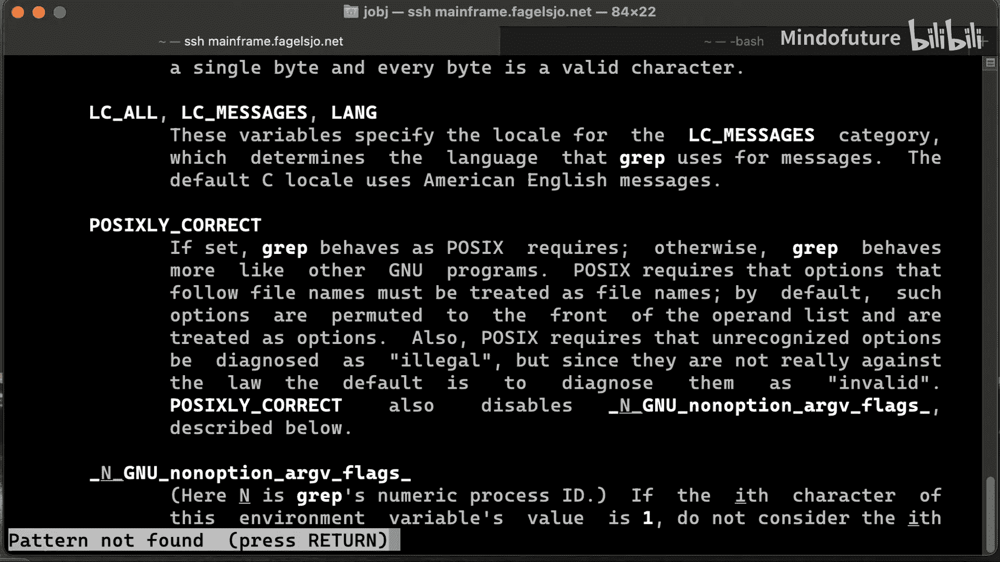

Okay， in this time in this instance， I think we need to go to Google actually。So， let's see。And。D it。

All this ways。

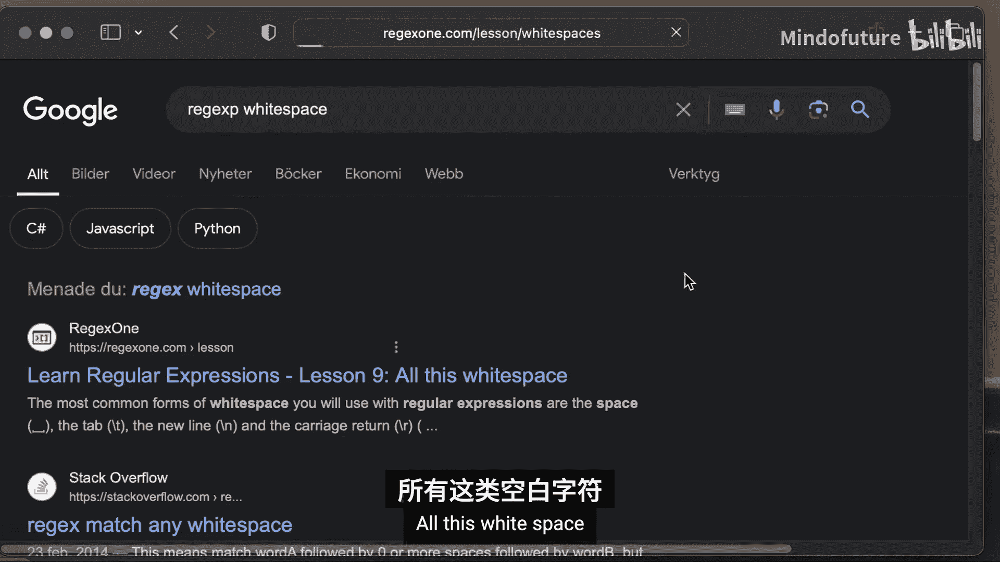

Mt come form a wet space。Other space。Deter the new line。

We have too much on the lines that have a space between the list number and ABC。

 we can do that by using the expression， D and S。To match the number， the actual period。

One or more white space characters。 So S is white space， okay。

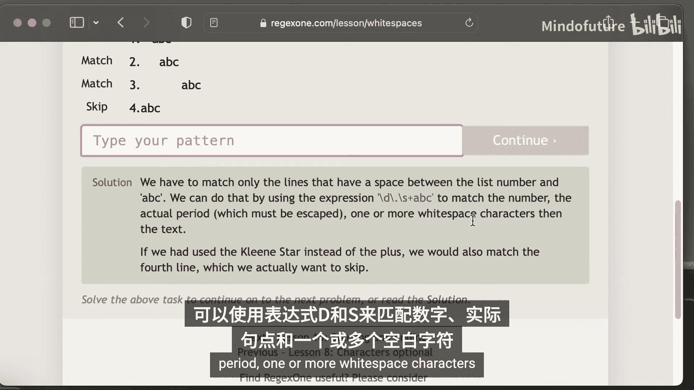

What kind of makes sense。So where where are we。嗯。Close down that window。Al喂。Let's do it again。

 So echo space space， blah， blah。 I we want a grab dash E。 And this time， we have a white space。

 and we have。じ？And we get it。 But if we remove the white space， we do not get it。All right。

So in our case， we want to have a couple of white spaces。And then， hashtag。So。

One or more white spaces。And then。A hashtag。We get it with this one。We should also get it with this。

 No， we don't actually。Let's put a star herrst。Okay， it worked there。And it works there。And。

If we were to remove this。We don't get it。Okay， now we have what we need。 So we want to grab for。

Let's see what we want to remove。So， at the beginning。Other line。

This means the beginning of the line。there can be。1 or more，0 or more we spaces。Followed by。

A hashtag。Which makes it a comment。And then we can have anything in the end of the line。

If we find this， we want to remove it。But if we do not every line which does not contain this。

We wanted to。We do also want to remove。い？Empty lines。So only the start in the end。

And we want to get this from the。Config file。Let's see。 We want。 We need to supply the concrete file。

本ぷでいく。I don't need any error handling in this case， because I'll be just repeating myself。

Their error handling is here， instead。All right， to regret this from the config。

And then we'll simply count the lines。So if it contains two lines， then lines will be equal to 2。いで。

Ls is。Mテ。There will set lines to 0。And if。Lines are 0。Then we can't really do anything。 So。🤧。🤧Sorry。

Bad former。In可。おきす？But if it works。Then we have the lines。 Now we need to select one of these lines。

So， let's see we have， if we have。Two lines。We want to create a random number between1。And2。

So basically， we do that by specifying less。RD。R and D equal to random。Person。And。And。咋。And that's。

Put this inside of parentheses。 That's probably not needed， but。Let's do it anyway。

 And then we plus one， because in this case， random will。This line will produce。

This part of the line will produce a number between 0 and 1。

 So it always becomes one less than lines and starting at 0。 So if we take this and add one。

 we will produce either one or two。In this case。So now we just need to grab that line from the file and the easiest easiest way to do that in bash。

Is by doing something like this。Let's call this line。And。Let's just。And。We will take the。Head of the。

On define。Starting at。The line number。呃嗯 mean。Random number。And。Let's see。

 This is from our recording。And then we'll take the last one。So， let's see if you have。

If we have line A， line B。Line C and line D。And our random number is 2。

Then the first part of the command will grab these starting at the second line。

And this part will take。The tale isn't really the right way。Let's see。No， we should do another hat。

So the first part will be this one， and then we take the first line of these three。

Which translates to the second。Al right， now I think it's good。And now we need to break this。Up into。

The different parts。So the first part is the port。Which is just to cut the first word。From。The来 him。

And when we have done that， we need to take the rest， and that'll be our header。

And we'll just do the reverse。 We will cut。Theres again。Delimited both spaces。But this time。

 we will begin with the second field。And pick the rest of it。I think this is right， Let's try it out。

So， if we。Cat this。Y。If we cut this config file。And let's take the first line， mo of the。

I think the idea is correctly from the beginning， actually。This should be。Ting。嗯，是的。And。

There's two headers at no。Yeah， the head。Dash2 takes the first two lines。 Right， Okay。

 so I did it correctly from the beginning。 This should be taken。嗯。不。So， get to。mm。Yeah不行。Okay。

 so from this， we want to grab。Report number， that's no problem。And the rest。No problem， okay。And。😔。

How do we return this。In an easy enough kind of way。Let's see。Well， we could just do this。So。

Take a port and then a pipe sign， and then the。P对。Because。This is a little bit easier to parse。Since。

It's rather unusual that。It's rather unusual that the。the head contains a p sign， but it could。So。

Maybe we should。Just do this things done。The only thing we need to do in this function is actually。

E goinging the line。And then， we can parse this。And the call function， instead。Okay。

 so now we can simply get one line by using grab line and the Kung fu file。And when we simulate。😔。

We need to run alo。The same number of times as we have a。As we have I P addresses。So。

 let's get the line first。Can't just do ra line。TheP。うじ。We also need to know the account。So count I。

But in that case， we will need to know the。Yeah。We would need to know thee。Network。Here， as well。

All right。It is enough to fix。So。Nothing seems子 this。Simulate。We will add I P。Subnet slash cider。

This is old。 No， this is the example。So here we have 1，92，1，68。0，24。Like so on here is the syntax。So。

 let's add。I please。n sideder。We need a file， as well。嗯。O。And let's add the。T appears。Alright。So now。

 we only need to create a loop and。Start all the instances of the services。Okay， guys。

 let's finish the last couple of things with our network simulator。Before we。

Continue writing the simulation function。 I need to fix something， which I。Kind of forgot before。

Our Necat function， which runs the Necat tool， and it。Well， it opens the TCP connections and stuff。

If we leave the code like this。That basically means that。

Once we have connected to the service and this connected。This Ne cat instance will terminate。So。

 basically， we will need to。え？We will need to make a loop。Out of this。So， let's do something lie。

Well。truee。Do sleep worm。So at the iteration， we will sleep one second and then we will start this service。

Andじ。Then， read done。And this would be repeating itself， in its own thread。Until we use the fail。

function？Which will kill off all of these。Threats or forks。

Perhaps we should could be calling them process been because that's the best way to describe it。

Right。So， let's see where we were。We are inside of the simulate function。

And we have grabbed a line from the config file。We have。Counted the。Interfaces。

So the next step would be to go through each。Interface， which means go through every IP address。And。

Then we will simply。😔，Lounch， the services。So， let's see， before we do that。😔。

There were something I wanted to add。😔，吐子。😔，Can't remember right now。 Let's do that later。

 Let's see what the。Oh no， no。I wanted to add an additional command。So， we can stop。The services。So。

 let's see。😔，simplyimp do。If we。Saた。Then we'll simply run the fail command。With the0。And。

The stopped message。很难受。Let's add to the usage， as well。So， let。See。So we have simulates。

That seems that SH。we don't really need any。Additional commands。Pmeterters， I mean。So。と。うん。にん。嗯。

I mixed it up a little， bit these two lines should be。Here。😔，And now I remember what I wanted to add。

😔，Since。We are using a tab right here。In the example， config file。

Maybe the users will just copy paste these two lines。And use them。

 and then it will not work because of these tabs and spaces。So， let's just modify the。Grab line。

 command。And let's remove thee。White space is in the beginning。So let's see how to do that。Easily。

 I think we can just type this to。Said。😔，So， we will do said。And will search for。Let's see。Spaces。No。

 it needs to be beginning。So start on the line。😔，And then。One or more spaces。😔，It's the command。

 which is S for search and replace。And we wish to replace it with。Nothing thing。Globally。

I think this lure。m。Let's test the grabular function。So， if we run。The look。Free。Simulate。

So if you weren't simulate， instead of this simulate command， we will simply do。Grab。

Line and provide the config。And then I will comment without。我的台名。Right， so let's edit this conf file。

😔，Let's add。Both a tab and a space， like it is in the output。Let's just do it like this。

And then we run that same， and。Simulate。Let is the cool。39。Yeah， we are。Hm。Unexpected。o。No。Let's see。

We have apptices， then we have these single quotes。😔，And inside of that。We don't have anything。

 We should mess up anything。<|OTHER|>And then well pipe this said。And we have the single quotes。

Surrounding。Looks right。嗯。You have this。😔，With let lines span。Let R G。here it is。

We forgot the parentheses。The error messages when coding bash isn't always left informative。

We need roof。Okay， that didn't quite work。It did not remove。你。White spaces。 Where is that。

Perhaps we need to use the。The E flag。Gain access to the more advanced。Irrregular expressions。No。

 that's not it either。Probably this plus， then I always have trouble with this plus。😔。

What's the star， is there。Nope， not that either。Okay， let's。Check through this line。What do we do。

 We search for the beginning of the line。And then。White space。Any number of them。

We replace it with nothing。Globally。嗯。Maybe we need some kind of ending thing right here。😔。

To the next character。Will be a number。<|OTHER|>And we need to grab that number。Using parentheses。

And then we will simply replace everything to that number。 so we don't lose it。Does this work。H。

 annoying。对。That's just a biggest string for now。And now we probably have spaces here。

Because a cup pasted it。对。That should also work， right。Wait a second。 This is the。Len。😔。

Number of lines， calculation。This is not where we should。えって言うんです。That explains it。

So let's remove this stuff that we added while troubleshooting。Put this plus back。And。

 let's copy the string。My connection is a little bit slow today。 I'm connected using a mobile。

Internet to us。So let's see。 line equals this。T this and。Right here， we want our set。Right。

 still doesn't work， but we're probably a closer to a solution this time。C。It's really。Yeah。

 there we go。And what if we do the different spaces and stuff？Then we pipe this to the same thing。

Also works。Allright， great。 so now that is' fixed。AndLet's go back to the。

this stuff and remove the grab line and add the simulate back。And呢。Finish this stimulate function。

If we are able to find it。Here。Okay， so we have grabbed a line， we have counted the interfaces。And。

So let's see if we have one interface， it will begin at interface number two。😔，So。Let'sxi。

Let's do like this， by the way。嗯。Coat。Is it nothing。嗯。🤢，I equal to 0。And if。Cos is0。

And if you wonder why Id do this in two steps and don't just。Put the code red here。

 That is because if it is ce。Then I want this。 And if it's empty。I would book。

So let's see I don't really remember what error number we are at。😔，え。うに。ラン？Tmes。

And now we will simply increase because。Like so。No，我也。Let's not do that。

Because if we have five interfaces， we will get five。 so that means we will start with number2。😔。

And we will end with。2，3，4。5， number 6。Right。So let's create two more variables。え？Let's see。

Start equals。Yeah。And let end equal。Let'sxi。Count plus one， right。Or should it be too。need to check。

So， let's see， we have。😔，Let's call it， just into。嗯ん。3。In in。4， so in this case。

 we will return That count is 3。It will start at2， and itll end at。Count plus one or count。Yeah，え。

Right。So。Let's do a loop。Before I， in the sequence of。Start。And。Do and what are we going to do， Well。

 we need to。Create an I address。We need to grab that address。😔，From that interface。

How can we do that in an easy enough kind of way。So， let's see。The interface is on one line。

 and the IP is on the neck。That makes it。Tougher。 but if we gave the interface as an argument。

Then we will only see that interface。😔，And then if we grab I， for example。Specifically， we grab E。

 which is not followed by silk。<|OTHER|>Then we get the correct line。Allright。And then。

 we can just do。Can you do like this。H， there are。White lines and stuff。 We can use Orc。

 in this case。That is a quite advanced scripting language。Let's see if I remember how to do this。

I think we just do something like this。So we want to print the first。Okay。

Think it should be just this。Yeah。Because when you use Orc to print words。😔，If were Legonore。

This initial。Wt light， and it will also handle tab a little bit better and better than cut does。

 So if cut doesn't cut it。Then we will go to Orc。And the dollars， too， in this case， is simply the。

Is simply the。Words。Number， so the second word。Right， so let's set the interface to。です。And。

We remove this。Change it to。No like this。 I。And this will be the。I。So， the interface。

That will simply be the。嗯。Let's see。Did we grab thee。Inter face。

Because we do need to know that right？😔，What argument does it take。Let's see。 Na Sim simulate。

 and then we get the IP address and then the config。😔，We never really added that。Let's do it。So， the。

What did we call this before。😔，没问题。Use a network。The network is the fur argument。What is。To run。

 simulate with。B。Network。And the co。So the config is。B。Second argument。不该。The first。

And we will get the。Interface。Do you think grab I。In this network。And then we will change the name。

Of this， I have to s by F， like we did before。And we have the base I have here。

 and then we need the current。Number。Which is dull I。

And if you wonder why I put this in curly braces。I don't think it's really necessary in this case。😔。

But if you have one variable and another variable， I don't want bash to mess them up。

Mix them together or anything。 So I usually do this in that。In this case。🤧ううん。So， let's see。

So now we have the sub interface。 And from that， we get the。IP address。

What else do we need for this nut catt function， We need the I P。 We need the port。

 and we need the header， So we need to passse the。嗯。See。It's getting tougher and tougher to find。

A way in this flat。Alright， so let's see line equals count equals this line thing。

I will move inside of the loop。Because。It'll change。Each time。And from that line， we will。

G two things。We'll get the port。By simply。Cutting out the first word。Yeah。And we'll get the header。

By cutting out the rest。So， if to and forward。Chone。冷。And now we have everything that we need。

 I think。😔，So， what will run is。Let can。And。I think it was。IP。And for。And。

And maybe we should put Heather inside of quote because it can be several words。嗯。Yeah。That'll do it。

 I think。有在录音。Andalou。And instead of running that cat， let's echo that cat。😔，So， we。So we know。

Oh it works。Itです。For the调。Allright。Have we forgotten anything。😔，How does thatt cat work。

Will get I P port and header。And then we。Start a loop where we first sleep a second。

Then we launch nutcat pipe to the header。And。The output is some。Did don know。And we will fork this。

In to back Road。Perhaps we should have some kind of message。え？乐讯。So。IP呃。Or。Something like that。

Alright， let's see if this。Work。So， let's run our script。

And let's begin by creating a couple of IP addresses。So， we will base it on this。Xi。Hello。😔，IP。

First dig number of addresses。So this is the network。 we need to。create。From。Number 6。10 forward。

And we need to add command and lock。Can trade 11 I P addresses。He lived。 That's one too many。

That should not happen， I believelin。So。See。😔，うん。We go from first。To last。Last is first。Cls amount-1。

 So first， in this case， is 6。The amount。Its 16。Maybe we should do -2 here， instead。

But what if we only want to create one interface。Then， last will be 6。Plus。1， which is 7，-2。😔。

Which is five， so it will go from6。Let's leave it like this。 It's not。

You can do it as an exercise and see if you can fix that in a way which doesn't create additional bugs。

Let me just check one thing。1，2，3，4，5。Oh wait。11。thirteen4。15 is the last one，1，2，3，4，5，6。7，8，9。

 It did create 10 I P addresses。The counter。Is wrong。😔，Run。Yeah。T we didn't change this part。Okay。

 so what， how do we。We are printing out none。And what is none， None is count I F I F。How can that be。

How does count F work。Itjos， if config， it grips for the interface with a colon after。

And it counts them。Right。So let's count them manually first。 So we see that we are。Right。

This first one is not。嗯嗯。There is a colon after this， anyway。H。That's a little bit annoying。Lets。

Let's add one more thing to this。We w have an extended graph so we can use。Ptter。😔。

Regular expressions。And this should be followed by a number。So， let's。

It's free the IP addresses of this network。It was worth it。101。11，2，0， slash 24。101，2。To。😔，Wen Qi。

Maybe takes a little while。Hm。Where is our free function？😔，嗯。And here， here it is。Okay。

 so what do we do？😔，Subway F is the interface with a0。And we want to take it down。

But that doesn't seem to work anymore。It did work before。Let's try combining these two methods， now。

Let's see。Coun is nothing。 and count is 0。No it is to remove。So let's start is equal to 2。

 Left and is equal to。What did we say count minus1。嗯。4 a in。sequenceequ from。してる？嗯。Do。

And then we simply would wna create our。Sf。Which will be the I F， followed by the number。

I would run a spin I F Kumpinging。So by F down。いたな。Like this。And then we remove the zero interface。😔。

And maybe we shouldn't give a success message， unless we are sure。Right。And the last。

Ting we wrote the s function。 I think I might have forgotten something in that loop， yes。

We need to have the dollar signs here。ううん。来声。And let's see if we can。Take this stone。That seems free。

 And this is。The network。Okay， no it works。Great。🤧。So let's go back and recreate our interfaces。

And this time， it should give us 10ip。Right。And David get him？did。And now， let's see if we can。

This we need to do。If we can。Simulate。So， instead of a look。We do。Simulate。

And the network is the same， but we need to give the。5 next。And if this worked， it will simply print。

They call to the function so we know it gives the right arguments and stuff。No interface specified。

Mun。That seems simulate。😔，全然で。IP。Ne were。No interface specified。 Where do we have that No net。不。Here。

 where are we。We are in the yellow。A look function。Where do we get into the lock function？😔。

Maybe we have the same message somewhere else， no。😔，Did we do a mistake somewhere're here？

So we have free。We have simulate。The only thing that differs is。

That we don't have a new line after these， but that can can't be a threat。So we have S， we have free。

😔，look。不的色彩。😔，What if we do。对。There we get。Usage。Case command in a look。Free。😔，C you。Let me trace it。

Okay。So it。嗯。So it does run this command， simulate， network configurationfig。

 And if we go to the simulate function。😔，Network is one configu2。😔，クれば。😔，Network 1， con2 interface。

Grabbi F Naur。fu file。 I need to open country fu file。That's a weird error， isn't it？😔。

It's like a runs brown function。What if we put the go，2，3，4。Okay， it does go here。Network is one。

 confi 2， IF。😔，Grabby if。 Let's add a couple of echos every here and。

AndLet's jump it out a bit so it's easier to remove afterward。😔，Cot count Iえ。We do need to specify。

DIS is well， al right， That makes sense。Let's remove this。And let's try this again。Okay。

Something happened。 We're on that cat。Gs this I P。And。😔，We did， however。Not to remove this line。

We need to fix that， and we have  port 22。 We have the header。😔，Look right， except for。

If not removing this stuff。So why doesn't it， It must be the grab line function。

 What are we looking for here。We are removing everything。That begins with。E。No， wait a second。

If it begins with a。Hashtag。Followed by anything。Or an empty line。We don't use。hmhmm。

<|OTHER|>Maybe we are over complicating this。What if we just do that。That didn't help。

Because we are looking for0 or more。white spaces then this， maybe we shouldn't escape。Still there。Oh。

 we are editing the wrong function again。😔，嗯。Or I mean the wrong Latin。This is the place。😔，So。

 the line。Let see。We should。Take out a random line。<|OTHER|>But we need to remove that stuff。First。

So， let's begin with。With a grip， instead。Exactly like we do here。And then we head that entail that。

And said it， right。So now， I think it should。Yeah。We get 21。 We get 22， and the。Input。对。Nothing else。

 al。So let's try if this really works now。😔，So， instead of。Just echoing our results。

We will actually run this network。Let's replace this two double quotes。Let's save。

 And let's see how it goes。

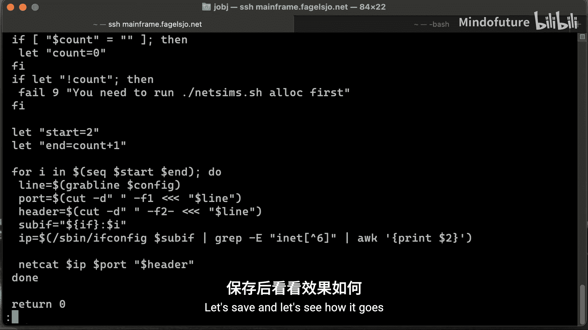

Okay guys， welcome back to the last part of this episode。Let's try this。Out and see if it works。So。

Let's start the simulation on our network with our two services。And let's see what happens。

 Launing server service at。This looks kind of good。Let's see if it's running in the background。And。

cra for that。Yes。AndLet's grab for let cat。AndLet's。Check for open TCP port。Looks right。

Let's see if we do get a boundary if we connect any of these。So， let's just。Let's take these。

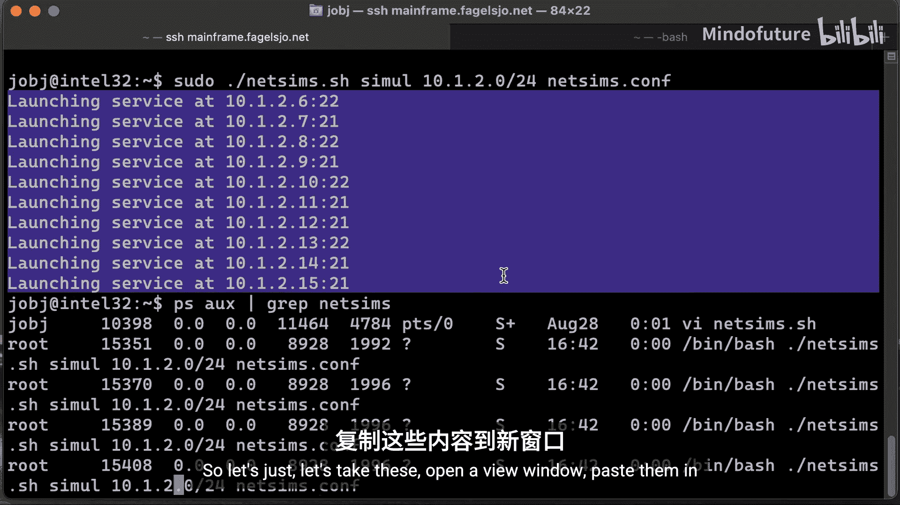

Open a new window。ペス to in。Let's take。We in the middle。Let's simply connect。Through that I P address。

The 10 was4 22。Like so。And we do get the。Out between。Thought。If we were to。Quっ thisす。

And we connect once again。We get the save。That's pretty neat。That's pretty nice。🤧。So let's see。

 Let's try one of the other ones。 Maybe the first。 Now， let's try one per 21。Its soon。Bd 21。

And we a get the other。This is great。And。Let's try out our。Poorrk togetherner。And see what happens。

So。Let's see。Let。Detaach from this window and connect directly to。🤧嗯可。And let's launch our。

 I think it's the。Is it the 250。Yeah。So let's run our network map。Against。The start I P of。嗯。

And a remember really which one it was。That was the first one。I think， number 6。

And let's run all the way towards 20。m。And we also need to specify the port。 So let's do。

 let's do 22。Let's see what happens。This is rather slow， so I'm not sure if。It's gonna。Freeze。

If we're not able to connect it。😔，I'm not really sure about my。Frewell settings， either。

But let's see what happens。Let's run this in background， and double check。The I addresses。

So let's see。 what did we have。This should be open port。22， right。

Lets connect manually from the same。Server。mhmm。See。😔，We go the cold planet， and we connect。To。

smooth。At board 22。We do get the better。So thats be attached touch with screen。😔，Let we have them。

Received any。Output， as of yes。我是的。Y。Let's run this， You thing。S stress。

 So we get a little bit more information。Okay， so it connect。Again this， I P 11。偉らいです。Spell the。

Or is it a bug。U is if in9 instead。In Netherlands。He love a wound。2，6。Why is that。

It seems we are okay。 That's right。We are increasing。The I P address。

But we are reducing network byte order， so we are increasing。😔，We are increasing it at the wrong end。

K。😔，So basically， if we were to manually specify。The I P addresses we want you to scan。

So if we make a sample for loop4 I in the sequence of。And6 to。とやて。To。行く？This should be done。

Should be。😔，Don， they will get this。If we were to。Take this， Ipededra is。

I will pipe them to our network number。A 22。Okay， then it works。So， basically。

We need to fix that by turning the I P address。Back to。Let's see。

We need to turn it back into the regular by order， then increase it and then turn it back。

But that would be a question for the next episode when we continue coding our network Paper。

As of now， it works。The port scanner works when we specify the IP addresses manually on the standard input。

And more importantly， for this episode， our。A network simulator works perfectly。

So let's see if the rest works as well， if we are able to。Stopped this， as well。So。次？If we run。

That seems。I threw it。And we。Do， that seems。是。Is it still rug？嗯。That didn't quite work。

So the stopped command went as a drone。It runss to fail command。

And what exactly does the failed command do。しセへが。So we ran kla all Ne catnet。

 since we should probably do it D9 here as well。Alright， let's try again。Let same stop boom。

And if we grab for that sims。How can it survive a。😔，Let's see。Kill9。

 probably because it's looking for bash and of net sims。Is it possible to do。Like this。嗯。嗯。

It's pretty weird。😔，🤧I don't have to kill all command。I've never seen that before。Kilocba busy。Right。

 so let's。嗯。Cash。Search for kilo。Okay， let's try this one first。け。あって。Right。It's running real slow。

 because I haven't。Fixed my bad router。 I hope this package is rather small。😔。

Because if the up update takes this loan。A huge package would take even longer， but。

It shouldn't be that big red。It's almost dull。That's pretty weird that they don't shape the k all command。

By default。That's one of the most useful commands， I think。

Perhaps there are some kind of replacement in later Linux distributions， but。

You don't try to see why that is necessary。A lot of packages。Come on。干嘛干嘛干 on干嘛干嘛干嘛干 on。😔，没个。Right。

So we do pseudo after get installed。And we trail this with。Okay， does' it seem very big。

The machine itself isn't very fast， either。Perhaps I should give it a little more priority。😔。

But I don't use this specific machine all that much because this is the。32 bit version。

And I basically only use this when I need to。code assembly。 Alright， do we have kilo。

 We do have kilo， good。So let's remove the9 for now。And let's rerun the。Let's you stuck for it。Right。

And let's grab for。Ss。Okay， said me。 What about left cat。Not穿你 either。😔，Good。

So we still have the I address。Is。Right。Let's see if we can remove those。

You need to take the network。And。Let。We were allowed free。paste in the network address。

 and the sider。Cl so。It， hopefully。If everything works as intended。

 we will not have all these I PLC aliases any more。We don't， all right。Thank you。

 ladies and gentlemen。 We have produced a full fetched。

A network simulator only coding the Linux Shascript of bash。Final version is。274 lines of code。

If you like this episode and you want to continue watching。

Then please like and subscribe and you will get the notification when my next episode is released。

 it's usually every fourth day or so。Don't forget that we have a chat。That you can visit。

 check the community page for that。You are always welcome to come in there and ask me stuff if I don't answer directly。

 I'm not at my computer。But if you just idle in there， I will answer you when I get back。

So thanks for watching and thanks for today。

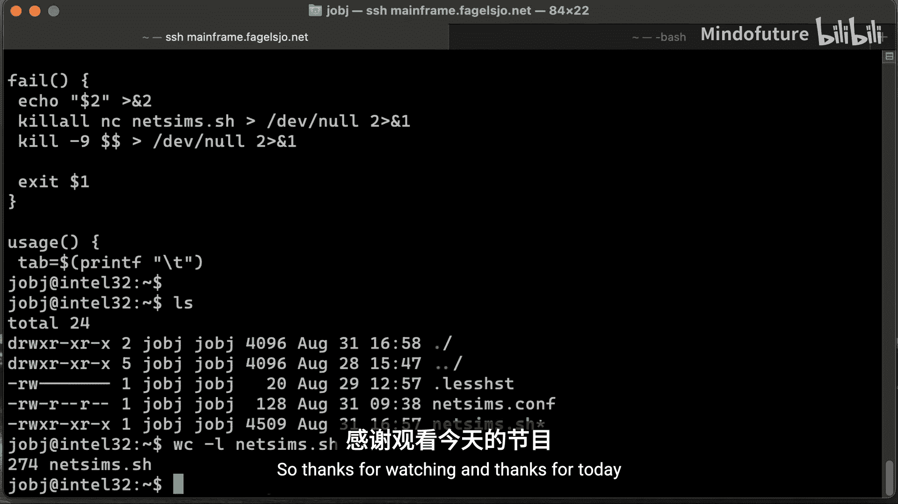