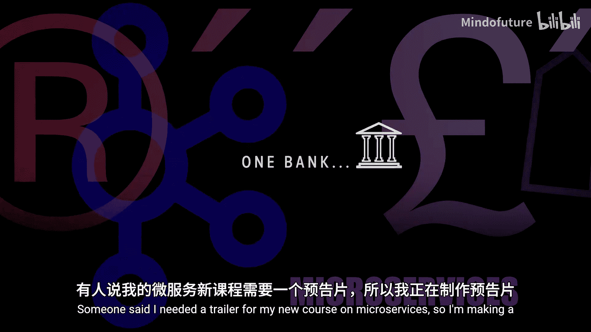
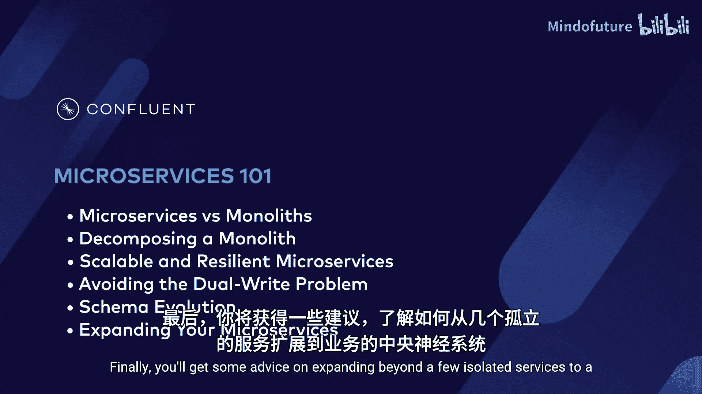
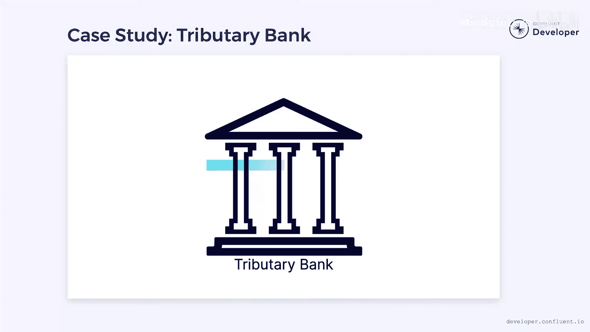

# 设计事件驱动微服务---中英-｜-microservice-｜-apache-｜-kafka-｜-confluent-p01-P01-Introduction--BV1D8EMzzEid_p1-

🎼In a world where monoliths reign king， one bank will defy all odds by extracting their fraud detection system to a micro service service。

What are you doing， Someone one said I needed a trailer for my new course on microservices。

 So I'm making a trailer。 Yeah， but what's with the voice， That's my trailer voice。 Well。

 maybe you could just tell people what's in the course and what to expect， but。You know。

 in a normal voice， I could try， but I don't think I have a normal voice。ok。Let's try this again。Hi。

 I'm Wade from Confluent。I've spent much of my career working on microservice architectures even before they were popular。

I'm not going to sugarcoat this I believe that microservices are the right way to build large complex systems。

 however， I don't like to be dogmatic。There are legitimate cases where microservices might not be the right tool for the job。

 so I'm not here to force the idea of microservices on you or even to try to sell them to you instead。

 if you think that microservices are something you're interested in and want to learn a little bit more about how to build them properly。

 then I think this course will interest you Now let's talk about what you'll learn when you continue with the rest of the course。

First， you'll learn the features of microservices and what makes them different from a monolith。

You'll explore different ways of decomposing a monolithic application。

 such as the strangler fig pattern or branch by abstraction。

You'll see how microservices can improve isolation， resilience and scalability in your system。

You'll discover the dual right problem that occurs with any distributed system。

 not just microservices， and see solutions that can be used to avoid it。

You'll learn how to evolve event schemas without incurring downtime。Finally。

 you'll get some advice on expanding beyond a few isolated services to a central nervous system for the business。

Throughout the course， we'll be focusing on a specific case study from the banking industry。

We'll look at Tributary Bank as they embark on a journey to extract portions of their system into a set of microservices。

The course deals with software at an architectural level and therefore does not require you to write any code however。

 if you want to try implementing some of these ideas on your own。

 having access to a production grade CAPka deployment might be useful。

If you haven't already signed up for Confluent Cloud， you can use this QR code to create an account。

And don't forget to check the description for a promo code that will give you free credits to get started。

If all this sounds interesting， make sure to check out the full course on Conflune Develop。

It's entirely free， so really what do you have to lose and don't forget to like。

 share and subscribe so that we can keep bringing you new content as it's created。

Thanks for joining and I'll see you in the next video。

