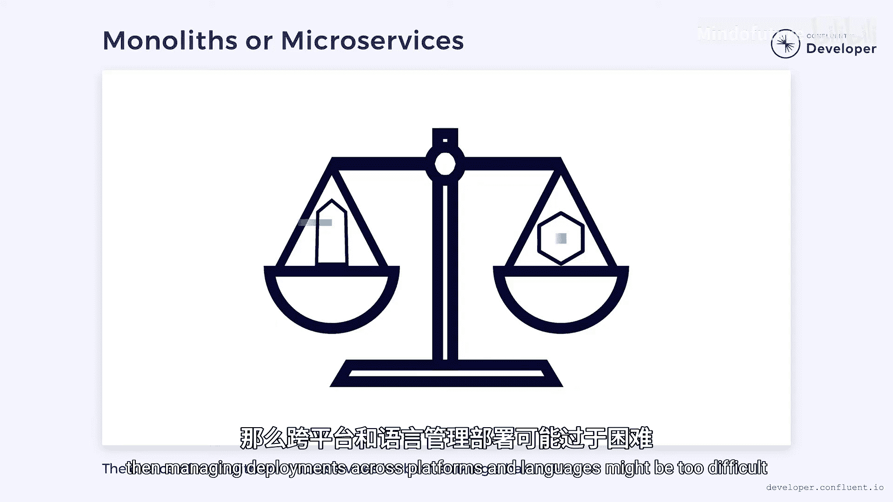

# 设计事件驱动微服务---中英-｜-microservice-｜-apache-｜-kafka-｜-confluent-p02-P02-From-Monoliths-to-Microservices--BV1D8EMzzEid_p2-

Hi， I'm Wade from Confluent。I want to take a moment to talk about the differences between monoliths and microservices。

However， this isn't a discussion of which one is better than the other。Instead。

 I will highlight the features they provide and point out the common ground between them。

The first step is to define monoliths and microservices。

They don't exist in a black and white world where applications are either one or the other。Instead。

 they live on either end of a spectrum with plenty of gray in between。

It's common to build a small collection of monolithic applications that are connected the way microservices might be。

And sometimes microservices grow beyond their original boundaries and become more monolithic than intended。

With that in mind， let's start with basic definitions。

A monolith can be described as a system deployed as a single unit and encompassing multiple business domains。

Microservices， on the other hand， are a collection of deployable units。

 each focused on a specific domain。We're ignoring a lot of nuances。

 but this is a starting point we can build on。Let's consider the worst case for both monoliths and microservices。

For a monolith， the worst case is the dreaded spaghetti code。

 where many domains are intertwined without clear dividing lines。Often。

 business logic is in the database as stored procedures。

 and there is a weak sense of ownership of the data。

These systems can be difficult to maintain because even small changes can have far reaching effects。

Meanwhile， the worst case for microservices is when every detail has become its own service。

🎼All connected through distributed APIs Take to the extreme。

 this ends up forming distributed spaghetti。This isn't easier to manage than a monolith， in fact。

 it might be harder。Making changes to a single piece of functionality could involve modifying multiple services which can be awkward。

And the failure scenarios when a service is unavailable can be disastrous。

This brings us to the real secret to building clean and maintainable software。

It isn't whether we use monoliths or microservices。Instead。

 it's whether we create sufficient isolation and autonomy to allow the system room to evolve。

There are many ways to increase the isolation in a system。

The most important is to find the domain boundaries that naturally exist and protect them with APIs。

In a monolith， the application can be separated into libraries with a clear API built on objects or functions。

These libraries can even be independently deployed in some cases。

 leading to what is called a modular monolith。Microservices are separated into applications that expose APIs through techniques like RE or asynchronous events。

A key difference is that with monoliths， the separation is optional while with microservices it's required。

Another way to improve isolation is to ensure each domain owns its own data。

Only the specific library or microservice is allowed to access the data in the database。

Everyone else must go through the API。Disallowing direct database access allows the domain to evolve internally without worrying about breaking external dependencies。

However， care must be taken to ensure the API remains compatible。

This is one of the driving principles behind microservices。

 although it can be implemented in a monolith as well。

A popular way to introduce isolation is through the use of asynchronous events and publish subscribe mechanics。

🎼Rather than having components in the system communicate synchronously through function calls or rest APIs。

 Instead， they publish messages to a topic。Any parts of the system interested in the data can subscribe to the topic。

This creates autonomy between the components by eliminating any direct dependencies。

This reduces the load on the services providing the API and gives them more flexibility to evolve。

It becomes easier to create new clients and opens up possibilities for novel deployments and auto scaling。

Some types of isolation only apply to microservices。In a monolith。

 unrelated parts of an application compete for the same resources such as memory， threads， and CPU。

If we split the system into microservices， we can ensure they don't compete。

 either using container resource limits or by deploying to different machines。

This also allows other forms of autonomy that are less obvious。For example， when building a monolith。

 each library is typically written using the same programming language and deployed with the same technology stack。

Even though the code might have a fair amount of isolation。

 it is still coupled to the language and execution platform。

Microservices break this coupling by allowing each service to be written in a different language and deployed with a different stack。

This can allow more flexibility when choosing what tools are best for the job。

But let's not pretend everything is perfect when working with microservices。

Deploying everything as a separate unit sounds great until you have to manage all of those deployments。

Suddenly， you need an orchestration platform to keep everything straight。

And polyglot architecture requires experts in each language or technology stack。

 this can make hiring challenging。This is where the balance between monoliths and microservices comes in。

If our business is used to working with multiple languages or needs access to tools that span different technologies。

 a microservice architecture makes sense。On the other hand。

 if the team is small and doesn't have the resources for a lot of infrastructure support。

 then managing deployments across platforms and languages might be too difficult。

In that case， a monolith might be more reasonable。The point isn't to suggest that monoliths or microservices are superior。

Instead， like with many things in software， it really depends on your use case。

Understanding the differences helps us make better decisions about when to use them。

If you want more information， check out Confluent Developer where you will find courses to help you build event driven microservices in a variety of languages。

If you aren't already on Confluent developer， head there now using the link in the video description below。

And share a comment below to let us know what other topics you'd like us to cover。As always， like。

 share and subscribe for more awesome content， and thanks for watching。

