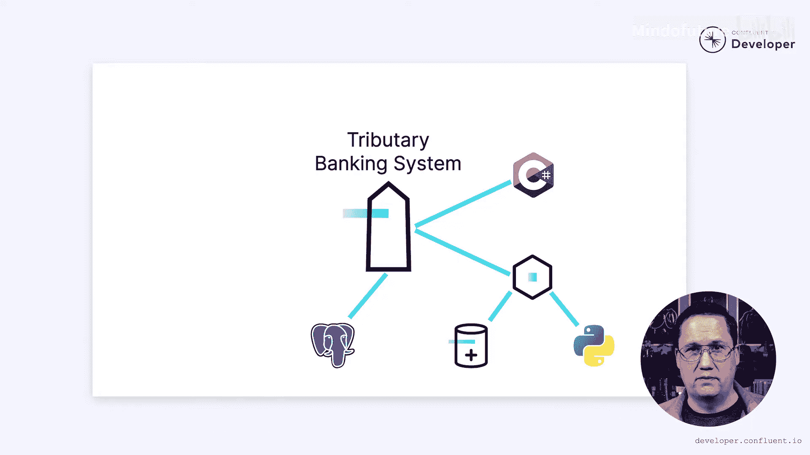

# 设计事件驱动微服务---中英-｜-microservice-｜-apache-｜-kafka-｜-confluent-p03-P03-Event-Driven-Microservices-in-Banking-and-Fraud-Detection--BV1D8EMzzEid_p3-

Are microservices the right tool for the job？That's one of the toughest questions to answer when considering whether to decompose your monolith into a set of microservices。

Every business has unique requirements。Sometimes those will align with a microservice architecture while other times they won't。

I'm going to introduce you to Tributary Bank and explore the challenges they faced when trying to modernize their architecture。

Should they build a new system of microservices， Stay tuned to find out， yeah。Okay。

 tributary Bank isn't real。Unfortunately， non disclosureclo agreements and the general threat of legal action prevent me from talking about real companies。

However， the challenges I am outlining are real。Our fictional bank is a moderate sized institution that provides both retail and corporate banking services。

 They deal with billions of dollars in transactions。

Their original software was built with a monolithic architecture and a shared relational database。

They differentiated themselves by being an early provider of automated fraud detection。

Each transaction was compared against a series of known fraud patterns that could be either accepted or rejected。

 depending on the results。However， criminals have grown increasingly clever。

 and the original patterns are insufficient to detect modern fraud。

Tributary has struggled to adapt its legacy system and now finds itself behind the curve as competitors introduce machine learning algorithms to combat fraud。

They need to modernize。 The question is， how the team responsible for the fraud detection system is convinced that moving to an event driven microserv architecture will be the magic bullet that solves all of their problems。

 But are they right。Let's look at their reasoning and see if event driven microservices really are a good fit。

Spoiler alert。 There's no such thing as a magic bullet。Everything has trade offs。

One of the problems faced by tributary is that their fraud detection system has become rigid。

Originally， the fraud detectionte team built a clean API to allow developers to check for fraudulent transactions and see the details of previous rejections。

However， some of those details， such as the reason for rejections。

 are readily available in the shared database。 Some developers bypass the API going directly to the database instead。

Now the fraud detection team is struggling to redesign their database because other parts of the system are directly coupled to the existing structure。

They need to find a way to break this coupling。They're hoping that microservices can be the answer here。

One of the benefits of microservices is that they are designed to only share data through a clearly defined API。

 Direct database access is forbidden。 This can be controlled using database permissions that restrict access to only the specific microservice。

If the original system had been built this way， they might have avoided the back door access to the database。

 However， it isn't fair to say that microservices are the only solution。

Careful use of database permissions could have prevented this problem。

 even in a monolithic application。The key difference is that with microservices。

 the principles of data isolation are built into the architecture， whereas with a monolith。

 they are optional。Regardless of what approach they use。

 they are going to need to untangle the existing dependencies。If they can do that。

 the microservice architecture can help maintain isolation going forward。

The fraud detection system is critical to tributaries's business because it is used by many different components。

Unfortunately， this has drawbacks。 If that component fails。

 any components that rely on it will also fail。In some cases， such as an out of memory error。

 those failures could shut down the entire application。

This can cause traffic to be redirected to other instances。

 which in turn may experience similar failures。Suddenly。

 we have a cascading failure that brings down the entire system。

 even parts that have no dependency on fraud detection。

In a financial system dealing with billions of dollars in transactions。

 these types of failures can be catastrophic。This has LED the teams at tributary to fear change。

Each change has the potential to introduce an error， and nobody wants to be responsible for that。

They've grown to be extra cautious， running every change through a complex suite of manual and automated tests before doing a slow and laborious deployment。

This mostly works because it keeps the application running。

 but it slows development to a crawl and further hinders their ability to compete。

The price of reliability could cost them the business if they can't find a way to accelerate development。

Raise your hand if you think microservices are going to eliminate failures in the system。🎼，Yeah。

 they aren't。Failure is a fact of life and needs to be accepted。 However。

 microservices are good at isolating failure。 If fraud detection is running in a separate microservice。

 a failure may not be catastrophic。An out of memory error might still bring down an instance of the service。

 and rebalancing might cause that to cascade to other instances。 However。

 the rest of the system can continue to operate。 Part of the system that don't require fraud detection remain unaffected by the failure。

So although failures are inevitable， they can be isolated to reduce risk。

 This can help alleviate the fear of making changes。Eventually。

 tributary Bank could learn to embrace change as a critical part of the process。

One of the challenges that tributary has encountered as their platform has evolved is that it's gotten slower。

In the early days， when fraud detection was easier。

 they could get by with a small set of static rules that would execute fast。However。

 as fraud detection evolved， the algorithms have gotten more complicated。

Commands that used to take milliseconds are now taking orders of magnitude more with machine learning on the horizon。

 It threatens to get even worse。This creates a problem because executing fraud detection on every transaction could mean slowing down those transactions to take several seconds In today's world。

 that's simply unacceptable， especially for a financial system。 And the reality is。

 fraud detection is something that happens over time。 It's rarely。

 if ever possible to detect fraud by looking at a single transaction。

 It requires analysis of patterns that span minutes， hours or even days。

So the original system that was designed to complete in milliseconds was flawed from day 1。

 The problem is that when we send a message， the sender is often stuck waiting for it to process and can't move on until it receives a reply。

 This can create long delays。If the system could be adapted to an event driven microservice。

 any time we send a message， we could reply as soon as it has been stored in Kafka。

 and the messages could be processed asynchronously。

This would improve the performance freeing us from the bottleneck of complicated fraud detection algorithms。

As an added benefit， it could improve reliability。An asynchronous process needs to be completed eventually。

 But if it goes off line for a while， it doesn't have to impact end users。

As long as the process recovers and picks up where it left off end users don't need to be impacted by potential failures。

One of the most important factors that tributary has to consider as they build this new system is how to encapsulate risks to security。

 They have thousands of employees and handle billions of dollars in transactions。

 A security breach has the potential to be incredibly costly。

 They have to be careful to limit the blast radius If a portion of their system were to be compromised。

In their existing monolith， it's not uncommon for developers to have access to far more of the code and database than is strictly necessary。

If a developer is compromised， it can have a wide blast radius。There are ways to mitigate this。

 and they've done a lot of work in this area， but it does require extra care and attention。

Even in a microservice architecture， they could mess this up。However， as we've discussed。

 microservices do lend themselves to isolation and encapsulation。Each microservice owns its own data。

We can limit access to the data to only the developers working on the microservice。

The code for the microservice can easily live in its own source control repository。

 and we can limit access to that repository That way。

 if someone were to gain access to a developer's credentials。

 they would only be able to compromise a small subset of the system。

While this doesn't eliminate the potential for breaches。

 it is one way that tributary could limit their scope。

There are additional benefits that come from switching to a series of microservices。

Their original system was built in C Shap， which was a popular choice at the time。 However。

 as they begun to move into data science and machine learning。

 they have found many developers in those areas prefer Python。

Moving to a microserv architecture would allow them to more easily adapt to the times and follow the trends。

 This can be hard to do when you're locked into a particular language。Similarly。

 their original Postgres database was suitable in the beginning。

 but now they're interested in more specialized databases。

Migrating their entire monolith to a specialized database is going to be difficult and probably undesirable。

 However， building new microservices against different databases is a far more reasonable endeavor。

By adopting the microservice approach， they will have more flexibility to adopt modern technologies。

 which can help them keep up with the fast moving pace of competition。

Is adopting microservices the right approach here？Drop a comment and let me know what you think。

I would say it's not possible to be conclusive。There are bound to be issues we haven't thought of that may pose problems from a microservice architecture。

And the problems that tributaries faces often have many solutions。

 microservices being only one of them。What we can say is that an event driven microservice architecture seems like a valid candidate to solve some of the key issues。

That makes it worth investigating further， and that's our next step。

Throughout the rest of this series， we'll look in more detail at the processed tributary Bank can take to migrate from a monolith to a series of microservices。

We'll see the kinds of challenges they might encounter along the way and we'll explore solutions they can implement to overcome any difficulties。

If you enjoyed this video， remember to like， share and subscribe。

Thanks for watching and stay tuned for the next video。

