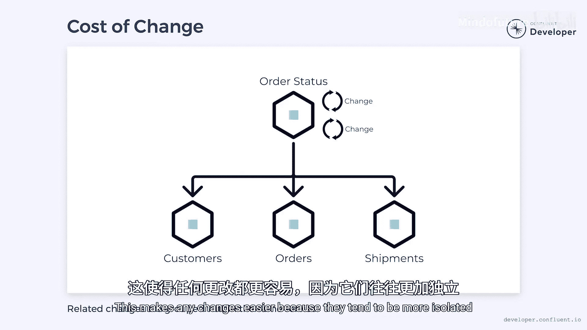

# 设计事件驱动微服务---中英-｜-microservice-｜-apache-｜-kafka-｜-confluent-p04-P04-Autonomous-Microservices--BV1D8EMzzEid_p4-

Hi， I'm Wade from Confluent In this video we'll explore autonomy and microservices and why it's valuable。

Before we get technical， let's talk about life at the office， whether remotely or in person。

When we work at the office， there's a good chance we'll be interacting with other people。

Those other people can be considered external dependencies。

 we require contributions from them but lack direct control over their actions。

This can lead to delays if they fail to deliver results in a timely fashion。

This is true whether they go on vacation， get sick or just take longer than expected in a perfect world。

 we'd be able to complete our work without relying on anyone else。At the same time。

 we don't want to do the entire job ourselves， sharing the work with a team is what allows us to scale。

So what does this have to do with microservices？Microservices are a team of applications working together to complete a task。

These services often depend on each other， which creates external dependencies。

Those dependencies introduce delays， and although a microservice doesn't get sick or go on vacation。

 it might fail or need to be redeployed。It can also take longer than usual if it gets busy。

These scenarios result in timeouts and failures in otherwise healthy systems。

The problem with both the office and our microservices is a lack of autonomy。

Autonomy is the ability for a member of the system to act on their own without outside interference。

Each external dependency reduces the autonomy of a microservice。

Imagine an ecommerce site that has information about customers， orders， shipments， etc。

The status of an order might include elements from each of these entities。

 that means it might need to pull information from multiple microservices。However。

 that creates a lot of coupling between the services。Each call results in a small delay。

What happens if one of those services is unavailable？In that case， the task would fail。

But what if we could make the system more loosely coupled instead？

Rather than pulling data from the microservices， each service could push data to a messaging platform such as Kafka。

The service responsible for the order status could consume the messages and build a view of the order ahead of time。

That way， when the status is requested， everything is already available and no external calls are required。

This changes the coupling so each service depends on the messaging platform and the message format。

 but none of them are directly tied to each other it also breaks the temporal coupling。

When the services communicated synchronously， everything had to happen at the same time。🎼However。

 with this new architecture， the communication is asynchronous。

 which allows more flexibility for when messages are processed。

 Services can go off line without having an immediate impact on each other。In this example。

 when the order service is offline， it's still possible to obtain shipping or customer data because those two systems are still fully functional。

This improves the autonomy of each microservice and allows them to be more resilient。

🎼When building autonomous services， it's tempting to put more functionality into a single service。

 Every everything lives in one service， then there's no external dependencies。However。

 this creates its own problems。The order status for our e-commerce platform requires orders。

 customers， and shipments。We might decide to roll all of these into a single service as long as the system is running。

 all of the necessary pieces are there。🎼But they also share resources。

 Imagine there is a new product launch and orders get overloaded。 Unfortunately。

 the entire system is sharing processors， memory and threads。

 So it's not just the orders that get overloaded。 Sudden， shipment stop responding。

 even if they are completely unrelated to the new product。Essentially。

 problems in one part of the system impact the entire system， which can result in cascading failures。

This is the type of scenario we want to avoid。To do that， we build highly cohesive microservices。

 think of cohesion as how closely related individual tasks in the service are。

Adding and removing items from an order are highly cohesive operations because both are operating on the same entity。

But adding an order and adding a customer are not cohesive because the entity involved is entirely different。

One way to think about cohesion is through the lens of the single responsibility principle defined by Robert C。

 Martin in 2003。The principal states a class should have only one reason to change。

This definition can be extended to a microservice should have only one reason to change。

In the case of adding and removing an item， we can say that the reason for the change is that the order is being updated。

Therefore， this could fit within the rules of the single responsibility principle。On the other hand。

 adding an order and adding a customer update a different entity。

 so in that respect it creates two reasons to change and violates the principle。Based on this。

 we can suggest that orders and customers probably don't live in the same microservice。

Domain driven design is a set of architectural patterns created by Eric Evans in 2003。

Evans introduces the concept of a bounded context。Large systems can be divided into smaller bounded contexts based on the use of language and business rules。

Boed contexts make an excellent starting point for dividing up microservices。

🎼They introduce clear boundaries with few connections。

 making them loosely coupled and highly cohesive。 One of the main benefits of low coupling and high cohesion is how they impact the cost of change。

Low coupling means that changes in one system shouldn't have an impact on another。

While high cohesion means that related changes are grouped into the same service。

This makes any changes easier because they tend to be more isolated。

This outlines some of the key goals when building autonomous microservices。🎼Ideally。

 requests can be answered immediately without requiring external dependencies。

 and changes can be isolated to just one service。That doesn't mean these services don't cooperate or communicate。

 but they do it asynchronously to minimize the dependency between them。 If you want more information。

 check out Confluent developer where you will find courses to help you build event drivenn microservices in a variety of languages If you aren't already on confluent developer head they're now using the link in the video description below。

And pop a comment below letting us know what else you'd like to talk about。Don't forget to like。

 share and subscribe， and thanks for watching。

