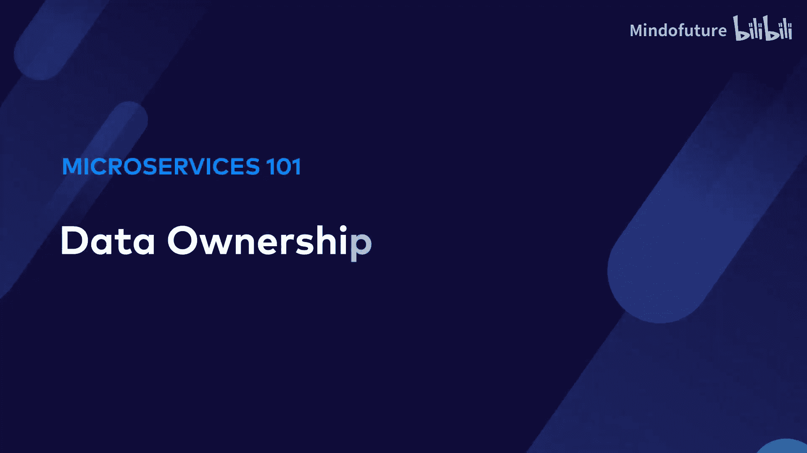
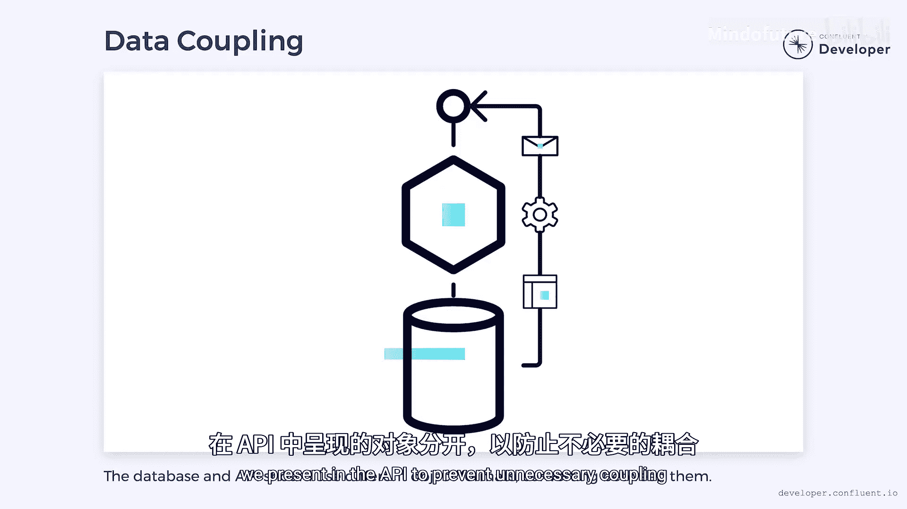

# 设计事件驱动微服务---中英-｜-microservice-｜-apache-｜-kafka-｜-confluent-p05-P05-Data-Ownership--BV1D8EMzzEid_p5-

Hi， I'm Wade from Confluent。In this video， we'll discuss data ownership in microservices and how it can be implemented。

Have you ever seen a movie where a character gains the ability to read minds。

 it never turns out well， does it？Usually they spend the rest of the movie trying to adapt to being stuck in everyone else's head。

 they become overwhelmed by the flood of too much information。In the end。

 they get rid of the ability because it turns out it's a real nightmare。

Now imagine if those people were microservices。And each microservice had the ability to reach into every other services database。

This requires extra knowledge such as database schemas， credentials， and more。

It leads to deeper coupling， which becomes an unmaintainable mess。

This is a problem that faces many monolithic systems。In a poorly designed system。

 any part of the software can potentially read or write to any part of the database。

🎼Each time a change is made to the database schema。

 the effects can ripple across the entire system in unexpected ways。

 It gets even worse when a shared database is used for multiple microservices。 Suddenly。

 the changes aren't just rippling across a single code base。 Instead。

 they might affect multiple code bases that could be written in different languages and deployed independently。

 Coordinating deployment of those changes across multiple services may result in downtime for some of them。

 This can be extremely difficult to manage and makes it very hard to evolve。

This is why one of the foundational principles of microservices is that each service should own its own data。

But what exactly does that mean， we can start by looking at something called the single writer Pri。

 originally proposed by Martin Thompson。It states that data should be owned by a single execution context。

This principle was defined to help avoid consistency and locking problems that occur when multiple threads try to write to the same record in a database。

However， the principle can be extended to microservices。

We need to avoid having multiple services writing the same type of data。

 otherwise we have to solve locking in consistency issues across all of the services。

🎼That opens up a whole mess of headaches we want to avoid But why stop with rights。

 Although having multiple services read the same data has minimal impact on locking or consistency。

 it has a huge impact on maintainability。If we only control the rights in our microservice。

 then we still have to update all of the readers if we decide to make a schema change。

The goal should be for each microservice to own its own data。

It should have full control over all of the reads and writes Ben Stockford rephrases the single writer principle in his bookDeigning Even driven Systems。

He suggests that it should also apply to the propagation of events through systems like Apache Kafka。

These events act like an API for the microservice and therefore should be owned by that service。

In essence， if an external service needs to access the data， it should always go through an API。

This could be a rest service， events published to Kafka， or something else。However。

 an external service should never go directly to the database。Instead。

 it must adhere to the API contract， which hides any implementation details。

This can be enforced using database permissions that restrict read and write access to the microservice。

🎼Or by creating separate databases for each service， this is many advantages。

All of the data is isolated to a single microservice。This means this service can evolve internally。

 and it won't have an impact on clients of the API。

This also means that the service has more freedom when choosing how that data is stored。

This could mean storing events or other unusual structures。

 but it could also mean using a totally different database。Rather than a relational database。

 some services could use a document store or another type of NoSQL database。And thankfully。

 coordinating changes across surfaces is easier because unlike most databases。

 an API can be versioned。🎼A new version of the API can be deployed。

 and any dependencies can be slowly transitioned over。

 There's no need to make the changes all at once。However。

 we have to be careful to avoid unnecessary coupling through the API。To reduce code。

 we might be tempted to take our database objects and present them through the API。Unfortunately。

 this means that the API is now coupled to the structure of the database and we're back to being unable to change the database without impacting clients。

Instead， we should explicitly separate our database objects from the objects we present in the API to prevent unnecessary coupling。

For developers who have spent their time working with a monolithic relational database。

 the concept of data ownership can be difficult to adapt to。

🎼We lose capabilities like queries that combine data from multiple domain objects。 However。

 we gain benefits like having code that is easier to maintain。 Just be careful。

 It may be tempting to build microservices that use a monolithic database。

 This is sometimes referred to as a microlith， However。

 rather than granting the best of both architectures。 This instead gives us the worst of both。

We've lost features like polyglot data storage， better maintainability and reduced contention。

In return， we've gained a distributed mess， it would be far better to just pick one architecture and stick with it。

If you want more information check out Confluent Develop where you will find courses to help you build event drivenriven microservices in a variety of languages if you aren't already on Confluent developer head there now using the link in the video description below and pop a comment below letting us know what else you'd like us to talk about don't forget to like。

 share and subscribe and thanks for watching。

