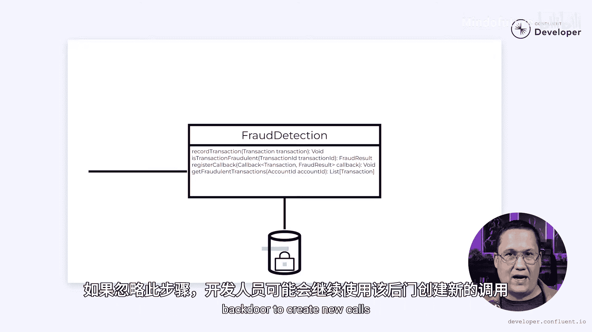

# 设计事件驱动微服务---中英-｜-microservice-｜-apache-｜-kafka-｜-confluent-p06-P06-Defining-Asynchronous-Microservice-APIs-for-Fraud-Detection--BV1D8EMzzEid_p6-

Tributary Bank wants to migrate from a monolith to a set of microservices。

Their first target is to extract a fraud detection microservice from their monolith。However。

 there are some knots they'll need to unravel first。

Their old API assumed everything would complete synchronously。 However。

 once they moved to an event driven microservice， that assumption may not be valid。

 What if the microservice isn't available or what if fraud detection takes longer than a few milliseconds。

Meanwhile， some developers have bypassed the API and gone straight to the database。

Once a microservice has been extracted， direct database access won't be an option。To make this work。

 tributary is going to need to define an API that supports asynchronous processing and restricts access to the database。

They're going to need to introduce this API into the existing monolith before they will be ready to start moving things to a microservice。

Let's take a look at how they can do that。If you aren't familiar with Tributary Bank。

 check out the earlier video where we analyzed the reasons tributary wanted to switch to a microservice architecture。

 you'll find a link in the video description。Let's start by looking at the existing fraud detection system。

 We'll strip away a lot of the functionality and focus on analyzing a transaction and viewing the results。

A real system would be more complicated， but even this simple use case can teach us a lot。

The fraud detection system has a single method named is fraudulent。

 It takes a transaction as a parameter。When the method is called。

 it registers the transaction in a database table。 It then executes logic that analyzes the transaction。

 taking into account any historical data。 Eventually。

 it returns a value of true If it suspects the transaction is fraudulent and false otherwise。

The method has three responsibilities。 First， it has to register each transaction in the database。

Second， it performs an analysis of the current transaction。And third， it returns the results。

Combining these responsibilities in one method has consequences。

 Notice that the method returns the result。 That means we have to wait for it to finish。

 which makes this a synchronous operation。That's a problem because fraud detection is growing increasingly complicated and time consuming。

Since this has to be executed on every transaction。

 it means that all of those transactions are now experiencing extended delays。

They can try to speed up those algorithms， but there are other issues to consider。

 Once we extract a microservice， there is a chance that the service may not be available。

In that case， our original transaction has to fail， which isn't ideal。

It would be better if we could delay processing of the transaction until the service is available again。

We can start to resolve these issues by altering the methods we expose。

The record transaction method takes a transaction as a parameter。

 Imagine it includes details like the amount， as well as identifiers like an account I D and a transaction I D。

The method registers the transaction in the database， but notice it doesn't return a result。Instead。

 the actual analysis will be handled asynchronously。Of course。

 if the processing is being done asynchronously， how will we get the results？For that。

 we add on is transaction fraudulent method。 It only needs a transaction I D because the rest of the data will already be recorded in the database。

 As before， it returns true if it believes the transaction is fraudulent and false otherwise。

What if we haven't finished processing the transaction， In that case。

 the fraudulent status would be unknown。It turns out that a Boolean is insufficient in this case。

 we need a more complex fraud result object。An enumeration containing values such as valid。

 fraudulent and pending would give us the flexibility to indicate each of the possible states。

That way， if the is transaction fraudulent method returns a pending result。

 then we know to check back later。Of course， this does require us to pull the system periodically to try to find a result that might not be the most efficient option。

An alternative is to use a callback so that when we finished computing the result。

 we can inform the original collar。The underlying implementation will be a little tricky when we convert to a microservice because it requires a method of notifying the original monolith。

One approach is to have the monolith subscribed to a Kafka topic。

 When the microserv finishes processing the message。

 it could send a reply on that Kafka topic to notify the monolith。

This API allows the fraud detection system to be implemented as an asynchronous process。

 It also makes no assumptions about where that process lives。 It could live inside of the monolith。

 but it could just as easily live somewhere else。That means when tributary is ready。

 they can begin to extract this interface to a separate microservice。Unfortunately。

 there's still a problem left to solve。When the original API was created。

 the database behind it wasn't protected。While the original API provided plenty of functionality。

 developers occasionally bypassed it and performed direct database queries。

The example we see here is a request to find all fraudulent transactions associated with a specific account。

Other developers needed the same functionality in different places and simply copied and pasted this code。

 The result is these types of queries being littered throughout the monolith。To fix this。

 they're going to need to wrap this query inside of a function such as get fraudulent transactions。

Once they've created this， they can begin the slower process of finding all its usages and converting them over to this API call。

A code search will hopefully reveal most of them。 However。

 if the team is using an object relational mapper or if the query has been altered in various ways。

 then the code search might miss some instances。They may also uncover cases where the query has been altered enough that it requires new method parameters。

 new return types or other variations on the method。 Eventually。

 they will reach a point where they feel relatively confident that they have eliminated the back door calls to the database。

At this point， an important step is to restrict the permissions for the fraud detection tables so that only the fraud detection API can access them。

If this step is ignored， it's possible that developers will continue to use that backdoor to create new calls。

An added benefit is this allows verification that there aren't any more calls hidden in the code。

Disabling access and then running automated or manual tests of the fraud detection components should reveal any remaining locations where those tables have been accessed without going through the API。

Just make sure to run and fix those tests before moving this code into production。Now。

 let's be clear on a few things。I've given a relatively trivial example of extracting an API from a monolith。

 The reality is not going to be this simple。 There are bound to be multiple potential solutions to these problems。

 many of which might be better than what I've outlined here。

If you see opportunities to improve things， I'd love to hear about them in the comments。In addition。

 in a real system， there could be dozens of method calls to deal with rather than just a handful。

 convertverting the calls from synchronous to asynchronous is going to have an impact on the user interface。

And all of this will have to be done in a live system without causing outages or issues。

But the point I want to illustrate is that to do this， you have to be methodical， take small。

 well planned steps， and slowly evolve your system there' something that you know can be extracted to a microservice later。

Then when it's time to extract the microservice， again， look for small steps you can take。

Trying to do everything at once often results in more issues， more failures， and more time。

In future videos， we'll look at some of the later steps in this process and see how they can be done safely and efficiently。

If you want to keep following me on this journey， make sure to like， share， and subscribe。

 and stay tuned for the next video。

