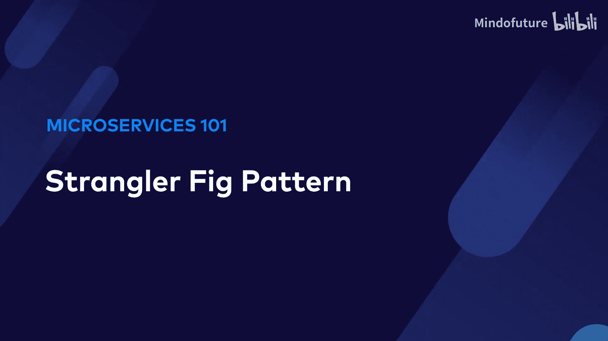
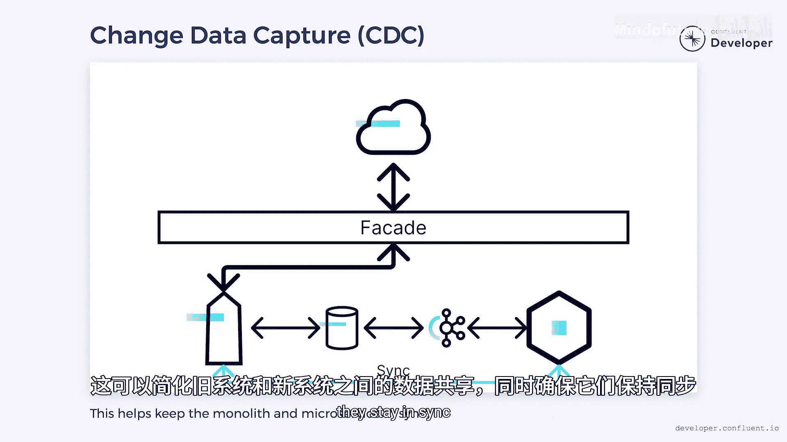

# 设计事件驱动微服务---中英-｜-microservice-｜-apache-｜-kafka-｜-confluent-p07-P07-The-Strangler-Pattern--BV1D8EMzzEid_p7-

🎼Hi， I'm Wade from Confluent。Today I want to talk to you about a design pattern known as the Strangler Fig pattern。

Deep in tropical forests lives a plant known as the Strangler Fig。

It begins growing in the upper branches of a host tree when a seed is left behind。As the fig grows。

 it extends its roots downward while reaching its branches toward the sky。Soon。

 it begins to compete with the host tree for the vital light and nutrition that will keep both of them alive。

As the strangler fig wraps itself around the tree， it slowly starves it out。

The host tree will sometimes die， leaving behind just the fig。

This fig is the inspiration behind the strangler fig pattern or strangler pattern originally proposed by Martin Fowler。

Many microservices are built to replace existing monoliths。

There are different approaches to doing this。One option is to rewrite the entire monolith using a microservice architecture。

However， this can be dangerous because it takes a long time before business value can be delivered。

Essentially， you have to replace the entire monolith before you begin to see the value of your efforts。

The problem is that the greatest risk to any software project is time。

 specifically the time to deliver business value。As time increases。

 so does the cost and potential for failure。The truth is that this wholesale replacement is a form of monolithic thinking。

 the goal should be to find ways to shorten the time to delivery in order to reduce risks。

We need to move into a microservices mindset， which means thinking smaller and more iterative。

🎼Rather than trying to replace the entire monolith at once。

 we instead focus on just a few features at a time。 Typically。

 this is done by inserting a facade in front of the system we're trying to replace。

We move everything to communicate with the facade， then we begin to reempplement features a few at a time using a new architecture when we're ready for production。

 we switch the facade to point at the new system rather than the old， but only for a few features。

We can then either delete the facade or leave it in place to act as an API gateway for the new service When we're done。

 we repeat the process with another set of features。As each feature is replaced by the new system。

 the old system begins to shrink。The traffic to the system is removed and portions of it can be turned off or deleted。

Slowly， the monolith dwindles until it becomes just a fragment of its former self。In a perfect world。

 you would eventually shrink the monolith completely and be able to shut it down by replacing the functionality in smaller chunks。

 we're able to iteratively release new business value。

This shortens our delivery time and reduces risks。🎼This is why we call it the strangler fig pattern。

 Like with the fig， there is a competition for resources。 In this case， application traffic。

 The new architecture is wrapping itself around the old through the use of a facade。

Our goal is to starve the old system so that eventually it dies when it has been fully replaced。

As we make use of the strangler fig pattern， there are some things we need to be wary of。

Each system we replace will require us to create an adapter to route the requests to the right place。

It's possible to find ourselves in a situation where we try to replace too much functionality at the same time。

We can end up with so many adapters it can be difficult to manage。Remember。

 the goal isn't to replace the entire system at once。

We want to do it slowly and in a controlled fashion。In addition。

 once we change from the old system to the new， it's possible we'll discover problems we didn't anticipate。

Having a rollback plan in place is critical to make sure we can recover from any potential failures。

One of the biggest challenges of the strangler fig pattern is that it relies on being able to build the facade。

Legacy systems often exist as a complex tangle of dependencies reaching deep into the database。

Extracting a clean facade may be a long and difficult task of slowly untangling dependencies。

Event driven architecture can provide some help。We can connect a change data capture system to our database Even from the database can be fed into something like a Kafka topic where they can be consumed by the new microservice。

This can simplify the sharing of data between the old and new systems while ensuring they stay in sync。

The strangler fig pattern isn't a one size fits all approach。

It can be useful when trying to migrate a large system to a new architecture。🎼However。

 for smaller systems， it might make more sense to simply replace the entire thing。

 The key question to ask is which approach will lead to delivering business value in the shortest amount of time。

The odds are good that whichever option reduces that time is probably the right one If you enjoyed this video。

 check out Confluent developer for more like it。If you aren't already on Conflune developer。

 use the link in the video description below to find courses on event drivenn microservices in a variety of languages。

 and please drop a comment below to let us know what you thought of the video and what other topics you'd like to see。

 Don't forget to like， share and subscribe。And thanks for watching。

