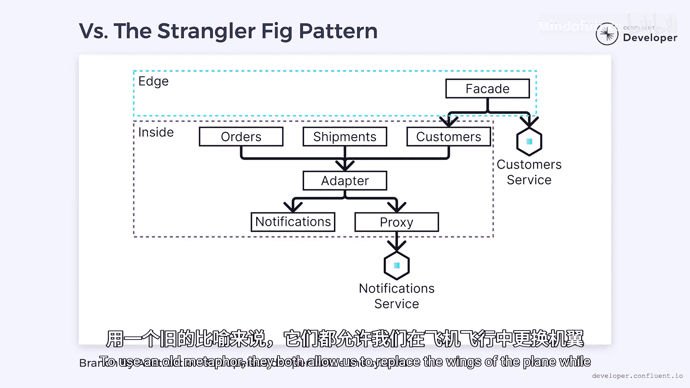

# 设计事件驱动微服务---中英-｜-microservice-｜-apache-｜-kafka-｜-confluent-p08-P08-Branch-by-Abstraction--BV1D8EMzzEid_p8-

Hi， I'm Wade from Confluent。The branch by abstraction pattern is useful when decomposing a monolith into a series of microservices。

Let's talk about how it works and how it can be applied。

In a traditional architecture， when we replace an existing piece of functionality。

 one way to do it is by creating a new source control branch。

We reimplement the functionality in the new branch， testing it as we go when we're ready。

 we can merge our changes to the main branch and deploy them to production。

This replaces the old implementation with the new one。However， this approach has a few problems。

 what if our new implementation takes a long time to build？

🎼The code in the main branch doesn't stop evolving。

 It begins to diverge or drift from the working branch。When we're ready to merge。

 we might find a messy process because of the drift。If we deployed a production。

 we might discover that there are problems we didn't account for this could be due to unexpected load。

 a bug we didn't catch， or maybe even code drift that occurred while we were working。Regardless。

 now we have to roll back the changes and fix any issues before redeploying。

While we work on the fixes， the code continues to drift， possibly introducing new issues。

So how do we know when we're done， how can we guarantee that our new code is producing the same results as the old code？

🎼How can we be sure it won't create production issues In an ideal world。

 we'd have a suite of tests to verify that it works。 However。

 those tests are rarely as comprehensive as we need。What if instead of using a source control branch。

 we create a branching path through our code using an abstraction layer？

Imagine an e-commerce system broken down into orders， shipments and customers。

 these all live in the same monolith。And all three rely on another component for notifications。

How could we extract those notifications to its own microservice？

We start by inserting an adapter in front of the code we want to replace。

 in this case the notifications。Any calls to our old code are routed through the adapter。

We then build a new implementation alongside the old one， if we are decomposing a monolith。

 then the new implementation can be a proxy that makes calls to our notification service。

We continue to serve requests using the old implementation until we're ready to cut over。

Once our microservice is finished， we can swap the adapter to point to the proxy。

 then we're ready to start cleaning up the old code and potentially removing the adapter This technique is what we call branch by abstraction。

It allows us to incrementally make changes and continually merge them to the main source control branch without risk。

It's part of a larger collection of techniques known as trunk based development this reduces the risk of having messy mergers that can occur when working on long lived branches。

It also enables a powerful way of testing and verifying the code is working。

Unlike with a source control branch， the abstraction allows us to have both versions of the code live in production at the same time。

This means we can make calls to either the new code or the old code or both。

We can use that to perform A B testing。 for example。

 we could send most of the traffic to the old system but route some of it to the new system。

 This allows us to subject only a subset of our users to the new system。Alternatively。

 we can make calls to both systems and compare the results。

 we can then log any differences and monitor them over time。

This lets us see how close we are to completion。During the testing phase。

 we always return results from the old system。But once our accuracy has crossed a specific threshold。

 we swap the implementation to return the results from the new system。

This is a low risk way of live testing the system， so when we are ready to cut over。

 we hopefully have eliminated any issues。Branch by abstraction has a lot of similarity to the strangler fig pattern。

 which is also used for decomposing monoliths。Both involve inserting an abstraction layer and swapping between old and new implementations。

Just be aware that creating the abstraction layer can be challenging in a complex system。

 the primary difference between the two is that the strangler fig pattern is designed to be used at the edge of the monolith。

 wrapping around the outside of it。The branch by abstraction pattern can be used deeper inside the monolith at any point where you might want to send requests to an external microservice。

 however， both approaches allow us to replace the functionality of our monolith while our system is in production。

🎼To use an old metaphor， they both allow us to replace the wings of the plane while it's in flight。

 Have you used branch by abstraction in your production systems， What did you think of it。

 Are there any other techniques you prefer， I'd love to hear more about your experience。

 So let me know in the comments。 Meanwhile， if you aren't already on confluent developer。

 use the link in the video description below to find more content on event driven microservices。

Don't forget to like， share， and subscribe， and thanks for watching。

