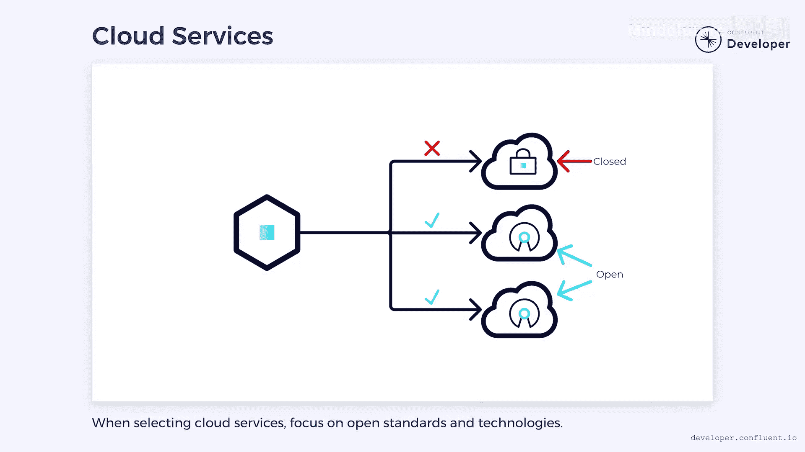

# 设计事件驱动微服务---中英-｜-microservice-｜-apache-｜-kafka-｜-confluent-p09-P09-Polyglot-Architecture--BV1D8EMzzEid_p9-

Hi， I'm Wade from Confluent。

What happens when a development team is using Java and MySqL。

 but another team wants to use rust with MongoDB if you're working in a microservices polyglod architecture。

 then this may be completely acceptable。Let's talk about it in more detail。

Moonolilithic systems are based on a single deployable unit， more or less。

We can separate them into multiple independently deployed libraries。

 but eventually it all runs as a single instance somewhere。Typically。

 this means a monolith is written using a single technology stack。

This might mean it's written entirely in Java against a relational database。

There is some flexibility since the JVM supports languages such as Kotlin or Scala。However。

 we aren't likely to see a Java monolith that includes components written in Python。

🎼This can limit creativity You've probably heard the old saying that when all you have as a hammer。

 everything looks like a nail。 Well if all you have is Java and a relational database。

 you tend to solve problems using techniques common to those technologies Microservices aren't bound by the same restrictions。

Because they are independently deployed， we aren't limited to a single programming language or platform。

We might choose to build most of our system with Java and other JVM languages。However。

 Python has rapidly become the first choice for data scientists。

So for portions of the system that deal specifically with data science。

 we might choose Python instead。In 2006， Neil Ford used the term polyglot programming to refer to the idea that you could build systems using multiple programming languages。

This comes from the Greek Palu， meaning many and glotta， meaning tongue， or in this case， language。

The idea was to allow developers the freedom to choose the best tool for the job。

 rather than always using a hammer， sometimes we can reach for a screwdriver instead， however。

 things have evolved since 2006， so the term polylyglot architecture encompasses more than just programming languages Polyglot persistence allows services to select the database best suited for the job。

Some workloads are highly transactional and benefit from an online transactional processing or OLTP database Other workloads are more analytical and benefit from an online analytical processing or OLAP database。

If we restrict ourselves to a single database， we'd probably end up picking one that was good for transactions。

 but bad for analytics or vice versa。With polyglot persistence， we can even consider document stores。

 event stores， or other types of databases。Each microservice can use the technology best suited to the job。

By allowing freedom of choice in what technologies should be used。

 it opens up the door to hiring the best people for a specific task。Often。

 the best people are interested in using the best tools。

If they see that a role is using an inferior tool set， then they might decide to look elsewhere。

Ensuring that the tools match the job can make companies more desirable to candidates。However。

 this can be a double edged sword。The explosion of tools within the company can make it difficult to hire for roles that cross microservice boundaries。

Finding that unique individual with expertise in all of the technologies may be impossible。

Furthermore， as the company evolves， people tend to leave and they take their expertise with them。

This can leave the company with a collection of microservices where the experts have long since moved on。

Replacing those experts may be challenging， which can cause the system to crumble。

To help mitigate the challenges， companies will often adopt a more limited polyglot approach。

Rather than allowing freedom to choose any technology， they have a subset of approved technologies。

Within this list， teams are free to choose what they want to use。However。

 if they want to go outside the approved choices， they need to make a special request using a limited approach like this still allows some flexibility and creativity。

 but it limits the impact of having too many technologies in play when selecting technologies。

 it's a good idea to choose those that support polyglot architecture。

 avoid walled gardens and instead look for open standards compatible with a variety of technologies。

Tools like RAS， GRPC， and more provide a rich set of libraries that can communicate across a broad set of languages。

 event driven systems such as Apache Kafka can provide connectors that can help move data between microservices and storage systems。

However， relying on open standards and technologies doesn't mean you can't use cloud based services。

In fact， in a polyglot architecture， cloud services can provide a benefit as they typically minimize the maintenance burden。

 essentially they reduce the cost of adopting new technologies。

 making it easier to do a polyglot architecture。But when selecting a cloud service。

 focus on those that are based on open standards and open source technologies to avoid being locked in。

Remember， the goal is to provide flexibility to the developers and avoid unnecessary limitations。

Have you ever been stuck with a poor choice of language or database or have you found yourself with too many technologies to manage。

 drop a comment below and let me know what you think about polyglot architecture。Meanwhile。

 if you want more content on event driven microservices。

 check out our courses on Confluent developer using the link in the description please like。

 share and subscribe so we can keep making more content like this and thanks for watching。

