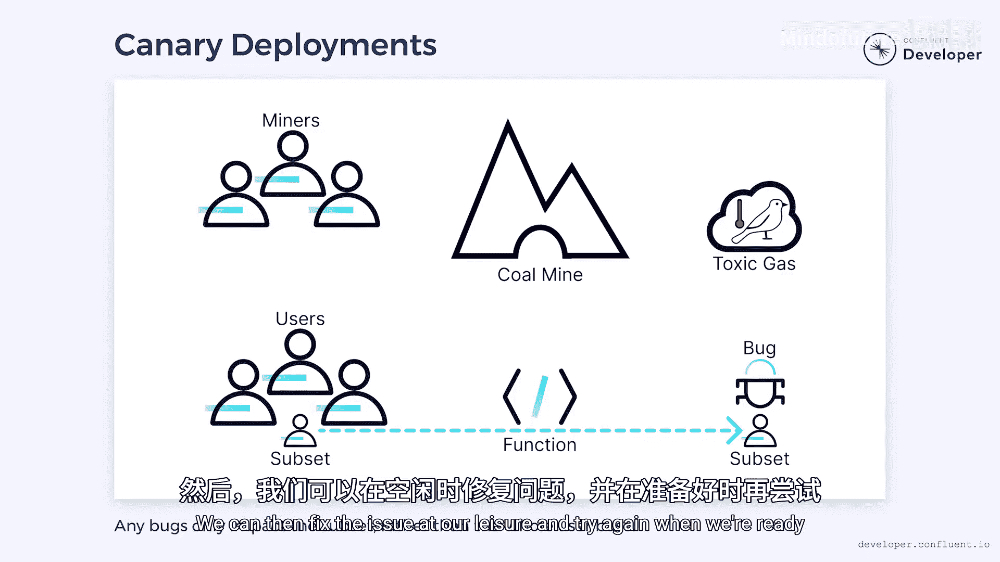

# 设计事件驱动微服务---中英-｜-microservice-｜-apache-｜-kafka-｜-confluent-p10-P10-Continuous-Integration-and-Delivery-(CI-CD)--BV1D8EMzzEid_p10-

Hi， I'm Wade from Confluent。

Software development often consists of long release cycles and plenty of manual testing。

 but with microservices， one of our goals is to increase our velocity。

 which means shortening the time to delivery Let's see how we can achieve that。

🎼Have you ever sat through a long release process， Often it requires a code freeze to avoid unexpected changes during the release。

 Any scheduled changes are merged to the main branch。

 Then we execute a suite of tests against the merged code。 often including manual tests， Eventually。

 we release the application to production。 However， no test suite is perfect。

 so we may discover some issues that weren't anticipated。Now we have to roll back the deployment。

 fix it， and go through the whole process again， but what if we didn't want our releases to be a big production？

What if we wanted them to feel like a non event The first step is to recognize that manual testing makes releases difficult。

It requires synchronization between the developers。

 the testers and the people managing the release process to avoid this。

 we need to ensure that our automated test suite can guarantee the behavior we are looking for。

🎼A good test suite will include anything we need to feel confident in our code。

 The base of the testing pyramid is usually unit tests。

 This is where most of the tests will be written。 As you advance up the pyramid through different types of tests。

 the quantity required gets smaller。However， the breadth of code covered and the complexity increases。

End to end tests tend to be significantly harder to write than a typical unit test。

Building this test suite may require a shift in attitude。Whenever we perform a manual test。

 we should ask if it can be automated。The goal should be to replace all manual tests with an automated version。

And if we encounter a bug in the application， we ask why there wasn't a test to catch it。

Then we sit down and write that test essentially the first part of fixing any bug is to write the test that prevents it。

🎼This leads to an increasingly robust suite of tests that can eventually replace the need for manual testing。

 Conin integration is the practice of merging all development work into a mainline branch and executing automated tests against it。

 The idea is that each time a developer commits code。

 we can run our robust test suite to verify that nothing is broken。

This is often performed using continuous integration tools such as GitHub actions or Jenkins。However。

 no set of tests， whether manual or automated is perfect。

Eventually issues are going to creep into production when they do。

 we need to be prepared to fix them fast。In the same way that manual testing slows us down。

 manual deployment does as well， much like with testing， we need to adopt a different attitude。

Each time we perform a manual step during the deployment process。

 we need to ask if it can be automated， and then we need to sit down and do it。Eventually。

 we will reach the point where all of the steps have been automated and can be executed with a single button。

 but once we reach that step it raises a logical question。

If a single button is all we need to deploy to production。

Why not eliminate the button and instead deploy with every commit？

This is what we call continuous delivery It's the practice of automatically deploying software after each commit。

Using it requires a robust continuous integration pipeline to ensure that issues are caught before they reach production When I first started doing continuous deployment it felt pretty scary。

But at some point， I had to ask myself where that panic came from。If I was confident in my tests。

 then there should be no reason not to deploy on every commit。And if I wasn't confident in my tests。

 then that seems like a problem worth fixing， but what about situations where it's not a lack of confidence？

Sometimes we work on code that is required by another member of our team。It may not be done yet。

 but it's done enough that we can share it。Normally。

 we would push to the main branch so our teammate can pull the changes。However。

 we have to remember that the moment we merge our changes， they're going into production。

Here it's important to recognize the difference between deployment and release。

Coode has been deployed when it's available on the production server， even if it isn't being used。

It has been released to production when it's both available and in active use this is an important distinction。

🎼We need to accept that any code we commit will automatically go to production。

 but that doesn't mean it has to be released。 We can use techniques such as feature flags。

 the strangler fig pattern and branch by abstraction to ensure the new code isn't being used。

We can then use canary deployments to release the new code in a controlled fashion。Let me explain。

When a coal miner goes underground， they face a potentially deadly threat。Deep in the mines。

 toxic gases can collect in pockets and are often impossible for the miners to detect。

To find these pockets， miners would bring canaries into the mine。

If the canaries show signs of illness， then the miners know there is a threat。

It's a brutal way to check for safety， but it was effective。In software。

 we use canary deployments for a similar purpose。When new features are deployed。

 we can release those features to a subset of users。

By only granting access to a small number of users， we reduce the impact of any bugs。

Much like with the coal mine， we don't protect everyone， but we do mitigate some of the risk。

With a canary deployment， when an issue is discovered。

 we don't have to roll back the entire deployment instead we just switch all of the users back to the old code。

🎼We can then fix the issue at our leisure and try again when we're ready a strange side effect of this workflow is it begins to shift our attitude towards deployment。

In a more traditional pipeline， deployments introduce anxiety as the team tries to get everything lined up just right。

In a CICD pipeline， deployment becomes routine， instead of panicking each time we deploy code。

 we develop a fear of not deploying。We learn to accept that until code has been released。

 it isn't delivering value and may have hidden issues。In other words。

 the longer it stays in development， the less confidence we have。

Releasing the code becomes a cure for our fear rather than the cause of it。

I'm curious to hear what you think have you transitioned to a CICD pipeline。

 how did you overcome the fear？Or are you thinking of transitioning but are still afraid to do so？

Don't worry， I totally get it。 Let me know what you think in the comments。Meanwhile。

 if you aren't already on confluent developer， use the link in the video description below to find more content on event driven microservices。

Don't forget to like， share and subscribe。And thanks for watching。

