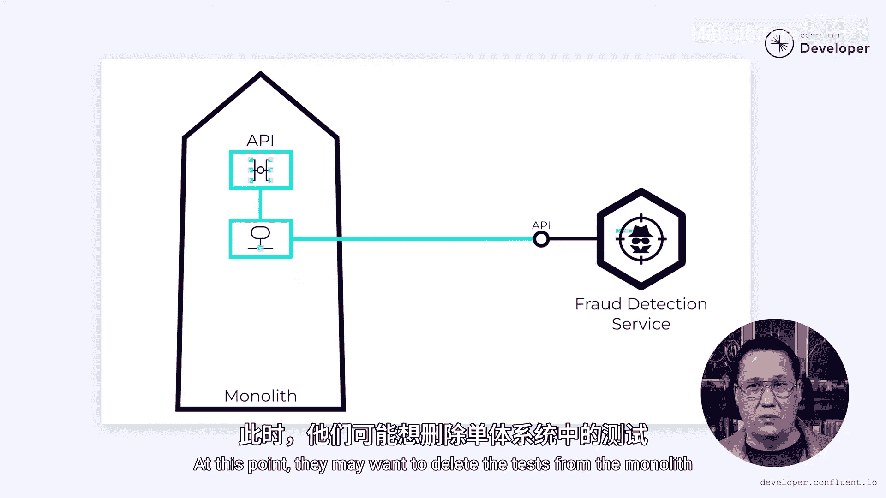

# 设计事件驱动微服务---中英-｜-microservice-｜-apache-｜-kafka-｜-confluent-p11-P11-Extracting-a-Fraud-Detection-Microservice-from-a-Bank-System--BV1D8EMzzEid_p11-

Tributary Bank has spent weeks untangling the dependencies in their monolith so they can begin decomposing it into microservices。

 They are confident that all access to their fraud detection system is going through a clean API。

 and it's time to start building a fraud detection microservice。However。

 they are worried that they might introduce issues in the process。

 They need to make sure that the new system is at least as good at detecting fraud as the old system。

How can they effectively decompose this portion of their monolith while maintaining the existing functionality？

Now， here comes the fun part。It may be contentious， but in my opinion。

 the first step to building a microservice is to deploy it to production。

I am not a fan of development cycles that leave production deployment to the end。

 You will learn far more from a production application than you will otherwise。

Keep in mind that running in production doesn't necessarily mean users interact with it。

Features can be in production but disabled behind feature flags or only accessible to a subset of users。

But if the users can access the feature， it's far more valuable than if they can't。

So how could tributary use this？First， they will create a hellello world version of the fraud detection microservice。

 This can literally be a rest service with a single hello world endpoint。Once it's ready。

 they deploy it to production。There's a lot to learn by putting the service into production。

 They have to figure out what deployment looks like。 They need to set up logging and monitoring。

 and they need to integrate it with their orchestration framework。

Getting this out of the way early allows them to avoid surprises。 At the end。

 There's nothing worse than spending six months on an application only to have the wheels fall off in production。

It would be better to learn that six months earlier。

Let's assume tributary has gone through this process。

 a hellello world version of the service is running in their production environment。

They've got logging， monitoring， and orchestration locked out。What's next？

The old system had a well defined API that they put a lot of effort into building。

The new microservice is going to need to support that API。

So tributary should create the appropriate rest endpoints in the microservice。

This will force them to define the inputs and outputs。

It also allows other teams to start thinking about how they will integrate with the fraud Detection Service。

However， they don't have to implement the logic behind these endpoints， it's enough to define them。

 even if they return empty or dummy values。This is especially valuable because the next step。

 even before they implement the logic， is to integrate with the monolith。Essentially。

 they use the strangler fig pattern or branch by abstraction to introduce an adapter This adapter will send requests to both the old and new systems。

Since the new system returns dummy values， the adapter will always return results from the old system。

But as the microservice begins to take shape， that will change。Now， remember， at this point。

 everything is running in production。Real users are interacting with the microservice。

 even though it doesn't do anything yet。This gives an ongoing sense of how the system will handle things like spikes and traffic。

 potential error states， etc。At the same time， because the adapter always returns results from the old system。

 users are isolated from potential problems。If the microservice has an issue。

 the adapter can log an error while continuing to serve the user without any interruption。Of course。

 talking to two separate systems could increase latency。To mitigate this。

 tributary could choose to talk to both systems only some of the time。For example。

 they could send every 10 request to the new system。However。

 this won't give them as good of a picture of how the microservice handles load。Alternatively。

 they could make requests to the new system asynchronous。 each time a transaction comes in。

 they communicate with the old system and immediately return the results。

 but in a separate thread or process， they also communicate with the microservice。

This keeps the latency back to the user low， but still lets them look at every transaction。

The goal is to do ongoing comparisons between old and new systems。

Each time a transaction is analyzed， they can collect the results from both systems and log any differences。

Initially， while the microservice is new， every transaction will be different。However。

 as the microservice begins to take shape， those differences will start to disappear。

If they plot the number of differences on a graph in their monitoring platform。

 they can get real time insights on whether the new system matches the old one。

These production metrics are incredibly valuable， but they shouldn't be the only way to measure accuracy。

Presumably， tributary had a robust set of automated tests around their old API。 If they didn't。

 then now might be a good time to build one。But assuming it's already there。

 they can leverage those tests to verify their new microservice。Remember。

 the API has an adapter that communicates with both the old and new systems。 Currently。

 we only return the old results， so all of the tests should pass。However。

 it is trivial to put a flag in the system that will switch the adapter to the new system。

That would allow the same tests to verify the new system's behavior。Presumably。

 once it passes all of those tests， it should be pretty close to production ready。

These tests would be more complex than a unit test because they require an instance of the microservice to be running。

But in terms of validating the behavior， they can be quite valuable。

That's not to suggest there shouldn't be tests inside of the microservice。

 There definitely should be the tests in the monolith are there to inspire what we build in the microservice。

Tributary is actively implementing new features into the microservice， meanwhile。

 they probably have a process or script migrating historical data into the new system。Eventually。

 they will reach a point where all of the tests are passing。Looking at the logs。

 they see that the microservice results are close enough to the monolith to consider it complete。

At this point， they can switch the adapter so that all requests are fulfilled using the microservice。

 If they've done things right， this should be a non event。

Nobody should notice they flipped the switch。They can leave it running like that for a little while to verify there aren't any unexpected developments。

 but eventually， they should feel confident that the new system is doing everything it needs to。

In all honesty， they should have been confident of that before flipping the switch since it had been using production data the entire time。

There shouldn't be any surprises。However， it never hurts to be a little cautious。

Once they are confident that things are running smoothly， they can start ripping out the old system。

 And I have to say， nothing feels better than deleting code。Once the old code is deleted。

 they can strip out the adapter and talk directly to the microservice。At this point。

 they may want to delete the tests from the monolith。

 since most of them will probably be duplicated in the microservice。

And now they're done。 They have successfully decomposed their fraud detection system into a microservice。

They did it completely in production against a live system。

 and they did it all without any interruptions or significant impacts on the user。Of course。

 your situation might be different。 You might find you have to skip some of the steps I've outlined here。

Or maybe you have to add a few more。Regardless， that's just the beginning of the journey。

 The whole point of this was to move to a more decoupled architecture that would allow them to evolve the fraud detection system。

And that's where we'll go next in upcoming videos we'll see how tributary can evolve the microservice to be more reliable and scalable by adopting an event driven an architecture。

In the meantime， how would you have done this differently。

 would you adopt a similar approach or would you go a different direction？

Let me know in the comments。And of course， as always， like， share and subscribe。

 and I'll see you next time。

