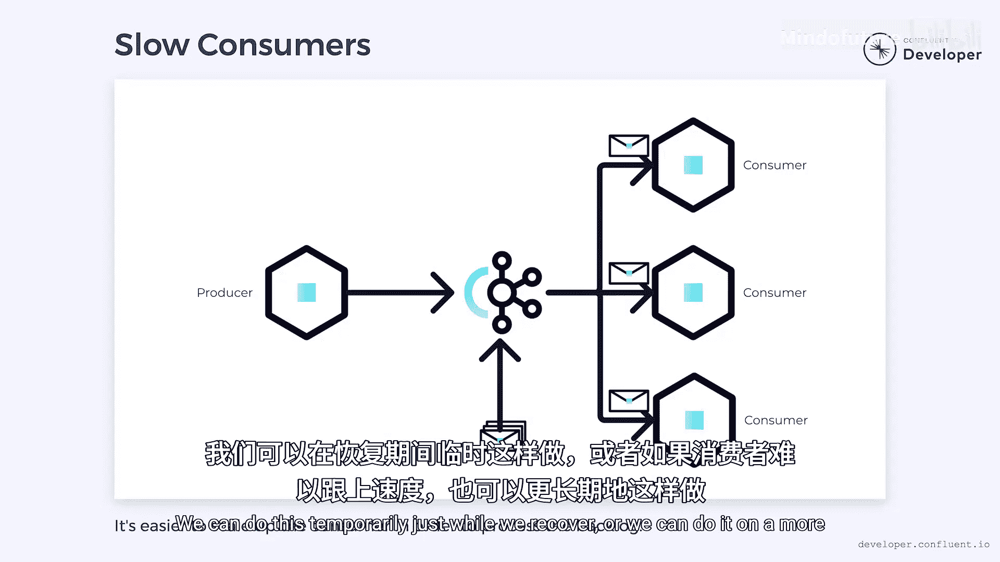

# 设计事件驱动微服务---中英-｜-microservice-｜-apache-｜-kafka-｜-confluent-p12-P12-Asynchronous-Events--BV1D8EMzzEid_p12-

🎼Hi， I'm Wade from Confluent。

Traditional systems are built on a foundation of synchronous calls。

 and for the most part it was effective。However， the world of microservices introduces new challenges in the form of network connections。

When we try to use the old approach in these new systems， things begin to break down。

Let's take a look。

In a monolithic architecture， communication within the system typically takes the form of function calls。

We assume that all function calls are local， all parts of the monolith are available。

 and all of our calls take a reasonable amount of time。However， with microservices。

 these assumptions aren't valid。Microservices communicate over a network rather than locally。

And there's no guarantee that all services will be operational at all times。

 a portion of the system may go offline temporarily。

The presence of a network and the possibility of outages can introduce unexpected delays。

These delays can cause larger problems if we aren't careful。

When we make a synchronous call to an external microservice， we are waiting for a response。

But what happens if that response takes too long or never arrives？In that case。

 the original caller is likely going to have to fail whatever operation it was attempting。

But what if it was just one link in a larger chain of calls？In that case。

 the failure can propagate upstream and cause a cascading failure。

The end result might be a significant outage。And if everything works， but is just delayed。

 those delays can also propagate upstream。Each call that waits is going to force any upstream calls to wait as well。

Suddenly， we have a whole string of operations crossing multiple microservice boundaries all waiting on each other。

Very quickly， the system can slow to a snail's pace。

The problem is that we have a mismatch in expectations。When we make a function call。

 we expect that the receiver is available and in a monolithic system， this is certainly true。

If the system is available to make the call， then it's also available to respond to it。However。

 when the call and receiver are different microservices， it's not guaranteed。Furthermore。

 we've been making the assumption that the function call will return in a timely fashion。

This was never a valid assumption， even in a monolith。Whenever we make a call。

 there are factors that might slow it down， including database access， CPU intense operations。

 and resource contention。If you're familiar with Java。

 you will probably have experienced the dreaded garbage collection pauses。

🎼These types of issues can occur in any system。 And as a result。

 assuming calls will always be instantaneous just doesn't make sense。

 Let's consider an alternative approach whenever something important happens in a microservice。

We can think of it as an event。An event is something that happened in the past。

 such as a customer being added or an order being shipped。

Rather than relying on synchronous calls to communicate these facts。

 we can instead produce an asynchronous event。We package the details of the event into a message that can be sent to any interested consumers。

Messages are sent in a fire and forget manner， often through a messaging platform such as Apache Kafka。

🎼The event producer might wait for an acknowledgecment that the message has been received。

 but we aren't waiting for it to be processed。 This allows consumers to process the event at their own pace without worrying about holding up the producer。

And rather than expecting an immediate response， the producer can watch for other events that might occur as a result。

If we synchronously wait for responses， it creates temporal coupling between the producer and consumer。

Essentially， the producer can't continue until the consumer is done。

This ties up resources such as threads， network connections， CPU， etc， and is generally undesirable。

By relying on asynchronous events， we break the temporal coupling。

 which allows the producer to send messages as fast as possible。

The producer can also free up resources more quickly， which can result in a more efficient system。

🎼The end result is a microservice that performs better at scale。

 Another benefit of breaking the temporal coupling is that we can be more flexible with when we deliver the events。

🎼If the consumer is unavailable or overwhelmed， messages can be queued and delivered later。

In the meantime， the producer can continue to produce new messages without worrying about the consumer。

As soon as the consumer is available， it can pick up where it left off。

So despite the period of unavailability， the producer has no reason to fail and the consumer doesn't miss any messages。

From an outside perspective， everything worked exactly as it should。Of course。

 even though the consumer can pick up where it left off， message processing will be delayed。

When the consumer recovers， it may have quite a backlog to work through。However。

 systems built with asynchronous events tend to be easier to scale up。

That means we can add new consumers to help reduce the backlog。

We can do this temporarily just while we recover， or we can do it on a more permanent basis if the consumer is struggling to keep pace。

For this to work， we need to embrace the asynchronous nature of events。

We have to recognize that they take time to process and build that into the system。

If we try to apply our old mentality of expecting immediate results。

 then we return to the problem of mismatched expectations。

The end result will likely be disappointing。But if we can learn to embrace asynchronous events。

 then it's possible to build systems that are significantly more robust and scalable than they would be with a more synchronous approach。

🎼I'm a big fan of building systems with asynchronous events， but I know it can be hard At first。

 What do you think， Are you using synchronous calls between your microservices or are you favoring asynchronous events。

Have you encountered any challenges with either solution？Let me know in the comments。 Meanwhile。

 if you want more details about events and event modeling。

 check out our other courses in Confluent Develop。 Don't forget to like。

 share and subscribe and thanks for watching。

