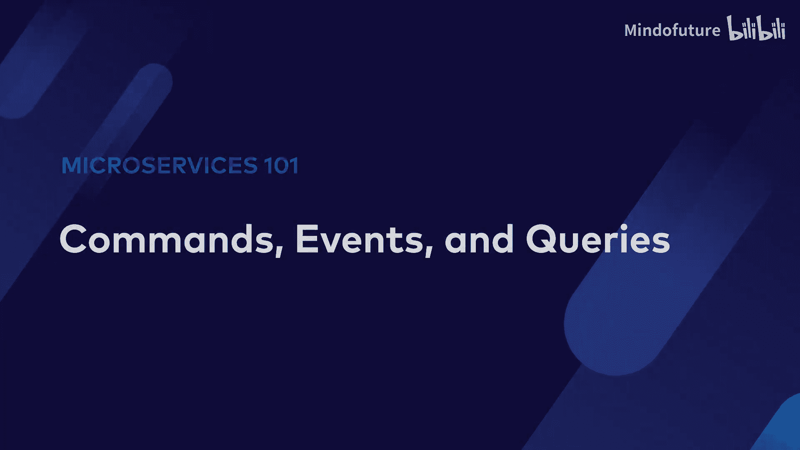
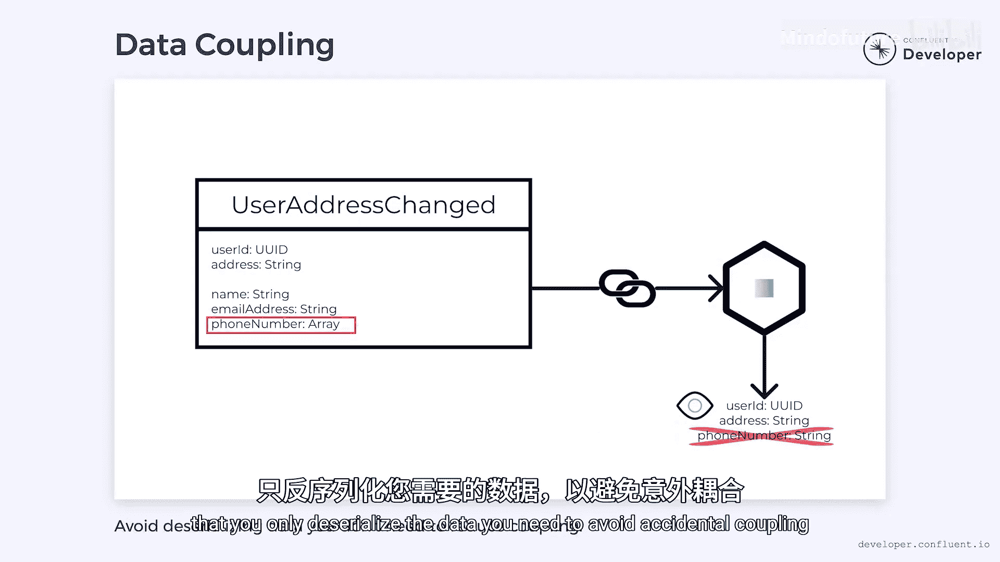
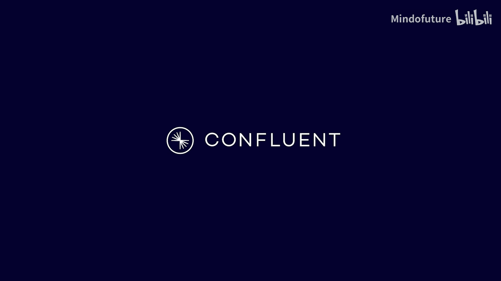

# 设计事件驱动微服务---中英-｜-microservice-｜-apache-｜-kafka-｜-confluent-p13-P13-Commands,-Queries,-and-Events--BV1D8EMzzEid_p13-

Hi， I'm Wade from Conflu。When communicating between microservices。

 we divide the messages they send into three categories， commands， events， and queries。

Each has a unique role to play that we'll discuss in detail。

In interface design there's something known as the principle of least surprise。

 it states that a user should not be surprised by an interaction with the interface。For example。

 if I choose to open a file in an application， I would expect it to load the file。

If it also modified or deleted the file， that would be surprising。

 following this principle leads to software that is more predictable， cleaner and easier to use。

So how does this apply to microservices？Commands are a request to change the state of a microservice。

🎼Following the principle of least surprise， the change should reflect the intent of the command。

 If we issue and add user command to the user's service， it should add that user。

It shouldn't do anything unexpected， such as deleting the user。However。

 commands can fail or be rejected。The sender will often wait for a response to see if the command succeeded。

These responses might contain details about the results， such as the user for an a user command。

But they can also be simple acknowledgements or acts， basically just a message saying， I heard you。

There is some debate about the right amount of data to include some developers prefer to return a detailed message。

 others prefer to send an a One advantage to an AC is it hides the implementation details。

 it allows the microservice choice in how it handles the command。

Rather than processing synchronously， it might just record the command， reply with an a。

 and do the processing later。This helps to decouple the two surface so they aren't waiting on each other。

Once the state of the system has changed， we need a way to access it。

 especially if the command was processed asynchronously。

Querries are a request to obtain the current state of the system。

They're usually synchronous and always expect a detailed response。For example。

 we could issue a get user query to obtain the user we created with the add user command。

Keeping with the principle of Lee's surprise， queries never change the state。

When I issue a get user query， it would be surprising if the user was altered in some way。

Like with the commands， the query should clearly reflect its intent。Unfortunately。

 the synchronous nature of a query means we may be stuck waiting。But what if we don't want to wait？

Events are the result of a command and communicate changes to the system。

They are a reflection of something that happened in the past。

Events are often sent through tools such as Apache Kafka， following the principle of least surprise。

 the names of the events should reveal their intent。

🎼They're often written as the past tense of the action that triggered them。 For example。

 for an ad user command。 The resulting event might be user added。

 It's also important to recognize that events are not commands。

 downstream applications can listen for the events and make changes in response。

 but they don't have to。 They can choose to ignore any event they aren't interested in。

 They still handle the event。 They just don't do anything with it。 However。

 The event has already happen。 So listening applications can't reject it。

 They have to acknowledge it， even if they choose to ignore it。

🎼We may choose to ignore the lessons of history， but we can't deny that it happened。

 Events should be handled asynchronously。 We go into this in more detail in our asynchronous events video。

 which you can find linked in the comments。The key point is that waiting for events creates coupling and we generally want to avoid that。

Events can also make commands and queries more asynchronous。

When issuing a command rather than waiting for a response， we can listen for the resulting event。

This allows commands to work in a fully asynchronous fashion。Similarly。

 rather than doing synchronous queries， we can listen to the events that record changes to the state。

We can use those events to create a local copy of the data without having to perform an external query。

There are two types of events。Delta events record only the details that changed in the system。

 For example， a change user address command might result in a user address changed event。

It contains an identifier for the user as well as details of the address change。🎼However。

 it doesn't contain other information such as the name， E， address or phone number。

 Delta events are lightweight。 The small size means they use less network bandwidth and require less storage。

 This makes them efficient to send through a platform such as Apache Kafka。However。

 they might lack the information to be useful。🎼If we wanted the names of the people who changed their address。

 that might not be in the events。 We'd have to issue a query to the user service to obtain the missing details。

This creates additional traffic and can increase coupling。Fact events， on the other hand。

 contain rich details about the object being modified。

The user address changed event could be augmented to contain all of the details of the user。

 including the name， email address， and phone number。

The rich data contained an effect event means we may not need separate queries。

The larger size requires more bandwidth， disk space and processing time。

 but in return it reduces coupling when using fact events。

 we need to be careful to avoid data coupling。Imagine that the user address changed event contains a field for the user's phone number。

If a downstream consumer decsializes the phone number。

 then we have introduced coupling changes to the data。

 such as converting the phone number to an array of phone numbers would mean updating the decializer。

A good practice is to ensure that you only decialize the data you need to avoid accidental coupling。

🎼When we design a system， the key is to pay attention to the types of messages we are using and understand the role each one plays As a best practice。

 It's a good idea to favor asynchronous events for the bulk of the communication in order to reduce coupling。

 That doesn't mean we can't use commands and queries。

 but we should limit them to where we really need them and try to keep them asynchronous if possible。

 There's a cost to making things synchronous， And we should avoid paying it as long as we can。

 Do you favor asynchronous events， or do you prefer synchronous commands and queries。

Let me know in the comments below Meanwhile， you might want to check out some of our courses on Confluent developer for more information on building event drivenven microservices Please like share and subscribe so we can keep the conversation going and thanks for watching。

