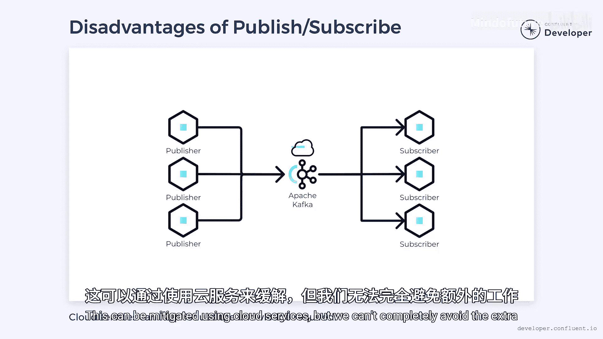

# 设计事件驱动微服务---中英-｜-microservice-｜-apache-｜-kafka-｜-confluent-p14-P14-Point-to-Point-vs-Publish-Subscribe--BV1D8EMzzEid_p14-

Hi， I'm Wade from Confluent。When microservices communicate。

 they can be direct using point to point communication。

 or they can be indirect and use publish subscribe techniques。

 both options come with some concrete advantages， but they also have consequences。

Let's take a moment and understand what each one offers。

Let's start with a quick analogy of communication in the real world。

Digital communication has taken over our daily lives， email。

 text messages and social media posts dominate our day to day communication。

We can think of text messages and emails as a type of point to point communication。

Both have a designated sender and receiver。The receiver is identified using a unique address or phone number social media follows something closer to a published subscribe model of communication。

When we publish something to a social media page or channel。

 we don't have much control over who will see it。Anyone who subscribes to that social channel will have access to what we post。

These subscriptions take the form of friend requests following hashtags or a variety of other mechanisms。

Most social channels will have many people subscribe to them。

 and when we publish messages to these channels， we give up control over the conversation。

We might be having a conversation with a thousand people。

 or we might be shouting into an empty room now let's look at how this applies to microservices。

Point to point communication in microservices often takes the form of HTTP or GRPC calls。

One microservice sends a message to another using these protocols。In order to send the message。

 we need the address of the recipient。The receiver will process the message and often synchronously send a reply。

Point to point communication has advantages in software， just like it does in the real world。

It creates a concrete link between the sender and the receiver this allows for a two way dialogue where the sender can reasonably expect a response from the receiver。

If something goes wrong， the two way link allows the sender to potentially take action and mitigate the issue。

It also makes it easier to understand what dependencies exist between different services。

We can look at what point to point calls are being made and immediately know who are the senders and receivers。

When the system is small， point to point communication shines。But as it grows。

 it can experience pressure from all of the direct links。Each link represents a type of coupling。

The sender is coupled to the receiver because it needs to know that the receiver exists and where it can be found。

Because these systems are often synchronous in nature， it creates temporal coupling。

Physical and temporal coupling can create issues in the system。

If a failure occurs in one microservice， it can propagate to others。

 this can cause small problems to grow into larger problems。

🎼It can also make it difficult for the system to evolve。

 Each dependency creates rigidity in the system。Changing a microservice becomes difficult because we have to think about the services that depend on it。

When the system is small， it might be relatively easy to manage these issues。

🎼But as the system scales， it becomes much more difficult。

 A single failure can ripple across a web of services。

 and determining the source can be extremely difficult。Meanwhile。

 some services become nexus points in the web because so many other services depend on them。

These services are critical to keep operating because if they fail， so does everything else。

Point to point dependencies create bottlenecks and single points of failure。

 which we want to avoid when building a distributed system Now let's contrast that with public subscribe communication。

When an important event happens in a system， a microservice can package the details of the event into a message。

These can be published to a topic in tools like Apache Kafka。

Downstream microservices can subscribe to the topics they are interested in。

Each subscribing microservice will receive every event in the topic。

 usually in the order they were sent。However， these events are handled asynchronously from the action that triggered them。

Like with social media， we don't know how much time will pass between when we post a message and when it is seen by the subscribers。

Furthermore， we don't know who will be subscribing to it and the subscribers don't know who did the publishing there's no direct link in this model。

This reduces coupling and creates isolation between the services。

Services are coupled to the messaging platform and the message format， but not to each other。

This allows microservices to change and evolve as long as they hold to the message format。

 other implementation details are flexible。🎼This allows the system to be more scalable as well。

 We can have multiple instances of a single service subscribing to any given topic。

 This allows the microservice to be rapidly scaled up or down， and scalability goes both ways。

 We can have multiple instances of the publisher as well。

 because the publisher and subscriber are not directly connected。

 addinging more instances of one doesn't have an immediate impact on the other。

Although the reduced coupling adds benefits， it can make it more difficult to understand dependencies in the system。

The layer of indirection between services means it can be tricky to track down all of the systems impacted by a change。

This isn't too bad going downstream where we can usually access a list of the subscribers。

 it's a little worse looking upstream because the messaging platform may not keep track of where a message originates。

It can be a good idea to include metadata in the message indicating the origin to help mitigate this。

Just make sure downstream systems don't rely on that metadata or you start to introduce coupling。

Furthermore， to create interaction， we usually rely on an external system such as Apache Kafka。

These systems come with their own learning curve and require expertise to deploy and manage。

This can be mitigated using cloud services， but we can't completely avoid the extra work。

When building microservices， scalability and resiliency are often high on the list of requirements。

Publish subscribescribe is well suited to providing these features as such for most microservice systems。

 publish subscribe should form the backbone of the communication however there is room for point to point as well we just need to make sure that we rely on it only when necessary and ensure that it involves at most to microservices。

 creating long chains of point to point calls introduces a lot of coupling and can lead to cascading failures。

Do you use P subscribe in your system， is it based on Apache Kafka or have you chosen something else？

And is it a cloud service or self hosted？Let me know in the comments below Meanwhilewhile。

 have a look at our courses on Confluent developer for more information on building event driven microservices and don't forget to like。

 share and subscribe。Thanks for watching。

