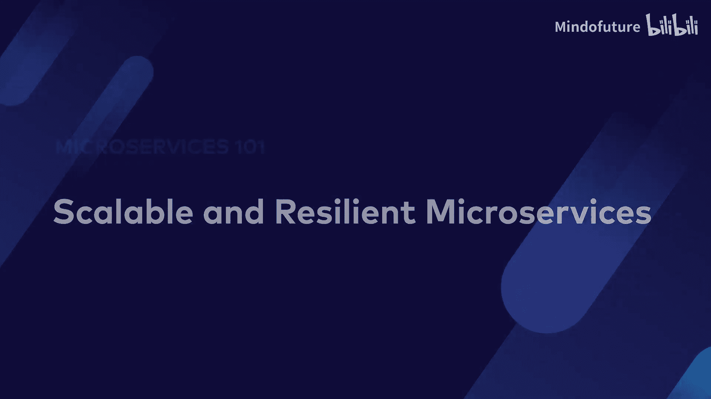
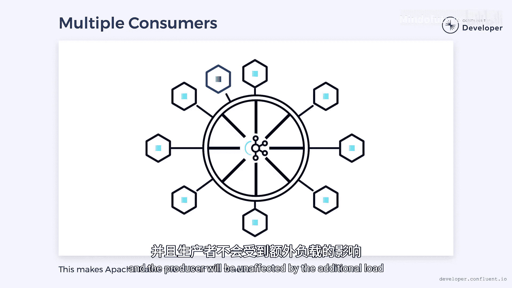

# 设计事件驱动微服务---中英-｜-microservice-｜-apache-｜-kafka-｜-confluent-p15-P15-How-To-Build-Scalable-and-Resilient-Microservices--BV1D8EMzzEid_p15-

Hi， I'm Wade from Confluent。Scalable and resilient microservices are built on a backbone of asynchronous messages delivered in a public subscribe fashion。

Let's take a look at how this works and how Apache Kafka can help。

Let me start by introducing you to someone This is Boo Boo is my childhood teddy bear。

 he's very special and there's only one of him。🎼He has a name。

 a history and a lot of memories associated with him。 He's irreplaceable。

 which also means he's not very resilient or scalable。 I can't create more of him。

 And if he gets lost or damaged， it's over。Now let's contrast that with another childhood toy here I have a bucket of Lego。

 easily the most successful building toy ever made。I can build some pretty awesome stuff with Lego。

 but none of the individual bricks are all that special。

The benefit of Lego is that bricks are cheap and easy to replace if I damage or lose a piece。

 who cares， I'll just buy more。So ask yourself。What do you think works better for microservices？

🎼Do you want your services to be irreplaceable， like boo or do you want them to be easily replaceplaceable。

 like Lego， Ideally， we want microservices to be more like Lego。

 This requires us to depersonalize them and stop treating them as though they are special。

The first step is to avoid having special microservices that aren't allowed to fail Fail is inevitable。

If we pretend services are always available， then we risk total collapse if they aren't。Instead。

 we should recognize that failure is possible and even expected and design the system to handle it。

One way to achieve this is by using Apache Kafka for communication。

Messages are sent to a topic where they can be persisted for as long as necessary。Meanwhile。

 consumers subscribe to the topic to receive the messages。Should a consumer go offline。

 the messages will be buffered in the topic， and once the consumer recovers。

 it can pick up where it left off if the producer fails， the flow of messages might stop。

 but downstream consumers can continue to perform other tasks。

🎼This allows microservices to be more ephemeral， where sometimes they are running and other times they aren't。

 but the system as a whole can continue to operate despite periods of unavailability。

 This feature of Apache Kafka can also allow us to implement scaled to zero approaches。

 if a particular microservice hasn't received any messages for a while。

 we can potentially turn it off。When the messages resume。

 we can turn the service back on and allow it to consume again。Because we have persistent messaging。

 there's no risk that the service will miss anything。

 we just have to be prepared to deal with the time it might take to wake up the dormant service。

Another way microservices can become special is by making assumptions about how many instances exist。

It's easy to find ourselves in a situation where only a single active instance of a microservice is possible。

For example， choosing to consume events in a strictly linear order limits us to a single threaded process in a single instance of a microservice。

These are the types of bottlenecks we want to avoid because they severely limit scalability。

This is one of the benefits of Kafka partitions。🎼Rather than consuming all messages in a linear order。

 we can partition the messages according to some key。 For example。

 we might partition them by the user I。 Each partition can be consumed in parallel。

 which allows us to scale up。🎼Meanwhile， within a partition， the order is still guaranteed。

 This allows us to have the best of both worlds。We have guaranteed ordering of events within a partition and can process individual keys in parallel。

One of the biggest issues we want to resolve is avoiding single points of contention。

These can occur even if you run multiple instances of a service。

Sometimes a service becomes so critical to the operation of your system that everything else depends on it。

It essentially becomes the hub in a wheel with all of the other services pointing to it like spokes。

This is a problem because that service might be under heavy load from all of its dependencies。

We can resolve this by reversing the dependency。We take that hub and we turn it into just another spoke。

This is done by having the service publish messages to Apache Kafka。

Depenent services can subscribe to those messages and behave appropriately。🎼Essentially。

 Kafka becomes the hub or central nervous system， which is what it was designed for。

 And we eliminate another special case with this model。

 we can have as many downstream consumers as we want。

 and the producer will be unaffected by the additional load。 This eliminates the bottleneck。

Part of building distributed systems involves looking for these special cases。

 often they indicate bottlenecks or single points of failure。

 and our goal should be to eliminate them。Of course we may not be able to eliminate all of them。

 some components are just too critical to allow failure。

 but if we can minimize the number of special services。

 it can help us build a system that is more robust and scalable。

I'm sure I've missed some ways that microservices can become bottlenecks or single points of failure。

 let me know in the comments。And have a look at our courses on Confluent developer if you want more information on building scalable microservices。

Don't forget to like， share， and subscribe， and I'll see you next time。

