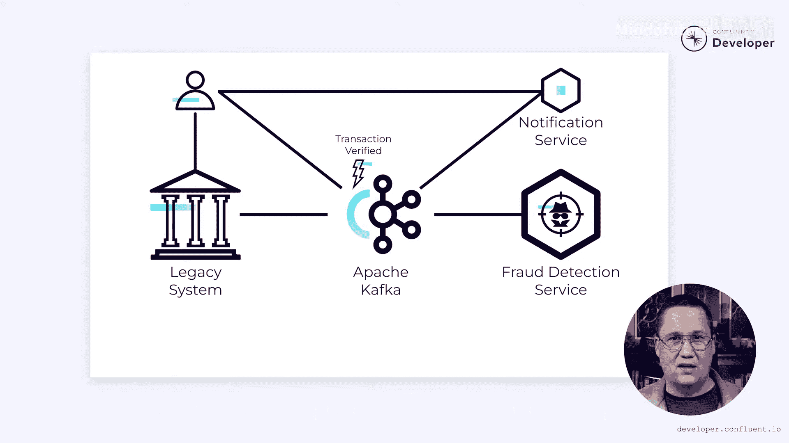

# 设计事件驱动微服务---中英-｜-microservice-｜-apache-｜-kafka-｜-confluent-p16-P16-Using-Asynchronous-Events-to-enrich-Fraud-Detection--BV1D8EMzzEid_p16-

Frad detection is a complicated process involving the application of machine learning algorithms。

 complex rules， and even human analysts。

We have been following Tributary Bank as it decomposes a legacy monolithic system。

 extracting fraud detection to its own microcicus。Unfortunately， there's a problem。

When everything was running inside of a monolith It either all worked or none of it did。

That has disadvantages because failures in isolated subsystems can bring down the entire monolith。

But in the microservice design， if the microservice becomes unavailable。

 it can still have an impact on the rest of the monolith。Let's look at a quick example。

Imagine one of the bank's customers decides to purchase concert tickets。

This creates a new transaction in the banking system。If everything works the way it is supposed to。

 the system records the transaction in the fraud detection service and kicks off a process to analyze it。

But what if the fraud detectionte Service goes off line？I mean， ideally it wouldn't。

 but it's always best to assume failures are possible。

If the fraud detectionte service is unavailable， we have two possible solutions。Okay。

 technically more than two， but let's simplify to just the obvious ones for the moment。

The system could fail the original transaction， but that's a terrible experience if this is a legitimate purchase。

Customers are going to be upset。To prevent that， the system could allow the transaction and just fail to register it with the fraud detectiontection service。

But if this was part of a chain of fraudulent transactions。

 the fraud detectionte Service is now missing critical information。

This could prevent it from recognizing the fraud， and again， the customer would be upset。

The source of the problem is that the rest calls between the legacy system and the microservice operate synchronously。

The call to the microservice has to be completed before the legacy system can move on。

Even though the actual processing is done asynchronously。

 there's still a synchronous component getting in the way。

We can resolve this by moving away from rest calls and instead using asynchronous events。

When a transaction is processed， the system can emit a transaction recorded event。

It contains details about the transactions such as the account ID， the amount。

 and any other important details。The event is sent to a messaging platform such as Apache Kafka。

 And once it's there， the original transaction is complete。

The customer doesn't have to wait for the fraud detection service to receive or process the event。

I hold on a minute。Did we just move the problem？Before， if the microservice was down。

 then we couldn't move on。 Now， if cafr goes down， we have the same problem。That's true。

 and yet it isn't。Kafka should be treated like an integral piece of the architecture。

 Think of it like a database。If the database goes down， odds are and nothing works。

So a lot of effort is spent ensuring that never happens。

 The same level of rigor should be put into the Kafka deployment to ensure it remains available。

But more importantly， with Kafka， we can centralize our efforts。

Imagine a system with 300 microservices and you have to make sure that each of those services is reliable at all times。

That's hard。Comparatively， making a single CAfka deployment reliable is easier。

 especially if you use a cloud hosted service like Confluent Cloud。So even though technically。

 the problem still exists， it's easier to avoid it when using a platform such as Apache Kafka。

 That's not to suggest that this is easy， but you only have to do it once rather than 300 times。

 and furthermore， as we'll see in future videos， there are ways to ensure the system remains operational。

 even if Kafka is unavailable。Okay， so let's assume the event made it into Kafka， what's next？

The Fd Detection Service is going to subscribe to the transaction recorded events。

Whenever it receives one， it will record the relevant details in its database and kick off the fraud detection process。

This might take some time as it runs through the various scenarios， but thankfully。

 that has no impact on the original transaction。And more importantly。

 should the fraud detectionte Service go off line for any reason。

 the events can still be written to Kafka。That means the service can pick up where it left off once it becomes available。

 and it never misses a transaction。But we aren't done yet。

 We've solved the problem of how to ensure transactions can proceed。

 even if the microservice is unavailable。 What we haven't figured out is what to do if a fraud is detected。

Resumably， the bank might want to lock the account to ensure the problem doesn't get worse。

But how do we do that if the transactions aren't waiting for a response？

The naive approach would be to make a rest call to the microservice to check if the account has been locked。

But that only works if the microservice is running。

A whole point of this exercise was to find ways to allow the system to operate。

 even if the microservice is unavailable。Our previous solution was to move to an asynchronous event for communication。

 maybe we can do that here as well。What if the fraud detectionte service were to emit an event such as account locked？

This event would contain details about the account and the reason why it was locked。

The legacy system could subscribe to these events， and whenever it sees one。

 it could update a flag in its own database。 The next time a transaction arrives。

 there's no need to call the microservice to check if the account is locked。

This eliminates the synchronous dependencies between the legacy system and the microservice。In fact。

 the legacy system doesn't need to know that the microservice exists。

All it knows is that it sends events to one topic and receives events on a different topic。

What happens in between is irrelevant。There's an added benefit to this approach。

 Let's assume that if a user's account becomes locked。

 we'd like to send them an email or a push notification。

Now imagine we build another microservice that listens to the account locked events。

When it receives one， it sends the appropriate notifications。Once again。

 the notification service has no requirement that the legacy system or fraud detection service are operational。

 It doesn't need to care whether or not they exist。As long as events are flowing。

 how they get there is irrelevant， and even if the events stop flowing for a little while。

 that's okay。As soon as they resume， the notification service will continue as though there had never been an interruption。

This is one of the benefits of an event driven architecture。With synchronous operations。

 each time you add a new function， you increase the latency of the original operation and introduce a potential point of failure。

However， asynchronous events can be reused without introducing synchronous dependencies。

If a failure occurs， it is isolated to the consumer。

You can have thousands of microservices all consuming the same events and the original producer remains blissfully unaware。

Because of how powerful this is， tributary won't want to stop with two events。

 In addition to the account locked event， they could o something like a fraud suspected event。

Imagine if the user could receive a push notification warning them of suspected fraud。

 They could immediately look at the transaction， verify that it was them and avoid the need to lock the account。

Meanwhile， this could emit a transaction verified event or something to that effect。

This is the reason why tributary embarked on this path。

 They wanted a system that they could easily evolve to provide increasing business value without being tied down to the interconnected nature of the legacy system。

Asynchronous events allow them to build new features without creating additional complexity。

These features can live in separate microservices that operate autonomously。

 relying only on the flow of events。That's not to say that the entire system will operate like this。

 There will be times when a rest call makes more sense than an asynchronous event。

But that should be the exception， rather than the rule。

The bulk of their communication should rely on asynchronous events and fall back to rest only when necessary。

Now， obviously， I'm taking a very complex domain and simplifying it dramatically for this video。

 The reality isn't going to be this easy。But hopefully it gives you a sense of how you can use asynchronous events to enrich your domain and protect it from failures。

However， it doesn't end there。Despite the great strides tributary is made toward a more autonomous system。

 there are some rather insidious problems hiding in the architecture。In future videos。

 we'll see how they can tackle issues such as the dual right problem and Schema evolution。

Don't forget to like， share， and of course subscribe。

 think of it as your way to listen to my asynchronous events。And hey。

 if you want to send me an asynchronous event， drop me a comment and let me know what you think of the video。

Otherwise， I'll see you next time。

