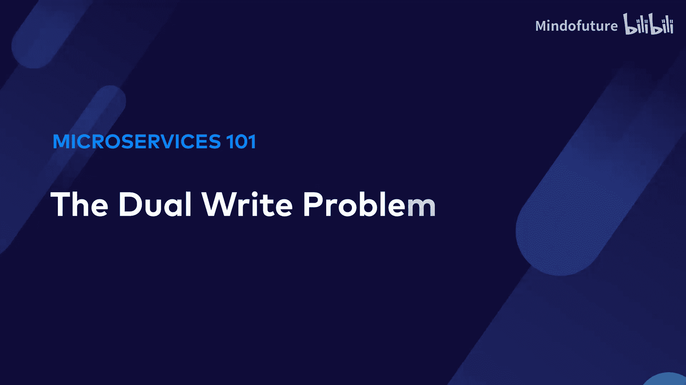
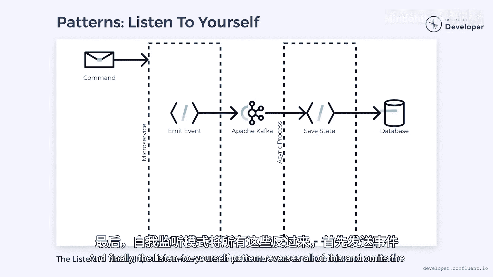
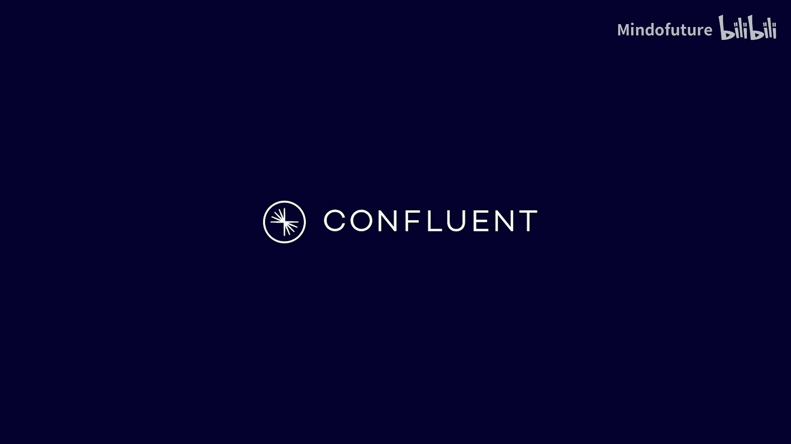

# 设计事件驱动微服务---中英-｜-microservice-｜-apache-｜-kafka-｜-confluent-p17-P17-What-is-the-Dual-Write-Problem--BV1D8EMzzEid_p17-

Hi， I'm Wade from Confluent。When I first started building event driven microservices。

 I made mistakes。Perhaps the biggest mistake was falling into a trap that is often referred to as the dual right problem。

So what is the dual right problem， stick around and I'll explain it to you。

When we emitmit an event from a microservice， it is typically triggered by a command。

These commands are designed to change the state of the microservice in some way。

While handling the command we'll make any changes and then save them when we're done in an event driven system。

 we want to o that change in the form of an event。On the surface， this sounds simple。However。

 can you spot the hidden issue？I'll give you a hint。

 The problem lies between the save and emitit statements。

The save statement is interacting with our database。

 This might be a relational or no sQL database of some kind。Meanwhile。

 the o statement is sending the event to an external messaging system such as Apache Kafka。

These systems are disconnected and can't be updated in a transactional fashion。

So what happens if our application fails after the save has completed。

 But before the emitmit finishes。 In that case， our database has been updated。

 but our event was never omitted。Now， we have an inconsistency between our state and our events and no clear way to resolve it。

The consequences of these inconsistencies can be minor， but they can also be quite severe。

 depending on your use case。 For example， what if the state being updated was your bank balance when you pay a bill and the event was what triggered the bill to be paid。

 When the failure occurs， you've withdrawn the money from your account。

 but the actual payment never happens。 Clearly， that's a situation we want to avoid。 Of course。

 the dual right problem isn't limited to just emitting events。

 It occurs any time you have to update two separate systems。For example。

 if instead of oting an event， we wanted to send an email， we'd have the same problem。 I'm curious。

 have you seen these types of inconsistencies in your own software。

 Were you able to track down the source， Let me know in the comments below。 Now。

 you might ask why we can't just omit the event first。Unfortunately。

 doing that just reverses the problem。 We end up with an event being omted。

 and the state never gets updated。The system is still inconsistent， so we haven't improved anything。

However， what if we wrap the whole thing in a transaction？The idea is that if there's a failure。

 then the transaction doesn't get committed and the state is rolled back。Unfortunately。

 this just moves the problem。Remember， there are no transactions spanning both the database and messaging platform。

If a failure occurs after the event has been published， but before the transaction is committed。

 then we still encounter a problem。The event has already gone out， but the state gets rolled back。

 and we have another inconsistency。So how can we fix this problem？

The key is to separate the two rights so that one becomes dependent on the other。

A common way to do this is to write data to the database and then have a separate process that scans for changes and emits the corresponding event。

If the database is never updated， then the event won't be omted。 And once the database is updated。

 that separate process will eventually find the change and emit the corresponding event independent of any failures。

The only risk is if the process fails after ottting the event。

 Then it will have to restart and may create a duplicate。 However。

 deduupplication of events is a common practice in downstream consumers。

 And if it's already in place， then this won't cause any issues。

There are a few patterns to help with this process。

Change data capture or CDC systems are designed to monitor a database and perform an action such as writing to Kafka when a change occurs。

We can use CDC as the separate process that triggers our events。

The transactional outbox pattern uses a transaction to update both the state and an outbox table at the same time。

The outbox is a log of the events that need to be omitted。

A separate process can then scan the outbox and emit any pending events。

 Event sourcing eliminates the storage of state and only stores the events。

 We then run a process against the event log and emit anything new。Meanwhile。

 the events can be used to reconstruct the state when it's required。 And finally。

 the listen to yourself pattern reverses all of this and emits the events First。

 A separate process then listens for the events to update the state。

Each of these options is viable for eliminating the dual right problem。 Now。

 the reality is that many teams ignore the problem and assume the database and messaging platform will both be updated successfully。

 They might claim that this is fine because they haven't seen it cause any issues。 Unfortunately。

 issues caused by this problem are extremely difficult to spot。

 You don't get any red flags indicating that something has become inconsistent。

 And even if you spot the inconsistency， Tracing back the origin can be extremely difficult。

More importantly， software shouldn't be built， assuming everything will work perfectly。

We should learn to embrace failure and plan to handle it accordingly。

In the case of the dual right problem， that means building a solution before it happens That way。

 we can avoid any of the inconsistencies it will cause。

If you enjoyed this video and want more information on building scalable microservices。

 check out our courses on Confluent  developer， please like。

 share and subscribe to support this content and keep an eye out for the next video。

