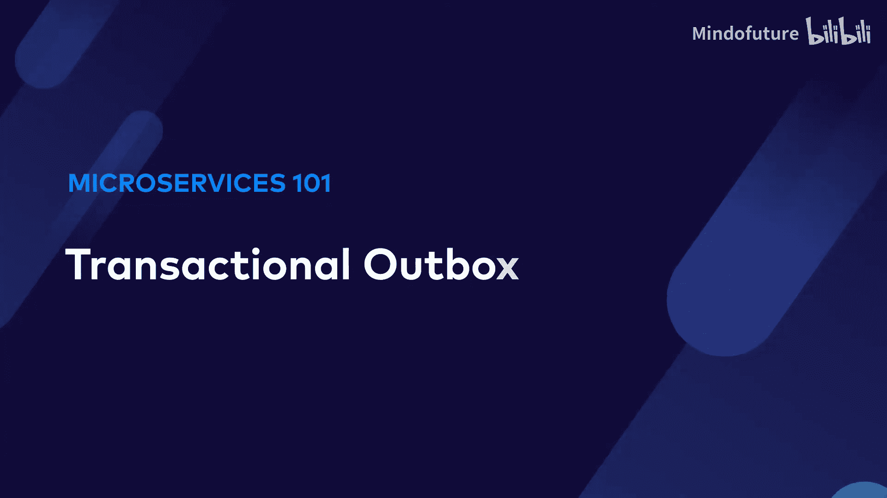
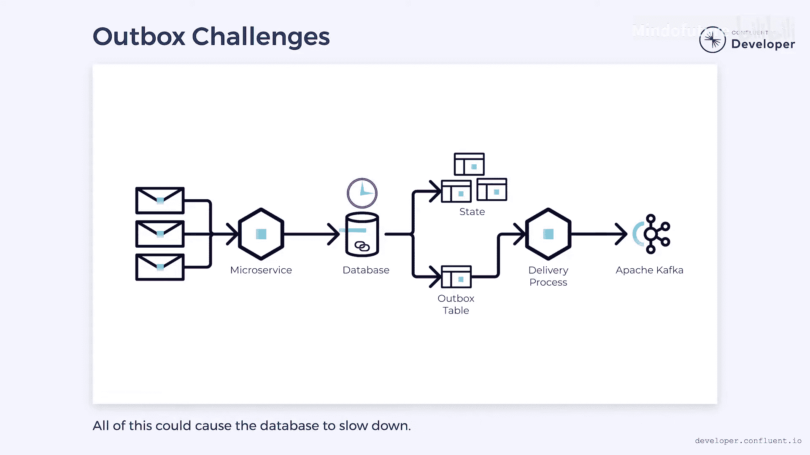
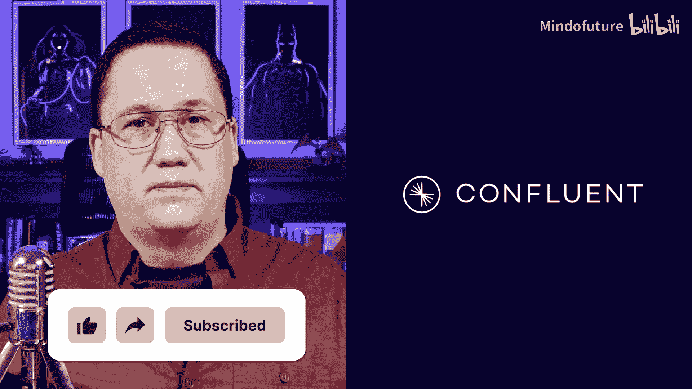

# 设计事件驱动微服务---中英-｜-microservice-｜-apache-｜-kafka-｜-confluent-p18-P18-What-is-the-Transactional-Outbox-Pattern--BV1D8EMzzEid_p18-

Hi， I'm Wade from Confluent。When we emit events from a microservice。

 we have to solve the problem of how to update the database and emit the events in a transactional fashion。

One of the easiest ways to do this is using the transactional outbox pattern。

Let's take a moment and see how this works。

The dual right problem occurs whenever we need to update two separate systems， For example。

 if we want to update the database and also write events to a separate system such as Apache Kafka。

Because these two systems aren't linked， we have no way to update both in a transactional fashion。

We need to find another way to ensure that either both get updated or neither does。

This is where the transactional outbox pattern can help。

If we have a database that supports transactional updates。

 then we can use it to overcome the dual right problem。

Rather than trying to update the database and Kafka at the same time。

 we pushed the transactional logic into the database。Whenever we do an update in our database。

 we can also update an outbox table in the same transaction。Think of the outbox as a mailbox。

 We fill it with letters that need to be delivered。

We then wait for a mail carrier to pick up the letters and deliver them to the post office。

In our case， the letters are the events we want to send to Kafka Kafka acts as the post office。

But we still need something to fill the role of the mail carrier。

 So what can we use to emit the events from the outbox table into Apache Kafka。 In this case。

 we can use a separate process that asynchronously monitors the table wheneverever it sees a new event。

 it can deliver it to Kafka。Once the event has been successfully delivered。

 it can be removed from the outbox table。The process is often written as another thread within the original microservice。

 However， it could run as a completely separate application。Depending on the database you are using。

 you might be able to use a Kafka connector or change data capture system to monitor the table and emit the events。

 The advantage of the transactional outbox pattern is it avoids the dual right problem。

The state and the Outbox table will always be updated in a transactional fashion。

If for some reason the state fails to update， then the event won't be written to the outbox。

This means we can guarantee that the data in the outbox is completely in sync with the data in the database。

From there， the separate process that delivers the events to Kafka ensures that the Elbox table and Kafka remain in sync。

This allows us to guarantee that every database operation will have a corresponding event in Kafka。

 although there will be a bit of a delay。However， when the process is oting events to Kafka。

 it's possible well experience a failure or a timeout in these situations。

 to guarantee that Kafka receives the data will'll have to try again。

These retries can result in duplicate messages。Our delivery guarantee to Kafka is therefore。

 at least once。We guarantee every message in the outbox will arrive in Kafka。

 but it may arrive more than once。As a result， we need to make sure that downstream systems are prepared to handle any duplicates。

 At least once guarantees are common in distributed systems， and therefore。

 it's a good practice to implement deduplication logic to handle them。

 Even when the dual right problem isn't involved。 For example。

 the receiver might fail while processing a Kafka message。 And when it restarts。

 it might receive the same message again。 We have to be prepared to handle those situations。

 This can result in a lot of traffic。 The frequent updates means the database might keep the table in memory at all times。

 Oing a lot of resources。Meanwhile， some databases aren't very efficient at handling deletes。

 They might use tombstones under the hood， and with so many inserts and deletes happening all the time。

 those tombstones can build up。This can lead to heavy resource usage and contention in our table。

If the database isn't equipped for this kind of traffic。

 it might slow down our application because remember。

 every right is going to be touching that outbox table。To resolve these issues。

 we might need to make adjustments such as marking records rather than deleting them。

 or adjusting how the database manages tombstones。There can be long term benefits to keeping the events around。

 so a delete may not be strictly necessary。 Some databases may even have special tables that are designed specifically for this kind of traffic。

If your system meets the requirements for the transactional outbox pattern。

 it can be a straightforward and effective way of overcoming the dual right problem。

🎼It's often easier to manage than other options， such as event sourcing or the listen to yourself pattern。

 However， if you aren't using a transactional database。

 or if you have other reasons to avoid using an outbox。

 then these other patterns might be good options to consider。

 When I first discovered the transactional outbox pattern。

 It seemed like a good solution to the dual right problem。 What do you think。

 Can you see yourself using this pattern in your applications。

 Is there an alternative pattern you prefer。 Let me know in the comments。

 If you want a deeper dive into the dual right problem or other microservice concepts。

 Check out our YouTube channel in the courses on confluent developer。 Remember to like。

 share and subscribe and stay tuned for more。

