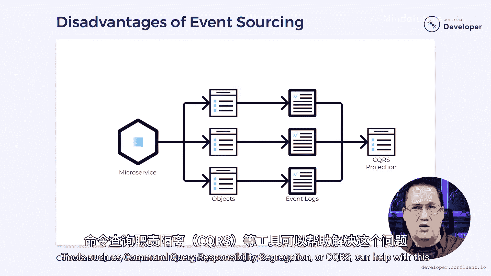

# 设计事件驱动微服务---中英-｜-microservice-｜-apache-｜-kafka-｜-confluent-p19-P19-What-is-the-Event-Sourcing-Pattern--BV1D8EMzzEid_p19-

Hi， I'm Wade from Confluent。Traditional database architecture can be thought of as a road trip。

You might take many twists and turns on your journey。 but where you are now is all that matters。

Except， it isn't。The journey is often just as important or more important than the destination。

But how does that translate into a database architecture？Traditionally。

 when we store data in a database， we do so in a destructive fashion。 Each time we update a record。

 we destroy whatever data was there previously。This means that we lose the history of the events that LED to the current state。

But what if we didn't want to lose the history， What if we were interested not just in where we are。

 but also in how we got there。 Have you ever investigated a bug only to discover that the current state doesn't contain enough information for you to diagnose or fix the problem。

You need to know what specific changes a user made to arrive at that state。

If you've seen this kind of situation before， let me know in the comments。

 One way to solve this would be to persist an audit log， along with the state。

 Each time we update a record in the database， we can write an audit event to another table。

These events would contain details about what changed， who changed it and why。

The events would be kept forever because we never know when we might need access to the history。

This can be very important in highly regulated industries， such as banking or health care。However。

 these audit entries do have potential issues。If we have implemented the log correctly。

 any details that exist in the state will also exist in the log。This leads to data duplication。

And if we have duplicate data， then what happens if it gets out of sync？Ideally。

 we' perform any updates in a transactional fashion to prevent that。 But bugs happen。

 And when they do， we need a plan to deal with them。When our state and audit log are in disagreement。

 the safe choice is to rely on the audit log。 It contains a full history of all the events and therefore is typically more reliable than the state alone。

But this begs the question。If all of the data is contained in the audit log and if the audit log is the final source of truth。

 then why do we need the state。Couldn't we just scrap the state and use the audit log instead。

This is the basic principle behind event sourcing。Each time we update an object inside of a microservice。

 We don't store the current state of the object in the database。 Instead。

 we store the events that LED to the state， essentially the audit entries。

If we need to reconstruct the object， then we can replay all of the events and use them to calculate the current state。

Baanking is an excellent example of how this works。 The account balance represents the current state。

 However， that's not what the bank stores。 Instead。

 the bank stores a list of all of the transactions that LED to the current balance。

If we want to increase our balance from $100 to $200。

 then we do so by depositing an additional hundred。Rather than storing the new balance。

 we instead store an event， perhaps named funds deposited。

 and we record important details about the event， such as how much was deposited and when。Later。

 when we want to know the current balance of the account。

 we can replay all of the events to calculate it。The advantage of this approach is that if a mistake happens anywhere along the way。

 we can use the historical record to locate the mistake and issue a correction。

 We can even replay portions of the event log to reconstruct what the state was at any time in the past。

If I want to know what my balance was at 3 PM last Tuesday。

 all of the information required to answer that question is readily available。

That wouldn't be true if I was only storing the balance and not the transaction history。

Another key advantage provided by event sourcing is that it allows us to solve the dual right problem。

When we build event driven systems， we often need to record data in our database。

 but also emit events to a secondary system such as Apache Kafka。

Because Kafka and the database aren't connected。 There's no way to update both in a transactional fashion。

 This can leave us in a situation where one update fails and the other succeeds。

 and our data becomes out of sync。However， using event sourcing， we can solve this problem。

Rather than trying to update both the database and Kafka At the same time。

 we worry only about the event log。 Remember， it's our single source of truth。

As long as the event makes it into the log， then we consider it to be correct。

We can then have a separate process that scans the event log and emits any new events to Kafka。

Once this separate process finishes， we'll be able to guarantee that the database and Kafka are in sync。

 We've eliminated the risk of data loss。Of course， event sourcing isn't a perfect solution。

It can introduce complexity， especially when we need to deal with queries that span multiple data objects。

Tools such as command， query， Re segregation or CQRS can help with this， but they come at a cost。

So although event sourcing can seem like a very powerful tool。

 it may not be the tool we want to reach for in every situation。

 It can be a great option when we're building portions of our system that give a competitive advantage or require auditing。

 But for systems without these requirements， the added complexity can outweigh any advantages。

🎼If you want a deeper dive into the dual right problem。

 check out the video linked below for more information on event sourcing。

 Make sure you look at the course found in Confluent developer and on our YouTube channel。

Don't forget to like， share and subscribe， and I'll see you next time。

