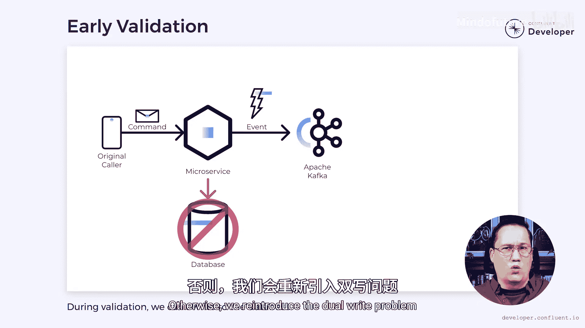

# 设计事件驱动微服务---中英-｜-microservice-｜-apache-｜-kafka-｜-confluent-p20-P20-What-is-the-Listen-to-Yourself-Pattern--BV1D8EMzzEid_p20-

Hi， I'm Wade from Confluent。

Sometimes when we build a microservice， it may need to perform a series of complex steps in response to a command。

It's possible that these steps may require transactions that span multiple systems and may take longer than we are willing to wait。

In these situations， we can reach for the listen to yourselfse pattern as a potential solution。

Let's consider a simple example。 Imagine a user has a fitness tracker。

 This tracker collects data such as steps， heart rate， et cetera。

The data is periodically synced to the user's phone and then pushed to a microservice somewhere in the cloud。

It can then be processed to build a complex model of the user's health。However。

 this raises potential issues。Throughout the process。

 we might need to access the database multiple times both for reads and writes。

We also need to process all of this data to build up the necessary models of the user' health。

 Meanwhile， we don't want the user to be stuck waiting while we execute all of this logic。

 We want to respond to them as fast as possible so they can disconnect and move on。At the same time。

 we might want to create some events and o them to Apache Kafka。

This might mean that we need to update both the database and Kafka in a transactional fashion。

And that puts us face to face with the dual right problem。

We have to update two systems that aren't transactionally linked。

If you aren't familiar with the Du right problem， check out the video linked in the description。

This is where the listen to yourself pattern can help。

Rather than performing all of the update logic while the user waits， we can defer it。Instead。

 when we receive the command from the user， we convert it to an event and then emit the event to Kafka。

 Once the event is in Kafka， it's safe and we can respond to the user。

 So in our fitness tracker example， the user's device might send a sync device command。

We would convert that to a device synced event and send it to Kafka。

Then we immediately replied to the device without any further processing。

This allows a fast response without excessive waiting。At the same time。

 the original command only writes events to Apache Kafka。 It doesn't write anything to the database。

 which means we don't encounter the dual right problem。After all。

 there's only one right happening here。However， our processing and database rights do have to be completed at some point。

Therefore， the next step is to have a separate process in our microservice that listens for the event。

This is where the name listen to yourself comes from。When it's received。

 it can initiate all of the complex processing and update the database as appropriate。Once again。

 here we are only updating the database， not Apache Kafka。

 so we continue to avoid the dual right problem。However。

 this approach does come with some challenges。Because we write the event and asynchronously update the database。

 we introduce potential race conditions。Once the original caller receives its reply。

 it might assume the database has been updated。If it goes to look for the data before the event is processed。

 then it won't find what it's looking for。Meanwhile。

 if a downstream system consumes the events and calls the microservice looking for further details。

Again， they might not be there yet。 This happens because the microservice is eventually consistent。

 At any given moment， there may be inconsistencies in the data that result from unprocessed events。

Eventually， once all of the events have been processed， the microservice enters a consistent state。

 but that can take time。To some extent， we can mitigate this with careful naming of our events。

 A device synced event only suggests that the data has been synced， not that it has been processed。

We could emit a data processed event once we're done。

 but that happens along with our database update， which is going to reintroduce the dual right problem。

In general， careful naming only gets you so far。If you find yourself encountering this problem。

 you might be better off considering something other than the listen to yourself pattern。

And what if we encounter an error after the collarer has been disconnected， For example。

 we may need to perform validation on the data contained in the event。If that validation fails。

 the caller has moved on and won't know about the failure。

This can create additional inconsistencies in our system。

We can try to address this by moving the validation logic if we perform validation on the command before emitting the event。

 then we can catch errors while the collar is still connected。

We can then ensure that the event being omitted is valid。 This will slow things down。

 but it may be an acceptable trade off。We do need to be careful， however。

 that we do all of this validation without requiring database rights。 Otherwise。

 we reintroduce the dual right problem。

The listen to yourself pattern can be a useful tool for solving the dual right problem。 However。

 it isn't perfect。 It's a great option for situations where we're looking to minimize upfront processing time。

It can also be useful in situations where we don't have to worry about other consumers trying to read the data immediately after we emit the event。

However， in other situations， we might consider looking at alternative solutions such as a transactional outbox or event sourcing。

Have you had a use case for the listen to yourself pattern that you want to share。

 let me know in the comments below。Don't forget to follow our courses on Confluent Develop and our YouTube channel。

 and please like， share， and subscribe so that we can keep bringing you more content like this。

Thank you for joining me and I'll see you next time。

