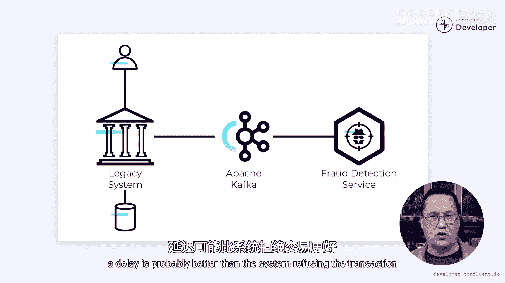
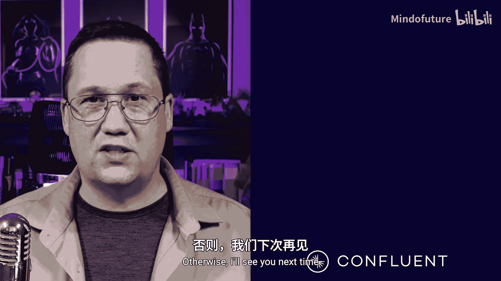

# 设计事件驱动微服务---中英-｜-microservice-｜-apache-｜-kafka-｜-confluent-p21-P21-Microservice-Pitfalls---Solving-the-Dual-Write-Problem--BV1D8EMzzEid_p21-

I've worked on a variety of large systems and have encountered the dual right problem on many occasions。

The worst part is， I didn't even know it was a problem for a long time。But now that I do。

 I want to share with you how to solve it。We'll do that by looking at a concrete example of a bank that has built an event driven microservice that is encountering the dual right problem。

Let's start by looking at what was supposed to happen。

Although the fraud detection system has been extracted to a microservice。

 most of the banking logic still lives inside of a legacy monolith。When a user issues a transaction。

 whether it's a payment to deposit， a purchase or something else。

 the record of that transaction is stored in the monoliths database。 Meanwhile。

 the system should emit a transaction recorded event to Apache Kafka。

The fraud detectionte Service will listen for the transaction recorded events and process them asynchronously。

 At least that's how it's supposed to happen。Most of the time， this seems to work fine。However。

 once in a while， it looks like those transaction recorded events are being dropped。

The transactions are logged in the database correctly， but the events never get to Apache Kafka。

This happens because of a flaw in the code。 When a transaction occurs。

 they need to perform two separate rights。1 goes to the database while the other goes to Kafka。

 The problem occurs when one right succeeds， but the other fails。 In other words。

 the right to the database goes through just fine， but the right to Kafka fails。

There are many reasons why this could happen， ranging from a network or hardware failure to software exceptions and system upgrades。

When it happens， the events are lost， this is known as the dual right problem。

It occurs anytime you write to multiple systems that aren't transactionally linked。

If you aren't familiar with the dual right problem。

 check out the video linked in the description for more details。Now。

 the first thought might be to solve this problem with something like a database transaction。

 Unfortunately， there's no way to create a transaction that covers both the database and Apache Kafka。

No matter how we arrange the code， there will always be a possibility that one operation will succeed while the other fails。

 and that will leave us in an inconsistent state。However。

 there is actually a way to solve this problem using a transaction。

 just not one that spans the database and Kafka。The transactional outbox pattern is designed for exactly these situations to use it。

 tributary can start by creating an outbox table。 This is a simple database table containing the events that are sent to Kafka。

 including event Is and any other relevant metadata。When a new financial transaction occurs。

 it is written to the database and within the same database transaction。

 an event is written to the outbox table。Because this happens in a database transaction。

 it's guaranteed to be atomic。Either both rights， succeed， or they both fail。

Once the database transaction is complete， the system can respond to the user to indicate success there's no need to wait for the event to be sent to Kafka。

Next， a separate process can scan the outbox table and emit the events it finds to Kafka。

This process can be written by the team， but they could also leverage a change data capture or CDC system if the database supports it。

It is critical that this process operates with an at least once delivery guarantee。

 If an event can't be sent， then it needs to be retried until it succeeds。 In some circumstances。

 retriries could result in duplicate messages。Therefore。

 it's important that downstream consumers operate id potently。 However。

 that's generally a best practice for Kafka consumers anyway。This is where metadata。

 such as the event ID can be helpful because it allows the consumer to deuplicate。

Once an event has been successfully oted to Kafka， it can be marked as complete。Alternatively。

 the event could be deleted from the outbox table。 However。

 banks are not usually fond of deleting data so they might keep it around。

The transactional outbox pattern is powerful and would get the job done。 However。

 let's take a moment and think about how banks operate。

Each financial transaction is recorded as a separate entry in the database。

A bank doesn't just store the balance of your account。

 They store all of the transactions that LED to that balance。Essentially， banks are eventssourced。

Because data is stored in an event sourced fashion。

 they could potentially simplify the process and eliminate the outbox table。

Whenever a new financial transaction is written to the database。

 a separate process could scan those transactions and om them to Kafka。

All of the information needed to construct the event is hopefully available in the individual database records。

That makes this a simple scan， transform， and emitit process。

There's no need to create a separate outbox table because the database records are the events。

There's an added benefit to implementing either a transactional outbox or event sourcing。

Whenever we write to an external system， there is a possibility of failure。

 that's true whether we're dealing with a database， Apache， Kafka。

 a separate microservice or anything else。By storing the data and doing the right asynchronously。

 we isolate the system from potential failures。 If a failure occurs while trying to write the events to Kafka。

 that's okay。 As soon as the system recovers， the process can resume。

 And since all of the events are stored in the database， there's no risk of data loss。

These failures result in delays， however， from an end user perspective。

 a delay is probably better than the system refusing the transaction。

 The dual right problem is tricky， but if we take a moment and ask the right questions。

 it's not necessarily hard to solve， but we shouldn't ignore it because doing so will result in data loss。

 and that's rarely acceptable。 We need to consider the consequences of losing data。

In the case of a financial institution such as tributary Bank， it's unacceptable。

It could result in fairly harsh consequences， not just from customers。

 but potentially regulators as well。🎼The transactional nature of banking makes this easier than it might be in other domains。

 However， techniques like the transactional outbox and event sourcing can be applied。

 no matter what domain you're working in。 Thank you for joining me today。 Now。

 don't forget to drop some events in your own out box。 you can do that with a like。

 share or subscribe。Or even better， send me a question or a comment and I'll do my best to respond otherwise I'll see you next time。

