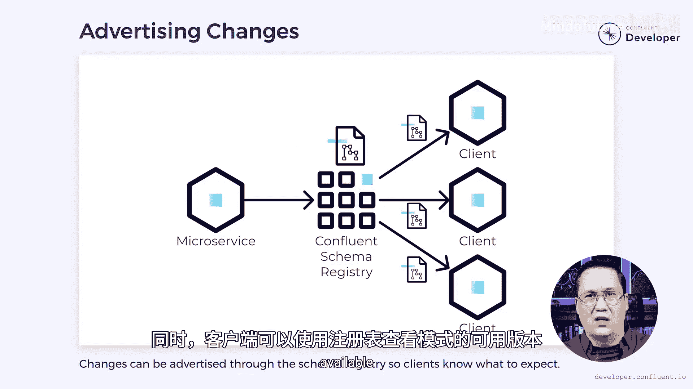
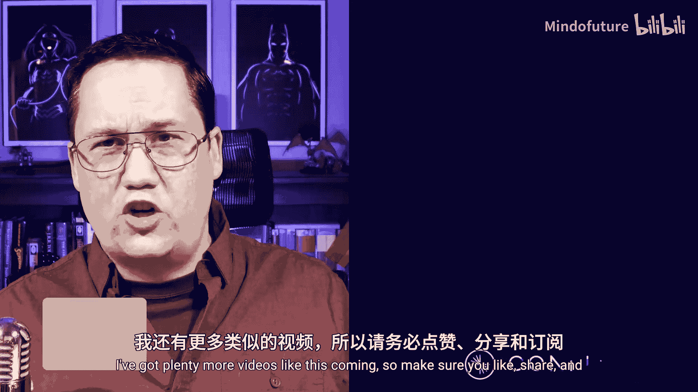

# 设计事件驱动微服务---中英-｜-microservice-｜-apache-｜-kafka-｜-confluent-p22-P22-How-to-Evolve-your-Microservice-Schemas--BV1D8EMzzEid_p22-

I， am Wade from Confluent。 During my consulting days。

 one of the most common questions I was asked was how to handle schema evolution。

It's a complicated problem， and there's no single answer。 But if you stick around for a few minutes。

 I'll introduce you to schemas and how they can be evolved。 When do microservices communicate。

 they need to agree on the format of communication。Essentially， we need to define an API。

This API acts as a contract between a microservice and its clients。

 ensuring that the service meets its promised obligations。

Many data formats encode these details in an explicit schema。

These schemas include details such as what fields are present。

 what structure they take and what data types they contain。

But what if our data format doesn't include a schema， Json， by default， is considered schemaless。

 and many people use it that way。 If our API leverages a schemaless format。

 then do we still need to worry about schemas and schema evolution。What do you think。

 Feel free to pause the video and drop a comment before I give you my answer。

 Even if we don't define a schema， an implicit one still exists。By defining an API。

 the microservice commits to providing data in a specific format。

Clients will expect the API to follow these rules even without an explicit schema。Over time。

 internal and external pressures， such as competition and regulations。

 can force the schema to change。We've all witnessed how modern privacy legislation has forced companies to adapt their systems。

These can be simple changes such as adding or removing a data field， but they can also be complex。

We might decide to switch from a JSO format to Protobuff， to improve performance。

Or we might be forced to encrypt data to meet regulatory requirements。Remember。

 the schema is a contract， and if we break the contract， clients may lose faith in the system。

Therefore， it's critical that we evolve the schema in a non breaking fashion。

 The first thing we should do is choose a data format that is flexible and easy to evolve。

Some formats are more rigid than others。 For example， with JO。

 we might be able to add or remove a data field， but renaming it is likely going to be a breaking change。

Meanwhile， Protobuff allows for adding， removing and renaming fields in a non breaking fashion。

But it isn't human readable， like J。We also need to consider whether those changes are going to be forward or backward compatible。

Forward compatible changes allow old clients to read data that was written in the new version of the schema。

In a JSO document， adding a new field is considered a forward compatible change。

Clients written against the new version of the schema can read the new field。Meanwhile。

 clients written for the old schema can simply ignore the field。

Backward compatible changes allow new clients to read data that was written with an old version of the schema。

Event streams often prefer backward compatible schemas because they contain events written with different schema versions。

When a client attempts to read the event stream， they need to be prepared to handle the messages written with an old version of the schema。

In a JSO document， deleting a field is a backward compatible change。

The current version of the document won't contain the field。

 If the client receives an older version that does contain the field， it can ignore it。Unfortunately。

 despite our best efforts to maintain compatibility， sometimes we're forced to make breaking changes。

When that happens， we want to minimize the impact on clients。

A common way to handle this is by creating new versions of the API。In the case of a RE API。

 this could mean creating a new V2 endpoint。For a Kafka data stream， we might create a V2 topic。

When we create the new API， we might need to support the old version for a while to allow clients time to migrate。

 On the client side， we should be careful to avoid data coupling。

Every time the client reads a piece of data from the API， it's coupled to that data。

If the data changes， then the client has to change with it。Therefore。

 the client should be careful to only read the data that it cares about to minimize the impact of changes。

For example， it's common to write shared client libraries for a microservices API。

Clients of the API can leverage the shared library rather than reimpleing the logic。However。

 for this to work， the library has to read all of the data exposed by the API。

If any part of the data changes， then the client library will need to be updated。 That， in turn。

 can force a change to any clients that use the library。

An alternative is to use a share nothing approach here。

 each client would implement its own logic for reading the API。In that case。

 they can ensure that they only read the data that matters to them。That way。

 if the API evolves in ways that the client doesn't care about。

 it may be able to avoid unnecessary updates。One final consideration when we evolve our schemas is how to advertise the changes。

A schema registry， such as the Confluent schema registry。

 can be a useful tool for broadcasting schema changes and enforcing compatibility。

Validating messages against the schemas stored in the registry can ensure those messages are compatible with clients。

Meanwhile， clients can use the registry to see what versions of a schema are available and what data is contained within them。

 As you can see， there's no single strategy for handling schema evolution。

 It ends up being a combination of different approaches。 Just remember。

 your unique requirements may impact any of the suggestions I've made。 Thanks for joining me today。

Don't forget to follow our courses on Confluent Develop and our YouTube channel I've got plenty more videos like this coming so make sure you like share and subscribe so you can stay informed。

See you next time。