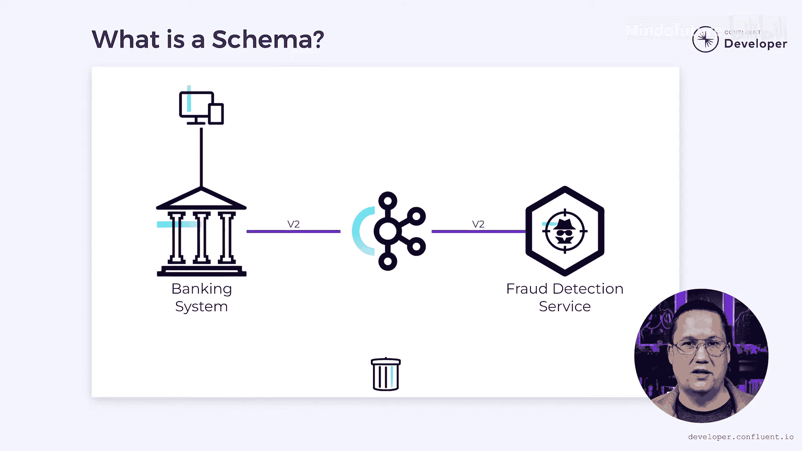

# 设计事件驱动微服务---中英-｜-microservice-｜-apache-｜-kafka-｜-confluent-p23-P23-Schema-Evolution-with-Zero-Down-Time--BV1D8EMzzEid_p23-

One of the more interesting challenges I've encountered when building an event driven system is how to evolve schemas。

I've used different techniques to update production data streams without requiring downtime。

I want to share some of them by exploring a concrete example of a banking system that needs to evolve its production events。

We'll specifically focus on why they should use techniques such as compatibility guarantees。

 flexible data formats and version events。Now， because we're working with a bank。

 there are some domain specific challenges we'll have to overcome。

Stick around and we'll see what those challenges are and how we can resolve them。

Tributary Bank has created a fraud detection microservice that contains logic for finding fraudulent transactions。

If you haven't been following tributary's journey， make sure you subscribe to the channel and check out some of the older videos。

You'll also find relevant links in the description。

An important part of their fraud detection is device fingerprinting。

 which tries to identify trusted devices。When a financial transaction occurs。

 details about the transaction are packaged into a transaction recorded event。

This includes account IDs and transaction amounts， but it also includes fingerprint information such as device IDs。

 IP addresses， Gelocation， etc。The events are sent to Apache Kafka and delivered to consumers like the Fud Detection Service。

The service can inspect the transaction and determine whether it came from a trusted device and location。

Unfortunately， new technology has made it easier to spoof a device。

 This allows criminals to pretend the transaction comes from your device。

 even though it comes from somewhere else。To combat this。

 tributary continually evolves the information they include to help with fingerprinting。Recently。

 they decided to add device battery levels。Rapid battery drain on a device can suggest malicious code running in the background。

 but it can also be used for more advanced finger printing。

If two transactions are made in a short period from the same device。

 but with drastically different battery levels， it might imply that one of the transactions is from a spoof device。

However， adding battery levels into the transaction recorded events will require updates to the system。

They will need to update both the producer and consumer of the messages。

 but the order they do it can impact the solution。 Let's suppose they start by updating the consumer。

They will add the appropriate battery level field into the message。

 The field must be optional because the producer hasn't been updated。 Otherwise。

 when the consumer tries to read the data， it won't be there， which could cause a failure。

If an optional field is acceptable， they could continue with this solution and update the producer。

However， if they wanted to avoid an optional field， they could consider a default value。 For example。

 we could say that if there is no battery level， we'll set it to 100 per cent。However。

 a battery level that never changes seems suspicious and could indicate a spoof device。As a result。

 a default value might cause false positives and won't work for this specific situation。

But let's look at the problem from a different direction。What if they updated the producer first？

Tributary uses protocol buffers for their messages because they're small and flexible。

One of the benefits is that additive changes tend to be easy。

If they add a battery level into the message， downstream consumers should still be able to read it。

They simply ignore any fields they aren't expecting。

This allows the producer to be updated without worrying whether the consumer is ready。

 Consumerers can then be updated separately to read the new data。

They can assume that all future messages contain the battery level field。

 and they can make it required。However， they do have to consider one other possibility。Often。

 when building an event driven system， events are kept forever with the intention that they might be replayed at some point。

If the transaction recorded events are treated this way。

 consumers must be ready to receive older messages。

The older messages won't contain the battery level field。

This forces the consumers to make the field optional so they can handle both the old and new messages。

The important thing to recognize is that the choices tributary makes depend on the requirements of the domain。

In this case， they want to keep the events and may replay them later so they need to make the battery level field optional。

Because the field is optional， it won't matter whether they update the producer or consumer first。

In the previous example， the change was additive， which is often easier to deal with。

 But what if something changed in an existing field。Recently。

 tributary learned there was an exploit available for the encryption algorithm they were using。

As a result， they've been forced to update their encryption to a new protocol。

But if they update the producer first， the consumer won't be able to decrypt the data。

 and if they update the consumer first， the messages won't be produced with the expected encryption。

They could update both at the same time， but synchronizing the deployment will be difficult and may result in downtime。

So what can they do？One solution is to update the consumer to look for an additional field in the record。

Now， unlike with the battery level field， here， a default value could work。

They could set the default to use the old encryption scheme。

But if the field was set to use the new encryption， then the code can be ready to handle it。

With that in place， the producer can be updated to start emitting messages with the new algorithm。

They just have to ensure they set the flag appropriately。

This approach doesn't require synchronized deployment and avoids the need for downtime。However。

 even though it would work， tributary doesn't want to use this solution。

Encryption is pretty critical to the security of their business and having events sitting around that use the old compromised algorithm as a definite risk。

They don't want to purge the events because they want to be able to replay them later。

But they do need to patch the security hole。To do that。

 they could write a process that reads all of the events， reenrypts each one。

And he emits them on a new version 2 topic。They could then update the consumers to read version 2 and use the new encryption。

This eliminates the need for a flag because all data in the new topic will use the new algorithm。

Once the data has been migrated， they can update the original producer to emit events with the new encryption。

They can then remove the migration process and delete any old events to eliminate the security risk。

As we saw in these examples， there is often more than one way to solve a schema evolution problem。

Which one you choose depends on concerns specific to your domain。

There isn't a one size fits all solution that can be applied to every situation。

🎼But if you're careful， you can evolve schemas in a live system without requiring any down time。

 Have you been forced to evolve a schema， Did you use a technique similar to what I've highlighted here。

 or did you do something else。 Let me know in the comments。And don't forget to like。

 share and subscribe。Thanks for joining me today and I'll see you next time。

