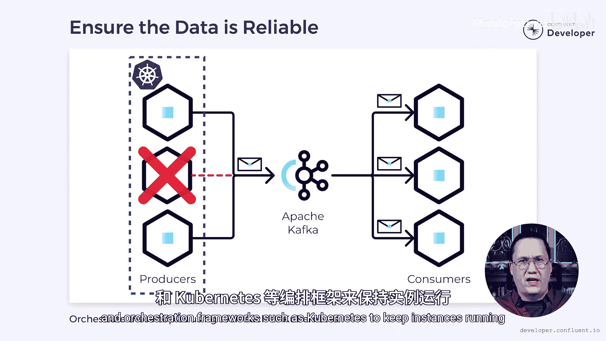
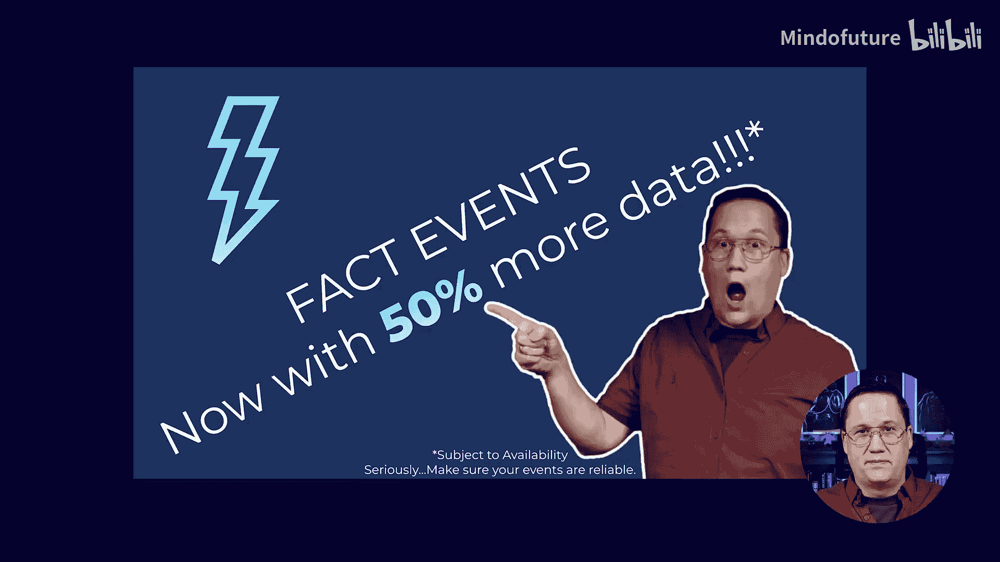
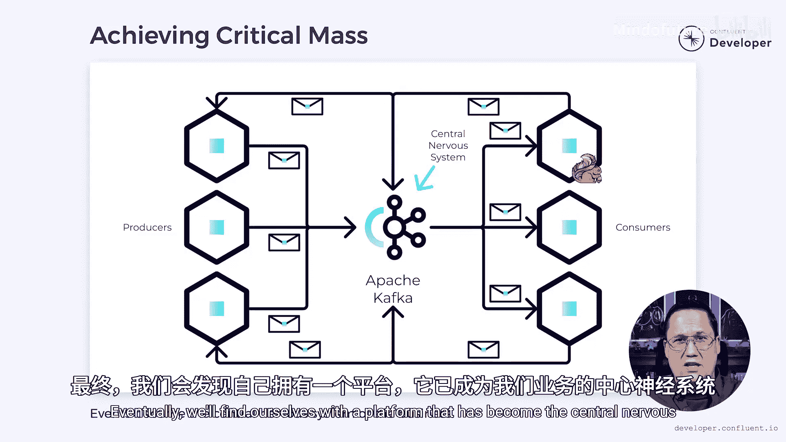
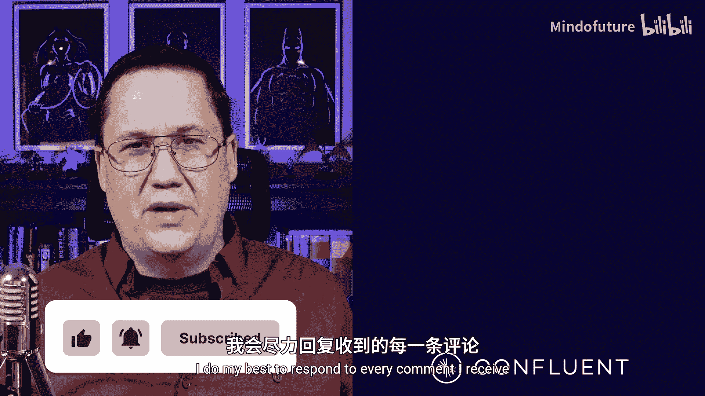

# 设计事件驱动微服务---中英-｜-microservice-｜-apache-｜-kafka-｜-confluent-p24-P24-How-to-Unlock-the-Power-of-Event-Driven-Architecture--BV1D8EMzzEid_p24-

Hi， I am Wade from Confluent。Event driven architectures don't spring fully formed out of the ether。

 They take effort to design and build。One of the biggest challenges I've seen is going from a small set of isolated microservices and expanding to a full event driven system。

The goal might be to build a central nervous system for the business。

 but many projects stall long before they get there。

So how do we make the jump from a small set of microservices to a central nervous system。

 We start by recognizing that events are a first class product in our system， not a side effect。

The job of a microservice is to produce data， and the events we produce are as much a part of that product as anything else。

In some ways， we could measure the success of our microservice by the number of consumers that subscribe to its events。

Now， for a product to be successful， it must overcome certain hurdles。

It has to meet the needs of the consumer。It should be reliable。

 and it needs to be accessible or easy to use。There's another hurdle that we have to overcome。

 and it's a big one， But I'll come back to that in a few minutes。

Any good product will make a solid effort to meet the needs of its consumers for events。

 This means ensuring they contain the required data。

Limiting the amount of data contained within our events reduces the bandwidth and storage we use。

 However， it also limits their reach。When we are designing for reuse。

 it can be better to favor richly detailed fact events over more anemic deelta events。

More detail in the events means more opportunities for others to leverage them。

We can always optimize later if certain data is not being used。

The data also needs to be presented in a consumable format。

Binary formats such as Protouff and Aro are great options for efficient and lightweight messages。

However， they aren't human readable like J。When a developer needs to debug a production issue。

 having access to the data in a human readable format can be important。

And when another team is deciding whether or not to consume the events。

 having access to a human readable format can help。

That doesn't mean we shouldn't use Protobu Avro because both are great options。However。

 we may need tools to convert the messages into a human readable form。

 If you are using confluent cloud， there are built in features for viewing protobuuff and Aro messages。

Otherwise， you might want to consider how you can make this data readable， either through logs。

 tools， or an administrative interface。Once we establish the content and format of our messages。

 it's important to treat it like a contract。If we change the format without warning。

 clients will lose faith in the data。Once that trust has been lost， it can be difficult to regain it。

Changing data formats isn't the only thing that erohodes trust。

 Sere outages can destroy any hope of expanding beyond our small set of services。

This problem is partially solved by using an event of an architecture。

Because events are consumed asynchronously from a reliable platform such as Apache Kafka。

 the system can tolerate short outages。Messages might be delayed。

 but overall the system continues to function。Unfortunately， long outages still pose risk。

To mitigate this， each service should have multiple copies that can take over if others fail。

And we should rely on monitoring an orchestration framework， such as Kubernetes。

 to keep instances running， even deploying new ones if required。

 Once we've established the data format and we're confident it's reliable。

 It's time to release it to the world。

Consumers can't listen to the events if they don't know about them。

That means we need to advertise their existence。

No， not like that。Tools such as the Confluent schema Reggiiststry allow us to register event schemas and metadata。

This lets us share details of our event streams with other teams and makes them more discoverable。

If we are hosting Kafka outside of Confluent Cloud。

 we'll have to consider deploying alternative solutions or building documentation to provide these capabilities。

The goal is to create a discoverable catalog so anyone can find and consume the streams we provide。

 Eventually， we hope to attract additional consumers for the events。

This allows us to build momentum in the system。 If each of those consumers emits events。

 it creates a powerful cycle。Imagine a series of microservices or Apache Flinkk jobs that listen to event streams。

 enrich them with additional data and emitm new events in their place。

Those new events can then feed back into the system， creating even more enrichment opportunities。

 The best part is that each time we emitit an event。

 we are adding value not just to the current event， but to any that came before。

If we do this long enough， we reach a critical mass。At this point。

 we have so much data flowing through events that it becomes easier to implement new features than it would be otherwise。

 This turns it into a runaway process， because remember。

 each new feature potentially emits events that further increase the momentum。 Eventually。

 we'll find ourselves with a platform that has become the central nervous system for our business。

But wait。I said there was another hurdle we had to overcome。

The last hurdle is the most challenging because it has a human element to it。

The reality is that people fear change。Event driven architecture sounds great to you and I。

 but how will it be accepted when we try to expand to the rest of the team。

Others might see it as a threat to what they've spent their careers building。

They might not want to learn new skills and technologies to adapt to this paradigm。

How do we overcome this last hurdle？We do it by building trust with these other teams。

 We need to show them that we are trying to build the best system we can。

 and we want to bring them along for the journey。So we start slow。

Rather than telling people that this is the new approach and expecting them to adapt。

 we start with a single event and offer help building that first integration。Along the way。

 we explain why this new approach is valuable and what benefits it will give them。

 Perhaps it means fewer late night phone calls， or maybe it will help the system scale to new heights。

Whatever the case， we need to be prepared to listen to their concerns and help find ways to overcome them。

Remember， we want them to feel like this is a team effort and we want them to be successful。

A failure at this point would be catastrophic， so we do everything in our power to make sure that doesn't happen。

Once we get one team on board， we can expand others using that first example for inspiration。

 There are no guarantees when we embark on this path， Like with any software project。

 failure is always looming around the corner。However， if we are careful。

 thorough and empathetic to others' needs， we can ease the transition and set ourselves up for success。

 Do you remember earlier when I said that the success of our events could be measured by the number of clients subscribing to them。

Well， now it's your turn。Just like you want your events to reach as many people as possible。

 I want this video to do the same。If you've made it this far and feel that I've given you real value。

 shoot me a like， share the video on social media， and of course， hit the subscribe button。

🎼And please drop me a comment to let me know what you think of the video or if you have any questions。

 I do my best to respond to every comment I receive。

Thank you for joining me on this journey and I'll see you next time。

