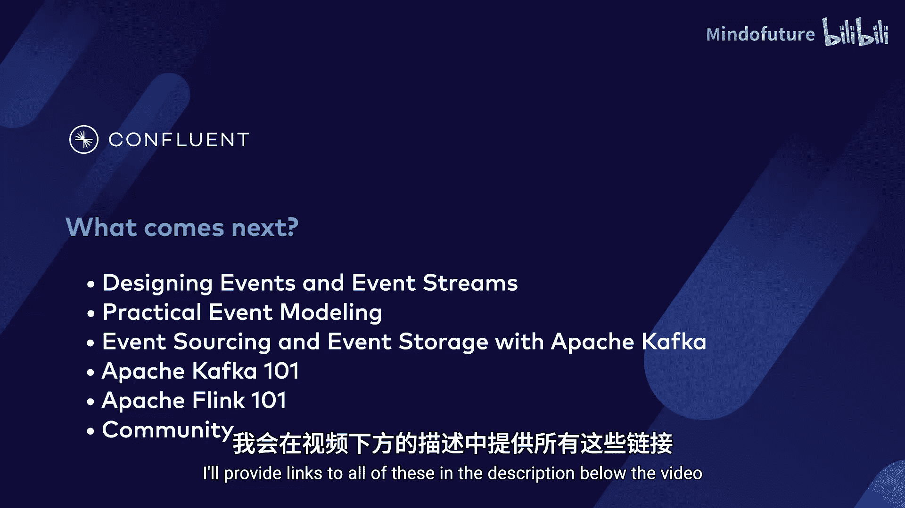
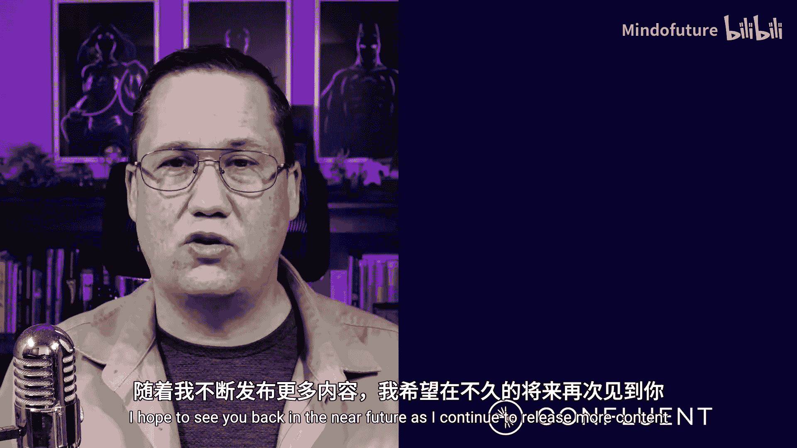

# 设计事件驱动微服务---中英-｜-microservice-｜-apache-｜-kafka-｜-confluent-p25-P25-Closing-Remarks--BV1D8EMzzEid_p25-

Hi， I'm Wade from Confluent If you're just joining me then I'm afraid you're a bit late to the party We're here to recap some of what you learned in the designing Even drivenven microservices course and provide some potential next steps If you haven't already taken the course then check out the link in the video description and join me when you're ready。

For the rest of you， congratulations on finishing the course。

I don't want to take much more of your time so let's get down to business throughout this course you learned the features of microservices and what makes them different from a monolith。

Different ways of decomposing a monolith using patterns such as the strangler fig or branch by abstraction。

How microservices can provide isolation， resilience， and scalability to your system。

Why the dual right problem occurs in a distributed system and some solutions that can be used to avoid it？

How to evolve event schemas without incurring downtime？

And what you need to do to expand your microservices into a central nervous system for the business。

However， it doesn't end here。I like to say that if you ever find yourself in a situation where you're no longer learning something new。

 it's probably time to move on and we're not ready to move on yet。

 so that means we need more to learn。Well， the good news is that there are still more courses on Confluent  developer for you to check out。

If you want to keep learning about event driven microservices。

 check out the Designing Event and Event streamams course or have a look at the practical event modeling course。

If you want to go deeper on event sourcing， the event sourcing and event storage with Apache Kafka course is a good next stop。

Or maybe you're not ready to go deeper on these concepts and want to get your feet wet with some code in that case you might look at Kafka 101 or Flink 101。

Both of these will give you a chance to learn the fundamentals of data streaming in an approachable fashion。

You can also consider joining one of our communities to engage in future discussions around these topics。

I'll provide links to all of these in the description below the video。

Whatever path you decide to take from here， I hope you've enjoyed this journey， if you have。

 please consider sharing this with the people around you it helps me build an audience which in turn helps bring you more content。

You can also like， share and subscribe to our content on YouTube to help build the channel。

If you didn't enjoy the course， well， I'm not really sure why you stuck around at the end。

 but I'd love to hear from you anyway， drop me a comment with any feedback you want to provide it will help me improve the next time I build a course and once again。

 thank you for sticking with me to the end。I hope to see you back in the near future as I continue to release more content。

Don't forget to keep learning。