# 超硬核-即兴90分钟rust开源项目维护实战-p01-P01-Rust-open-source-contributions-stream--BV1aiQGYtEux_p1-

All right。Hi everyone welcome back to yet another stream I'll do the spiel from the beginning just before we get into the stream so I'm John。

 I do a bunch of these live coding streams sort of various different things but in general the goal is to write somewhat more intermediate or advanced rust material for people who have some beginning grasp on the language or it's coming to it from a programming background and want to learn or see the language being used in sort of more advanced ways or to build real stuff。

I have a Patreon page where I post updates whenever I do video streams or recordings from past streams or I solicit suggestions for what streams to do next So if you want to like watch me there you can do that Otherwise I also post basically all the announcements to Twitter so either is basically fine I post all of the recordings to YouTube afterwards so if you go to。

This page。So on my YouTube channel there's a playlist for all the rust live coding sessions we've done it's really slow today so if you go into this playlist it has all of the old videos and I'll keep adding you one's there as long as we record them。

So this dream is a little bit different。 And I don't quite know yet how it's going to work out。

 But I have this idea of。Like over the course of myos programming。

 there are lots of times where I sit down and。I like want to use something that someone else has written I don't always want to write everything from scratch even though it's fun and so every now and again like you end up using some software or other people have using either as a library or a binary。

 you need to depend on it in some way。Or even if you just want to like expand your knowledge of us and you want to contribute to something someone else has built。

 then usually what ends up happening is I open up， I end up in some GiHub or Gitlab repository and like now what and I figured it would be pretty cool to try to show what that experience is like to come to someone else's codebase and like figure out what's going on。

 figure out how the crate is organized and so。And also how we might contribute to it and so sorry is I cant imagine not using other crates it's possible you often don't want to do it but but so for example。

 one of the things that I've done a lot is write relatively primitive crates like things that are like data structures for example。

 where you often end up not depending on any other crates or if you do very few or like only for testing and benchmarking。

But in any case。I sat down and figured， like， how about we just do a stream where I do open source contributions。

 which。Is a little bit terrifying I'm not going to lie because it means I'm going dive into some codebase I know nothing about and have never used and going to try to like modify it live。

 we'll see how it goes and so I outline this on Twitter and I got a bunch of response to where people who seem pretty excited about it and the basic ideas is we're going look at some crates the people have suggested。

 we're going look at how the crate is organized， try to figure out what it does。

 like look at the readme， the documentation， how the source sort of fits together and try to give some feedback on those either if the authors are watching or just for our own sake。

 like which things do we feel like they've done well。

 which things would you perhaps do differently if you were to write this project from scratch and then we're gonna try although we'll see how well this works to see if we can contribute to the code in some way like whether that is improving the documentation。

 improving the readme adding some feature to the code。

 looking for a known bug it depends a little bit on the crate and what kind of sort of how sophisticated it is。

So how well developed it is， some of these are relatively early on in their development and some other later on。

And so we're gonna look at the bug tracker and see what we can find there and we'll see like my hope is to spend maybe an hour to an hour and a half per crate。

 but we'll see it depends a little bit on how expensive the changes we want to make are remember that this is this sort of ends up being pretty collaborative right I know very little more about these crates than you do。

 So if you see something that you think we should change something we should point out to the to the authors。

 something you would like us to try to change or something you don't understand and want to know why is there then feel free to like ask in chat and I will try to address them and also sort of go along with you and we'll see how this goes。

One thing I would like is after the stream is over。

 I'll take like a few minutes just to sort of sum up things with you and see if I can get any feedback on how you think this format worked。

 whether you think this was interesting， whether there are particular crates you would like me to see me do next whether you'd even like me like to see me do this again。

 but we'll see。 we'll see。 I think it would be fun。 I also to point out Nathan Liitz。

 just donated $50 a month on Patreon， which I think is really cool。

 This is a person I have no idea who he is。 but he decided to give me money and that's amazing。

 thanks。😊，rightLet's see before we start， there was some。😊，How about reviewing the rex Okay。

 so I' have gotten a couple of recommendations for like really large crates or really sophisticated im mature crates like cargo Regx servo and a couple and like just the compiler and while that would be interesting that is a very different sort of monster So in a sense what I wanted to do here was look at。

Things are sort of still in flux and still in development and where there's some hope that we can understand what's going on in 90 minutes。

 This is not true for any of the large and very sophisticated crates， right， Like even just rex。

 which is a somewhat smaller crate is a really sophisticated beast of a crate right now。

 And even even though I know I happen to know that it's pretty well developed。

 trying to dive into that and do something useful fold in 90 minutes， It's gonna to be pretty hard。

 One thing we could do is do a stream where we pick a crate and just try to understand it without even trying to contribute anything。

 We could do that that will be a lot less programming in it and we're just reading code。

 But we'll see it's not， it's not a bad idea。 It's just hard to balance。

Do you already have crates picked or do you need suggestions， I do have some crate picked。

 So I did a Twitter poll over the couple of suggestions I got。 And this was sort of the the winner。

 This is a part of Graph Q L implemented in rust。And so specifically the hyper bindingds for that we're going to look at。

 that we're going to look at Tokyo Beantlk D， which is a Tokyo implementation of working with the Beanta protocol。

 which is sort of similar but simpler than the zookeeper stream we did in the past and then agonauuta is implementation of Ru password hashing algorithm。

 or it a。It's a password hashing algorithm and the implementation of it in rust。

 And so I feel like these are three relatively different things。

 And so that's why I feel like they match up pretty well and they all got some decent amount of interest。

 There are some others， too that maybe we'll get around to look at later。

 If you have other suggestions and like p me on Twitter or something。 and I'll try to queue them up。

 Yeah， and then I saw， I appreciate it。 In a sense， I'm。😊，It would be great to get to 1，50。

 but that's also a bunch of work。 So it's like， I I I really， I do really appreciate it。

 But this particular week is also a lot of stuff is going on。 those the deadlines。 So its like。😊。

But it worked out， thanks though。Let's see。 Oh， author of the。 Okay。

 So we have the author of this crate here。 Fastic。 You can， of course， still suggest more crates。

 We probably won't get around to them in the stream。

 But if you like put them in the chat or tweet them at me or something。

 Then I will add them to my ever growing list of things I want to cover in streams。 Sadly。

 I only have so much time。😊，All right， let's dig into Juniper hyper first。

 So in sort of the same spirit as with all the previous themes。

 I've tried to not do any work ahead of the stream This is in part so that you don't feel like you're missing anything like any part of the experience。

 It's also so that you can observe my entire process of going through something new as opposed to me having like fully prepared before we sit down and know where everything is because I don't think that would be helpful to you and it's sort of disingenuous because that's not really what the experience is like。

 And I want I want people to realize that programming is like not。It doesn't just happen。 right。

 you need to invest some work。 Al right， so Juniper hyperper， let's find out with Juniper is first。

So Juniper。Graphq L。 Okay， so it's some kind of data query language。

 And theres a rust implementation。Does not include a web server。Okay。

 so it's like sort of like a database。But without a web server or any kind of web API。

And integrations for hyper。 Allright， so I'm taking a wild sta here， but it seems like this is a。

It's like a way to set up。I mean， judging from the name。

 you set up graphs of data structures and then you have some way of querying those data structures and the hyper thing is going to be a wrapper around that so that you can make requests to the stored data over the network。

Let's look and see if I got it right。嗯。Okay， did a  query language。Oh this is pretty unhopful。

 how do I use it， Give me an example。Examples？There is no example directory， what about here nope？呃。

Getting started， quick start， but great。Quick start。啊。Yeah， yeah， okay。

 So it's like youve set obstructs， they have relationships to one another。

 And there's probably like okay， yeah， so you declare objects and you can search the object。 Okay。

 yeah， so it's just you're querying for data in some structured manner。All right。

 now the question is what is Juniper hyperper because that's the thing we're actually looking at。

 We're not going to look at all Juniper。Pinpoint dull crate for pinning。Yeah。

 can you ping me with that on Twitter because this will get lost in the chat？呃。

Why not ask the author here， Why mean we could， but。Usually you're not able to ask the author。嗯。

Also I think he's the author just of the hyper part， but I might be wrong。Okay， so。

Let's see what we got here。 Oh example， good， All right， example is a good start。

 Let's look at the example。Oh， future CPU pool。 that looks weird。

 I don't think future CPU pool should be here。Why do I need to build a CPU pool？This is Tokyo？

This is using hyper， this should just be a Tokyo。That way。

 you wouldn't have to clone the pool in here。regardless of the setting up a hyper service。

 so hyper for those who aren't aware， hyper is a rust web framework both for clients and servers。

 and it's sort of built entirely asynchronously around futures and Tokyo。

And the idea is that you set up a bunch of services and every service is responsible for routing the request it gets in。

 you're basically like you're sort of given a you're given a request and you have to populate a response and it's all asynchronous and so a service just a thing that can reply to requests。

In this case， yeah。 So here you see， this is basically doing routing， right。

 Like it's looking at the method in the U RI and then it's doing some stuff in response。 Okay。

 so this， this is， this example is then basically the。The hyper part wise this in the example。Okay。

 so the thing， what does let's look at the docs。 Okay， ju hyperper provides these two functions。嗯。

Interesting。I wonder why just those two。 That seems like a weird thing for this crate to provide。

 Like， I would expect a crate that's supposed to provide web bindings to provide web bindings。

 Where it looks like from this example。It looks like the user has to come up with the actual routing。

Because this is in the example code so the ideas this would be in your code。

 and so I guess the question is what are these functions？Right， because it's routing。

 it's routing these to different things。 So it looks like get slash IQL。

 what's the different These two names are not clear。 What's the difference between these two。Oh。

 that I would say that the first thing that's liing in this script is a documentation。

 Maybe so in theory， that is something we could provide。G。You just forward the request to Juniper。

I see。I see through。But if you're just forwarding， then why is this Cre necessary？That's。

 I guess I want to know what this function does。 It's a good source。So IQL。

This just uses Juniper directly。To request an end point in this constructive body。 Okay。

 so this is extremely straightforward， right， Like this method is just。

Calling whatever that method is， and that's noticed specifically this is。In the juniper crate。

 not in juniper Hyper。 So this wrappper seems pretty straightforward。 What is the。

 I feel like I should be named something else。 Twitch don't have communities anymore and don't have a game creative。

诶。Oh， I mean， my stream isn't game programming， so GraphQl is a UI for the GraphQl backend。Yeah。

 but why I see。 So the response。 So what you're saying is。嗯。This call here。

Just essentially essentially print some H M L of some kind。 We could probably just run this。

 I just wan to， I， I like exploring the， the high level part of the。

 the crate first before trying to run anything myself， because I knowt。

It it might not be that we even need to run this All so the so this is just like I guess I is for index maybe So this just provides you with the graphical index of the UI all right so what does this other thing do because that that's what all the the seemingly interesting endpoints go to right？

You go to slash GraphqL then something else happens。So this takes a CPU pool。

 which I think is really weird。嗯。All right， so this。Further matches on the method。Fascinating。

 I feel like。Some of this stuff should probably go。

 there should be like a wrapper that's provided by the crate。

 so that might be something we can build。So， this。Takes was a root node Okay。

 a root node is the root of the data search we're searching over CT Tx is。DB， just database。

I don't know the difference， Okay， so databases like the entire collection of objects and root node is the one we start searching for would be my guess。

And then pool unclear why they need a pool， I guess we'll find out later and then they're passing the request to this GraphqL okay。

 so Graphql is the main thing provided by this cr， it seems like。It matches on the method。

 and if it does a get。Then。I see okay， so mainly what this crate is doing is mapping HTTP requests to GraphQL requests。

And then taking the responses and mapping them back。It seems like。RightSo if you get a。

If you get a post， you essentially parse the body， you make it into a request。Yeah。So here。

 for example， notice it's basically taking the body of the request， turning it into a string。嗯。

Pasing it as Jason into a Graphql request。And then doing this execute request business and the response that comes back。

Oh， I see。 So execute request is really the thing we want to look at。To execute request。

I wonder why this uses pooled out spawn， like why does this not use Tokyo spawn？

Why are they using like this future CPU pool。It seems odd。嗯。Ququest dot executing。

 So request is the Graphql request。 Okay， that's fine。 Yeah， so that's what we parsed it into。嗯。Yeah。

 okay。 And then it just does a new response， which is presumably then mapping a Graphql response into into whatever web response we want to give。

 So where is new response。 Yeah， okay， so great。 so it just creates a response。😊，Right。

So the sort of main stuff of this is really mapping then between。HtDP and。The underlying Graph Ql。

 it also looks like all of this a single file， which is a little sad。

C pupil is needed because hyperper is async and Juniper is blocking。 So Tokyo has Tokyo blocking。

 which I think fixes that problem for you。So that's another thing we could do is we could use Tokyo blocking to get rid of the future CPU pool and just have it be Tokyo all the way to make it a little bit nicer to work with and you would also avoid having two thread pools so currently you end up both with the hyperthread pool and the future CPU pool。

 which is a little unfortunate。诶。Currently， the stream is not easily discoverable for anyone who's not already where you're streaming。

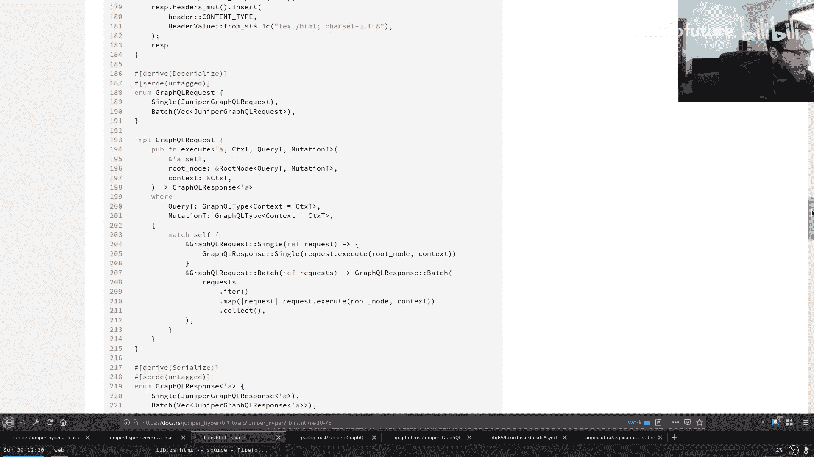

Now， there's a programming category。 Sure， let's fix that while ready。Actually， should we do that？

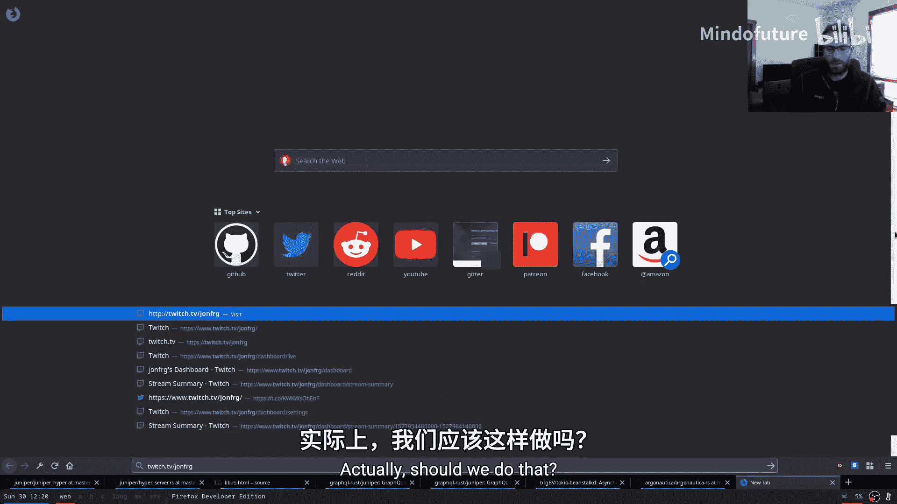

Sure。Oh， that's the worst I get up。

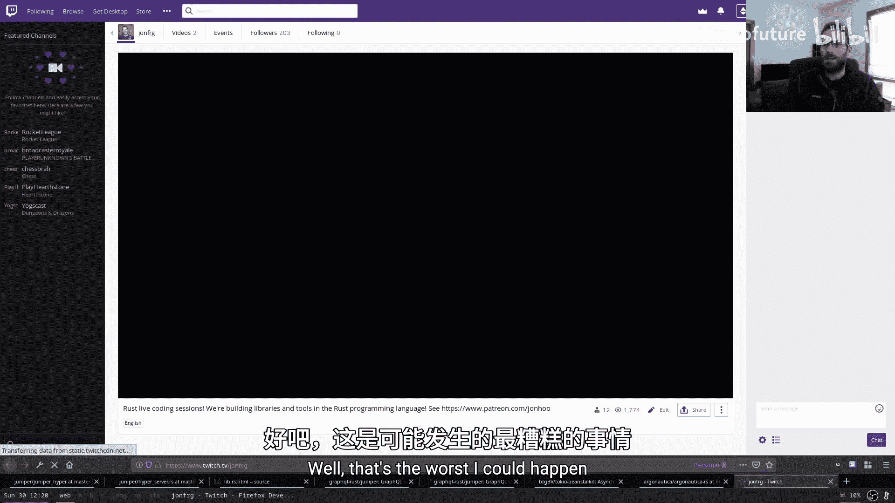

dashashboard。No， maybe channel。No， dashboard。Sorry， you want the category here to be programming。

Great update。Great。It's now a programming channel。Nice。

 I'm not really sure what the difference between CPU pool and Tokyo's thread pool。

 So Tokyo's thread pool does work stealing。And it's also where Hy will be executing so because hyper is based on Tokyo。

 Hyper spins up a bunch of futures and it spawns them on a Tokyo thread poolol normally。

 and so now by using future CPU pool， you have two thread pools running。

 you have the CPU pool that you explicitly constructed and also the thread pool that Tokyo started。嗯。

In particular here， when you do server bind， so that's a hyper server。

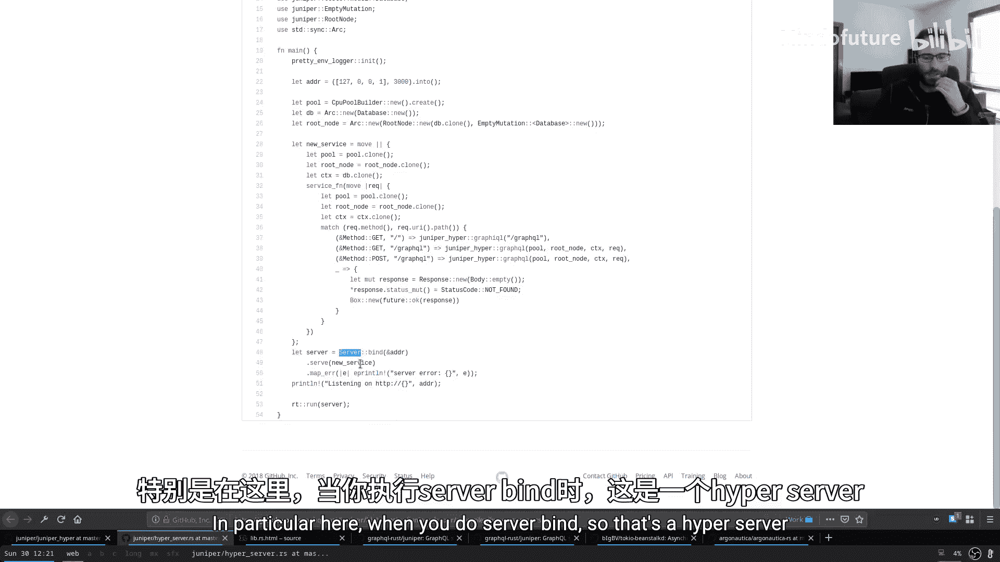

And if you look at。

I mean， unless you're depending on a very old version of。Let's see cardioboomal。Of hyper。No 0 12。

 Okay， so if you look at server。嗯。Server， server， server。Returns a builder right。

 so what do you do with this builder， you call dot Ser。呃。Yeah， so if you call dot serve。If I right。

 so the thing you get back needs to be spawned somewhere。 So currently， this example。

This server that you give back， you run RT run and RT。 So hyper RT， if we go back here。Hyper。

RT default runtime， so the default runtime for hyper is a Tokyo runtime and a Tokyo runtime starts up at its own CPU pool And what you end up is this is starting a this is already starting a thread pool for managing all the hyperfus and then in addition you're creating a separate thread pool for doing Juniper request processing this is no longer necessary because if you look at Tokyo executor Where is the oh I guess this is probably now。

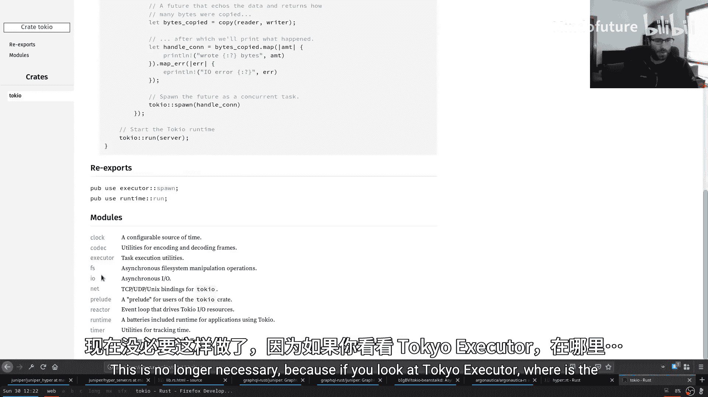

東京エス。呃。嗯。😊，Preezer。2。Run time。Runtime。Where is blocking？That's a good question。

 So there's a there's a blocking， there's a blocking function now that gives you a future that runs a blocking operation。

 Oo thread pooled。This function。Yeah so this takes a function and gives you back a thing you can pull and so basically it gives you back a future。

 but it makes sure that it like still reuses the various threads that are already in the pool to execute the job so this is probably what you want rather than have a separate CPU and this might be the conversion we want to make on this cr。

嗯。The creative category。 Okay， Yeah， that's fine。 I think， I think the change I made was correct。

 right to the Titch category。All right， so so blocking seems like a good candidate here because it would avoid spinning up two thread pools and let's see the other thing it's doing is really just mapping between hyper requests and GraphqL requests and Graphql responses and hyper responses right so Graphql execute。

Really just does。Does it execute and what does it do with the response？So it does execute。

 and then Graphql responds as one of these。Okay， so this suggests that really。

 it's just like Json encoding the response， probably。Alright。

 so the cr itself seems pretty straightforward。 Like。

 I think this is basically the entire contents of it。 The thing willll want to。

So I think that the two things we could do here， one would be to get rid of this extra pool。

 which I think is a pretty nice change to the crate。

 The second would be to add some documentation to it， which like is maybe interesting。

 but it's unclear the third thing we could do here。HThe third thing we could do is this business。

 we could probably wrap up instead of it being an example。嗯。In fact。

 this part of this example code should probably be in the documentation， too。

 But instead of this just being in the example， it seems pretty reasonable for。

This crate to provides this provide this service explicitly like there's no reason for every user of this crate to have to write this code。

 right， I guess the question is like， what if they have other things they want to match on maybe。

Maybe I guess this does let you change the URL pattern。

 but it might be nice to provide like a shortcut for users to just want the bindings。In fact。

 I almost wonder whether this shouldn't be an example， but instead just be a binary。

 just like a straight binary。Maybe。嗯。In a PR， let's look at PRs。嗯。はい。嗯。Hyperteration。Mh。Yeah， see。

I don't think it should use CPU pool， so that's separate。Oh hey， I know DGC or rather。

 have contributed with him on a different crate。OhThat's fine。Yeah， so okay。

 so this is the observation， right？Yeah。Okay， so maybe the goal then should just be to be able to simplify the example。

嗯。Right， so they can write whatever integration they want。All right， lets give let's give this a try。

 So I guess we're going to do something like fork。PR 230， that's the one I had open right。I think。23。

All right， we have a fork。

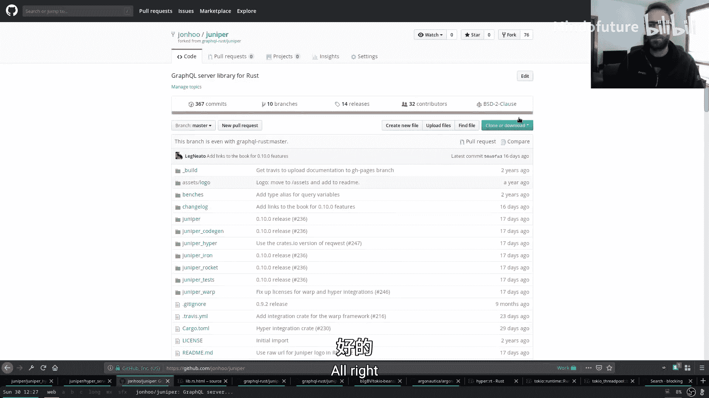

And get on this。

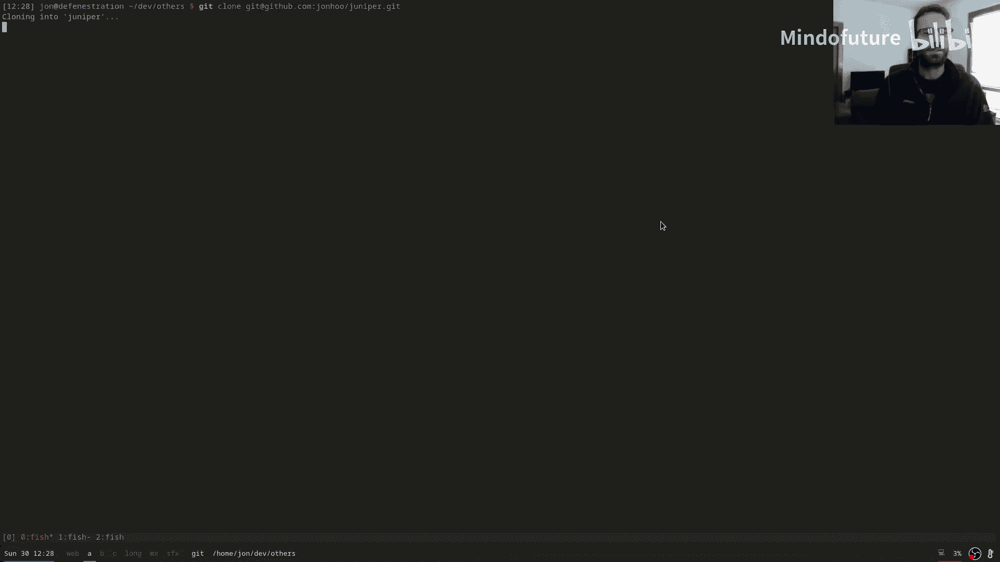

So usually what I like to do is。

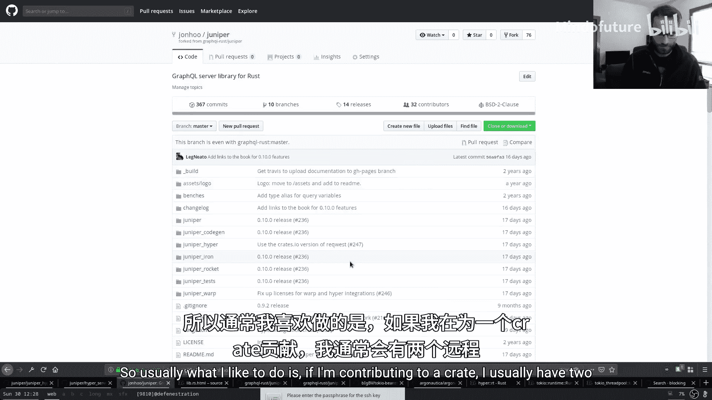

If I'm contributing to a crate， I usually have。啊。Two remotes， so I have origin point to my branch。

 and then I have one called upstream。Upstream this one。Let's also do。

 and then I point master to upstream。

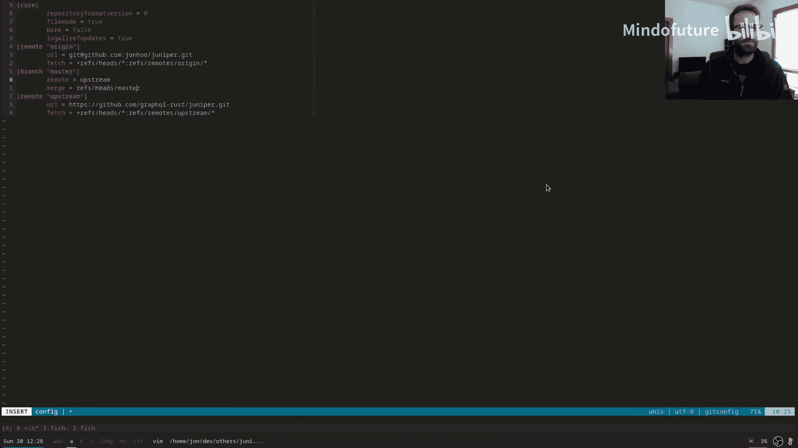

So the master is not pointing into my fork。And then I make a new bru。 So in this case。

 what we're going to do is remove CPU pool。

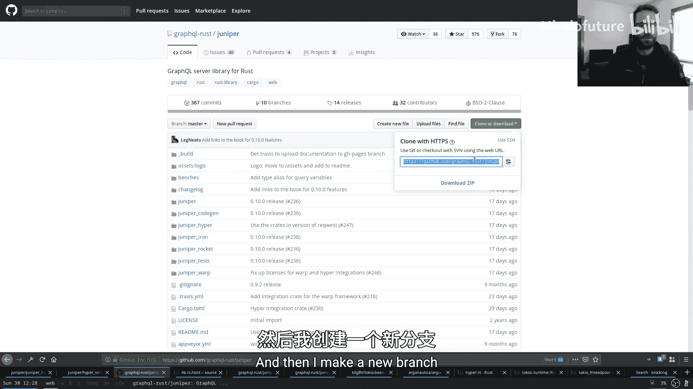

Move hyper CPU view pool。And then Juniper Hyper。Let's do our cargo check。

 let's see if we can build this thing in the first place， that would be that would be handy。

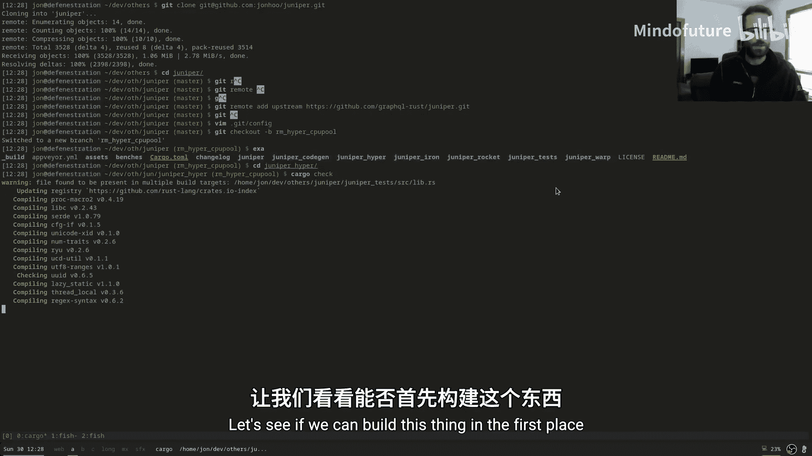

嗯。Okay， so the real question we we need to deal with now is。If I can get back to。ワックし？Some。

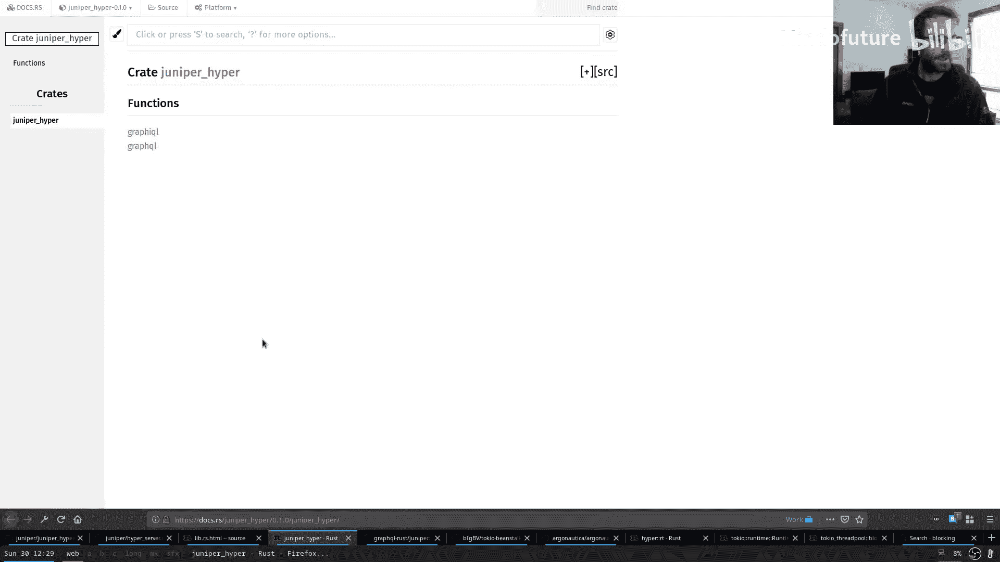

对。Oh， great。 We can build it。 It's fantastic。 All right。

 so we basically need this function to not take a CPU pool， right， Instead。

 it just give you back a future。😊。

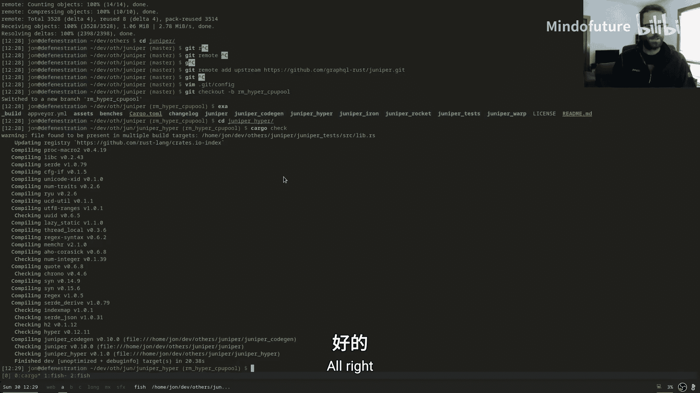

Yeah， this could probably be imp future， I don't think this needs to be box。

Itpen how performance critical this is。 But I guess let's focus on getting rid of the pool。

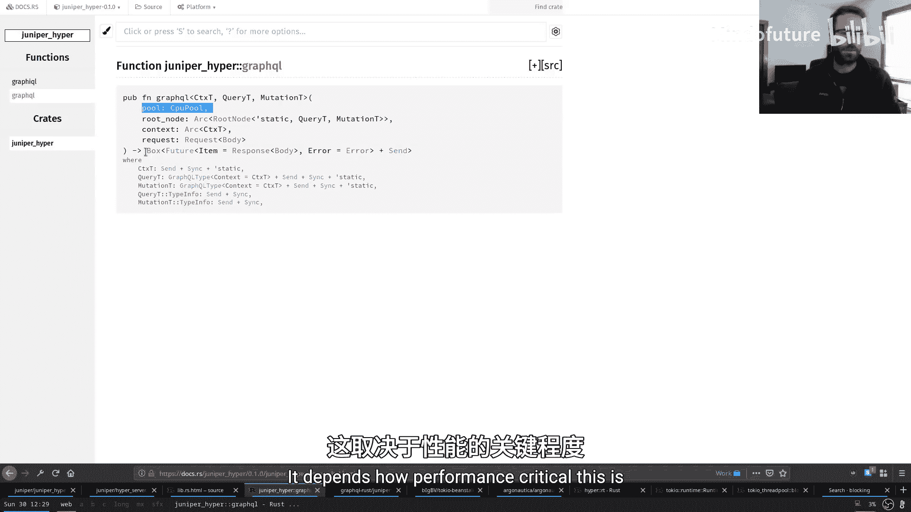

So here's what we're going to do。Oh， no。Oh， it's almost dress formatted。Ohpe。Oh。

 that formatted everything。 Okay， so juniper is not formatted for those format。でした？

 we'll just ignore that change later。Right， so over here。

 I guess we would need to change cargo Tomel to get rid of the CPU pool and move Tokyo to be a dependency。

 moving Tokyo to be dependency is actually fine because hyper alreadyity pools in Tokyo。

 So we're not actually adding a dependency。're we're making an implicit dependency explicit。

 which should be fine。So now there will no longer be a future CPU pool。 instead， there'll be。

Tokyo always。The hypergrid itself should be rust format。So it mostly is。

 I'm running the latest night， which is probably why it's。Why it's complaining， specifically。

 the only real diff is this business done here。 That's the only di it makes。

So that's probably a rust format nightly change。 so I would not worry about it。汤。

So now it's obviously not going to compile。Okay， so we need to figure out how we want this to work。

 so specifically。I guess the concern is when you call a GraphqL。

 we're going to have to do something that's blocking。Which is fine。

 So we're going to use Tokyo blocking for that， which means we have to pull in Tokyo thread pool because that's where the blocking function lives。

 Tokyo has been moving in this direction of instead instead of having all the things exposed through the Tokyo crate。

 they have lots of other crates。 and then Tokyo just exposed as like the really essentials that are not expecting to change。

 The reason for this is they can improve the other crates without having to issue like breaking changes or anything to Tokyo itself。

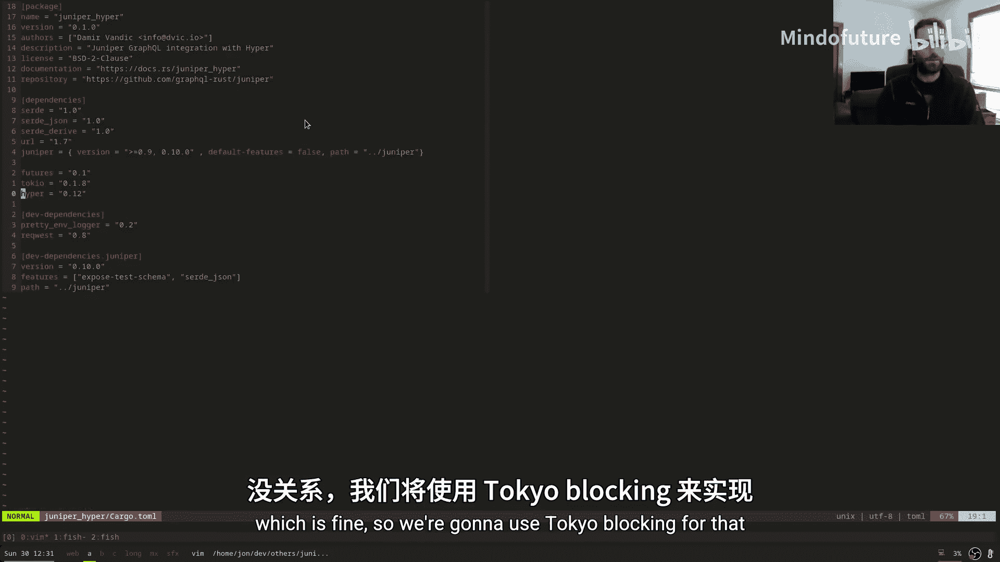

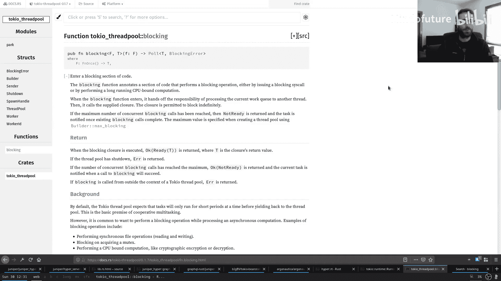

So in this case， we'll need Tokyo thread poolol 0，1，7。嗯。

We're going to get external gray Tokyo thread pool。哎。So， yeah。 So the question is。

 what are we going to do about Graph Q L， I think it does not need to take a thread pool。 Instead。

 what it's going to do is just call。So I guess execute request is the part that's blocking。

 so I think all it really has to do is return a blocking thing。These arguments are not pretty。

 but I guess it's fine。I think this can also just be imp future does not need to be boxed。嗯。Yeah。

 so down here， I guess execute requests。And execute request。 Okay， they both use execute request。

 So that's really， we can just modify an execute request here。Right， graph IQL。

This can also be import。Oh， I guess the reason why am future is a little annoying here is because we have different return values depending on we have。

 we have different futures that return depending on whether it's a get or a。

Get or a post or anything else。So that's probably why it was originally a box。

We can get around this using either so futures。I think it's in future either。So， we would do。

Either a。Either A。The AA is a little annoying， but I'll show you in a second why it's necessary。

TheSo either is a is either。 So there are only two options， right it left or right or A And B。

 And in this case， we want to return three different things。 Specifically， this is one， this is2。

 and this is3。 And the way you get three from two binaries is you wrap the binary。 So in this case。

 this would be。So the type of A， A contains it either， B is just this。嗯。So now that can be in future。

 This can just be in future directly anyway。嗯。New HTML respond。So isn't this a blocking call？

I guess we don't really know， but to me， this seems like something that might block。

But given the current writing， I guess。呃。呃。the。All to。Graph IQl source blocking。Because if it is。

 this should be wrapped in Tokyo blocking， right， like we should。

 we should mark this as also being a blocking future。

So now execute request is gonna return something that's an impple future。 Okay， that's great。

 So here， Iple future was used already。 So my guess is for the box is because they didn't。

 they tried impple future。 It didn't compile。 And they were just like， let's just box it。

 The reason is because impple future only works。 when there's a single future type that's being returned。

 If you have， So if you tried to do like F M Iple future。 And then you do like if。😊，诶。house。

And like this is some future and this is some other future。

 This will not work because I future is going to say there's no one type。

 It's you to think of imp future。 It's like there is a single type here。

 I just don't want to name it。Right， but in this case。

 there is no single type for the return value because these two futures。

 this and this have different types， even though they both implement future the same way。

 they're different things。 And so the way you get around this is by doing。Either a。B。

And so now there's only a single type that's being returned， and that's an either。

 which is generic over its left and right future。嗯。Allright， great。

 So we got rid of a heat allocation。 That's good。Oh yeah， either is fantastic。

Let's see what else we have。 Okay， so we got rid of the pool from here。

And now the question is down here， what do we do， So this doesn't actually have to be lazy anymore。

This is now really just。Why does this？Hao。Did I put the wrong number of parentheses somewhere？

Probably。No。Yes， here。And also here。And also somewhere else。52。Ma Mr。 Comma？And another extra comma。

Great。嗯。So it was interesting。 Okay， so the coat now actually compiled。

 even though there's no pool and the reason for this is now we're just like executing this request directly on the current thread。

 And so you should think of Tokyo as it spins up a pool of threads。

And those threads are supposed to keep processing futures and if and what what happens if you put like an expensive block in call somewhere like imagine you like do like an expensive file system operation or you do like even just you do a loop that just spins forever then that threadpool worker that that one worker in Tokyo cannot process any more futures and so imagine that you had like。

Four futures， and all of them just did a spiny loop， or they did something that blocks。Now。

 if you only had four cores， there would only be four threads in that pool。

 if all of them are just spinning， then none of the other futures you have get executed。

 So like if therere another H P requester comes in or something， it will not be processed。

 And so the way we deal with this is that we tell Tokyo that a given。

A given worker is now blocking so it it's doing something so that it's not going to be able to handle futures for a while And then Tokyo is going to respond to that by essentially spinning up some extra threads or keeping some extra threads to make sure that like the rest of the world continues working。

So in this case， what we're really going to do is we're going to do。Tokyo。Thread pool。Walking。So。

 blocking is going。Yes。So this is going to return as a future and then。And then。

The response of that is we're going to do this mapping thing that originally happened。 I guess this。

Does this even do any。I think this is just a map。 I don't think this needs to be an ad。I the map。え。

Interesting。Oh， I guess actually。We probably want the blocking stuff to happen all the way in at request execute。

So we're going to have request， execute， return an imp future。Yeah。So execute， where are you here？

So this is now going to do。 it's going to return an imp future。

Where the item is this and the error is。Blocking error。This thing。Now。

 this is not something we want to expose to the user。 In fact， why is。This pub， why is this not？

That makes no sense。 requestquest is not pub， So this is not。Yeah。

 so if you try to execute a request， what we're really going to do is we're going to execute it we're going to return a future that will eventually result it being it having finished and in this case。

呃。Oh， I see this does multiple blocking requests。Fascinating。All right， so this business。

That's a juniper。Graphq road。Okay， so this is the actual blocking call。

 So here's where we're going to have Tokyo thread pool。啊我。Chas a closure that's going to execute。

 and then we're going to map that into a single response。Great。If you get。A batch of requests。嗯。

Then we're going to do， I don't know if it's going to be okay for this execute to be on a ref to self。

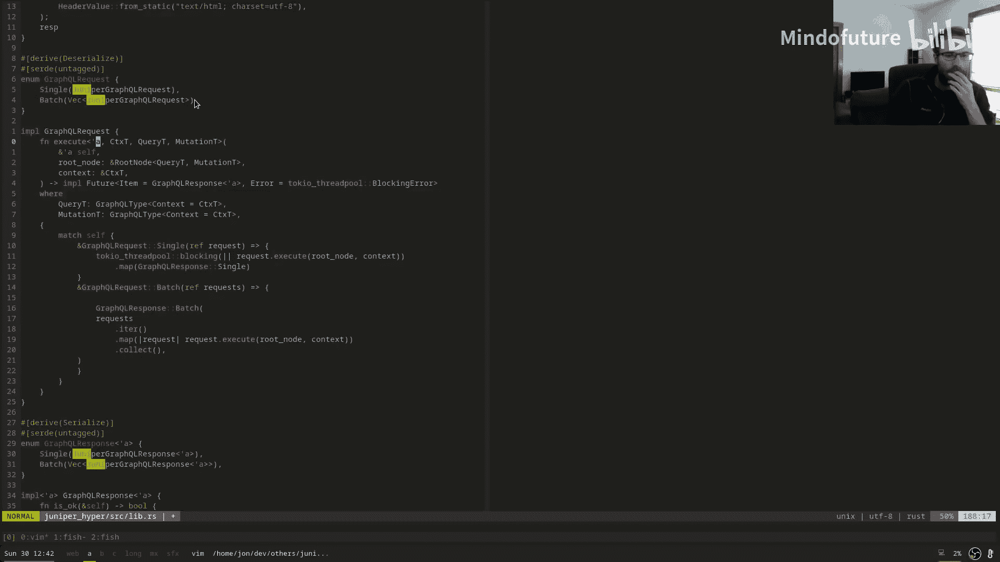

I guess this is where we have to find out what the。Tuneniper API is like。So the where is it？

GraphqL requests。Yes。

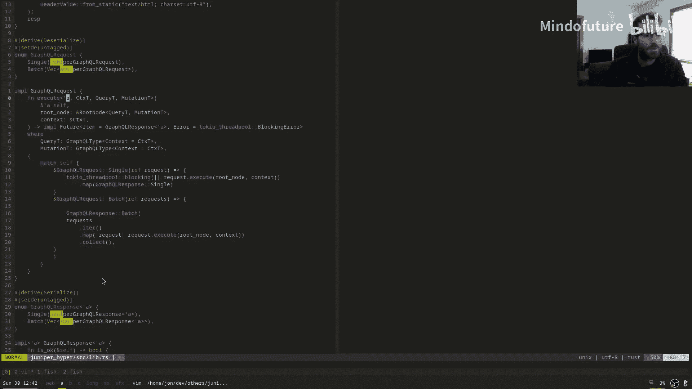

嗯。😊，🎼Graph Q L。Qu。HtP movie hair request。Oh， execute returns to responses tied to the request。

 that's awful。

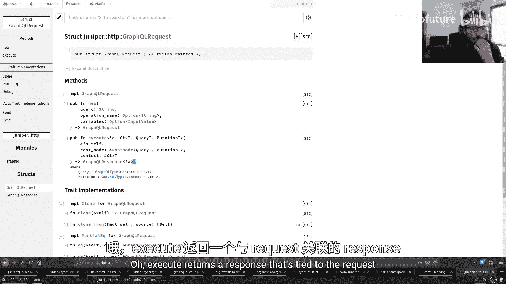

嗯。Yeah， that's kind of awkward。So the problem here， of course， is that。

This future is just like spun up in the background。嗯。喊喊喊 함함。And specifically execute。

 return something that borrows requests。And I wonder if blocking， blocking need to be static。

 maybe not。

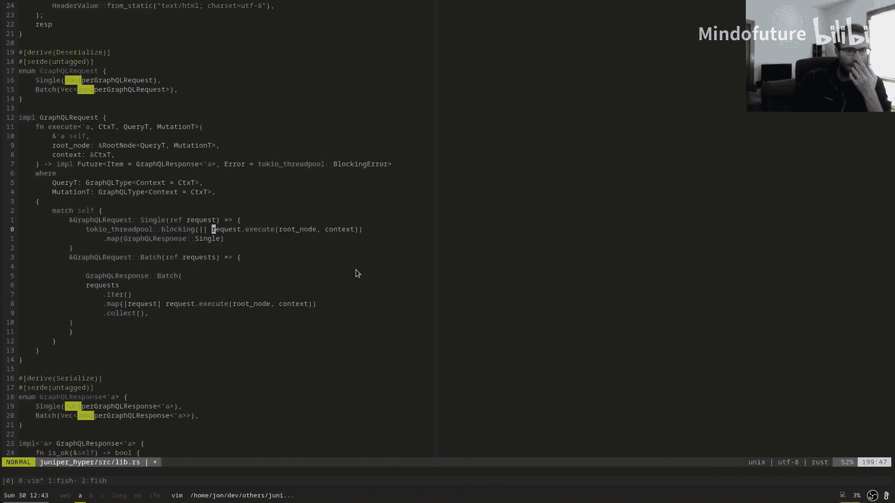

It does not。

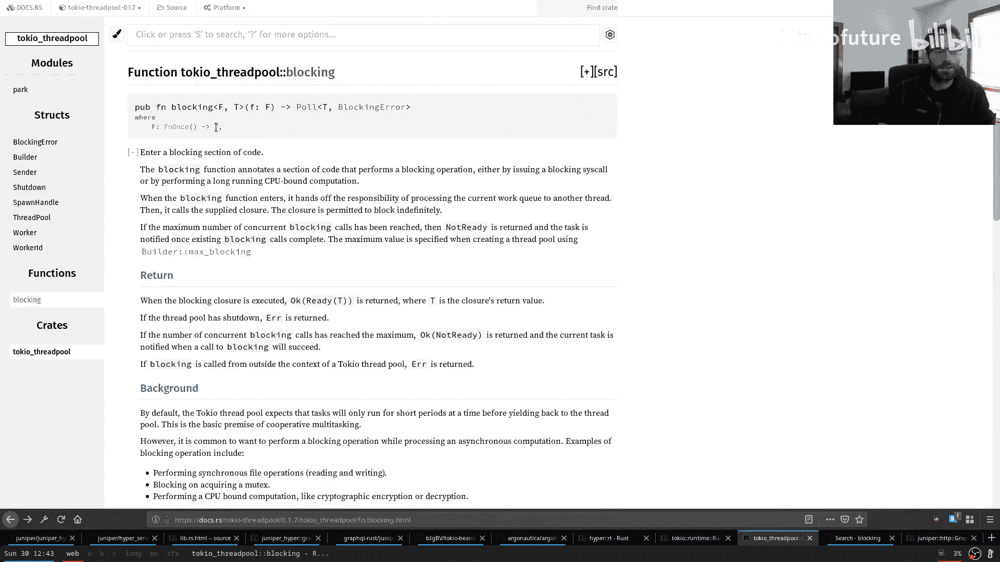

Specifically， closure does not。嗯。This might not compile， which is a little sad。嗯。Let's see。

Why don't I see the whole thing in a blocking call？嗯。That is basically what we're doing。

It's just that it。Wouldn't help。 So if blocking requires its argument to be static。

Then we can't give it any closure because any closure is going to have to borrow their GraphQL request。

嗯。Wait a second。 So the execute up here。Is given the request， wait， why？Oh， I see。So really。

 we do have self here。The problem is just what do we what's the lifetime of the return future？嗯。Oh。

 I see。 that's why it。 I mean， let's this might actually work。 Let's try this。嗯。So specifically。

 if we get a batch of requests， what we want to do is we want to。Do and execute for all of them。

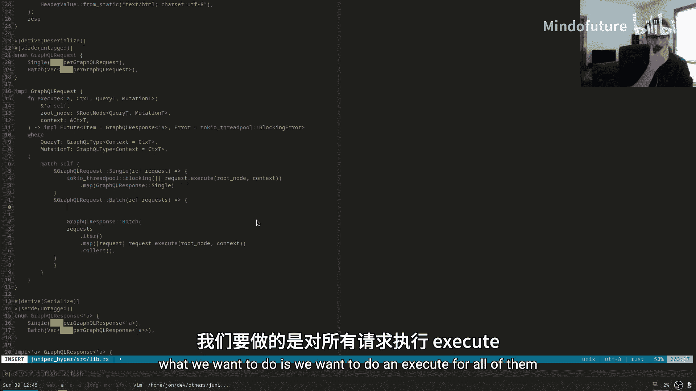

So there are a couple of ways to do this in Tokyo if you have。

 you want to essentially wait on a bunch of futures。And the way to do this is 0。1。Let's see future。

Join all。Think it's the one we want。Yeah。And a join all， I think is a stream。No， it's a。 Okay， great。

 Yeah。 So that is what we owned。 So specifically what we're going to do here is we're going to do a futures。

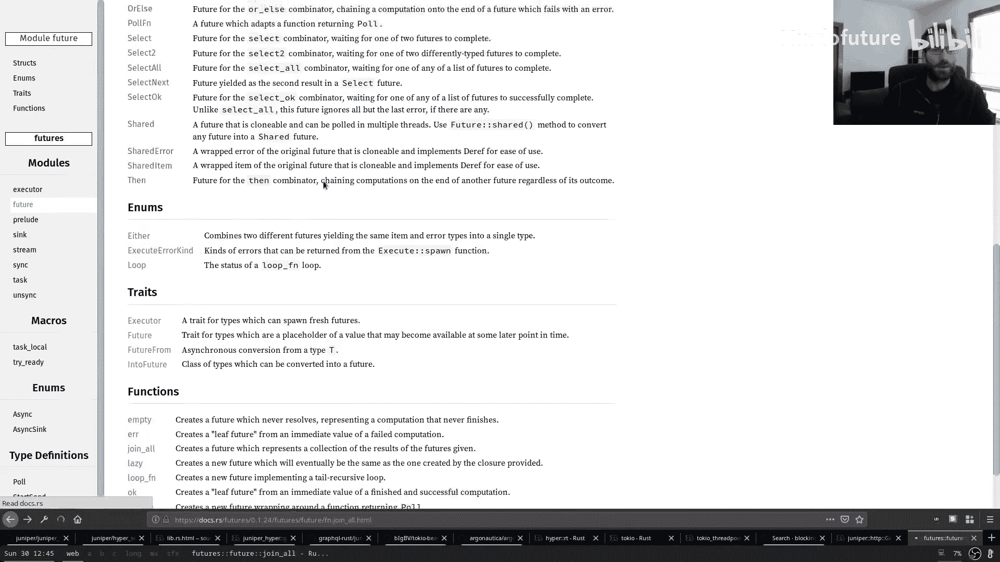

Future join all。 I guess this comes from。 if we just use the Tokyo prelude。

That brings in future as well， and it brings in future。And I guess， we might as well bring this in。

 That's fine。 So we're going to do a join all across request thought it。Dot not。嗯。です。Right。

 and this is now going to be a blocking。So we don't need to collect anymore。

 The join all is going produce a vector for us that we can then just map into the final batch。

And this is now and either。Right， because the two different match arms are different types。

It's probably going to complain all of the place， that's fine。95。All right。

 it's going to complain that the error here。Why is this generic over the error type？

I don't think that's true。I think this is specifically a。Tokyo thread pool。Waling now down the line。

 this error might have to be more refined， specifically。

 I think that error type is going to have to be something like derived from the juniper error type so that you can also return juniaries。

 right？

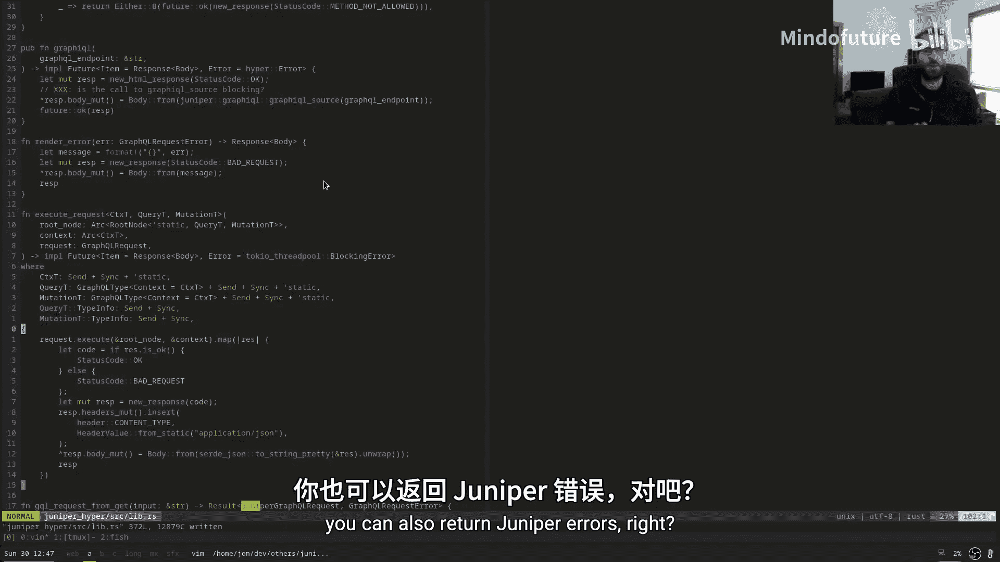

I guess the question is whether Juniper execute。啊。Yeah。

 so execute here will my guess is at some point will return a result。

 but I guess the response maybe contains that error anyway。

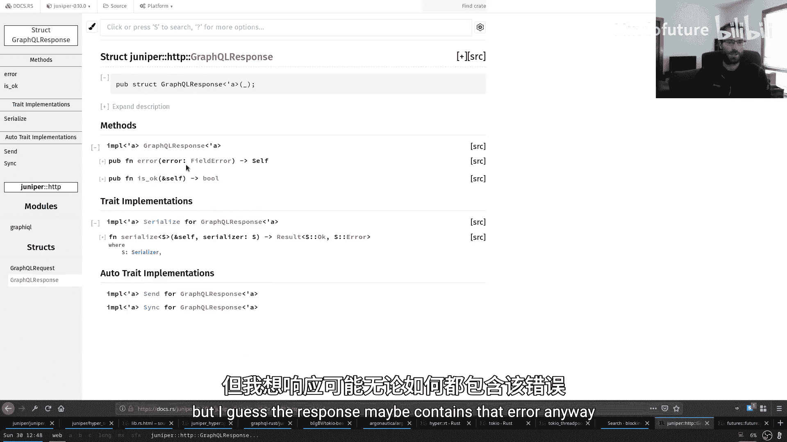

嗯。2。Sorry， what is it complaining about？He's complaining about a lot of things。 Alright。

 let's look at 51 first。 So here it's saying type mismatch。

The error should be a GraphQL request error。Right， because here I see so up here。

 we're making the error type B Graphql request error。So the question is。

 what do we even want to do here？🤢，I think what we want to do is ignore the blocking error。

And just make it a Graphql。啊。Quest error。Sure， invalid。 I mean， it's not really invalid， but。

Thiss going to be something like no more capacity。So this would happen if we already have lots and lots of threads that are。

We have lots and lots of threads that are already executing these blocking requests and Tokyo is saying I'm refusing to spin up any more threads。

 You can set the limit on the pool for what you want that limit to be。In fact， we could hoist this。

Could put this further in， but I think for now， we're just going to put it here。那我。啊。

Ty this match on 208。And so here it's saying。Expected signature。

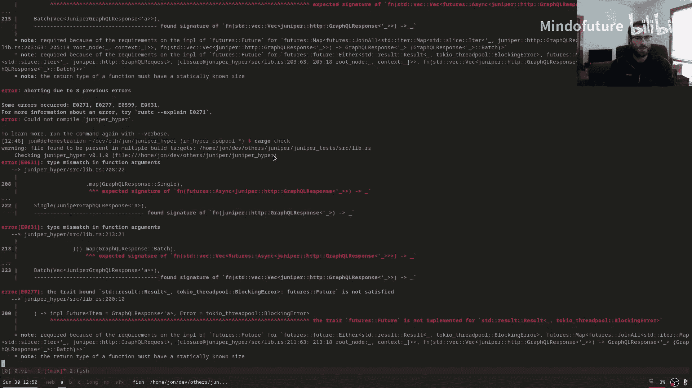

Oh right， what does blocking actually returns？T of poll。Oh， I see。怎么。

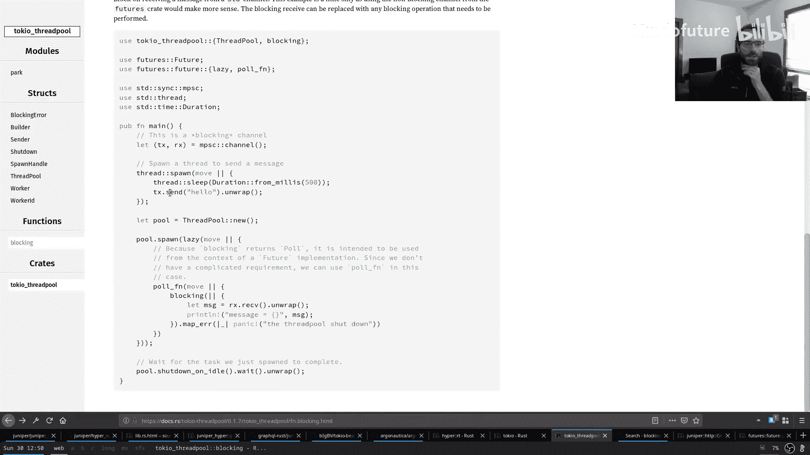

So we need a pole offense， which we're saying。So this is so blocking。

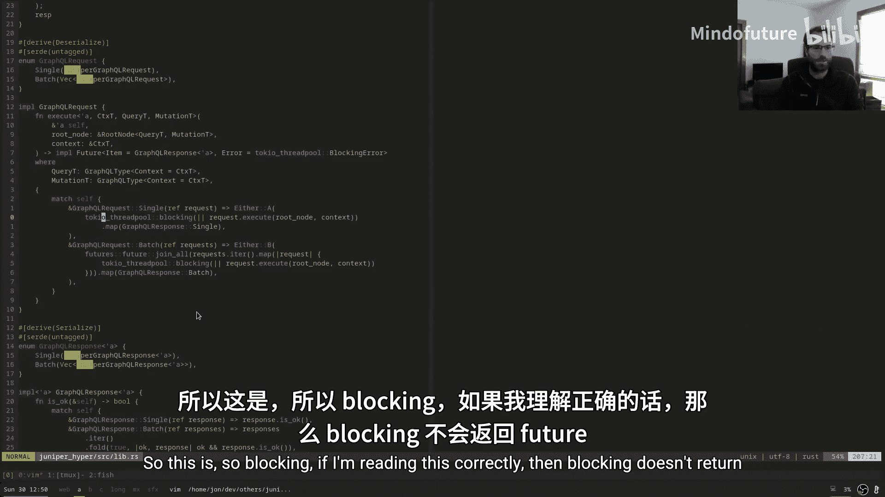

嗯。If I'm reading this correctly， then blocking doesn't return a future。

 it just returns whether it is currently executing that blocking call or not。

So it might return you a blocking error if that thing is not yet ready。

 if there are no threads available to do the blocking call。

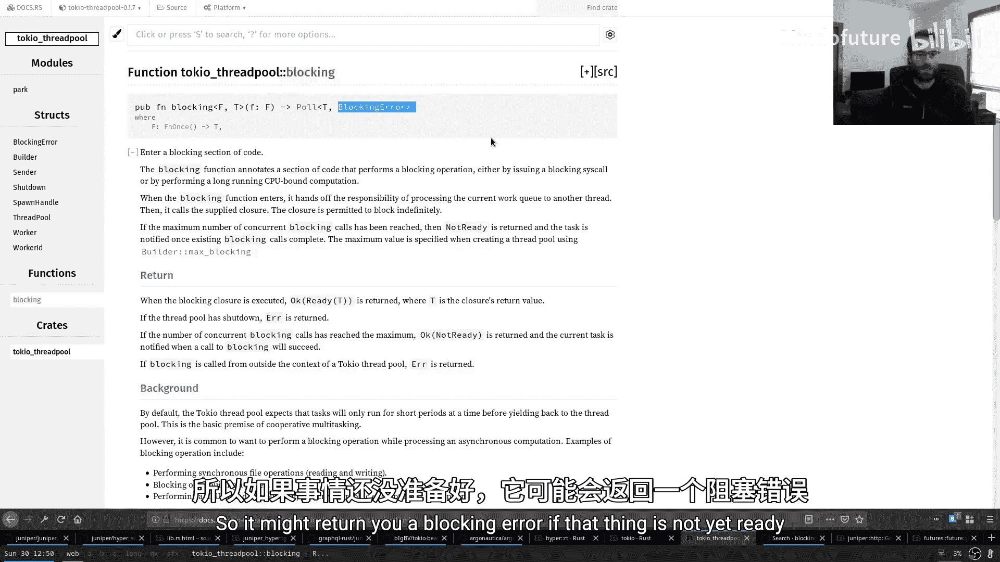

啊。And so I think what we want here。So imagine that you have four cores。

 you're currently executing four blocking futures and Tokyo goes，  no。

 I'm not going to spin up another thread for you， then the call to blocking is going to return an error。

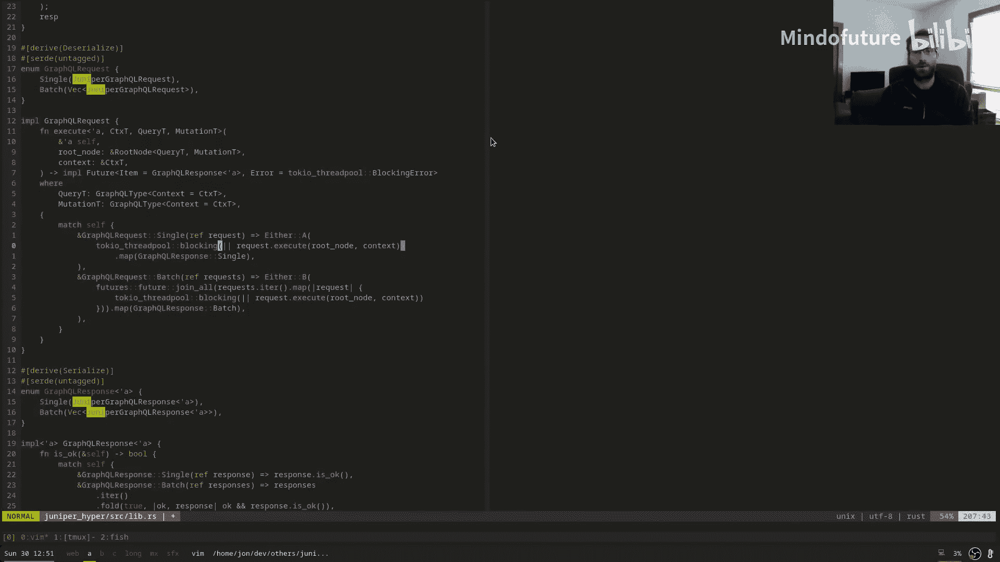

And so really what we want to do in that case is every now and again retry it。

 essentially we want to poll whether there are available threads and the way we do that is by using future poleloen。

Which really just tries to execute the future until it succeeds， which is what we want in this case。

 So here。

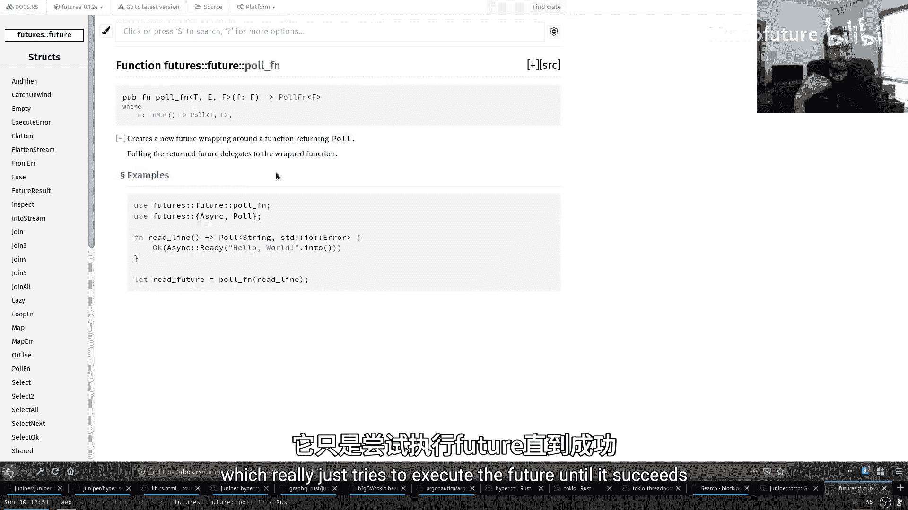

I guess the question is what is a blocking error then， it？And that's unhelpful。啊。

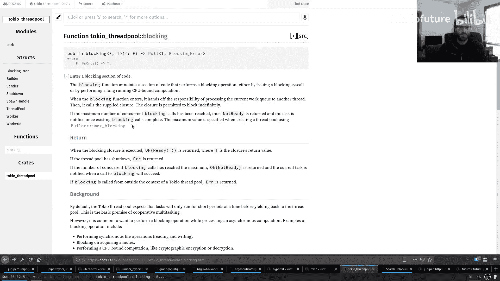

Return oh， if the thread pool is shut down。I see。 So really， this should just like。

this is not no more capacity because I would return not ready。啊。So in this case， this is just。

This is really like thread pool has shut down， which I think should never happen。

So I think we can just do unreachable。Because this shouldn't ever happen。

And so this is going to be a whole of N around。And same。Right。Now 198。Right， so actually we need。啊。

It's a little awkward。So because we're。Carrying along the root node and the context into the closure in here。

And that might like we might return from this function almost immediately right。

 because we we try to put it on the thread pool and it like is there aren't enough threads and so it's going to run it later and so these references。

Need to stay alive for as long as this future is alive。

 and so what we're going to do then is we're going to have a tick F。And these and the future are。

And that we're also going to have to save that。Tick a outlives tick up。So basically。

 the reference itself also has to live as long as F。Because otherwise the future wouldnt result。

 right？And now it's probably going to complain about all sorts of ownership issues。So 109 here。

Request does not live long enough。呃。Wait，Why are all these things borrowing。

 they don't need to be borrowing？If they are not borrowing， that makes us a lot easier。

Because now this is no longer a reference。This is an part to that。

This is no longer a reference part to that。Now， this doesn't not to be F anymore。

So we're going to move into here。Let's see what else we have mismatch title。

I guess this is now going to borrow these。Exquisite lead required in the type of root node。Oh。

Root node takes a lifetime， too。109。Request does not live long enough。Well。

 the request is actually owned。So， let's just have this。Take self instead。And。

This now has to be generic or A， but just for the root node。や。Unfortunately。嗯。That's a good question。

 Okay， so the problem here is that the the response we're giving back is tied to the request。

 so we can't。We can't produce。A result。So the reason this is awkward actually is because we want the ability to have this freestanding execute request bit。

嗯。Because this thing。It changes okay， so let me rephrase。

The problem we're running into is that we're trying to。Do a request where execute a request。

 And that's going to take a while。 And the response is tied to the lifetime of the request。

 The problem then is that means that the request has to live for as long as we want to run this thing for。

 But we own the request。 and we want to move it into where we execute it。

 But the problem is then the response as they'll tied to that lifetime。

 So to phrase that differently， when we the thing we get back from executing the request still borrows the request。

 So if we just hear return， then request would be dropped and that the response is no longer valid。

 right。So I think really the thing to do here is to provide a map。Yes。So we're going to consume self。

嗯。Yeah， okay。So crucially， the problem here is the response only lives for as long as request is alive。

 Request is still alive here when we execute， but the moment we return request is dropped so the response is no longer valid。

 which means that we basically need to map the response in here to get rid of its lifetime。

 So what we're going to do is we're going to allow execute to be given a mapping function。

 And so there's going to be an F and an R。 and this is going to return an R。

So F is going to be an Fn mute。And it's going to be given a Graphql response and going to have to give us an R。

Does that make sense， So what we're now going to do is we're going to have this dot map。

And same here。And so now notice the response is no longer time to the lifetime of self。

 this can now be moved into the function。I think that should do it。嗯。Now 199。

 the execute function that we had up here somewhere。This。

Is now going to pass in the mo enclosure directly。嗯。N9。

Expected Graphql response found type parameter。hy。嗯。あ。Yeah。That's kind of awkward。Okay。

 so the real way to fix this is just to。Not have this be a separate method。

But I don't really want to pull that out。Okay， so the problem now is our mapping function is over a GraphqL response。

But the problem is that we don't have the Graphql response until we've resolved all of these。

And they are still all borrowing。Requests。Although that might be fine。

We might be able to have this just not move into this。Not my peer。

So then the request is still borrowed at this point。This is now in either a。And right。

 we already did that。And then the future that comes back from this， we map with map。

Before we end up dropping self。Maybe。Specifically now a reference to the request is going to be passed in there。

Yeah， the problem is， there's no。There's no well defined owner of request。Is really what's going on。

啊。Ming， blocking an asynchronous code like this is always a bit of a pain。嗯。嗯。嗯。Yeah。

 I wonder whether。嗯。It's just really problematic that the。

Why is the response tied to the lifetime of request， This seems really odd， Juniper。

 why I have've done this。

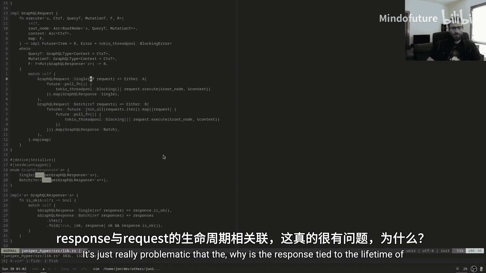

Execute。To the response， why is the response。What does it contain？Oh。

 the ticket is only there for the error。Oh， that's awful。Oh man， that's a bad choice Juniper。

That's not worth it， errors should be rare。That's awful。

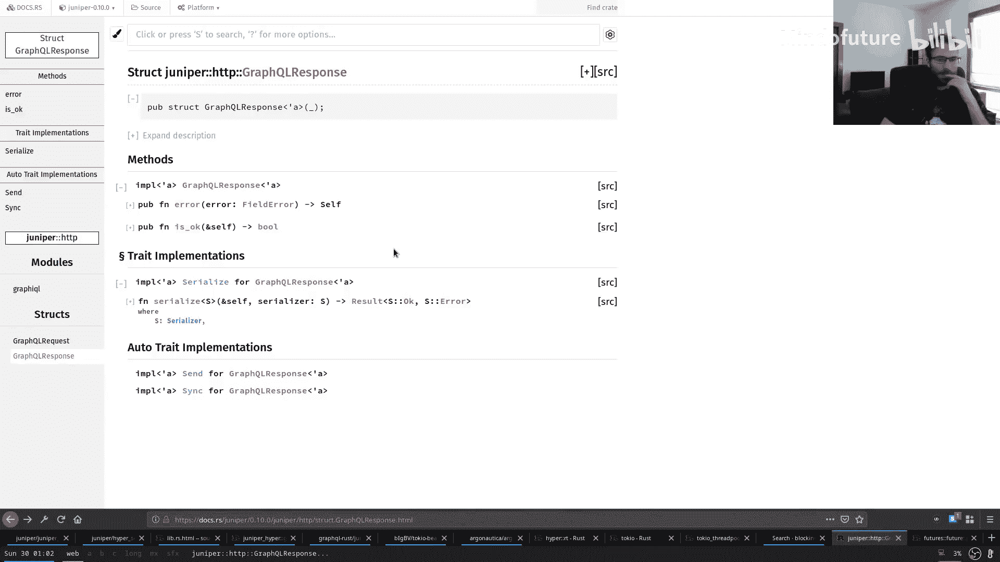

Yeah， that makes this a pain。So notice that if the execute's response did was not tied to the request。

 none of this would be a problem， the problem is specifically that the T A of self here is tied to the TA in the response。

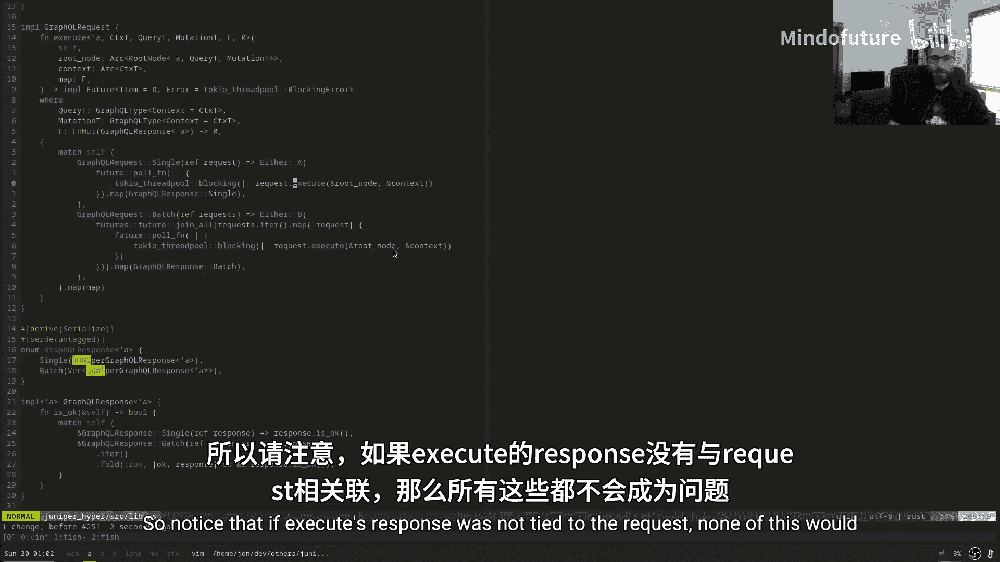

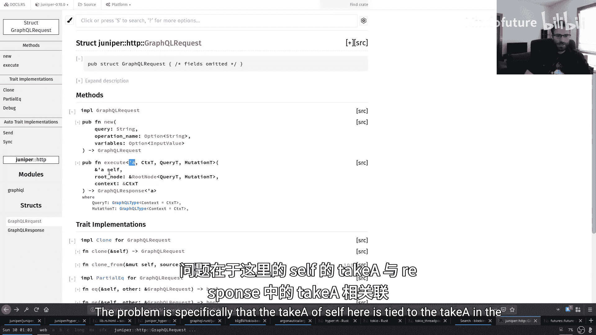

啊。

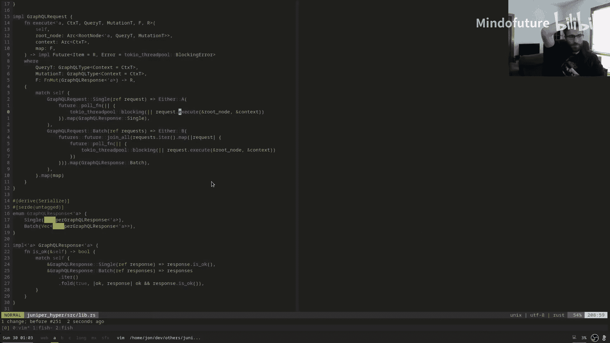

No， because well the input bytes are only used if you return an error and if you are returning an error。

 then cloning is fine， right， the standard operations should be not getting errors。

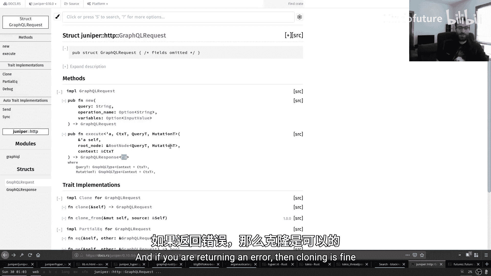

So it's fine to make the ears a little more expensive。Well， then。嗯。いや。Yeah。

 the real problem here is just like that the request ends up being dropped。H。

But I don't know how to avoid that easily。嗯。So the way we could do this is like wrap the。

Request in an arc。Because like， okay， this case is trivial because here we just。Dot吗。Ql。

Respondse single。So that part is fine I think， because there we know the request doesn't get dropped。

呃。Oh。Alright， after the。Can't be after the poll。It's like， match on this。And if it is okay。嗯。

I think ready V。So if we get the value out。Then we want to produce map of graql。Bs。Single。right。

 so this erases the lifetime。So that's fine。 And anything else， if we get o， So we guess okay。

Asynnc great。If we get O okay， async， not ready。Then， we really just。Oh。

 I guess actually the nicer way to do this would be。です。Wow， that's one ugly future。

So the idea is that we try to do this blocking。 and if it succeeds。

 then we immediately map the result。 and this is still happening。I guess here。

 this is still happening while we have a reference to the request。 and so that's all fine。

The problematic case is this business。Because here we can't pull the same trick because。

There are multiple of this requests。 So this is going to be intuitive。And each。Yeah。

 so here the real problem is we can't call map on the entire batch。嗯嗯。

Maybe you can convert it early on into GraphQL request error。

 Now the problem is specifically that this is actually a GraphQl response。

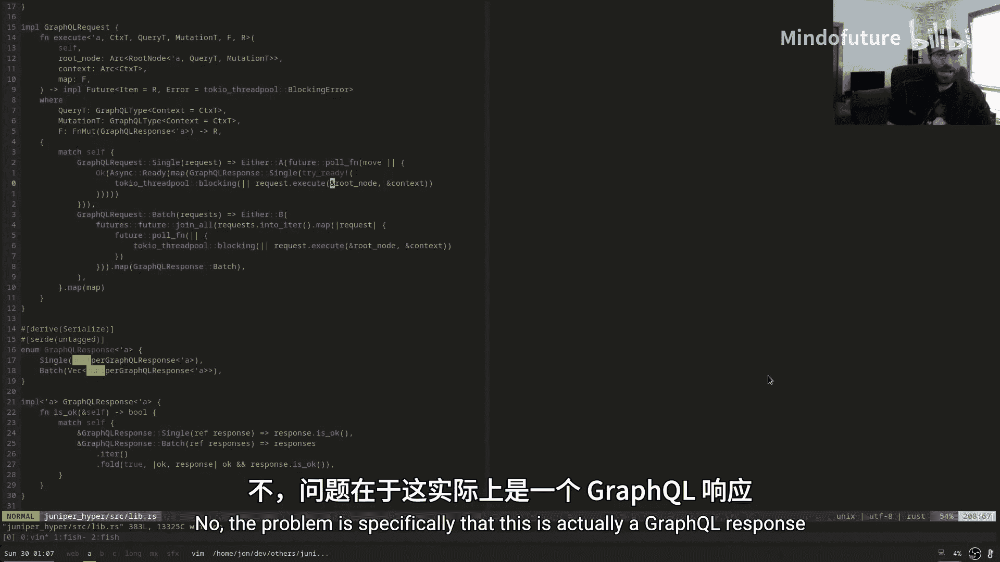

I need to get the value from the response。And there's no way of getting the value。

As far as I can tell。hi is kind of silly。 Okay， so the other way to do this is to specialize this code a bit more and just have this happen in line。

So what does wait， this only looks at the。Yeah， this just serializes the response anyway， okay。

We can make this a lot simpler by just。We're just going to erase this lifetime。And。What does this do。

 so this is if it's okay。Then you respond from the code。Al right， so really。

 all this needs to return。 Let's ignore this map function。 This just needs to return。stringring。

 which is the Jason encoding。Actually， it needs to return a hyper body， which is the。

Body we're going to include， and it needs to return whether or not it's an error。I think。

That's all this code relies on。 So if that's the case， then this is pretty trivial。

 because it's just。诶。It is just going to be here。I guess。

This we're not going to produce a graph field response at all。 We're just going to。Do。

Whatever value we get back。Sorry， bear with me here。

So we're just going to do this blocking and if it succeeds。Then we are going to do the。Where is the。

They execute。I' just going to do this。Body is this。And then we're going to do。Is。

Okay is V dot is okay。I guess we can call this rest。And this is rest。 and this returns now is O。

 embodied。And then we're going to have to do the same thing down here。嗯。哦。Right。

 so this join all is a little bit more problematic， but we can pull a similar kind of trick actually。

Shes， we're gonna do。For each one。We're going to try ready。And then。We do that。

Not going to give a response。Instead。I's gonna move into here。嗯。No那。This is missing something。

 This is missing a future pull of that。です。 so we're going to pull for all of them。

 we're going to try to execute it synchronously。 The problem now is what this join all is going to be is is's going to be a bunch of already Json serialized responses。

 it just so happens that given those， we can easily produce the final Json string。

 It's a little less efficient than what we would probably like。

 But we're going to do now a map of this。 So what what the join all is going to produce is it produces a vector of results。

😊，Where each result is。And is okay in a body。 And we need to produce a single。Single is okay for。

And you can concatenate Jason pretty easily， right， So really， what we want to do here is just。

Is O is results dot hit dot。All。嗯。Specifically， the request is okay if all of them are okay and。

Concanate Jason bodies as array， which is what we want to do， right if。

What this would have been produced if we did the whole thing and then Jason serialized it。

 that would really just give us a serialization of a Vck of them。

And the serialization of a vector of things is just comma separated and start with an open bracket。

And so we just need to modify the body to do something like body is results into it。Fold。Body empty。

And。For each one， we're going to have。呃。你。I guess all in body。

 And we're gonna to have to produce what the new body is going be。

 And the initial body is going to be actually。This。

So we're going to start out with an open square bracket and then we're going to just add all the things with commas in between。

 and then finally this is going to return to SOK embodied。So we now need Dox Rs。

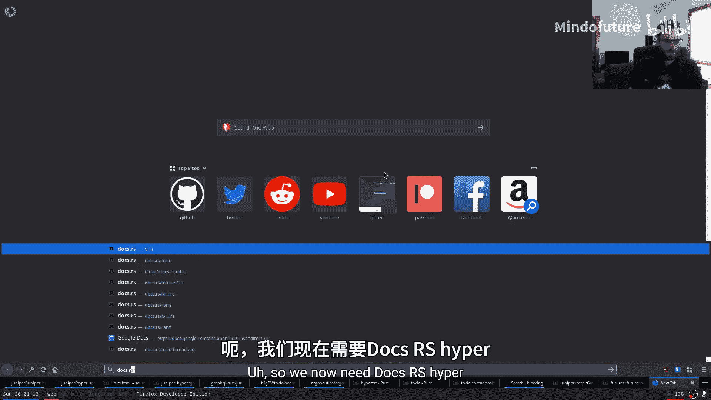

Hi for her。So hybrid body。One of these。What is this？Wu。Ooh， that's even better。

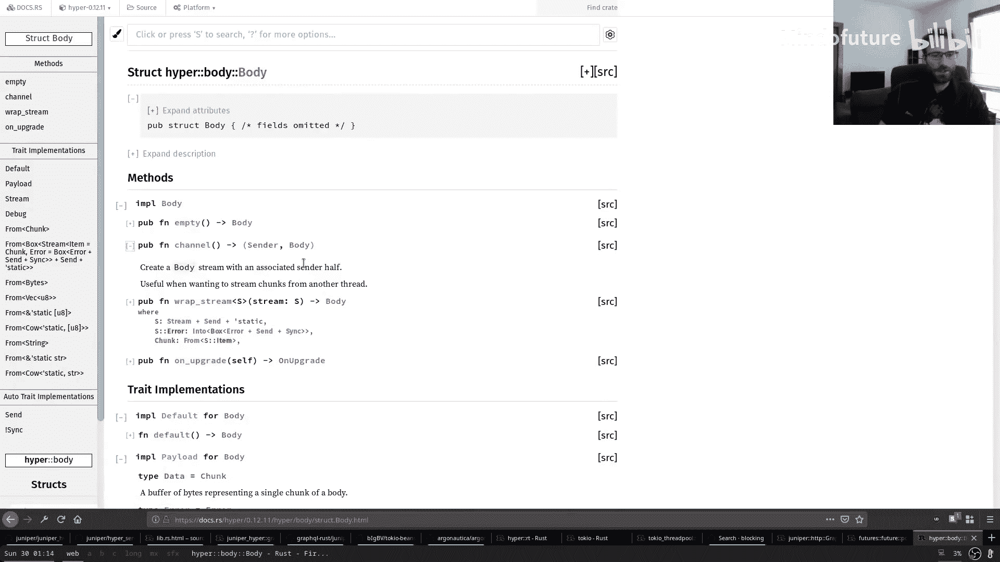

Yeah， let's do that。 All right， so watch this。 This is even better。So， T X and body。

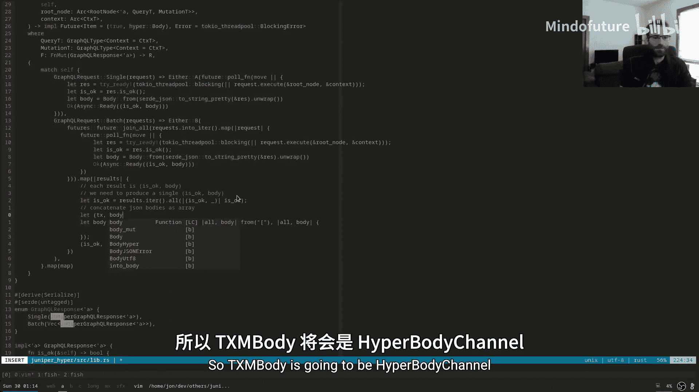

It's going to be hyper body。

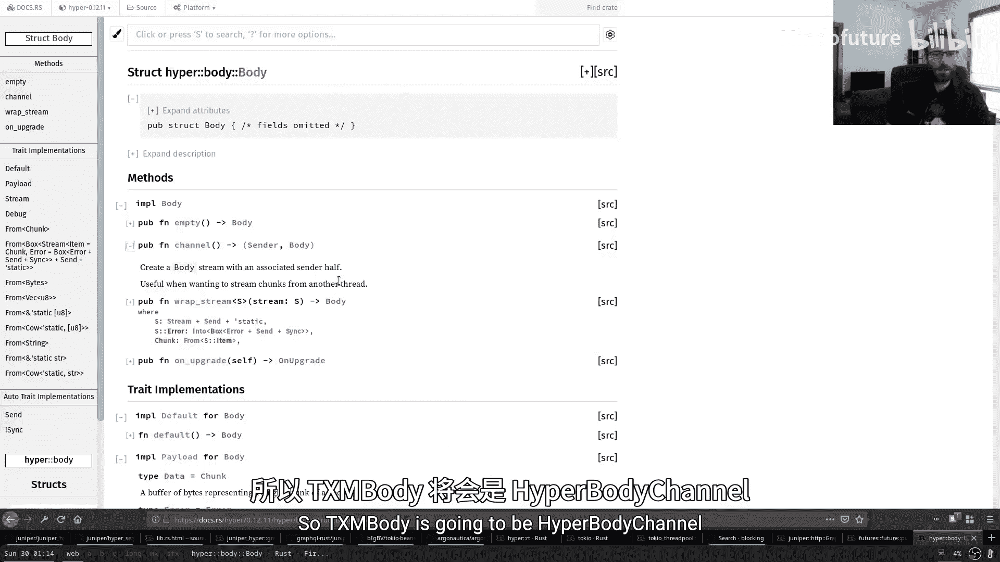

。And then we're going to do， we're going to send one of these。

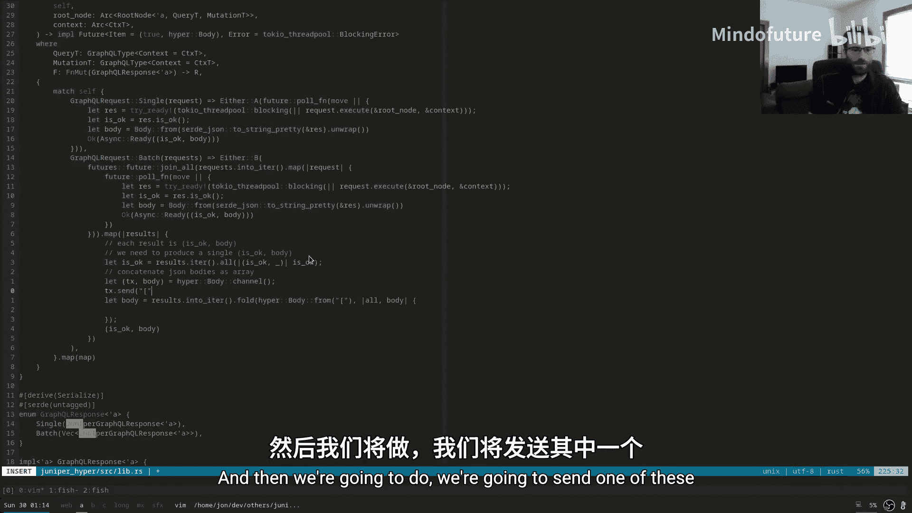

What does this， what do I have to send on the send？あ。Oh， it's not an unbounded sender。

 that's awkward。How do I add to one？

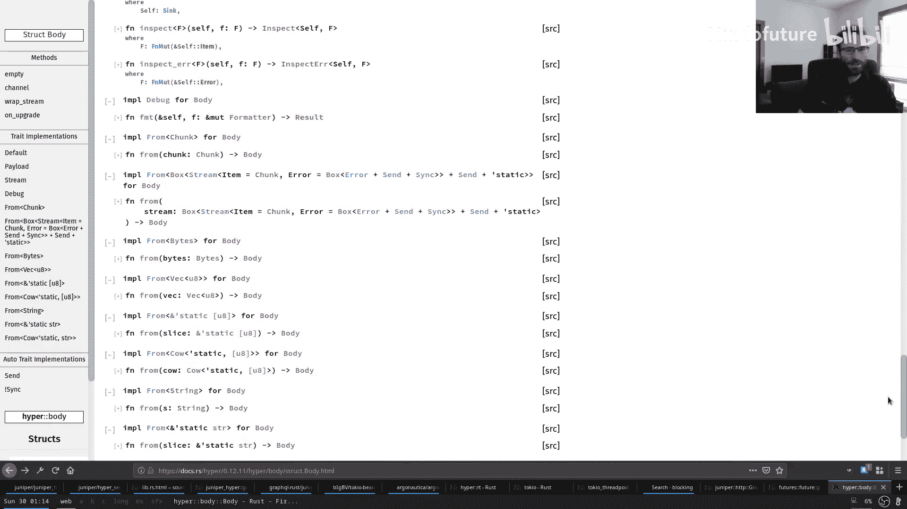

I can only asynchronously add to one。Allright， that's fine。Sure， that's fine。

So we're just going to make the body up here。' not going to be a map down here。嗯。

So we're going to start out our body up here。呃。Sure。

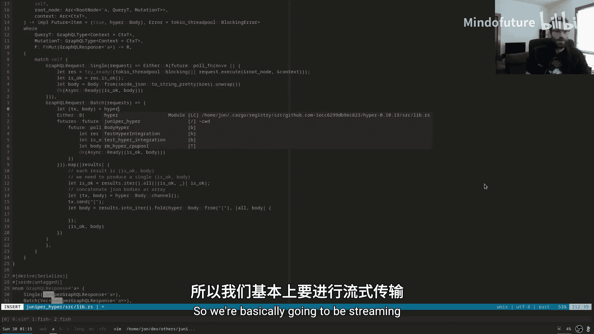

So we're basically going to be streaming。We're going to be streaming the body into this。

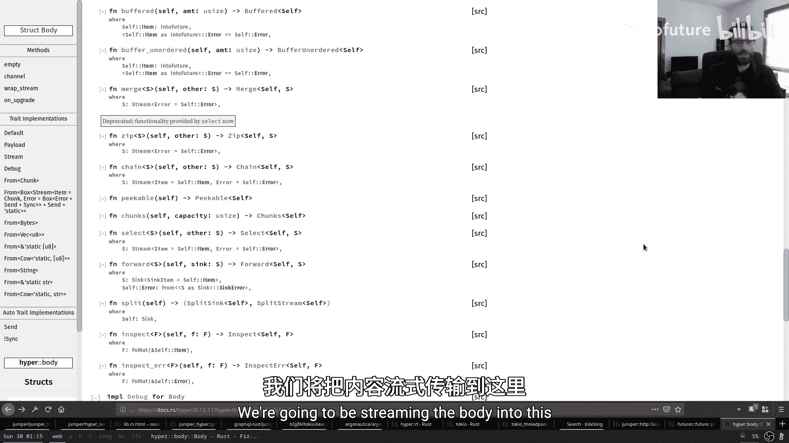

嗯。So this channel， we're going to stream the body as the results come in。

 So here what we really want to do is as these come back。We'm going do something like， and then。

A results。嗯。Is okay is's going to be a little bit trickier this way。

But the idea would be that instead of doing a join all。We're just going to do。

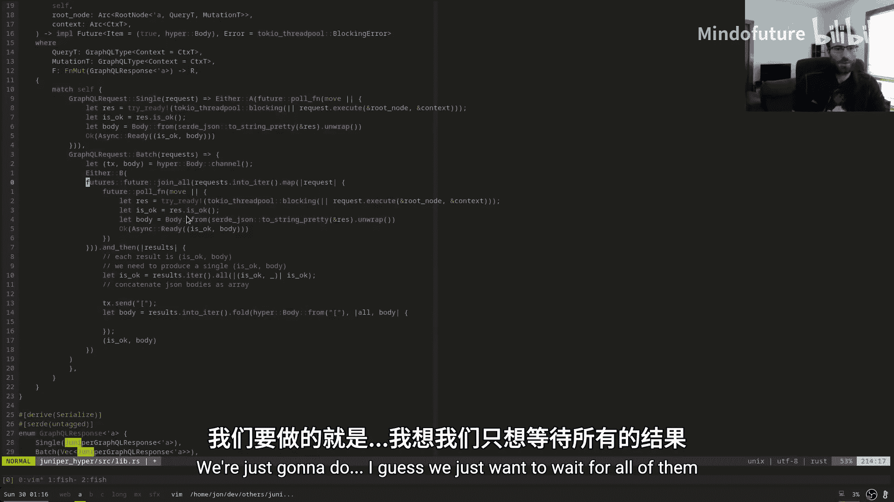

I guess we just want to wait for all of them。 We don't really care about the order， I think。

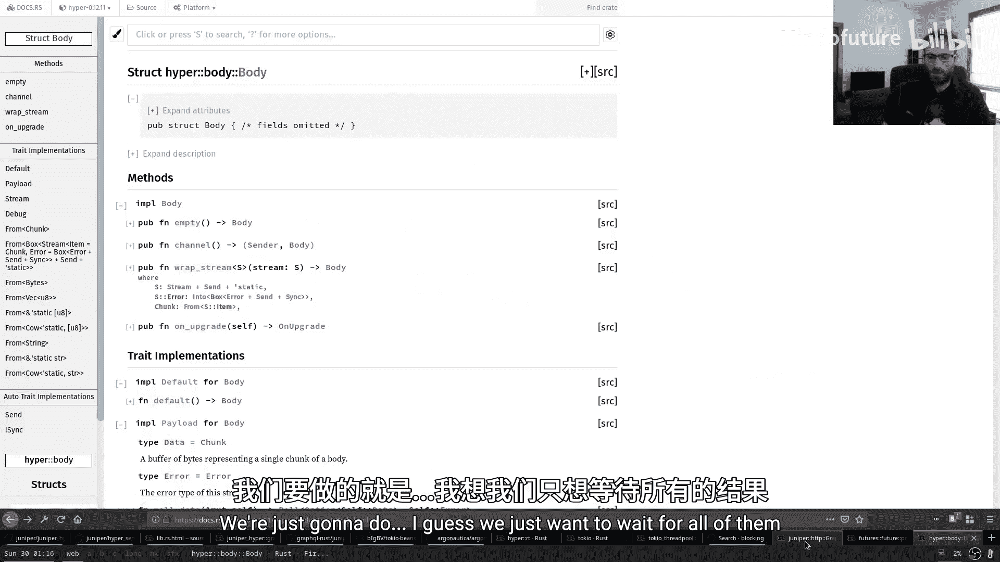

I know we do。We have to produce the responses in order too。嗯。Ha。

So the real way to do this is then probably dot。

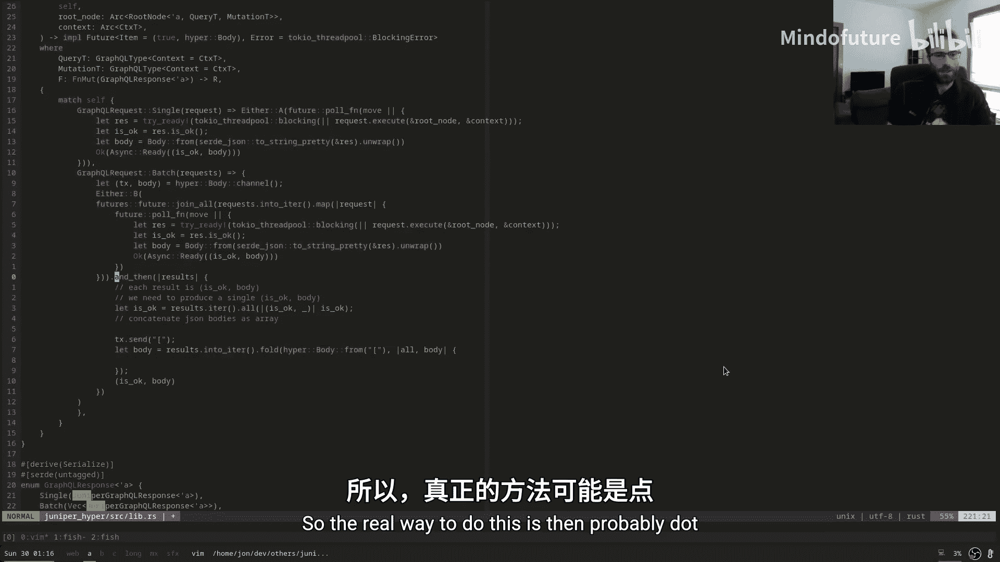

What's the thing to turn a， we really want to turn an iterator into a stream？Think。Really。

 what we're going to do here。Which we can do with future stream。啊。Itter。Mei。

AndDeprecateated for it or okay and it result。

Yes， we want it okay。 So we're going to do is instead of this join all business because we don't actually need them that way in order。

 we're going to do。Futures。Stream it are okay。 that turns this iterator into a stream。

So that gives us an inter okay， which is going to be a stream and on the stream we're going to map each item。

 each request。

I guess it's going to be in pan then。い。Yeah， so for each value。

 we're going to do this blocking business， and then。

For each result， we get back。So for each result that finishes the blocking。

 this does mean that we're not going to I them in parallel， which is a little sad。

 but it might be fine。

wish。

But I guess if if this is， in fact an ordered batch。

 then it's not okay to issue them in parallel anyway。 So this is fine。

 So we're just going to iterate over the request one by one。

 which produces an asynchronous stream for each one。

 we're going do a blocking call when the blocking call finishes with the result。

 then we are going to we need to do something to manage is okay value。

 and then we're really just going forward。I guess this is going to be inspect。To do some business。

Don't know how we're going to deal with this okay yet， and then we're going to dot forward into Tx。

Right， that roughly makes sense。 So we're going to iterate over all of the， essentially。

 this is going to be a stream over all of the Graphql responses。 And for each one。

 we're going to forward them into this body。 right， So my guess is that hyper where's the。

The cinder is a sink， I hope。It is not。's so unhelpful。え。Why who rapstream？Yeah， okay。

So we can just do that instead then。

So this is going to be。啊。

It true。 let's wait for the item for now。So this is going to produce。Abody。呃。

I guess here we're going to map this into result thought。Handle is okay。

 and this is going to be mapped into result dot body。So for each one。

 this is going to be is okay and body and its going to be the。Right。

 so this body now is the concatenation of all of the streams。 We're also gonna have to inject the。

Inject commma and the characters to wrap around。唔似。I a good way to even do that。

 I think the way to do that is。嗯。You sort of have to chain onto the stream， right？

We don't have a good way of doing that， I think。啊。

Can I change streams。So a thing that's doable。Sorry left found the chain。There is。

There's also a conca that's not what I want。

Yeah， okay。 so we can do this by doing。

Dream。It are O， and we're going to use standard error once to produce a single element。

And that's going to be this。RightAnd then we're going to chain that with this future。Oh。

So a lot of stuff。All right， so we're going to produce an iterator that first produces an open square bracket。

 then produces each of these， and then I guess here what we really want is for this to alternate between producing body and comma。

So we could probably use zip for that。你啊。Now the produce is a pair， that's not really what I want。嗯。

Merge。It's not what I want。

Why do they make this so difficult？嗯ん。I also realize that this is a fairly involved code， but hey。

 this is often what。Trying to build an asynchronous codeb works like。嗯。All right。

 so we're going to produce the open square bracket。I feel like this should be easier。Actually， right。

 there is a way to make this much easier。It's going to be less performant。But that's probably fine。哎。

Let's do this the simpler way。Ftures， I guess， future join all。So we go back to the join all。

We're going to take。We're going to map is going to give us results。That is okay。

 So this is basically the code we have before。Results， it are all。This is typically one of these。嗯。

And then we're just going to concatenate the Jason bodies。 And it's a little bit sad。

 Like it is definitely less performant that it could be。But。Much to do about nothing。 We're going to。

Do this by doing stringing recognition。So for result in results。I guess this is gonna to be。Results。

 we're gonna do。Actually， I're going to do better than that。We have to join them。So， it's gonna be。

Awful。W。Bodies is results into it。And then， we're gonna to say。Ay is format。This， this， this。

bodyod dot join。系。And then we're going to return。Is okay and。Let's see what it says about that。去了。

This isn't either B， That is true。こな理。子播。呃。You9。しく。17，3。There we go， that's better。

Tready is a macro futures， so we do macro use。嗯。2，3，2。I guess this is gonna be。1，10。Right。

 this is now going to map over is O and body。And so this is now just going to be is okay。Cold。呃。

This is just going to be body。嗯。Al right，1，10， right， this is no longer now generic over the。S and R。

We no longer need the T A。You also don't need it here。5。

Future is not implemented for GraphQL requests。Join all。Oh， are you wrong？呃。So。

Consider giving bodies of type。組織にリや会。呃。然。Let's just have this nod make a body。

 It should just make a string。An expected string found body。

That's'cause this is now gonna be a body from。Yeah， so this formatting is really sad。

Maybe use body chunks instead。Lifetime static is required。呃。I see yeah。 So we do need this， I know。

 this， just because this is tied to a T A and this is tied to a tick。That should be。

The query T also needs to live long。It's true。呃。99。Context also。ho。哎。So close。This。嗯。

So this is one thing that could also be made more efficient。It shouldn't be necessary， too。です。

Actually， it might not be necessary at all， we might be that we can get around with this。By doing。

This。And then we want to move in because we want to move in the request。

 but we don't want to move in the。The root node。Right。W。So it's complaining about what exactly。😔。

So the thing we move in here。Yeah。IAnd of like that。啊。Yeah， it's arch。It is arch indeed。诶。And nose。

This。 all right。 Now that compiles。These clones are set。And now GraphQL response is never used。And19。

Graphq response is never used。W are there tests。 I don't think there are tests。

 I don't think I saw any。哦。Yeah， this openness to sell business is really sad。

I don't think there's much to do about it， sadly。Yeah， my guess is the juniper。Depends on something。

Unnior。dependingep on some like old version of open SSL somewhere， it's pretty sad。Through。No。

 why does it。Oh， they just haven't run cargo update in a while。How about now。Really。

What is it that's depending on。Cargo tree Duty。What is depending on open SSL？Europe。Fine。

Something is depending on an old version of openness is cell。Hypertels。Oh。

 it's an old version of requests。Qut 0，9。Great。Now， this might not actually compiled。All right。

 in theory， in theory， that's all we need。The practice is who knows。

It's funny because it's a very elaborate way to remove a relatively minor。Thing。

 but it does mean that this becomes a lot nicer because now this pool can go away。

 and this can go away。This can go away。うう。This can go away and this can go away。

The example is simpler。嗯。Wait， what source load。285。No builder。W he need a builder for it。No cool。

肉普 no浦。So satisfying。Removing stuff from code。3，22。Oh， that's awful。This is because that has changed。

Question， would it also be possible to use a single Tokyo blocking around the execute request function？

嗯。收。The problem is the lifetime association between request and response。

So that I think that's what makes it hard to do the blocking outside。But in my work。啊。Yeah。

 that might work too。It might simplify the code， although I'm not sure you could try it。

Heitter value。Why did they change all of this？ It makes me so sad。

呃。This is in response。Padters。Get。Which gives you an option T header value。

And what this is trying to do is print it， which I think has to be。If来。あ。Okay。

呃。So Po spawn has different lifetime requirements。Well。

 it's more the pool spawn is not asynchronous whereas Tokyo blocking is that's what makes it tricky。

 you need to keep polling so Tokyo blocking can return not ready。

 whereas that's not true for your CPU pool future CPU always succeeds and just cues up the request that is not true for Tokyo blocking that's what makes them different。

If matches。呃。I array。A there be。I guess this needs to use。Futures。Puture。

And now there's no longer a need for the extreme crreate in the example。Go away CPU pool。各 away。

And to where。Right， these are now all different。 So this is either a， either。

Really wish it was a nicer way to express these。Because this just becomes ridiculous。Specifically。

This one。So let's call these both B。Then this is B。 Then this is A。 this is B。

So this is one of those places we're like。The box is definitely nicer。Yeah。

 maybe we should just let this stay boxed。That's probably right。

 especially given that it's an example， you really just want to show the user。

How the code works and you don't want them， you don't want the example code to do like low level optimizations。

 right。So let's just get rid。For now。Much armed with incompatible type。Really？All right。

I guess it's going to be something。一。呃。Item， I don't care。

So the problem is the box new will normally just。So this is going to return a。B of type I future。

 This is also going to return a box of imp future， but the two imp futures are different specific types。

 And so we needed to turn this into box future and needs to make the compiler realize that we actually want box of a trait。

 which。W。痛。Cannot be sent between threads safely。我 send的。啊。Oh， great。All right， that was a process。

And。But I think that's all。I think now we're all the way through。

So let's submit a pull request。Hey， that's not bad on time， either。

Good job， team。So this is where we want to be helpful。Let's see， remove。Separate。Spread。あ。

Use only a single。Thread pool for。Juniper。I don't know if actually moving this window down makes any difference。

哎呃。And now let's make this a little bit more helpful， why is threadpool underscored？本通。

That's weird right。The previous implementation， so usually when I write commit notes like this。

 I like to try to explain what the previous thing did and how this is different and why the change is better。

It's like a good way to follow these。Previous implementation used a futures CPU。嗯。三十。Aations。

Which caused there。For example used a future CPU pool for executing blocking juniper operations。

 This pool comes in addition to the。Thread pool started by。I go free Tokyo。For executing。Pperpers。

あです。呃。This patch uses。Tokyo blocking。To implement。To perform the blocking juniper operations。

While reusing the same。呃，th to。I feel like maybe thread is two words。Unclear， girl。

It's a good question。啊。Which simplifies the code。False the X。AI， and also reduce。呃。Great。

 let's do that。 push you origin this bridge。

All right， Juniper。ho。

O， that's new。对。And then， we。It's kind of nice because most people don't know about this blocking function。

 I'm also going to do this。Where did that go？We're here somewhere。I'm mostly going to link to this。啊。

Great pull。哎。Good job， team， We did it。We implemented pull request in an open source repository。

 and it's been a little bit over 90 minutes， but not that bad。

I think I'm decently up with that。All right。We did it， nevertheless。Now。

Oh joy。 All right， we successfully contributed to open source。Now we move on to the next project。

I realized there was probably a lot of。Like there's a lot of fiddling going on there that's sort of fairly low level and it's unclear whether it's useful or helpful。

 but like often this is the case when you're digging into a code。

 especially making a change that's so orient around async stuff like it might be hard to follow hopefully going back to watch this room again and might help you。

But let's hope it was useful。 Certainly the I think the commit makes this project better。

 which is good。All right， now we're moving on to project number two， Tokyo Beanta D， All right。

 let's see， what is Beanta D？A simple fast work queue。Oh， I see。 So this is similar to。Right。

 this is similar to sidekick or factory。It seems like so you like issue。He issue jobs。Yeah， okay。

 so you issue you issue arguments for jobs to some the work server。

 it distributes to workers and the workers pull that job from the pool and then do some stuff。啊。Well。

 I'm glad you learned something。 you are biased in that this is your crate。

 And so you presumably know more of the low level stuff。

 but hopefully it was useful to other people too。 Like， I also did not know anything about this。

 So I hopefully have explained the process that we went through。😊，嗯。Okay， so beansstock D。

Maybe to do list for your distributed application， yeah。

 so you queue up jobs and then workers take jobs。

Y， that seems nice。 Okay， so this is kind of cool， so I。There are many of these， but。

There's another one called factory， which is pretty similar that I actually wrote the API bindings for。

 So it'll be interesting to see what the API binding are like here。

Although my bindings are not asynchronous， whereas this one is， so that'll be interesting to see。

Okay， so let's look at this cr。啊哈。Let's keep based。Yes。

 crate is like a package and cargo is like MM is。Basically accurate。嗯。

This lib consider serve as a client for both the application and the worker Okay， so yeah。

 so this is it provides bindings both for issuing jobs and for processing jobs。That's fun。

 This is basically the same library as I wrote， that's kind of fun。

 but just for an entirely different back end and also as sat。

If justt cred They spent her and took your runtime。Yeah。

 so you connect to a thing and then you can do a bunch of operations。

Okay， this is funny， so this person has very clearly watched one of the previous dreams。

 specifically Tokyo Zookeeper。

So。Compare。This is the example that's given there of。

Operations interspersed with inspects or certain equals， and this is the same。

So I think this person has watched this stream or past stream， which is kind of funny。 That's cool。😊。

Okay， so you can put a job。Reserve， I think， takes a job。呃。

How you started to do commits and open source。 So I usually。

 I actually got started basically because I found bugs that I wanted to fix。 And so I started。

Looking at the code and trying to figure out what the bug I observed was the problem， right。

 trying to look for what was the source saying and what was the essentially whether I could track down the bug in the source。

 And then I try to fix it。 And then slowly but surely you find if you think about it。

 just all of the software you use any time something doesn't do exactly what you want。

 It is probably something you could fix And you just need to be willing to like actually go in and fix it。

And then that introduces you to open source a lot， actually。What is Rust even good for？嗯。

I don't know how to answer that question， except I。

Rus is the first language in a very long time that I really enjoy working with。 Like。

 I actively want to write Ruscoe。 This is part of the reason for these streams， right。😊。

Why prefer it over go you can prefer it over in part because it is a better type system so can you have things like enumerations that actually you can contain data which is really neat go does not have this you have generics which go does not yet have and the proposal is kind of stupid you have much lower level control over things like memory management if you care about that。

 but you also don't have to care about that you can like use RZs and clones and whatever。

I would say that if you're writing， if you don't care about performance and you want to just like。

Write a very large codeb that lots of other developers are going to be using go is nice for like network programming So that's one place you might want to use it。

 C and C++， you want to prefer Ru because it is a much nicer language。

 It's a much higher level language without giving up any of the low level things you can do in C and C++ it is a nicer language to work with。

嗯。Like I think at this point， there are very few reasons to write C++ or maybe even C。Because。

The experience of writing Rus is better than writing C++ they both comp with LVM at least most of the time。

 and you can link between the two。 So like unless you have this huge code base that's already in C++ like I don't see why you would why you would。

All right， so。I don't know what this reserve business is。Release。

It be nice to have comments in this to explain what it's doing。 I guess we could take a look at the。

 oh， I guess this is the thing to we're at。 So put add a job。Reserve gives you a job， deletete。

 removes the job。 This is a nice way to phrase that。 I like this。

What VM are you using oh， there's just because I'm probably going to get this question again。

So I did a stream a little while ago where we。Looked at my setup， so if you look for this video。

Then that has all the details about all the setup that I have。嗯。We can close all of these。 now。ooh。

 that's nice， Bye bye。嗯。The worker cannot finish， can release。Great， alright。

 so that makes a little bit more sense。 So you put a job to the server。

 A worker reserves a job to operate on it。 It deletes it when it's done。

 and it releases it if it can't。 I don't know what touches。 I don't know what Barrry is。

Thiss explained up here， no。😔，Get them might be handy， all right。Okay， let's look at the docks。

So I think。This example is。Is pretty contrived。Because usually you you wouldn't ever write this program as a user。

 I mean it does say it's a contract example， but as a user you would never write this code right you're probably either a client or a worker and so it might be good to give the examples for the two separately。

Like basically give an example of here's a workload for a client and here's a workload for a worker。

 so split them into multiple examples， maybe under different headlines。Link to what exactly。

If you just go to just go to YouTube and search for my name or just。

I guess maybe I can post it here somehow。Like you're， oh， I guess if you're on Twitch。

 you can't see it here。I think I can do this。Without it being too sad。Really。

 it's not going to give me a chat。哦。My internet might not like this。Addd URL。嗯。Yeah。

 I would probably split this into multiple examples， each one for a different use case。 So if we。

 if we look at the。The create I have for a similar kind of use case notice that it has an example for if you want to submit jobs。

 if you want to accept jobs， and I think that that's a lot clearer for the user。

Instead of sort of this， this is a test， really， right。

 it's not actually how anyone would write code to operate on it。嗯。

It would also be nice if these were links， so you now have the short links。

呃。Oh， where is this？Why do I always struggle to find this。

 I feel like I search for this issue like every single stream。嗯。Well。

Not terribly important， but you can。 So in Ru， if you're writing some do comment。

If you just put square brackets around like anything。Like， I guess， let's say。

What was the example we had over here？Delete。

Yeah， so。This automatically produces a link to the appropriate functions documentation。

As you want to do this like pretty， you want to rely on this pretty heavily actually。

 because it interconnects your documentation a lot better。

So that would mean that I could like click on all of these to get to the appropriate documentation。

 which would be pretty nice。 But there is an issue， though， where I don't know if this uses。

Yeah， okay， so given that you're generous to read me manually， it should be fine。

What rust project are you working on？For this stream or in general。

 so for this stream we're currently looking at this one。

We're going to the hope is to go to multiple right， you thought about streaming advent of Code 2019。

Maybe I， to me， advent of code is not that interesting。 I mean， it's interesting， but it's not。

 it's not advanced trust in the same way。 Like the。

 the goal of these streams is sort of to expose people to。

quote unquote real world development and rust and advent of code is not really real code。

 you're not building any real code base。But maybe， I mean， who knows？All right。

 so the the other problem with this example being so long， actually， is。

All the stuff that you really want to get to is at the bottom and really far down。

 So it looks like the only thing that you really want to look at here is being soy。嗯。はあ。

Drop in thestruct will close the connection。Gets you connect。What's error here。It's a failure error。

Okay， so。This is relying on the failure crate for error handling， which is nice。

The only thing I could imagine here is if I try to connect。

 I might actually care why it failed to connect， which failure will not give me。

 You might want to have a so have this in。

个气。So this is a crate for interacting with web browsers or for automating and manipulating web browsers。

And。Most of them just have this like generic error response， but new has a new session error。

 The reason for this is because I specifically want to be able to highlight reasons why connecting failed so you can imagine that the user cares about whether it failed because of the network or it failed because of like its connection was denied。

The way to think about this is sort of。Whether to use failure error or not depends on whether the caller will care about which specific error like are they going to match on it and in the case of Connect they might actually match on it。

嗯。Oh， here's a weird error， or weird。Put what is this？嗯。So， put。Returns a self。Okay。

 so it consumes self。 Yeah， this is， this is one of those things that in the。In the world of Async。

 we haven't really figured out yet。What kind of receiver should you take for methods。

 like should you take self or a ref self or mute self。In this case。

 it looks like he's opting for self。I don't remember if is he he。No。

 they are opting to use self to consume self， which means you can only issue one command at a time and you need to chain them。

 which is， which means that this will be a little annoying， actually， to use with。Async to weight。

Because with they S weight， it would mean that your。

嗯。So let's say that I have some beans as。It's not important。

 So the current coat is going to look something like you do a put a foo and then and then what you get back is a is the bean because the call to put consumed bean and also the response。

 there would be some other stuff too， but that's not important。

 and then you will do something like bean。All the things are there deserved。Right。

 and then you'll do an and then。 and that will give you another be and a re。

 And you end up writing code like this， right。And that's all fine。

 It's like a little annoying to have to change them， but that's just how futures work。 Now。

 with asyynch weight， what we'll get is actually the ability to do something like let Res is a weight。

Be Ill put fu， which is much， much nicer， right， The problem is this won't actually work in the setup。

 If you consume self， this is going to have to be this。喂。Which works just fine， it's just。

 it would be nicer if the code was just this。Which it can be with a weight。

 but only if these methods take mute itself。If they take self， then they always return selfs。

 You have to do this game where you keep returning it。 The problem， of course。

 is that if you take mute self and you're not using a weight then。

This gets really awkward because the real way you do this is like this。And then you do。

It basically becomes no better because you then do。This。呃。ま。Move。It's awful。Beam rice。And then。

 and then your next line is going to be this。So。Notice that if you take mute self。

 then you can make it look like it consumed self。It does mean that you have to take take care that none of your。

That you never have this pattern。Right。Because if you have this pattern， then you when you call put。

 imagine the put had this pattern， when you call put the bean is a part of this future and you're not allowed to move it into this closure because it's still owned by the future。

And so this becomes really problematic。 So the way I've ended up writing this is if if I have any of these。

So I turn any of these into one that consumes itself。And then all others are mut。And that。

 I think ends up being roughly this， the right compromise。 But it is a little bit awkward。

 And I don't have a good way to。Transition between them or to choose which one is better。

 just they're just very different。

But so I would probably recommend to have these do mute self。嗯。

And then it also simplifies the return value。 Okay， so why do they return。

Self and a result and the future has an errortype。嗯。Okay， so that's。Document in the arguments。

I need priority。嗯。是8。Okay， so I think this is trying a little bit to be generic。 So first of all。

 I would probably take astruct for this。Instead of having like four arguments is a little annoying to deal with。

And the response here is weird， like this error， I feel should just be a part of this error。

Although that comes down to this error needs to be introspeced， right？Specifically。

 you need to know the difference between you tried to put a job and there's something wrong with the job you tried to put and you tried to put a job and the server crashed。

Because in one case you can just retry the job or like issue a request to the user if the server crashed like there's no reason to retry and so this is one of those cases where having a structure return value is probably better for you。

So I think that's what I would do here。

So in front of chi。

I think I made this change， but I could be。啊。Now this is how generic as。

 where did I make this change？啊。Home。And Tokyo Zuki。Is where I made that change。So if you look， yeah。

 so Tokyos zookeeper has the exact same problem， right。

 this is also somewhere where I should split up this example， although to be fair in zookeeper。

 you might actually want to do all these things in order。 I don't think that's the case in bininzodi。

 I think in binzodi or one or the other。But that should arguably be splitit up so here。

So I do do this here as well。 Okay， so this is another case where I'm pretty sure they've just followed what we did in Tokyo Soookeeper because notice here we're also consuming self and we're also taking lots of arguments and we're also returning a triple。

So arguably， Tokyo's zookeeperper should be updated to follow what I just said。

 This is something I've only recently noticed myself。

 so I would not blame this person for doing this at all， given that I did the same thing。But yeah。

 so notice here the error for each given operation is actually a specific one。

 So if you look to create， these are all the ways in which a create can fail。Now。

 arguably this this error type could be hoisted to this one and then have create also include like a protocol error。

嗯。Yeah， I guess this is the reason to keep them separate is that。The inner result。

It means that all of these error enumerations don't also have to list like protocol error。

So maybe this is it's unclear clear， actually， I don't know that one of these patents bend in the other。

It's just a little weird to see double error specifically I think。

What I'm reacting to maybe is the fact that this one is not introspective。Right。

 like if the put failed with this error， I don't know how it failed。 So ideally。

 this should be like put error if if there is， if there are， in fact。

 multiple ways in which a put can fail， which I assume there are， if you go to pin tea。啊。

Client libraries， maybe。Protocol？嗯。Is there another protocol doc？呃。So what does put return？Yeah。

 so notice here， there are actually responses you get to doing a put。RightAnd if you get job too big。

 like that's something you want to expose to the client and they should be able to match on。嗯。

And so I think I think you'll probably want to have these be semantically relevant errors。嗯。Right。

Part that， these seem pretty reasonable。Actually， I have the same objection here to the response。是。

The response， oh， I see so this is where buried comes in。I see so some of these are， in fact。

 parsed because Barrry is parsed。But like this or this or not parson just returned as a generic error。

 That seems odd。But crucially all of these， so there's one。

 there's just one giant response type here， whereas in reality。呃。In reality。The response is to a put。

Are only these。Right， so it's not the current API indicates that put can return any of these things。

 but we know that that is not true。 Put can only return one of these。And I think ideally。

 this is something this API would expose， So maybe that's should be the change we'll make is to make all the responses be only of the appropriate type。

This probably doesn't have to be a static string。Like the imp future can probably just return a tick A like this could be generic or tick A for any stir。

嗯。Same here。Okay。What else is there， So there's error and response。 Okay。

 so the setup is pretty straightforward。Let's see if there are any known issues here， known issues。

 great。Great， better documentation。Well， I don't know what to do about that。

 I guess we could tag it as something we're working on protocol commands， okay， that seems good。😊。

All right， well， I guess we're working towards that then。So we'll fork。Great以。Specifically。

 we'll need the protocol docs to find these。And we'll refine that。In fact。

 someone should probably do the same thing to So to Tokyo's zookeeper note that it does parse the result。

 It only gives the appropriate result for each one。嗯。

But someone should go through and if you want to replace all these self self with just mean self。

嗯。All right， let's see， so we now have a fork of this。Let's do a。This。

呃。いいね。upstream， No， that's not what I do。

We want the original one。クアす。So。

I to point master to upstream。

And now we're going to do check out a new， and we're going to say。Precise。Return。Specifically。

 we're going to have to figure out how this library works， so what's in source？Lib and proto。

 What's in proto， Proto response。Yeah， so this thing。Is a lie。I guess。

Let's first check that we don't do any。Ah， cargo formatmat does lots of things。Cas the format at all。

呃。Just I like to。Do all the formatting in a separate commit just so I don't have to think about it so I can just save normally my editor because it formats on save。

So proto response， and I guess here， so we know they're using failure， right？Yeah。

So really what we want to do here is。So for error。I guess these aren't errors， actually。

I have to go now finish watching the uploaded video。 Thanks again。 No， of course。

 hope you enjoyed it。

All right， so let's look at what these operations are。 So it's put reserve using。

 I don't know a bunch of them， right。

So for each one， we're basically going to do something like。呃。是。

So this is going to be a put response and a put response， which we load for the protocol can be。

Inserted。Or buried。Or this thing， which is an error， this thing， which is an error。

And draining， which is an error。So。These are the only things that are actually possible to get back。

Now， for。

What was the other one， So using。So this should really be used， not using， but all right。

 so the only response to use is using。So using response， let's see。 So slip。

So put does not return that in terms of put response。Photo mod。Just one。

So this returns a put response。And this。Here。Good主。Okay， using。Oh。

 I guess these not in order of that， we reserve。

A， reserve。

Returns。诶。Reserve response。I think this is just going to be stard。

Let's make this instead be pub great。Response。And then this is going to be a pub use proto。Response。

 so we don't have to enumerate them all the time。停。Pree job。Is also just pub crpe。

And I think job is also probably just part of。

Let's see， so。A reserve response can only be。

Deadline soon， which is not one of these timed out， which is also an error。Reserved。

This is a reserve response。呃。

Can only be reserved。 All right， so maybe we can simplify these a lot。 actually。

 So a put response can be a bunch of different things。 A reserve response can only be reserved。

Which gives you a job。Great， so job is actually public。Oh， pre job is also。Fine， so a reserve does。

 in fact， give you a job。

Uing。Gives you。

A tube。And a tube is a super tube nice。So this gives you back a tube。喂。啊。

So we don't need reserve response because the only response to reserve is a job。

 We don't need using response because the only response is a tube。 about delete。

Delete， the only response to delete that is successful is deleted。

So deleted is really just。Nothing。Cause not found would be an error。 So here。

 delete is really just one of these。That could be an option failure error。

 but I think we can just ignore that release。

Can return released or buried。Right， sorry， yeah， release can return released， buried or not found。

呃。Released or buried。 Okay， so this is going to be release response。And that can be either。

Bured or released。So。So this is going to be release response。

Touch。What does touch do？

Oh， I guess Bary， but we'll get to bur。 So touch returns touched or not found and touched has no contents。

 And so therefore， this returns nothing。Barry。Returns buried or an error。

Yep。

So barrier returns nothing watch。Watch returns。Wating。

Watch returns of watching。I guess let's keep around the old one。

Thank有喜す。So watching is a U 32。

So this returns a U 32。

Ignore。Returns either。

Watching or not ignored。And not ignored。

Well not ignored is an okay response according to this。 But all right， sure， so watching。

No， I an ignore。So， that is a。Ignore response。 ignorere a response。And so we have this。Here。

I ignore response， and that is either watching。Or not ignored。What else do we have？

That's the last one， great。Now， this is obviously not going compile。呃。

It's obviously not going to compile because we haven't actually made it use any of these new values。

 new types we've added。 But in particular， I think proto mod。

This here currently gives a response somewhere， so this gives an any response。

Depending on the structure of this。Any response？Ooh， this is using Tokyo Kodak。

 we should probably use that for Tokyo's zookeeper too。嗯。系。Yeah。

 so notice now the compiler we're getting is that， look。

 you've promised that this was supposed to return one of these。

 but you really gave us an any response what's going on， which is what we're expecting to see， right？

そうですね。Source Lib。1。So here， I guess。呃。All of these are any respond。

That example is also going to become a lot simpler now， which is nice。呃。Any response？No。

 so this is now put response。Let's put response this is now。This is a successful reservation。S。

Which is a job。This。The only reply is 2。So notice how that we can simplify this a lot now。 In fact。

 it doesn't even need to say。This。It could say， I guess。呃。这是V1。We could just have this be。Job。Right。

 so this simplifies the documentation a lot as well， right？Yeah。You。Here。

This no longer needs to talk about deleted。This。嗯。Rease whisper。So this is now our release response。

Which is different because so it used to say that a successful thing is a release response。

 but that mis burieded。 So I guess the question is whether buried should be considered an error。

 It wasn't previously。

啊。So that might be something worth looking into。何？Touch。We don't need to talk about it all。Barry。

 we don't need to talk about return type at all。呃。This is going to be this。This is just a U 32 now。

This。I guess is cool。And so。There was another one release response， I guess。

 So the successful one is。What did we say the successful one was for release， released。Pleaseice。So。

 this is going to be。Vant。ちち。Le。Hey， now。Of course， now when we try to compile this。

 it'll still yell at us because we haven't fixed that。Cannot find response in response。

I don't think we care about the display。 It shouldn't implement display。Cannot find a tube。

That's a good question。Prob use proto tube。And this no longer needs to。But do that。All right。

 so now we just need to map all the response types。So let's see。Release， so it gets a thing back。啊。

Case of rude。It is an error。Okay， so it does reap release。Okay。

 so release response is just nothing as well。So release response here is really just this。

So in this case。不知道。呃。Map that into great。哎。So I guess really what has to happen here is。哦。

Handle response。 What does handle response do？Handle response is。Oh。

 it's really just doing the mapping。 Okay， so what we want to do here is。Dot。马。好玩。

And we want to match on our。And。If R is。Is actually。

 it's a little more awkward than that It's going to be。Let's。This is r dot0。

 and then we're going to match on r dot1。In the dock of release， you would。Yes。Oh， yeah。

 So this can go away。Good catch。啊。How long did it take you to get comfortable with rust。嗯。

That's a good question。🤧嗯。dependspends a little on how what you mean by comfortable， like I think。

There are still times when I get confused about why it's yelling at me。嗯。But at the same time。

At the same time， I think。佢。I think it's pretty fast that you become relatively proficient in the language。

Every now and again， you'll get really stuck。 and it's really annoying。

 But I think that applies to almost any language。 The difference is just in rust。啊。

You'll get stuck at compile time in many other languages。

 you'll get stuck with some bugged runtime that you can't track down。

And so I don't think it actually takes that long to become comfortable with it。

 like I'd say it will probably take you at least a few months of like regular programming and then of course it depends on how comfortable you want to be。

呃。Response response。Did I do something stupid。No， I did want to delete that。

Release no longer returns a response。The return is always just okay because Bar has turned into an error。

I'm also going to make our life a little bit easier here by having。Handle response。

Also let you do a map。呃。And I guess。This is gonna be。呃。This is a closure。So it's going to be this。

So this is now going to be。Given a response。Well actually no， it's going to be even better than that。

Where is this， It's not going to be a map。 It's going to be a。Not。And we're going to do a。呃。可以。So。

 this。Is going to be。です。And it's going to be a any response。Who and fact it can be even better？

I mean， the question is how fancy do we want to do this macro。Did I even remember how to write this。

Roな。Where the there's a thing。Microbook。Maybe。ISpecifically want。いや。

You're going to write a funky macro， yay。嗯。As Ma but。In terms of syndax and standard library， Oh。

 that， I think goes pretty quickly for almost any language。 Like I think it takes you。

 it takes you a few months and then youre。

Then you're proficient。Proceed。Microbus。And I want the thing that lets me do multimat。

Which is like this bit。Yeah。Specifically， what's the。

Tst hashmama。Yeah， this is what I want to write。So I want a thing that gives me。

A。呃。は。呃。And a。Actually， this might be over complicating things。

 I think I think this is probably fine。I just trying to make it even shorter。

 but I don't think it matters。 Rachel， do you look like Charlie from his always studying in Philadelphia。

 I have been told that before。 I have not seen the show， so I don't know to what I extent it's true。

 but。嗯。Let's see。 So any response。 No。 So put is supposed to give us。

诶。

What do we decide it was supposed to give us inserted or buried。Inserted， which had oops。

Which has an I D， in which case， it that should map to a。Oh， it can't map an okay necessarily。

That's why。嗯。So that would map to an OK put response inserted。I guess。

I'm a little surprised that buried is not considered an error for put。It seems wrong。The five。

Let's not change the semantics of the application， at least。啊。

So that's going to be any response inserted and buried apparently is not an error。Any other response。

 though， is an error。So where's this business， So what does it do if it gets something else。

Does this。Oh， it's not considered an error because for Barrry， buried is what you expect。

I think put response should just not。Should just return an ID。I think we should do this。

And have this return。And then。This now uses tube an I。Which is。The integer ID of the new job。

Because now， inserted gives you that。And buried。Gives you。This。And anything else。Gives you。呃。Oh。

 there is a put error。 Then why aren't these exposed。That's so weird。

I don't actually know why they've chosen not to do that。

Also。If you can get， can you actually get buried to a put， I don't think you can。

Well， you can。

And buried still gives you an I。

That seems wrong。Oh， I see because technically this is not a consumer error。

I feel like this is just wrong。Like it might actually be buried， but。

Specifically， I think， put。

I think this is specifically。

I to bey。Because now this can be error。P buried。You see。

 I don't think these should be wrapped in failure error。I think this should actually give you a。啊。

 put。And yeah， let's just do that。Right， so now we can semantically return what the actual error was without sort of trying to obscure it somehow。

Oh， I guess that doesn't。 No， that should work。 Yeah， So if you got buried， that's one thing。

 And now we can actually like， actually interact with all of these， right？ So if we got。

But the other is protocol errors。Right。What are the other responses？ Yeah。

 the others are actually fine。We tied it out up later。

 So if we did not get inserted and we did not get buried。

 then this is some other error that we don't know what is。 And in that case， I think what we want is。

I got unexpected response。What response this。Let's see if it。Yeah， okay。

 So now it's expecting the same from all the others， which is fine。 So for all these others。嗯。See。

 this is why I wanted the macro to do this because then the。

The last clause could be handled the same by all， but it's fine。 So I guess here we're expecting a。

Reserved。Job， and that gives a job。And anything else is an unexpected。Preserve response。

And I guess all of these are going to complain， so we might as well do all of them。While。

 we're at this。Ex。Are you doing programming as a hobby or doing it professionally both so I'm a PhD student in computer science and so like I do Ru programming for my main research project as well。

Which is why I get away with this。So using that's a using response。Which is a tube。Tub is funny。

 It's a funny word。 I like tube。Using。What else could you get from two just using， right？Yeah。Delete。

Is similar。I said， what we're expecting to get is。Delete it， right， yeah。And otherwise。

 we got unexpected deleted response。Or I guess delete leak response。And this is really used。

 even though the function is using。嗯。Oh， and I guess this is a tuple。Release。

Already does the right thing。 So that's great。Touch does not do the right thing yet。

Because this should say touched。Barry。Should say Bar。I guess， here， we want。This to say。

Touch response。 We want this to say。Barry responds。 So Barrry should give you buried。Watch。

What should give you。Watching。And ignore。Should give you。Either watching， in which case。

 it's an ignore。Ignore response。And。Or if it got or it got not ignorant。Like so。要。

Let see what it thinks now， variant， not found。Did I misspell that probably。

Moul is wondering if I'm the only person who uses his right hands fingers for navigating vim。

As right hands fingers， who would use any other fingers。I'm confused。 I mean。

 I've disabled my arrow keys in them。I don't know if that counts。Error is not implemented for stream。

Oh， what's the。

え？This is supposed to be format error， I think。From。Failure error from。For。Should be。For my。嗯。Think。

Hey， plus， great。I navigate themm using my left foot toes。 Actually， have you seen the vim petals。

So someone bought like racing game pedals and then mapped them to escape an insert mode so they use their feet to switch between modes。

 which is fantastic。Let's see how this works。This definitely changes the API。

 but I think it changes the photo better。Oh right。 Now it's going complain about these。 Alright。

 so that's sort of what we want to happen。Specifically， using。You no longer need that fact。

 you no longer need this。More that。See this is going to make this， this is why we made this change。

 right。This goes away。This goes away。あ。This goes away。Here also， so usually for this kind of code。

 if you're just asserting that something is true， you might as well use unwrapap。

 that's what it's for， right？So I think this should just say。Assert equal response dot unrap。

Dot data。There's no need for this extra song in dance。呃。This。Similarly， should just be。

Bean dot touch。Response。 unwrap。pd。Although， we'll have to be a little bit careful here because。

This is an Asra。呃。This is just going to be。Response。t unwrap。Just to check that it's indeed okay。

Let me do this。Then we do this。😔，Then we do。Respondse， thatt unwrappped dot Id。

So that makes that much simpler。Do I need to have beans stock the。Installed or something， probably。嗯。

脱でだ。嗯。Here we're really just checking that。It was released。 So this is just going to be。

Response thought unwrappped。I guess as rough don't unwrap。See how much nicer that code ends up now？嗯。

The reason you want to use unwrap instead of it's okay is because it will actually print the error if it went wrong。

I guess we want there to be no return value。啊。So。嗯。Why is this not。Currently， it wants it there。

 but it doesn't care here。It's just a little weird， oh well。Here it's doing the same thing。

 So this is just going to be job。 this is going to be response dot unwrap dot I D。あ。

This is another one that just responds。Aszra， unra。Did I mess here？Expected。That。And that。Oh。

 that's why this is lacking that。嗯。This should be another response as you unwrap。This is gonna be。O。

Yeah， put， we already know， just does。mall as start on the wrap。This。Yes。それら。啊。So much code。Like， so。

Don't need any of these。 I guess the question here is， okay。

 so we can leave this code commentt in placeca you might want to do that。呃。Then being watch。

 And then this is going to be。Asert equals response dot unwrap。Is2。

And then this is going to be response dot unwrap。为。How did this test ever pass？

That's not what you're supposed to。给。On that， right？Just ignore returns。And ignore response。Oh no。

 that is what you're given。So that's an ignore response。Watching。

Do you have a Gitthub or Gitlab account， Yes， they're both under the username John Hu。Like this。477。

呃。This。Can move out of borrowed contexts。That was also accurate。呃。F or，5。左ロ8。It's gonna。

Unable to spawn server。Yeah， so I probably need Beansta to actually run the tests。

 which is a little sad。It's fine。It makes me a little sad to have to do this。Yeah。

Comply all the things。 Nice。 All right。 How about now。Hey， best。Oh， it failed。What。

Use of undeclared type or module any response on 46。Oh， the do test。That's awkward。

That used to be the same。Is the real question here？I think that's the same。

I think we can just do this。And then do。です。And。I guess are these similarly indented？No。To less。

Just to minimize the di little。That's how the CL works。 Hey， great。And I guess。So read me as well。

Read me as well。So that's going to be also the same。Because we're not aiming to do all that stuff。

 too。This。Minus。3e。All right， let's look at the depth。So that's simplified。That simplified。Great。😊。

I pass all the tests。 So I guess we submit it。嗯。Make all myth。Turn only。呃。Return only possible。

Just check that that's pub great， yeah。Oh， I guess we should probably document this song。呃。

Fine， let's so where's ignore here？啊。

Return only possible。Or I guess refine return types for all methods。Re。Previously。

 all methods return。A generic。2し8。However。Only certain。T time return very。

Possible responses to each command。This patch。This forces users to manually match on the。

Even when that shouldn't be necessary。This patch does the matching inside。So that only the。

Expected return value is exposed。To simplifypl。Other。turn if an incorrect variant。

According to the protocol。Please return。嗯。There is。This simplifies。DAPI。just not say that。哎。

Precise returns。呃。The first three hours。

Yeah， time zones are hard， I don't know how to get better at this。

I I tried， there's a page called Every time zoneone that I use occasionally。

 which shows you like when the time is in various local times。

I should start leaking to that again。呃哦。I guess really what I wanted is。です。そう。Let's use that today。

All right， we submitted another pull request。Good job， team。Yeah。

 we started noon Eastern Standard Time， which is about three hours ago and we've been so。

So good at keeping our schedule。 So it's now three hours in and we've covered two crates。

 so that's an hour and a half per crate。嗯。Actually let's。Check up on a little birderie told me。That。

不管。か。Hey， look at that。Our pull request was merged。We did open source software。

This is why we need Jesus request。We。Hey， how about that， We made the world better， pleased。

 in theory。Although。

little unclear what failed the tests that's， oh， just on out there， I don't believe in out there。

Great。

We did that did that， We did that。We did all of these。Nice rust pointer protection is all right。

 but why rust is hard to code。I'm not sure what you mean by pointer protection。

I guess you mean ownership。So Rus is hard to code because it's really hard to write your code in such a way that you guarantee that there are no data races and the compiler enforces that in Rus。

 and that forces you to reason a lot more through your code。It's empty in here。What do you mean？

Don't know what you mean by empty here。All right， great， third crate。

 third and final crate for the day， Arrgonauutica RRS。

 So this is an implementation of the Arrgon2 hashing algorithm， by bio。呃。I don't know。

 is there a Twitch bio， should I fill out a Twitch bio， is that important？I mean。

 I guess I can do that。嗯。So the Arrgonne2 hashing algorithms。

 So this one I actually know a little bit about。 So a while ago。

 there was a competition to come up with a new password hashing scheme like there are a bunch of people that just use like do like a Sha 256 or M5 hash or something of passwords。

 which is generally a bad idea。 You want to solve them correctly。

 you want to make the hash expensive to compute so that if someone downloads your database and get all the hashs。

 they can't easily compute the corresponding passwords and Arrgonne 2 was the winner of the password hashing competition 2015。

And then this is apparently the rust implementation of or one rust implementation of Arrgonne 2。

Do you ever work with Rock， I have done very little with rocket。So I guess the question is。

 what do we want to do with this grade。 So it's designed to be easy to use robust and follow the rust API guidelines。

 Oh， I love these。Great feature complete。Oh。That's a good read me。Yep， Passher。嗯哈。Yeah。

 so there are a couple of others。Oh， and he a Sdy。嗯，s你。嗯。I going to a d。

The default configuration for hasser and theirifier， which was going to be reasonably secure。Okay。

That's a lot of texts。Yeah， this is basically the Tokyo blocking stuff we talked about earlier。

Although my guess is this uses is。See that's a good question。 What's the CPU pool it uses。

Use this future CPU pool， but my guess is this crate doesn't actually do any。呃。Ha。

Why are these not dev dependencies？I think these should be death dependencies。But yeah。

 so my guess is they use future CPU pool just for the CPU pool and not for。

Any Tokyo stuff like I didn't see a Tokyo listed here。嗯。Oh， scope guard is nice， too。Yeah。

 so there's no， there's no async stuff going on here I think they're quite literally just using CPU pool for a compute。

And not for anything else。 So I don't think this is one of those cases where we want to eliminate the additional pool。

嗯。Yeah， they basically want to expose a。Interesting。

People want to expose an asynchronous implementation。

There's a question of whether they should rely on Tokyo for that。

 so instead of spinning up their own thread pool， they could have a thing that relies on Tokyo for that instead。

That way， the user doesn't have to configure this explicitly here。

Like you can imagine that if you did this， it would just spin up。

 it would just use Tokyo's spawn to run the hashing on Tokyo spawn with a blocking to run the hashing on a separate。

Whatever threat is available in the pool and then return a receiver to that so that might be one way to get rid of the CPU pool here for the non blocking methods。

 it does mean that they're now relying on Tokyo。So you might。

 it could be that we want to add it behind a feature flag。你把。嗯。

Any chance you can give impressions to Tokyo means Sadi。

So we've already covered Tokyo beans Sati or actually， so I'm going to post the video。

And so you actually just missed it specifically， we did it from。

So when the video eventually gets posted， if you go to like about an hour， 30 into it。

 that's when we start being suckd and we talk about it for an hour and a half。

 So you actually just missed it。 Sorry that but the recording is there though。

The day the CPU pulled the idea， you're not wrong。嗯。It's more that like。

Thread pools and CPU pools are really hard to get right and we it's good if we don't have many of them right。

 and especially because the intention here is to interact well with future heavy code like。

You can do it on a CPU pool。 It just means that you're now likely to have more than one pool。

 It would be nice if this could share the pool somehow， Of course。

 relying on Tokyo means that if you have some other executor than you are now relying on Tokyo instead。

 which is unfortunate。嗯。回以。哦。And yet， they still do this business。

Even though they might already spin up multiple threads here， that seems unfortunate。

I like this form of documentation， though。 I do worry that this is maybe slightly too verbose like I would have a。

Less verbose description here with a link to the actual docks。This is a really nice read me。

 like I'm a big fan， major props。Busy Myers have written stuff before， but that's really cool。

Let's look at the docs and see what we can find。Okay， so the dogs are pretty much the same。

 which yeah， okay， so they're using cargo readma。 That's why cargo readm is fantastic because it means that you can generate the readma from the source lib。

😊，I wish Rust didn't set this ugly as fondnt。Specifically， why are they doing that。

 just don't do that and let me use my own font。Stop setting my font。See， see how much nicer that is。

 a stock， stop sending the font。 Maybe that's the thing we should do。啊。まし。I guess was lying。

From stock。Fine。嗯。rusト。Source。Source， no。呃。Tools， rustsstock main。That's unhelful。Liimpress talk。

 maybe I feel like this is something I。I want to submit a PR that just removes the font overidedes。

Because you should never be doing font overs。Lib ruststock in dot， dot slash。Lis， there is no Lib。

Roust themes。That's so unhelpful， astock。That's still pretty unhelpful。So where did this？

Light dot CSsS。I know this is slightly tangential， but。Lib ruststock。Theme。All right， well。

 where is the external files。 Rs？Where's the CSS， Li？cheat cheat。CsS。An HTML static。は。Great。

Where is it that it's overr my font。Where is it overriding my font？で？If I go back to this。All right。

 where do these font stuff come from style。css？Oh， this is probably set by Dox Rs actually。

Doox hourss needs to stop that immediately。All right， well， I'll do this later。

 it seems all worth it。But。I guess templates， no， yes。I will fix this later。 Stop doing that。He。

 so back to ourdu Monica， Rustls aren't run by the rustine last time I checked。

So it's not about the No， Dox dot S is not。 It's true。 the handover is probably place。

 I was thinking the style was set by Ru stock when it generated the file。

 it's actually set by Docs R S。 And so that's why I'm gonna submit a PR to get rid of these because it shouldn't be setting my font。

嗯。Let's see， Okay， so we have these dogs and the question is what's down here， so there's a nice。

 see， I like this， that was very good。嗯。I mean， I saw an example here， it's probably not terribly。

Just these things from your machine。This， though。Their fault Haster does not have a CPU pool is only needed for hash non blocking and hashron non blocking。

Oh， I see。 So that's why they've set it up this way。

 So if you try to call it and you haven't set up a CPU pool， then everything will be fine。

Whereas with Tokyo， that wouldn't be the case。嗯。Like specifically if we tried to。Spawn the Hasher。

If we try to spawn the hassher， then。Then there might not be a Tokyo runtime running。

 And if there isn't a runtime running， they would just fail。

So we're adding this like implicit dependency on Tokyo。嗯。Hash non blocking。

And let's look at what this does。Hsh Ron on blocklocking。Yeah。Oh， that's interesting。嗯。

Id moves the hushher and what does scope guard guard do again？

ま。Scope guard， Col and Col guard。Owning thee with deferred closure。Right。But it's not owning thee。

 it's just mute self。Yes， I think if I remember correctly， Tokyo Spwn requires the future to be。Oh。

 no， it does hashher too owned。 Okay， I see。And scope guard has a two ot。I guess the D refs。

That's pretty weird。Why does this use a scope guard？

Because this two owned is going to go through the hassher。

It is going to go through the scope guard and just call to owned immediately。

So this is really just going to clear。Immediately before spawning， I guess。

So this is just equivalent to calling clear on the original hassher after you call to owned。

Unless I'm missing something， I think that's right。Yeah， I think this should be fine。

 let's try to get rid of the sea people pool。So we have been making this the mission for the day。

 so we might as well continue， right？

So we'll do the same thing as we've done before。We will clone this。

And then we will go to here。

Into。Remote。Exreme this。Yes。Make master track upstream。And then we're going to do no more of。

Tokyo over CPU pool。

Now。I guess we specifically want to edit Preagonauio。

To see that that actually compiles， I assume that it does。嗯。

エッチ？I wonder if that's the only place to use the scope card。It's used in hash raw， too。

Feel like that garden is not necessary。

Hello。Faaiil to run。Why。Source path。It's not an existing regular file。Gu。呃。What。I mean， I guess。

Builded R S line 43。🎼So get sub model。That's why。Great， all right， so it does。Test all the things。

That's。

All right， so I think really， what this is going to do is's going to do。

It's going to create so usually the trick here is to create a one shot channel if you're going to have something run on the pool and then eventually tell you when it finishes。

 what we're really going to do is we're going to set up a one shot one shot channel。

 give the sender to the future that we spawn。

And then just send on it whenever the hashing finishes。

Are there any other places where this CPU pool shows up。I guess would be not， but。

Configure and then Hasra， okay？

I am using that well， Ne of them technically， but。start doing。嗯。Im sure out now。Fine。Wow。

哎。Let's see。So the question now is where do we want to teach this。

 so it's really just source or good what？

Passion。All right， and cargo Tomel is going to no longer have future CPU pool it is instead going to have。

Tokyo 0 dot 1。 We also need Tokyo。Thread pull 01 because we need the blocking function。呃。Sib。

here we're also going to need。呃。Extterern cr， Tokyo。And Tokyo threadpool。Up here， we're going to use。

I guess CPU pool is going to eventually go away。呃。That's going to go away。This。Okay。

 so I don't think the scope guard here is necessary。Although it's fine。

 like I don't need to change it。嗯。But instead of doing this， it's going to do Tokyo spawn。No。Well。

 I guess so Tokyo Spwn takes a future。And in this case， the future is going to be a。

So this is the same trick as we played in Beant D， right？

It's kind of sorry in well in Beanta as wells。In fact。

 replay played all through the day is using this like blocking stuff， right。

 So we're gonna need futures。We have futures here。Tokyo Prelude star。

And then we're going do this gonna be future。Poll of them。あの。AndIt's going to be。Tokyo threadpo。

 blocking。Move not move。 And that's going to be。Haasher dot hash， wrong。

We're going to make a Tx on an Rx， which is going to be a few。We are going to need futures。😔。

The futures sink One shot。Channel。And then。Really， what's going to happen here is we're going to dot map。

This is the。Final hasush。And that we're going to send on。The transmit of the channel。

 And then we're going to return to the user。 is is the Rx part of the channel。And that should be all。

Right， so the setup is。Whats error here？嗯。That's a good question。😔，啊。Tokyo。How can I， Oh， I guess。

 okay， so that is a result。啊。Yeah， and I think that's right。T X dots send。

And this is going be a then。Specifically， we need to match out the R， so。This can be。

Let's look at what the One childild channel is， so it's under sync。Don't want future 0，2。Sk。

 one shot receiver。So the error would be canceled， which is if the sender is dropped。🤢。

Which shouldn't happen， but it could happen。So this is going to be a result result。

And this is going to be an error。

I guess what is a council， where is a council lived？Ftures。

Ftures sink One shot。Cancel， so the question is。What is that gonna be， I don't know yet。嗯。

We do have to use。Tokyo thread pool。What。对。I mean go into the oh no， that's。Agonaua， agonaua artists。

Right so。The other question here is。I guess， if the。It's a blocking error。

 That's of a threadpo if Tokyo is shutting down。And so if Tokyo is shutting down。

 we're just going to drop the sender and then handle that is canceled。

 So all of those are just going to fall into the same sort of category。 So think here we just do map。

Let me just ignore that error。Ignore error。Cause。呃。えと？え。Is handled by。Canceed case。嗯。

There is no longer a default CPU plane pool， we don't need that。There is， we do need to use Tokyo。

Tokyo spawn。呃。Con defaults。It's no longer a CPU pool。So。This goes away。Oh。Why is that？Why is that？

Default CPU pool30。So I'm not actually used by anything， so I don't know why that's even there。嗯。

Ver fire。So that goes away， this goes away。I guess， oh， Verifier also has the CPU。I mean。

 it'll work basically the same way， right， So we're going to go back to our hassher。啊。down。That was。

I was right there， we saw it。So for the verifier， it's basically going to be the same thing。

 We're going to spin up a thing。 We're going to move the hashher。 We're going to move the verifier。

 We're going to do verifier。The。F。And。Iす。And。That's just going to be okay。

And that's just going to be returned there。And move that。And， of course， now we need all the。

All these users。Don't need this。 and don't need that。啊。Pasure config。 no longer has a CPU pool。So oh。

 that's why I was there okay。CPU pool is going to go away。 CPU pool is going to go away。CPU。喂。

There's also verifier config。That goes away， that goes away， oh。

 isn't it beautiful when so many things disappear？Yes。goes away that goes away that goes。Oh。V。242。

No longer needs a CPU pool。Haasher。I guess 244。No， its same门。What else do we do wrong， Verifier 1，72。

All right。This needs to。I still have this line。All right。32。Oh， the send can fail。Really。です。嗯。

I the problem here is really。This we I think we know that this can't fail because the sender hasn't been dropped。

So we could do dot expect。嗯。啊。嗯。でも。Is going to be。呃。There's no way for that to be dropped， really。

Oh actually no there is。If the user just drops the future we give back， then the send would fail。

Which is fine。 It's okay if the user decides they don't care。And same down here， where。あ。All right。

 that's all fine。So now， of course， the problem is now you need to run this under Tokyo to work。

Not'm sure about that。We also still need to figure out what to do if it was canceled。

So it'll be canceled if。嗯。If the thread pool shuts down。Which it shouldn't be。

I guess the question is， what errors do we even have to express something like that。

So what did the old code do with the CPU pool。So the old code。Just did spawn FN。And not just work。

So let's look at future CPU。

呃。So what does CPU pool spawn if， it gives you a CPU future。And。A CPUU future implement。Really。😔。

How is that possible？So what this is saying is that。There's no way for this to fail。Except the。

Except in the ways that the returned future from this closure fails。Which seems bizarre。

Like I don't know that I believe it。啊。

Actually。Here's probably the way to do this， actually。Instead of。

We don't really need to do a Tokyo spawn here。We could just do a poleloen blocking。Yeah。

 I don't think we need this spawn。Which is nicer。 Actually， this can just be that。Right。

 because we don't。That's right。Because we don't particularly care。

So Tokyo Spwn is just going to put the Xune and the verifier on a different thread。

 We don't necessarily care about that。 All we care about is the fact that we're not blocking the current pool thread。

I think this is better。It does still rely on their being a Tokyo threadpool running。

But that should be fine。あ。And so I guess really here。 The only then thing we need to do here is。

Thread pool is exiting。So then what do we do。And now it's complaining about what exactly？

I guess we should just do then。好尔。And then match on R。And if it's any kind of regular thing。

 it's just going to be R。 and if it's error， it's going to be a Tokyo threadpool blocking error。

And then the question is， what do we do？So I think that should satisfy yeah， okay。And then down here。

Ch。Very frustrating。嗯。Yeah， so this is also going to be simplified because it's now just going to be here。

 hasher dot。わ。And then it's going to do the same thing。Yes， so the question is。

 what do we want to do if the thread pool is exiting。

 And this is a case that like the old implementation just ignored。

呃。I feel like just panic， that would be my guess。Zhuo。嗯。

はい。I mean， it could be that the right thing to do is just to panic。

 but where does the error come from？The error is an error kind in a display。

Now the question is is like， do we want to panic here？

Basically trying to figure out whether there are other places they unwru or panic。

That's all in testing。And it doesn't look like it。 So I guess what we do here is we。ter an error。

Where the error kind is something like， what is error kind here？啊。C。I think we do。new。呃。Thread pool。

Shut down wall hasing。And then this， I guess the question is what what are the error kinds？

Use error kind。What's America。Oh。I see。I think probably what we're going to do here is then add something like。

We'll just add a new one。I guess that is。P。呃。Terly。呃。Thread pool used to。

Feel like thread needs to be too。The thread pool used to a sink。Whenness the。Execute operations。

 exited。Prematurely。And without full stop， apparently。Because now this can just be an error kind。

Poull terminate。And same in verifier。Take a look at that。Now it's Arrgon2。Yes， it is indeed Argon。

 too。Unused import。 That is true。 We no longer need the import of。Tokyo or Tokyo。Maybe even。

Or futures？And also in the hasher weed。Don't need any of those。do need that。Okay。

 now I guess we still need to。Okay， so this goes away。This goes away。啊。And then here， we need to say。

呃，的。The hashing is performed。啊。Formed on the current thread。啊。That shes performed to the。

Current tread thread。啊。Actually， let's start with puttingny it here。Danley Rivers aren't welcome。

Now she has performed on the current thread。But。Yes， that is also a good question。

So we have changed the semantics of non blocking here a little bit because if you just wait on。

 I guess you shouldn't wait on this future。The semantics of this now is the current thread is going to be used to do the hashing。

呃。But the current thread is wherever you spawn the future。On。

Whatever thread runs this future。Yes another question is， what happens if you call blocking？

And you are not currently running under Tokyo。呃。Probably panics would be my guess。

You should find out probably。😔，嗯。I guess we'll have to look at the source。Yeah。

 I'm pretty sure there's panics。

Because I think worker with current。All right， so I guess the Haing is performed on whatever thread。

呃。Execcuts。I returned。Feture。嗯。We will not。

， but。啊。

Iuess we should link to this， but Tokyo blocking。I guess， but with。A Tokyo blocking。

Anitation to ensure that the thread pool。那啲。Time is not。From polling other。Futures。

Note that I guess we do have to say that it now depends on Tokyo。

Leave at least two blank lines between functions。So I would also normally leave two blank lines between functions。

 or at least one。 But this is the way this project is set up。 And so I'm not going to change it。

 You want to conform to what。What the original authors are doing， right， It's not your。

 it's not your job to set the。Code style policy for。For someone else's code base。

It's not blocked from pullinging other futures。嗯。Note that。始じます。在。The returned。

Future relies on being executed by。Tokyo。啊。And will not。呃。And we'll panic if that is not。And。

Same for verifier。The verification is performed in whatever threads it the future。All right。

 and then I guess。开机视B。Okay， so we're going to have to run that。Example arc。而。Atics？

I wonder why this。美し。哦。This has to return our future。

So the question is whether actics。

Think Actcticxweg does use Tokyo。

うんわ。啊看も。嗯。6。Really。

All on top of Tokyo， okay， so this should all just work fine。Just without the CPU pool。

Without the CPU pool。the CPU pool。Don't need the CPU pool anymore。呃。Don't need the CPU pool， great。

Source lid still has some CPU will stuff it in it。I goes away。 That goes away。

This entirely goes away， which is fantastic。LG。You CPU pool。30。他是CPU是。There we can get rid of。呃。

All right， so it's only the read me read me。Read me in。Did not change any of those。

🎼Only thing I changed was。Did not change that。Did change this。 Did change this。 Did change this。

Now change the。Sorry， just to see that we haven't included any weird changes here， I don't think so。

 I think this is a pretty straightforward change， really。あ。Remove futures。呃。

Fs CPU pool in favor of Tokyo。呃。Previously， a dedicated CPU pool was spunung up。

To run hashing and verification。In a non blocking fashion。嗯。This is unfortunate。Given that。

There is usually already a CPU。Spread pool。Running。Tokyo。Ide1。This a patch。Changes the code to run。

Non blocking。Cashing and verification。On the Tokyo。Instead。To avoid creating。Figuring。

And creating a separate。啊。It uses Tokyo。出。Blocking to ensure that it does not hold up other features well。

嗯。So one thing that's good to do is if you're submitting something that like。

Changes something relatively deep。 like changes the especially changes the API without expressing that in in the API。

 So we've removed some functions， right， but。It's not really expressing the API here。呃。

Then we want to explicitly point out the fact that this does break the API。

 this like makes a major change to the API that would probably require a major version bump。

Note that this removes the ability to。You number。Rs used to。Wing。ピ？And instead。呃。

Places that responsibility on。Whomever。Setets up the Tokyo。One time。This is。Probably。Better。It does。

Change the API。Furthermore。Non blocking methods。Now， only work。抽屉。And will not work。呃。

I guess here we could point out actics uses Tokyo。And will not work。In other as and non Tokyo。

 as synchronous。えす。Although those should。哎。Origin。Tokyo Over view pool。

Agonctica。We have a pull request for you good issues here。No。No。

Compareable requests and no I want see why is it？Not being helpful here and using the latter commit。

Or the bigger commit rather。And I guess we' do the will'll be nice and do the same thing we did。

That we did in the other pull request， which is add some links to the relevant。Thing。

 so this should link to Tokyo blocking。This。Should link probably to Tokyo thread pool。啊。

On the Tokyo threadpool， instead。On。Tokyo's。嗯。I guess we probably want to link to Tokyo。

The Tokyo runtime， specifically。Runtime。He right， like so。Great pull request。We did it。

 We have now contributed to。Agona， as well。This is a slightly weirder change。

I guess one thing I will point them to is。呃。

I sort of actually want to get rid of the rest format man， can I do that？ベ dash。

We're going to swap these two around。I do。So basically what I'm doing is getting rid of my rust format commit now after the fact。

呃，CB。And I guess verifier。In both of them， like this is pretty straightforward。Cafe。🎼然是。F fire。

And now it's going to be the same。啊。And I think all of these are should all be just the rest format changes。

 So we're going to do reset。

他们被。Push force。And now this should only have the one diff that we actually care about。

And the files change should be much more reasonable。Beautiful， beautiful is what it is。哎。

I guess now we check whether whether things happened， what was the previous one we did。

 We did B install。Poll request。Oh hasn't been merged yet， oh well， it did pass the test though。

 so that's nice。How do you get the Firefox bar top bar at the bottom I did a live stream a few weeks ago where I went through my entire like desktop and editor setup so you can just look up the video for that in the YouTube channel。

 but basically so Firefox lets you write CSS for the browser Chrome。

And so， I wrote。Oh listening。So this CSS file， if you add that， it moves the tab bart to the bottom。

 it's not perfect。 It's just， I like it a lot better that way。Okay， let's see。 So we now have。This。あ。

This。え。Where it's the last one， so that was the first， this is the second。です。

I think that's a pretty good day's work。We submitted a pull request。For juniper。

 for 100 lines plus 15 minus one for be stock with two300 lights minus 200 lines plus。

 and for agonaua， 200 lines minus 50 lines plus。It's pretty good。I think we did well。

I hope I hope you feel that was useful。 I think we're gonna stop there and not to another one。

 There were a couple of other that would be fun to do。

 but I think like it's been about four hours now and I think it's probably a good place to stop if you feel like so I'm I'm going repeat the message from the beginning if you feel like this was useful if you feel like this format of going through other people's code than try to make changes was interesting and useful then please。

 please let me know because then I will probably do more of them it's still a little bit stressful and it is。

One thing that's hard is it's hard to predict how complicated the changes are going be and how viewer friendly they're gonna to be like I think some of them are just like really nitty gritty details that may not be interesting to watch and may not be something you learn from watching but if you feel like the format is useful。

 please let me know if you feel like there are crates you would like us to take a look at。

 please let me know if you feel like it wasn't useful you'd like to see something else then you're probably not still watching。

 but if you are， please let me know。I'm not entirely sure what the next stream will be。

 I've also had some ideas to try to do some more data structure work。

 So we'll see maybe that's something we would do something from the standard library。

 I should do like a big poll at some point to figure out what we're gonna to do for the next stream It will probably be a little while because I have some conferences coming up。

 but。Please， I think we， I think this this was useful。

 I will post a recording as usual on YouTube afterwards。

 I'll make sure to try to link into where we like useful checkpoints in the video of where we started a new crate。

 for example， So if you want to go back and look at some of the things we did and maybe look at them at like lower speed and look at the code at the same time。

 that's a useful way to do that。I guess let's check if therere。Are any last minute questions。

Your desktop video made me really want to dig into mine。 Yeah， I。

 there are still things I want to change。 So one thing I found sins last time is。

This is an addendum at the last point of the video。

 if you have any last minute questions you should ask them now so I can check them out so six is great it's a really simple image viewer that just has vim bindings。

It's really handy if you live your life on the command line like I do， the other is dust。啊。し。

So Duns is a nice way if you're not running like no Merkaie or something and you still want configurable pop up notifications for things like receiving email and changing Spotify songs and stuff。

 This is really easy to set up and configure。 I've been really happy with it。

 I'm also considering switching my window manager away from Xmona。

 that I just need to find something to switch it to。But yeah， I mean。

 I think the setup was pretty fun。For some reason， all of these links are dark blue。

 which is unhelpful。Oh。Let' see。

Yeah， the YouTube channel。 sorry， the YouTube channel is just。

Slash C slash my name。Or that link。I think this is one of these easier， but。All right， sounds good。

 Well， I hope you found that interesting。 follow me on Twitter or Patreon or something if you want to see upcoming streams。

 you can also of course subscribe to these poll requests and see whether there's any activity whether they end up getting merged or not And I guess thanks for watching and have a good rest of Sunday for those you are still on Sunday given your time zone All right bye everyone。

It was a joy to scream for you again。

