# 超硬核-即兴90分钟rust开源项目维护实战-p02-P02-Rust-open-source-contributions-stream---Rust-tools-and-std----future--BV1aiQGYtEux_p2-

Everyone， welcome back。 It's time for another stream。As， as always， I'm John。

 I do a bunch of Rus like live programming and educational content and。I try to。

 for all of these videos， give you a say as to what you want to see。

 And this time we decided we're going to do a note another open source contribution stream。

 So we've done one of these in the past where we did some contributions to projects where we tried to sort of tidy up a lot of asyyn code。

 This time， I wanted to focus more on rust tooling， because I think。

People are a little bit afraid of trying to contribute to the rust core tools because they think they're overly complicated or fancy and scary in some sense。

 whereas in reality， they're just open source projects like all the others。 And so in the stream。

 we're going to make a contribution to cargo。 And we're going to make a contribution to rust up。 Now。

 I've made a contribution to rust up before， but I've never made She is that true。

 I don't think I've made contribution to cargo before。

 I also had a bunch of people when I mentioned this on Twitter。

 Ask me whether we could do a converting a crate from future 0。1 to standard future。

 And so we're going to do that as well。 which order we do these in is I don't really mind too much。

 We can order them whichever your preferences， As always， I'm John， yeah。

We the one thing I want to mention before we start is I want to say thank you to all the people whove bought me stuff。

 It's been fantastic。 Like now someone complained about last time the tapping for my keys。

 you could hear through the microphone。 And then someone bought me a shock mount。

 which now means in theory。 that shouldn't happen anymore。

 So there's a Amazon wish list that's pinned on my Twitter。

 where you can buy me stuff for the stream or for life。 I'm not allowed to have income in the US。

 So this is my workaround for not being able to have a Patreon or something like that。😊，All right。

 without further ado， let's get started。So。Oh， yeah。 you can。 if you want to。

 if you want to vote on what our next stream should be about， there's this website here。

 it I can paste it into chat as well for those who are in chat。

So this page lets you basically vote on what you want the next stream to be and we even did a stream on building this site it uses like rank choice voting。

 so it's pretty cool you can vote on multiple things and rank them and this is why we're now doing an open source contribution stream。

嗯。Alright， so do we want to do cargo first， rust up first or converting old futures to new futures preferences。

I'll， I'll give chat。 This is， this is the maybe one of the few advantages to watching live is you can ask questions and you can suggest the order of things and what to focus on。

嗯。Let's see here。Cargo， first， cargo， cargo， cargo， futures， futures， futures。 alright。

I see mostly cargoes。 Let's do cargo， first。Al right， let's see how this goes。

 So usually when you want to make your contribution to a project。

 there are many ways you can go about it。 The easiest one is usually to go to the project page。

 go to issues and then look for labels。 And then usually you might want to look for things like E easyy E helpp wanted E mentor there might even be things like good first issue。

 In my particular case， I've decided to not do that because I have an issue that I want to get fixed。

 And so I'm just going to fix it。 I filed this issue about a week ago and it's been bothering me for a while。

 I figured that let's just use this chance to to fix this problem。

 So this problem relies on a particular environment and variable， you can set when you run cargo。

 And I don't know how many people know about this。 but if you set the environment variable cargo targeter。

Then any time cargo compiles stuff， it's going to put it in that directory instead of in like a target directory in the current directory。

 right So instead of ending up with target directories all over the place。

 you end up with a single target directory that you can choose where is。

 And this is really handy because it also means that you can share compile artifacts。

 So let's say create A and create B both dependent pen on C C。

 if you compile create A and then compile create B。

 C B doesn't have to recompile C C because it's already stored in that shared target directory。

 And so this is actually really handy for reducing the amount of stuff you have in your system and reducing the amount of duplicate effort and compilation you have to do。

 And so I have this set。 And I have it set in a slightly weird way in that my targeter is a simlink。

 So the reason for this is I have a script that I run on all my machines when they boot up。

 which looks for a simlink and my home directory called dot cargo target。😊，And if that exists。

 then they set the cargo targeter to be that value to be that path。 Otherwise it doesn't set it。

 And then I can use that simlink on different systems to simlink it to a directory on a different disk。

 for example， or on temp or something else。 the problem that arises and what this issue describes。

 is that if you run cargo clean， which is supposed to delete your target directory。If cargo。

 if you have cargo target Durs set， or if target is a simlink。Then it will only remove the simlink。

 It won't remove the contents inside of that directory。 So this is pretty pretty annoying。

 Let's see if I can give you an example of this。 So let's do something like。

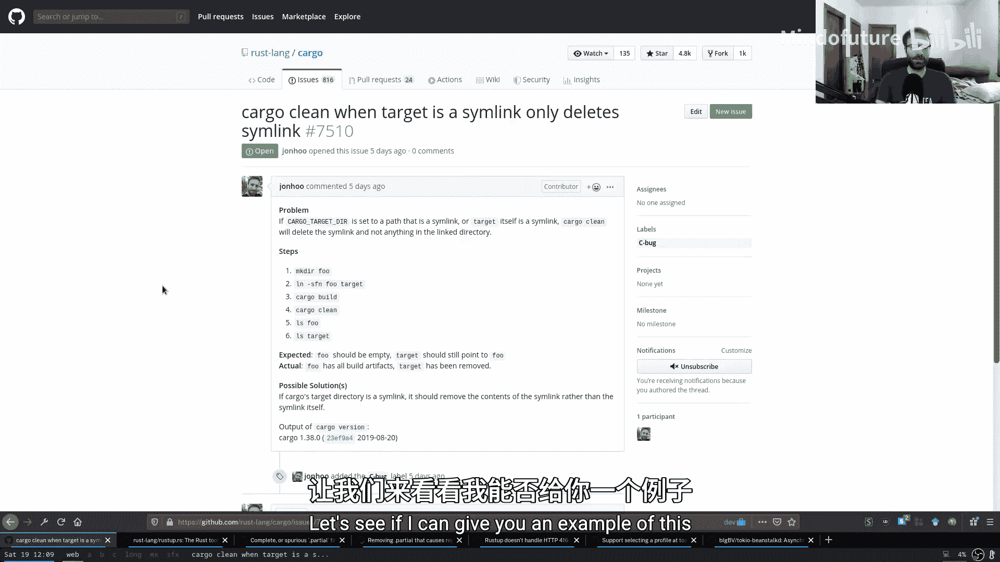

Like this a little larger。And， let's do。Cargo new。Clips。Now， man。Fooe bar， great。

Not enough temporary names。 Okay， so if I do cargo build。

 then you see there's no target directory here。 And this is because I have。Car到他。

So I havego targetgour set to this path。 I can unset it。And if I do。If I do this。Or therell be。

 then you see now there's a target directory here。 And if I look inside Target。

 there's a bunch of stuff in there that is related to the current project that I built。

Where this gets， and if I run cargo， if I run cargo clean。

You'll see that the target directory now goes away， which is what you want。 Now。

 where this gets weird is if I make some like my target。 and then I L N。My target to target。

So if you now look at the directory listing， target is now as simlink into my target。Alright。

 so now I'm going to run cargo builds。And you'll see now that if I L target。

 or rather if I L my target， then the stuff is in there。But if I now run。Cargo， clean。

Notice how the the target simlink goes away， but my target is still there。And inside of my target。

 there's still all the stuff。 So cargo Clean just removed the simlink。

 It didn't actually clean anything。 And this is annoying， because。

It means that a not only does nothing get deleted， but also my s link go away。 And so now suddenly。

 it's my cargo targeter won't get set。 And this is all sorts of annoying。

 So this is a relatively small issue in cargo， but it's one that's just been bothering me for a while。

 So instead of just complaining on it in an issue， let's just fix it。Let's see。Yeah， exactly。

 So the thinking here is that we want to instead of just deleting the top level simlink。

 what we want to do is detect if it's a slink， then delete everything below it。

 Otherwise you can just delete the top level thing。

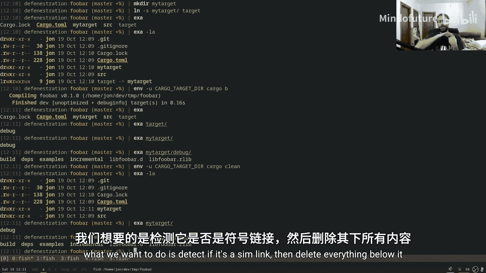

I know that if we look at。

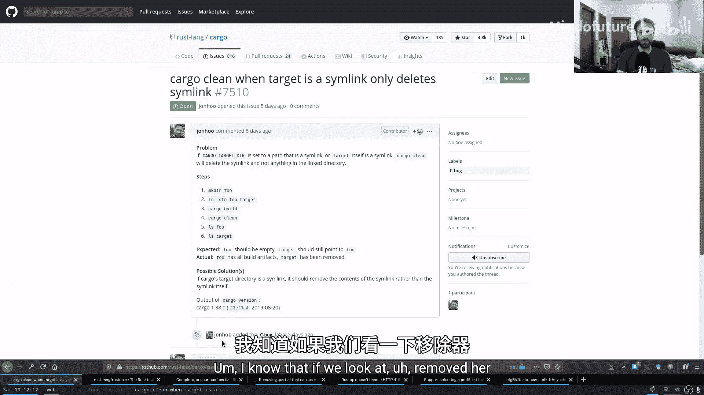

Remove。Is that the function from the standard library？Removed or all。Right。

 so I think this is what cargo currently uses。 But notice that it does not follow symbolic links and just removes the symbolic link。

 Right， So this is the behavior that cargo exhibits， and this is the behavior that we don't want。

How do we keep track of what we own in the similar directory if it's shared。

 So cargo doesn't actually care if you run cargo clean。

 this is going to delete the entire target directory， It doesn't check of the stuff inside of it。

 which like arguably is a problem in and of itself。

 But it's not something that we' are going to be solving in， in this stream broadly。

 because it's a larger issue。

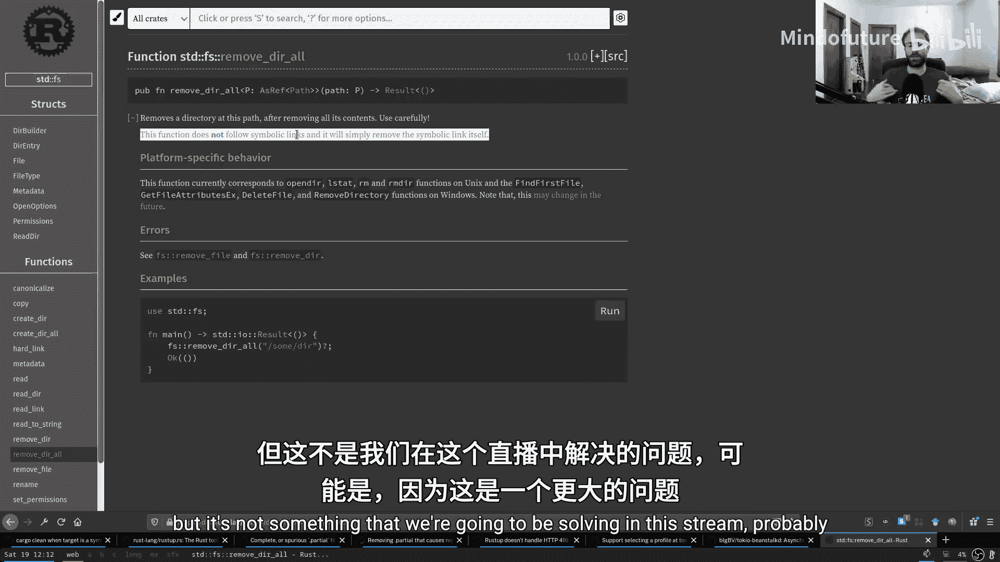

Alright， so now we know what the problem that we're trying to solve is。呃。可掉。Conveniently。

 I already have cargo checked out。 What you'll see is that the way I have this set up is I have two git remotes。

 I have one called origin， which points to my fork。 and then I have upstream。

 which points to the upstream cargo。 And the way I do this checkout， actually， I can just show you。嗯。

Is that I do。Git clone。 And then I clone the upstream thing。哎。And then， I rename。Origin to upstream。

 So this way， the master branch locally for me， still tracks the master from upstream。

 not from my fork。 And then I do get remote at origin。And then I have my fork。

Because now when I push， push new branches to origin， they will appear in my fork。

 but I can still pull in master to get the upstream master。So the question now becomes， okay。

 we now have a checkout of cargo。 Now what。Right呃。OkayOkay。Where do we start， Well。

 let's look at what's in the cargo directory。 So good places to start are usually the Readme and also files like contributing architecture might be handy。

 We might need that later to figure out where we're going to make this change。

 But let's start with the readme。So， the read me。Talks about installing cargo， compiling from source。

 That seems promising。 Okay， so it looks like it's just like cargo build。

 We don't actually need releaseca we're not going to be running this in a performance sensitive way。

 The fact that they use cargo build makes me think that we could just run cargo tests if we're gonna run the test suite。

 So that's a good contributing。呃。Working on issues。 Yeah。

 so here they talk about things like E easyas and E mentor， like I mentioned before。

 opening new issues as a cargo discord where you can discuss issues。It must compile un stable rust。

 Okay， that's fine。For can pull。 that's fine。 basic steps for cargo， create a branch。Coode style。

 that's fine。 Comit to you go。 includenclude tests。 We're going to do that。

 Make sure cargo test passes。 Okay， so this makes me think that cargo test is all we need。

Cross compiles， we can probably disable。 So we probably want to。I think we。

Probably want to just ignore those。Okay， so in theory， we should be able to run something like。

Cargo test。 And so that I don't break the stream。 I'm going to run it with only one thread。

You could also add your own fork as origin only for push the upstream is origin for fetch。

That's true。 I think it's just， it's just easier for me to think about master。 Like。

 I'm never going to push to master anyway。 So I just want master to be tracking upstream anyway。

 And then I just want any branch I make to track origin。 Okay， so the test suite seems to be working。

 So at least now we know that we can compile cargo。 I're not actually going run all of these。

 It seems relatively unimportant。 The question now becomes， how does clean run。

 And there are many ways we could look at this。 The easiest one might just be to search for clean。

 I see what we find。Okay， so there's a bunch of stuff in docks。ha，B cargo commands。

 This seems pretty promising。Alright， so there's a clean CLI。 That seems very promising。

And there's a modud in here， called clean。What does clean do， Okay。

 so now we found where clean happens。Oh， yeah， someone's asking。

You can see whenever I type commands in Vm， you can see them down in the bottom right corner here。

 and someone is asking what does double double quote plus y do？I don't think there was a T。Oh。

 so T lets you select until a particular character。

 So if I do so the double code plus means copy to the system clipboard。

 y means copy like the I set the destination to plus that so double tick is set the destination of whatever you do plus is the system clipboard Y is copy T is until the following character and something like semicolon is going to be copy everything until semicolon to the system clipboard。

Okay， so we have cargo clean。Let's see what it does。 Clean options。Os clean。Cargo ops。 Okay。

 so it looks like what we want is。Maybe， cargo。Ops。P go clean。Great， alright。

 So here we see these clean options。 I wonder whether we want， actually。

 let me start a new branch for us。 Let's call it。Delete through sing。Actually， no。

let's call it clean。Through siblinglink。We might want to add an option actually that let's actually it's unclear。

I wonder whether we want an option to say delete through Simlinks or don't delete through Simlink。

But when would you ever wanted to only delete the simlink， There might be cases。

 So that would be the argument for adding an option。

 I think we're going to not add an option to begin with and then take it from there。嗯。

What if you want to copy anything up to a sequence of characters rather than a single character。

 So then instead of T， you can use slash， which is search。There's also。

 there plugins for adding additional。Announce， as they're called in them。

 such as like do a search for a double character， which is usually S。

But I find that I rarely need them。All right， so。Clean of packages build artifacts。Okay。

 so it's interesting because many of these are。Not a problem， right， So if you have doc set。

 then it's going to look at dock inside the target there。 So if the target directory is a simlink。

 then doc will not be a sim。 The doc will be a directory inside the the simlink。 So this is fine。

This， too， like this looks in the if a profile is specified。

 then it's going to look inside the target directory。

 So the target directory being assseillink is not going to be a problem。嗯。Yeah。

 whereas this is the real thing， right， If， if you haven't specified what to clean。

 So with cargo clean， you can do things like dash P and give the name of a crate， for example。

 you can give like dock to clean only dock。 So there are a bunch of options you can give。

 But if you haven't given any options， it just deletes the whole target directory。嗯。

It looks like all of them called this RMRF function。So。😔，Hm。That's a very good question。

 One thing we could do here is。Ha。Yeah， so I think maybe the fix here is going to be just changing。

RM，RF。To check whether something is a simlink。 And if it's a simlink， then we want to。

Then we want to delete all the stuff inside of the simlink， rather than the simlink itself。Also。

 one thing I want to point out， notice how quickly we got to this point， right。

 we had a bug in cargo。 And now we're editing cargo source code。 And it like it's using clap。

 It's just a normal rust program that you can make changes to。

 And it might even be that this change is going to be local enough that it's just inside of this function in cargo clean。

We'll also want to write to test for this， although in theory， that shouldn't be too hard， I think。

Here， so this uses FS metadata。Why do they unwrap or false instead of is somewhere is O。They。

 they can't， because is di。 This is an option bull。 And so they want the bull if the bull is there。

Isn't the correct fix to resolve the simlink and then run removed or all in the resolved path。

 The simlink would be orphaned， but I think it's closer to the behavior without simlink。

What if it's asse to asse？Yeah， that's a good question。

 So the proposal here is maybe the thing to do is if path is a simlink。

 then resolve the simlink and then basically retry。Because that way。

 you would remove the target of the simlink。嗯。So there are two considerations here。 One is。

 would this fix my issue， And the second is， what is the correct behavior， I agree with you that。

Resolving the sim link and then deleting the target of the simlink。 So in our case of the。

Let me bring that up。In the case of our example here， right， where we had。呃。My target， target。

So if I now ran cargo clean， what that would do is it would delete my target。

But I don't actually know what that would do。 Okay， so let's， let's try to emulate this。 right， If。

 if what we did was just delete the target of the simlink rather than its contents and leave the directory in place。

 that would be equivalent to running this。 This is the state you would be in。

 And notice that this simlink is now dark dangling。 Let's see what happens。If we now do。Yeah。

 so notice how this now fails because it doesn't try to create the target directory。

This is also somewhat important。 Imagine that the shared target directory is unlike some shared drive where you aren't allowed to create directories。

 So someone else created it for you with the necessary permissions for you。

 You don't actually want to delete that directory because you wouldn't be able。

 you might not be allowed to delete it。 because it's in a directory someone else owns。 But also。

 if you were able to delete it， you might not be able to create it again。

 So I think we actually might want to delete the contents and not the directory itself。嗯。

Which is a little weird。It's almost as though the behavior should always be to just delete the contents。

m。呃。I don't think we need a max depth well， maybe， so it doesn't iterate forever。

I think we should delete the target of the Simlink。Yeah， exactly so。

Is there reason not to just empty the directory in all cases rather than deleting it。 Yeah。

 So that's what I'm wondering whether what it， I'm wondering whether that's what it should do。

 It does mean that you're left with a bunch of empty target directories。

But it's a little bit tempting。To just delete the。Contents。嗯。The other question is。

If we delete just the contents。Yeah， I think that that might be what we need。

 We could have a special， a special case for if， if none of it was assse to then just remove the top level just so we don't regress in the current behavior。

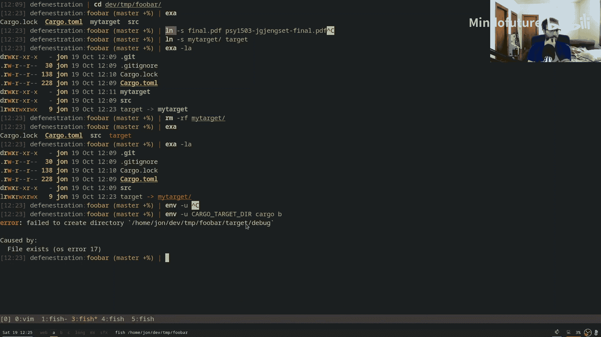

So maybe that's the way to go。 And we will also need tests for this， of course。 Okay。

 so the in order to do any of this， the first thing we're going to need is to know whether something is asselink。

 So they call this F S metadata， right， which returns one of these。

This function will traverse symbolic links。 Well， that's unhelpful。Oh man。Alright。

 so we need to find some way to determine whether something is a symbolic link。

Which is going to be this thing。Yeah。I think this is。

 so we're going to have to make this be simlink metadata。

And I assume here that there's something like。Is link。What are these。 Oh， no。

 extension traits for different operating systems。So there is not a single is link。

It's also weird because on windows， they're only hard links。嗯。Oh， file type， though， maybe。哦。

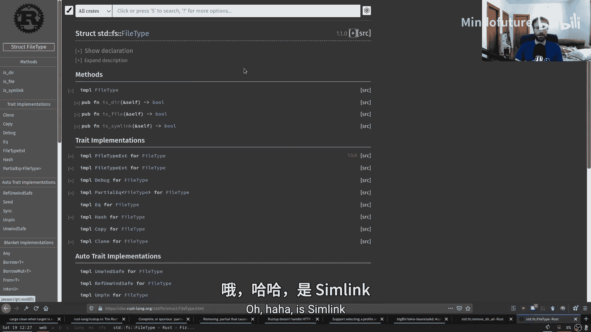

is similarimlink， great。Alright， so we're gonna have to do is。

To figure out whether it's aselink is going be M。As ref， that's fine。Map。And that's gonna。

 does this D ref， Is that why they're able to。Yeah。File type。Dot。Is Simlink。Right。Unwrap or false。

And now， if it's aim link。Then we want to do something。Right。嗯。We see the pattern。嗯。

What's the downside of removing the top level directory？ If someone created a directory for you。

 can't you just create the top level directory inside of this top level。No。

 so the argument is someone created a target directory for me to use in a directory that they control。

 and I do not。Right。And so， if that directory gets deleted， I can't create again。

 because I don't own the parent directory。 if it gets deleted。 Now。

 there's an argument that the removal would fail， but that's still a problem。

 That means cargo clean would always error。 So I think what really what we wanted to do is only ever delete the contents and leave the directory intact。

 And the exception might be if Targ is in the current directory or something like that。嗯。Yeah。

 you're right。 So if we assume that the directory is owned by someone else。

 then we wouldn't be able to delete it， but that would mean the cargo clean would fail。

 whereas it seems weird for it to fail if it just， if it could delete everything except for the top level。

 if it could leave at an empty top level， that doesn't seem like it should be an error， right。Please。

 to me。Yeah， so the question here， I think， is really one of。呃。Actuallyly。

 there's an argument here that we don't even need to detect whether it's assimlink。I think really。

 what we want to do here is change the behavior here， where if it's a directory。

 then remove all its contents without removing the directory itself。嗯。Unfortunately。

 that's not entirely straightforward。Where does paths come from。Hats。Join paths。Normallyormal's path。

Removed or all。They already test for whether something is assembly。And if so。

 they it's interestingcause it's implemented so that it specifically we'll just delete the sameimlink。

Which is not really what we want。Ha。嗯哼哼哼哼。😊，I wonder why this code is here。 Let's find out。Alright。

 it's gonna get bright here for a second。Let's， where is this source cargo uyl paths。

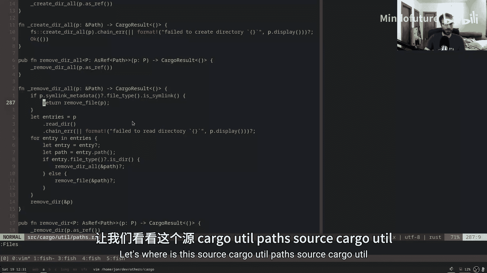

Soce cargo， uil。Has，And then we're going to use blame。Great feature。Now， let's look for。

Wheres our remove path。Here。呃。Al， I want older。Versions of this file。Apparently。

 older versions did not have that。 Okay， fine。So this is probably what added this。Remove business。

 yeah。So why did Alex add this？Specifically， why is the simlink clause here that suggests that he really wants to just delete the simlink。

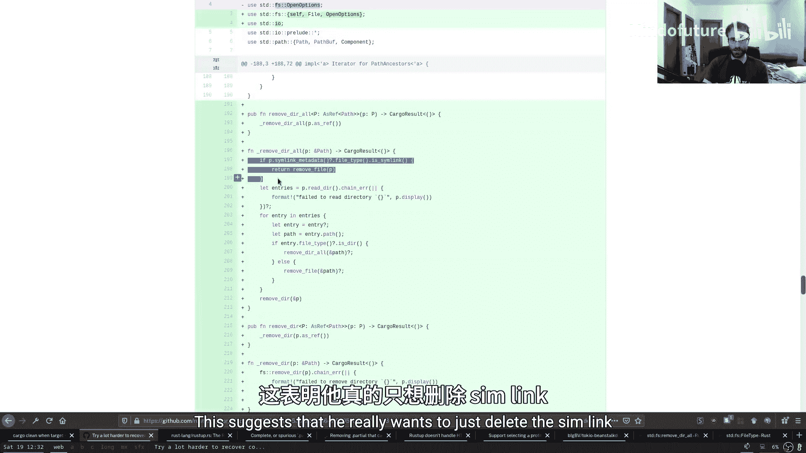

嗯。That's a good question。嗯。It's interesting because this actually does walk the directory。

HSo this is the code path that we want。 In theory， one way to fix is just to comment this out。嗯。

Or perhaps even better to say here if it's， if it's not asselink。Then。Removed her。That。

Right so this way， if it's a simlink， it's going to delete all the contents or actually。

 regardless of what it is， if it's a directory， it's going to delete all of its contents。

 And then if it wasn't a simlink， then it's also going to remove the top level。嗯嗯 응 응嗯。

Don't you need to check whether it's a as siblingimmbling because if it is。

 you cannot treat it as a directory when you're recursively deleting a directory。 You can。

 you can do things like read on as link。 That's， that should work fine。

At least I believe that to be the case。 That's a good question。 I'm fairly sure。 that's true。嗯。

Interesting。I feel like this is what you want。Right， and now we don't even need theseing change。

 In this doesn't have to change at all。This does mean that we've now changed behavior for anywhere that tries to lead files through that removed her。

Right。And then this now should still be this。The only question is whether reader works on simlinks。

 but I believe that it does。嗯。Why not follow the default behavior of R and Euchs。

 followll Sims and delete all the folders， including the top level folder。So the reason for this is。

 as I said， I I don't want it to delete my simlink。 So RM and Unix， if you delete a simlink。

 only the simlink goes away， and that's specifically the behavior that I don't want because it means that my cargo target directory cannot be a simlink because it' is going to go away each time。

 which sort of ruins the point of having it be as slink in the first place。

Do you need to change somethingimlink。 Yeah， exactly。

 So we did that removed are all recurs and now won't delete nested simlink makes the director non empty when trying to delete。

That's not true。Oh， I see this one。I see what you mean。 Yeah。 So， so the。

 the problem that being pointed out is this， this function is recursive。 So here。

 if it finds something that is a directory。Then this might be a simlink。

 And now this simlink won't be removed because we just made it not remove simlinks。 And therefore。

 this removed dirt will fail because the directory isn't empty。So the question really comes down to。

 do we want it to preserve。Do we always want it to preserve all simlinks， including nested simlinks。

 right， Like if my target directory is a simlink。Or， in fact， even just ignore that。

 Imagine my target directory is not as simlink， but it contains a siblinglink like the debug directory in there is a s to somewhere。

 Like， for example， I have debug and release beyond different disks or whatever。

 Like they're both ss。 Then the way we've currently written this is those。Would both be left behind。

 They wouldn't be removed because they're simlinks。

 But when we try to remove the top level directory， which isn't a simlink， then this call would fail。

嗯。I think we want to preserve all ss。 I just， like， really don't think we want to。

I really don't think you ever want to delete the sum links。嗯。But I could be wrong。

I think in some sense， I'm only concerned with the top level behaviour at the moment。

 Siming deeper down in the target tree seems less likely。

 But let's look at where else uses a removeer all。Okay， so this uses FS。Interesting。That's awkward。

 So different things use different versions of it。 Like some of them use F S。

Wai there's also a crate cold removed or all。Oh， man。 Look， this uses removed or all the crate。

Interesting。嗯。What we could do is add like one version that's the base case here and that's the recursive version and only delete the top level。

For the use of debug and release Simlinks， it makes sense to keep them。 Aqantas would be removed。

 which feels like that's when intended with cargo clean。 Yeah， so that that's my thinking as well。

 that you never want to delete the simlinks。 The only question then becomes。

 do we ever want to remove the directory。And I think we do。 Otherwise。

 we're just going to leave tons of empty directories in the place。嗯。Okay， here's a proposal。

 It's a little bit sneaky。 But what if we do remove her。 And if it fails， we just ignore the failure。

Right。Removed her will only succeed if there is nothing in sight of it。

I think that might actually be what we want to do。呃。We allow this call to fail。

Because if there are some links。Left within the directory。呃。Deleting the directory。It fail。

But we also don't care about that failure。呃。Keeping track of whether we did this intentionally would be pretty painful。

 So we just let the O S do the checking for us。How about that。You could ignore not ems。Oh， yeah。

 that's， that's a good idea。 What's the。ド。 am I blind。

 I don't think there's an empty that we can easily get at。Yeah。

 I think I think that just get gets racist as other。So I don't think we can actually detect。

 We could write that here in theory if a kind not empty。Was available to us， and that would。Then。

 we could be less。嗯。Let's just say， actually， let's do。If Eric I not empty was available due。

We could only。Ignore the relevant error。But sadly， it is not。Yeah。

 so the problem is we can't actually get at that specific error。 I think it gets race as other。

 But keep in mind that if someone like the permission errors will still come up when they。

 when cargo tries to delete the stuff below， right。

 This is we're only ignoring the error for removing the top level directory。Right。

Were not ignoring any of the other errors。嗯。Well， what we could do is。

What we could do is just look for other。Yeah， so if I don't have permission to delete the target directory。

 but I have permission to delete the contents， I don't think cargo clean should error。

 I think that's fine。 It should leave the top level directory in place so that I can keep reusing it。

Yeah， I think it would show as other， I think you're right。Other with the code 39。 But。

 but the thing is， I wanted to also not show me permission errors， right？ So this。

 this is the example of。If I have a target directory in a place that I don't control。

 like someone made the target directory for me on like a shared drive or something。

 I don't want it to try to remove because it would fail。 They would get a permission error。

 and I don't want it to remove that directory。 And I don't want it to treat that as an error。

Note that。 So let me type that。 It's a good point。 So let's type it up。

 Note that we intentionally do not propagate。Other errors。Permission denied， in particular。

Because the top level directory。May be in a。Shared directory。

 The user does not have right permissions to。In which case。

 we want to leave the targeter there so we can keep using it in the future。呃。Actually。

 that's poorly phrased。 Not that we intentionally do know appropriate at other errors。

Because the top level directory may be in a shared directory the user does not have right permission to。

In that case。The user will want to leave the target。

Dre there so they can keep using it in the future and will not expect a removal error。

For that directory。Well， keep in mind that you will still get permission errors， right。

 Like all the other removals or the first of the other removals will still raise a permission error。

This this is only ignoring it for removing the top level dir， right。

So I think this is still the behavior that we want。Permission denied。

Will still be raised when trying to remove the。Contents of the directory。So， this。Shouldn't。

The hiding errors that are relevant to the user。So I think this is actually the behavior that we want。

Al right， so now the question is， how do we test this。嗯。嗯。What do we see in the tests directory。

Is there a particular tests suite for clean， That would be nice。 Haha Tes suitee clean。Test suite。

 clean。Won to be for removing any dir within the hierarchy。You're， you're right that it's any。

 any empty directory in the hierarchy。 But removing any files， you'll still get this error。

 So I feel like you will see the error like it。It seems like it would be a really weird case if only removing directories would have errored and you want to know about it。

 right， I agree with you。 It， It feels a little weird， but I think it's the right thing。嗯。Okay。

 so now let's just first make sure that we didn't break something。嗯。Let's do cargo。Oh，M， why is that。

This is why what I want。T sweet， clean。And I want。Quan。See what that gives us。

So notice I haven't added a test for us yet。 I first want to see that making this change doesn't break anything else。

 It probably will。 actually， There's probably a test that checks for whether。

No target should be removed。 It shouldn't break anything。Okay， all of those passed。Let's look at。

Pillllscript， clean git， registry， clean rebose。Okay， I think we add this pretty early on。嗯。Cargo。

 clean。Leaves， simlinks。嗯。Oh。There's a test support package。What does it do？Lib。

Cargo has a variety of integration tests that I see with the cargo binary， okay。嗯。

It creates a sand box。 That's fine。 The real question is， can I use it to make a simlink。

 That's really all I want to know。S link in tests。嗯。Test suite package。So。Interesting， okay。

 so the we're gonna need this thing。Right， this sing supported business。Because as it says here。

 like we， we can only run a test that uses simlink if slink are available to us。Right。

So we're going stick this in here。What else does it do？嗯嗯嗯嗯嗯。I don't know what T is here。ro， okay。

 so cargo test support。Has a macro。Unclear what it does。Micros tea。Oh， it's just an unwrap， okay。

That seems relatively less important。The best thing would probably be that you only delete the files that are from your project out of the Sembling directory or at least as an option。

 but I don't know if that's possible without changing run build check and so on。

 I don't think we can do that because cargo doesn't really track those files and adding that would be a much larger effort。

嗯。Yeah， so， so Holger cargo clean will still error。 like the way we change it now。

 it will still error whenever it tries to remove any file。

 It's only for removing the the empty directories that'll ignore the error for。嗯。哎。

So what does this do to actually add a simlink。It just simulateims them。 great。 So in theory。

 we can just do the same thing。嗯。So we'll create a project。 That's fine。Why is there a F R S。

 That's fine。 We can leave V R S there。 And what we want to do。Is。We want to。Now。

 I need to remember the order of arguments for Simlink。Sour and destination。

The destination path will be a symbolic link pointing to the sort path。 Allright。

 so this is going to be the link。啊。Target， and this is going to be real target。

Which also means we're going to have to make a directory here somehow。嗯。u。Is there a way for us to。

Test support project。Hats。Project。嗯。Gett paths， publish and registry。Alright。

 so where this project comes from。Out some down here is an oh， simlink builder。That seems handy。Wait。

 that's perfect。 Okay， so we have a simlink builder。That's something I want。嗯。Okay。

 so then maybe we don't need these。And then what we want to do is。Sim link builder。

 Let's look for someone who uses that。No one uses that， great。Wait， it's also not pub。

That's unhelpful， oh。Great。😊，There's a siming dirt on project。Wait， this is fantastic。 Allright。

 fine。Dotim link dirt。An order is。Destination and source。Wait， that's all sorts of confusing。But。

Okay， what， what is the。It's simlinking。But that's the opposite of what this does。

 The first argument is source。Oh man， why， Okay， so。Destination here is passes the first argument。

 which is destination here， which is used as the source。 Okay， so we need to flip these in our head。

So。No， okay。 The first argument is the first argument。 It's just that they're name differently。

 So we still want real target to point to。I think we want this。嗯。I also think we want。Real。Target。呃。

Dbug。To point to real debug。And now， oh。嗯。Won't the strategy of leaving simlinks cause issues with anyseims generated by cargo itself。

嗯。Maybe。It， might very well be that cargo generate simlink。

 but then I don't think removing them as a problem。 I mean， the the test pass。

 that's a good indicator。 You are right， though。I don't know。I don't know。

It might be that we can detect cargo Simings at least， but I'm not sure。嗯。Alright。

 so what do we want to do， Well， we want to check that。嗯。Buildder。Join。😔，Real target。Sure。

 let's not even do that。We want to make sure that the build directory。What is the built director。

IsThat just gonna be target。Great。So we want， we want the bill directory to still exist in this case。

 because it was as link。 We want the target。Target。Debuger to also still exist。

 because that was asselink。What else do we want。But we， what we want， though， is we don't want。Join。

 So this is where it's going to get fishy， which is。What inside of that。

What can we look at in of this， I guess， build。We don't want build to exist in sight of there。

This this is Cargo clean Leave Simlinks。Queen beat。Thes said。Let's see how it works。All。

 that's fails。 Why is that。Pass。Was erroneously implicitly accepted for binary food。What。嗯。呃。

That's fine。 We don't need it to be a binary。没我。Can't find food bin， specify bin path。Wai。

 does project require us to。To actually set a library。Seems unlikely。😔，嗯。Oh， basic bin manifest。

 That's not what I want。I want basic lib manifest。这些。I want basic manifests。

And I wanted to have name and version。嗯。Sure。Which I guess means that there was also an what was it called target Dbug。

D， there was also something else down here， which was。

Example lib path to an example built as a library。Oh， no， that doesn't really help me。Okay。

 that's fine。See what that does。So what are we doing， Well， so what we're doing is we are basically。

 there's a， there's an issue in cargo that's been bothering me for a little while。

 and we're trying to fix it。hich is that if your target directory is a simlink。

 it removes the simlink， but not the contents。failed to create directory。嗯。Really。

WellWhy did it fail to create directory？W。I wonder whether cargo doesn't support making debug be asslink。

8，46。Okay， that's relatively unhelpful。Well， actually， no， it fails in run。

But which run builder clean。Clean line 35。Fills and bill， down。I think it might not support this。

Which is seems like also an issue that someone should fix。嗯。Fail to create directory， targetrg。

 debug。File exists。What。No。Oh，We're not cleaning up after ourselves。 That's probably why。嗯。

Was that what this God as well fall exists。 Okay， never mind。 This is fine。

 The problem now is when we run the test and then run the test again。

 the test doesn't clean up after itself。Because these things still exist。

Because the clean does not actually clean everything。So the question is。

 how does this do its cleaning。No， although these don't clean。I have the sneaking suspicion that。

Alright， let's， let's see if I'm right。Qulean tests。Clean targets。Al right。

 what does clean targets do。嗯。I wonder whether this doest， actually。

I wonder whether the testing script actually uses cargo clean to clean， and therefore。

 it doesn't clean up after this project because the simillinks are still there。Which like， is fine。

 It's just。呃。P dot build。I guess。呃。Target debuger。And。呃。This should be。

Although I'm not actually sure where those files would be。What does it look？喂喂。Just remove that。

Cargo integration tests and then try to run it again。Oh。That's true。

Mar won't fail if director oil exist。 but it， if it's as， good will， yeah。

Had you set up your cargo target de variable， I set it in my in my bash setup script。

What Linux destroyed。 This is arch Linux。File exists。hu。

This makes me think that cargo really doesn't like if the debug directory is asic。嗯。

I guess one way to really find this out is to do this。

If no way to have a per test function temporary directory， is removed。

 not reuse on the test runs again。That would be nice。

 although I want to see whether this is really the issue。Yeah， here it fails again。

 even though now Debug isn't a simlink。So， something is fishy。In this pond。All right， what about now。

Now， there are no siblinglinks。 So now， in theory， the test should just fail。

The arch Linux Wiki is actually really good。 makes it a lot easier to install， yeah。Oh， no， okay。Ha。

So it's really the target directory being asse it doesn't like。

Which makes me think that it doesn't actually。It's the build that fails。Why does the build fail。Ha。

It's a very good question。Feel like we've somehow， like， messed up our environment。嗯。

I want to see that path here again， and see if I can。Find out what's going on。So， let's just sort of。

C D overta。Ha ha ha。 we are removing the target of the Simlink。This is what we didn't want to do。

Because it breaks the simlink。呃。And that's probably what it's complaining about。

It might also not like that this is also called fo。But that shouldn't really be a problem， all right。

Okay， so。This is a problem in our code。 in particular， I think what we need to do is。嗯。Ha。Clean。嗯。

Why is it removing the target at all。Some interesting stuff right there。呃。

I have the feeling that clean should remove everything as it does by default。

 If you want sing super an environment for created when run。Sorry。

 I don't want cargo to create some links。 I wanted to not remove them， if they're there。

The similarimder actually create the repository you're， you're siming to， though。

 Perhaps it only creates a sim link。 It looked an awful lot， like it。Pretty sure it creates it。

 as well。Similarlink builder。嗯。S build new。Newder。😔，Build。4 filing simlink， it calls Mch。And。呃。Yeah。

 Mck does make their pe。So it should create the the target， and then simlink。Hm。And you see。

 the as simli is created correctly as well。 right， that that is the path we expected to point to。嗯。

So。File exists。Actually， here's what I want to do。M。Hang on。 That's a good point， this。

Is the state because the build fails， right？ We're still in line 35 is the one that's failing。

 I assume。35 yeah。 So because of what fails is the build。

 this means that this is the directory layout that。That cargo is working with。

So that does make it seem an awful lot like the target directory isn't created。Yeah， you' right。

 You're right。 Maker P only creates the target。How weird， Like， why is that。I mean， that's fine。

 I guess we can always just create。I guess we can just create the directory， ourselves。

But how weird that it doesn't create the target of the se that that that seems to make near dear kind of useless。

呃。Like， okay， who uses simlink di。That's not helpful。呃。It's used only by tite packet。Properably。

That seems wrong。Okay， it's used in one place。 And they're the target。

 It doesn't matter if the target exists。I kind of want to change this to。Create the directory itself。

 as well。Oh， it's because they don't know whether the。No。I think， if self source。Is there。

Then it should do this。See， I don't know if that's even a thing that I can do。No， probably what。

That seems incredibly false。All right。 Well， I guess we have to create the thing ourselves。 Fine。

 fine。 We can do that。呃。That just means that we need to go back to our cu suite。And here。

 we're going to have to say。Before build runs。We're going to have to do。

WaiWhy can't it find make there。It's called creator。 Yes， see there's creator all。But that's fine。

 Like if this it， it calls maketer per P， it's， it's all fine。 We'll just use this。 So we'll do。

Creator P dot。Ruter。Join。Real target。翻转。Tests so we can un。AndD保。And now， in theory。

 we don't need this， I think。嗯。Yeah， Daniel， they call it on the parent。 I see that。

 I'm just wondering why。嗯。But it might know matter。 Let's see how this does。 Oh。

 I probably still need to do this。嗯。😊，Is's it called rootr。m missing missing something。Apparently。

 I am。呃。It's just called root。Could not。 This is another cargo I've been seeing lately。

 and I don't know why it happens。I have to do。That's bizarre。嗯。No， no。

 I understand why they have to create the parents first。

 I'm wondering why they don't also make the directory。嗯。File already exists。Where。I mean。

 I'm sure it does， but we're。Iin， 35 again。Wed now real target already exists， what。Alright。

 if they say so。Okay it's reusing the directory layout。はい。We don't care if it ours。Actually， know。

 we do care of it errors is。 We have to do， I guess。Yeah。呃。Yes。呃。Isn't there a file exists？

I want a handy way to do that， but apparently not。Basically， we。

 we only want to create it if it doesn't already exist。 So I guess if let air。第。Is this。呃FE dot。

Findd。Is。Air kind。It's just file exists， right。I forget。Already exists。It's real sad that this， like。

Needs to be this rebose。I mean， needs to is a strong word。嗯。Let's see how that works。

The only reason for simlink versus sim dirt is because of Windows。Yeah。

 I guess my argument is more that。If it's a directory which they already know。

 then they should also create the directory that the sgue that's being created is pointed to。

 and they don't。 And I'm not sure why。It would be more consistent behavior。

 if an end view of your target set as a path than during build cargo should create similarim to that instead of de。

 So that's not actually the problem either。 The problem is， the problem is when you run cargo clean。

 what should it remove， And I'm arguing that should not remove my。Simlinks。

 because I placed them there for a reason。嗯。Failed。O， okay。

 so now we're getting a failure at the assertion of line 51。 So that seems like a better place to go。

We're getting an assertion failure that the。Target。Debug。Oh， okay。

 so clean correctly did not remove our top level directory。 So that's good。呃。

But it did remove whatever that It did remove the actually， let me just。Let's go there over here。嗯。

See what's in target。Oh。Okay， so did remove the simlink in there。So why did it do that。

That is a good question。Is that even if we start from scratch。

Why can't we clean up after tests instead of putting if logic check for the tests。

 So that doesn't work because if the test fails， the code after that removes wouldn't be run。

Otherwise， it would be attractive to just remove it at the end of the test。

It's a little weird that they have this setup where the the bill directory isn't cleaned each time。

What did I just do。Right。Now I want to see what's in here。Tarrgget still points there。

 But what was inside。What was inside real debug was not removed。

So this suggests that real debug was treated as a。Sure， I kind of now want to just do this。Actually。

 this。To see that we， in fact， get what we expected here。

Does that the layout of these directories are what we expect。um。Yeah， al right。 So there is a debug。

 and it is a similarim link。 So the question now is。

I'd still think I'd remove everything at the beginning of a test and not have to care for last testone and artifact。

 but maybe I'm missing something。嗯。Or remove at the beginning of the test。

Could remove at the beginning any of the tests。 that seems fine。So you're arguing that we should do。

Removed her。Remove。Well。It can't actually be removeder， but it can be removed or all。

And then we would have to ignore errors from this。And ignore errors from this。In some sense。

 I'm agreeing with you that this testing infrastructure seems weird to me。

 It's more that I don't want to change cargo's testing infrastructure as a part of this PR。

 That seems excessive。It's only true We can do this， though。 That will help clean up a little bit。

Okay， so the siblinglinks seem to be set up in the right way。嗯。And after build。

 things to seem to be correct。But then after clean， the debug simlink goes away。

 So that should suggests that there really is an issue in our code somewhere。H。Remove du all。

Let's just give ourselves something to work with。Acur。IIt's actually this。You have to do this。

 I think， right。See what this gives us。Yeah， I mean。

 there are many times when I want to fix a bunch of things。

 but I need to constrain myself to only make the change that's sort of relevant here， right。Alright。

 let's see what this prints。So。 well， that didn't print anything at all。Wai。Oh。

 this is probably an artifact of how the Te are run。 That's kind of awkward。呃。B bar。

Because what it really does is it like compiles cargo and then runs cargo。

 At least I think that's what it does， which makes running the test a little weird。But。

I don't know why I would just swallow or output。On this， this code is just like not called at all。

 but that seems weird， too。Well， then that's particularly unhelpful。呃。Let's look at test suites。呃。

Ced lip。T sweet。What's even in。Test suite。嗯。What does cargo test actually do。

And where does cargo test come from。It's a lot of gia。This maybe。Test macro。Alright， what does it do。

It's just gonna run my thing， but。嗯。It's a very good question。 Why is my output not visible at all。

Even if I go here。Those helpful print messages， right。Yeah。

 I think it's just totally suppressing our output， which makes debugging a little bit more annoying。

It's also not trivial to attach G to B here because it goes through a bunch of levels of interaction。

 but we can try。Alright， so we're not getting prints， so we're going to have to break out some GDP。

So let's do。 What does it actually give me here。Running。Just to recompilile it。Yes。

 he had built the cargo binary。 That's my concern that it ends up。Running， this is a binary for us。

Which is the reason we don't get the output。so。This ends up running this。So you give me that with。

Wantan to see the exact command。 Let's run。This command。And now。We this。And I want to break at。

Paths dot R S line。去 my one。Yeah。Exactly。So it really spawns a new process。Test support source lib。

Allright， fine。Test supports。喂。Support source slip。Alright， so what does Fm clean。呃。And run。Aha。

 run output。Okay， so test suite clean。Can I run output。Yes， please。I don't need the。

Is there an interactive step by s debuer for。 GD B works fine。嗯。I life， I。

 I live code on both YouTube and twitch。 It's live on both。Yeah， I have R R as well。

 It's really handy。 The problem here is the processes are a little bit annoying。Why can't I just。

Process builder。嗯。I'm in the mood for cheating。嗯。Mmhmm。Verify checks， output。If I checks output。Kay。

I just want。I just wanted to give me the process output。Do it， please。

You should rather use Xec with output or turn the output of the command instead of matching against it。

Where。Oh， is this instead of run。Well， so that's on X X。 But it doesn't。

 that doesn't really help me from where the。It's not a function on the project。See here。

Then I would cheat it。Al right， so it recurs into debug。Then it removes recurs the depths， removes。

steps。 That's fine。This is the line。 That's the problem。嗯。This R M。Why is that R M dearer even run。嗯。

So remember that here this RMD is only supposed to be run if P isn't a simlink。But。

This path is definitely assembling。At， that was the intention。

So unless that gets removed somewhere else further up， which I don't think it does。Interesting。Oh。

 unless cargo recreates that directory。That could very well be that this is cargo being like。

 I don't want my debug thing to be a。P什么？It could totally be that cargo will just like blow away debug if it's if it's a simlink。

Seems like its own kind of problem that we probably won't fix in the same run。Alright。

 so when it chooses to arm this。Well， that's relatively unhelpful。Ha。😔，Seems like it's just a normal。

It thinks it's just a normal directory。Ha。😔，How do we want to。Even deal with that。 Like， why is this。

 Why does it think the debug isn't asimlink。Hm。I don't know what we want to do there。嗯。In fact。

 let's look further up here。So we already checked before， right， We checked that debug。Was， in fact。

 a simlink。Pretty sure we check that。 We can。 We can check it again just in case， like at this point。

Just to like。Prannoid。It's not。Well， that certainly explained some things。

That's because this has to happen before that。Otherwise， we overrite the simlink。

Which won't work but we can't。呃。Think we might have to do this。嗯。Let's take a look at that。Oh。

This now fails， because。Not found where。Clean line 31。Creator， all。Think we need here。😔。

Although creating these should just not be an issue。Oh， I see why it's an issue。

 It's an issue here because this creates something inside of real target。

 which means the real target must exist。So really， the solution here is going to be。I see。

This is really what we have to do。We first have to remove real target。

 So they're creating it just fine。 I guess we can remove real deep O2。 that doesn't really matter。

Now。This line is going to create real target。And it's going to create the parent of real debug。

 And then we have to create real debug here。RightI think that should do it。And this has to be this。

Yeah， that's why I changed it to。Pette O probably doesn't exist until until you call build。

 So that's why that's why I do。 this is just a removal。It doesn't actually need to create。

It doesn' actually matter。 We ignore the error。 This is to remove it in case the。

 in case the test previously failed midway through。Al right， so now what happens if we do this？

 now it's a sim link。So now， if we remove this return。Fingers crossed。嗯。It now runs R M on that。

Which is better， but not quite right。So now it's no longer hitting this case。

 but it is hitting this case。呃。That's probably because this。Sif entry file type is Simlink。

ignoregnore。Don't delete Simlinks。呃。Well。哎。The problem is we want to recurse into Slinks。See， why。

So very good question。Please try to create context as you go。 What do you mean context as you go。

Okay， so now Dbug is， in fact， a simlink。But because it's not a directory， doesn't get recursed into。

嗯。My guess is that this is because reader does a simlink metadata instead of a normal metadata。

So I think what we need here is。嗯。If。Path dot Simlink metadata。We wantna。If the simlink。

Is pointing to a directory， Then we want to recurse。Into it。Or curse link。Else， ignore some。

I entered midstream， and I'm unclear what you're doing what problem you're focusing on。

 So I'm happy to give like a recap where we are。 In theory， we're almost done with a cargo bit。

 I'm hesitant to keep repeating what we're doing because for the people who are watching like。😊。

That would be a little bit jarring。I think what I'll do is because this feature is now almost done。

 The tester is passed。 I'll do a recap when we're done， which should be in like， my guess is 5。

10 minutes。嗯。Yeah， so the the observation here is that entry that when you do read De。

 all the entries you get essentially run simlink metadata， not metadata。

 So the file type we get for Simlink is not directory， but Simlink。

Whereas if it's assseimilling to a directory， we want to recurse into it。So that's hence this。

 this thing， which if it's assimil link， then we look at the metadata of the target and see if it's a directory。

 So this will be。We still want to， actually， I don't think that's even necessary。

To see that this horse again。 Aren't you opening up Cargo for getting caught in endless simlink loops this way？

 Yeah， the previous one would just RM Slink， so it wouldn't get caught。 So that's a good point。

We could do this by just keeping like。Yeah， no I see what you mean。

 The easiest way to deal with this is a recursion modifier。

 So we just add like a number here that you count down for each step。 But if it reaches 0。

 you go like recursion limit reached， there isn't really any other way to detect slink loops in this way。

 if we want the sings to not go away。It's a good question。Maybe the way to deal with this is to say。

Recursion limit。And then give， I du'nno，2 to 6。And here do。So this is going to， in fact。

 maybe we only in decrement the recursion limit。So this is really like。Follow， follow link limit。

Because that way， we can say we can make this a decent amount smaller。

 Like we probably aren't more than 16 siblings deep。嗯。And then we do if。Follow link limit is 0。呃。

Too many chains some links。Were probably in a sing glue。And so in this case， we can return。 Oh。

 that's a good question。Pug results。s。嗯。うんうんうんうんうん。I think what we might do here is。

Something like an I O other。嗯。It's unclear。Actually。Maybe呃。I always forget what the。I O new。

And we'll do something like。Caaught in。Sly group。And this would be standard I。Air kind。

Probably other。Prob the other。And this probably needs an into。You my guess。I agree with you。

 probably needs a separate test。嗯。Spectted one parameter。Moder all。H。What is it complaining about。Oh。

 I see。 This needs to call these。Mismatch type。That's fine。This is gonna be。Thank。

But why does the2 not do that。Oh， we might need a from instead。

Suppose somebody creates a link outside of target and target for some reason。

 Some do integration tests previously， directory of saves。Now， it's gone。That's true。

 Now there can be links outside of the target directory， whereas previously there couldn't be。

I think that's almost necessary for this feature to work the way I want it to。

 So what I'm going to do is submit it and then mention it in the PR。 It's a good observation。Alright。

 And then let's add to the test suite。Leaves， simlinks。Cargo， clean。Detects simlink。Loops。And now。

 how do we want to do this？We probably。呃。We don't actually need any of these。 Instead。

 what we're going to do is just link。So oops。We're just going to link target debug to target。

 which obviously is not okay。And。This least in theory。This should be cargo clean。

Conan Seimlink loop shouldn't be the airt because just your guess is whether would happen instead of it should be max Simblings follows。

 Yep， you're right。呃。Could not remove bill directory。Let's see。 So that is back here。 In fact。

 in fact， really， what this should do is we should up format error here， I think yeah。So。

 thiss gonna be。It shouldn't really be in the I error either， which is。Max Simlink。Wow。

 so this is also kind of awkward because we don't actually have the original number here。呃。

Slink recursion depth。L reach。Sorry， and this failed where could not remove Bill directory because of that error。

 which is what we wanted it to be， right， We want。呃。

Is there nothing here that tries and sees whether it fails。 That's odd。

We really want this to be like a run， but we want a run that checks whether it fails。 My guess is。

 there's a。Support。嗯。Mmhmhmm。And we want。We want width status 101。Right。And。我。The standard error。

 Wheres the。Why blind？ Where is our actual error message。Maybe it doesn't print it。呃呃呃呃呃，with。

Air contains。And that should contain our error message from up here。And none of these tests。

Let's see what that gives us。I failed， why。好。This is just like not print internal errors。

 that seems relatively unhelpful。嗯。Can I do this。嗯。So， it very clearly is printed。

I want to make sure that we。This。And this。Ha。😔，Oh， as it may be printed to standard out。

 That seems weird。Or does contains require that to be the entire line， maybe。

The given contiguous lines。Yeah。Whereoras， I think there's some like。Spaccing that needs to be there。

嗯。嗯。Here you see the actual output says could not remove bill directory caused by similic recursion depth limit reached。

 does the others there like two spaces at the beginning。That seems so brittle， though。

But let's see if that does the trick。One of the things you'll see is that okay so the process here is going to be I'm going to submit this as a PR and then it might very well be that the cargo maintainers come back and say like this is not okay like we don't want this feature at all or like things like this test they come with better proposals for how to implement it。

What I wanted to do here is keep the di as small as possible。

 So this is why we haven't fixed a bunch of the testing infrastructure stuff that we've seen。

And so you see the diff pretty small。Alright， so let's do。

Are youably we should have committed as we went here。

 So we should have committed probably before we added the。The recursion limit。 But here instead。

 we're just going to commit。嗯。Just let me check that I don't have any weird print lines or something in here。

Don't think so。Great。So this is make sure that we tag the issue。 That was issue number 75，10。呃。

So I'm going to prefix the message with clean to to get this relates to cargo clean。

 Do not remove some links。Only contents。Previously。Cargo clean would remove。Sim links。

In the target battery。But not the contents of those Slinks。This meant that large amounts of。呃。つ。

Clean， in some cases。Like when the user sets there。Cargo target dirt。To a slink。嗯。

Did not clean any files。It also meant。It also causes surprising behavior， where。A build。

Following a clean might fail or where a build following a clean might place build artifacts。

Artifacts。In the wrong location。Because。Because clean， removed simlink。The user expected to be there。

Yeah， my editor does cargo format。My font， I think you can do both artifacts and artifacts。

 This is the Noto Sans monoo font。嗯。Note that this commit does introduce。Some security risk。嗯。嗯。

Before this change。Cargo clean would never leave the current directory。We will leave the。

Target directory。Whereas now that it follows simlink。It might。It might recurse。

Curse into directories， beyond。Target directory。呃。An act or。The decision that this is okay should be。

We should decide whether。We think this is okay。Fix is 75，10。

And then we push origin clean through Simlink， clean。Through。嗯。Great screen is gonna be。

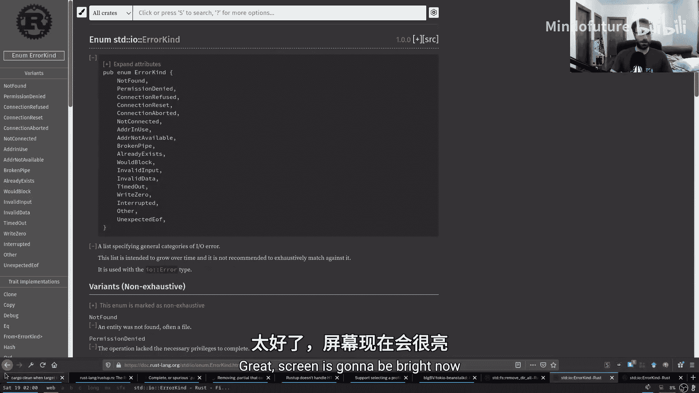

Right now。And now we're gonna file this as a PR compare and pull request。嗯。We have a。

 we have a poll request。Alright， so pull request 1 is out。 I suggest that you watch this PR。

 if you want to hear I'll put the link in chat。 you watch this PR。

 if you want to see like what the follow up process is like， right？

 So what we did is just the first step。 and usually after you submitted a PR。

 there are then going to be reviews of that PR follow up changes， maybe additional tests。

 a bunch of other things that might happen。um。Great， okay。 so that was PR 1。

 Now on to the next project。 Alright， so I'm gonna C D out of all this。😊。

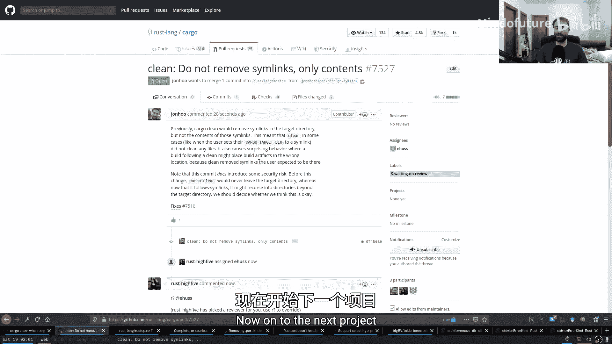

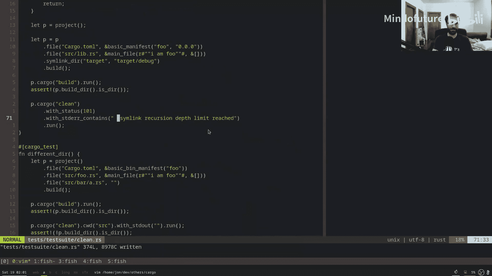

So that was the first thing we wanted to do。Congratulations us。 Now， the question is。

 what do we want to do next， So I want， there's a contribution I want to make to rust up。

 And there's a contribution I want to make to a project where we're going move from future 0。

1 to standard future。 Which would you like to see first。

 My hope is that we'll have the time to do both。😊，So would you rather see？More rust tooling。

 or would you rather see futures。Actually， I'll be back in a second。

I just realized one thing we forgot to put in the PR description is what the PR changed。

 It said what the behavior was previously， but it didn't say what the new behavior was。嗯。Let's see。

 What does Chad say。Futures， futures， rust tooling。 congrats and good luck。 Fu， future， future。

 rust up， future， future。😊，Rust up。Rust up futures， futures。See， I could put up a BRB screen。

 but it's annoying like screen management in OBS is annoyingca you don't get it through the right hand here。

If I did， that would be a lot easier， but I don't。Tooling futures， Ru up， Ru up， Ru up futures。 Okay。

 it， I think we're gonna do futures first。The futures changes is， at least in theory。

 more straightforward， because it's mostly a mechanical change。

 And then we'll do the rust up one afterwards。For us of， there are actually two different issues。

 and I don't know which one to choose yet。 but that let's do the futures change。So。呃。

I've done a lot of streams on like async stuff， on futures， on pin， all of that stuff。

 But one question that keeps coming back to me is。If I'm on the old future stuff and I want to go to the new one。

 like， how do I do that， Don't just tell me about how it works。 But like show me the actual process。

 And so that's what we're going to do。 As I looked around a little bit and asked for suggestions for crates that are using future 0。

1 and that aren't too large so that we could pretty easily move it to standard future。

 And so I ended up with this crate。 by someone who actually watches the stream pretty frequently。

 So this is an implementation of the beta D protocol。 And it was written for future 0。1。

 And we're going to port it to use standard future。 And you'll see that the process we go through is。

😊，Fairly applicable to any project。 At least that's the hope。

 I don't think I have a fork of this yet。 Oh， I do。 great。How about that？呃。

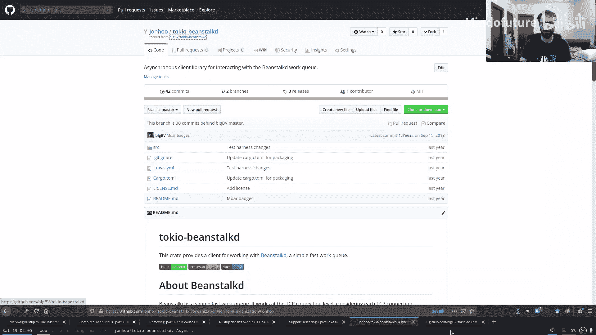

so we're going to do the same process of。Others。Go to clone this。嗯。Apparently。I already had that。

Let's just blow that away， Cause I don't know how old that thing is。哎。

I'm going to re anor to upstream， like before。

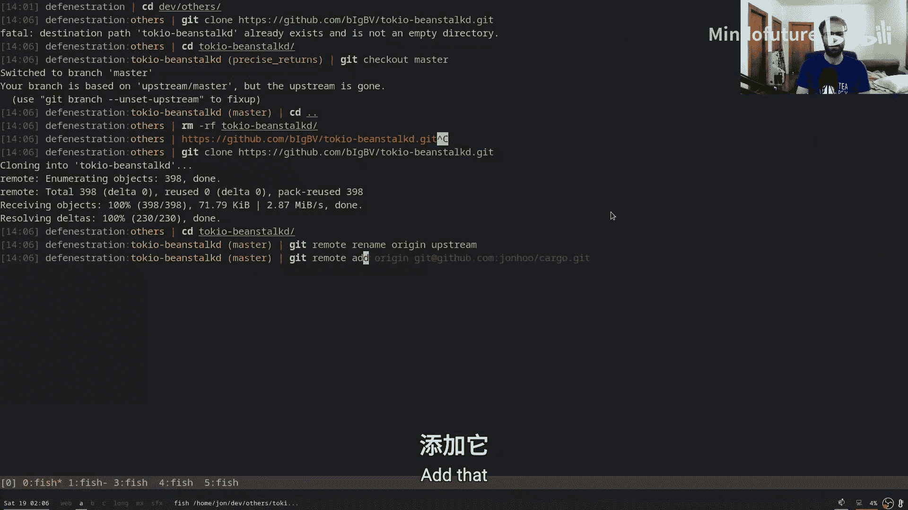

You can add that。嗯。

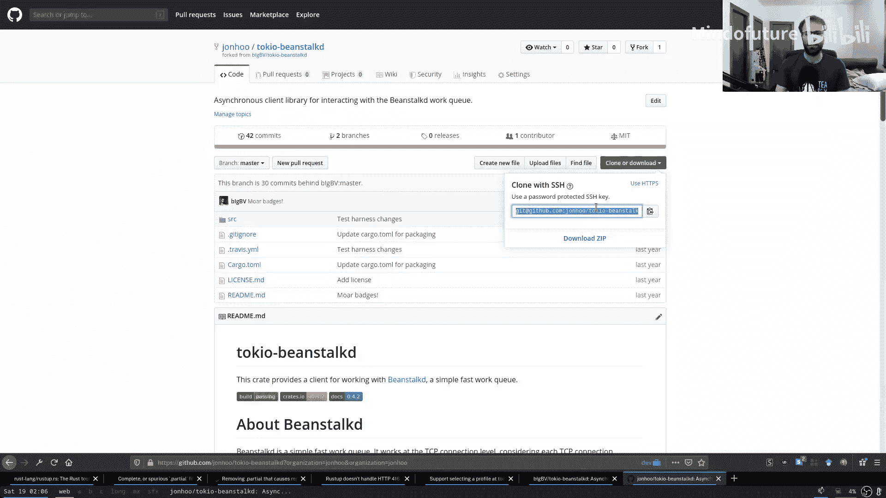

Great。All right， so the question now becomes。Where do you start， just like with always。

And we're going to start by looking at cargo Tel。 So generally。

 whenever you want to do bigger changes like this in rust。

 doing it in sort of a compiler assisted fashion is really handy。That's what we're gonna do here。

Is that we're gonna just start changing the types to the new types and then see what breaks。

 So this is going to become 0，5， alpha 1。嗯。We're going to use Tokyo 0，2 Als。6ix。Future 0，3， Alpha 19。

Think those of the most recent versions。And then let's just run cargo update and see what happens。

 We're gonna have to rust up。Override set beta。Am I like， Oh， yeah。 this， There's no。

 there's not a futures cr yet。 This is gonna be futures core preview。So futures， the futures crate。

 there is a futures preview that has all the stuff。 We won't actually need all of futures preview。

 So instead， we're going to bring in core and uil are probably the ones we're going to need。

 So core has traits like stream。 U is has a little bit of things like。Channel selection。

 all of the extension traits for future and for stream。

 So core is just like just if you want to implement the stream trait。

 you would use that whereas U has all of the like map， O map error。

 and then like all of that stuff is in U。嗯。哎。Let's do a cargo check。

Thiss probably is obviously going to fail in a bunch of ways because none of the types are the same。

 but at least it'll kick off the build process。What's today's stream about Today's stream is an open source contribution stream where we're going take on a bunch of open source projects and try to make contributions to them。

 We previously did one on。 we did a contribution to cargo。 Now we're doing。😊。

Taking a crate that uses future 0。1 and moving it to standard future。

 And then next we do we'll try to fix an issue in rust up。Can't find crate for futures。

 That seems like it's obviously true。 Actually， does this still use。

This is not on the latest edition。So。I'm going go back a little。

And then I'm going to run cargo fix edition。So cargo fix edition is you。

 I just wantan to move the crate to the 2018 edition because it's nicer。

And we're going make a standard future branch。And this now did some rewrites。 Now。

 we can say addition is 2018 in here。And。That should， in theory， work。

 variantren is never constructed。 That seems fine。嗯。What else do I want。I also want。呃。There's a。

Worn Ru 2018 idioms。I forget what this lint is called。Rus。2018 idioms。Great， so this。

 this li is used for like things that you should be doing in the 2018 edition that you couldn't in the in the 2015 edition。

嗯。So， let's just fix these。So this。This。The failure one is handy because it uses macro use。呃。56。

This is another change that happened in the 2018 edition where if you have types that have a lifetime parameter。

 it's optional to write out that lifetime parameter， but in 2018 edition。

 you're supposed to do it to indicate that this type has a lifetime parameter， it's not static。

 and you can do tick underscored to say， I don't care what this lifetime is。嗯。

And then let's see where else Proto request。87。Same thing here。

The external crates we already dealt with。And the variant never used。Cargo format。

I think I'm also going do a。Rusest format my do Tommel and say addition equals 2018。All right。

Move to 2018 edition。We install。Can you do the cargo Tommal thingingy where you install a Cates future score preview。

 but you call it future score in your Rs files。 So dash preview。The， the。

 all the futures preview crates are their names are without the preview suffix。 automatically。

 you don't need to do anything。I don't think fixed edition did work because you didn't change it in the cargo Tommel。

 did it。 cargo fixed edition。 You need to run without changing your cargo Tommel first。

So your cargo Tmo should not say edition 2018， and then in fact it will tell you this if you try to change cargotmal and then you're in cargo fixed edition。

 it will say， nope， you've already changed your edition。

Which rust edition version do you prefer to work with futures？You basically need the 2 edition。There。

 there is no 2019 edition， but the 2018 edition is where you get asynchate and these types of things。

嗯。All right， so now we can go back to this。嗯。And run cargo check。

And it's going to complain about a lot of things。And so we're just going to start at source Li。

And look at where it complains。 So first， it complains about Tokyo Prelude。

 which makes sense because the Tokyo prelude， you basically don't need anymore more。

Maybe missing a Creek Tokyo。No。Why is it saying。喂 what。It's lying to me。奥瑞。In addition，2018。Great。

Let's try that， instead。Great， a bunch of errors。Bon ofs Lib。Al right，1，39。

 it says Susanan type item not found for future。 That is right， so。🤧嗯。

There are two things we can do here。 The most straightforward one is that future no longer has two associated types。

 So we can just say output results。This， that's sort of the most straightforward change。 In reality。

 we don't really want to do any of this like imp future business any more。

 Ca we have async functions。 So we can just make this an async function。That just returns the result。

Nothing more to it。And now we can do something like。Let connection is this a await。

And then we're going to return。 O， set up C。All see how much easier that was。

My guess is there are more of these。 Oh， these do comments will not work correctly。 This should say。

This has to be like this。 This has to be like this。And this has to be like。

And there need to be no line。 Otherwise， they won't actually work correctly。

The additions are a rust format， it isn't necessary if you run cargo format。

 but if you run rust format， which Rudot vim will do sometimes。

 then it doesn't pick up from cargo Tommel。 It is a little unfortunate。We can do the same thing here。

 Right， So you see here， put returns this， In fact， here there are two things we can change。 First。

 we're gonna have to change this to be output。 but also notice that this as a pretty common pattern that you see in。

0。1 libraries， which is they consume self， and then they return self。

And the reason being that they need to like mutate self in some way。 But with the old futs。

 this wasn't really easy to do here， though， we can just say， make this an async function。

 say that it takes mute self。And that， it just returns。I guess， this。It's a little weird。

 but that's what it says。ISo I've never actually used this library。 so I don't know what it does。

 This is this is， in some sense， a blind port。 What's important to note here is that when we put the async keyword before function。

 what that means is the return type is a future that produces this function's return type right and crucially that future will be associated with the lifetime of this borrow。

So us taking mute self here is fine。 It just means that the future you get back is tied to the lifetime of that borough of self。

 and we'll see how that impacts things later。Now， here， you see the insides of this。 Of course， we。

 this is now an async block。 And so we can use a weight。 If we didn't want to use a weight here。

 notice that this uses and then you can still use and then。 So let me pull up。Futures， U preview。

So let's look at the future trait。If you look at future。The new future trait。

 the one that's in the standard library， it just has an output， right。

 There's no item and error anymore more。 And when you poll， it just gives you that。 Of course。

 the change is that you might still have futures to produce results。Right。

 that basically future is like an error。 And there are some convenience methods for dealing with that。

 And they call this trifu。 and they have the same for tri stream。 So tryfuture。

Is a trait that is implemented for anything that's a future where the future's output is a result。

 And so tri future is basically like， if you were previously depending on a future that could error。

 you can just change to use tryfu instead。And then you'll notice that the under。Under future。

 there's future X。 So this is the extension trait for future。

 which has all the normal combbininators youre used to， right？

 But you'll see that this doesn't have an end then。It has a then， right， Because if。

 if you have a future in results and then you want to do something you call then。

 but it doesn't have an end then because it has no notion of succeeding and then doing something else。

 Similarly， the map function here is a map， regardless of whether the underlying thing succeeded or failed。

If you have a future that can succeed or fail， you would have a try future。

 So you would look at try futureture X， and that has map O K， map error， and then or else。

 like all the things you're used to from the old futures that could have errors。And so we。

 we would be able to use this if we just imported that trait。

 but look at how much nicer it is if we don't do that， and we say。That con is this wait。And then。

 just that。Right， we no longer have to do this， this callback business because we can write it in a straight asychite form。

 And this is where this is， of course， where asychate shines。 And we can do this for all of these。

Right， so this is going to take a mute self。It's going return a。Don't know why result is used here。

 It seems weird fur to still use the result type。嗯。Cn is this thought weight。嗯。

And then we do the same thing。Same thing here。See this is what I mean by this being a relatively mechanical change。

Is that。You don't really need to think while making these changes。

 even though I just said while saying that and there。Because generally， this just。

It's just transforming code。 I'm pretty sure you could write a tool that just did this。

 at least for most of the common cases。The result for item use was used there because there are method specific。

Method specific errors and protocol specific errors， which I wanted to surface。Okay。

 so what threw me off then。Was I see。 I see。 Is that here， for example， this just says consumer。

Whereas I guess this is like consumer errors or something。um。Doesn't matter too much。

What I want my goal is for， for basically all the PRs we do today is to make the minimal change。

 And this， this should often be what you want to do in PRs。 less you can change at a time。

 the easier it is to review the PR。 If I did a major rewrite of this crate。

 like beyond just the mechanical changes， it would be much harder to review that PR， instead。

 what's usually a good idea， is make self contained changes for your PRs。

 So this PR will only be about moving to As and Kuwait。 And then we can do a later PR。

 which cleans up in these types， should we need it right， but that shouldn't be something that。

That we bundle up with the main change we're making。呃。

It's kind of easy to do these changes on code that use simple future often。

 But how about crates that have own future types。 So for crates that have their own future types。

 often you could do the exact same transformation。 The manual implementation of the future。

 you just turn into an async block。 It's the same thing。 And if they don't， that's fine， too， right？

 you could imagine that this returned like。Instead of this， it returned like a my super future。

 because why not？ And then in here， this used to create a my super future and return that。 Well。

 if you're in an async block， you can still create that and you just do dotta weight。So， and。

 and then。Turned this back into this。 So the， the same transformation still applies。呃。

I don't think they wanted either。 I think they， I think result。

 result is really what was intended here。呃。So we have one of the the author of the library is in chat and is is pointing out that this was written when they were pretty new to rust。

 and like that's fine。 We， we were all there。 I also don't think this code is bad。

 It's just like it was just an odd pattern to see result result。

 But I think the explanation makes sense for why， why that's what you wanted。嗯。然后。This。

 this library is probably more regular than what you would normally expect to see。

 right you see all the methods here are basically all the same， like the transformation is the same。

 We'll see whether that's the case when we get to like deeper parts of the library。 I don't know。

This should now be results。That should be。Con， is that wait。嗯。This， oh， I forgot a change。

 This should say， mute self。Did I miss out anywhere else。 Yeah， this should say。Mute of。嗯嗯嗯嗯嗯。Great。

Mute of。Arguably， I should just make。At this point， I should just do like a vim macro for this， but。

Right， I wonder。 let me try to see if I can do a vim macro for this。

 So for those of you un'familiar with Vim macros in Vim， you can record a sequence of key presses。

 and then you can replay that recording。 So let's see。QA。Word forward。Insert aync。Escape。嗯。

Present to go to the end of the block。Forward to the eye。Chaangnge to the result。Escape。呃。

Right to go to the result。 Pre to go to the end of the result。 right to go there。

Delete to the equal sign。And replace the equal side with a comma。Oh crap， I forgotten itself。

 You're right。Back。Oh what is it， it's， it's。Shift F for backward to character。End parentheses。

Percent。A pen to line， mute， and then Ru format will take care of that for me。Percent to get。

Back there twice， O。So that transforms the header。嗯。And then we want。

 if they're all as regular as this and we want one line down0 to the start of line， let con equals。呃。

Percent to go to the end of the send。A penal line， a weight question mark semicolon。Escape。呃。

Line down， delete， insert above。Escape。Percent line down， double delete。哎。

Now let's see whether it worked。That seems pretty promising。It just didn't delete this line。

But apart from that， I did what I wanted。I think。Oh， but this is， this function is different。嗯。Oh。

 yeah。 You definitely spend more time constructing the macro。 But also， of course。

 now we're like almost at the end of the files。 It's unclear that it's worth it。呃。And， of course。

 this function looks different， so。嗯。On is this。All right， let's try this one。Yeahea。

 didn't have to do any work。What about this one。Not quite。For some reason， they didn't like this one。

I really didn't like this one。Al right， let's try recording it again。 just for fun， QB。All right。

 async end of line。Mute。呃。Percent per。Forward to the eye。Chaanged to the R in the results。Escape。

Percent to the end of result。Delete to the equal sign。 replace it with a comma。Line down 0。Let。

C equals escape。Present to the end of send。Append await。Line down， delete。

Insert line above just because we want it to be pretty。Line down， present to end。 line down， delete。

End of Q。No， then now， of course， there are no more methods。 Da it。Oh， well， we tried。No。

 Sebastian werere， youre we're roughly halfway through。Alex， no， I'm not using a plugin for percent。

 That's just what percentcent does。 It does。 It goes to matching brackets。I kinda wanna。

 I kind of wanna undo now and like， retry my macro。嗯。Okay， let's see how that worked。嗯。Well。

No method named into future line 1，1，4。 So handle responses is a macro that's called in a bunch of these。

 And we don't need this to be into future any more。Why was it even into future in the first place。Oh。

好。Okay， so this is kind of interesting。 We may have missed Red what handlele response does。So。Oh， no。

 it， it handles an O as long as the connection from send comes back O。

 then handle response is going to act on it。 And con here。I see。Okay。

 so this is going to turn into an async block。Actually， it doesn't even need to be anything block。

 What am I talking about。Why is it an into future？ So that means that con is a result。呃。

I don't think it needs to be into future any more。I think this can just do much on input。

And if it's O。And in fact， there might be an opportunity for us to improve this quite a lot。So， this。

Send business。Previously used to consume the connection in some way， I guess。Whereas now。

 I think this。ItCertain doesn't need to produce any these any more。Right。

Think it just needs to produce whatever this is。And the error no longer needs to be this。

The con is no longer going to be included。So， this。It's really just going to be that。

Not sure why error turns into O。O， because it's an internal error， okay。嗯。All right。

So let's see what that does。Oh，21。 I did something silly， didn't I。This no longer needs that。

This match is expression type。Nothing。That seems false。What is the type of corn， really。

Where's my assignment to con。Frame。Connection dot or。5。Oops。That looked like a problem。

This definitely should not say what it does。Ignore， I think we。

 I think we accident accidentally got too excited about our macrosca ignore no longer sends anything。

😊，Where to ignore。Ignore。Should should send one of these， really。呃。

I guess let's look up the docks for。Tokyo。Tokyo， Koak， and we have a framed。

And what do we have on framed。😔，嗯。

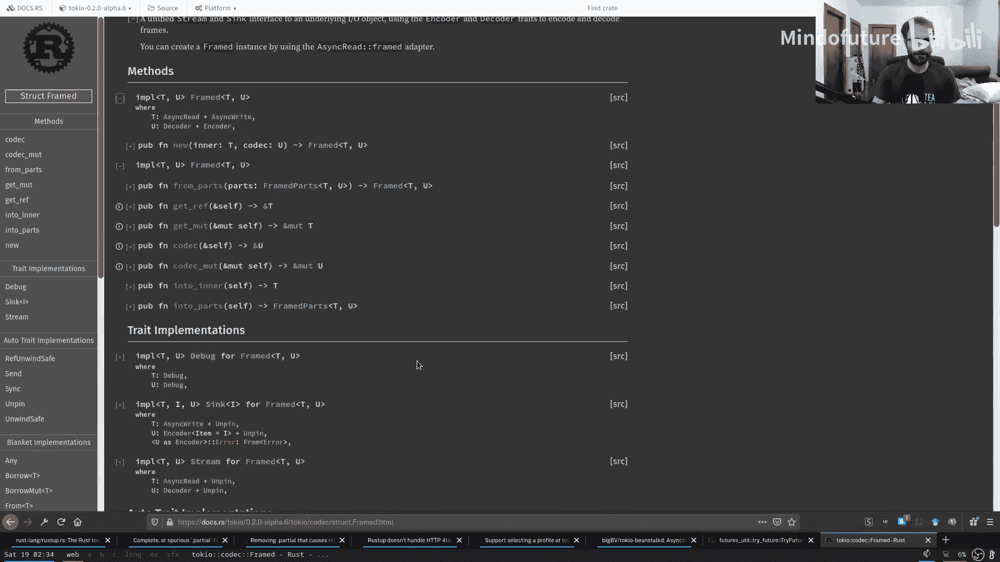

It implements sink and stream。啊哈。Okay。So what this means is we really need。I can cargo Tommil here。

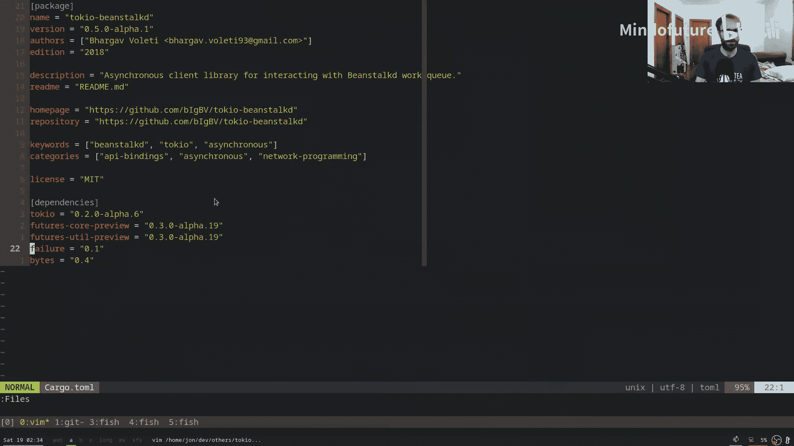

So in we need to use it as a sink。 So we want to use sync X and sync X， I think has it just send。

 Yeah， great。So this is the thing that we're calling over in over here， right。

 Self connection is a framed。 We call send on it。 And that is this business。

 And what does send give us back。 It gives us back a future， I assume。

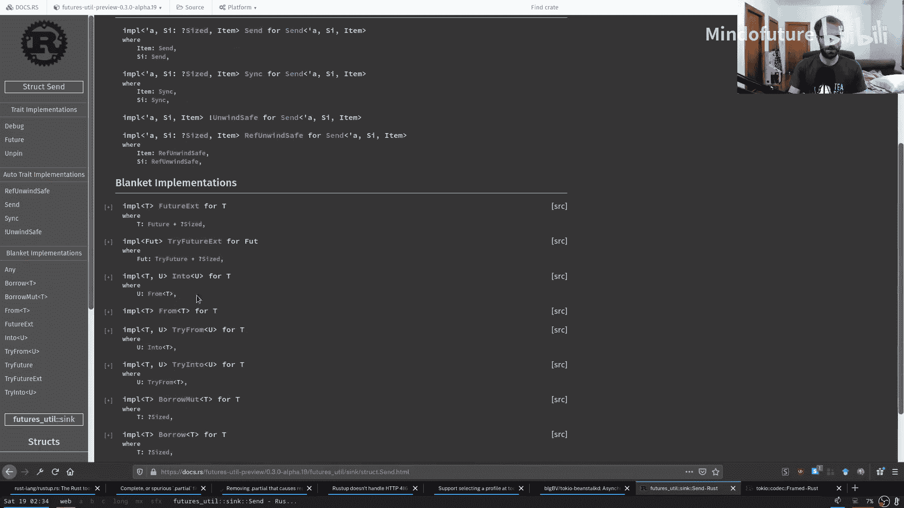

Yeah， just the future， right。呃。嗯嗯。So why is it nothing。I see what's going on。呃。I see what's going on。

So。Okay， to explain self do connection is a framed in Tokyo world。 and a framed is a。

 it's basically something that's both a sink and a stream that's implemented on top of async read and async right。

 And what we're doing here is we're using it as a sync to send a request to the server。

 And then we're using it as a stream to read a response back。

 And so handle response should really wait for the thing to come back。 And that is no longer con。

Right， we don't care about this value anymore。呃。This con is no longer important。

Because the return value。 So send gives you back to a future that either errors because you couldn't send or it succeeds with no value。

 So there's no， like con isn't a thing any more。嗯。And so anywhere where it says。Handle response， con。

 What we really wanted to say is handle response， oops。His handle responds。Self connection。

And then the macro， that we have。This is going to be Exp dot， next。Dot await。Please， in theory。

This should say， con。嗯。This match expression。 Yeah。

 so what we're saying here is we're going to send a request。 and then we're going to call next。

 which is the stream method for getting the next thing as as a stream。

 which is going to be the response from the server。

 And then we're going to await that Now in standard future。Now。

 streams return options of the output rather than like a result of option。

 So that's why you're seeing here that we're trying to match on the result of this as a result。

 But in reality， this is now an option that contains a result。 rather than the other way around。

And so this means that， oops， this clause。NoThere's no longer an okay。Alternatively， you get some。

Okay， Val。In which case。It's this。Or you get some air E， in which case is this。 Now， this being an O。

 I think is because。The error is， if we fail to send something。Yeah。

 the outer error is if we fail to send something to the server。

 which is is like a problem with a connection。 The error here is we got something back。

 but it's an error。But it still seems a little weird， but I think that's the semantics we owned。Oh。

 wait， that compiles。All right。Although， that it was easy。We haven't imported the test yet。

I'm surprised there aren't other。I guess these are just like， display and stuff。Alright。

 so let's tryy cargo test。Of course， I don't actually have beans stock day， do I。呃。Okay。

 so this is going to be。嗯。Fort library parts。Bean stock D。I guess I want to install it。

I see it's fine。Yeah， so David， it doesn't actually always return okay。嗯。

Because this question mark can cause it to return an error。Handle response will always return an O。

But this question mark means that we can return an error in the sense of the outer error。

 I still think that these should probably be collapsed and just have the the error be hierarchical。

 but I don't really want to make that change as a part of this PR。S start in stock the。Great。

 so now we need to port the tests。 And luckily， this is probably going to be a lot easier。Ou。

All right， well。I guess。Stop insulting。If it's gonna start it on its own， so here。

What we really want to be able to do is just use asnc Ki as well。 And it turns out that we can。

 when you use Tokyo， you can use Tokyo tests。You can make this an asynccaen。 And then you're rolling。

 Now， Tokyo will already create the runtime for you。 You don't actually need to worry about it。

Previously， we have to create these for every test that we run。 No longer necessary。

 this annotation will do that for you。 Now， because we're in an async caen。

 we don't need to do things like block on， we can just do a wait。 Unwrap。Down here， we can say。

Unrappped。This is just going wait。This。It is also just in a weight that we're going to unwrap on。

We don't need to keep reassigning bean because this now just takes mute self。嗯。Here。

 we're going to do。Response is this。Dot a weight。呃 on the。

And then we're going to assert equal response tests。All of these blocks go away。

 We don't need to check that it's not an error at the end because we're doing that as we go。

 We no longer deal need to deal with the runtime。Now， let's。

I would anticipate an okay handle connection。But yeah， that's bigger change。 I mean。

 I would be okay in putting the O around。 But I think the current structure to not put O around handle response。

If handle response changes so that it might produce an error instead。

 it's easier to keep it the way it is。呃。This is Vm。 I don't use Adam。

 I don't like to have browsers running where they don't need to be。Okay。

 so this change is basically the same thing。 We're just going await unwrap。

And all of this is going be similar kind of things。 So this is going to be response。

Doesn't actually use the response here。 So I think this is just in await。Unrappped。

That's all that inspect really does。This does been dot reserve。And here。

 we do actually want the response。And we want to assert。That the response data is that。Apparently。

 and then we want to。皮鼻音。At this thing。And we want。We want to assert。That response。

 we want to assert response， I think。Things that， that's what that's saying。呃。2。Spons as。Oh， no。

 that is an unwrapped。This is a weird way to write an unwrap。This， the oops。

This ones response dot I D。 We don't need the unwrapped because we already unwrapped up here。嗯。

This doesn't care about the response。This doesn't care about the response。呃。This。

Doesn't care about the response。Just wants to unwrap it。This。Seems to care about the response。

Be released。So you see how this code is now basically becoming almost the way that you would write it。

If you were writing it just imperatively， like， you can't really tell that there's asynchure apart from the awaits。

 because all of these like weird closures and inspects and amhens just go away。And also。

 it's nice that now there's no longer this tuple that's returned by every method instead。

 you can just call the method directly。This goes away。AndThe response here。5。

This is supposed to be an error， I think。喂。This is supposed to be。Oh， this is where the nested。

 nested Oques come into play。So really， my guess is most of these unwraps need to be double unwraps。

It's a little awkward。嗯。So this becomes that I see。

 So that's why there are all these unwraps in here。That's why this is an unwrap。Dot I D。So， really。

 this is just。This is a double unwrap。 This is a double unwrap。All of these， in fact。

 are probably double on wraps。I don't really want to add all of them。 We can add them later。嗯。位张ra。

See what I mean by this is mostly mechanical change。Right。This can go away。And this can go away。

And then the rest of that can go away。H，5，61。Yeah， exactly。

 So here we're starting to see like all of these are double results。581， this is a double result。

Fact， how about we just do。呃。Dot await unwrap with dot await unwrap unwrap。

The exception to that is this， which should be。Air。And this should check that E is equal to it。

This also doesn't need to do that。And this doesn't mean to be that。And they don't need to do up。

And the bean needs to be mutable。WithHere and up here。See what that does。

Cinema made a tool to automate the transformation for commmodd adjacent weight。

 I haven't seen any tool。 I feel like it should be possible to write。

But I haven't seen anyone who does it。Sufficient enough is the wrong wording more powerful to the right way of saying it。

Sufficient enough。Oh， above them。Oh， I see。 I missed some chat。Can you overload stack names？

 I don't know what you mean by overload stack names， But， yes。

 you can declare a variable with the same name as a previous variable and chat it。嗯。

This is a published cr。How does rust compared to golng in terms of performance orriability。

 Its a much larger discussion that it doesn't really fit here。 I would say they're。

 they're both good for different things。Can you elaborate on browsers running where they don't need to be。

 I want my browser to be。 I want a single browser。 I want to control which one it is。

 and I want to control all the updates to it。 I don't want a program that runs an outdated browser in the background。

 Like this is why I don't use electron apps， for example。

 I would rather just tab them be another tab in my browser and use a pin tab or something。

I am totally happy with them the way it is。 I don't want it to have any richer features。

 I don't need the richer format。😊，嗯。What's the reason you switched to cock dot Vim。

 It was actually because I wanted better integration with rust analyzer。

 which is a little awkward to get with NCM。 It's also weird because I was using NCM and Ale for two different things。

 and Cous provides both of them。嗯。All right。 Why did this not pass， This did not pass because。

Connection refused address already in use。Really。Is that so。does look。An awful lot like that。What。😮。

突然了。我后。All right。Its still there， no。O。It works， succeeded。And then， consumer commence failed。

Can I have it just。Not spawn for me， please。Spawn is just going to be true。呃。

And then I'm just going to use that。How about now。Apparently not。Failed for some other reason。

 Unwrap on not found。Where。Here。Source Lib line，600。Oh。Not bound。

Did I miss something in the port probably。The， that test。Which part of the test is this。

 This is after more data。Where is more data。More data。This。

Seems like it's expecting an okay response。Interesting。If I run just。The consumer tests。Yeah。

 that's what I was afraid of。Okay， so they work in isolation。 They don't work if you're on。

They do work， if you're on both。Okay， well， I'm just going ignore that for a second。Alright。

 let's not include that， but let's include all the changes there。 and then。Actually。

 do I want to include all those changes？Yes。呃。For tests to standard future。

Just going leave that in there。 And now you'll notice。

The next things that have failed were the the do tests。

 and the do tests basically need to go through the same processes we've done before。 We want。

 don't need any of the excellent crate anymore。 We don't need Tokyo prelude。 We can do that。

 That's fine。 Then this now becomes Tokyo Maine。Don't need to do this anymore。

And we can have this be visible just so users don't get confused。W wait， I'm wrap。And then I want。

 this is gonna have to be mute。In fact， let's see， how did this， How did I break this down。

 I kind of want the same breakdown in the docks。 It just makes it。A little bit nicer to see。

Wait and wrap。It's really sad that this double unrap has to be there。Use a particular tube。哎。

You say so。And。This。Wai。So that actually shortened the example by a decent amount。

 and especially given that we expanded out this part， right。嗯。

Arguably this shouldn't even be necessary。 This parse could probably be gotten rid of。 But again。

 in the interest of making fewer changes to the library at hand。

 we're going to not do anything about it。呃。 so。This is now the standard setup。And then。

This is going to be something like let spawns is。Bean reserve awaits。Onrap。Unwrap。

Do something with the response。I'm going to take an artisticutistic liberty here and do this。嗯。

And then being dot delete response。I wait。I guess this should also be double un。嗯。Like so。

Let's see if it's happy about that。Great。😊，Poor doctor test to standard future。

Do you see all of this like very， very straightforward mechanical changes across the board。嗯。

What is bean， Bean So D is like， I want to say it's， it's like a job server。

 So The idea is that you can submit jobs to it or request jobs from it。

 It's sort of like sidekick or factory。Why do you want to rewrite async S H with FFI just to show F I is there a problem with thrush。

 So when I first wrote async S S H， Thrrush was very。

A very immature project as we had to hack around it a lot。Maybe it's better now。

 Like maybe it's fine。 It doesn't have to be with F of I。 I just haven't looked at it since。

 I also one reason to do it with F of I is to show off F of I。

 But it's not particularly important to me if， if thrus is now good enough that we could build something reasonable on top of it。

嗯。Well， we have to write this many unraps when they think way hit stable。 Oh， so the。

 the unwraps are there because of choices we made in the library。 The unwraps are not like。

Asyco weight does not require any unwrapps。 The unwraps are just there because this library has a double result type。

 And so we need to unwrap the outer result and unwrap the inner result。

 but it's not related to asyco weight。I always unwrap my own wrap before I not before I unwrap。

 My favorite is when I get a little bit tired， I start writing unwp instead of unwrap。

 and it sounds way cooler。😊，go of a rap。 R sounds tasty。

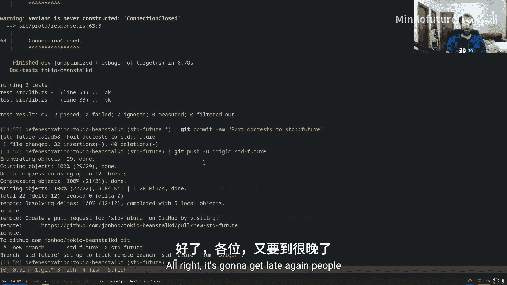

Alright， it's gonna get light again， people。Boom。Poll request。That's not very helpful。

P to standard future。This PR。Updates。Create to。Standard future。 and the。Alpha based ecosystem。

Around it。Tokyo， Alpha dot 6。And futures preview。Al of about 19。Mostly， mechanical changes。

Except that。All methods now take。Mute self instead of self。 and thus also do not return。

Self anymore more。

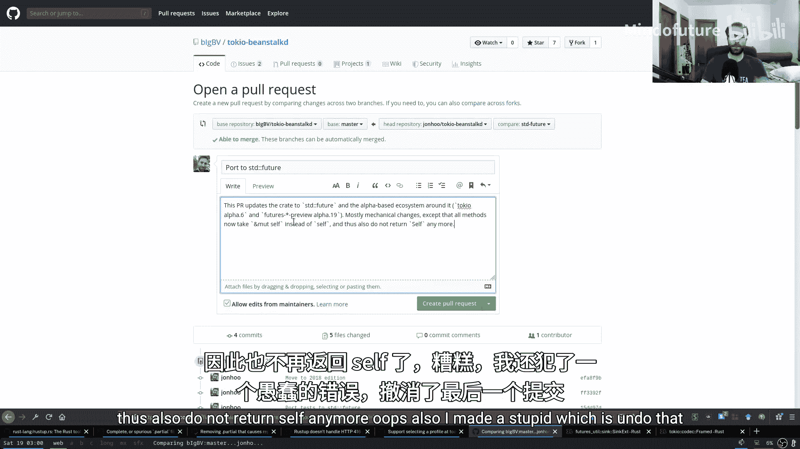

呃。Oops， also， I made a stupid。Which is。Undo that last commit。呃。For two reasons。

One is this extra spacing。But I don't want to check in that change to the bullolean。

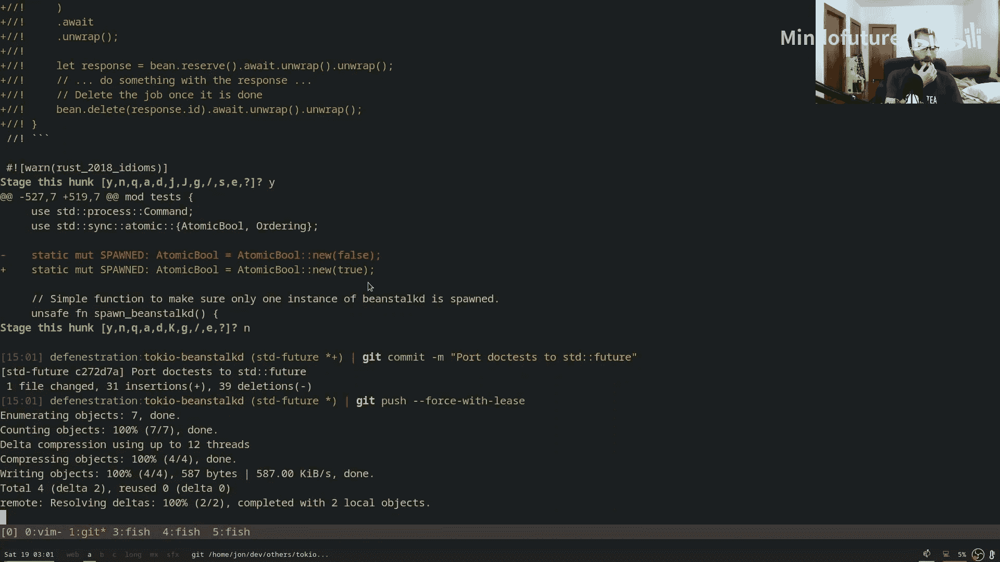

Yeah， I did。 I said it was going to get light again。

 Mostly mechanical changes except that all methods now take mute self instead of self。

 And thus also do not return self any more。 The double result。Wraping is now， particularly apparent。

 and should。Probably。Be changed， but that's。For another PR。呃。

This patch also updates the crate to the 2018 edition。Great。嗯。

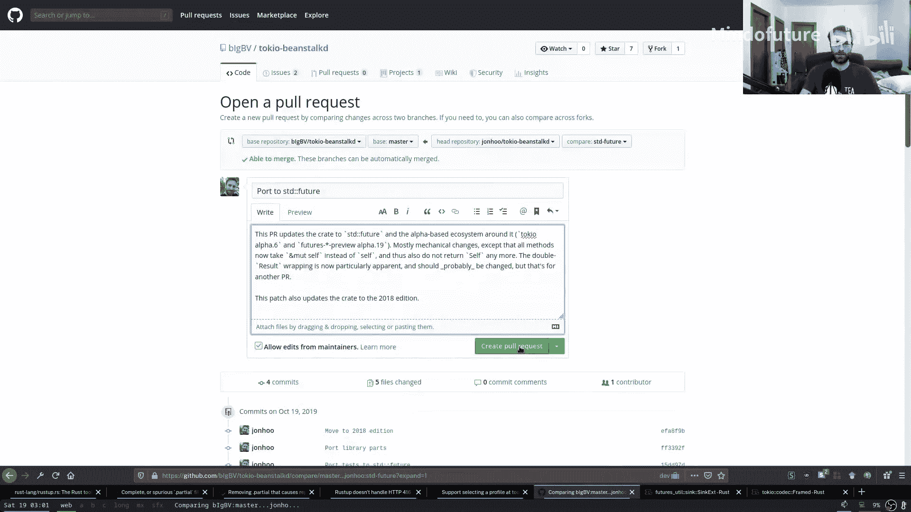

Al right。 good job， team。 We now have。2 PRs on our belt。

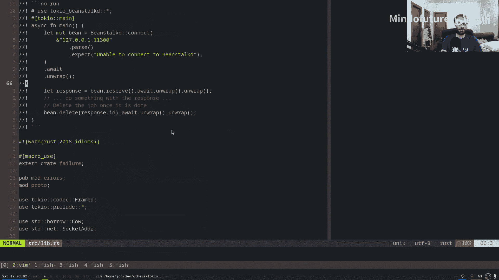

Pretty good for a day's work。 So let's make it 3。Yeah， there are dark github styles， but I dont know。

 maybe one day。 I don't。 I actually prefer the light style even for Docs R R S， but for the stream。

 I don't。Because people get sad when they're in， because it's the middle of the day here。

 But if you're in a place where you're in in a dark place or in the middle of the night。

 then the light screen is pretty annoying。All right。Time for the。

The third and last contribution of the day。Okay， so for those of you who have joined only sort of midway through。

 what we're doing is an open source contribution stream。

 The idea is that we find rust projects that we think we can submit a PR2。

 And then we submit PRs to them。 We first did tackle an issue in cargo。

 Now we've done a port of a crate from future 0。1 to standard future。

 And the last thing is going to be contributing to the。To another part of the rust tool chain。

 which is the rust up tool， the thing that you usually use to install and manage your rust installation here we have。

Here we have two different choices of where we're going to go next。 The first one is this issue。

Can you go back to the first PR， There was an error during the build，oo。

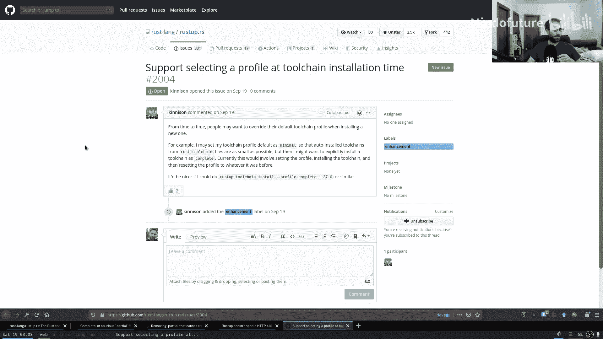

呃。

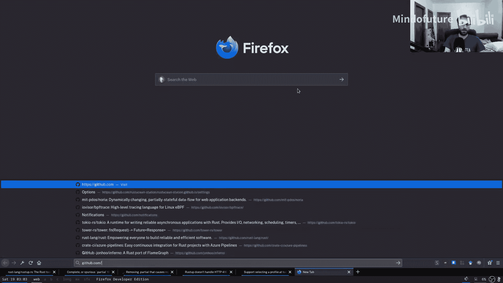

Cargo。An error during the build， you say。Interesting。Sure， we can do that before we do the。

The rust up one。

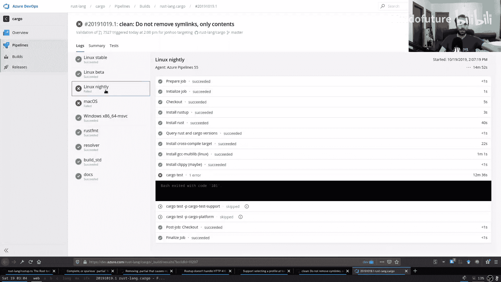

Really， it fits all nightly。Interesting。Why does it fell a nightly。呃。

These errors are unrelated to us。These are nightly issues， I think。Yeah。

 this is like cross compile stuff。I don't think this is us。Min。😔，Could be， of course。

 but it doesn't seem like these errors are our faults。Failures。Depen that one is us， though。On Macs。

No such file or no。This。one。Could not remove Bill directory No such file or directory。Interesting。

Although。There seem to be other errors along this line。

 like different Dr also fails with no such fileler directory。Yeah。

 this also fails with no such file directory。So I'm tempted to say this is unrelated to us。No。

 maybe not。 This also runs clean。No such file or directory。😔。

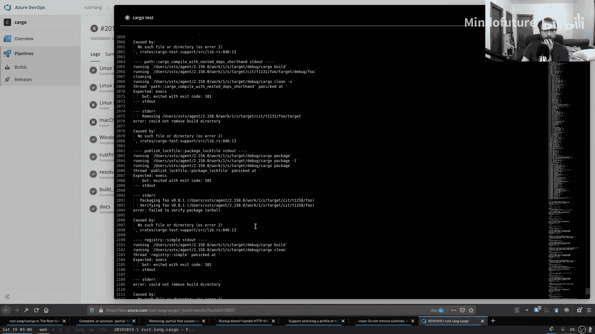

We did push it with the。うう。Yeah， we ignored that error。好。

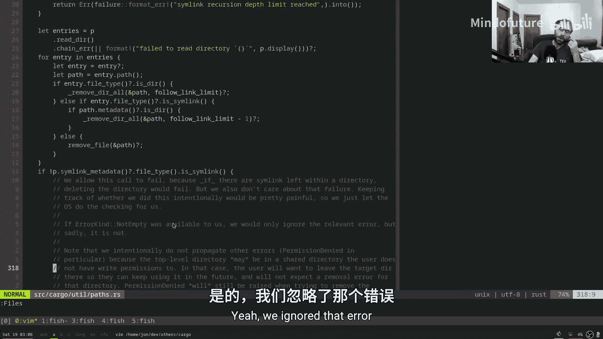

It's hard for me to reproduce， given that it only happens on Mac O OS。

 like Windows passes and Linux passes。嗯。If someone with a Mac wants to try to run the test suite and like dig into it。

 then that would be very much appreciated。 It seems to work elsewhere。

 So I'm not entirely sure what's going on there。 I'm going leave that for a bit。嗯。

The9y airs seem unrelated to this。B compilation。they also seem to。curring in other unrelated tests。

It's useful in PRs to at least follow up with a short。 like when you get errors like this。

 at least let them know that you've looked at the errors and what the status is。 In this case。

 if I had a Mac， it would be a lot easier to reproduce， but I may look at it later。

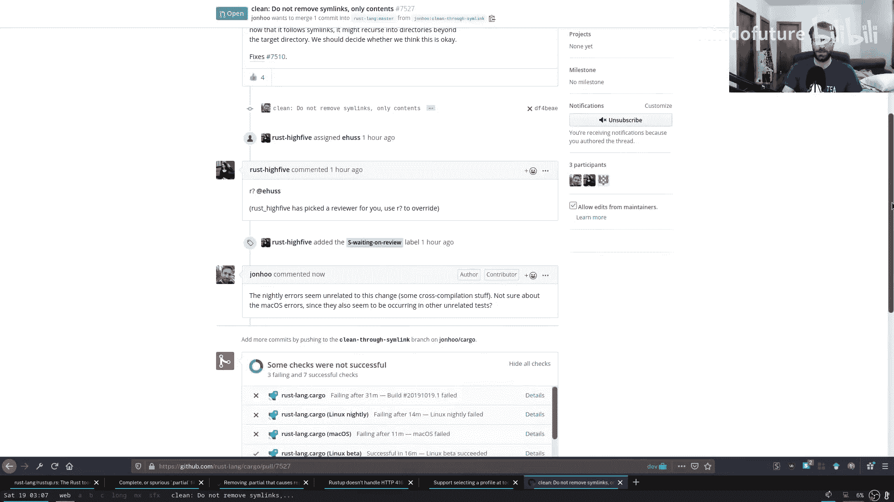

Al right， so with that aside dealt with。 So there are two issues that we could choose to tackle for Rust up。

 The first one is this one， which is Rus up recently got the ability or the support for something called profiles。

 And the idea for a profile is that。

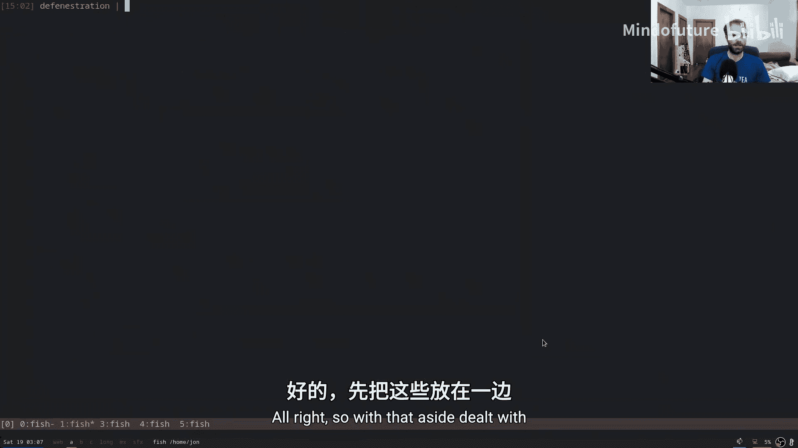

By what happens if you install a tool chain， or rather。

 which components get installed by default when you install a tool chain。

Previously you used to get a bunch of stuff which included things like all of the standard library documentation。

 which meant that like if you download a rust up and then tried to install stable or beta or nightly or whatever。

 it would download a lot of stuff because it had to download all the documentation。

And so recently in in 120， which was released just a few days ago。

 they landed support for this thing called Profils， which is if you set your profile to be minimal。

 for example， then Rust up will only install the parts of rust that you need to compile things rather than all the sort of nice to have business。

 which is very handy for C ice scripts as an example， however。

 you're only able to set your profile when you install rust up。Which is nice。

 But you also kind of want the ability to select which profile to use when you install a particular tool chain。

 like when I install nightly， I want to say， install it with or without the bells and whistles。😊，So。

 it might be useful to be able to set this on a global stage。

 but setting it for a particular install is， is attractive。 So this is a very straightforward issue。

 I don't know how hard it will be to fix。 It shouldn't be too bad。 but this one。Like。

 seems like a straightforward thing to deal with。 If we want to get into something that's a little bit more complicated。

 but also。Is only tangential to rust up。There's this issue， which is basically。

 if you interrupt rust up in the middle of a download， then there's a。Basically。

 when Ru has to download something from the web， it downloads it into the file with the partial suffix。

 and it just keeps app to that file as it downloads。 And then if you interrupt the download。

 it's going to try to resume from that file。 The problem is。

 if that partial file either is corrupted somehow， or actually completed。

 but it just didn't do the the move of the file， then。

Trying to continue the downll is going to fail in weird ways and basically you need to manually remove the file to make make any progress。

And there's an existing PR to try to fix this。 But that PR seems to have sort of stagnated a while back。

And there's also a follow up issue that's somewhat related and a little bit easier to reproduce。

 And so we could try to tackle this sort of group of problems。 It's， it's a bigger task to undertake。

 And it's also a little bit harder to test because it it sort of requires to interact with H TP servers。

嗯。What is this。嗯。Oh， this is the follow comment。I think my preference is to supporting this because it seems like such an obvious hole to fix。

 And it's a gentler introduction to rust up。 But if you particularly want to see us deal with like HP download issues。

 then we could do that， too。 So would you rather see。Imrovve profile support for installs。

 or would you rather see like HtTP debugging？1 vote for each so far。

It's interesting because there's a delay to both YouTube and to Twitch。 And so suddenly。

 there's like a stream of messages that comes in。Is it a P， Is it a P， Is it a P。Rust up， I mean。

 it's gonna be rust up regardless， both of these are rust up。

 But one is how Ru up deals with H TDP weirdness and one is。How it。Basically。

 fixing the profile support。That's interesting。 So it seems like。Oh。

 the test suite has a web server built in。 Great， that makes it easier。

 It seems like Twitch prefers profiles， and YouTube prefers HD P。嗯。Oh yeah， Okay， great。

 It doesn't have a Web server。 I think what we're going to do is we're gonna， seems to be about 50。

50。 So we're going to do the profile thing。And here's the reason why it's a little bit shorter。

 which gives us more time to talk through the changes we make and to test them properly。

 it's also something that is more important in terms of features of Ru up needs like this is more needed than for people who interrupt downloads it also means that the HtP download issue you can go fix。

Right， like after we go through this， like， try to fix that problem。

 And now there'll be a bunch of people who can pick up that PR， for example， and try to run with it。

So let's do that。 Okay， so I'm going to close down these。

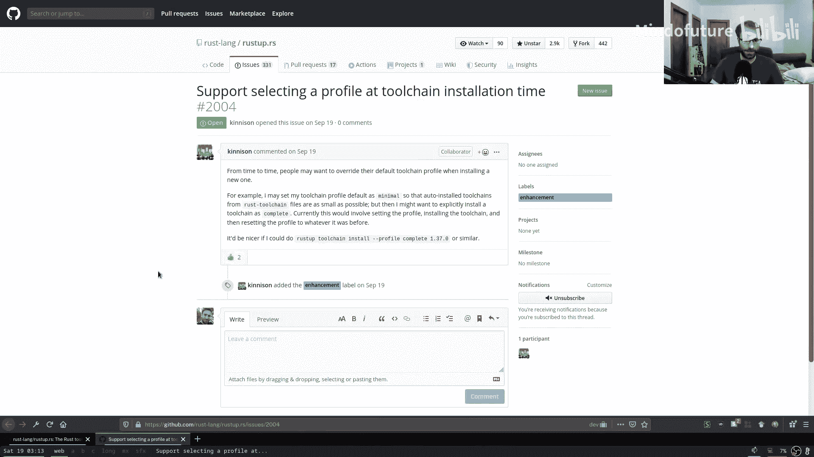

And then， we're going to go。Here to。And here I've cheated a little。 I have a check out already。

The other thing that's a little bit nice about that I actually really like about the rust up code base is that I can build it。

In fact， I've already built it。 And then I can do this。This business。So if I run this funky command。

 then this lets me run rust the run the compiled version of rust up on my system as if it was the real one。

 And this is handy。 So， for example， if I do this install， I guess， nightly 20。1901，01。Great。

 so this is now running the rust up that I have compiled on my system rather than the system wide rust up。

And you'll see that this is now downloading things like rust stocks。Ironically。

 I'm now going to drop my download。And really， what I want the ability to say here is profile minimal。

Profile， minimal。But that doesn't work。 I can change， forget where this is。 Is it here somewhere。嗯。

Is this where I can set like profile equals minimal。No，Pro not。 But generally。

 it's when you install rust up。 So when you do like the whole like curl business to。

 which has its own problems。 But it's when you install rust up that you're able to pass this profile business。

 And I think it creates a file somewhere。 I forget where。This， I think this was in the。

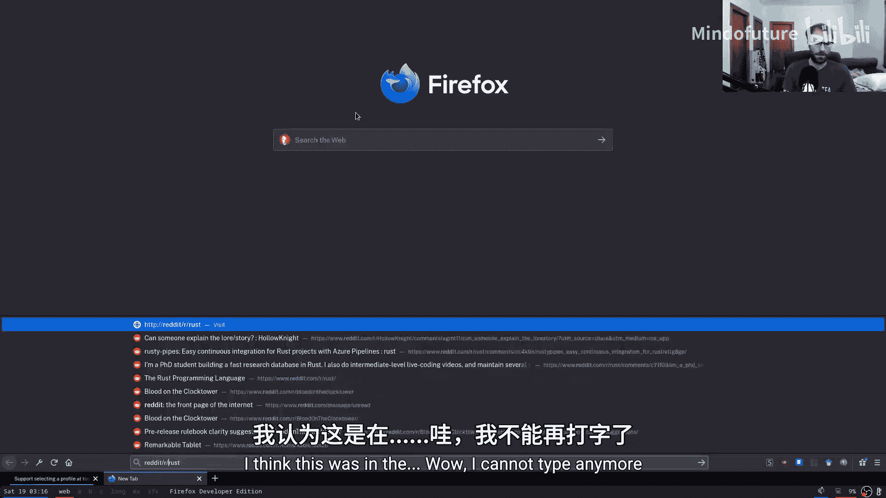

Wow， I cannot type any more。嗯嗯嗯嗯嗯嗯。Just up 1，20。嗯嗯嗯嗯嗯。See if I can dig up this。

Could also just read the source code， but that seems too hard。嗯。Having a piece of state somewhere。

 where is the piece of state。 That's what I want to know， profiles。嗯。嗯。啊。

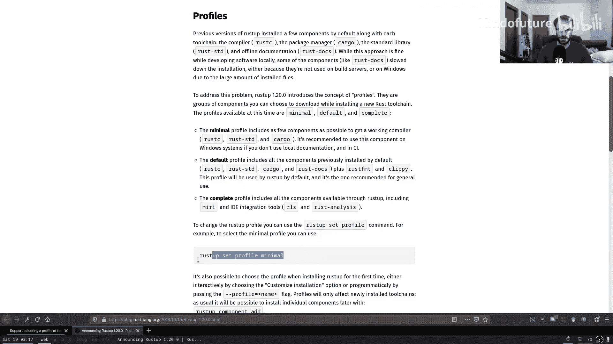

Yeah， so I can do this。Great。And then this。 And notice， why does it still download docks。

That doesn't seem right。Have I like not pulled。That shouldn't matter。That's interesting。Okay。

 so this seems like an issue。 When I set the profile to minimal。

 then installing something should not download docs。

 Maybe it's because I already tried to download this one。I try to download a different one。

 when happens。Nope， it still fetches docks。没有。That seems broken。Yeah， okay。

 so it is just setting profile minimal there。 Okay， so something is broken。The real question is。

 do we want to fix this or do we want to fix it differently。Ha。😔，Oh， maybe you're right。

 Maybe I do need to do。This。Said profile。Although it should just have the same effect， I thought。Yep。

Still， down with dos。Try a more recent nightly， sure。Okay， yeah。 So with a more recent nightly。

 it does not land out docks。Whereas if I did this， oh。Defaultts， great。

Then now it dwill down the docks。 Woo， did not like that。 unavailable clippy。Great， yeah。

 So now this seems to work。No， I'm on 120。 It's。It's the nightly I was installing the 0，1，0，1。

 that did install docs， but on 1004， then it will then the profile applies correctly。

 So I'm not sure why that is， but that's the case。 So you see now， let me demo this again。

Now that it actually works。 So if I have the default profile and I try to install， say this nightly。

 you'll see that it downloads cargo， clippy， rust docs， et cetera。 If I set the profile to minimal。

M name。Profile， minimal。And then I try to install it， then it will not download clippy。

 It will not download Docs。This apparently only works for recent night， but that's fine。

 And now the question is， is there a way where I can do profile here， minimal。Right。

 so I'm going to set my profile back to default。 And now I want the ability to do this。Yeah， exactly。

0，1，01 is before profile data was available in the in the channel manifest。

 So that's why the the older ones didn't work。 So I want the ability to run this。 But， of course。

 profile isn't supported on install。 And that's what this ticket is all about。

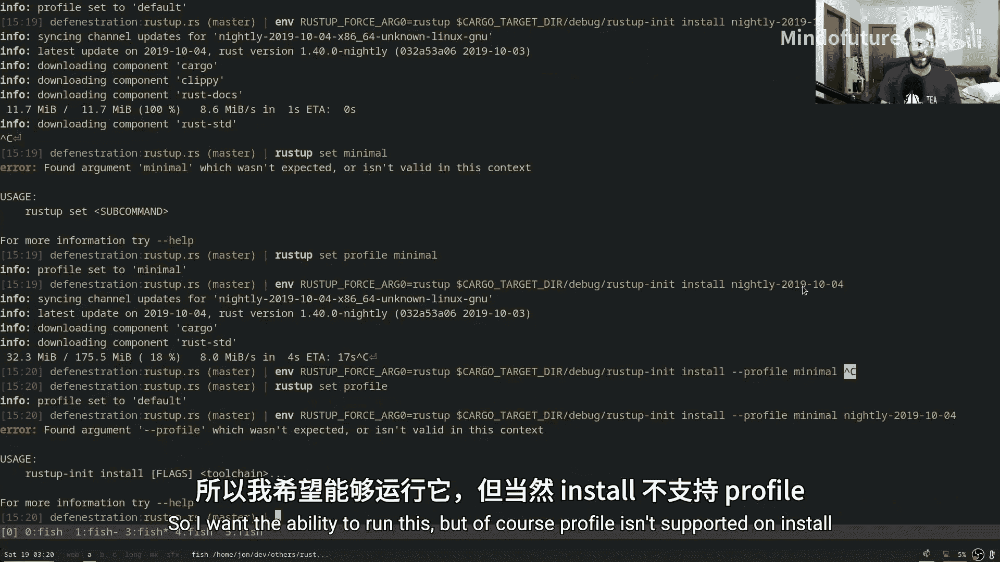

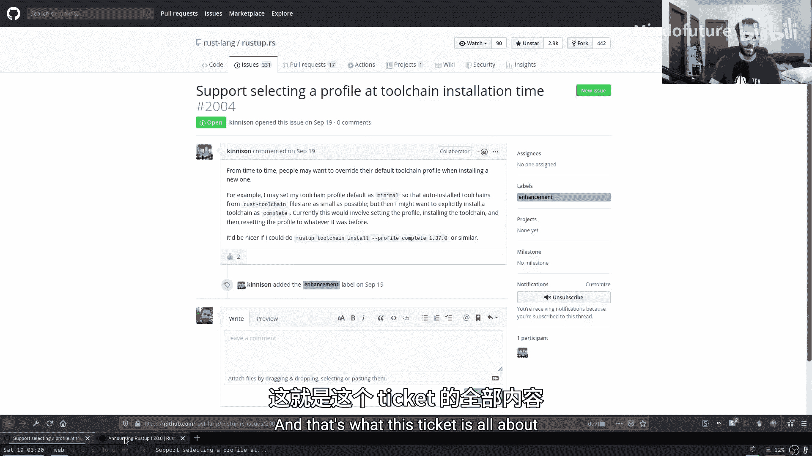

哎。So we want the ability to do this with rust up。How do we do that， Well， let's start a new branch。

 and we're going to call it。Fix。2004。Great。Where do we start， Well， Start with contributing。

 the same thing that we did for cargo， right？ And we for the project done。 We created a branch， done。

 We can't commit any changes Can we haven't made any yet。 I feel like there's a 2。5 here。

 which is make edits。Yeah， so we want to develop rest of itself。

 So we're going to install it into temporary directory， which is what we just did。

 There's cargo builds。No know actually did didn't do a rust up home。

 I'm just going to share my normal install。 and that's fine。嗯。So this is a different way of doing it。

s basically installing another copy of rust up。 I didn't want to do that。 doesn't really matter。

I know that this particular thing works。Yeah， so that here developer trips and tricks。

 that's where you see this environment variable that I'm using to trick rust up into thinking that I'm running rust up。

so。In theory， just cargo build is all we should need， which also means that in theory。

 we should be able to run cargo tests。Actually， let's do test that it's one。Oh， those tests are slow。

Why the Tesla。Seems slower than they should be。I probably like lunches some processes or something。

 Okay， so the test， now we have a test suite that runs。 great。 Now。

 let's see if we can actually figure out the issue， so。This is part of the install path， right？

 Like we want rust up install some nightly to take a profile flag。

 So the first thing we want to do is find install。 General。

 the easiest way to do that is look for a file called install。Well， there's source in。

 What does that do。Installation and upgrade of both distribution manage and local tool chains。

 That seems exactly like what we want。Runha。😔，Okay。

 so this seems like the stuff that gets called when you try to install something。

 But the real question becomes， where is this use， Like how is this called in the first place。

 So this install method。See if we can find where install method comes from。Who source tool chain。

That seems potentially promising。 Lets look for In here。Component status。Install。Interesting。Alright。

 so this all seems like sort of internal wiring。 Where really。

 what we want to find is where the arguments parsed。 So maybe let's look for clap。

That seems promising。 Ru up mode。 So C， L I rust up mode。 That seems very promising。And here。

 is there something called install， there is。Interesting， so main， okay， this seems great。

 So this is the， this is the main that gets called when you want to run rust up as a。

 as a binary with the name rust up。 Basically， you should think of this as rust up behaves differently。

 depending on the name of the binary。 you're running it as。 And if you're running it as rust up。

 then you're in rust up mode。 In fact， if we look at source C I。

 you'll see that there is like setup mode。😊，Proxy mode。Who knows what Main is？Okay。

 so it looks like install just calls this update function。 So where does update come from。

What is update？Well， here we have sub command install。 That seems promising。

 So we want sub command install。To take。Profile。But we also know that there are other places where you can call profile。

 and ideally， we want them to work the same way。 So let's look for Arg。Prole。Al right， so setup mode。

Also has a a。Profile。Great， we want the same things in our profile。

Which means we need profile names and profile default name。 Where does it get profile from。

Gets it from over here。 So we need that over here， too， which we already do， great。So， now。

We have the profile argument to install。 So at least as that。But now we need to parse it somewhere。

 All right， so this creates a giant list of commands for rust up。 And at the end。

 it probably has to parse them somewhere。嗯。Ting。 So this was。C I， so something calls C I。Rust up。

Main， great。Yeah， so this is what matches on the subcomd。 looks for install。Calls update。

 So where does update come from。Let's see if we see an update。嗯。Actually， do I have GD。

 I should have just。O， that seems promising。 Is there an FN update， great。Al right。

 so it looks like both install and update really call this update function。

 So this is sort of a catch all for you want to change the set of tool chains that are installed。嗯。

Alright。And in our case， what does this do。Values of tool chain。嗯。

Does tool chain have a default value then。Values of。Let's see。

 So what is tool chain even set to in install。Target tool chain update。Install。

It's not set to anything by default。That's interesting。嗯。So， this is。I think。

 I think this will be some with an empty vector， but I'm not sure，Regardless， it might not matter。

 So this calls update all channels。And this calls。Okay， so what does update all channels do。Okay。

我要治疗服。Ands so where does config come from。对。Update all channels on config。So update all channels。

 just lists all the channels， which are things like stable beta nightly。

 and it calls install from disk on all of them。And if we go back to our update。

 it calls install from D on all tool chains。 Okay， so it looks like regardless of whether you end up through this path。

 because you haven't specified a tool chain or you end up here because you have specified a tool chain。

 you always end up in this install from D business。 And so really。

 what we want here is we want to make sure that we thread through the name of the profile。

 If there is one。嗯。So let's look at what install from disk does。Install from disk。

So install from disk。Does install methodthod disk， That seems promising。So this is like a giant。

Stuck the tuple of。Various properties about the thing you want to install， I guess。

Now see here we see components you want to install targetsrg you want to install。

Who knows what all the other fields are。But this seems like a place where we need to include the profile that we want to be used。

And this calls install。What does install do。It calls。Install method， run。嗯哎。So， that means that。嗯。

This means that this install method thing。呃。Must have a run method。So installment to disk。

 What happens if you call run on it。It calls update from this。 So this is like a web of calls。

 So we're just like， we're trying to， we're trying to trace down to where， where ultimately。

 it's trying to install all these things。 So this update from disks。Moud。What was it update。

Update from this。Distty， dust。Update from disks。All right。 And that calls update from D。So。

 down here。Calls try update from disk。Let us try update for this due。Downloads and manifest。

So that seems promising， get profile components。All right。

 G profile component seems like something we care about。If profile is sum， right。

 So this is the thing we need to end up overr with。So where does profilele come from。

 Profile comes from here。Which comes from here。Which comes from here。Which comes from here。

It comes from here。Which comes from here。She comes from exists。Ithich comes from。Profile。Right。

 so profile。So， tool chain。😔，Self confid get profile。Alright。

 so how does the config get set for install for from disk。So that would be back in rust up mode。

Tool chain。😔，嗯h。Okay， so it seems like。What we want is to set。嗯。Is to set the profile in the。Yeah。

 we want to set the profile in the config that's used by the tool chain。Yeah， does this track。

I think this tracks。So if we go back here， this tool chain has a config field。 And I mean。

 we can double check that， but it should。As a tool chain has a config field。And inside， config。

There is this， hopefully。How does profile get set here。Oh， interesting。Oh。

 this just mutably modifies the profile file。That's not ideal。

Because we don't actually want to change the file。 We want to change this temporarily。

It looks like gett profile will always open the settings file。Ha。Well， that's awkward， Okay， so。

Basically， what we want to change here is we want。The profile to be or the。mhm。

We want the profile to be stored in the config， either that or we want to pass an override。

So that if the overide des it uses that one， Otherwise it uses the the one return from get profile。

 that might be the cleaner way to do it if we don't want to modify the config here。嗯。Again。

 this is in the， in the interest of keeping PR small。 That said， like here。

 I think it would be okay for us to change， to change。

 config so that it actually stored the profile and say loaded it when it starts。

 So there's a presumably like a new from end。So this probably opens the settings file， I would guess。

Apparently not。 But you could only imagine that this o， said default。Yeah。

 so you can imagine that here in from N。Yes， settings file。 Like right after this part。

 it would load the profile here。That's actually probably what we want。嗯。

What else is Se file used for， It's probably used to set a bunch of things。Yeah。Interesting， okay。

 so we have， we have two options here。 One option is for us to pass to install from disk。

 like a profile override。There'll be one way to do it。

 We'd have to do the same for update all channels down here。So maybe it's a little awkward。

 like we'd end up having to override a bunch of things。嗯。Actually。We can just overrideite it in here。

 I think we want to change it on config， becauseuse that way。

 we can just change the config right here。 Proise this is read only。

So we don't really have a way to override it。We could clone it。And modify the clone。嗯。

It's definitely a little ugly。So I assume the reason that it's readed only is because you're not supposed to change the config on the fly。

Because it's basically what is stored in the files， but。Mm。

It feels a little bit against the spirit to be adding a mutable feel to conveyg。

 given that it doesn't seem to have any other。It doesn't seem to have any mutable fields。

So it feels a little bit like cheating to add one。But at the same time， like。呃。All， we could try it。

Does this even implement clone oops， that is not what I wanted to do。Does not implement clone。

It's also kind of awkward。Think it could implement clone。Check that it actually can。Yeah want。嗯。

This is something that you run into for。For submitting PRs to other people's projects， is that。

It doesn't always make sense to you。The design decisions they've made。

 and you want your PR to align with the design they've chosen for their application， right？

 And you really need to think about。What is the way in which this change will match the current design。

Temp config。 That's a good question。嗯。Rest of your join1。It seems to be something。

 That's like the temporary directory used for temporary stuff。

 it seems like'cause it uses the rust of dare join with T。嗯。Let's see if we can make this be clone。

37。Or。Fig 93 oops。InP 93， this is known R can。R。Okay， so that's now clone。

And then I guess what we'll do is cached profile。I think it really should say， just profile。嗯。

And then， what we want is。So that's going be a dis profile。And then， this。

So get profile is really what we're going to do up here。呃。This we're gonna to say。

Let profile is equal to that。Because then when we construct the config down here。

 we can now add in profile here。Then， down here。We can say。

That this now just returns self do profile。This is now no longer true。This cannot fail anymore。

Interesting， so this。Previously returned an error。If。Settings file cannot not be read。

 or the profile is invalid。 Both of those are now instead gonna to cause errors when you create the config。

 which is probably fine。And it will still return okay default。So this， I think， can now go away。

 And now set profile also has to change。Because。し。Here， let's do this。

So the set profile has to do self dot profile。 Oh balls。 We can't do that， can we。

Causesette profile only takes a ref self。problemblem here is if， if set profile is called。Then get。

 if you called get profile after， you would not get the same result。嗯。Okay。

Here is a proposed alternative strategy。Given that that won't work。We make this profile override。

Then we have this be。We have this set the profile overide to nothing initially。 and then we have。

That won't work either， because。Because this still just gets a read only。No， if we clone it。

 it's fine。So here's a proposal， get profile。Is going to be if， self if。

Let some P is self dot profile。Then return O， P clone。Right， and then we have a width profile。

 basically。That is。Pub a then with profile， which takes a mute self and a profile。And returns itself。

And it does self profile override。Seets that to sum， and then return self。

Because now what we can do in rust up mode is say， let config equals config dot clone dot with profile。

Well， actually it does to do this。嗯。诶。Let some P is M value of。Profile。

Then config is config with profile P。Great。And then， of course， you can do let configure this。

See what this says。How are you able to search the source tree for files so quickly？So in my editor。

 I have it set up with the fuzzy Finder with FF。 So control P brings up a fuzzy finder for the file tree。

 and so that gives me fuzzy find for files I also have double space bar map to switch to my previous file so I can switch swap back and forth between files quickly and then space semicolon gives me a list of previously opened buffers and lets me fuzzy find through them。

So that's my navigation flow。嗯。Okay， this probably needs something like a dis。Great。

So that's almost there。 And then now we need this to parse the profile， I guess。嗯。

Do you need to figure out how， though。I sort of want to give the same error as get profile does when it fails。

Yeah。Which comes from tool chain。And that just seems to error normally， okay。嗯。

And what error did thy give that gives a this error。Like so。This。Well， just profile work。

 Is profile even in scope here。Probably not。Oh， no， it is great。Let's see how that works。 Okay。

 so that worked。Let's see if it actually works。 So my profile is now default again。

 And if I try this。Sir， oh， I need to rebuild。See what that gives us。AndC built。Oh。

 that did not download Clipy or Rustock。And what if I do remove this。Then he gets clipy and rusttas。

 So that seems promising。 That seems like exactly what we wanted。Right， alright。

 So let's try writing a test for this now， so。嗯。呃。Install。Add dash。

 dash profile flag to override install profile to override profile。

Sound is much better than last time。 Thanks to ever gift to you the shock mount。 That's good。

 I'm glad。 yeah， it's co So the reason this happened was this microphone is better than the 1 I had like much earlier。

 And the boom arm is much more firmly attached to my desk。

 which means that the tapping sounds transferred to the mic a lot better。

 And the mic picks it up better。 So I think the the shock mount helps。😊，Could use R C instead of Arc。

 I could。 The reason I used Arc is， first of all， the cost doesn't really matter here。

 Like the atomics are insignificant in this kind of workload。

 Like if you're working with a command line tool。And Arc means that the things are now send and sync。

 which is nice。 And also because this code base uses arcs elsewhere。And so just for consistency。

 we might as well use arc here as well。Install。Test install，hu。Package contains。

 Let's look for a profile here。Nott really any profile here， but。Set up。Profile in tests。

A looks more promising。So， there's self update。Cs。Clius， kill this cl。Profi。Alright。

 so this does what exactly。This seems to indicate that it runs rust up in it with profile minimal。

Wait does that not as little cargo。Really。😮，Profile minimal doesn't give you cargo。 That seems false。

All right， well， I mean， we could try that。Let's just copy this test。To install。And then， just add。

Install。With profile。We have a setup function over here now。

 So this has a setup that does this thing。So let's copy that and see what this will do。Of course。

 we don't actually want to run rust up in it。 So what do the other tests that do installs over here do。

They do。Mock installer builder。Seems awfully complicated。I don't want any of these。

 I think this might be the wrong file。It's just like。Ting on to this， and then find， like test。

Maybe just dis。Is there any install here？I don't know what all this business is， but。

Different from this。Uninstall。Just want some easy way to write a simple test， please。嗯。Cly rust up。

 That seems promising。And target。See， this seems more promising。 This does like rust up commands。

 That's what I want。Remove target， lists target link。

Do we see anything here that looks like installing something。That seems promising。Install lightly。

Show tool chain。Show tool chain。Okay， this certainly seems more like the type of。

The type of test we want to write。Just want to find something that actually looks like。

Something that looks for like components， right， That's really what we want。呃。

This is a handy way to I mean， this file is particularly large。

 but when you're submitting a PR to a project and you don't really know how to write a test。

 look for a test that does sort of what you want and then just copy paste it and then modify from there。

嗯。Well， that's unhelpful。Let's look for， like。Nicely。Cly， what else do we have here。He's like it。

Tet slash C looks pretty promising。Mis。Custom tool chains。Search path。Run install。

That seems kind of promising。Right， like this has an install and then checks for installing component。

That sound like， I know what I want。Yeah， like these tests seem pretty promising， not going to lie。

Instalall profile。 That's what we saw earlier。 So really。

 we've returned to the file that we started at。Okay， well。How about we just try one of these。

Install profile。 And I feel like I want the setup from something like this one。

 Ca this seems like a nice test setup。 So let's just try that。 See what happens。

And then let's just get rid of this business down here。Alright， I don't know what this does yet。

 That's fine。 default。 defaultult stable， seems fine。And then， I want to run。Install。

And I want to run install。Profile。Minimal。See， what did the install with profile It used。

 it used setup simple V2。Okay。And that does not end up with cargo。Okay， so simple V2。Sted that。And。

Oh， I guess we need to do like nightly， maybe。Actually， this seems to do stable。

But I guess just see what happens if I do like。This。Alright， so we're gonna do a setup。 I don't。

 Maybe we don't need this。 We're gonna do a simple V2， which who， who knows what that is and。

We're going to set the default to be stable。 I don't know if we even need that。 but sure。

 it's a default to stable。 And then we're going to try to install nightly with a minimal。

 And we're going to see what that does。So we're going to do cargo tests。

 and we're going to run install。Profile。And see what happens。That's an awful lot of errors。呃。

This is all the。This is all the changes we made to tempt config。

That apparently a bunch of things were relying on being able to。 Oh， man。呃。Use standard sync arc。

There are other things that。D apparently。This install。And I guess we here too。

 need use standard sink。I just want to run my test。 I don't care about all these other tests。And yes。

 I know there's， there's a flag I can add to test to make it only compile my thing， but。Test。This。Ak。

Great， almost there。Now， run my test， please。That seems promising。Running one test。Alright。

 let's look atooh， okay， so。It running default stable that ran correctly and told us that we had stable installed。

嗯。Oh， I see。 when we said default stable， it installed stable。And had seemed to include like cargo。

 Rus dos， rusted， great。嗯。Then we install nightly with profile minimal。And then， it downloaded。Rusi。

Well。Okay， that's sort of good，cause that means it it did pick up the profile。嗯。It was not installed。

嗯。I think I know what this is。This is gonna be me cheating a little， probably。

I know what this error is， because I've seen it before。I think。And I'm pretty sure。

I need to pass this leg。And we're just going to pretend that I spend a lot of time searching to find that and then see if it works。

Okay， this is getting annoying。Tests。Cim。Hm。😊，I did mean climemk。Hm。Allright， so。Install profile。

 minimal nightly。 No self update。That downloaded just Ru C， which is what we want。rust up。

Version that worked， receive version that worked。Cargo version。Worked which is not all you want。Oh。

 it's causeuse we haven't said default。So。嗯。I see that these are still run under the default tool chain because we haven't set the override。

So。What do these other ones do， I say， as he， we， we certainly need to set the default the nightly after doing this。

 Otherwise， the following commands won't be run that way。Let's see what that does。All the past。Right。

 so， okay， so let's look at what this test does。 I don't know know what simple V2 does。

 but it's the same。 I'm guessing this like sets up a manifest of some kind。

 And it sets up a manifest that we know from the other test we looked at。

 right So the other profile test。This one that already existed。Use the same setup。

 And when it installed with profile minimal， then it got rust up and rustsy， but not cargo。

And so what we're doing up here in ours is that we start with a default of staple。

 which has all the stuff。 And then we say install nightly with a minimal profile。This no self update。

 I can tell you is normally Rust up tries to check for self updates at the end of installs because it treats them as updates。

 And this is just telling it not to do that。 And The reason is because it it's not actually installed。

 It's running in like a testing harness。 And so the self update would fail。嗯。

So we start with the default table， we install nightly with a minimal profile。

 so at that point nightly is installed， but it will only have C。

 and then we switch to nightly by setting it to the default。

 and now cargo won't be there because for whatever reason this manifest is set up such that cargo is not installed when you installed the minimal profile。

 even though feel like the minimal profile usually includes cargo。

 So ruststock might have been a better example，In fact。Kind of wan to see simple V2。

 What's in simple V2。In mock high tools。Simple V2。Lu。Okay， so when it's simple V2。

 you have a nightly。And some stuff。Okay， so what's in these releases。What is a release？Release。Maock。

Build mock channel。Right。Build mock channel。Buildmark channel。嗯。Alright。

 so where's the profile stuff。Okay。Maybe it's related to this is extension business。 No。

 it doesn't seem right。Well。There's no mention of profil in this file。 All right。 Well。

 then I don't know。But it does the right thing。I wonder why。 I wonder how。

 how it determines this profile business。I mean， this works， right。

 We've tested it and it does what we expected it to do。 It's more that I I given that in reality。

 cargo is included even even in minimal installs， like。It seems weird to be testing that way。

 but seems fine to me。It's painfully obvious to me now that I need to do a better job of structuring the install flow。

Structuring the install flow in what sense。 So this is one of the authors of rustt up。

 I don't know what you mean by structuring the install flow。

 I think it's more about making it clear what the testing flow is。But the install flow， it's true。

 If you want someone to edit the install flow， there was a pretty long chain We had to go down like a pretty deep rabbit hole to figure out how anything ever gets called。

 Maybe one thing that would be useful is， is。Some higher level docs that explained。

 like how these pieces fit together， because there's a lot of just glue that really points everything to one place。

 although maybe that is documented somewhere。 And I just like skip the documentation。 Okay， so。

Let's first add。D businesses， because they are all。嗯。And then， I guess。This。Wait， tweet。

Change and install profile。Did not intend for that to be the case。Okay， we did a stupid。

 So I'm gonna you see what we did。 I changed the existing test call install profile。

 but I copied the test call install profile to install with profile。

 which is the the opposite of what I wanted to do。 install profile。Install with profile。This。

Should be down here with the other one。 And this is the old one， which is installed profile。

 and this is installed with profile。There we go。 That's more what I wanted。

And I want this to be the way that it was。Don't want to make any changes to the existing test if I can avoid it。

Great。And now let's see that this actually still works。With。

I meant more the vast sequence of function。 Yeah， it was a pretty deep。

 like rabbit hole to dive into。Great， okay， so the Tela passes because we didn't change it。

 but we moved around。Add test for install。Install with the ash profile。Now。

 what I actually want to do here is I want to be a good citizen and。And do this。Oops。

 that's not what I wanted to do， actually。呃。I want this。I' sququaash these。 And then I want to say。嗯。

呃。Previously。The installation profile。The profile to use for installation。

To use when installing a new tool chain。Had to be set manually。Had to be set。呃。

Through rust up profile set。Said Pro。I forget。Sat profile。嗯。Or at rust up install time。However。

 often it。In C， I contexts。And otherwise。呃。I don't know how to phrase this。嗯。Previously。

 the profile to use when installing a new tool chain had to be set the Rus upset profile。

 or at Ruup install had to be set globally。Through rest of the profile or rest of install time。

 however， in C I context。I are in some contexts， however， sometimes this is inconvenient。嗯。

Because you only want to use a particular profile for a specific。Truol chain。呃。This patch allows。

Users to pass dash dash profile to rust up install， to install a tool chain。呃。

To override the profile used when installing。呃。Profile used for that one install。

One question that this races actually is。If I update a tool chain that I installed with an overridden profile。

 Does it now suddenly install the other components。So' good question。That's。Look at that test。Sorry。

 what did I mean， Ru up。In it time， sure。嗯。I just realized that。What happens if I now do。

Rust up update。Nightly。This should do that。I don't know that it will。 I think this might break。

That worked，hu。So， here's my thinking。Actually， know this。 I。

 I'm almost positive that this will not work。呃。Okay， so so here's my thinking。

 If you install it with profile minimal， there's nothing recording that the profile you installed it with is minimal。

 And so if you later update it， how would it know to not install the other components。

Maybe we'll check that they aren't already installed。 I don't actually know。

 The reason this test passes is because there。It recognizes that there is no newer nightly。

 So we want to update。 So there way we can get a simple V2。Okay。

 so there's a different date that's available here。 So is there like a date。Wait， I can set yeah。

 here we go。Okay， so I'm going to set this here， and then I'm going to do this。

And see whether that fails。No such file or directory。Bi。Wai， waitait what。A back。R。

Top factor equals 1。Why。Where。How。Oh。Change channel day。 apparentlypparently what。

I'm not allowed to do whatever I did there。Apparently。

 you can't set the date as we experienced at the start。嗯。But。Other people do it。So why can't I do it？

Maybe I can only set it here。Oh， so these are mocked。 these are not real manifests。

 They're mocked manifests。 So the 2015 is， is you can ignore。 It's not related to real dates。

I'm going to make this expect error just to see what the output is。Now， boocks。嗯。Ha。😔。

That's fascinating。Alright， show me that output。Yes， I didn't actually do an update there。So why。

Don't understand why this will work。呃。Right， by Dutch。You're here for like every stream。

 It's amazing。No such file or directory。At Moist 48。That seems problematic。

Why am I not allowed to do this when other things that use V 2 are allowed to。Or maybe they aren't。

嗯哈。It'sca other people aren't doing that。嗯。Interesting， so。I can't actually make it update。

Because this， for whatever reason。Won't work。Wonder why。啊。What's in dis。嗯。Tests this。This this。

Confused。Where is it getting these。Manifest from。 Did you like generating them。嗯。嗯。That's very odd。

 I don't understand why there are other tests that are able to call this currentest date。But。

 I can't。Update unavailable rust C。Like， what happens if I run that。But take unavailable rests。Yeah。

 that runs just fine。 So why， oh， why， oh， why。Does mine not。

This sounds like simple V2 just like doesn't do that。嗯。That's fine。 I'll just do one called。R荣服。

Full seems great。 Let's do full。I wonder why。Seems odd。好。Well。Now that works。And apparently。

 the update。I I'm going to assume that it now actually does the update。 And apparently。

 that update doesn't install any other components。 Don't quite understand why。

That that sounds like if you run rust up update， it won't install components you didn't previously have installed。

Which actually， I guess， maybe makes a lot of sense。I mean， we can leave it in as。

As a test anyway to check for regressions in this behaviour。Yeah， so it updates。

 and then it only installed the component we had。 We got great。 So that was the only concern I had。

 But at least now we have a test for it。So， this is going be。

Installing with minimal profiles should only install rust C。嗯。After an update， we should。Still。

Only have the profile dictated。Component。 so。I'm going to just fold that into the previous update。

And we're also going to say that this fixes 2004。2004。2004 was broken。Alright。

 it's gonna get light again， people。

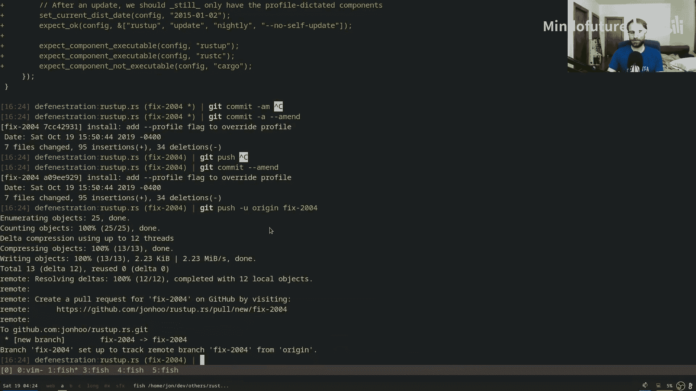

And file pull request。22004 in 2019， with tests that talk about 2015。pull request。Excellent。

 so we now have another PR that you can watch。

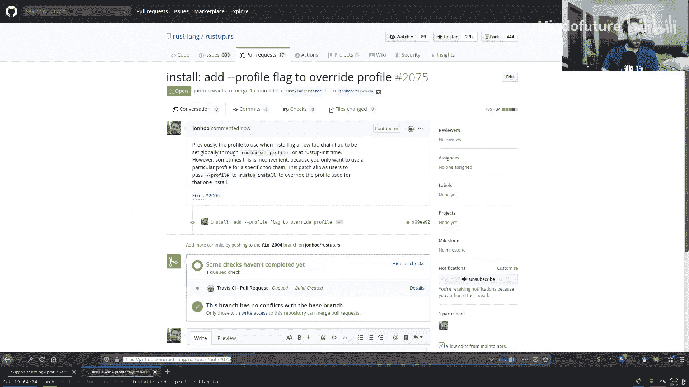

And this one。Oh， I forgot to push。

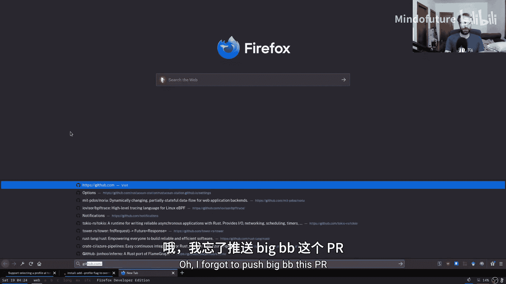

北。B， B， this PR。This was the other PR that we filed that。You may want the URL， too。Here we go。哎。Well。

 we now have。3 PRs to。3 different rust projects。 I think we're probably gonna stop there。

Because I don't have an idea for another contribution。 And it's also getting a little bit late。

So this is recap what we did。 So first， we made a contribution to cargo where we。

Changed its handling of what it does when the target directory has simlinks in it。

Then we ported a crate from future 0。1 to standard future。

 And then we made a change to rust up so that you can choose which profile to install a given tool chain with at install time to override the globally set profile。

 This is a pretty decent amount of stuff we got done。 And like what，4 and a half hours。嗯。

It's pretty good。I think we did well。 Well， well done us。 So at this point， I。

 I recommend you watch all of the PRs that we just submitted because very often there's follow up work。

 either because the authors or the maintainers of the。Create request added tests。

 request changes to behavior。 And sometimes they might even say we don't want to fix this way。

 Like for the cargo change we made that that change might be more。

 more controversial because as someone mentioned in chat as well。

 we will end up recursing outside of the target directory if there are siblingimlinks outside。

And so these might be worth watching if you want to continue to see the process that these PRs go through。

 If anything， my goal with this particular stream was to just show you that。

Supporting a project or contributing to a project that you haven't contributed before is okay。

 Remember that here。we like here， we just sort of dove in。 We did not do any mentored issues。

 We just dove into the code。 If you look for issues that are marked as E easy。

 things that are marked as hacktoberfest also work pretty well。 things that are marked as mentored。

 then you can get more help getting started。 if you feel like you want that。

But it isn't that daunting。 Like just start。 And initially a lot of what you do is just going to be copy pasting。

 And that's fine。 And then submit a PR。 and then people will talk to you and ask for changes。

 And that's sort of how the whole system works。 And remember that even the rust tools are just code。

 right， And you can contribute to the ecosystem a lot by improving the tools that lots of people use。

 Like these fixes are going to matter to people。 Like especially this one to rust up。 My guesses。

 we will see this used in like C I scripts for lots of rust projects。 And that's pretty cool。

 whenever you help improve the rust tools， you really improve the entire ecosystem。😊，嗯。

Will you tweet about the follow， if applicable。 Yeah， I'll do that as well。

 So if as the PRs get updates， like whether basically when they get merged or closed。

 I'll make sure to tweet out as well to to mention that this happened stream and to point it out to you。

 So if you want to follow updates for upcoming streams。

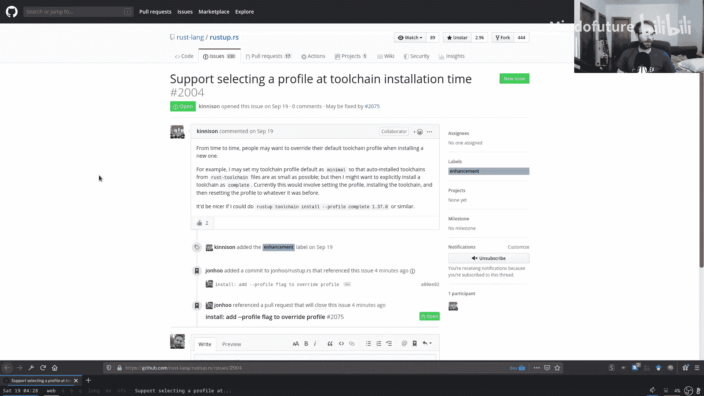

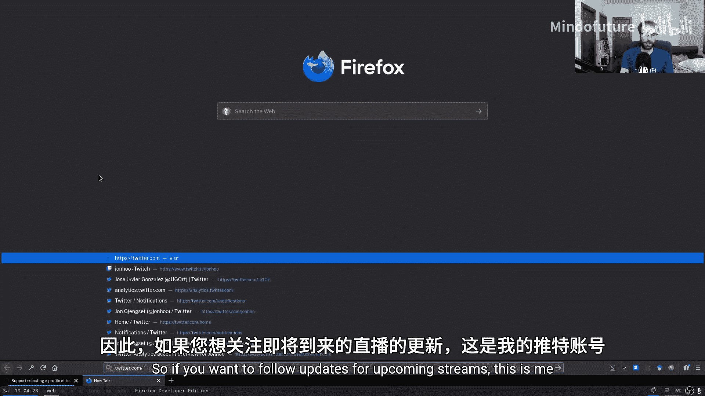

This is me。Twitter dot com slash John who。嗯。And。I tweet， so I mean。

 I'm a normal Twitter user I retweet things and there's stuff there that's not rust related。

 but I try to make sure that whenever I have thoughts for an upcoming stream and I want to hear feedback about it or just if you want to talk about stuff or if just announcing upcoming streams or announcing like interesting changes in the rust ecosystem or to the rust language then I'll post it there so feel free to follow me there if you want there's also so I also am part of a actually I should mention that here。

There's a rust podcast called the Rasation station that Ben Striegel and I have started。

 And it's sort of a community podcast。 So the idea is that if you want to make a podcast episode about Rut。

 even if it's just a one off， then get in touch with us。 and we will help you make that episode。

 And then we do regular episodes on what's new in each new rust release。

 So we recently talked about 138， I recommend you give this a listen。

We also have guest hosts almost like almost every other week。

 where they just talk about things they think are interesting and interview people。

 they think are interesting。 So if you want to be a part of that， then， or just listen to them。

 then then I invite you to do so。 And， of course， if you enjoy what I do。

 then please take a look at the the Amazon wish list is like the only way I have to get anything back from this apart from just your。

 your。😊，You being happy about being educated， which is great。 That's why I do this。 But if you。

 if you have some extra to support， I would love that。 And with that。

 I think we're going sign up for today。 Thanks for joining me。

 It's always fun to program with other people。 And I think this turned out pretty well。😊。

I will see you in a few weeks time。So long farewell， I' feed us in goodbye bye。

