# 超硬核-即兴90分钟rust开源项目维护实战-p03-P03-Open-Source-Maintenance,-2024-07-14--BV1aiQGYtEux_p3-

Hello， folks， welcomee back to yet another stream this time at sort of another iteration of the open source maintenance streams。

 I've done a couple of these in the past。 and basically every time it is mostly out of necessity。

 right， So I I maintain a bunch of open source。😊，Cates， libraries， applications， all sorts of things。

 None of them are like， you know the use by most of the nothing like that。 it's just。

 this is a bunch of them and everything like this ends up just requiring a bunch of ongoing maintenance。

 whether that's issues or PRs or or you know feature requests， whatever it might be， support。

 and in addition， you know I make contributions to other open source projects that need to be followed up on and you know whenever I take a vacation。

 if I fall ill or I just have a bunch else to do for some period of time I end up falling behind of my Github notifications of things that I kind of need to deal with because there's no one else that pick up that thing。

And when that happens， you know I need to spend some time catching up on those things and I figured you know why not turn on the camera for it and show people what that process is like and so that's what these streams are they're not intended to be a sort of learning resource in the same way that many of my other rust streams are it's not like I'm going to teach you a topic or teach this particular software rather it's sort of a day in the life kind of thing if you will of let me just show you what the processes like going through like working in open source and hopefully you learn a bunch of bits here and there like most of the projects are in rust and so you know especially when reviewing PRs I'll generally talk you through know I would do this differently or this doesn't quite work or this is a backwards compatibility hazard or whatever it might be and similarly you might learn things about project structure or even just projects that exist or how to make contributions。

 whatever it might be。Or just to get some insight into what this all looks like from from the sort of other side of open source。

 So we're just gonna dig into my giub notifications as we're gonna start from the back and make our way forward and get however far we can。

 I mean， I've allocated about five hours for this。 I don't think we're gonna catch up in five hours。

 I think in five hours we're gonna get you know maybe a third of the way through and this is the bane of my existence。

 no I enjoy it。 I think it's fun。 it's just it does end up taking a surprising amount of time。

 especially once you start falling behind。😊，Just before we kick into it。

 I just wanted to highlight again that I do have a discord where I announce these streams you can if you want an invite to it。

 it is just Johnho no it is not。 it is discordjohnho Eu if you go there it'll take you directly to the invite I'll put that in chat as well so that you have it and you can just join there the only channel you'll normally see is the announcements channel and the YouTube channel that automatically posts whenever there's in a YouTube video。

 this is also I announce if I'm giving talks if I'm not doing a stream that I'd originally planned or if I'm doing sort of ad hoc streams like this one there are other channels too。

 but those channels are specifically for people who sponsor me on Github sponsors or Patreon or whatever but Ive figured out get that out of the way just as an additional way for where you can figure out when I do a stream next。

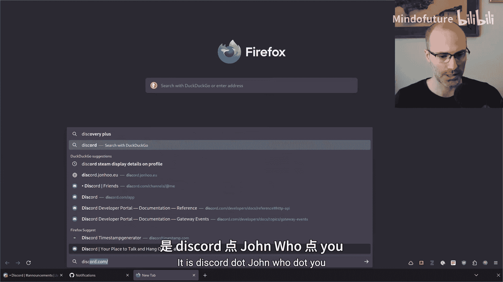

Okay， let's dig into it。 So Github notifications。 I have。1 hundred and58 of them。

 This is after I've already pruned a few that are just notifications of releases or like rust issues that I follow。

 I'm sure there are more that have been added to since I started tagging some of them off。

 but like rust issues that I'm tracking， but I'm not actively doing anything with。

 There are a bunch of depend about things in there。 So， you know。

 realistically is not actually 158 like action items。 we're gonna start from the back。

 We're not gonna start all the way from the back just because some of the things on the last page here are things that are a little bit more。

Like either long term or I have to think harder about them。 And I've said this for a while。

 Like if you look back to some of the older open source streams。

 you'll see that some of these are recurring from there。And I just haven't spent the time。

 but like some of them are are simply just non trivial。 like bump to hyper1。 for example。

 this is a breaking change I need to issue to Fantticcini。 And I actually。

 maybe we could do that oneca it's mostly done。 It's just about doing a release。Sure， why not。

Why not？ actually？ Okay， So Fantaccini is a it is a rust crate that allows you for interacting with web browsers through the web driver API。

 So the web driver API is a way to do sort of browser automation or browser orchestration。

 It's supported by a bunch of different browsers through these little proxy processes。

 And so for Firefox is something called geckco driver for Chrome。

 there something called Chrome driverri。 I think theres something equivalent for for safari Internet Explorer supports the standard as well。

 And Fcini is not intended to be a sort of。You know end user API arguably the description here is wrong。

 It is actually a very it's an API that very closely wraps webdriver。

's not it's not a super highleve API in the sense of giving you the sort of abstract way of expressing chained operations directly maps to the webri API And the idea was that either you can use this directly or someone else writes a cr around it that gave some more ergonomic ways to access it I wrote Fanttacini many。

 many years ago。 I guess seven years ago when I started the project and one of the changes that sort of happened since then relatively recently。

 was this sort of move to hyper 1。0 in the ecosystem and Fantinni， of course。

 interacts with the web driverri proxy process over Htp which means it uses hyper and request and whatnot and also relays some of that to the user of the library。

 So for example， it gives you。😊，A way to。Get a H TDP request that has all the cookies that the browser session has for a given domain so that you can fetch it directly without going through the browser。

 There's a bunch of that sort of stuff。 So it， it ends up integrating fairly closely with some of the hyper stuffuff。

 So that means that the upgrade to hyper1 was not entirely trivial。 If we look at the。

 the Delta here。You know， obviously a bunch of it is just version bumps。

But some of the things that are painful， which you'll know if you've gone through the hyper 1。

0 upgrade yourself is the changes to the body type。

 So the body type used to be a structure now it's a trait and that means that anything that uses like hyper body for example now needs to change to use a concrete type that implements the trait instead and there are a bunch of helpers for this I'm not gonna go through the entire changer because it's one that I've already done but it's more like this is definitely a breaking change。

 there's a bunch of public APIs that either name the hyper error types or the hyper like body types so this type this method here。

 for example， with raw client for this is the thing that gives you a hyper client that has the cookies for a given domain that gives you back a hyper response So obviously if we bump the B version of hyper then we've changed which type is shown in this API。

And therefore it's breaking change and then there there are various other things here as well。

 but but most of them have to do with just there' a breaking change because of the major update and the dependency and then a couple of minor mostly changes to the to the API you'll see here that there are some places where we name like legacy types out of。

Some compatibility layers that hyper has released to make it easy to easier to move from the previous version to 1。

0 those are generally not in public types。 So like here， for example。

 you see we use the response future type from hyperutt legacy but that is in a private enum and so therefore it's not a part of the breaking change and the reason I point this out is because you have to be really careful about what types you put in public APIs if a public API or public type or public E and whatever it might be holds a type from a given crate。

 then a new major version of that crate or even just changing what that type is to something that's say not in the legacy module would itself be a breaking change which means that if we do a breaking change now for hyper1 and then down the line we want to change this type to not be a legacy type if this was a public type that would itself be a breaking change to Faccini and so we wouldn't really want to set ourselves up for having to do another one shortly in the future。

嗯。I'mTry to see if there's anything else here that's really worth talking about。

 Most of this is just hyper1。0 stuff。嗯。This was a change to。 That's not particularly important。And。

This is just a change to the testing for how you need to start a server。

 So that's not terribly interesting。Okay， great。 So this is not too bad。 Now。

 one of the reasons why I didn't merge this after I finished it。Well， there are a couple of things。

 actually。 So one of them is if we look here at this。 So this is the the error module。

 I'll make this a little larger might be helpful。 So the the error module for Fanttecini。

It defines a command error， which is sort of the error we use more or less everywhere in Ftacini。

 It's an enum that has a bunch of sort of sub errors like this is an error that came from Webdriver。

 this is an error that came from a parser。 This is an error that came from hyper and unfortunately this required that I added a variant to that error enum that surfaces errors out of the hyperutyl legacy crate Now I'm not too worried about adding this here。

 because if in the future we're able to represent this with real hypertypes。

 we do have the hyper error type in here。 So we would just stop producing this particular variant so it's not it basically means we're not forced to make a breaking change it does mean。

 however， that we can never remove the dependency on this particular version of hyperutyl and that is I think pretty unfortunate but I don't have a great way around it。

 like there's basically a。Stuff that was removed from hyper in 1。0。

 But that we need in order to have a sort of ergonomic client， I could maybe move us to request。

 I don't know that that's really better here。 So I'm inclined to just keep this the way it is。

 So that that's one of the reasons why I've sort of been hesitant to merge this。The other is。

We have a bunch of pending changes in Fticcini。 So if you look at Fticcii。

 if you look at the version number here， you see this bumps this from version 020 Rrc 7 to 020 R 8 And this is all legal right So you're allowed to do breaking changes between prerelease versions But the argument I was thinking of was。

 well， that's true but there are a bunch of people using RC 7 because it has a bunch of other useful breaking changes that people might want。

 And so if I cut this as RC8， it just feels kind of weird to have this hyper1 change。

 which is a very big change if you're a user of Fticcini。

 then you also have to upgrade to hyper1 and that might be a massive undertaking for you。

 but pinning it you having to pin to RC7 feels very arbitrary And so what I proposed here was that we do a release like not an。

RC release， but an actual release of version 020 of Funiccini there's a full release， no RC。

 and then we start this hyper1 move as 0210 And I think we don't even really need the RC here you know this is still pre1。

0 for Funantticcini itself even though it's 7 years down the line So I may be okay just cutting a 021 here。

 but it's more I think we should maybe release the current version of Funticcini as a nonC and then do a major version bump right as in 020 to 021 for the hyper1 change。

And so I propose that to one of the the authors of a crate that traditionally used Funageino under the hood。

 So this was a crate called 34， which is sort of a higher level API for browser orchestration and they've made a bunch of contributions to Funcini in the past。

 And in this case， I think they。They were on board with this probably being a good idea。

 but they've also started to no longer depend on Fticcini。 And so therefore。

 its not really relevant to them anymore。 And so that that meant there wasn't really a push for me to make this release。

 But I figure now we might as well just do it， especially because it's it's pretty straightforward。

 So if I now go to Fantticcini， I do a gi pull。

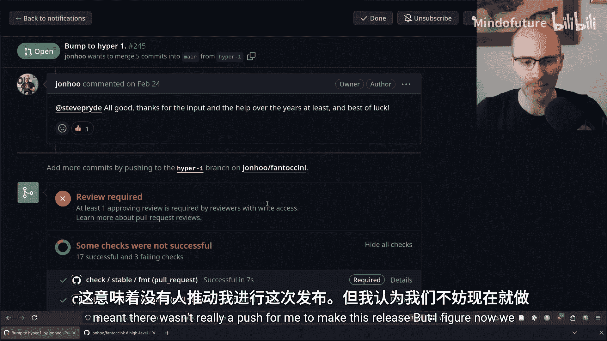

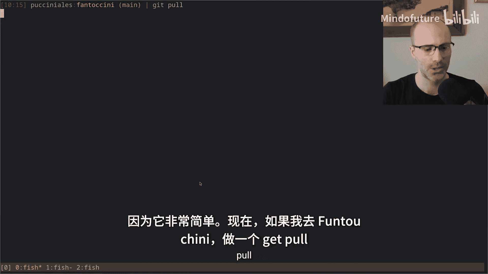

And I guess it's worth checking in here。If we have。Other things that we want to land in 0。

20 before we cut 0，21。 Let's go ahead and look at these other ones。And。Okay， someone has。

Introduce spell checking。I mean， that's nice and all。

 I don't really want to also run whatever this typo things is。But I'm happy to take it without these。

So I'm gonna do this。 And the reason is just， I don't love having lots of C I jobs that just run like random scripts。

So I'm going to go ahead and do that。And I'm gonna go ahead and do。That。In fact。

 I can just commit directly to their branch。 I'll do。This two。Add another cI step， though。Soll。

Prove that。And then。Commit this as well。 And so now I'll make this a little smaller。 Now。

 if we look at files change， it's just the typos。So now we can go and merge this。

And because this is just。Typepo checks。 I'm just going to squash it。F a bunch of typos。

 confirm squash。Great， so that's one。Oh， this is a URL fix。 That seems fine to me。

 Let me just double check that。 That is。Actually， a valid URL。

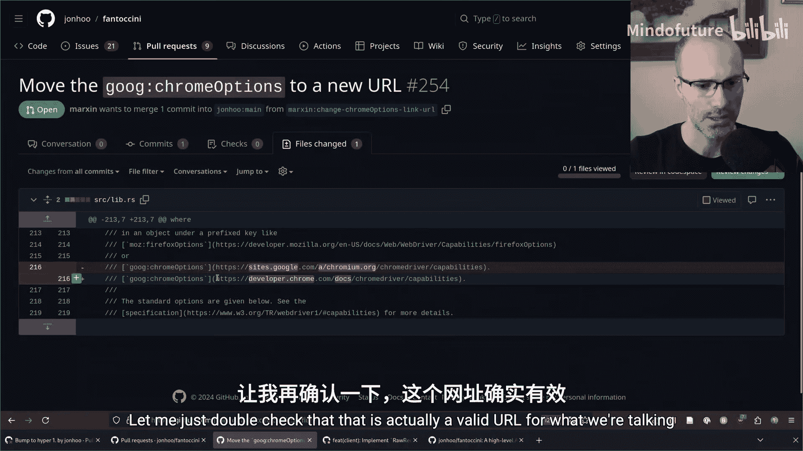

For what we're talking about。

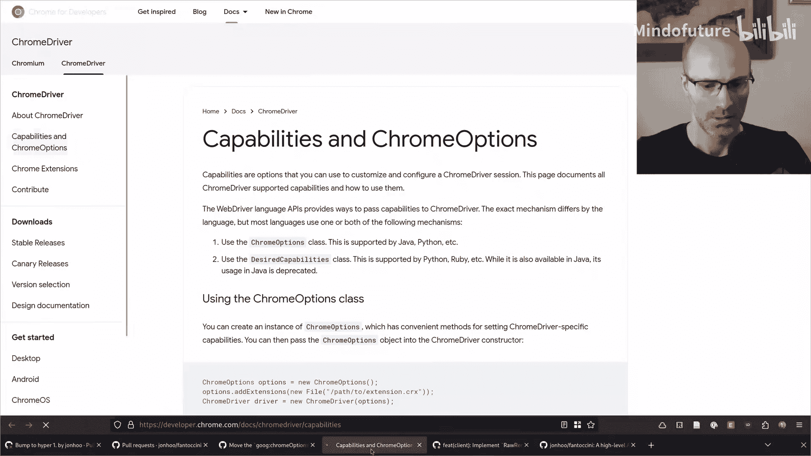

Perfect， okay， great。And this one too， I don't really need C on， it's just a URL fix， squash emerge。

 confirm。And then， this is。Raw request builders struck to handle raw HTTP requests with optional cookie handling。

Interesting。Okay， so this is just a way to construct a raw request。

But that doesn't really fix this issue。 So the issue here is that。Webdver has a long standing bug。

 Basically。 that's this one over here that。You can tell Webdriver to get all the cookies from the browser。

 but you can only do so for the current domain。 So the browser needs to be on a website of a given domain and then get all cookies will return all the cookies for that domain。

 You can't request cookies for a domain that the browser is not currently on。

And that's really awkward if I want to start my own own HtP request that uses the same cookies as the browser。

 And so currently the way Funtagene does this is it tells the browser to go to like a random non-existent URL on the domain and then grab the cookies and then go back to where it was。

 which is obviously kind of st， but it's the only thing you can do that the spec supports this PR adds a feature to implement。

😊，It adds a sort of request builder。For building requests for a given URL。

 I don't know that this really helps。 It just feels like it's re implementinging some of hyper。

Because what I'll show you， So what Fagecini currently has if we go to RRC 7。

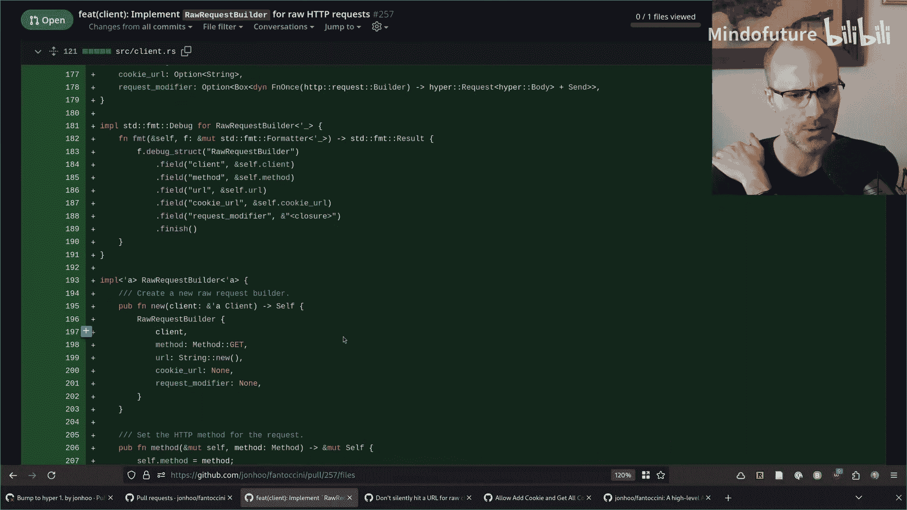

Is when you have a client。You can call。B， where is it。Raw， not raw。Raw client4。

Or with Rock client for， which you give a URL and you give a method and then you give a closure that is given a hyper or an HttP request builder。

 and that gives you back the response。 And so this way you can issue arbitrary requests。

 and we will sort of map in the required bits for getting the cookies and stuff for it。 This。

 I guess， is sort of a generic request builder type。

 which I don't think really adds anything over that API。

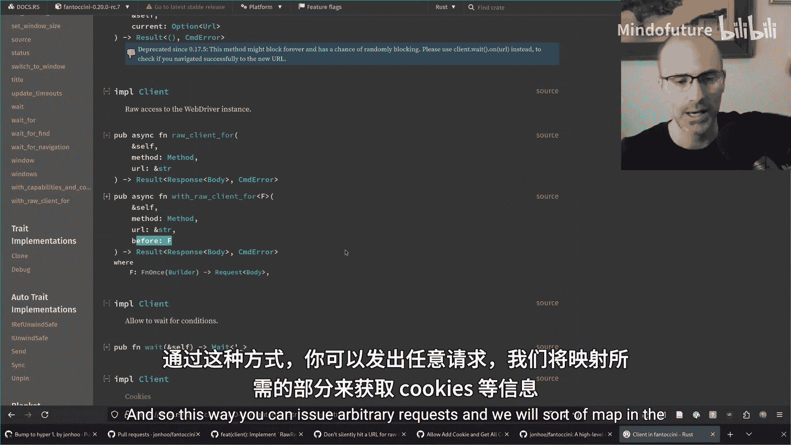

Becauseuse all it allows you to do is set the method， set the URL。

 I guess you can set the cookie URL。 So， so one of the complaints here is that， you know。

 we hit this sort of arbitrary URL that we construct。

 And there's no way to configure what that URL should be。

 And so this would let you configure what the cookie getting URL should be。 I guess。But， I don't。

 really。Love that。 I guess that's this issue。呃。Oh， well。

 I'm the one who propose this in the first place。 Great。 Okay。

 so this is what I was thinking that what you really want is just a way to construct to。

 to configure where Funtucini goes in order to get that cookie stuff。

 And I guess someone did actually propose doing that with an additional method。 And then I said。

 well， what if， what if we just do a builder instead。Interesting。Okay， let me look at this again。So。

Baw request。😔，Let's you the method。The URL。😔，Maap request。

So map request is because our current like with thing。

Allows you to set a closure that gets called on the HTP request before it's actually issued。

 and so this is to preserve that functionality， I suppose。And then， send。

Gives you back the hyper response。And so this is something we're going to have to port to hyper1 as well。

And。What's awkward to me here is， I would like。D。😔，And。

The current code that we have for raw request to reuse this。

 because otherwise it feels like we're just doing this twice， right。

 where we're implementing all this logic that's in send here。 We're also implementing that over in。呃。

Over here in with raw clientient4 right that also does this extra code。

 and so I would like to avoid duplicating that in here。And， in fact。

 if we go look at the current code for。Actually， where。Did that live。

 Live just lives since it was client， right。嗯。So the code that they've written over here basically replicates this code that we have over here。

And。Although it doesn't even fully replicate it， it writes it differently， which also makes me sad。

And。So I would want us to de duplicateupate this。 The question now。

 and this is sort of an eternal issue for things like this is。Do you tell the author of the PR， hey。

 please change your thing or do you just merge it and then change it yourself？

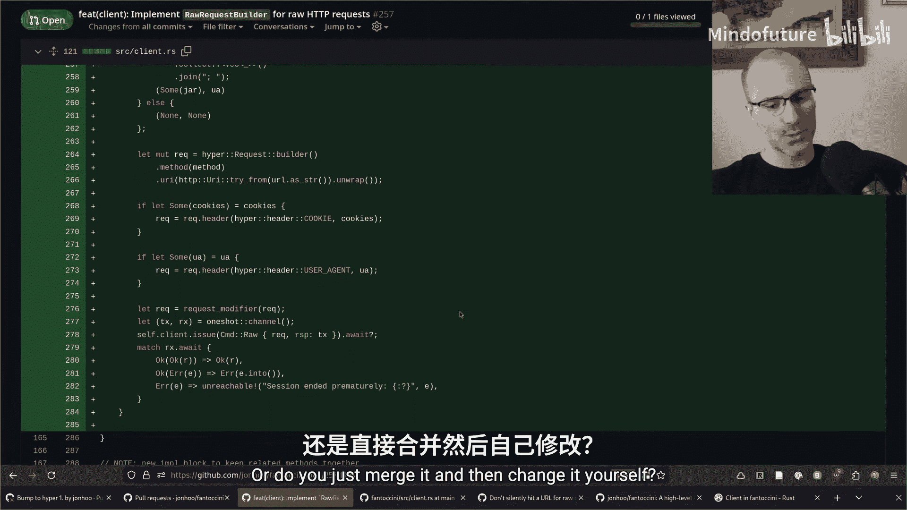

Now， given that this was opened。Two weeks ago， I'm sort of inclined to ask the person to do this themselves。

I think what I'll do here is。I will。I'll， I'll merge the bump to Hy 1。

 I'll do a release of 020 without that change。 Then I will do a。

 then I will merge the bump to hyper 1。Then I will leave a comment on this MR。PR， I mean。

 merge request， pull request， whatever。 I'll leave two comments here。 one。

 please make this please make the with request stuff。

 reuse this stuff rather than having the implementation twice and two now that we've moved to hyper1。

 could you please upgrade to hyper1。So I think I' I'll do the make those two notes for them to update if there's have been like two years ago。

 then there's no way that person would still be around us。 they'll be motivated to do that。

 But two weeks is not that long。 So I think that's what we're gonna do here。

 So that means the next steps are， we're gonna pull here。

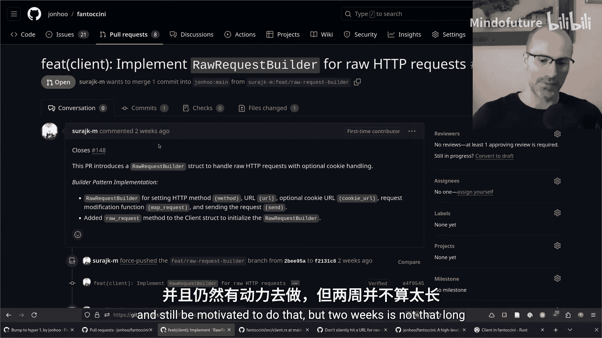

We're going to do a。Here's what we're gonna do。 We're gonna a cargo update。Actually。

 we're going to do a prep。0ero20。And。Cargo update。 we're gonna do a change to cargo Tomel。 Actually。

 I want to do a cargo updatedated slash R as well。 I like to do this before I do a release to see whether there are any dependencies that I can upgrade that are not part of the public API like Hy obviously is part of the public API。

 but base 64， for example， is not。 And so for base 64 we could move this to 022。

And by moving it to 022， people who are stuck on Fantticcini 020 would still have you know dependencies that are as up to date as I can give them。

 and in fact it looks like there were no breaking changes in base64022， which is interesting。

 let's see what actually changed here。

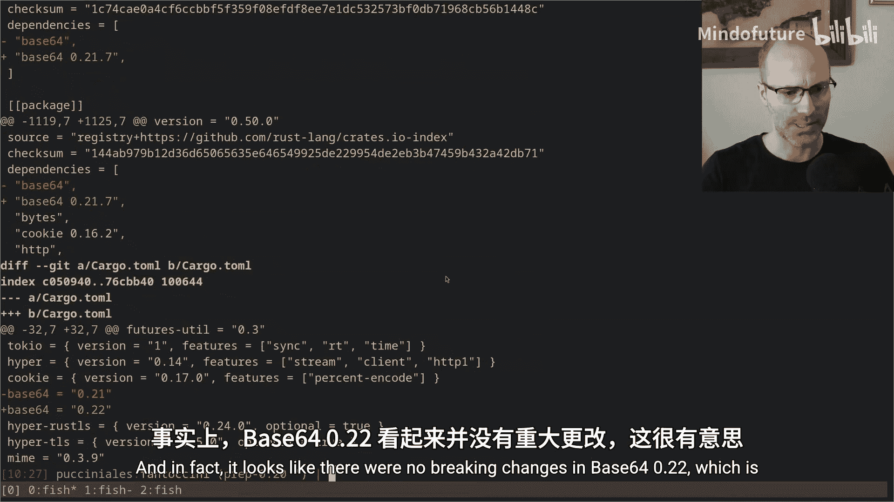

Repository。

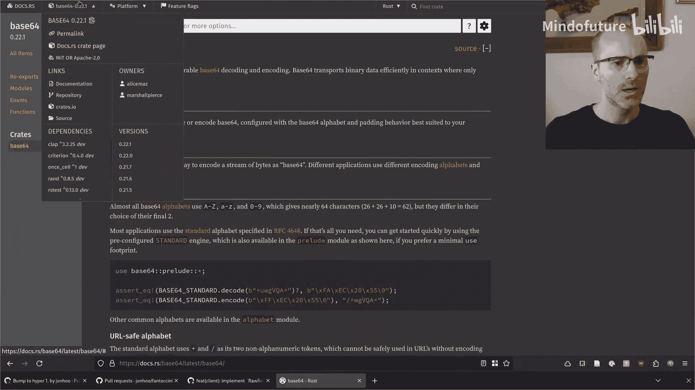

At least notes。0re 22。Okay， this seems like nothing that breaks that changes us。Bump base 64 major。

And then we're going to mark this as actually0，20。Minor Ptichini。Oh， my Lord。

 And then we do Odiss so that we get the cargo lock to be happy。呃。And we push that out。 And so now。

 if I go over here and make that a。Release。Bump and release RC7 as 020。Greatre pull request。

And then I will also put in the description here， I suppose。Prior to Hy1 bump merging in。

Which will be a bigger major change， bigger breaking change。

And then we'll let CI run and then I'll merge this， I'll tag it as a release。

 then we will merge the hyper1 change， which should rebase just fine on top of this or merge fine on top of this and then we tag that the question is should that be an RC or should that be sort of beta or should that be an actual 021 release I'm inclined to just make it a 021 release if something is super broken then you know it doesn't hurt too much if we do anotherang release right after。

So I'll let that CI run in the background。And I guess I'll prep the review here， which is just here。

And。Let's do。Any particular reason why。Why the code here divert just so much from how。With raw。4。

I think。And result is the same。我嗯。So that's just an observation I had separately。

 And then I want to see， I guess， up here。嗯。Now that we have this， andd like。Raw。Clanient for end。

Withre。Client for。To both use this。So that we don't duplicate the logic。

And then I'm also not super happy about the docks here。

 If you look at the docks for the rest of fontgenes， they're actually quite extensive。

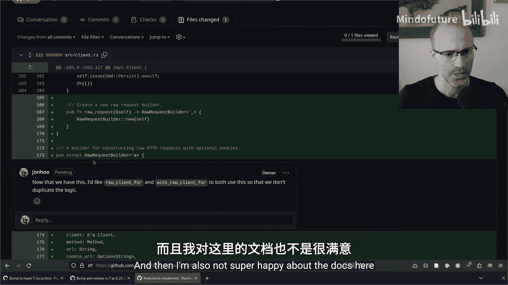

Then in particular， if we look at the。Something like with raw client for。And。

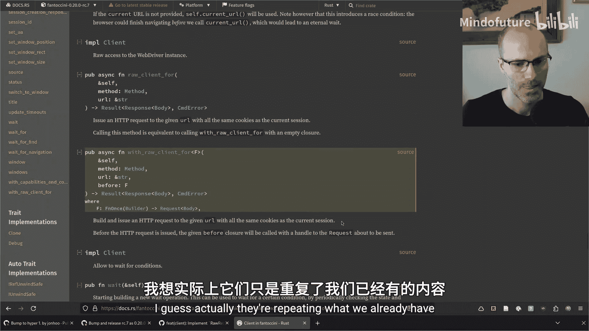

I guess actually， the repeating what we already have。嗯。To see a bit more detail here。

Raw request actually means。Something like I like to give a proposal so they have something to work from。

 Sometimes just they end up just copy pasting my example。

 but but even so I just want to give some like guidance of what I'm after。 Otherwise。

 it can be hard to take。 you know， the idea I have in my head of what the doc should look like for them to write something that matches that without something to go on。

Cs a。呃呃。Build a direct request to the。To a remote site。Without going through the。Web driver。

In Web driverver host。While preserving。Cookies from the Web driver。This is his connection。嗯。

Would be good to give some more details here。

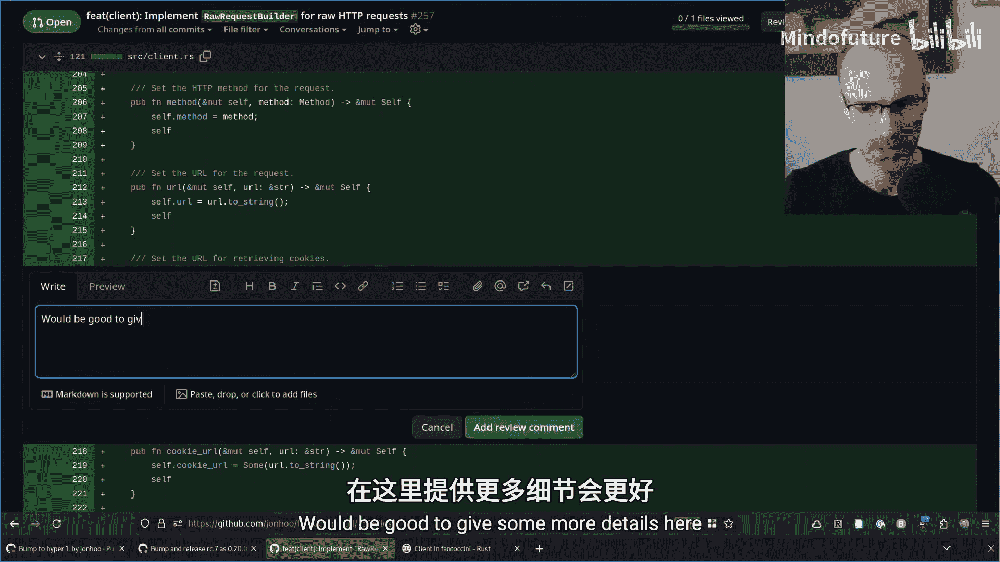

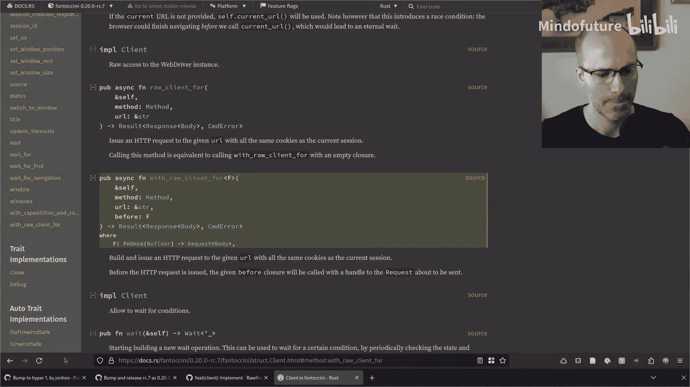

About what this is and why it needs to be there。Links to this， and。That。

Probably also be good for added context。Otherwise。Developers not already aware of this。Limitation。

 this web driver limitation won't know what this。Means。Someone in chat is asking。

 isnn't it faster to update that comment yourself in that case？

 So sort of one of the reasons why I don't want to do that is because I'm asking for a bunch of different changes。

 And so me making one change to this is actually more annoying for them to deal with because now if they try to push this PR。

 they get like oh， there's already been modifications on this branch。

 then they need to like pull and merge or pull and rebase。

 but also because I want them to feel like they own the thing。

 So me writing this does not mean use this string。 It means I'm looking for something more like this。

 And then sometimes you know they come back with， I don't actually think that's quite accurate or they end up writing a bunch more。

 which is good like they give more detail。 this more is me for me to sort of prompt them as to I think there's more context needed here for the developer wholl be reading these docs。

 And I think this is a common failure mode for programming documentation。Is like a the written with。

They're not written with a user of the library in mind。

 They're written with yourself in mind as the reader。 And when you read createates a request bill。

 you go， yeah， that's what it does。 whereasas to someone who hasn't used the library before or has just picked up the library。

 What is a raw request。 Why do I need a builder for it。 right， there's sort of that there's a。

 there's an impotence mismatch here or an expectation mismatch。 that I want to highlight。

And then I guess the last bit is down here。And。And remember， I I haven't posted this yet。

 So I will write this in the past tense as though Hyper1 has already been released has landed。

 This will need to change slightly to match the hyper 1。0 cement。Types and such。Shouldn't be。

Too bad in this instance， I think，2 for 5。May give some helpful pointers。For how to adapt the code。

The changes to with raw client 4。Aerview。Okay， so now hopefully this should be all good。

 The Macs and Windows tests always take forever。Still running。Should probably be unwrap or else。Oh。

 yeah， you're right。Good catch。 There should probably be unwrap or else so that we don't construct the box unnecessarily。

I also don't think these should need to clone， because they consume self。Oh， did I。 Oh yeah。

 you're right。And。呃。May not since we consume self here。

One of the things that's interesting is when you when you know you're asking someone to make decently large changes to their PR。

 I often try to resist the urge to also do a review of the PR at the same time。

 right things like you know avoiding clones or the unrapper elses because I know that I'll have to do another review when they make that change anyway。

 and so I want to not overload them with too many things at once。Like， for example。

 this might mean that they end up changing a lot of this code to basically copy paste the with rockline for code instead。

And。O。Great。嗯。Alternatively， keep it in an option。And just if， let some。

Around the call to this later on。And then I'll wait to do that until this is merged。

 Minimal versions always complains in this case。

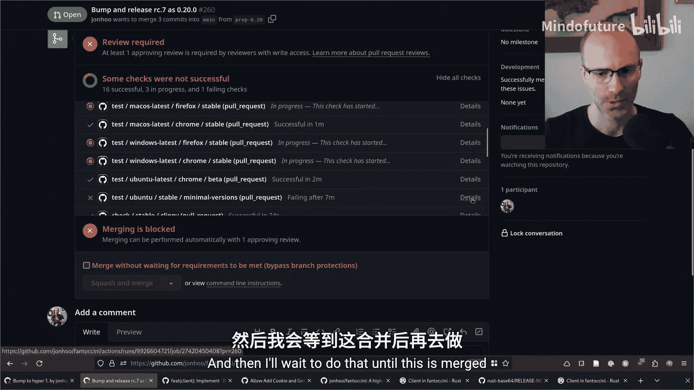

Oh， this is just a spurious error。 I see this。Annoyingly often。That's fine。

 I'm fine merging without that one。The Windows ones take forever。 And so do the Mac OS ones。

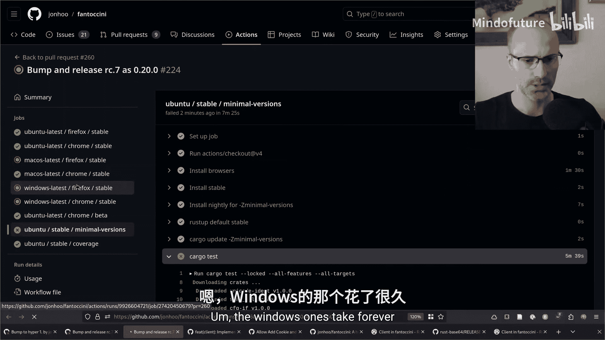

But we'll give it a little while。 Okay， so the order here is going to be merge this， tag the release。

Merge that tiger release。

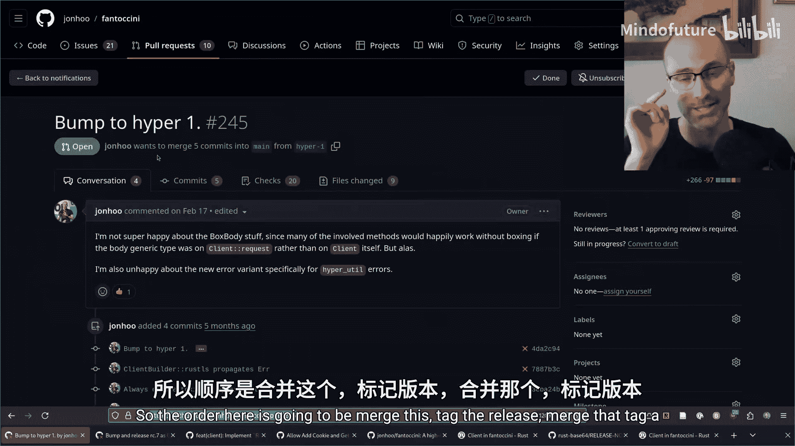

Submit this review。Great。

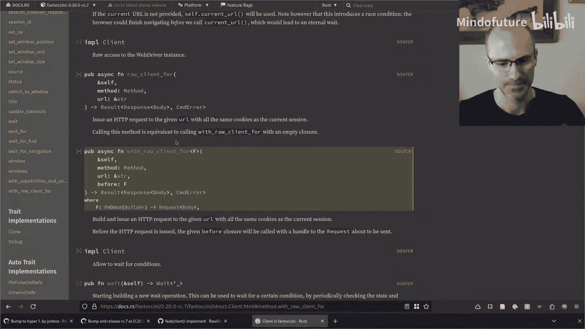

And then we can go over to notifications to see what the next one is。

 Not all of them are gonna be this long。 I， I hope， but they really should not be。

Let's see while we're waiting for this。Any reason you don't have clipulences enabled to catch things like the unrapperels。

 So I actually do have clipi enabled， but there was the the Github action that posts。

Clippy notes has basically not been maintained for ages。 And so it stopped working somewhat recently。

Because no one was maintaining it。 And I think I thought I had updated it with something else。

 Let me see if I can dig that up。The workflows， I think it's under check。Yeah。

 so I've replaced it with this one， which should be working。

So I'm actually a little surprised it didn't show any annotations here。I don't know what that is。

 so there is a clippy job enabled。嗯。Just a minor thing。 Not it using code Co for the code coverage。

 It uses tarpain and some other outdated tools。 Any thoughts on code coverage in Rus and Cargo LVM Co。

 I actually quite like tarpain。 And Tpain now also has LVM based coverage support。

 I don't think I would call tarpain an outdated tool。😊，Also。

 code cover code co does not actually require you to use any particular tool。

 You can use cargo L VM Co and upload to code to code Cove。

 Code Co is just a place where you upload coverage files。 So the the two are sort of disconnected。u。

All right， is this ready to merge yet？Well， we haven't really made any meaningful changes to this。

 and we have we have Firefox and Windows working and we have Chrome on Mac OS working。

 So I I'm satisfied this saying this is gonna work merge commit because I want to keep these individual commits separate。

 merge that。

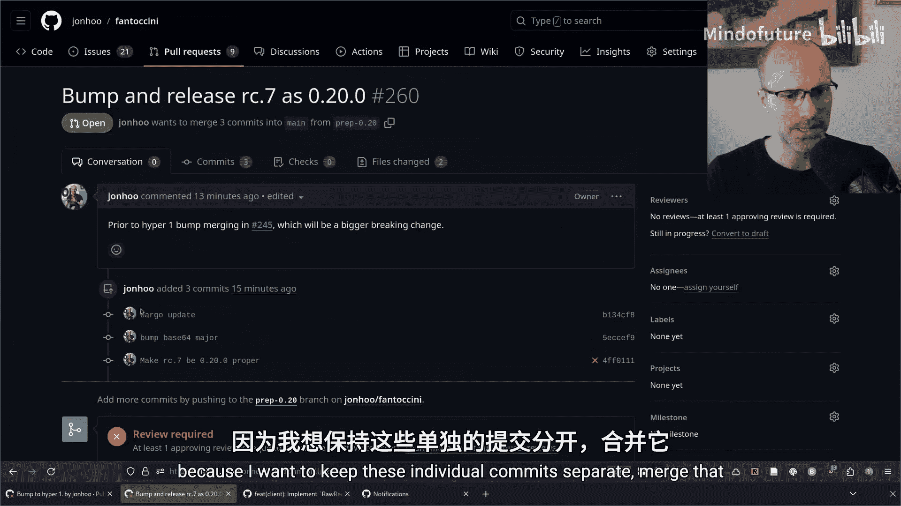

Alright， and then if we go back to main， we do a poll。And then we do my little script。

So now you see a tagged v020。And then we push tags and Git pushush and cargo publish。So， now。

Boom tarpoen is configurable。 You can choose whether to use the sort of old style or the new style。

 Great， so。

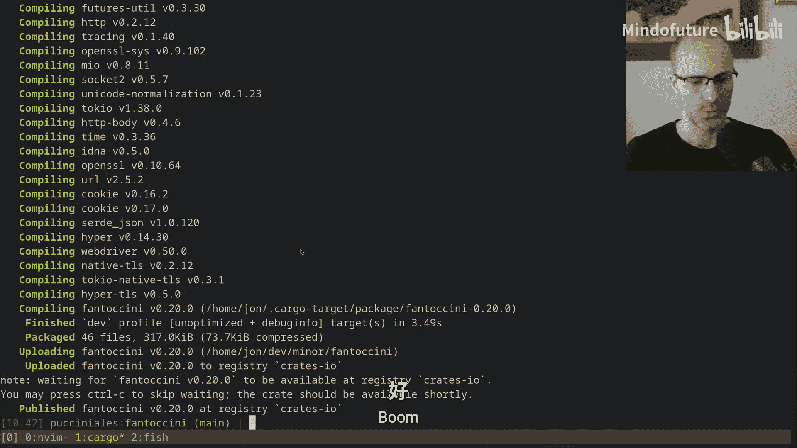

Change has now been cut。So that's comment。 And then we're going to do hyper1。

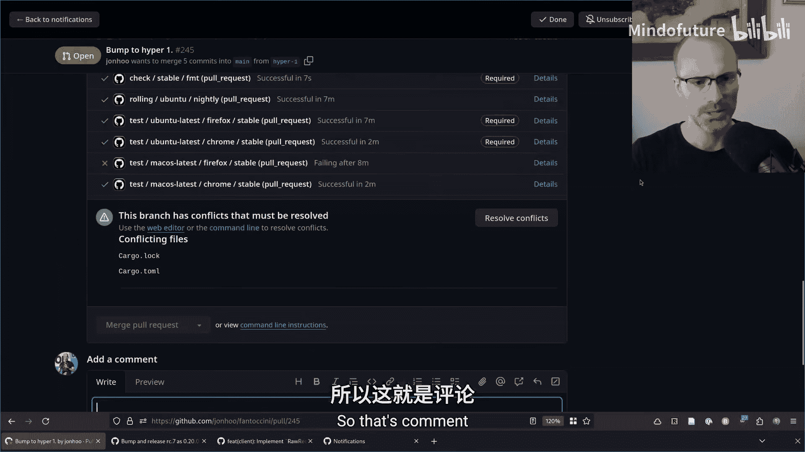

And we're going to do， what's my log here。I'll do get merge Ma。Yeah， cargo Tommel is unhappy。

 and it is unhappy for this reason。 This is now just going be 21。 And then I guess here。

The main thing we're going to pick up is the base 64 change。 and otherwise。

 we're going to keep the things we had。And then for the cargo lock。

 we're going to remove the cargo lock， and then we're going to check。

And then we're going to add cargo lock。And then we're going to merge continue。

And then we're going to run cargo outdated D R。Okay， so there's an update to Hyrusst TlS。To 27。

 which feels like a thing we should。Update as part of this major change anyway。

Do we have anything else as updated？Does this also still build？Is the other question。Great。

 so it still builds。 Let's see if it actually passes our things。Russells 0，27。 It was through 27。

 right， e。Okay， and then we push that， and then we'll see if this now still passes C before we merge it So this guy's done。

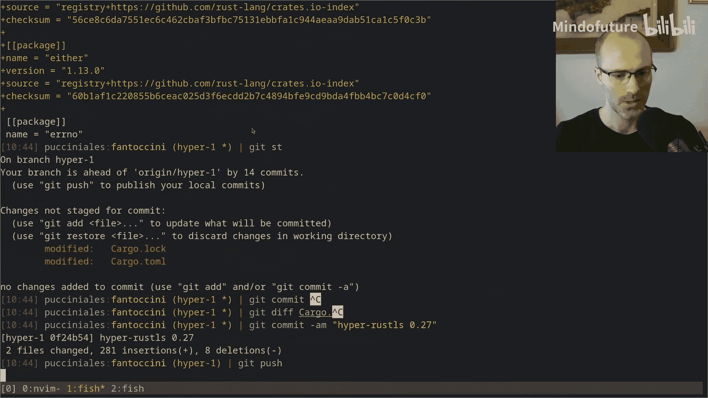

And then we had to wait for yet another C run here。 These are is fun to wait for。Okay。

 let's see if we can do another one sort of in parallel why that， while that C is running。You。

 you'll see here， actually， if you look through my notification， some of them are。

Are like issues that have been you know open for a while and things like here。

 like Otocraraab having been upgraded to hyperht P 1。0。

 this is an example of an issue where I think I filed this issue originally that I wanted them to upgrade。

 And it's because I have another project that depends onoctocraab。

 And that project can't bump to hyper 1。0 until Otocraab bumps to hyper1。0。

 And so this is there to remind me to update that other project that it can now move to hyper 1。0。

 so there's nothing for us to do here。 This is not a thing that I have to follow up on in this issue。

 It's just it means that I have follow up to do in other software。

 And that particular one is I don't think public yet。 And so that one I'm just gonna leave for now。

And this one is actually an example of something that I want to do a stream on。

 This is a really subtle thing around how Drop check works， what it interacts with Phantom data。

 and this is actually just a change to the rust documentation I'll link it here in chat because it it's a super interesting read。

😊，嗯。

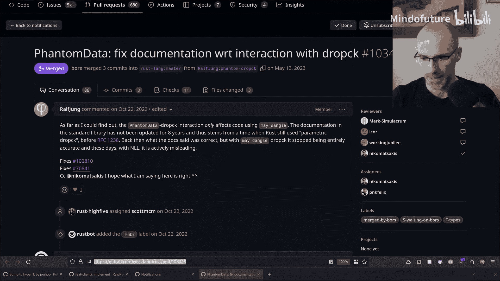

But so， this one is like。

The， the thing for me to do with this one is more of a， hey， do a stream on this。

 It's not really a thing for me to do in that issue。 And arguably。

 I should just like bookmark this somewhere else。 In fact， maybe。

 maybe I should really just start one of those。I'll do that at some point。 I'll do that after stream。

 I'll start a bookmark collection for these instead of just keeping them in my Github notifications。

 which I agree feels maybe， maybe not great。This one， we already did。This。

Is someone running the same tool and trying to get it into C I for a different crate that I own。呃。

Yeah， I mean， those are all great， I just don't want your CI job。So， we'll do。

Same thing we did for the other one。In fact， I don't even have to do that。

 I think I can just edit it directly here。And then， remove the。Spell check。Commit。Thank you。

So this one， we're now gonna。Leave for CI to be happy with， though there's no meaningful change here。

 but we'll read it run anyway。嗯。Bump crates index from 2，5 to 3。 Okay。

 so cargo index transit is a crate that I built on a stream a while ago。

 And the idea was to basically build a compatibility layer between a bunch of different。

Cates I O types that represent things on Cate that I O。

 Like there's a type in cargo that represents a thing in an index。

 There's the crates I O index crate， and there's one other one as well， which is here。

 Let's look at the cargo Tail。So there's the cargo crate。

 there's the crate Iio crate and there's a Cates index crate。

 and it basically implements a compatibility conversion between all those three。

 And so this is an example of there's been a major version release of one of them that we would need to cater to what's interesting here is that this still runs fine。

 I guess the minimal versions has changed， but what is the actual diff here。Oh， it's a diff to HtTP1。

Which I don't think matters for cargo index transit because it doesn't actually use any of the HtDP stuff from the underlying crates。

In fact， we don't access。 We don't do HTDP access at all。 So this 1。

 I don't know if I ever actually published this to createates I O。I guess I did。

 But then in that case， this is fine to just merge。 Let's see why these failed。

So coverage tends to fail kind of spuriously sometimes。

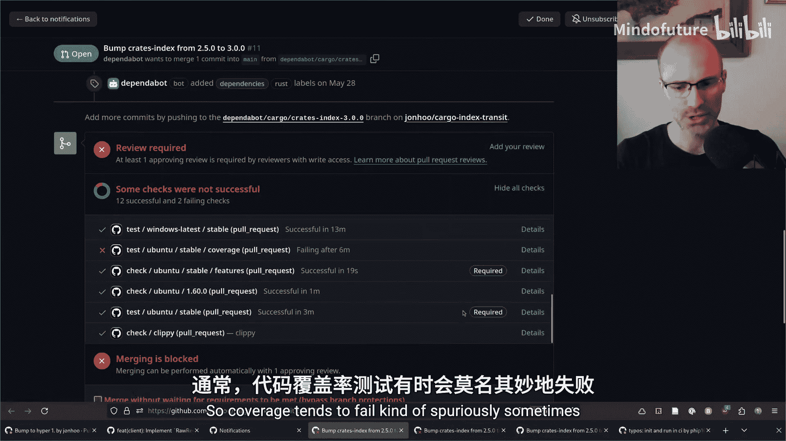

Yeah， this just failed to upload to code cove because of a rate limit。 and this is。

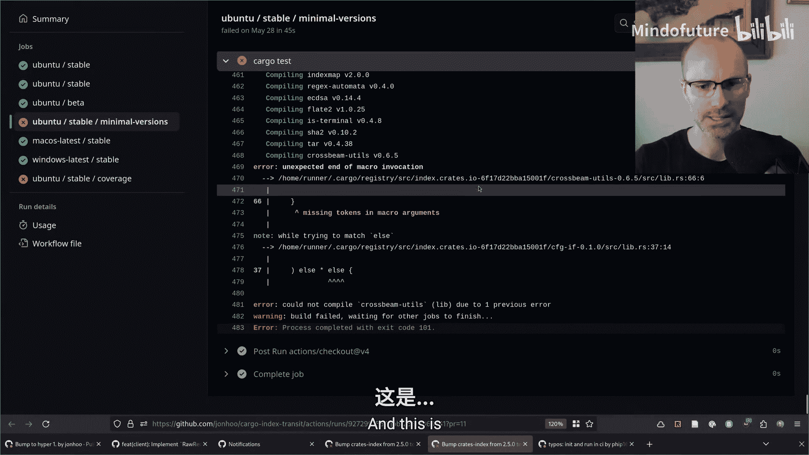

Cross beam us no longer builds with some newer version of rust。Which implies that over here。

 we have a dependency on。Cross beamam channels。 So this is just a minimal versions things that we're gonna to have to fix。

 So both of these， I'm comfortable with merging in spite of。

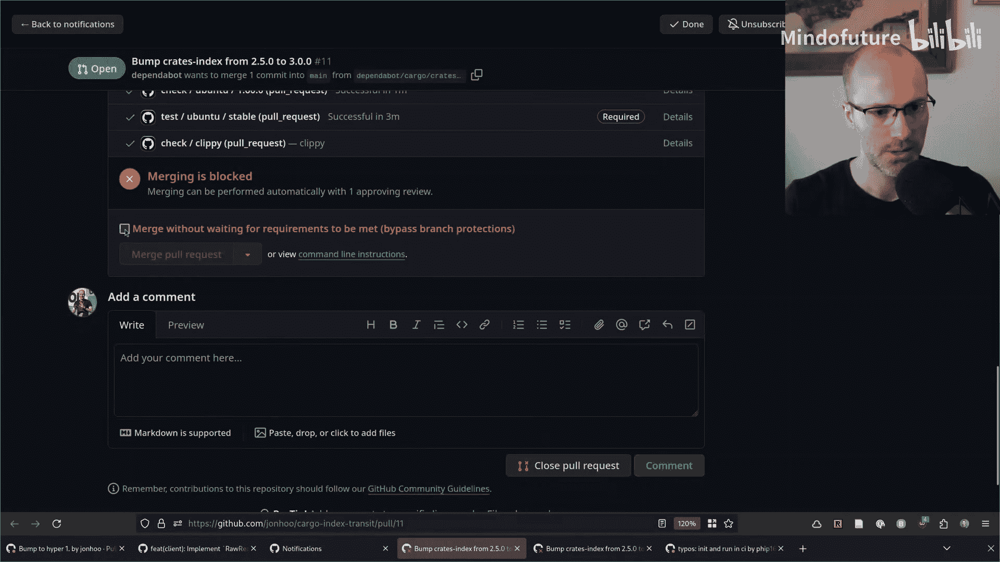

So let's go ahead and merge this one。嗯。And we're going do cargo index transit。

And then we're going to do cargo nightly update Z minimal versions。

And then we're going to check if it still builds。It does not。 great。

 And so it's not building because of cross beam us。So here actually is this needs to change。

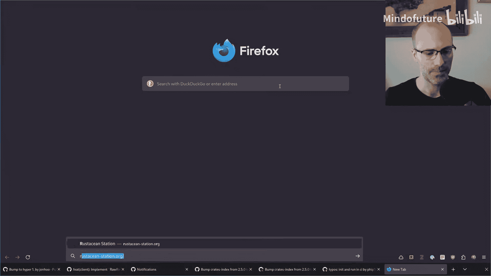

So minimal versions is a way where you take the minimal。

Minor and patch versions within the major version of every dependency in your tree and see that your thing still builds。

 So the idea is basically to check that you， you've specified the correct lower bound for。

 for your dependencies。 And currently， you know， if if。

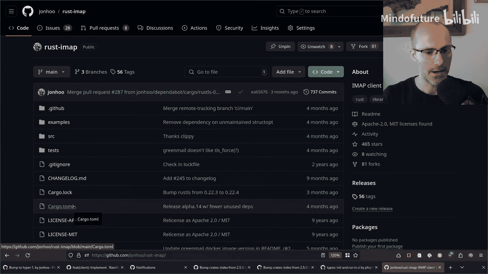

What you run into is if I take a dependency on cargo。

 and then one of cargo's dependencies is incorrectly specified。 Like they've specified they need 1。0。

0， but they actually would need 1。2。0。 Then I get a build error when I use minimal versions because my thing picks 1。

0。0 because all my dependencies claim that they're compatible with that。

 And so I have the separate section in here。 that is specifically correcting the lower bound for transitive dependencies。

And that's all well and good。 The problem with this one is currently they're listed as dev dependencies。

 which means that they actually get pulled in and built as dependencies of my project。

 even though they don't need to be so this is trick you can pull which is to have this so you specify a dependency block that only applies for the following targets and then it's a list of targets that's empty and so therefore those dependencies are not pulled in for anything。

 and then you also mark them as optional to indicate that you don't like they don't actually ever need to be built。

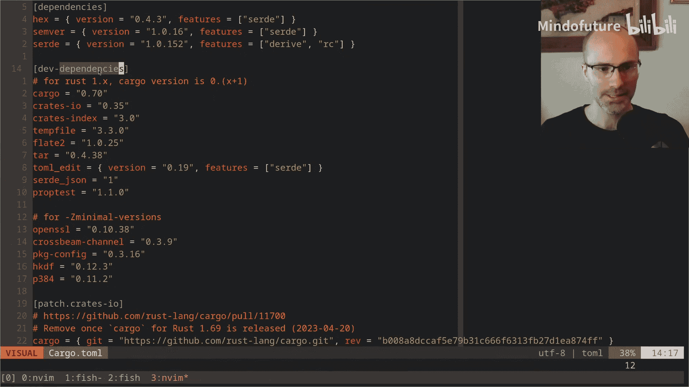

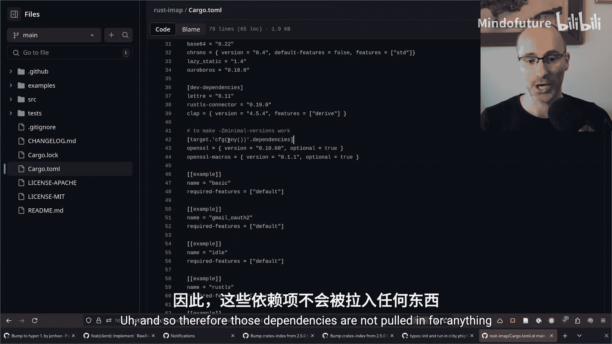

And so we can do this。For all of these。And then we do optional equals true。

 And the reason we do this is because they're not real dependencies。

 We don't actually take a dependency on them。And then we're going to add in here。

 and I guess I'll do a check with this too。Car will plus slightly。And in fact。

 if I do get check out cargo lock， you can see what effect， what effect this would have。If I do this。

And then do a git diff。Oh， I did not change my cargo lock at all。 That seems wrong。Interesting。Oh。

 I think you just found other things that we need to fix。 Okay， that's fine。

 So if I do a cargo cargo up nightly update minimal versions。Then what does it fail to build with？嗯。

Cros beam u 0，65。 Okay， so we'll do cross beam us。0ro dot 6。 And then usually what's。

 what's funny here is also if you look at the us and we look at the change log。

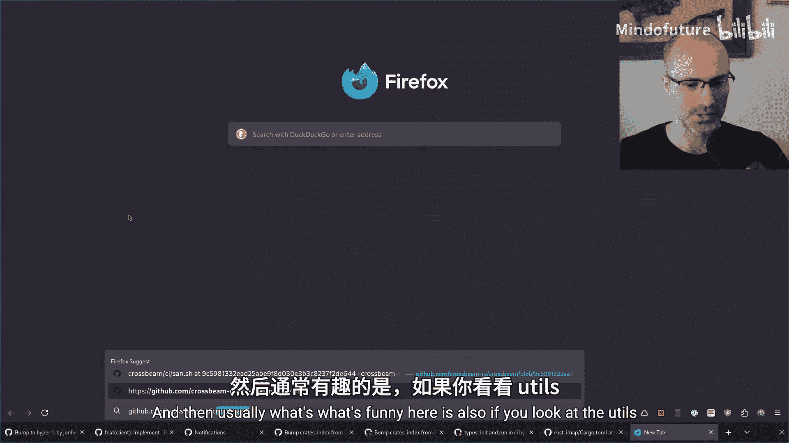

Oh， that's moved far past us。 do we， Why is there even a dependency on cross beam us。

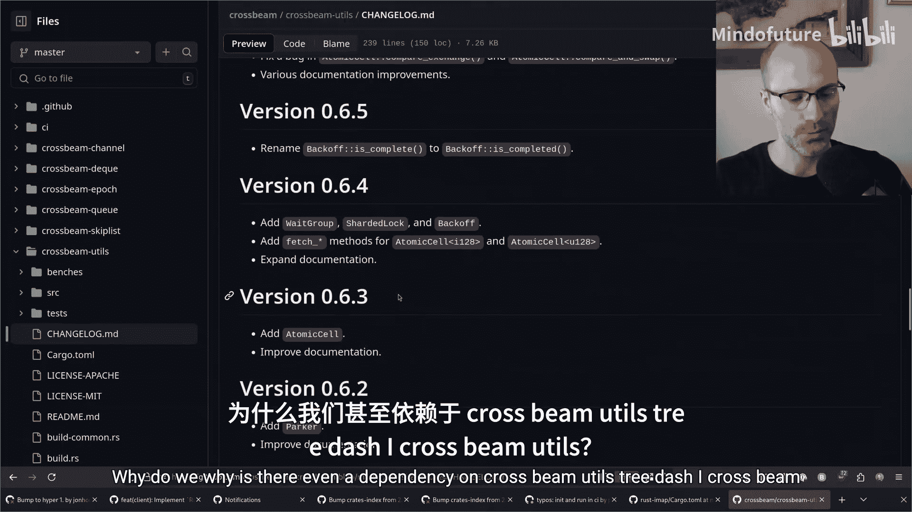

3 dash I。Cross beam muts。 Where does that come from。It comes from cargo's dependency on ignore。

That one might actually have been bumped separately anyway。

 So how about we bump cargo itself and see if that fixes the problem。So let's do a cargo update。

And then an outdated R。And then， now， we can do。We can get rid of some of these maybe like this probably can go away。

And you see P3，84， whatever dependency we had that gave us that dependency has also moved on。

 So for that one， we can also probably get rid of this。 and then Tamil edit。

Has had a bunch of changes。 So that's now on 22 dot 15。

 We can probably get 22 dot 0 and Cates I O has moved from 0，35 to 0，40。2。Actually。

 we'll do 15 just because we're probably going to have to make some code changes。

But why is there no update for the cargo crate。Like。

 there's no way the last version of the cargo crate is 0，70。 Yeah，0，80。 That's what I thought。

 But why did that not show up in cargo outdated。Let's see what we got now now。

There's no way this builds straight away。That would be wild。Cause we， we。

 we use a bunch of like the deep types from these dependencies。 And so it's pretty likely that， yeah。

Exactly that some of the things have changed， although maybe not too bad。

 Could dont fight config in cargo。Oh， wasn't there a change to cargo recently where the cargo crate now has。

Another。I a cargo u。That now holds config。Where has Config gone。呃。No。Interesting。

What crate did Config move into。Maybe call your platform。But I don't think it was cargo platform。

Or maybe they made。Config be private。It's also a little disturbing。

One of the ways to look at this would be， if I just look at something along the lines of。Oops。

Oh yeah， a bunch of this has changed。 Is a cargo ops。Why is that not linked in this。

Like if I do compile WS， what arguments does it take， It takes a workspace， okay。

And a lot of these take a global context。I think they've just renamed Config to global context。

Is what they've done。So I'm torn here because this is a much bigger change on a crate that arguably doesn't matter。

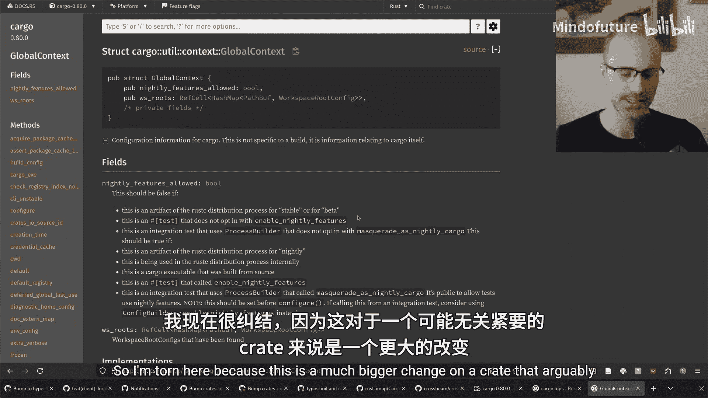

So I'm tempted to just leave this as is and not fix it。

I think that's what I'm going to do just because it's not that important to bring this crate up to speed。

Cause as far as I know no one's using it。Okay， then we will not do that as interesting as it might have been。

 We did learn about that trick， though， So that's nice。

 This thing I'm guessing is not going be a problem。 So we're going go ahead and squash that。

Fix a bunch of typos。 Come from squash。

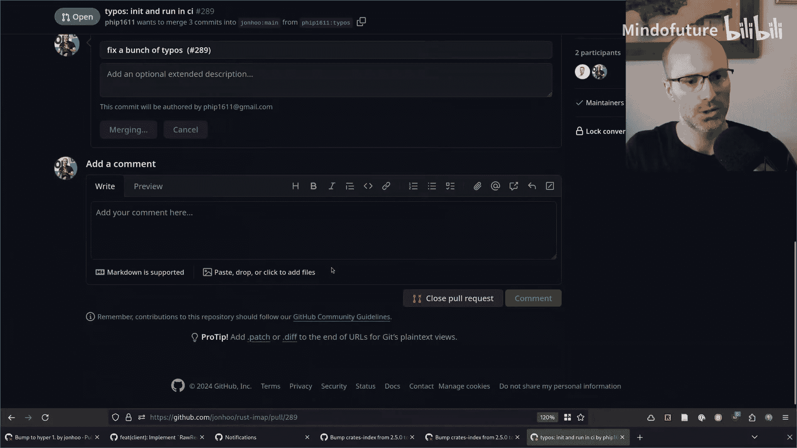

Excellent。So that guy， we've merge next Iap release will include those this I can then just mark is done and move on。

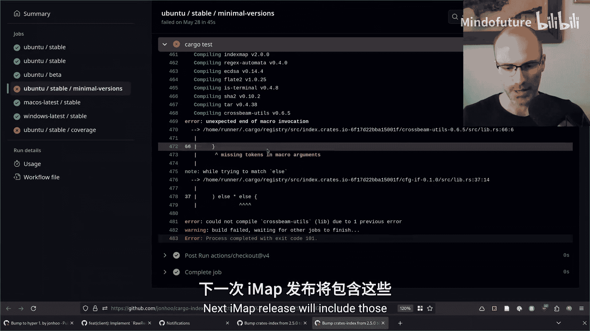

This guy。How's this doing， It failed。On windows on both Firefox and Chrome。

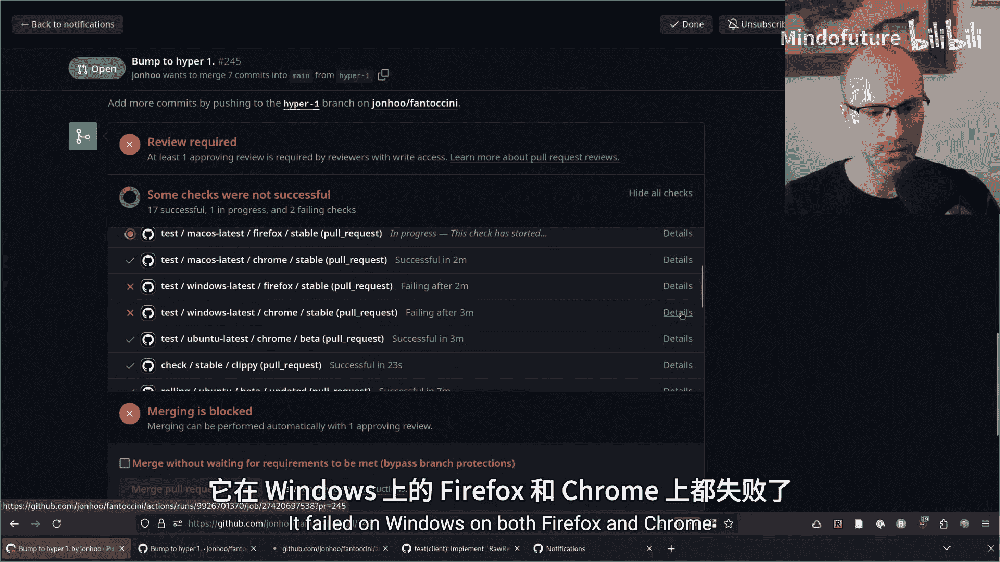

Missing nasm。Oh， boy。😔，Faied to run custom build command for AW S L C Cis。 Oh。

 this is the AW S Lib crypto implementation that I guess they're using on Windows。

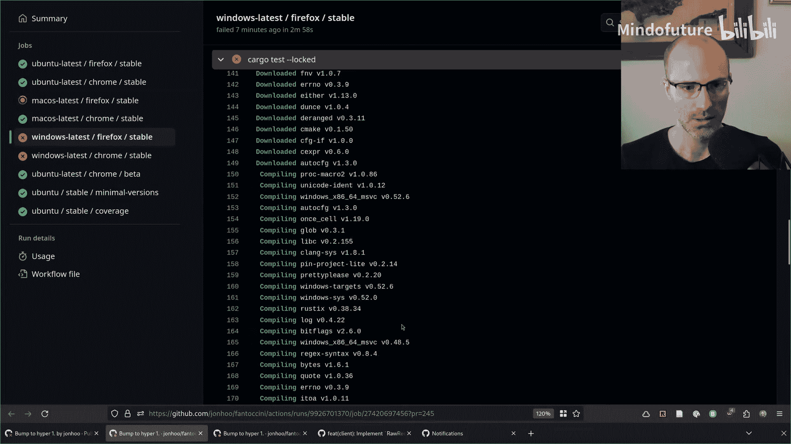

Oh， boy， why。Okay， so this is going to require a change to。This is going to require a change to。Test。

Windows。And then the bits on windows that are going to be annoying are。And。

Where's the bit where we install。Oh， this hasn't merged for a while from my CI thing。So actually。

 let's go back to main and do C syncnc。

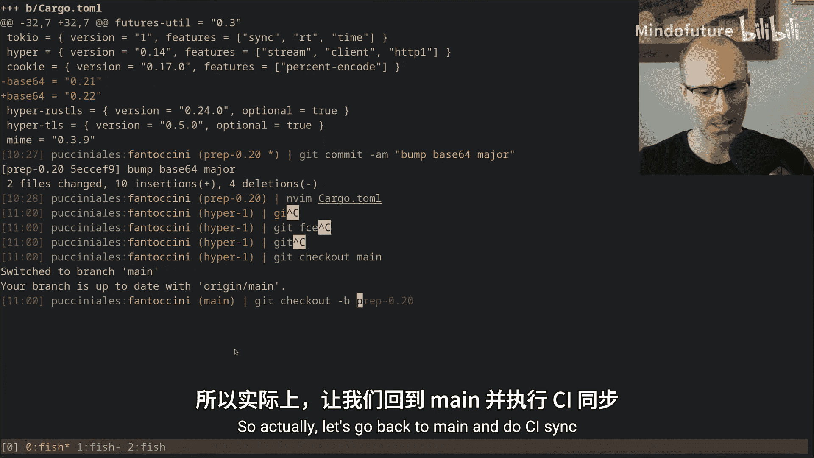

Ftch C I。 So I have a repository where I keep most of my Github CI config so that I can easily reuse it across multiple projects。

 And so that it's easy for me to grab updates on the like。

 And so I can just do get merge C slash main。

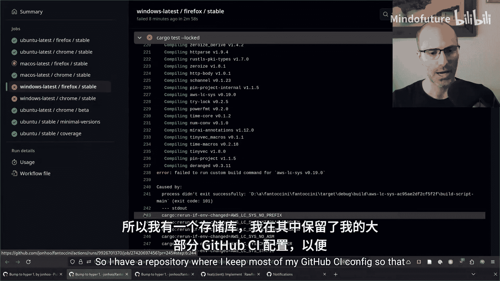

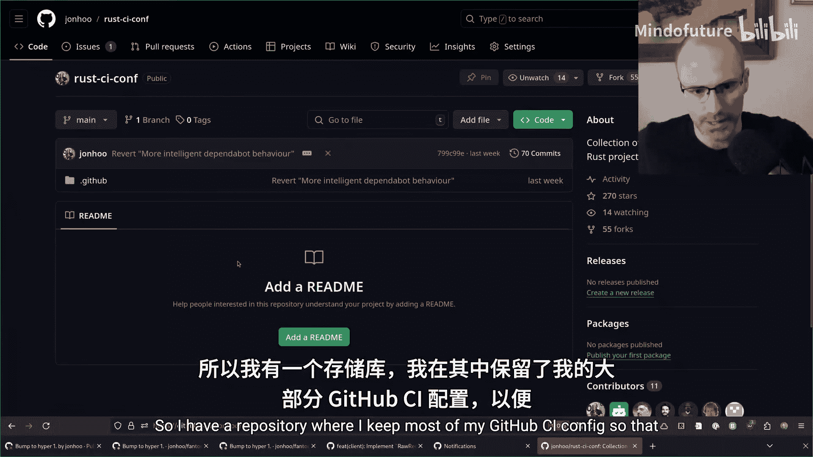

Although that didn't bring so much either， which is interesting。That just brought s checks。

Which is interesting， but not what I was after。No， hyper one。Interesting。

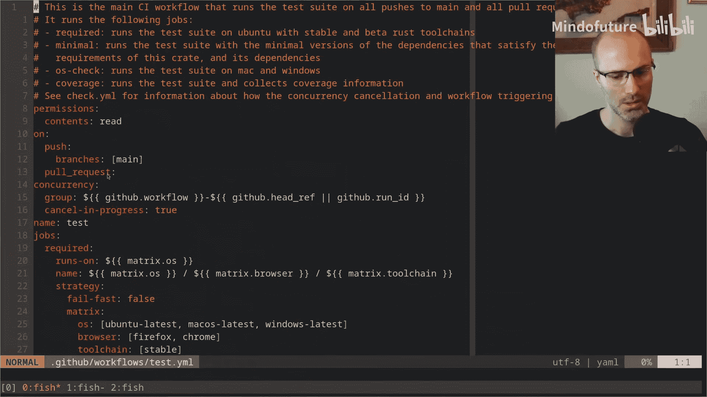

Cause there should be here it is。 O， no， that's not it either。There is a rule in here for installing。

Open SSL on Windows。 It's this bit。That， I guess， I've removed。

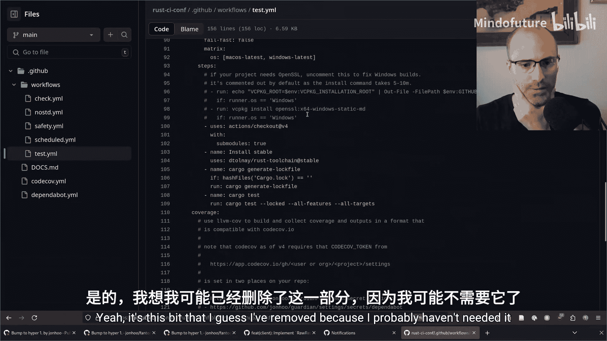

Because I probably haven't needed it， however。

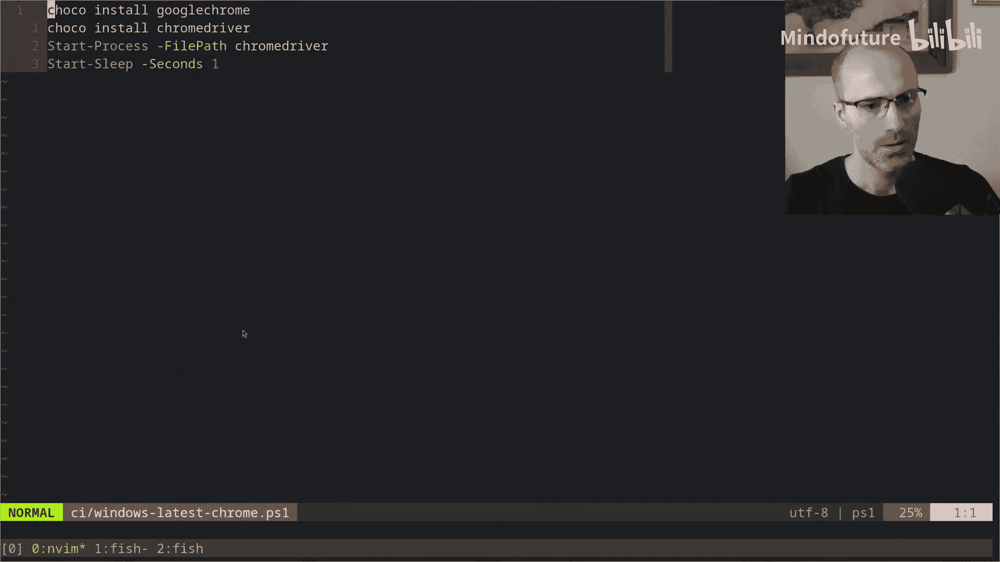

Yeah， I think we're gonna have to also install something here for。For NASm or for the AWSLC。

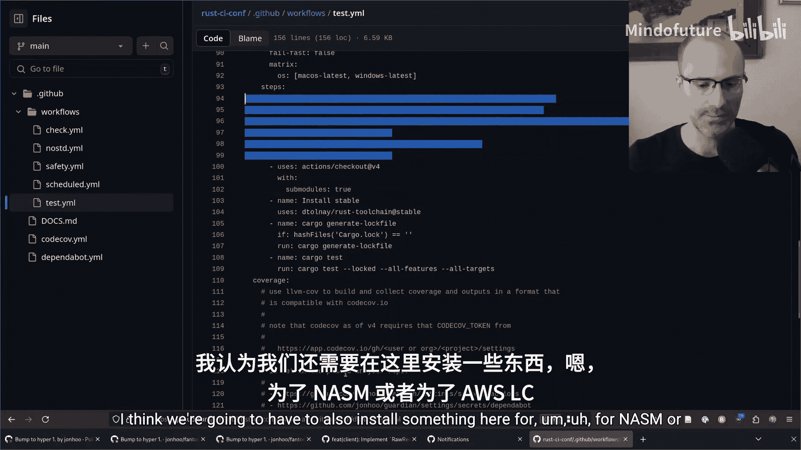

So here's what we I'm going to do。

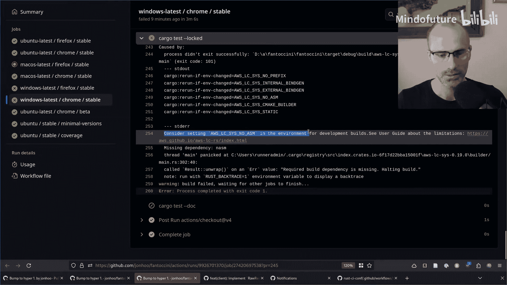

I'm going to do。This。And see whether anyone else is talking about this particular setting。呃。Okay。

He we。L C RRS。Build instructions。Guidance on installing build requirements。Windows。It requires Nasm。

Okay， nasm。So， Github。CI Windows Nasm。

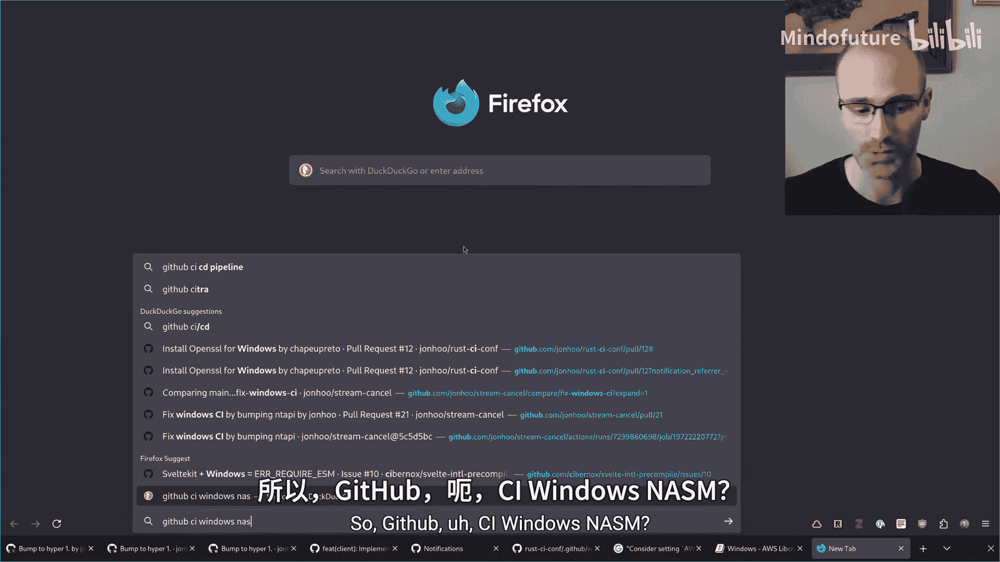

啊哈。😊，See， there's always someone who's done it before。嗯。That's disturbing， and sad。But， okay。

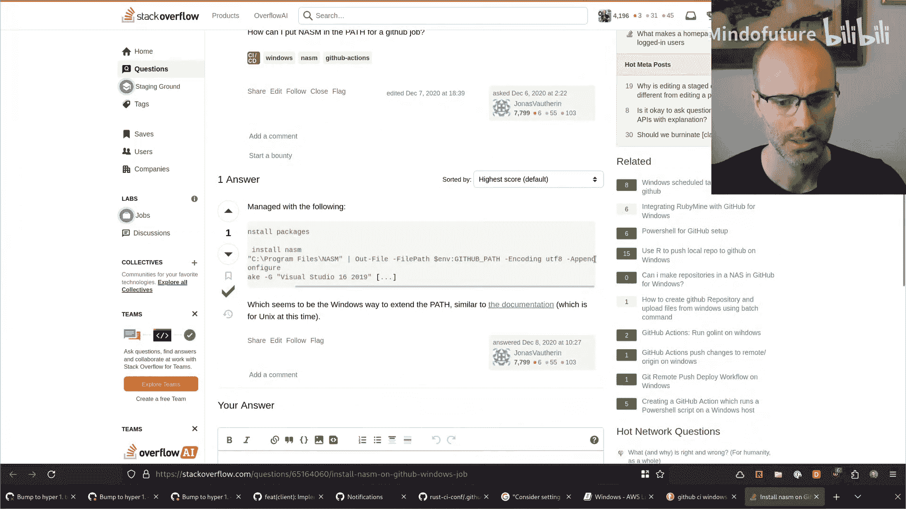

I guess what we'll do here is。Up here。嗯。Install Nasm for。AWSLC。

But we only want to do that on Windows， though。

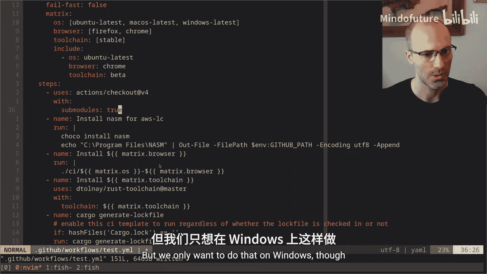

And the rule for that is over here， if runner O os is that。

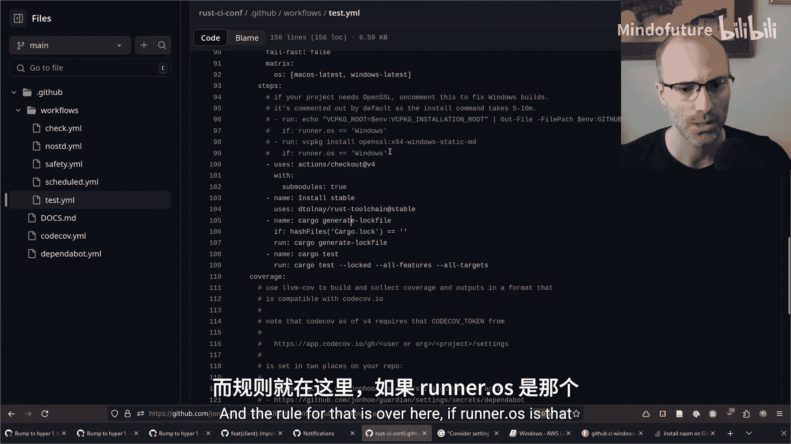

Give windows。Nsm port ofLC。Push。Let's see if that makes Windows happy。

Because all the other ones seemed to be happy as just windows。O。

Told you this one is gonna take a while。 Let's see， chat。呃。

When developing an API for a library how much of a leaky abstraction is mutability。

 like if deciding if the user should be abstracted to it with interior mutability will let them have to define mute。

I don't think of mutability as a leaky abstraction。 I think of types as leaky abstraction。

 So if you expose the concrete type of a field， then you're committed to that field staying that type。

 mutability less so。 I mean， it's mostly a concern if you later on want to make the thing not mutable。

 but that feels like a thing you're more likely to know in advance， whereasas the concrete type is。

 is more likely to change down the line， I think。So I would I wouldn't think of mutability so much。

 it's an important part of your API， but I wouldn't think of it as a leaky abstraction。

Is this a stream for asking random questions， not so much。

 You can ask them whether I get to them or not is unclear。

 It's primarily focused on me catching up on Github notifications， which is happening slowly。

 but maybe shortly。 How's the weather， It is raining outside， and it's nice。 I like rain。😊。

I don't know if you can hear it， but it's nice。Yeah。

 I'll put my microphone closer to the window and see if you can hear the rain。Maybe not。嗯。

Config any doesn't match anything。 That's correct。 Config any matches nothing。

John's favorite topic Windows boy， not even Z is now available on Linux。 Do you plan to try it。

 Maybe， you know， I think Z is kind of interesting， but but as I've said before。

 like without a compelling reason to try something else。

 I don't really want to try something else right and and I don't see the anything that's compelling there for me。

 I actually chatted to this the said folks back when I was leaving AWS。

 I consider starting to work there。 And then I ended up being more interested in Hels as an option。

 but but I do think what they're building is really cool。😊，But the other thing for me is。

 and I don't know whether this is the case for Z， I would have to double check is I want a terminal。

 I want an editor that works in my terminal and the works over SSH because I want the same editor everywhere。

 and I don't know whether Zed does that。诶。You can link to workflows and other reos。 Not quite。

 So what I do with my C thing is no， is that it is just a Git repo that holds a Github subdirecty with the various things that I want to be there in C。

 and I just make commits to this to change it。 And then I add this as a Git remote to my main repo and then I just merge from it。

 So I don't commit this like I don't put the URL to this anywhere in my in my other reos。

 I just add them as a remote and then I merge allowing unrelated histories。

 And from that point forward， I can just merge to get the updates。

 and they just seamlessly merge into my C。

Can I post links here， I don't know whether YouTube lets you。 You can try。

 but probably not just links。 I think only I can do that。Why do you run Windows C I。

 So for Venticcii， I do that because I want to make sure that this works cross platform， right。

 It's a browser orchestration library， and it's kind of useless if a browser orchestration library only works on Linux。

 for example。 So here， it actually does matter that it's。

And like Windows and Mac OS are fairly different environments there。

 and so you actually need to check that they work it's not a given that if it works on one platform and it will work on the others。

嗯。Is there any way to make C context aware to avoid running jobs for parts that have not changed？

 So sort of you can configure Github actions to only run a job if certain paths have changed or paths under a given directory。

 for example， what's tricky with some of these is like if documentation in a file has changed。

 Github actions， There's no not really a trivial way to say you don't need to rerun C because only comments changed。

 you could in theory do it。 But even then， you know。

 let's say that someone changed a doc comment and changed。Text in a doc test in a doc command。

 Then you really want to rerun that doc test。 So it's not immediately obvious how you tease these apart and actually get a more granular understanding of whether something needs to be rerun。

We can。 Yeah， its， it's faint。 And also the my microphone is set to be very low gain because it's so close to my mouth so that it doesn't pick up。

 you know， environmental noise， which also means that it doesn't really pick up other things very easily。

 which is by design。嗯。AsZ is editing via S S H and preview right now。 I don't mean editing via S S H。

 So I'm not talking about running Zed locally and then editing a file through S S H。

 I know a lot of people do that， but that's not what I'm talking about。 I'm talking about。

 I want an SS S H to a computer and then run my editor there to open a local file。

And there are a bunch of reasons for this， like I want the ability to run like pseudo editor on the other side。

 for instance， I want the ability to you know if if。

If I'm running some install script or something there and that script wants to start an editor。

 I want to start my editor。 There's a bunch of that kinds of things。

Would you opinion on L L Ms in general， in the context of software development。

 Do you use any during work， I don't。 This is another one of those。 I。

 I haven't seen a compelling use for it。 I like， I don't think I spend most of my time writing boilerplate。

 I think it really depends on the kind of work that you do。 In my case。For， I would say。

 a decent chunk of the work that I do。 I write code that no one has written before。

 There aren't good examples of the code that I'm writing。 for example。

 I'm doing a bunch of like implementations of CRDT algorithms from papers and like。

L Ms are not going to generate the right code for that because the code does not exist anywhere。

I think L Ms are really useful if you're doing things like using an API that lots of other people have used before。

 that's like well documented。 Like you're interfacing with S3 or something。

 or you're writing like a pretty standard web server that's doing some rest thing。

 Like for those kinds of things。 It makes a lot of sense to have L Ms generate code for you for the kind of things that I do。

 I don't think it really makes that much of a makes that much sense。

 I don't think it could generate a lot of the code that I end up writing。嗯。

Another workaround for the Windows build issue with Russells is to use the ring feature instead of AWS。

 LS， LCRS， so I don't define any features for hyperruss， I think。

嗯。Yeah。It's an optional dependency and I don't declare any features of it I'm just using the default ones and so I don't I kind of don't want to I don't want to specifically dictate a feature here because I want the user of fonttecini to be able to choose the library they ultimately end up using so arguably the way that should work is this should take default features equals false so that it's truly up to the collar。

Which actually now that I think about it。We'll see if that even builds。Yeah。

 you can't do with native roots because that requires using u having well。Hyper。Russeels。

With native roots。It requires Ring or AWSLC。Yeah。And I don't really want to specify either， but。

I would rather than just have it be whatever the default is。嗯。

What do you mean Ne of him working through S H， How would do you do that in Ne of them is just installing any of them on the remote。

 Yeah， exactly， I just run it locally， locally on the remote host。

Path matching for Gitub C iss are very bad with Monte reos， I believe it。

How do you feel about the collaborative editing that Zed comes with and maybe more in general about pair programming I'm a huge fan of pair programming。

 I think often， though you don't really need there to be collaborative editing as much as one person needs to be able to see the other person's screen。

 And arguably， it's a feature， not a bug for the。The pair to not be able to directly edit the code because it it encourages them to be sort of overly controlling or sort of take over and and。

But at the same time， you know， collaboratively editing on a document is super valuable。

 It's hard for me to say because I haven't， I haven't used that collaborative editing feature。

 I do a lot of。是る。Not quite code reviews， but sort of code walkthroughs with teams internally at Hesing where you know a team has built a thing and they want to know whether they've built it well。

 and so I will sit down as book an hour or two with them and just walk through their code and talk through you know here's the thing that maybe I would change here's the thing this is a good design this has the following tradeoffs that you're making you should decide whether those trade offs are worthwhile and for that sort of stuff you know we walk through the code。

 but it's not really a writing code exercise。 It's a looking at code and reading code exercise。

It's relatively rare that I end up actively pair programming with someone。But for that。

 I could see it maybe being useful。And。I have not tried helix， again， no compelling reason to use it。

And。I was saying you could seemingly at the same effect as you're achieving by using workflow links。

 Don't know if that's any better than what you're doing。 I don't think so。

 my memory at least is that reusing Github workflows across reos is super painful I don't really want to build and actually there's another reason why which is one of the things that my current setup of like merging from a dedicated repo has is that I can make local changes so I can merge from my main C thing And then I can edit the files。

 I can directly edit the files and commit。 And then the next time I merge those those changes are preserved through Git merges So it actually works out quite well for me。

😊，How much time per week do you dedicate to open source projects？Really depends on the week。

 really depends on the load Sometimes it's as much as like you know a few like actually like a full weekend。

 but usually it's more like a couple of hours a week it should be more like I'm realistically I'm behind on a lot of my open source projects and continue to be behind but it's just life gets in the way。

嗯。And particular reason not to have a fixed Typos job in CI。

 the main reason for me to not include the  Typos job is because I don't really want to have things running in my CI because things that run in your CI are relatively privileged and so I don't really want to have things that are。

Sort of third party and relatively low value run in C I。 It's just not。

 it's not worth the trade off for me。 You know， there， there's a。

There's an argument that by setting permissions here it might be okay。

 but it also makes your C more complicated and slower and I think for something like typos。

 they don't really matter most of the time and you can always just run it ad hoc so it seems like the value is low and the sort of relatively constant cost of adding new things to your C is relatively high。

Is your newiv a custom config or boiler play config， Is a custom config。

 I've written it from scratch。 Basically， I've taken a lot of things from different configs。

 but it's written by me。The problem with screen share is you just get a limited view of the page that's the main benefit of collaborative editing so yes that's true like if people can go to different parts of the dock at the same time。

That's true。 However， I also think there's value enforcing the same view of the doc so that you can talk about the same thing and also forcing you to be synchronized about what you're talking about rather than some person being distracted somewhere else in the dock。

 So again， it depends on whether you're using this for like pair programming where it really is we're working on this like one person's the driver and one person is sort of the observer or payer or whether you're doing this is we're collaboratively editing a doc。

 So for the second case， I totally agree that you want fully collaborative editing across the old document。

 if you're actually pair programming on a problem。 I think it's less clear。嗯。诶。Okay。Great。

 let's see if the C has。

Ended。Windows jobs are still running because of course they are。

Why did Knightley fail。 Yeah， this， this one test is spurious， and it's extremely annoying。

But I will rerun that job should be fine。 this Windows job。😮，At least built。

 So then I think it's for crying out loud。It failed the test， but it did build this time， at least。

 but it looks like a lot of them fail。Which is fascinating。All right。

 I think we're going to move on to other。

PR is while that continues to run。嗯。Right， so this we dealt with。

I'll just open a bunch of these because many of them， I think we can just not do anything about。

 This is an experimental feature that someone proposed to cargo for basically something that's higher level than the external C。

 A BI。So it gives like first class primitives for things like vectors and not just for for pure arrays。

 this one I'm just monitoring because when the RFC ends up landing， I want to read the RFC。

 but I don't actually follow all the discussion so we can mark this as done。

This is a PR to missing semesters， missing semester is this MIT class that I ran as part of the I student Tea month of January a few years ago。

 where we talk about a bunch of things that are sort of missing things that are never really taught in CS courses but that we think are important things to know anyway。

 stuff like how Gitworks， and we get a bunch of MRs to this sort of randomly on。

Like we've published all the lecture notes and everything， and then there's always something small。

 the man exercised for Windows users。In general， a course is focused on。Unix systems or。Yes。

For Linux。So。I'm inclined to keep this， as is。诶。Besides。呃。

Nothing in this line Ash says that you have to use man。Searching is also totally fine。

So this one we're just going to not do。Close。The reason Windows CI is so much slower is because GitHub CI has way fewer Windows hosts。

 so they take longer to be scheduled and also because I don't know the build just tends to be a lot slower。

Wow。Okay， when those failed。 Why did it fail。Timemed out receiving message from Re。That's disturbing。

An existing connection was forcibly closed。Incomplete message。That's fascinating。

The hyper1 bump just breaks windows。I guess。Wait， what The Chrome job。Oh， this is 30 minutes。 Okay。

 good。 It's like we're there for a sec。 Let's see if Firefox also fails。

The Firerefl job is also failing。So hyper one on Windows。For some reason。

Causes a bunch of the test time out。Timed out， receiving message from render。Interesting。

I don't have a great answer for this。Although this is an error from。Render。Oh。

 this isn't a hyper error。 This is。Hyper。Hyper did get a response from the Web driver drive like the web driver。

Proxy， adapter， or whatever。And it said that it got a timeout from the render。

 which is basically the browser process。Interesting， what about the Firefox ones。

 I want that to fail too to see if we get a different error there。

Chrome driver。

Well， that's not going to be very helpful。It might actually be that we need。

Every version ju breaks unless you pass cryptic arguments。 Oh， good， Oh， good。呃。

It could be that that's the， the change here， although。Xai。Windows， spare windows。Oh。

 it could actually be that we just need to update the。

The driver instances here。S news version of Geckcodver，0，34。Al right， let's try 034。

For Geckcod and Chromedver， we're just installing the latest one。

So I'm guessing here that there's then some bug with Chrome driver that like。

It needs to be started with a particular set of。Processes。But which ones， though， that's gonna be。

May 2023。They said to change to headless new。Oh， boy。😔，Enable automation。Oh， they target the GPU。

But is this for。Are these arguments for the Chrome driver or are these options for the。Oh， boy。

I see here。ChromeDver has none of these options。Okay， so that means we're going to have to change。

 but， but this shouldn't have changed because of the upgrade to hyper。

 That's what's really weird here。

诶。B。The Firefox one is also still failing， which is interesting。

I'm pretty sure that this is like related to the GPU stuff。 I'm， I'm just baffled by why。Oh。

 we already passed Disable GPU for Chrome。Let's see。Okay。Maybe we also need this enable。Automation。

 but I don't understand why this would have changed with the hyper1 off grant。

Maybe we just haven't run。

Maybe we just haven't run C for a while。 No， we ran C I。 No， that's not even true。 Oh， okay。

 here's what we need to do。 The PR that we just landed for this。How did C fare here。

 Because we ended up merging without it。Yeah， here， at least Windows on Firefox worked fine。

 How did Windows on Chrome Fair， Windows on Chrome failed before the Hyper1 bump。 So this， I think。

 is just Chrome changed on Windows。

Okay， great。

So now we got to try to figure out how to fix。Chrome driver on Windows。

No sandbox， Disable GPU。Theisable extensions。

And DNS prefeched Disable， I don't think that should matter。

 I think it's this enable automation thing。

But I'm just curious about what other。Let's do here tools。Search in the past year。

January 2024。I'm also facing the same problem。 Okay， great。

呃。

Oh， good。 No one's， no one has an answer to it。Sweet。

March 2024。

No response。

What about this guy？

It's not about increasing wait time， that's a lie。

You missed。On enable。Oh， oh un enable。哦。No， enable automation seems like it should not have dash dash。

Which is itself is pretty wild。 I guess， actually， Chrome options。

Remember， someone， this PR we already looked at， which is someone gave us the updated URL for this。

 And so we can just go look。

What this is。嗯。Common use cases custom profile start maximize non standard location block dials。

Chrome options。This is a part of As， which means we need this page。

Why is this on a random blog somewhere？

Hao， boy。Oh， boy， okay。Automation。Enable indication the browser is being controlled。Okay。

 so that probably doesn't do anything that we care about。啊。Headless。And we have disabled GPU already。

So this is all very unhelpful。Because this has to be something that's changed recently。October 2023。

Chrome WebDriver 115。Okay。Okay， but what did you change。What did you change。

 Tell me about what you changed。

呃。I don't know what Catalon Studio is， but what changed in 866。tagags。Compare。Compare the 8，6，5。2，8。

6，6。Right， what changed？That's completely useless。That's completely useless。<|OTHER|>唉。

I'm guessing it's probably not。

Webd。

Chrome 1，15。

Driver restructuring the new Chme。 Okay， Chrome for testing。

Oh， oh， okay， so maybe a chacoal install。See， this is what open source maintenance is often like when you maintain things that integrate with other systems is a seemingly simple thing takes you age just to figure out why something is no longer working anymore。

呃。Okay。No， I want。Where is the。How can I see the chocolate we go？Chrome。Okay， Chrome driver。

 that's fine， but I also want。Chrome testing。

Ha chaco Chrome for Tea。

Interesting。

Let's do Gitthub actions， Windows， Chrome for testing。Wo。Okay。So I'm guessing。

This is now what we have to do here。Okay。And then we might actually not even need。

This change we made here。Fieffox and Chrome。2。for testing。

So the default Chco Chrome driver package seems to install Chrome for testing。

 but does it install Chrome driver for testing or also Chrome for testing？Let's see， files。呃。

Depenencies。Discussion。Discussion is completely unhelpful。Okay。Oh， boy。Okay。

 the window of Firefox failed because。Navigation timed out。That's interesting。 I wonder。

 So so this might also just be because the。Fiirre fox thing we were installing。

 The gecko driver was also old。So I guess now we will。See if C is happy now。And end。

 only the Windows ones。Cause all the other stuff still works。

 I'm going to go back and close all these tabs。Nopes， that was too many。Great。Back to notifications。

呃。Okay， this is someone debating。An issue that's not a fetoi issue。 so that can just be closed。呃。

This is。Someone playing around with the TCP implementation。Made a PR in the wrong repository。

 great that can be closed。Rst Iap。How to handle deflate compressed data streams。

 are there any plans for related support。呃。For the I map crate。

So I don't think you can have deflate on the TCP connection to the server。嗯。

Specifically for things like attachments。I don't think。Bate can be used on the entire。

For attachments and the like。A creepep does not。Craade just gives you the。Raw。Multi parts。

Decoding their contents is up to you。Comment。And I guess I can do。Oh， there's so many。

There are so many pages。 I'm hoping many of them will be a lot faster than we just went through。

 though。 Tra issue for public and private dependencies。 I really want this。

 So this is the ability to say for a given dependency in your cargo Tamel to be able to say this is a public dependency or this is a private dependency。

WithThe idea that if you have a private dependency。

 it's always safe to bump its major version because none of its types appear in your public API。

 And this is just a major foot gun where people。Fail to take into account all the types that are reflected in their public APIs and therefore issue accidentally breaking changes。

 So being able to have this delineation in your dependency closure dependency listing be super helpful。

 It looks like they're hoping it might make it into 2024， but its help wanted for that to happen。

So I would love to see that happen， but I'm not going to be the one driving it。

Unlikely for this edition， Po future edition。 That seems fine。 It's sad。 I really want it。

 but I will who。What is this， though。What is cargo Public API Cates？Oh， no， that's different。Alright。

 so that's not helpful。嗯。Stabilize the Li un nameable types。

So this is a link to the rust had for ages that was sort of the ability to tell you if you have a public type。

 like a type that's marked with pub。 but that is not reachable from outside of the current crate。 So。

 for example， you have a private module and inside of it， you have a public type。

 Then even though the type is public， there's no way for a user to actually name that type because the module it was in was not made public。

 This is usually an error， right， Usually if you declare a type pub。

 then you intended it to be reachable。Sometimes it's not though so sometimes the type should have been pub cr instead of pub sometimes it's because you need a type to be pub so that it can be in a public interface。

 but you don't want users to ever name that type those are exceeding rare circumstances。

 but they do come up and so that the unreachable pub L I think was basically split into multiple li one of them being this unnameable types and with a nameable types being the li that will probably worn by default because you probably didn't intend for it not to be namemable。

诶。Yeah， that's fine。 This was just a， I think I just had this subscribe to because I was interested in this landing in the first place。

But there's nothing to really follow up on here。Signal handling。

An RF from 2015 on signal handling in rust。And a comment from June Zang would love to see progress。

 Okay， great。This is an easy one to adjust Mark is done。

When I try to connect a Geckku drive from where you've been to server， this comes out。呃。

The code for spawn is this with headless， thank you。What do you say to something like this？And。

This， these look like they're gonna fail。 not gonna lie。

哎。Okay， I guess what I have to tell this person is。That， for us。I mean， I can't debug this for them。

But what I'll do is。Not what we use in C。So if that doesn't work。

I'm afraid you'll have to do some debugging。On your。Close。

Your Windows CI passed on Chrome 125。

Interesting。Oh， you dug back in the build logs？

But then。What's going on here？Okay， so then it's not the。Then it's not the chromme for testing bit。

Although， I mean， this did seem to at least still do if we look at install Chrome here。

It did at least install Chrome 126 and ChromeDver 126。

So I'm fine keeping that change because at least it makes sure that these are in sync。

 so that seems fine。I wonder whether it just like didn't start。

Because I run start process。And maybe that fails。

What's weird， right is that Firefox is also failing。

And so， I wonder whether。What's happening here is that。The browser isn't starting。

Because if the error we're getting is that the proxy， the driver handler， so to speak。

Is unable to talk to the browser Time out when talking to the browser。May the browser crashes？

Or exits or doesn't start in the first place？Because these the fact that Firefox and Chrome are both failing is sort of a。

A telling oddity here， right？

It could be that we need to。The we do explicitly start Chrome and start Firefox。H。😊，I want。

 I wonder whether Github actions。Windows。Gecco driver。

And then I want to search for sometime in the past month， maybe。

I wouldn't be surprised if the NpX command didn't update Pa。嗯。I mean， that could be the case too。

 although then we should see the start process fail。And it doesn't， right。

If we look at。The Chrome job。Install Chrome。Slls Chrome installs Chrome driver。

 And there's no error after that。 There's also no message after that。

 So it who knows maybe Powerhell doesn't exit with an error if the， if start process fails。But no。

 it must be starting because otherwise， I mean， we'll see at the error that that comes out of here。

 but。But if it truly is like the connection to the renderer。

 then that must mean that the Crone driver does start。Because otherwise。

 we'd get an error trying to talk to the Chromed driverver in the first place。

It's not helpful。😔，No， I mean， the start process must be working because otherwise we'd time out talking to the driver in the first place。

And at least that was not the error mode we saw earlier。

All right， let's I'll let those keep running in the background and we'll see。Okay， notifications。

Just keep on going。The relentless march of progress。Open， open。 This has been resolved， open， open。

Unable to generate a flame graph from the collapsed stack data， this is in F graph。

And I've been tagged into it， I've replied， and someone has replied with me too。 Okay， great done。

Unsafe field。 So this is another one of those RFcs that I'm interested in is is basically being able to mark individual fields is unsafe so that accessing them requires unsafe to indicate that there's some additional invariant maintained for that field again this is something for I want to read the RF when I gets closer to landing So I can mark that as done for now。

呃。This is another RF for adding a diagnostic blocking thing。Oh。

 an annotation to be able to say that a function is blocking and therefore should not be called in async context。

 So thist neat is another one I'm just tracking。嗯。Rust up is not safe for concurrent use。

This seems like a plus 1 me too， so that can be done。Adding sums to histograms。

 so this is an HDR histogram， which is a crate for keeping histograms over large batches of data。

Efficiently。Have used case where I'd like to get an approximate sum of all the values in a histogram。

 specifically I'm looking at tracking the latency of calls in nature histogram and then noon something like histogram do sum that looks like this can be achieved through it or recorded。

 I was wondering if there might be some interest for a dedicated method for this。嗯。Oh see。

it's getting wet over there。 Hey there。

These kind of utility functions are always kind of。Hard to say whether they are a good idea or not。

So a share histogram。On the histogram type。All the values are stored in buckets and then。

Each bucket holds like what the。sort of what the value of the bucket is， histogram wise。

 and you have exponential buckets is one of the ways this can be efficient。

 so it stores like approximate buckets basically， and then for each bucket you have a account of the number of things number of samples that have been in that bucket。

And we have if I minimized this。😊，We have a method that gives you the length。

Which is is the total number of samples recorded so that is the。

The sum of the counts across the buckets。But I think what this person is after is。A sum of the。嗯。

Some of the values。 So arguably， I should draw this， but I think I can do it in an editor too。

So you have something like that what the histogram really looks like is  zero to 100。

 you have 50 samples， 100 to 1000， or I guess zero to 10， you have 10 samples。10 to 100， you have 50。

100 through 1000。 You have 25，1000 to。10000， You have five。All， so you could imagine that this is。

What you have。And then dot L would currently give you 10 plus 50 plus 25 plus 5。

 I think for dot sum thereafter is1 times you know，0 no 10 times 5。

 so that the average of bucket1 plus 50 times 50。Plus，25 times 500 plus 5 times 5000， roughly。

That that's what I， that's what some would mean to me。 But this is a really weird value， right。

 because it's like。You don't actually have the sum of the samples， you just have the sum。

 you have the product， the average sample， so to speak for each bucket。

So this actually is weird to me。Traing the latency of calls and then doing something like。

Histogram do sum。It's an interesting idea， although it ends up being。呃。Expect。

 you'll end up with semantics。With having to decide on。The semantics you want out of that call。

Depending on the application nature of the values。In particular， this is。Because the。Buckets。

Record samples in a lossy way。So the original sample value is not actually preserved。呃。So， your sum。

Would end up being more like the。嗯。Count of a bucket times the。Buckets。Min。😔，The times the。

Mean of the buckets。Count。Of each bucket times。The buckets。Range is mean。Which is。Od。Alternatively。

 we could keep a running。Some of the recorded values。How are that feels like a。

Thing that could just as easily be tracked。Outside of the histogram。呃。And thus， probably should be。

I'm not going to close it because maybe they have some more thoughts， but。That's my initial thought。

Unsafe pinned asing of pin mutable references。This is actually an instance of an RF that has landed。

 and I want to incorporate it probably into a video into like an unsafe Chicleles talking about pinned and unsafe。

 So this one I'm gonna mark is unread and it's another one that I'm arguably should bookmark just like the previous one rather than leave it in my Gitthub notifications。

All right， house is progressing。 this has now failed。

It's still timed out receiving message from Reer。So， again， this must mean that the。

Chrome driver runs。 We definitely run the Chrome driver。So that means NPX must be adding to path。

So if we then go here and I want to do this。And then I want to search for Chrome 1，2，6。

And then， maybe。Past month。This is very old。

啊。

Someone else with the same problem， but not super helpful。

H。Won whether you just search Selenium for this。June 6。January 11。Okay， nothing in there。

Automatically closed。Automatically closed。

嗯。I actually think one thing that we should arguably add in here。

Actually， let's do this。 Let's do Chrome driver。1，2，6， change log。A hat Chrome 1，2，6。

m。Media， JavaScriptscript， privacy accessibility。New origin trials， further reading。

That's not what I want。Also， not what I want。It's also really strange to me that Firefox is having the same problem。

 That's the thing that really gets me here。

It makes me wonder whether this is not a Chrome changed kind of problem。

But if it's a like networking on Windows changed or something。

I guess let's look at this guy， so here。Chrome failed， but Windows worked sorry Chrome failed。

 but Firefox worked。

Okay， so the Firefox failure is due to hyper1， but the Chme failure is not。

Okay。

Good try a job installing 125， that's true， let's try that。

How do I。And。So can I just do at 125？

Like can I， can I just write at 125， or do I need to give a specific version？

And then I guess the question is also what to do about Firefox。

 I guess I want to see what the error that comes out of this is。Kown good versions。 Oh boy。

That is a big J file。1，2。1，2，5。😔，1，2，5， this guy。😔。

The other thing I was thinking is we could try to run 126 and see if it was a bug that's since been fixed。

I guess why do they give another two zeros。Sure， I'll give another two zeros。No。

 with Chrome for testing， they have the same versiongeoning， I think now。

 I think that was one of the things they really wanted to go for。嗯。

That is very old。嗯。😊，I guess for Firefox actually we didn't change anything compared to this job。

 so we should be able to hear look at the Firefox error one more time。

Navigation timed out after。A long time。I do want this timeout to not be 300 seconds because I want these to fail way faster。

And I want the same from Chrome， actually。

I guess let's look at Chrome options。

I want to look at this for a timeout and see if I can change that timeout。

But I guess I probably can not， so we'll go to this。Time out。诶。Oh， maybe that's actually。

Property of Chrome driver。Nope。Okay。Just wanted to see if there was a way I could。

Make it have a shorter timeout， but I guess probably not。

As a Firefox still fails in the same way。Fireffox options， web driver。Android。

 I don't want Android things I want。Profile， Android preferences and。

Our driver capabilities。Vendor specific capabilities。Fiirfox capabilities， that's unhelpful too。

 okay。

Then I guess it's going to be geckco driver help。 Do you have anything for the。Timeout。You do not。

Okay， then I guess we're stuck with。

Navigation timed out after。The driver process could be crashing。U。I mean， it could be， but。

 but again， I'm not going to be able to reproduce it locally because it runs fine on Uuntu and on Mac OS。

 right， it's a it's a Windows problem。 I don't have a Windows box assessed on here。 I am curious。

 though。

Whether there's a way。😔。

Oh good。 close is unconfirmed。It's just really fascinating to me that。

系哦。I have an idea。 Okay， try Chrome 1，25。I have an idea。嗯。Which test is failing， actions。

And actions uses。Sample page URL， which uses local host。 Okay， here's what I'm wondering。For。

For tests， we spin up our own web server。That we point。Though we point the browser at。

And it could be that in the hyper 1。0 upgrade。This code is wrong somehow。If so。

 it's wrong in such a way that it hangs on windows but doesn't hang on other。嗯。

Doesn't hang on other platforms， but it could still be wrong because this code did change because we're using hyper to sort of host the。

The thing as well， if I look here， it files changed and you look at。Tests common。

 Where is tests common。New multi thread worker threads one。

I don't immediately see a way in which it's wrong。But it is code the changed。But like。

This seems like a pretty straightforward transformation to me。But it is an interesting candidate。

 right， because。呃。This would also explain why Chrome would be hanging。

It will be an instance of it tries to browse to this URL。And for whatever reason。

That request just hangs forever。So that would imply that。They try to connect。

They don't get a connection closed。Chrome is also failing before hyper 1 butdo。 That's true。 However。

 Chrome might have been failing for two reasons， right。

's a there's a world in which Chrome is broken because。

Did we ever look at what the error we used to get for Chrome was， it was the same one， wasn't it？

It could be that Chrome is broken for two reasons and Firefox is now broken for one， right？

But I'm wondering here， whether the。The the， the。URl that we connect to right so here you know for actions null。

 for example， we try to go to the sample page， the sample page is HP local hostst colon and then a port and the port is the one that we got in from if you look here。

From。ASe up server。Right， so setup server。Up here。No， that's start server， setup server up here。

Start the server。Sends the port and and the Nos on the server。

And so it sends back the port that you're supposed to connect on。

It could be that maybe the port is zero。It shouldn't be after binding the the local outer port should have been filled in。

 but it could also be that， you know， we're binding to。The four of local host。

And maybe this then needs to be 1，2，7，0，1，1。Rather than it can be local host。Maybe on Windows now。

It connects to。That wouldn't explain why Hy1 changed anything though。Chrome hasn't changed。

 or rather Firefox hasn't changed to like resolve locals differently。

 This isn't the matter of like the Windows host got updated。

 The only thing we've changed is Hyper1 and。And the URL does not get resolved by our hyper。

 It get passed as is to the。To the browser。So it would have to be on the server side。

So we should be getting a handle file request request to get the sample page。

Could it be that it's like this？Now， we do need to give body。The thing that goes to a page。Takes a。

No， the， the Web driver command for go to does not take a time out。

 not the underlying Web driver command。 Maybe we could time out the issue call。

 but that's not really what's。Causing his problems here。And if。

 if Windows Windows ended up issuing like multiple。

Multiple connections that shouldn't be a problem because we're calling except in a loop。Responding。

 serving that connection。To handle the file requests。There's like nothing really that fancy in here。

So my intuition was also， oh， maybe it's like a Windows firewall issue or something， but again。

 the only change between the main branch and this PR is that we bump to hyper 1。0。

It's the same windows hosts the those have not changed。And we're connecting over。

We're connecting our HtDP。So there's no like TlS weirdness going on here。嗯。

I don't think it's an issue in hyper either。I think it's。And just to check， we have Tokyo with。

Full features。And we we have cargo update， right， We're not running behind。

I get connection refused locally。Well， that's certainly interesting。But again， why just on Windows？

Why just on Windows。So I'm curious， Simon， could you try？Changing this to like 127。

001 in test common。And then see if the test passed for you then。

And I guess it might also be interesting to print out what the port is to make sure it's not zero。

But this is like such a simple web server。 Like there's no。

 there's nothing that strikes me as weird here。嗯。Unless I suppose， if the。My 1，25 attempt failed。

 because。It says just use at 125。

Why。

But I tried， this is what I tried to do。Oh， you don't get to use the last， okay。Chrome。

So without this guy。And I guess that it's fine， I'll just do at 125。Try harder。嗯。

One thing that maybe could be happening is that。嗯。I forget whether HtTP2 was the default。

 It could be that the browsers are now like requiring HtTP2。

But I was already using just HttP1 in the past。So I don't see why that would have changed anything。嗯。

What now my rust format changed， this job failed， okay， great。Window chromroe。

嗯。At what we could try， right， like if I do this。嗯。And then to see that it。

With one way to test if it's a Windows she to write to Powerhell script that tries to curl the test server。

 the problem is the test server is spun up as part of the test suite。

Not getting the port logged and Dasha's no capture didn't work。In test common。

If you change sample page URL and run the action test。Because not all the tests use this。

 you specifically need to look for the you need to specifically run the actions null test。Yeah。

 like it's weird that these tests pass on Linux and MacOS too if it was HttP2。

Why would Chrome on or Firefox on Windows require HTP2 but not require it anywhere else？啊。

This is for what it's worth why open source maintenance often consumes so much time。Is because。

 you know。Things like this， especially if you have a lot of libraries you maintain。

 you come back to them and then you don't have like the。

You don't have an environment set up for one project in the same way like if I was professionally working on maintaining Ftucini。

 I would have a Windows host， a Mac OS host Linux host。

 I would have just like I would just spend this up on Windows。

 do a bunch of locally debugging there and fix the problem but when you're not really doing that when you're owning them in sort of ad hoc capacity like this。

 these things end up just consuming so much time。嗯。

What difference does Chrome and Firefox have between the Oss。 I mean， nothing really。

 I would assume that Firefox and Windows of Firefox and Chrome have like at least a similar like web driver and network stack。

诶。The main thing I can think of is like networking issues in Windows。

 but that doesn't explain why the。Why it works on Maine。So it has to be。

 it has to be something that changed with。Hyper 1。0。As a server on Windows。It has to be。

I think it has to be because。嗯。And it's the only common bit here。

 That's the only thing that explains all the symptoms。 It works on main。But doesn't work on Hy 1。0。

 It works with Hy 1。0 on Linux and Mac OS， but not on Windows。

And it does not work on Chrome or Firefox。 Now， Chrome might be a different issue， but even so。

Why the change to the multi threaded runtime， That was because I think new current runtime went away。

Oh， no， it's because the current thread long time does not support。Does not support。

Something that was needed with hyper 1。0。I forget what it was now。

There's something we started having to do with hyper 1。

0 that meant that you could no longer use the current thread runtime because current thread runtime does not let you start blocking threads。

Or something。There's something that there was a reason for it。

And so you start a new multi thread at runtime with one worker thread instead。Connection refused。

 no connection could be made because the target machine actively refused it。And this is with 12。

7 was 0，01。So for some reason， the server is not starting up。Or is not accepting connections。

It does let you spa block it through。 Then I don't， then I'm not sure why， why I did the move。

嗯。ButBut I also don't think it's responsible here。To the default port。

That hyper is choosing be chosen by Windows No so the way the port0 works when you bind to a port is that the operating system chooses the port。

And so when you do this， what's supposed to happen at least is that the OS chooses a port that's not in use and gives that to you。

And then。When you bind when you bind the port， then the operating system told you which port you chose and that's what you should get back from the local adder here。

 and then it's that that adder's port is what we connect to。It could be that。

Fromrum stood here is broken， although I think we used to do from stood as well。

And。And the old code， we did server bind。I mean， there is a change here in that we now bind using a synchronous TCP listener。

 then we call local ladder， and then we turn it into a Tokyo TCP listener。Previously， we were using。

Server here is from。From the old hyper。 So I guess we're going down this path， right， so。Server。

Server。Bind。Would create an adder in coming。And an adder in coming。Here。😔，I believe， is just。Yeah。

 standard library TCP listener bind。Which is what we do。 And then from stood。Set non blocking true。

And then， tea ber from stood。And then， from listener。Interesting， here's something。嗯。

T youC P listener？From stood。The caller is responsible for ensuring that the listener is in non blocking mode。

Oh， good。 Oh， good。 mind， dot set， non blocking。To true。Unwrappped。I swear， if this is。

If this is it， I' I'm going to。Quit software forever。No， I wouldn't。 I wouldn't do that。

Does that make his sense of it's only failing Windows， I think maybe it does， because the。

If you don't set non blocking to true， what that means is whenever we try to do a read。

 we're blocking the current thread， the current executor thread。 we only。

 we have an executor with only one thread， which means blocking it means no other futures run。

Including the ones that are supposed to serve files， so blocking the。Blocking the。Listener。

Task means that the the one that's supposed to handle file requests is just blocked forever so。

It could be that what we're seeing is that on Linux。嗯。Why would it be different on Linux。

Maybe it automatically gets put into non blocking mode when it gets added to an epo or something。

Yeah， I'm not sure why it differs but the behavior for operating systems when it comes to sockets and file descriptors are wildly different。

 so it could be that the semantics of not forgetting to set nonblock in on Linux and on Windows so they just work out in such a way that it ends up working on Uni based systems。

I'm going to guess that this fixes Firefox and then I'm going get I it does not fix Chrome。

Now， unfortunately， I， because I pushed， we didn't get to see whether this one would have succeeded on Chrome。

Did it get far enough that we get to see something。Yeah。

 this didn't seem like it would have fixed Chrome on its own because these。

 these were running for so long。 However， that could be the sort of there are two issues kind of ordeal。

 right， So it could be that。Chrome was not working both because of 126 and because of this problem。

 and so by fixing this problem， we might now unblock Chrome to get a different kind of error。

Itll be an interesting thing to see。But now Buntu fails。Why does it win to fail， no？

Oh， did I do something stupid。Oh， this is HtP2 for tests。 This needs to be HtP1。

Back to H should be one。Don't never change multiple things at once。

Okay okay。Let's see how that goes。Oh， boy。Where is my Windows job。Windows， Firefox， Windows， Chrome。

Hof。怖。All right， close all those things。Now， let's back to continuing day notifications。Okay。

 let's open some more。And again， notice how quickly we've been going through the other ones。 So this。

 this really is a sort of。Its a discrepancy， but they do happen and they tie you up so much。

Naming conventions for traits。

This or。

Some one wrote something in this thread， recently。But。Not that I see。 Maybe it was removed。 Okay。

 done unboxed closures。 I is gonna be like a me too。Okay， great done。

MSRV aware Reolr call for testing。诶。Okay， this is not relevant。 trim paths。

 So this is someone who took an， an RFC I made to cargo a while back。

 And then it's basically rewriting the RF because it it needed a bunch of changes。And this， I think。

 is not。Two interesting so we can close that one。呃。Oh， that's too bad。

 So there was an RF to make cargo。Write information about all your transitive dependency closure。

 like which version of each dependency you built into the binary for sort of tracking purposes later on that you could sort of track what a given binary was built with for sort of supply chain type things and I think the conclusion here was to postpone the RFC because there's just not resources to build it and it's not entirely clear what the right way to build it is。

I think I read the summary for why here and that the RFC needs a bunch of changes so this one we can mark is done。

Great。嗯。Tracking issue for hashma occupied entry， replace key and replace entry。

 These are things that I've wanted for a project at work， actually where。

I don't remember why I wanted these。I think I just wanted to replicate this API in an internal data structure。

So if this gets closed， that's fine。 I will just。Close it myself， too。

 It has not yet been close as proposed to be close。 That's fine。Bump Piper for Fticcini。

 this we've already dealt with because we ran cargo update。

Handle Sig term and signals from user space。I'll take that one in a second。

I'll take this one in a second。Faky test fix。 This is in factory。 So this is。This is。Client。

 a rust client for interacting with factory， which is a job server， sort of like sidekick。And this。

 this person， Rusworthy has been doing a lot of really good work。

 So for example they converted the entire library from syncnc to Async。

 which ends up being quite important for something like this because when dealing with jobs you really want to be async。

 you do a lot of IO rather than compute。And， you know。

 there's been a bunch of follow up work from that PR。

 If you really want to see like one of the biggest。

PR's discussions。 You could take a look at。Where is it support async？No wei。呃。Is it support Async？

 Yeah， it is support Async。So， this。Is the MR that changes the whole library to be async。

 and it doesn't look very long until you realize that most of the reviews were conducted over here on reviewable。

And I think the that's fine。When you see that this has like 41 comments。

 that's 41 iterations back and forth of batches of comments was that was a whole work and I guess this is a flaky test。

嗯。ItT make insertion like， okay， so this is a test that。Okay。

 we're reading some stats from the server。Then we incue a job。

 and then we want to see that the servers stats indicate that at least one job has been pushed。

It and that apparently is a flaky test。 Y temp to make assertion like total and queued this time is greater than or equal to total in cud last time plus one。

 But since we've got a server shared amongst numerous tests that are running parallel。

 this assertion will not always work。 that will be true and the majority of test runs。

 Imagine a situation where between our last asking for the server date data state。

 and now they' have consumed all their pending jobs in other queuees。

 This is highly unlikely but is possible。 So the only more or less guaranteed thing is that there is one pending job in our local queue。

 It is more or less。Because another test may still push onto and consume from this queuee。

 if we copy a pasta， this test contents forget to update the local queue name。um。Interesting。

Although。If we share cues between tests， that feels like it unlocks a whole different set of problems。

呃。Instead， work pretty hard to ensure that tests indeed， have different。Q names。

Likely to run into much。Larger and R to debug issues down the line。呃。Happy to merge this。

 as is to resolve the flakkiiness。 if we can make the assertions。

Stronger by upholding the invariant that every test。Has its own Q， unique Q name。

That's something I'd like us to do。Start a review。 The reason I want to merge this。

 even though it asserts something weaker， is because the thing it asserts isn't that important。

 And flaky tests are really annoying， really bad。 So I'm going to go ahead and merge this。We can。

This one， we can just rebase and merge。Dan。

All right， something failed and something succeed。 Oh， Windows Firefox is passing。

So that did fix Firefox on Windows。What about Chrome， Are we ready to look at Chrome。

Chrome tests are also passings。Bock me， okay。So next question now is。

If we now move Chrome to be stable instead of 125， will Chrome still pass？Oh。

 but alert accept tests has been running for over 60 seconds。So there's still something weird。Why is。

呃。ItSo sad to hear you' quitting software right， I know。

呃。

allert。You know， what's really disappointing here is。Why， why does the dismiss test pass。

 but the accept test hangs。Aoboi。😔，呃。I'm just trying to see if there's actually any difference between them at all。

So this is the dismiss test right and I want to see what is different about the accept test。

And then I wanna， I guess， delete。This guy from here。

The only difference between those tests is that one calls dismissal。 the other calls accept alert。

And。The accept test looks for O。And find here is not loop， it's just a single lookup。

So this feels like our race condition。So how does accept Al differ？Acept alert。Yep。

 except alert and dismiss alert， just issue webDver commands。

Good， good， good， good， good， good。 Well， Firefox passed all the tests on windows。Yay， for that。

Chrome seems like it's stuck on this alert accept test。Okay， minimal versions。

h that's the spurious test failure， so that one we're okay with， it's annoying。

 but we're okay with it。嗯。I'm going to guess。That this is a race condition somehow on that test。

So the question is what to do about it。嗯。What we're going to do about this is absolutely nothing。

Instead。And I know this will make people sad。We're going to do this instead， which it no。

 that's not what I want。 I want Windows Chrome。 I'm just going to turn this back into stable。

Therefore， also rerunning the tests。And see if the tests just start passing on their own。

All right， give me a Windows Chrome job I can look at。Alright， well， we'll let that run。

 Then there are more factory PRs。 So this is。Right， where did this start， this started with issue4。

So factory lets you write your own way to connect to the factory job server。

 it lets you write both producers and consumers so producers are things that make new jobs consumers are things that subscribe to jobs。

 do them and put the result back into the jobb queue and one of the things that I wanted in there was the ability for someone to like control C and stop the process there wasn't really a mechanism to do that currently or at least not cleanly to tell the workers that are currently running to sort of abandon their current jobs it doesn't specifically have to be control C even though this issue originally started there with sort signal handling。

 I actually think I want to relax that a little bit and instead say that there needs to be some way to interrupt the loop so there's sort of a main loop similar to what you would do for an HTP server。

You have a main loop that sort of runs forever。 like it never exits。

 And you want some way to interrupt that loop。And I think where we ultimately landed here。

 we had a lot of sort of discussions back and forth and where did this land up？呃。Okay。

Let's look at the diff here。Change since last view。Okay。

This doesn't really change anything that's fine。Okay， so here too， we have a worker builder。

 worker is sort of the connection to the the job server。

 And now there is a the ability to set a shut down time out and a shut down signal。

 the signal here basically being a。I know this because I've gone through this a couple iterations on this PR is a future that if it resolves。

 then we stop poll the workers， we stop looking for more work。

 we stop iterating on the ones that we're currently working on and we just sort of tell the server all of these workers have departed now and then return so it's a graceful shutdown signal。

Similar to what， like axiom has something similar。 And as the docs hopefully will say here。

 said a graceful shutdown signal。 as soon as the brighter future resolves。

 the graceful shutdown will step in， making the long running operations return control to the call code。

 The Grful shutdown itself is a race between the cleanup needed to be performed。

And a shutdown deadline the letter。Can be customized via shutdown time out。Right， so this is。

 you can also set a timeout for if you ask for graceful shutdown。 But， for example。

 one of your job processing things is CPU bounce。 So it's not yielding back to the scheduler It's not giving us the opportunity to interrupt it。

 Then we also have a shutdown timeout， which is。When I send the signal， you know。

 give it 30 seconds to finish if it still hasn't finished， then just exit anyway。嗯。So。Yeah。

You do client connect。You can queuee a job， whatever。

Create a signaling future that you use to indicate that this is sort of the thing you passed a graceful shutdown。

 In this case， we're using cancellation token from Tokyo， U。Great。嗯。And then we create a worker。

 which is the thing that consumes jobs。Pass it with graceful shutdown。 that signal future。

Register a handler for jobs。That just returns immediately connect on rap。Run it on that Q。

 And the run here will basically run forever， because it's。You know。

 even if there is a job in the queue， whenever you process that job and then， you know， you。

 you just wait for more jobs。 So run this normally will never exit。

Send a signal to eventually return control。嗯。But I think then what's missing here is that after this。

Okay， so here。I think we need to。

Is there a try join on join handle？I think it has a try join。 It hasn't is finished。

And。We should check。 That is。Finished。Is false。Prior to。The call to Tokendo cancel。

But maybe after waiting a few seconds， and we should ensure that we can await。After the。

After the token doc cancel。To test that。Indeed。Wass initiated。Otherwise。

 I think the docks for this are pretty good。Shut a timeout。

This will be useful as the workers and determination。Signal。😔，Defaults to none。

So the naming here is a little weird， right， because this is not shut down within this amount of time。

 It is when you have to shut down， this is the amount of time you have。

 but I think that's probably okay。Okay， this seems fine。A lot of arguments tonew now。

 which is a little awkward。嗯。Listen for heartbeats。 Not that this method is not cancellation save。

 We're using it in。To roll timer internally， that would be reset。Okay， let's fine。 Good to document。

 I suppose。And。It's forever for。Run sees reason。嗯。I see。 So this is now now that run。

So the run function used to be able to terminate only in one way。

 which is if the factory server was shutting down。 And then， you know， there are no more jobs coming。

 you might as well exit。 Now， there are multiple reasons why it might shut down。

 It might be a graceful shutdown， or it might be。Or it might be that the the factory ran out， so。

I don't love the name Run Cs reason。呃。How about。Run sees reason is a very weird phrasing。呃。

It could be C's Ca， which is very funny。😊，But， I think。MaybeMaybe I'm overthinking。

 maybe run sees reason is fine。But it's not necessarily a shutdown， right。

 It's like the reason why run returned。Arguably it could just be called done， right。

 so run returns a done。Returns a。嗯。Like in some sense， it's an end of file， right。But。

 but it's not really it's。It is a term termination cause， but I think。

 I think runs C's reason is fine。 It's weird， like halt reason， shore， but os。What did I do？

Like halt reason is， is okay， but is it better than runse's reason， I'm not sure exit does。Fine。呃。

Honestly， the more I think about it， the more I think see's cause is not that bad。Actually。

 it could be。Stop reason。Run sees as in no longer running is to stop。

Right like when you cease to run， that means you're stopping。 I guess it can mean you're walking。

 but that that really means stop。Okay。This， I don't think is right because we've landed on the terminology of graceful shutdown。

 So I think。呃。Init initiated。Would not exhaustive be helpful here， that is a good point。

 I think you're right that this should probably be non exhaustive。As it feels likely。

There may be more stop reasons in the future。Also， I think it's unlikely that callers will benefit from。

Exhausive matching on the ceiling。 that is the thing， no。Oh， good。

 I think it's unlikely the callers will benefit from exhaustive matching on this enum。

 That is the thing that。You give up by putting non exhaustive or one of the things you give up right is that people will not be able to do a match on this without a wild call it a card arm。

嗯。A signal from the factory server received。呃。Oh， my Lordrd。 I keep hitting control。

 the factory server。Asked us to shut down。Incate that the。Server is shutting。

Factory instructions feels weird。It's really more。 So that one is graceful shutdown。 The other is。

Is a。We don't actually know whether it's the server shutting down or the servers telling us to quit the two are。

 I think indistinguishable because a user can do something like log in to like the factory control panel。

 select the worker and say quit and then the server will send a quit to that particular instance like don't think you can separate the two。

So maybe it is。Server。Initiated， at which point maybe it is server instruction。

Feels weird to have factory in the name there。Run this worker on the given cues。

 We run the worker until an I IO occurs， error is returned。

 or until the server tells the worker to disengage， O K is returned。Or a signal from the。呃。

It's a little weird to list O twice here， but I think it's okay。

 especially given the following paragraph and the number of workers。

And the zero can also indicate that the graceful shutdown period has been exceeded。

Either weve already taken this feature or pulling it elsewhere。Or they never provided it。

This feels weird to， to remove the shutdown signal。When we call run。

 because you can imagine that you you actually call run。The server tells you to exit。

 and then you want to start up again， but you want to reuse the same signal handler and you think it's still there。

 but it's not because we take here。um。ItWould be nice nice if we could give an。

Estimate of how many workers， actually。Main here。I think this is fine for now。嗯。Okay。

 so this is the graceful shutdown case。And this is the。We're told by the heartbeats to exit。Right。

 so this is really subtle。 So cancellation safety basically means that if you drop a future。呃。

If if you call a function the returns of future and that function is not cancellation safe。

 that means that if you drop the future， the function returns， you cannot call the function again。

 or if you do， it will have like weird semantics like it might drop bys or drop heartbeats or whatever it is So the argument that's being made here is that okay listen for heartbeats is not cancellation safe therefore we're not okay to call it again on the same connection because you know if we look up at the documentation that was added here for this。

 because it uses an interval timer internally that would be reset and also it's used on a connection where we do write all and write all is also not cancellation safe。

So the argument that's being made here。Is we're either marking the worker as terminated in which case we don't start back。

 it can't be started back up because it's terminated or we recreate the connection in which case。

 you know we start a new timer， we start a new connection and so we don't reuse the broken connection。

嗯。And this， I think， is just code that。Was already there and hasn't changed。

 It's just the indentation has changed。Which we can confirm with this。

This is to skip white space changes。诶一。No， further down here。

Why did this get changed from have to has， all workers that should still be have？Have exited。嗯。

This is why the white space independent view is useful。嗯。Okay， that seems fine。That seems fine。

That seems fine。Okay， but I am still worried about this this bit。嗯。

Means that if the user decides to reconnect using the same worker。Their graceful shutdown。

Future is no longer there， and active。um。I think we should only。if it resolves。Because then， it's。

Definitely not useful， again， in the future。That is a little bit weird， though。

 because it means that。It means that if you try to reuse it after a graceful shutdown。

D it'll be gone， which will be weird。嗯。And then， we should also document。On with。Graceful。Shut down。

That if the future。Resolves， it is then no longer。诶。

Is then removed and no longer taken into account if the connection is used。The worker is reused。Okay。

Run this worker until the server tells' text or connection cannot be reestablished。Right。

 run to completion is sort of a。A convenience constructor here that says exit the process。

And this is sort of a handy thing to call from Maine， for example。

 if you just want to write a main loop that runs。Sort of handling factory。

 then you wanted to just shut down。呃。Okay。I'm confused by why this can't just call。😔，Oh。

 because we try to reconnect， I see。嗯。But this seems weird。 Well， why can't this。Just call。

Self dot run。And allow。Run to deal with the graceful。Shut down logic。

Feels weird to have to redo it there。 I don't think that's actually necessary。呃。And I guess this is。

 especially if we make the change around。Take above。

But I suggested that might be the reason they'd done it。And。Okay。

 and then we have a bunch of test changes that。Just assert this new property that we got。

Arguably this should be now a， instead of this returning a tuple。

 I'm wondering if it should return an actual type。How do you feel about returning a？Struck here。

Rather than a。这个。Here with pub fields。呃。O。That's now viewed。No。I'm blank。 that's not viewed。Oh。

 that is viewed， okay， those are straightforward。😊，And this is now。Okay。

 so this is a test connects the worker that's going to run for a long time and cues the job。

 make sure the job received it。Signal to return control。And then see that it still exited。

 even though it didn't need to。Although。I think this test needs to run forever。

 I think this actually needs to be an。Infinite loop。The see in each loop to avoid。Wasting cycles。

To truly test the。Cancelllation logic， otherwise。The test will succeed， even if。

The graceful shutdown machinery。Didn't work。Oh， I guess that's not true because。

Run would still just keep running， even if you eat the job。

So I wonder if you even need the sleep here。Alright， that's fine， then。Okay。

 and then I should also go look and see at the。Discussions we've had to see if any of them can be resolved。

 This has been made a duration。嗯。It should be an option that's been changed already。呃。

Eum to tell them which case that's been added。呃。Yep， control C has been removed。

Because control C is just a special case of what you use to define the graceful shutdown future。Yep。

 that's been out of docks for that makes me happy。 The re exportport has gone away。And。

That's no longer needed。That's fine， that was changed。And that's moved， okay， resolve。Nice。Okay。

 and then we can do review。Something like。Newly there now， mostly smaller knits left。Submit。Okay。

 how's this looking？

What。

What that job stop。I'm confused。Okay， Macs on Firefox failed。

But that's probably just the。Yeah， that's just the damn spurious test again。

Windows Chrome failed again。But why。Crucially， why can't I open this to see why it failed？哦。H。I want。

 want to open this。Post run has been running for 10 minutes。

I don't really understand what's going on here。 Why is this job。Just like。Hang in。Cancel。

I guess I can retry it。What's interesting， though， is this means now that。

We're in the same state as Maine is in。

and so that makes me inclined to merge this because this feels like a Windows Chrome is broken on main and also broken to Hy1 and it's unrelated to the Hy1 change。

But now this job is just stuck。I guess I can just push another commit。

To try to trigger it， but I would rather just retry these two jobs。

This is weird， right， Like， this suggests that some process is just stuck somewhere。

And is not being killed。嗯。😊。

Oh， this can be。This is done now。

Well， all right。Oh empty， bump sea eye。

I don't like it， but it does the trick。Okay。Add tracing， this is also a factory。

 add tracing and examples for run and run to completion。Okay， so this is basically out in logging。

Instructions。うん。This is fine， It's an example， so showing trace logs as well as。Seems totally fine。

What else are the comments I left last time that's been resolved。This is in examples Run line 23。

So that's up here， it used to do an iterator。 now it just accesses the artist directly， great。

 That looks fine。It's an example， so。Easier to read is better。

The tracing info can just be a print line at the end。 That's now just a print line。 that seems fine。

嗯。Source worker health。What was the change there， Not that this method is not cancellation save？

Mo to 57。 okay， that'll move to 57。Okay， so the change that was made there to that comment has already been moved into the PR that we just reviewed。

 The rest of this is just。Adding trace events， which seems totally reasonable。

 so this has been resolved。嗯。That's the thing that's already been fixed elsewhere。

Which means now we are happy with this thing。So。Looks good now。Is there a plane landing？m。

Pretty sure those。There is like a unicode character for plain landing。Yeah。See。😊。

It's just Github doesn't wanna give it to me。Excellent， how many commits， a bunch of commits。

 so we're going to squash it。Confirm squash and merge。Amazing done。And。Okay back to this guy。

 how's this not looking？This is now running a bunch of things。

main one we care about is where the Windows 1。It's my Windows job。Winds Chrome。

Keep that one open over here。Add support for blocking handlers。So in factory。

 the argument here is now that the whole library has been async。

 we still want to make it possible for people to write blocking handlers。

 So handlers that are not async that just need to do a bunch of compute， for example。

And in particular， the way we want to do this is running them as blocking blocking tasks。

 a Tokyo blocking tasks so that they don't end up holding up the executor for example。

 so we basically want to make it easy to do the right thing if you have a blocking task。

And I think we got pretty close on this。 I think it was mostly smaller things。

 Let's go ahead and open the files change because I think the di was pretty small。And。Right。

So the debate here is。Tokyo has this thing called spawn blocking where you can give it a closure。

 you can be an asyN context， you give it a closure。

 and Tokyo will run that task on a dedicated thread that is allowed to block and will not hold up the asInc Executor when doing so。

That。Feature comes with this warning in the Tokyo doc saying that， you know。

 if you have a lot of CPU B code and you really want to like， you know。

 limit the number of threads that use it， you should just not use the Tokyo stuff。

 The Tokyo stuff is for like， you're wrapping something that needs to be blocking。

 You're not using it for like a general purpose blocking thread pool。

 That's not really what it's for。嗯。Like use rayon， for example。

 And the way that's manifested is in that's in the Tokyo docs。

 And then this the contributor here has added some part to our docs。

 So if we go to look at the change， you'll see that there is a。Is a jewelry。嗯。On builder here。

 there's a method on the builder that is registered blocking FN。Which is like。

 if you get a job of the following with the following。Type。

 then use a blocking handler to respond to it and they've added this paragraph to it that says note that it's not recommended to mix blocking and all blocking tasks and so if many of your handlers are blocking you want to launch a dedicated worker process where only blocking handlers will be used。

And I was pointing out that I'm not sure I expect this to be necessary。

 it should be fine to mix and match them。And so I think maybe the distinction here is like。

 are most of your tasks blocking， if so， you probably want a separate thread pool。

 but if only some of them are then I think mix a matching is fine。嗯。

Consider launching a dedicated runtime。嗯。Okay， so they want to give a nudge。

 I think this is too strong of a nudge。嗯。I think giving a nudge in this direction is fine。

 although I think the nudge is currently。Too strong。I wonder if we just want to say。Something like。

 I like the phrasing something like because it indicates it doesn't have to be this。

 It just has to be like this。And say。You can mix and match async and blocking handlers。

In a single worker。However， keep in mind that。However。Blocking is not。嗯。No， active。

Management of the blocking。呃。Tasks in Tokyo。 and so。If you。End up with more CPU， intensive。

 intensive。Blocking handlers。Executing at the same time， then you have course， the asynchronous。

Handler tasks。Indeed。All tasks will suffer， as a result。If you。Have a。Lot of。Blocking tasks。

 consider using。The standard async。AJob handler， and implementing。And manually。And， explicitly。

Consider using the standard ascing job handler and add explicit code to manage。

The blocking tasks appropriately。Okay， so that's one thread。

And the other discussion is on how these are stored。

Because we now allow the the handlers for jobs to either be asynnc or synchronous。

 those are different types of closures， right， one returns to future， the other does not。

The box job runner is a， and I think it's defined in the same file here， a little bit higher up。

 maybe。Oh， it's in runner。The box job runner is。Okay个。呃。

So we have this trait called job runner that just lets you run a job。 That's all it does。

 And then we have a。Box job runner type， which is the box din of that。So if you have a product。

If you have an asynchronous job handler， then you store one of those， if you have a synchronous one。

 then you store well currently the PR stores an arc din of that closure。

 And what I was putting out was like okay why does this need to be an arc when the box job runners are box that feels weird especially because these callbacks are already stored in an arc right because you register all your job handlers once and then you spawn up a bunch of tasks that handle the incoming jobs and invoke those callbacks but that means they all need to share those callbacks so they can all invoke them So all the callbacks are stored in like an arc hash map basically。

And so there's already an outer arc， so why does there also need to be an inner arc。

And so this is the debate we get down into here。And this is the thing that actually runs a job。

It looks up in the callbacks hashm， the handler for given job kind here sort of job type。

 and then it matches on that handler and if it is async。

 then the thing we used to do is just call call the function dot run of job right and that's what we still do。

And we map that to an error。In the。The comments end up getting in the way here。

 But in the synchronous case， here， C B。Then we call spawn blocking， and then we move。

The call into the spawn block en closure。And then we call call the function。

 which is synchronous function。 I think the reason why they have an arc here is because they。

You know。Spawn blocking requires the thing you pass it as static。

 That means it can't have a reference to something that lives outside。 But here。

 what happens is we are。You know， we have a reference into callbacks here and callbacks here is an Rc mapap and so the C that we get out of sync here is a borrow inside of that hash mapap。

 which means it's a borrow inside of the Rc map of callbacks， which means that it's not static。

 we can't move it into the closure that's required for spawn blocking in order to call the function。

 and so by making the thing an arc， they're able to do an arc clone just of that one handler and then move that arc into there and then execute the job。

Now。And this is where I said， here。This is why you arc each individual sync function。

 you could instead just arc clone all of handler， like the entire callback。

 the entire callback hashmap to avoid having an arc inside of an arc。嗯。What is this comm， Yes。

 and getting self callbacks cloned instead。Because the individual handles are not marked in the registry while the register itself is art。

呃。Yeah， this is basically what you end up with， right， I that you， you do the look up。

 you look at the handler type。 If the handler type is sync， then you need to arc clone the callbacks。

And then you need to move the clone of the Rrc cache map into spawn blocking so that it owns the entire arc and then you to look up again。

And panic if it's not there， because you know that it is of that type because you matched on it further out。

呃。Yeah， that's exactly what I was thinking。呃。I agree。 It looks pretty weird。um。

It's an interesting question， right， whether it's better。嗯。嗯。😊，I mean， I think it is。Alright。

 let me see。 why is。I'm curious whether people can still see me because chat suddenly went very quiet。

Someone in chat say something just just to see， okay， you see me， great。OK呃。Okay， great。

I agree it looks pretty weird， right， this code is pretty awkward。And。And it's sad to。

Is sad that we have to double match。呃。I guess thiss an interesting question of whether it matters。It。

 it's not， it's not quite box versus Arc， right， It's whether a double arc is worth avoiding the the annoying double lookup。

 double arc versus double look up。嗯。And honestly， I think the double arc is fine here。

Like the more I think about it， the more it's sort of。There's not really a performance overhead。嗯。

You end up with a less contented cash line。 You end up a slightly higher memory use because you need to delegate space for the counter。

嗯。Should just stick with what we had with thee。Double arc， even though it makes me sad。Yeah。呃。

Can it be an enum where each variant is aed。Not easily because you need to share the whole hash map between all the threads。

Or between all the。Were candlelerrs and those clones， I think， happen more often。

We could maybe move the ark down。 I don't know that it helps here。Okay。

 I think then we'll we'll resolve this。Willll resolve this。This was resolved。嗯。

Its not in in the way it's now being done。And。Oh， I see。 So this is basically for spawn blocking。

 Now， we spawn blocking in Tokyo will actually catch panics and return them as。

Errors that you can manage。 It would be nice to catch panics here for the。Futures， as well。嗯。

Let's do that in a follow up。And then this test， I think I've looked at in the past。

 and it looks fine。So， I think then。嗯。That's fine。嗯。Okay， so this is now basically， this is okay。

 except for the one comment I pointed out。 So let's then do viewed viewed。Looks good。

 subject to the one。Documentation change。Great。Done。

How's this looking。Chrome。Succeeded on a bunch of them。And then， started failing。

Deevtool's active port file does not exist。What。😮。

Oh。

Well。The fun never stops。嗯。

Ooh， there's a recommended fix now。Ah 125 working， 125， no pipes， debug pipes， dev tools。Okay， but。

In progress， accept it。 Okay， so this is a bug in Chrome。Comment number 36， there's a workaround。

 It's not true。Remote debugging pipe。Gives timeouts instead。 Oh， good。Pin our web test to Chrome 125。

 Okay， great。 So we found what the problem is。

So now Chrome。Failures。On Windows are now due to this。

So that means we'll now do 125。1，25。Pin to。125 due to this guy。

Although， I thought。And。This guy still failed， didn't it， Oh， we never saw that one finish。

We never got to see that one finish。 What， What did this person say here，1。

25 and no pipes is a timeout，1，25 plus re remote debug pipes。 Okay， so that means we need this。

Argument as well。 So that's going to be in tests。Common。For Chrome。Great。So it's not our fault。呃。

Work around the sky。

Let's see how that works。Maybe， maybe it wasn't actually our fault。 That would be nice。

Slowly， but surely。And this one has been stuck When was it reported in March。 Oh， good， great。

哦。All right。I need some food and some more tea。 So I'm gonna。

 we're gonna take a short break for eating， going to the bathroom， getting more tea。

 So let's say another。5 minutes or so， and I'll see you back here and we'll keep going and let's see I run in the background in the meantime。

 so see you in a second。

まナまナぶまナまナぶ。

They can't possibly have been scary。Right， that wasn't scary。Al right， let's see how this is doing。

 still eating， but you know。

Let's see。

Windows still compiling Ogo。Okay。This is just release notification so we can ignore that。

This has been already closed， so we can ignore that。Release notification can ignore that。

Bump engine X from 125 to 127。And it failed C。AThis is the flaky test fix。

 which means that this is now fine， which means now we're okay bumping this in RCI。So that's fine。

 that can be merged。S。Gwa and merch。Thanks to Pedabot， great kind of view done。

Bump factory version in the Enprise Factor CI job。Okay。That seems fine。Prove。Squaash and emerge。

Zhen。😔，How's this job doing？

嗯。A little book of rust macros。For the latest rust episode。I don't understand。

 this is for rest station station。I guess they're meaning that。It should be added to the。Show notes。

 maybe。I am filing AP PR。Ca I don't know what they mean。Tracking issue for cargo canfig。

Displaying config values。嗯。That's fine。 That doesn't seem to be important。And foreign build scripts。

 whether cargo is checking or building。Discussion from。

Thiss a current project looking for someone to implement this now is still in discussion。Oh。

 this is whether build scripts should get to know。In what context they are being run Currently。

 build scripts don't get to know they just have to。

Like you can't optimize a belt script for check specifically。嗯。嗯。😊，This doesn't seem super。 no。

 my windows open。嗯。😊，Okay， so not too much new information in there。No。Oh interesting。 This is。

 so the cargo build cash。Currently， in order to see whether a file has changed。

 it just looks at the modification timestamp of the file。

 not whether the contents of the file is changed， this can be really annoying if you're doing things like R syncing where like the M time might change even though the contents are the same。

Or if you revert the change to a file， fixing it is surprisingly difficult。And this is essentially。

A tracking issue for fixing that。嗯。I'm curious about this， I'll continue to subscribe to it。嗯。

This feels， I don't even， why am I subscribed to this， this is I used this age as ago。

I do not need to be subscribed to all of this。I'm just skipping through some of the inferno ones because I think there are multiple that have built up。

 and so I want to sort of batch them together and see if there are any other funtacini or factory ones first。

Sort of going through here。Qing。😔，A lot of these you see are rust ones so that we can close them out pretty quickly。

 there often just has something changed in this issue。

This I think is just I want to see when it's resolved。

New release of cargo Public API that's interesting but nothing to。I really do about。

Dive default suppresses war of dead code。I don't know why I'm subscribed to this。

Private enum variants， I do really want that， but this is just more I want this as well。Oh。

 this one is so annoying。Okay， so this is for rust format if you have really long strings。嗯。

Then Ru format just gives up on formatting。Is a surrounding text？

And it gets really bad if you have chains of function calls because。

Then the remainder of the chain of function calls does not get formatted。

 and if the chain includes things that call， say closures and those closures have bodies。

 the bodies of those closures also don't get formatted。嗯。

And it's just very surprising you end up with a bunch of code that's not formatted。Yeah。

 things like this。But this is just it is still a problem。defaultult to v0 symbol mangling。This one。

 I'm just keeping an eye on。So this is。When Russ initially came out， it used like a。

So symbol mangling here is how you turn rust type names and function names into debug symbols that are the things that get printed in back traces and stuff。

Because you need an encoding because the debug symbol files only allow like a restricted character sets。

 often it's just like it's only letters and numbers。

 and so the original rust was sort of trying to emulate C or C++ really and using a lot of the same encoding standards just so that rust things would show up roughly right in most tools that knew about C++。

And then。A little bit later， someone standardized again。

 this is what the rust mangling will actually look like so that we can accurately capture the naming of rust types because the approximation to C++ types or encodings was sort of lossy。

And they called it V0。And this is basically。Proposal to make Vi zeroro name mangling the default。

 because it is more expressive， it is not as lossy。

The reason not to do it is because there are a bunch of tools that would need to specifically support the rust name mangling format。

 not just they can't go by and get by anymore on just supporting the C++1。

 and so I think they've sort of been holding back on a bunch of popular tools getting support specifically for the rust mangling。

And so this is just keeping track of what's left。嗯。😊，Oh nice， looks like they will。Move for V0。Oh。

Okay。Interesting。Okay， so maybe progress will be made。Okay， this is a me too， I can close that。呃。

This， I think， was the thing I cared about for work。嗯。I'll leave this one open because it's。

 I think I cared about that for work for some reason。Semantics of the expect。Attribute。And。

What is the expect attribute？Lntres。Oh， right， I forgot about this RFfC。

So this sort of C is specifically for。呃。This thing called。The expect attribute。

And the expect attribute。Yeah let's see if I can find the RFC link here。Rendered。嗯。

Do you expect limb attribute？So the idea here is that sometimes when you write tests for code。

 you want to check that a Li gets triggered。嗯。And this expect attribute has， I guess， now been added。

Or it being closed means the。Semantics have been finalized， I suppose。 Oh yeah， stabilize Lre。Nice。

That's cool。So I'm guessing this will end up in release nodes at some point。

But it is interesting that now you can say， you know。

 I expect this block to trigger the following links。Good。

This is why I subscribe to a lot of tracking issues is to get reminders of things like this that I cared about in the past。

嗯。Great， and I guess this is just the same that this is now closed and landed。Great。

What else do we have？诶。Unblock cargo feature metadata。Moved to a tracking issue。嗯。Oh right。

 this is so currently in your cargo Tamel， when you declare features。You just declare them like this。

 right， it's just a name equals array。Feture data。The plan。Is to do this。

 And I forget what syntax they used for the。嗯。嗯ふ嗯ふ嗯。呃。I is really not doc。 Okay， that's unhelpful。

 The idea is to basically say something。 I think it extends， maybe。

 So the idea here is that they want to allow you to write a sort of more verbose way to declare a feature similar to what you can do for。

 for regular dependencies And the reason they want to do that is so that you can in theory at other fields。

 such as description equals。 But this is sort of the start of moving to a table based instead。

So that's cool to see that landing。I definitely want to subscribe to that because it is。

A handy thing that I want to see land。Fix address with Webkit driver。Rning Pentins webkit driver。

 this is from 2018 from myself。诶。Empty string for the browsary。Empty string for the browser name。

Well， until someone comes with an actual use case for this， I'm just going to leave this one as is。

Migrate to alternative compression for crates I O Cates。 Oh， this this is also a debate。

 So this was opened in 2016。 So crate files like the things that are hosted on Cates I。

 the things that are published when you use cargo publish are really just compressed tar files。

 compressed tarball of your source code。😊，And by default， they are compressed using just F2。嗯。

And the argument is， well， there are better compression algorithms than that。

 How about we use something else to make them smaller so that they're faster to download faster to upload。

 And so this is sort of an analysis of what are some alternative compression mechanisms。

 how much both how much smaller are they and how much slower are they。嗯。And it looks like。

There's just a bunch of debate on。Like exactly which algorithms should be used and also how do you do backwards compatibility。

 like do you ever stop uploading the old ones because if so。

 you're sort of dropping support for older versions of cargo that don't know how to extract those old cr files。

嗯。😊，Okay， so this is the bunchge more debate about this。嗯。😊，Okay， I don't。

 this is not a debate I actually need to be part of， it's just interesting。What are we eating。

 This is homemade pizza。 I made homemade pizza and then I've put betroot hummus on it。嗯，我唔我唔我。嗯。

No specific dependencies for individual artifacts has been closed。Okay， that's fine。

Ruststein Cate ownership policy， or this one was sort of contentious。Am。

The idea here was to figure out， you know， if you have a crate that's abandoned and someone wants the name。

 what do you do， how do you handle that？嗯。And I think they settled on a policy that ultimately got。

Sort of ratified。Mtering。Oh no， Hammusson pizza is real good。Fixed cargo hack job for the bin target。

Okay， so this is something where we did something。嗯。Oh， I see。 This is。 this is specifically。

When you run something like cargo check in a repository。Um， your options are you can run cargo check。

 which just checks Lib and bin。You can run cargo check dash all targets。

 which includes examples and tests and benchmarks。嗯。Or you can give dashes'， label。

 dashes tests or whatever。What's weird is sometimes you know you kind of want to just hit all the targets。

 but not for instance， examples， examples tend to be an instance of something where you don't really want to cover that one Benchmarks tends to be a similar one where they often like require nightly so you don't want that to be a thing that you run your exhaustive feature testing on。

 for example， which is what cargo hack does， it comps with every possible combination of feature flags。

And so there you don't want to pass dashes all targets。

 but you also can't pass no targets because the default set is has live in bin。

 you want to include tests。And so what I've ended up doing for myI thing is to do dashlib dash tests。

 which covers lib and tests。The problemble is if you have a crate that has no lib but only has a bin。

 then Dalib will actually error in cargo， cargo will say there's no library here。

 similarly if you pass dashash bins and you don't have any bin。

 cargo will complain and so this makes it really awkward to figure out what the sort of the right thing to pass in here。

And then I guess someone here is saying， okay， can we just change cargo to not error on this case？

Yeah， because bins will warn， but Dasha'slib will error。That's interesting。

Yeah I'm curious to follow what happens to this， and I guess this is the。

The general question of like is there a way to cargo check everything except benchmarks because benchmarks are surprisingly annoying？

There's been a lot of discussion here。This feels like a thing not worth trying to catch up on right now。

嗯m。Interesting。Yeah， I'll subscribe to this and see what what comes out of it。

But that means there's nothing to really be done here for this， so that's good。

How's this doing。啊。It's running a bunch of the tests， but then it。Then it seems to get stuck again。嗯。

😊，嗯。Feels like we need to do some kind of like。Rate limiting or something。For Chrome。

Which， you know， okay， here's something I'll show you。What is that thing called， It is called。Cereal。

So all Firefox tests are run with serial， meaning we only run one at a time。

 the chrome tests are not the run in parallel。So。What if we just make all the Chrome tests？Be。Also。

 be cereal。Why， why are these sometimes in different orders？Let's just make these all first。

Be in a consistent order。And then add the same annotation to all of the Chrome tests。And so that way。

 rather than， I mean， it means the tests runs slower， but if it also means that they actually run。

 then I'm happy。Because currently what actually happens is a Chrome for Chrome。

 we run all of our test suites at once， which means we only open like a window for every test and if you have like 30 tests。

 that means you're opening 30 windows at the same time。

And I could totally see that end up being quite slow。So how about we just do this。

All of the Chroe tests。Going to be cereal as well。嗯。

And even for the ones where we have relatively few tests， I'll do the same thing because otherwise。

 when we eventually get more tests， they might suddenly stop working and that seems pretty frustrating。

So let's just make them all cereal。So I think that covers all of them， great。Make all Chroe。Tests ce。

 as well。Poor windows。

You can't handle so many things at once。

The amount of C hours we've spent on this now is。Pretty depressing。All right。What else do we have？嗯。

This we've dealt with。Now， this is like a debate about the semantics of pointer types。

 it's not been resolved yet， that's why I'm watching it。This is a debate about a bunch of。

Improvements to macros of adding count so you can say count and then like a dollar variable。

 meta variable from a macro pattern and it'll return how many instances there are。

 how many repetitions there are of that token， which currently is you have to do in super hacky ways and this is just giving you a standard way to do it。

 but people have opinions。Not bad opinions， people just have opinions。

I had a general mechanism setting rustfls and cargo for the root crate only。So this is。

I want to build all of my dependencies。As normal。But then I want to build my crate with a particular set of additional rust flags。

And this could be things like， you know。That's a good question。 Actually， what would it be。

Whatder if there are good examples？Target CPU native， but I thought you would have to pass that down。

ButThe debate here is basically， should there be a way to specify rust flags just for the root crate and not for for all the dependencies。

 And I guess this was proposed to be postponed， which seems reasonable they didn't have a concrete use case for it。

I also need naming。Needs documentation。Okay， that's fine。Not too much to do about that one。All right。

 let's look at the inferno ones， maybe because now we have a couple of those。That have come up。

Oh was a funticcini one， too。Okay， inferno。So inferno is a crate that。Draws flame graphs。

 So if you run a benchmark or something， you run a profiler on it。

 you sample a bunch of information about where you your program is spending his time Inferno will draw flame graphs of that profiling information So this is stuff like these you may have seen them in places before。

I don't know why that loads slowly， but things like this。

 So they show you where you're spending your time。And it was originally it was implemented as a pearl script。

 and then this is a port of that pearl script， which is still maintained to rust。嗯。😊。

It it uses D map because it allows you to do。To process the input file in parallel。

And then you need to keep track of like how many times have you seen a given sample。

 which means it's concurrent access， do you need a concurrent hash mapap？嗯。I forget whether。嗯。😊。

I think， actually， sadly。Dashmap is in the public API。Is that true。Yeah。

So this is pub genome occurrencecurs that holds a dash map。

Which means we can't actually do a major release of it without doing a major release of Inferno itself。

U。Yeah， Inferno was built entirely on stream， so there's a bunch of videos of that port。嗯。

This is public because it is part of the sealed collapsese private traits API。

But is in a private modules， it's not namable。Interesting。Does that mean we can bump it？もモテ。

Because that would be nice。Okay， it only shows up in implementations of。The collapse private trait。

I think。Let pullll up another one here。Collapse。That doesn't occurrence is new。So， we have a pub。

Trit。That names this type in a bunch of places。And then what the claim is that occurrences， okay。

 common is a pub crate。That means it's not publicly visible if we go to Lib。

There's no re export of common， either。So， inside of common。

The only places where occurrences shows up is in the collapsed。Collapse private trait。

 which is public。But it is sealed because it is also in a private module。 So that means。

No one outside of our crate can implement this trait。

That means no one outside of this trait is actually dependent on occurrences， because。

They can't be implementing this trait。And also， they can't name the occurrences type directly。

 So that means they're never given one and they can never construct one。

And so I think what that means is it's actually safe for us to change it。

Just looking through to see if that' is un to sort of。Weird looking signatures here。

 but I don't see any。Okay， I think that means that it's actually safe for us to bump dashm here。

嗯。

Interesting。And I think there's actually nothing。Let's， let's do a。Here's what I want to do。

 I want to do a gi pull。Then， I want to do a。Bumps。And in bumps， I want to run。

I want to run Gi suble update。For each。头。I guess I can just seed into the one that we have。呃。

So we have a sub moduleule that pulls in the pearl thing in order to run the pearl's things test suite as well。

嗯。Why does I fail a bunch， that's somewhat disturbing。Oh。

 it's because the underlying files have changed。嗯。Any of you look at。T common collapse。嗯。

Some random one of these。128。嗯。I guess。Where's the one that actually runs。The flame graph things。Oh。

Collapse Perf。 by which file am I in。Tests。I think it's test collapse perf。That does all these。嗯。😊。

Yeah， here， okay。Collapse Perf test upstream。So what this does is it runs。All of these tests。

 based on the files。That come from。The upstream。The upstream pearl version。 So a bunch of these are。

These upstream ones we' using inputs and outputs to that come from upstream。

 so there we should actually match them directly。Right because the comparison files。

 the output files are also in that repository for the ones that are down here here。

 we're comparing against data that we have generated。

 So this is we're using the inputs from the real Fgraph project。

 we're using outputs that we have defined。And this is things like improperly demangled rust symbols。

But what's interesting here is if you look at like this guy， for example。

This is in one of the upstream ones， which means it really should。呃。

It should be matching upstreams is a little bit disturbing that it doesn't。

So what's left versus right here。If we go back to common。And。没ai。Oh， yeah。

 this is from pretty assertions。 Okay， so L。Line is。What we got。And Buff is what they had。

Interesting， so we do actually just end up with something completely different。嗯。Why。

That's fascinating。嗯。I want to。Xi。What actually changed in this file？And another test source。

Are these all in vertex， no。Some of them are。Okay let's do Java stacks， then。Update tests。Okay。

I wonder whether they've。Actually changed how they run the tuss。m。

It does feel like something's actually changed here。That causes us to now。

End up with very different results。So what are the things we end up producing this？But， not this。

But there isn't even a。Big TCP， it looks like these lines are just different。

I actually wonder whether if we go look at this file。嗯。Pine 143。

Like it could be that it's actually just。The line order or something that's different。So see。

 we produce one that includes k free。 Is there one that includes K free here There is。

So specifically， what what's the one we were looking for， K3 SKB release data。SKB release data。😔，1n。

But before that TCP， clean R T X Q。 So that's not the same line。Interesting。

So we're just producing completely different stuff here。This feels very strange。

This feels like like the test files or。Almost wrong。嗯。嗯。H。嗯。😊，P on Dlta test what happens。

I forget what we end up running。 We end up running。Now a kernel， for example。That is。

 well we end up By， I wonder whether there's actually been a change here somewhere。

This feels like something that is worth。Fixing， but not right now。

 So I'm actually gonna do rename this to flame graph update。嗯。

Bump flame graph submodule for newer tests。And then， I'm gonna push that。

Because that's actually separate from the thing that I wanted to fix。 So I'll go ahead and。

Open that as an am just so that we have it open。嗯。The upstream。The tests from upstream now。

 we now fail。Which is disturbing。嗯。Okay， so this one is just something that's going to be a headache for me at some other point in time。

Interesting。呃。This feels like it。Could be partially related to this question mark。Okay。

 so this is there， there's a bug somewhere where we mismatch what Pearl does。

 So that feels like a separate thing that needs needs to be fixed。This is a fix。For that。

Which I'll review in a second。I wanted to do this one first。

So this bump to dash map。诶。什么主。Put that back to what it was， please。

So for dash map， I'm actually tempted to just move to papaya now that it's out。

 but I guess we can do this bump separately first anyway。

 What's the what's the actual release note for 6。

嗯。It doesn't actually say why it's breaking， though。Like， what's， what's the breaking change。

Fascinating， but it seems to like it mostly built。 the things that changed are it bumps minimal versions。

So what I'm tempted to do here is。Cargo Chael。Let's look for dashm。Version 6，0，0，0，1， I guess。

 And then I want to run。

Cargo MS RV， to find。What the new minimal version is。

Cause it's no longer cargo164。The reason I want to check this is because I don't want to bump。

The minimum version requirement of inferno too much is used by a cargo Flagraph， for example。

 So if we bump it， that means cargo Flagraph also needs to bump the lowest version of rust it works with。

 and that makes me sad。So I just want to see how much it bumps it by if it's just like a couple of versions iss not the end of the world。

I guess while that runs， we can look at。

And this again。

啊。😮，No。Even with the Er though， did I update elements？

Yeah， I did。I don't know， man。Why Chrome on Windows is zone unreliable here？

I'm tempted to just land it anyway。I guess we'll see whether the。

We'll see whether the errors are the same as what we've been seeing。

This feels like a thing where it's not worth trying to push us any further。

 And we should just land it undo the release。Its a little sad。

 I wish I could make the Windows Chrome C I green。

But alas， I don't think it's meant to be。And where did this land？M SRV is now。165， okay， that's fine。

So then we'll do。Bumps。So we'll do dash mapap。Which changes。Gitub orfo tests。 No， check。M RV to be。

65， which is。Dash map 6。Pump dash map。嗯。And I guess。

That replaces。

And I want to， I guess， also run this。To see if， see why minimal versions is broken。

嗯。

Wow。Get unchecked mute requires that the index is within the slice。That's wild。

I don't even know how to figure out。Where the origin of this is。I guess I do。R Lee decodeed fast。

This comes from Lib F。

Okay， so we'll do the bump here。

嗯。I want to keep these contained so that we can control which。

So that we can actually control which things cause which test to fail or break。 This 1， I think。

 is going to be just fine。 Then we'll go back to main。

We'll do。Minimal versions。We'll do cargo Tomel。 look for F。 And I think this is actually a lie。

 I think we need a much newer version of F。 So let's actually look at our cargo lock。

What do we have in our lock for Lib F？What is the latest one of F 2。

， it's Libf。

2。1。Update the minimal versions。 Let's see if thatll run。n。🤧嗯。嗯。😊，So its probably in Rly decode fast。

That has 103。Oh， interesting。These two are。嗯。You can get rid of this。Do we actually use reggex。

 I don't think we do。Yeah， I don't think we do， I think Regx here。Is actually one of those。Yeah4。

Dash Z minimal versions。Target dot。Config。Any。Depenencies。I don't think we need even that。Right。

 and we needed to do the same thing for RLE。Decode fast。No longer builds with newer rust。

So R decode fast， we're going to bring in 0，3。Why is that being。Great。Check out cargo。lock。

And cargo tea。And get diff。And we no longer， I think， need to。Bump this one。

I think it was just the Re thing that triggered a newer rust lint。So we'll do a dash P。

Fix our RD code。Broken version of。That。

And this is a change that we can make independently of the dash map bump。 right。

 So this way I can open it as a a separate PR。

Over here。Let's see。 So dash mapap now fails on Uuntu minimal versions。

 which are fixing nightly dock。

Stable coverage。And。Whatever the guy is。So， nightly。A hash fails。Code cu fails because rate limiting。

Okay， so on nightly， we have a problem because of the version of A hash we have。

So that's also something that we can fix independently of this， which means this is good to land。

So we'll do bump of no。 we'll do rebase merge。This guy。Confirm。呃。Not a breaking change。

 because occurrences is only used in a seal trait。

Great。嗯。

And then this should fix the minimal versions， and otherwise should leave。C I working the way it was。

And it indeed fixed minimal versions。 So this one we can rebase and merge。

Confirm rebase and merge。

Bleet。And then we can get to pull on main and now we got to fix this a hash thing。

 which I think will do with a hash。嗯。A hash。Fixed nightly。 So this is。Bump a hash to fix newer。

 nightly builds。And I wonder actually， whether there's a here， if we go to。はし。

And look for issue， oh， in fact， it was that one。So this was actually filled in。 Oh。

 it was fixed in 087。

So we can do even better here。 We can update cargo Tommel。To say that。

Cargo update D P A hash to precise A hash at 0。8。7。dash a amend。K。😔，That closed the the penda bot。

 So that's good。 And now we should be able to do。This guy。Greatre pull request。

Hopefully that should fix our nightly builds。I， I think the simple weight test that would cause local to fail。

But I don't think it's local that gets stuck its element。

And that's the only sleep there。But it is certainly true that this should be this。Don't sink sleep。

But I don't think that'll make an actual difference。 Okay， did that fix our tests。

Yep， I don't see any failures are nightly。 Let's also make sure we didn't accidentally bump。

The minimal roast version， I don't think we did。

嗯。

Great。

Coverage still fails because of the rate limiting， but that's okay。Confirm。So， now。嗯。

So now I think we're getting close to being ready to do a。

WeRelease them inferno with the changes we just made。

 and there are a couple of other things I want to do， though。First， we have this PR right here。

That seems to be fixing some inconsistency between inferno and the original flame graph。嗯。

Interesting， so this seems to be。Sees to be some。Change。😔，Where they take into account。Okay。

 so when you run Perf， record。I think it records。Or maybe for certain types of events。

 it records how long the sample was too。So this would be， I guess we can just look at the。

PR that this person did。 So they say， okay， so they this is the parsing。Of。A perf line。

So this is what the lines that come out of Perf look like。It is the name of the process。

 the idea of the thread。Then the。No， the idea of the process。

 the idea of the pro the the name of the。Process， the I of the process， the I of the thread。

 And then in the sort of trail here。嗯。There， this is the。

This right here is the event type that was gathered。 So this is like， you know， it took this。

 the it took this many cycles or it took this many， in this case， CPU clock cycles。 This， I think。

 is the timestamp of when that sample was taken。嗯。And I don't know what the square brackets is。

And then this is the address where you were at in the program when you took that sample。

And so previously， what we would do is we would split by colon。 so we would split， you know。

 we we parse out the stuff that's before here。 We split this by colon。And we look at。

So we split it by three by colonlon， so that gives us the time， which is that thing that we skip。

That's the thing that we skip here。And then it gives us the。Type of the event。And。

Yes that's what we get at here Even is by colons next， so it'll be the next thing from the iterator。

 which is the thing that precedes the next colon， and the thing after that again is the description of the event。

 which is this bit here。And so that's what we parse down here。

 And I guess the observation is for some of these samples like this one。

 you'll see this is the time of the sample。And then in here， it's not just the name of the thing。

 It's actually for how many cycles were you observing what that process was doing。

 what that sample was doing。And so it is this thing in between the colons is actually as this says。

 the period and the event。嗯。The event name comes last。 The period is what comes next。Interesting。

Yeah， I can see that。That seems reasonable to me， however。And。Y。And re it for the next event。Yeah。

 I buy that。 This， This looks about right。 I'm not even sure whether you need。

Oh see that up after event。Yeah， that's fine。Okay， so the one thing that's weird here is this doesn't change any of the tests。

So does it？Pass the test suite。😮，Seems dubious。呃。Upd with rebis。

Cause I have a suspicion that this will not pass the tests。

 or we don't have any tests that have periods。And I guess this could be part of why。

We fail when we run with the upstream test suite， it' because if they've adapted to this change。

 that would potentially change results by a decent amount。

I guess we'll see here that'll be interesting。We also have， no let's forfront tocini， okay。

 how's this now doing？This fails with。Session not created， failed to construct timed out messaging。

 timed out receiving message from render。Honestly， I think this is just another instance of that same problem。

 I'm going to just go ahead and merge this。On Windows is。Still flaky。Hangy on windows。

 but about the same as on main。 So going to land this now。squash and merge。Confirm squash。

Okay。So now if we go back to Fantticcii， we go to Maine， we do a gi pull。

And we go back to cargo Tommel。If you look at outdated， there's nothing outdated。

And this is now021， are there any other changes to land on this now？

嗯。I don't think so。 So in that case， we're going to do。诶。It tag A。

 I'm actually not going to use my script here。Instead， I'm going to do 0，21 dot 0。

And I'mm doing that because I actually want to write the tag message myself because I want to give a little bit more details。

Release version 0，21。0 with hyper 1。0。And friends。Actually， is there even more context to give。

 I don't think so。 I think that's the main breaking change here。Great， push， tags。

 get push and cargo publish。

Released as 0。21。0。Well， yeah。 here we go。 Comment。 All right。Done。

And now this that we left here can now say request changes。Submit。And I guess I'll also hear， say。

The surot ended up landing right in the middle of the hyper 1。0 change。Excellent。Okay。

 back to this guy。Yeah， so this。

This fails a bunch of tests， why， though。嗯。

Yeah， it's gonna fail a bunch of tests because all the sample counts are different。

 So it actually needs to update the tests。 So I think what I'll do here is。

I'll help this person a little bit to。

No， not here。In Inferno， we'll do。

We'll do git remote add。Workk a bit。Slash。

Get fetchch Orbit。And then we'll check out their branch， which is a fixed period。

We now run cargo testingine here。Those are all gonna be。Errors， and I think there's a。I guess not。

 I thought there was a。Command line argument， like an environment variable。That we had， yeah。

 infernal b tests。I thought we had that。Which I think is supposed to overwrite them， but I guess not。

啊。Alright， well。This is where arguably we should just be using Insta instead， actually。

'Cause if we were using Insta this， it does support something like this。

Rather than me having to do this manually， which is going to be a pain。Yeah。

 this is going to be a huge pain。So maybe I just look for that。

So I think we have something very similar here。Yeah， which is here。Now。

 maybe itll just overwrite them。So now let's look at what we have。 What is the actual diff。呃。

Check out Flalam graph。Wait， why did。A bunch of these files change。

 they changed because of line endings。呃。They change because of line endings。 Well。

 I don't really want to override the line endings here。

 I only want to override them if the compare fails， I think。

So catch a wind returns a result。 And then if we do， if let。

A E。Is that。Clone s。😔，So， and then。Stood a panic。Resume on wide E。Check out。Tests， data。

Submodule reset。And then， let's do this。Now， hopefully the di should be more manageable gift W。

Interesting。Color words， please。Great， so it's only really the counts that have changed。And。

Having looked at the original change， I think that original change is probably fine。嗯。

I don't know why there's a change to this SVG file。That seems unexpected。Add。Test data。Collapse perf。

What does the actual change here？Quote apostrophe。If I check out that， does it still。Oh， wow。

I don't understand why that has changed。Cause this file didn't make any modifications to that。Am I。

 am I going insane。Get a sub moduleule update in it。CD F graph。Reset。Hard。Oh， this is。

 this is actually potentially going to be quite painful because what'll happen is。呃。Yeah。

 now we get a bunch of errors saying， oh， your counts aren't matching the things that come out of Fla graph。

The challenge is， if we。The fix to this is to update flamegraph to a new re version。

 But then we also hit other changes in flamegraph。

So the question now becomes， which commit of flame graph do we need to move to， And that， I think。

 is going to be。This presumably changed a bunch of the tests。 Okay， so we need to move to。

Whatever commit ended up landing as a result of this。

So we want to move to this commit。And then we just hope。Check out this。Ftch。

What。

Remote duv。Oh。

This maybe。Oh， I guess I have to add the remote for this。

Add the remote for this。I guess upstream。What。Remote addd upstream， fetch upstream。

And then get， check out that。And now。Firign cargo tests。

Now we get all these other errors because there was some。

 so that means there was some change to flame graph。

Prior to this commit， but after the commit that we were previously on。

And so this is where I said it was going to be painful because that means we actually need to solve。

This guy a little bit out of time。 We need to first solve until that commit。

 and then we can solve after that commit。

Okay， so that this means add add flame graph。So， this is。呃。Bring tests and flame graph along。This。

 I think we wantan to， this is a good change regardless。 So this one。ASital update in it。

I guess get ssh pop。This is。Allow blessing。 Test run。For collapse。Two。

 and this one I'm just going to push because it's fine it's inque， oh boy。Pull rebase。Push。嗯。

Like this。 So if we now go into the Fgraph update， I think what we actually have to do is we have to seeing into Fgraph。

 and then we have to find the commit before the one that changed all the accounting。

嗯。Which is。Where is it。 I had it open a second here。 We want to do the one before the merge commit。

The merge commit was。Merch commit was a14， so this was the parent commit。So if we now do here。

 get check out that one。So this should now have not the it should have the changes to。

Whatever the underlying bits are， but it should not have the changes to sample countering。

And so if we now look at this and then we go here and we say compare and we want to compare。From the。

呃。Show the SPp。When' going compare from the commit， we're on。

On main to the commit that is before the changing of the accounting。呃。What has changed。

A bunch of things have changed。Many of them just remove lines。Interesting。Interesting。

Why am I not being given a commit list。Am I being confused about the order of these？So， if I look at。

This commit。And I look at。This commit。Oh， this commit does not belong to any branch。Oh boy。

 we're on a fork of flamegra aren't we。We're on a fork of flame graph。Because。

I have a fixed pending with flamegraph that was never merged。

And so F graph doesn't take that one into account。Which means。I need to update my F graph。Ao boy。😔。

So that's the actual problem here。 I need to update my fork of flame graph to be the latest flame graph。

 but with this change。

Oh， boy， minor。Others。Get clone。 Where is my fork of。

Flame graph。Yeah。

呃， copypy。Clon this。

And then want to get。I want to add upstream F graph here。

Okay。Remote a upstream is this guy。Fetch upstream。

No， so what is the branch that I wanted to merge。This change from。This change。Okay。

So now this is from Perf last sample。

Perf last sample。That has one commit。 And then we want to reb that onto this。

 which is before the sampling change。So I want to rebase。On to this。Oh， that is the commit before。

Okay， so then it may， maybe we got lucky。 Maybe the only change that actually matters is the。诶。

Is the big change。The sampling change。In which case， we need to rebase on to。This。嗯。

The only thing I want to keep is include。Last stack imperfcollapr。

Right， there's only one commit， and it's that one。And if I now run。Test the dots H。Force with lease。

So we'll， we'll push that one out and see if。

Wai， why does this。

Oh， because there have been changes since then too， maybe。

So， get fetch。Upstream。Log。Oh， this is just completely wrong。It fetch upstream。Reset hard。

 upstream master。I need to reb on to this。I was just completely wrong。 Here we go。

 And then for this guy。What I actually want to do。I think as I want to rebase abt。I w to get reset。

Head， I want to keep only my change， and not the。I want to keep only my change。

 not the changes to the test because the tests， I can just regenerate anyway。

And then I'll do this。

And commit just that。Not commit any of the test changes。Then I will do the rebase。On to。

The latest flame graph， which should be easy。And now the question is。

 how do I regenerate all of the test files， because that's really what I want to do？And I think。

I think the way to do that is to change this。To instead of diffing， just writing it to out file。

And now we can go back to Dffing。And so now that looks like it's the same change again。

Has a bunch of。So， so this particular change is like， it's a case of。

Purf fails to take into account the last event that comes out of Perf。

 And so everything is off by one。 as you end up with a bunch of these。

 like the count increased by one。 And then some of these， I think it's just。

 there's an event that just gets missed completely。 So it it perf。

 the real flame graph counts it as zero events and therefore doesn't print it。

 and we count it now as one。 So it appears。And so now， if I do this and the push force。

 then this should now be。

Up to date with。Master。And this is now that commit， which is what we need to move inferno to。呃。

Ftch upstream。Hard this。Thattch orange。 No get， yeah。This， though， will not work because。嗯。

We also now have the sampling things in mind， so we need to。Check out Orbit fix period。Nope。Branch。

Fixed period。CD F graph。Reet。This。Also， bring。Frame graph diff。Our flame graph change。R。

And now does that pass the tests。It does not。So there's some change here。 This is。

 this means there's some change that has happened upstream since。Since that counting change happened。

 and specifically， at least now the di is much smaller， It's some of these L things。

 So that means if we look at the Delta from。

This commit。Compare。This to head。Then what has changed。What has changed， What has changed。Well。

 what I really want is。

The list of commits， if I can。 Thank you。And specifically， I want to know。What changed。😔。

The test files。 So， in fact， I can just go to something like。

Test results， per stack test results。Perf。😔，Vertex stacks。Collapsed Pi。

Clse P。Wait， but that file hasn't changed。

Oh， that's the input file， right？ So I actually need to compare that to。Not。😔，Yeah， perf。

Vertex stacks collapsed。

Pid。😔，What's。啊。😮，唉。But that file is definitely changed。Right。Otherwise。😔，We changed it。

Okay。Used to have this dash L。In a bunch of places。And we also have the elses。

So their behavior did not change because then the results file would have changed。

So why then。Are we now seeing failures here。

We produce something with L I O。They don't。L Ne， L， I O。They still they produce things with LIO2。

Something， something's wonky here。 Maybe it's this。No， that looks different Spaces and file paths。

Fall handler。Until V tune。License comment。😔，This is take period into account。

If I'm comparing from that commit， then how does this even how can there be older changes？

Fix an initialized value on an empty input。

I'm so confused。Mine 28。Left is what we produced。

So we produce stuff that includes these L Java in， for example， Okay。

 let's do Java fault01 collapsed P。In results， right？Test results， Perf Java faults， collapse P。Okay。

Test results。Perurf Java， faults， a1 collapsed Pi。So that file was regenerated。

 What's the history of this file。Updated us seven years ago。 And then this thing。And this thing。

Seems to only as far as I can tell， seems to only have。And。Sup blame。Actually， no， let's do。

Why does their version of the file？Not contain， for example， L Org。

But it does。Have I just like done something stupid here。

C， D，9， E E。Is the latest commit， right。

C， D 9 E is the latest commit， and then plus our change。Well， now I'm。T。Results。Perf Java faults。

Clllapsed， pit。呃。Color words。Tff， mass， de。Upstreamream master to hear。Okay， that's not helpful。Okay。

 there's a bunch of elorgs in the diff before。 There's not a bunch of ergs after。

I think I know what's happening。No one has run the upstream Fgraph test suite in a while。

I just regenerate a bunch of the files， and they changed。If I can tell you， man， here， look。Deev。

 others F graph。Master。Get pull。Log。Ortav。Re。It's just reset origin you know， master。

To be synced with upstream master。So now this is on CD D90 E。 So this is upstream master。 Now。

 if I run test is H， it fails。

This is just upstream F graph。So upstream F graphs tests， it doesn't pass its own tests。啊。Well， then。

How are we supposed to pass their test suite if they don't pass their own test suite。啊。

And I'm telling you， if I now change。Test status H。And I make this do this。And I run Tesla' H。

Tur it back to doing the diff。And then， I get diff。Test。Results。Purf Java faults，0，1 Pi。

Then here we have Lorg Lorg Lorg， right， we all see the allorgs。And down here， there's no los。

There's no allogs in the diff。So。Okay， so now we're going to a funnel journey with figuring out why the los changed。

Okay， get。Get bisected a script。Get by sex start。Get bisect script。Dot slash test W H。It by sec。

 start。

Start is actually。呃。No。呃。We know that that commit was O。No。I did something stupid。Get by sack stop。

Did。What。😮，Bisect。Stop abort。Okay， get by sex start。Get bisected script。Get bisected bad。 No， good。

 this gi bisected bad head。And then git bisect script test。Scrip。What？

Isn't it， isnn't it script。Ohll get biscyclched run， I'm sorry。Well， how about that？

 It is the one that I opened earlier。Remember we were looking through the history here。 This 1。

 I opened this one was like， hm， I wonder if this does something weird。Swear man。Oh， wait。

 it broke the tests。 We'll just fix the test Saer afterwards， thanks。I， I swear。

So here's what we're going to do。We're going to。We're going to check out this。

Then we're going to regenerate the tests。This stiff。Regenerate tests following。1，4，7。

Then we're going to go here。We're going to reset hard to master。I'm going get pull。 check out master。

 get pull。 Everything good。 Then we're going cherry pick this。Which we can't do。

 because it conflicts。With。I don't even know what it conflicts with。 Why does it conflict。First。

 Java。Falultse， one collapsed pit。You know what it conflicts with。

 It conflicts with the counting change。欧贝。啊。

Does that mean。It does， doesn't it， That means that this change。This change updated the tests。

 but it updated the test locally on the branch。And therefore。

 it did not take into account the changes that were on Ma， which were happening concurrently。

 which was his other change that。

It's fine。 It's all fine。Just， it's all fine。呃。I almost wrote a very bad branch name。 St。

 I'm going to do this。 I'm cool and composed。This isn't a git problem， really。

 this is a they're not running tests and CI problem。Okay。

Okay， when did these different ones land， So this guy landed September 18，2022。 When did this land。

November 2023。So。

Oh， it's because I didn't regenerate from the merge commit。That's why the merge commit is this one。

So if we do， this is just to make doubly sure。呃。If nope， that's not at all what I wanted。

 if we do this。

And then， this。And then， this。And then。It still doesn't really explain。

Oh， cause it landed after him。So now that's this。And now， if I do this and then I reset hard to head。

 and then I cherry pick。This， then now that applies cleanly。 And if I rerun the test now， they pass。

 okay。嗯。B准 sir。

So this is。

Was planned。This was planned。But never happened。Maybe worthwhile。To make C I run。Test H。

I'll submit a。Separate PR that does so。Okay。

I swear。

All right， so that one。 And now how about we。C， I， please。 And we， we're just going。

 we're just going to do it real nice。 Nothing， nothing fancy， because I don't think they want it。

We're going to do。Inferno Github workflows test into Github workflows。Test on YM。

It's only going to have read contents。Run on PRs and on merge to master。Cancel， run if PR is updated。

And currently。呃。Name is just test Auto H。Runs ontu。No strategy。The steps are just to check out。

It's no sub moduleles。And then。他照。

So， now。Let's just open this。呃。Requires。To land first， to pass。呃。

And this is run testalci in C I create pull request。All right。

Obviously， it's not going to run C， which is fine。 but just to check that it actually works。

If I go to my C I， please branch。呃。Actions， general。Actions。What。Oh， it's because it's not。

It is because it is not a。It is not master， and it's not a pull request to my branch。 So therefore。

 it won't run it， but in order to just。

Sanity check that it。

Runs。And it won't run on my PR there because they're basically protections。So， now。

Just see that it actually does a thing just to see。Excellent。

Okay， great。

So now。After all of that。

呃。

What this actually all means is。That the change。In this。Pr。😔，Hope。哎。Okay。

 so that's going to have to be rebased on top of this。 But in order for all of this stuff to work。

 what we're going to have to do。Is take。This change and also port this to flamegraph。

And what that will mean。Is going to。Purf。Search for Java。

And here。Instead of this saying， equals Java。

It should be。Starts with。

job吧。And then。Somewhere further down。

We need whatever this is， which is。Oh， this is pearl。 So we have a nice little Unless here。

 but this is going to be。 so unless is the same as if not。

F you。😔。

I think is what this is doing。So it's just， don't add this suffix if it's already been added。

And same thing here。Don't add this suffix， if it's already been added。

But I think it's actually a little more sophisticated than that。

 because this doesn't have a trailing dollar。Which means。

Which means it doesn't have to be the end of the line。

 What's interesting is that means that dot star here is completely useless。 It serves no purpose。

If。Now。Iron Kgo tea。Absster。Purf DD stacks。

All of this is in DD stacks。So something changed in DD stacks as well， I think。

What changed in DD stacks。😔，Did something so in mine。Getit log。Test。Results perf。

Did these stackax any of them。That's just take period into account。So。Wait。

But this did change all the accounts to be that。So。And I generate that。So。Oh， that's interesting。

So this actually means that my change here now is wrong。Somehow。S dash P。Yes。

 this one is not supposed to be a one perf。Da Pel。😔，Member stack。Should be this。

Yep， okay， so this， this actually did find a bug。Just for。Adjust for。

I've completely lost E 250。Push。Rv parsehead。So， this。Needs to do gett pull。We set hard this。CD。

Cargo test。Finally， passes the dam tests。

So now we can write that this also fixed。

Also， a port。This。And then。Further bump Lame graph。For the bump， our flame graph port。Now。

 if I do get push。Oh， I guess I need to get remote set URL work a bit。 Am I allowed to do。

This because I guess that's what I have to do。Gitthub dot com， colon， this。Great。😊。

Which I'm allowed to do because of the because they've enabled。Maintainer access to the PR。

So now this is all in place。 That has been ported。 This is now fixed。

What do you mean it's out of date with the base branch。Right。 And then merge。Merge main。

Push。呃。Fix in。Took the liberty of updating this PR that required a bunch of。Semi related changes。

 including bumping our。Patch on top of flame graph。To account  for。Not they emerged。Wow。

 we've had some dooies of things。 I was hoping we would get way further in my notifications。But。

 alas。I have to，'s I have to end pretty soon。 I'm hoping to land this first， because。You know。

This can now be closed is。Will be fixed by this， close with comment。This。Is a Fticcini thing， which。

Yeah， we'll look at that while the C runs， Why not。K incomplete adder。 Consider div class， A， B，C， D。

 the result of adder on these should be the same。呃。What。😮，The case， What output do you get。呃。

We just pass this directly on to Web driver， so it's unlikely。There's an issue in。Ftucini here。

If you could。Submit a PR with a new test。Faais on this。That would be helpful。Great， done。I mean。

 we got through like what 55。Things and not all of them trivial， either。um。

I'm going to go ahead and mark。Both of these as done because we have them open。

 I'm also going to mark that as done because that's just a release。

And then we can just run through the we were wondering onces because they're just。Yeahea， yeah， yeah。

 this is thus trivial。You can do all of these real fast。While this is running， Oh。

 this is done fails with coverage。 That's just because of rate limits。

 So this one we can now do like this。And I'm I'm going to do a merge commit here。

 even though these commits aren't perfect individually。

 I actually think having some of the exploration here is useful。

And then I forget whether Inferno has a change log file。 It does。 Okay。

 so I will update that as well。

嗯。So， unreleased。What have we changed？I guess get log 011。9， no。19。And。Yeah， none of this is really。

So the real changes are updated dash map。To V6。 And then also this PR， so。Take period into account。

When collapsing stacks。So， that's 3，12。Nope， that's 3，19。 and also。

呃。I guess。Pointing out that bumping。Flame graph here， also required。I think。We implementing。

Which was luckily pretty easy。诶。So the actual change for that is。Is。

u。Correctly detect。Or more reliably， detect Java and avoid。Double annotating。In line N。

And I guess that's also， we'll just market as 3 and 19 because that has the context for it。Great。

That's an unreleased。

So then we can。Merge this， updating the change like doesn't matter。

 So then I'm going to merge this anyway。Oh boy。

Merge this right here， confirm， merge。 Then we'll go back to main。Well， Paul， we will。

This can be this can go away。 This can go away。 Now that we're back here， we'll do a release。

 We'll actually do a cargo update。GC dash B。Release 0， 11，20。Cargo update and also bump P。

I guess cargo outdated dash R。Criterion， end vlogger， and Quick Xml。W。Wonder if this still works。

I don't understand， are there any benchmarks？Oh， it's that's。Oh， no， it is running them。 O a great。

So what's the actual change for criterion？Criitterion 0，5。

Cinlog。MSRV bump to 164， that's not a problem because we already have 165。So I think that's fine。

嗯。What was the other one was quickiximel to 0，35。 That feels like something that's going to hurt。

Repository。36， even。Oh， I don't want to make that change right now， so I'm going to not do that。

But the criterion one we can change。And。En vlogger， we can also change， I think。呃。Update majors。

And then we'll go up here， make that 20。Oh and I guess this is 65 now， right， because of D mapap。

Correct MV for dash map。嗯。And。Booom version。So the quick Xl bump seems like a thing we're going have to do separately。

So this is now not just fixed but fixed fixed in there。And then I'll open more for this。

Create pull requests。Oh， and this also needs to change log。呃。This is then 01120 release 2024，0714。W。

 I haven't updated the list on here in a while，15161718。Should really automate this， yes， I know。20。

 okay， so this is 12 to 13，13。14 to 15。15。To 16。16。To set oops。16 to 17。17。18。18。The 19。19 to 20。

And then this is gonna be 20 to head。I was using control A。The bump。

Then I'm sure this is going to complain about something， but maybe it's just the coverage。

The big question is whether we've accidentally bumped MSRV as well， but I don't think we have。

Oh， maybe we have。

Clap。And its MSs orV policy makes me very sad。诶。

But I think theres a way， because it's such criterion pulling it in V Vi its C， L I stuff。

 Can I make it not do that。Maybe I can not。

And。Is there a way for me to avoid D clapped， but yeah， can clap be made optional。

So we're going to go ahead and。Get， check out。Main cargo dot lock。Then we're going to do this。

Then we're going to add cargo Tommel。Add cargo lock。Deaf cached。And then we'll do here。Don't。

Bump criterion。To 0 5 until。Until clap is optional。To avoid M excessive and the bumps。呃。

Criterion to 0，4 again。

More in the survey。So this is the reason I always run releases through C is so that they catch things like this。

So while that's running， we can do， we were wondering really quick because it's super fast。诶。

We just do here。Br， branch bump。Push short。 And do I have a bump that I haven't deleted。 I have not。

Pump， and then we do CD into server cargo update。We see it into client and PM updates。

And that way。Pretty much all of these are going to just resolve themselves。

Is it a grade that also updates the？What is it the。

 What's the NPM command that also updates package Do Jason。I guess it doesn't really matter。

 I don't care that much about updating the。The package not Jason anyway。Pump all the dependencies。

At once。It's just because the Pedabot has decided that it wants to update each dependency in a separate PR。

 and that is annoying。 so instead we're going to just create one and then close all the tickets。Okay。

 this now is hopefully just coverage。

I to update package， Jason， you need to do it manually， that's annoying。Clap 4，5。 What？

 I thought that's what I。

I swear。哎。Okay， so maybe we can actually do this。 Maybe we just need to update dash P clap。Precise。

4 dot，5 dot。

3， I don't actually remember。

Which clap version is O with which。嗯。65 do 0， check。5，4，0。End vlogger requires rust C 171。唉。Okay。

Ro stop install 1 do 71 do 0。The people demand newer rust C。 That's true。 The problem is。

 when I bump the rusts， the minimum rust version of inferno。

 that means that the cargo flamegraph command will stop working for older versions of rust。

 If you want a newer version of cargo flamegraph。And so it just feels really unfortunate to be locking people who are using older Russi out of a new version of cargo flamela graph。

 essentially completely unnecessarily， right， like both here for clap and for en vlogger。

Neither of which it feels like should really care about this stuff。 it makes me sad。

Cargo update dash P。Just sort of binary searching here for what the last 4，4 version was。

I guess it was 18。呃。Upgrade， while retaining。And then our cargo Tael has to change to 71。诶。

And that also means our Github workflows test。Noe， check。Has to change here。

71 for end loglogger and clap。Bumps4 bumps to maintain M miserV of 171。0。

And there's not really a great explanation of why exactly that， I guess now。To1 dot 71。0 for。

En vlogger and dash map。And clap and dash map。Mch。

Mention M。 R Vba。

Okay， so that's going to run in the background and then our bump all dependencies。

 all checks have passed， merge， confirm merge。And now。These， in theory。

 dependot is going to go and close all of these on our behalf。 And then I don't have to look at them。

The Benabbo is rebasing。Yeah， first one closed， boom。Second one closed， boom， go it。Cllosed。G。

Cllosed。Go位。Cllosed。Nice。All right， come on， little C。Released in 0。11。20。Is the message that is。

Going to be posted here in a second。 Sam thing for。I guess， this guy。Coverage。

 the straight limiting minimum version stays at 171 Windows thing I don't want to wait for this。

 I'm just going to squash because the details aren't important。Confirm。

Delete branch。Check out main poll。呃。Tag。Push。the。Minor inferno tag。

Push tags and get pushush and gargo publish。And yeah， we are getting some warnings here。

Ignoring test。Ignoring test collapse guests as test collapse guess is not included in the published package。

Interesting， all right。But it does run those tests， right， If I run cargo tea。Yeah， it does， okay。

There are some warnings here that I would love to fix， but I don't。

doesnn't matter enough to deal with right now， I think。

If someone wants to do a PR that makes this makes him for a no， not have warnings anymore。

 that would make me happy。It's a call for action。

Great， so this is now out。诶。This is now out， close with comment。This one's done。 This one's done。

This one's done。

呃。It's not quite happy enough here， because。

Because in server。We have some things。 And also this， it's not tracking。It doesn't rebase this again。

 I guess， rebase， please。Same thing here。

Depen pen about rebase please。 And then these are major version bumps。

And I'm curious as to why Lambda HtDP。

Lambda GDPP， what is the actual bump from 0，11 to 0，12。

Youear 12。

Okay， well， that doesn't seem very important。Cargo Tamel。Let's just make this be 12，0。

What am I doing， there we go。Does that just kind of work？

Itll be interesting to see。

Maybe。Great。😊，Commit。From。

Fll requests。And what。The bump。Great pull request， bump Lada。Great full request。

And then these have now been closed。Great。This also needs to be really briefbased for depending about to realize it can be closed。

These。Should be good ones， this lands。

I'm guessing there's no further update here。

It's interesting， though。I'd be curious to see whether this actually causes any kind of breaking change。

 I'm surprised they didn't actually say what changed here。Times realization。😔。

The runtime like none of this actually seems like it's a breaking change。So。

I'm inclined to just see that that's fine。Pttier is now closed。Great。And then once this is done。

 we're done in this， I have to deal it separately， O。

I think I think we're now way over time and it's time to finish this up。

 I'll click the merge button for this and end the stream。I hope that was useful。

 was we spent a lot of time on basically the two of the PRs took like 80% of the time， if not more。

 but we managed to catch up a decent amount and I hope that was know useful to watch and that you got some insight into the work that goes on behind the scenes for this stuff。

And maybe you learn some rust things， too。 That'll be nice。 Thank you all for hanging out with me。

 It's more fun to do this when I'm not just me。 And I'll see you all whenever I end up doing the next stream。

 I've had a lot of requests for derused streams， A lot for crust of rust。

 I have a couple of other stream ideas。 And mine included some impulseple streams。

 We'll see what ends up happening next。 But at least now I'm slightly more caught up than I was。😊，Oh。

 that's been merged。 This is done。 Close that。 And this is for another day。

Thank you all。

And I'll see you next video。