# 超硬核手把手coding使用rust实现TCP协议-p02-P02-Implementing-TCP-in-Rust-(part-2)--BV1dLQLYzEui_p2-

Hello， welcome back it's time for another one of our TCP streams in the last Twitch stream what we did was we started implementing a user space TCP stack not really for sort of performance reasons or anything even though that is often why people do that but more because it would be we figured it' would be interesting to implement sort of a lower level protocol like look at like technical specs and protocol definitions so we were doing basically implementing RFC 793 which is the TCP RFC and various other related RFCs we're doing that using ton tap interfaces。

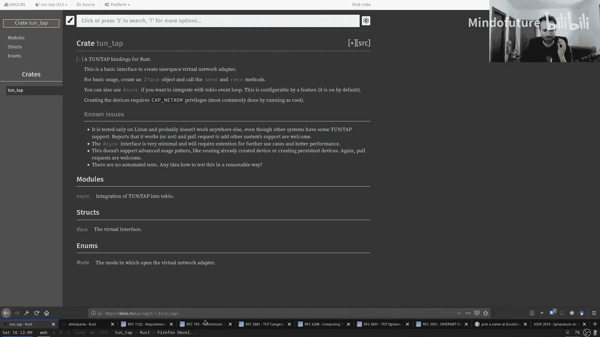

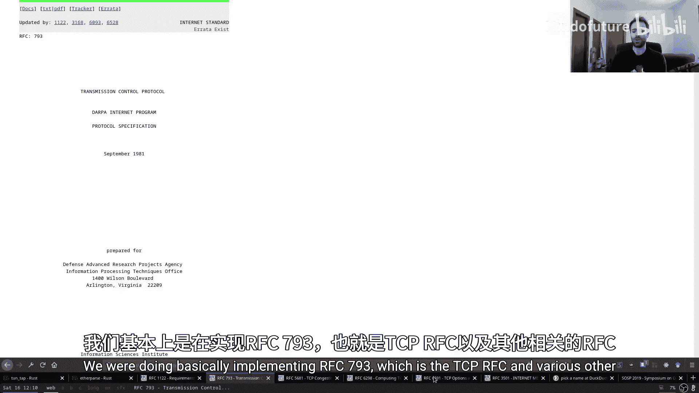

So ton top interfaces are basically a way to have the kernel give a user space process access to raw packets。

 And so this lets us interact with our implementation as though it was running in sort of its own kernel somewhere I'm not going reiterate all of the stuff from the first stream in this one。

 So I sort of assume that。I sort of assume that we that that you've watched part  one before this one。

 So I'm gonna put a link。Somewhere to part one so you should go watch that if you haven't already。

 this video will also be uploaded to YouTube as always， so you can always watch this later。嗯。

Before we get started on sort of con our implementation。

 there are a couple of housekeeping things I want to deal with。

 So the first one is that this will probably be the last stream for a little while。

 I have a pretty major deadline coming up towards the end of April。

 So next stream probably won't be until May It's a little unfortunate。

 but but sadly life gets in the way。 the。Really， they inject ads into the screen that's awful。

And number2， I feel like we've been running this for long enough now that it seems appropriate that we try to find a name for this thing。

 It's sort of easier to just call it rest live coding streams。 We do some other stuff too。

 like the video on the how and why of futures， for example。

 And I think it would be good to have some umbrella term for what this。😊。

Stream is so I'm gonna I'm gonna sort of give a yak shaving project to the chat over the course of the stream to try to figure out a good name for what the stream should be referred to as I might even go as far as sort of to create a separate Twitter account or something that you could follow just for updates from the stream We'll see exactly how that works out。

 but some kind of name would be useful。呃。And there's a 13。 that's kind of stupid。

 I decided to buy new wheels for my chair， and I discovered that the， my floor is not level。

 So every now and again， I'll just sort of。Roll away。And so if you see me moving weirdly。

 then that's why。Okay， so with that housekeeping out of the way。

 are there any questions from the first stream before we get started on this。

 anything that was unclear that you sort of want to know how it works just so we all start out without having burning questions from the very beginning。

I'll give Cha a little while just to。See if there's anything you want to recap before we start。

Chat currently seems mostly busy talking about how to avoid ads on Twitch。

 so I'm going to assume that there are no particularly burning questions that people have and if you do then just sort of ping me as we go。

嗯。Okay， so where we ended last time was we wrote this thing called trust name still under development。

 and we basically just wrote a main function that runs the core TCP protocol so main will basically just read packets in from the virtual interface that we create。

 So it creates a virtual interface it reads packets in from it and。

Sort of keeps track of various connection state and then calls into the。

The TCP implementation we have， the TCP stack for the state that we're currently at。

 it gives the packet that it received， and that's basically all we have so far。For the TCP stack。

 we have support for setting up and tearing down the connection。

 but we do not have any support for data yet。嗯。I still vote for Thunder as the name。

Thunder is pretty cool。 I agree。 Yeah， So we have support basically for establishing and then tearing down a connection。

 but nothing in between。 The other thing that's actually worth pointing out is following the previous stream。

 There were a bunch of comments on。😊。

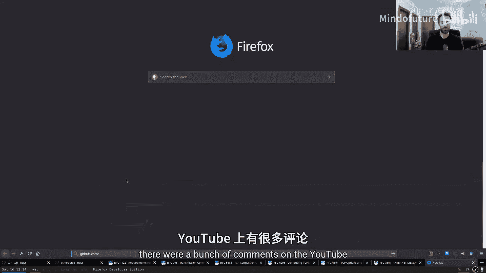

On the YouTube。On the YouTube video for the first part where someone pointed out that actually when the RFC talks about sequence numbers being between two different things。

 there's a welldefined way in which that operation works and specifically instead of this whole business that we computed and drew out。

 it turns out what you're actually supposed to do is just check whether one minus the other is more than half of the number space and this is sort of apparently so well understood that it's not even in the RF。

 which is kind of stupid but such as life so this has been changed to me。

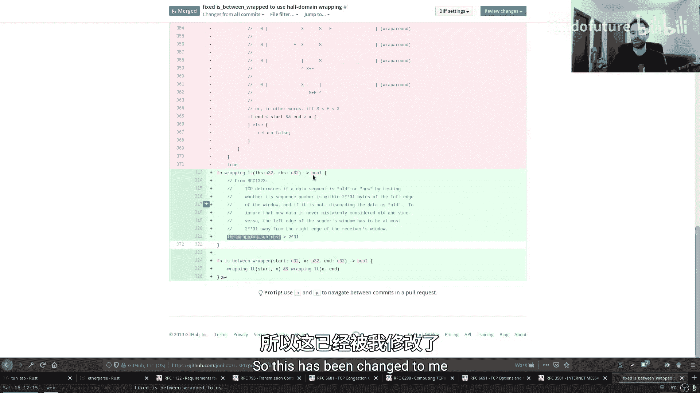

还有。So that has now been fixed。 So if you look at the is between now， it is actually a lot easier。

 a lot simpler than it was before。呃。Yeah for raw packages， I would。

 if you're wondering how to do that， I would watch the first Dream first。Okay。

 so the question is where we go with this particular stream。

 This might be a little bit shorter than the normal streams， but we'll see how that works out。

 I think what we're going to do in this one is。The next thing we sort of need to support is being able to send and receive data because currently all you can do is set up the connection and tear it down。

 which isn't particularly helpful， So I think we actually need to set up what is effectively an API for being able to send things and receive packets and we're probably going model it mostly on what is in the standard library already so we're going end up with something sort of like standardnet TCP stream and standardnet TCP listener instead of this currently we just have this main function which doesn't really have a good way for you to read or write data。

And so how about we just get started with that？I think we're going to start a new file here。

 something like， let's call it Lebars for now。Have you tried BPF。

BPF is not really for this particular thing。There are rust bindings for BPPF， I think。Okay。

 so we sort of want something along the lines of TCP streamream and we want something along the lines of TCP listener。

Right this is the types of theCP that TCP provides us is that the standard library TCP implementation provides us with and ideally we want to support the standard interfaces as much as we can so specifically we sort of want to do Iple read for TCP stream。

We want to ample right for TCP streamam。And on TCP listener。We want something like a pub。

 but I guess these are going to be pub。嗯。We want something like an accept that takes a mute。

Self and returns a TCP stream。Probably an I result TCP stream。嗯。

So like something along these lines and of course， read。Just to get the signature for read。

Read is this。So this is an IO result。And right。Is this。

So right we're going to need something along these lines。

So I think our goal for today is basically to find a way to fill out these。 Now。

 we might not actually be able to get read and write to Fo work because that's a bunch of internal protocol stuff like congestion control。

But we at least want to figure out how to wire this interface into the implementation we already have。

If you remember from last time a listener， a TCP listener。Doesn't really do all that much。

 except that actually， I should put off my paint program here。

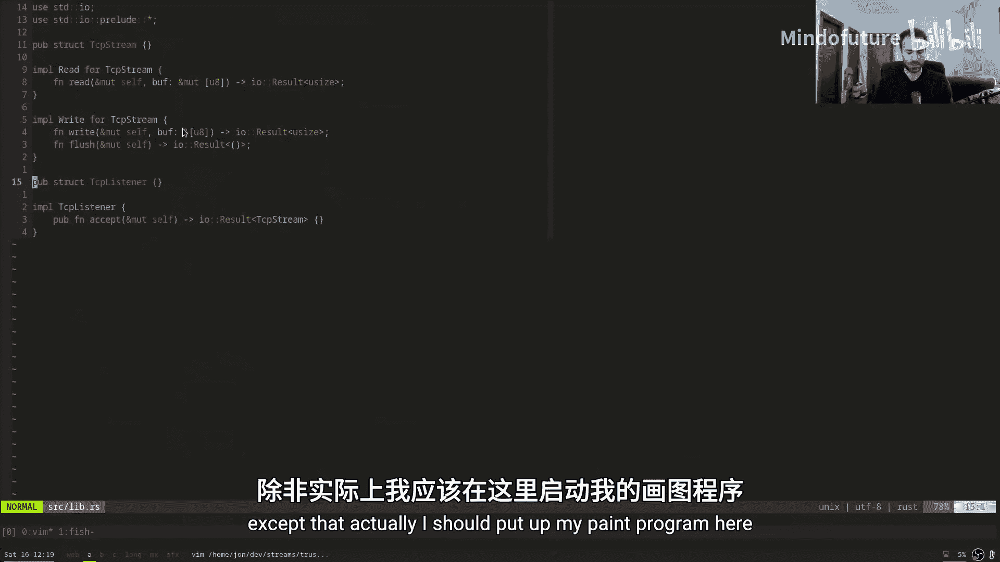

Let's see here， so。Let's do。 That's fine。To somewhere around like here。So。

If you recall the way TCP works is you have sort of a client。🤢，And a server。

 although TCP doesn't really call them this。But you sort of have a client and a server。

 think of the server as the thing that is listening and the way the TCP handshake works is the client or whoever wants to connect sends a S packet。

 so this is a TCP packet with the S bit set。me check that and the server。

 if they're willing to accept the connection， responds with what's known as a S act。

 so this is a packet that is both the S flag and the act flag set and the way to interpret this is that this act。

This act is for the sin。And then the client is going to send back an act。

And this act is for this sin。So this is saying I got your sin and I want to connect back to you and this X is for the sin。

 So this this is known as the three way see if I can do I don't know if that's easier to read Probably not。

 the three way handshake in TCP。And what it does is it establishes a two way connection。 right。

 So think of a sin as， I want to talk to you。RightAnd this a is saying okay and I want to talk to you okay as sort of the way to read this sequence of events and if you are listening on a given port。

 all that really means is you're willing to send this message。

So if the server is not listening on a port， it's just not going to reply to the sin。

 It could respond with like a reset to just directly say that it's not responding or it could just not respond at all。

 They're both sort of fine。 TCP might mandate which one you're supposed to do。

And currently what we have our system set up to do is anytime anyone connects to any port we're gonna to SAC and set up a connection with them。

 whereas in reality， what we really want is only if the server has created a TCP listener wow。

 my handwriting on this is terrible it's terrible otherwise too。

 but if we've created a TCP listener on like port 80， for example。

 then if this packet is for port 80， then and only then do we send the SinAC back。

If the S comes from some other port like 9000， if it comes from 9，000 and there is no TCP listener。

 then we will not respond。 There's no reason to because we't want to。

 we haven't said that we want to accept packets on that port。Yeah， I mean。

 Chad basically just demonstrated how the TCP handshake works。 Want to shake hands。 Yes。

 puts Ar shakes hand。 It's like a very， it's a very sort of weird human protocol if you were to try to act it out。

Okay， so。So what this means is that our TCP listener， all it's really doing。Is almost like marking a。

Marking a port number as being available。 And so if a packet comes in from a port that is not marked as available。

 we drop it， if it is marked as available， then we sort of enter the whole TCP event loop for that channel。

 And so the TCP listener actually does not that doesn't do all that much。

 The TCP stream on the other hand is basically the thing that contains all of the state associated with this connection。

 So once is synAC business has been set up。 There's a bunch of state you're keeping like sequence numbers and act numbers and window sizes and all of this business all of that from both sides is going to be incorporated into the the TCP stream。

So that's basically what we want。

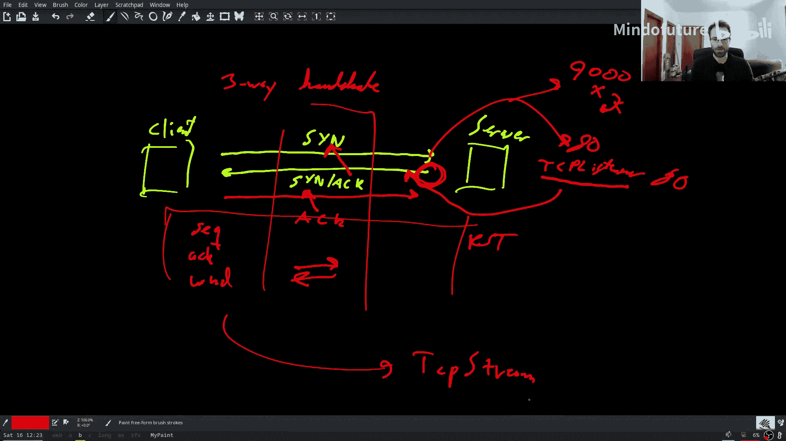

And so let's see how that would actually look in code。So。If you remember from our main。

 we have this connections map。 that is a map from。That is a map from a quad。

 so a quad identifies a particular connection to a TCP connection。 and if you look down here。

What we did down here was if the entry is vacant。 so if we get a， if we get a TCP packet for。

For a quad that we don't know about， then we just immediately call accept。

We sort of want to change this， right， like we want to change this to be if it's vacant。

 So if there's no current connection and we've said that we're willing to create a connection。嗯。

And so we're probably going to want most of this。 The other thing that's a little weird here is the the tunnel we have is basically single threaded。

 right， whereas we sort of want the user to be able to create multiple different connections all over the place。

And so we might need to have this be almost like almost like a sort of a main event loop that runs on one thread。

 And all of the TCP listeners and streams are gonna interact with that thread。

 That might end up costing us a little bit in terms of performance。

 But it might be a good way to model the system， at least initially。So for that to work。

What we will probably need is we'll need something like a pubstruct endpoint。

Or endpoint might be a bad name for this， but。Interface， maybe。Or network。

It's called that interface for now so the idea would be that an interface is a thing that can receive packets and it sort of holds all the connection state information for all the currently open connections and so if you want a TCP listener you have to call listen on the interface and that will give you the corresponding TCP listener object。

And so the way to think about this is something along the lines of this。呃。

That's also a good question。 what the types of these are。So let's not put those in just yet。

So we're going to have something like imp probably default for interface。嗯。

And what that is going to do is this。And then create an interface that has connections， Nick。

 and buff。So。嗯。Maybe， actually， we need。GoToel， we need to declare that we also have a library。嗯。

Last。And we also have a bin。I don't know how cargo is going to feel about this。Penary name。

It's going to also be trust。Let's see if it actually lets me do this。嗯。No。Sure。

These are for the time being unimlomented。嗯。And of course。

 these fields need to exist in the first place。 So connections we know is going to be one of these。呃。

So connections is going to be a default。Revol。I don't actually remember the type for this。

 so this is a neat little trick that you can play。Oh， actually。

 this I do know the type of this is a U8。4。嗯。So in this case， I don't actually know what the。0， U，8。

150，4。 I don't actually know what the type of niki is。 And so I'm sort of gonna cheat。

 I'm gonna cheat by。actually， this has to be a new。

 it can't be that because we have to be able to return an error。So this is going to be an I result。嗯。

And so this is going to be okay。 So the， the trick here is I don't actually know the type that without packet info for returns。

 I could look it up。 But instead， what I'm going to do is to set the type to be unit and then try to compile。

 And then it's going to tell me。This is the type I actually had。 Great。

 So now we can just replace this with that。😊，Whole driven development， yeah， basically。嗯。Okay。

 so you create a new interface And what that's gonna do is its gonna create that。

 that tongue top interface for you。And it's going to set up all the sort of buffers we need and basically empty connection state。

And then I guess this is going to have to be pub。And then we're going to have a PubF listen。

So this is basically the same as。So TCP listener， you can just call new or bind， I guess。

 and it sort of implicitly does the right thing， whereas for us， we're going to have。

We're also going to have a bind， but it's just， it's going to take a mute self and a port。

 which is going to be a U 16。And it's going to give you back a TCP listener。

And we don't actually know what this。It's going to be it。

 but we sort of know that it's going to do something that means that now we're going to start answering sins on this port。

Right？great。And there are some other things that might carry over from Ma。 In fact。

 most of this loop is going to still remain here。 So you might already see where this gets tricky。

 right， when you get a TCP listener， that TCP listener is going to have to do things like interact with the N right the N is where you read packets from or where you write packets too。

 But if we stuck this mute self， which is a mutable reference to the N into the TCP listener。

 that would mean that you can only have one TCP listener open at any given point in time。

 which seems kind of problematic there are a couple of ways we can get around this。

One of them would be that we just store like an arc Muex interface inside everything we give out。

 and then they just sort of multix between them。That's also not great， though。

 because it would mean that imagine you have two TCP streams。On the same ni。

 and they both try to take the mutex on interface and then imagine you have TCP streamam 1 and TCP streamam 2。

 TCP streamam 1 gets the muttex and reads a packet， but that packet is for TCP streamam 2。

It wouldn't have a way to tell the other steer， oh， I found a packet for you， right。

 It just has to read until it gets its own packet。And so we need to find a way to get around that particular issue。

 One way we might do that is to。Is to have the TCP streams really just be like almost channels to some central thread it's a little sad because it means that we basically have to copy all the bytes like if you write out these bytes。

 we're actually going to have to copy them into a vector somewhere and then send them off to this other thread which isn't exactly great。

嗯。Yeah， I don't have a good answer there。I think one way to do this would be if you want to write。

 you take the muttex and you call into the event loop until the stuff that you want to write has been written。

嗯。But that has its own set of problems。嗯。Okay， let's go with the channel approach for now。

 and then we can。Try to figure out if we can optimize this somehow somewhere in the future。

So what that means is。When you call new， what we're really going to do is we're gonna。

Spin up a thread that's going to run in the background and manage all the packet stuff。

And then we're just going to return a handle to that。 So here， instead of just having interface。

 we're going to have like。2。Actually， that。I sort of want the public structure to be called interface。

 But all this is really going to contain is a。Xing。MPSC， something， right。

 so this is going to be just an MPC sender。Yeah， we're going to run into a sort of weird pattern here where this is actually going to be。

Here you。Interface requests。And that is either going to be a right， in which case it's evacuate。

Or it's going to be a read。Which is then going to include a。嗯。Ser。Of evacuate。And I guess， flush。

As well。嗯。And I wonder whether。All of these。Yeah， so the trick is。

 imagine that the idea here is basically if you try to write on a TCP stream。

 what you're really going to do is you're going to send a right message over the channel to the thread that actually runs the interface。

And then it's going to do like it's going to keep running its event loop and at some point it decides that you write is done。

 but at that point it has to communicate the return value of that right back to you。I mean。

 that is really awkward。 We sort of don't really want that to be how it works。嗯。

Because what that would imply is that the writer， if you do a right call。

 you also include like a channel that the server is going to respond to you on。😡。

I guess we could do that。It feels a little awkward。嗯。H。

The other reason this is unfortunate is just like it adds a lot of overhead to reads and writes。

And I feel like we could do better。But let's stick with it for now。 and then we can always。

Improve it later。So all of these are going to have。Channel to sort of。Actually。

 this is going to be a u size。 So this is going to be how many bytes were written。

 This is going to return all the bytes red。And in fact。

 this is also going to have to include a U size， which is the capacity of the buffer so that we don't try to read more bytes than we can。

I's going to send back at most that many bytes。Okay， so interface then is really just。

A thing that can send those requests to the interface main event loop。And this， I guess。

 is going to be， what are we going to call this。 It's not going to be public。 It's going to be the。

A connection manager。Yeah， and so at that point， the C， we're going to， when you do new。

We're going to create one of these connection managers。Then we're going to do a thread spawn。嗯。

I guess we're going to do a。We're going to create a send and a receive handle for an MPSC channel。呃。

We're going to move the receiving end into that thread。And that's going to be CM dot run on Rx。

And I guess we can keep track of the joint handle for when we drop at the end。

And then this is going to return then an interface。

 Let's make this a little nicer for ourselves that has a transmit handle for where you send the requests and also a join handle that's going to let you。

That's going to let you join with the connection manager when you wanted to exit at the end。

It's going to be a join handle， and I don't know what that type is yet， so it's going to be a hole。

So this now is going to have Rx， Tx and join handle。Does the basic pattern here make sense。

 like the rough setup for what we're trying to do？And I guess we have to do bind as well。B。

It also have to be unbind。And。Bind。Is also going to have to take one of these and a porch。

So I guess we can make these。A little bit more helpful for ourselves。

 specifically a right is going to be this is going to be the bys。

 and this is going to be the act channel。So this is not a TCP act。

 but like an act in the sense of I have completed your right。A flush。Just has an a field。

Bind does important in an act unbind。 So unbind is what we have to do when you drop a TCP listener。

 right， when you drop a TCP listener。We have to make sure that we're no longer bound to that port。

 but there we don't actually have to wait for the unbind to finish。

 We can probably just unbind sort of asynchronously。 That's not really a problem。

 And a read is max length。And red。All right。So we're gonna to spawn this connection manager on its own thread。

 It's going to do this run on， which we haven't written yet。

 So here there's going to be an imp connection manager。Thiss going to be an FN run on。

 and it's going to take a sender of these interface requests。It's also going to consume itself。

And so this is going to be the main event loop for packet processing。Right。

 and really all this is going to do is this is an RX。 So it's going to do like four。Request in Rx。

And then it's going to have to figure out what it actually does with each of those requests。嗯。Right。

 and now implementing these methods actually become relatively straightforward。

 So a TCP stream at that point is really just a。An MPC， in fact。

 we could probably use a type alias here。So。An interface handle is going to be an MPC sender interface request。

So， this here。As an interface。And a TCP stream is really just an interface handle at this point。

And this is a little sad right so in theory you could imagine that we encapsulate the state associated with each stream inside the TCP stream object itself。

 that would be a very nice sort of clean separation of concerns rather than having this sort of connection manager that distorts all the state in a giant T map。

And so one day we might get to that for the time being。

 I think we're stick to something that's relatively simple。嗯。

And so this also is really just an interface handle。嗯。So when you bind。

 what you're really going to do is you're going to do self。ttx。

 sendend and you're going to send an interface request。And specifically。

 you're going to send a bind request。On that port， and you also need an a。So we're going to do。

ON R x is a new channel。And this here， what we get back from bind is probably nothing， right。

 It's just a message that says， I am now going start accepting packets。 So once we get that back。

 we really just want to do sort of R X dot receive dot unrap。 We don't care what the value is。Yes。

And then we want to return OK TCP listener。And we give it a copy of the。Of the transmit handle。

I haven't said anything about what we do when we receive a bind。

 but this is sort of the client side of this， and you'll see that all the other methods end up looking very much the same。

So a read is really you send a read request， the max length is going to be Buff dot capacity。

 actually Buff dot L。嗯。And what did you call it， we called it read。

And here we actually care about the response。 So the response is going to be a bunch of bytes。

And here， it might be that these unwraps are actually not reasonable because you could imagine that you try to receive。

 but the other side。Like sent as a reset or something like a connection error happened。

 So it might be that this eventually is not going be an unwrap anymore。 But for the time being。

 let's leave it as an unrap。 So here we now have a bunch of bytes。

 And we're going to do is we're going to do。呃。嗯不。What's the slice copy thing？ハy。あ。Slice。

Copy from slide。Isn't there a better one copy non overlapping？😔，Fine， we'll do copy from slice。

 seems fine。So crucially， we're going to do Buff dot copy from slice。Byights。Right。

 so that's going to copy all the as many bytes as we can from bytes into Buff。

 Does that return something no， And then we're gonna return O and。Wait， this。Response。Right。

 White salt land。So that's the number of bytes that actually got red。And here。

 you could even imagine we'd do something like assertt byte do L is less than Buff dot L。Right。

 if we ask the server to read at most Buffed dot L。

 the sort of the connection manager to read at most that many bytes。

 then it shouldn't be returning more bytes than that。Less than or equal， I guess。嗯。And similarly。

 now， of course， I assume you can start to see the pattern right is going to be the same thing。

Except this is now A。And。This is bytes。And that's going to be Vck。From bus。嗯。Ooh。

 missing a semicolon there。It seems they going there， too。Why is my Lntern not working？

This is the same。And at some point， we'll get back。

A messagess about how many bytes were written right。

 So the the response for right the a sends a U size。

 which is the number of bytes that were actually written out。 it might not be all of bytes。嗯。And。

Here we can sort of assert that n is going to be less than equal to Buffin。

 it can't have written out more bytes than we passed it。

And then we do OKN that's how many bys were written。Can there be an issue on received？ Oh， yeah。

 absolutely so。Specifically， you could imagine the connection gets closed。

 so this needs to be a right。嗯。You could imagine that you try to read but the connection was closed and so therefore the connection manager closes your channel instead of sending you something and so this unrap is definitely not okay this is just to get sort of the basic flow working。

啊。Fluush is basically a right， but with no data。So here this is a flush。

Fluush only has an act and nothing else。We don't care about its return value。And we just return okay。

The last questionnaire is accept。So。We need to figure out how accept its going to work。Specifically。

 I think one thing that's missing here is currently there's no way for the connection manager when it gets one of these to know which connection you're trying to operate on so both right flush。

read， yeah， write flesh and read all need to include some kind of identifier for the underlying stream。

嗯。And I think the way we're going to do that is。Well， we can use the quad。

So we have this sort of quad identifier， right？And you can imagine that every time you want to do a right。

 you have to sort of say which quad you're operating on。So a flush and a reed。

And this also means that if you try to do an accept。嗯。Then what you get back is a quad。Right？

This probably needs to say which port。So if you want to accept。

 then if all the connection manager sees as you wanted to accept。

 it doesn't know which of the ports to try to accept on and so we need to include that information and what you get back is a full identifier for that connection that you can then use for read flush and right。

This then means that the TCP stream needs to include a quad。

So that it knows which TCP stream it's for， and TCP listener needs to include a port。

 which is going to be U 60。This also means that。Down here。This is going to include the port。

And when you call， accept on a TCP listener， let's move that code up a little。嗯。When you call accept。

 it's very similar to doing like a read or something， except that。

Except that what you're issuing is an accept。You give the port。Which is the port that is。

This should be one。Now all of these in fact， should be one。呃。Yes， you send it except。

 you include the port and you。I guess，And what you get back when you read from that channel is you get back a quad that identifies the stream that was accepted。

And then you return a TCP stream that's going to be that quad and a clone of the interface handle so that it itself can send more requests。

And of course， this， whenever you send something， you have to include the quad。

So the way this API is currently structured is like definitely not high performance right we're copying all the rights when you're doing a reader or write。

 we're like allocating an extra buffer， copying between them。

 we have to do all these like interface send these channels， sends and receives。

 every time you want to， in fact two of them want to send the request and want to send the response every time you want to do any operation。

We have to like include this quad with every operation we do。

 So there's definitely a bunch of overheads here that we might one might hope that we could eventually get rid of。

 but notice that the external API doesn't actually reflect any of that right the internal API is just there is an interface right you have to create one and once you have an interface。

 you can bind， you get a TCP listener， you don't get to look at the fields inside the TCP listener。

 All you know is you have one of these。 it has an accept method。

 that returns a TCP stream and TCP stream implements read and write。

So the the external interface is still what we would have almost no matter what the internals were like。

And so we can always later optimize this to get away from this single event loop。嗯。All right。

 so the question now becomes， what do we do in the main loop of the connection manager well。

We basically have to do what we did in Maine， right， We need to look for packets and such。

And I think specifically what we have to do is。We sort of need to。

We're going to have this sort of main event loop is going to have to deal with a bunch of different things specifically it's going to have to deal with packets coming in over the network requests coming in over the interface。

 So these are like interface requests the ones we just wrote and it's going to have to deal with timers firing。

And so all of that is going to be sort of stuff that it has to look at。

It would be kind of cool to do this in Async。Because asInc is just perfectly suited for this。嗯。

Let's think about that for a second， when that is worthwhile。嗯。どんどんどんん。

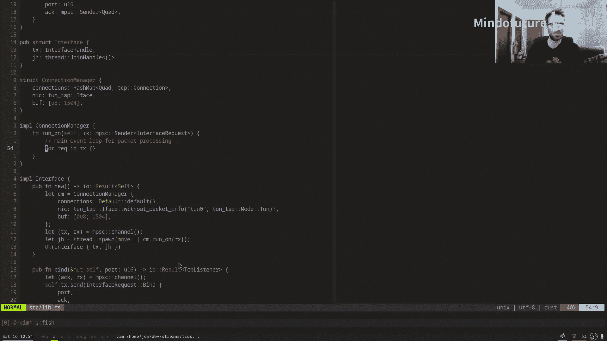

It really depends on whether a ton top is async。🤢，Because if it's not， it's not going to be worth it。

O， asy。Ou。Wu。

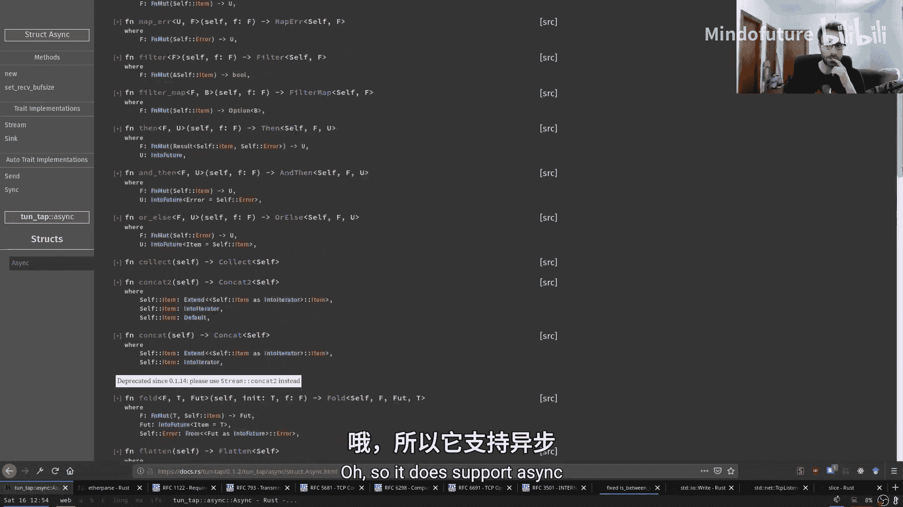

So it does support async。That's pretty cool。The asynchronous interface is very minimal and probably inefficient。

But it's kind attemptinging。 not going to lie。

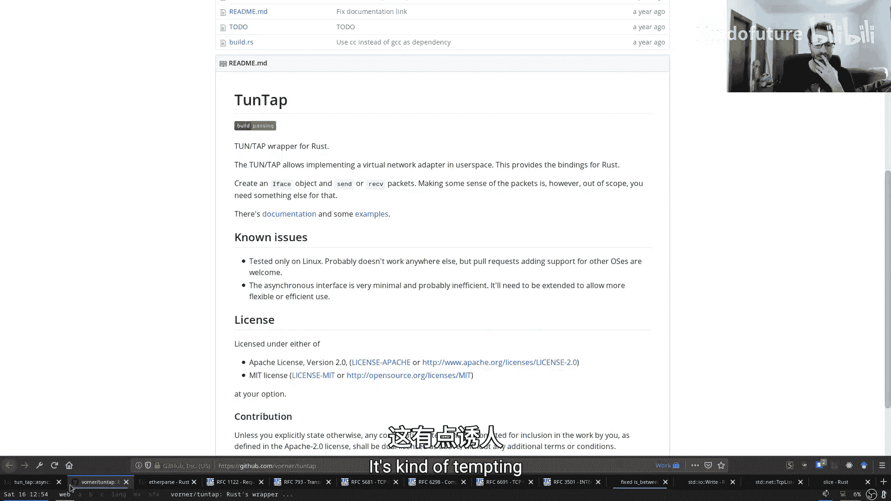

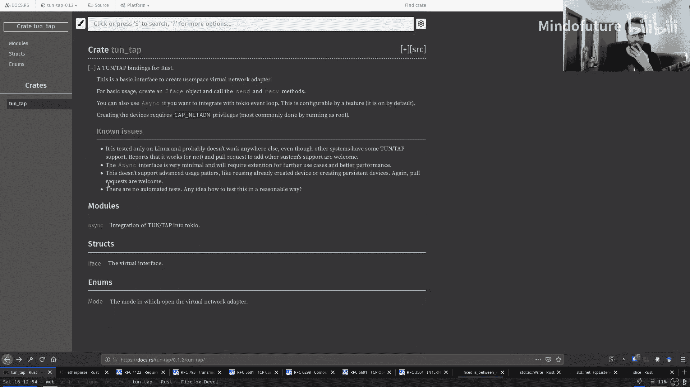

So the reason I think it's tempting is because。We're basically writing an event through peer that needs to wait on multiple different types of things and doing that in ASync is just a lot easier。

 but if there's something like try receive，There is not。嗯。So the problem we're going to run into is。

嗯。Imagine that you sort of。There are no current requests coming from the user and so you have to try to read from the network to see if anything is happening there。

 if you don't have a try receive， then you're going to do a receive and then it's going to block until there's another packet。

But that could block for forever， it might be the other side doesn't send any packets。

 and now there might be a bunch of requests building up on the sender that you are not going to get to because you're still blocked on reading the next packet。

Which is problematic， right？嗯。So the real way to do this。

I was sort of hoping I wouldn't have to do that。So the most straightforward way to turn a synchronous interface like this into an asynchronous one is you spawn a thread and it has a channel。

嗯。And that's really sad because it's going to copy more bytes。So the。

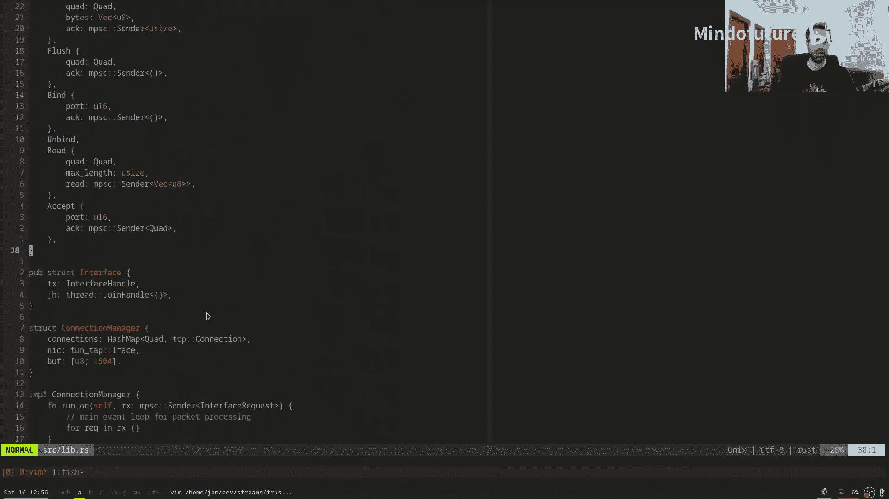

Okay， so here， let me try to draw this a be easier。So the situation we're running into is as follows。

嗯。So the kernel is down here， right， and it has like our network interface with packets coming in here。

Currently， we have our connection manager here。And we have a bunch of like TCP streams and TCP listeners and whatnot up here。

Currently， all of these have sort of a shared channel。

That's the channel we just created into the connection manager。

The connection manager also has a single connection down here。

The problem we face is what does the main loop of the connection manager look like， Wow。

 it's supposed to be a arrow， right， What does this look like？Because it can't。

It can't block on reading from this because then it wouldn't read from this。

 It can't block on reading from this， because then it would block on this。

 then it wouldn't read from this。So one way in which this can。

 we can sort of fix this is that we introduce a。Separate thread over here。

And it's going to have that connection， so we're not going to have this one。Is going to be the。

The packet manager， if you will， the package manager。Has a channel。To hear。 So to be clear。

 this is an MPC。 This is a ton tap。喂。And in the orange world， this is a ton tap。And this is an MPSC。

So multi producer， single consumer channel。The reason this is the reason this works is because on channels。

 well on the standard library channels you can't do what's known as a select so you can't arbitrarily select between the two。

 but at least you can do like a try receive on this one and you can do a try receive on this one。

And so that way you can essentially multiplex between them。嗯。

Probably what we want is to use cross beam。chanhannel。😔。

Theres a really cool crreate that may or may not end up in the standard library because it has this thing called a select。

So select， let's you say you can sort of select between channel1 and channel two。

 and this will block until either of them returns。Right， and that fits really well into this model。

 We're just going to select between these two and whichever return first we handle。 And in fact。

 we could do this with a timeout。And that lets us also deal with timers firing。

The way in which this is inefficient， though， is imagine you're trying to do a read。

So the read is going to progress as follows。嗯。Let's say that this guy wants to do a read， Okay。

 so they send a read request to here to the connection manager。The connection manager。

Doesn't currently have any data？But at some point some bytes come in here。

Right so this reads some bytes。 So this now has like a bunch of bytes in a buffer somewhere。

 It has to send it on。Yeah， yeah， selects are great， so Crossb channel also has those selects。

The the package manager， the packet manager now has to send this buffer to the connection manager。

 but this is on the stack， right， the bytes we read here are on the stack。

 so it needs to actually copy them over here。So it copies them over to， to this。

 to the stuff that it sends to this channel， the connection manager then。

Gets those bytes has to do a bunch of parsing， right， It to run all the protocol stuff。

 So it internally has like a buffer of unread data for every connection。

 And these bytes are just going to be extended to that buffer。

 And now it needs to respond to this read。 So it's going to take some part of that buffer is going to be the next bytes to read。

 It has to copy those into a new buffer。That it can then send over this channel。

RightSo notice how many extra both channel sends and memory copies and allocations we end up doing in the scheme。

It's really not great。 It would work like it would。

 it wouldn't mean that you end up with something that works， but it is pretty unfortunate。嗯。

'Trying to think if there's a good way to。Design this differently。 I mean， there probably is。

 but it requires some design。嗯。So ultimately， what would have been the the sort of。

Best possible design。 if we could figure out how to do it， let's do。What color do I want， I want。

At color。嗯。Okay， so let's start another sort of hypothetical design somewhere over here。呃。

So we're going to have a channel。rry， we're going to have the kernel that says to the network interface。

We will still have a bunch of TCP streams。That logically sort of get。

 they get sort of multiplexed over this one connection， this one network interface， right。

 that's sort of the core of our problem is that these have to collectively drive the network interface forward。

嗯。And each one has a bunch of connection state。That's not the best way to draw it。

 So this is the connection state for each one。呃。If we want to。嗯。Yeah。

 so each of them has their own private private state that's things like the sequence number and the act number and the window size and whatnot。

 so each of them has one of those。嗯。And now imagine that you're trying to do a read from here。

So this guy trying to read。If this reads， it's going to have to ultimately like look at this channel。

 We have to somehow get data from this to this。 The problem is， there's a bunch of packets here。

 right？ Like， who knows what kind of packets you're going to get from this interface。

 And like this might be for this one。 This might be for this one。 This might be for this one。

 And this may like this one is actually the one that goes here。To the one that tries to read。

 and you still need to decide what you're doing with all the intervening packets。嗯。

You sort of want to process them， right， You， you can't drop them or you could drop them。

 but that that's really inefficient。 You can。Sor of stash them for later so you could keep sort of a cu so imagine that this takes a lock right。

 imagine like there's a giant lock that's like protecting all of this。嗯。我。

Then there could be a giant queue where any packet that you encounter that's not for you。

 you stick it into that queue。And so so when you get to yours。

 then you process that one and any subsequent thing that comes in to look for stuff is going to first go through the queue and see if it finds things that's for it。

So the question is， isn't what you're describing basically network specific work stealing？It's well。

 not quite。 So the， the way in which it's different is that here。

It's not as though we have multiple network connections。We actually we have a single。So logically。

 we have a single incoming network connection， usually when you have works dealing because the kernel。

 the kernel gives you this impression that you actually have multiple separate streams， right。

 it doesn't expose a single network interface to your application。

 You think that you have multiple sort of separate streams。

 You have one thread that or you have a bunch of threads that are managing as a terrible way to draw it。

 You have a bunch of threads up here。 And these threads are just going to like pick up packets from wherever they get them from the kernel and sometimes。

The package you read needs to be handled by some particular thread。

 And so they steals things among themselves。But at no point here is there really like a single point you're going through？

嗯。The other thing that would be a nice bonus is if we didn't have to do this。

 if we didn't have to stash these packets away， because these packets， if we have to stash them away。

 we have to stick them basically in some memory that's not going to go away。

 So we're going have to create like evacuate for each one and store those， it' would be great if。

 if this。If this node notices this packet for this peer。It could just sort of do the processing。

For that node。 But that means that this state has to be in here。I mean， maybe that's okay。

 Maybe this actually keeps， so inside the lock， you also keep the state for every connection。

It still means that any bytes you read here， you're going to have to stash for later。Because if。If。

Let's see。 okay， so let's call this the red， the red connection。

 and this packet is for the red connection。 And let's call this the。呃。Yellow。

This is the yellow connection and this packet is for the yellow connection。So， the。

Red connection is going to end up seeing the yellow packet before it sees the red packet。And。

And the problem is the memory in yellow， ideally， we would just sort of give to yellow so that so that we don't have to copy the bytes anywhere。

 but maybe that's not that important。 Why not have node specific inboxes that you can stitch memory into。

Stick memory into。Yeah， so that's basically the proposal here is that we have a sort of queue of things that we haven't processed yet。

Maybe instead what we should do， should not have painted that yellow。Dark blue。Dark blue。

She is a terrible color to read in this。嗯。So maybe what we should do instead is keep all the state for every connection in this sort of one map。

So the inside the lock， you have all the connection state and。So like we would have。

 we would end up with like a red connection state and a yellow connection state and whatever other connection states we have。

 And this would be sort of all of the bytes that have been read that we have gotten packets for on red。

 but that red has not。Red itself， and similarly， with yellow。Okay， so maybe that's a better design。

That any time。Okay， so the problem with this is imagine that red tries to read and it just doesn't get any packets for itself right so this is why I didn't do this in the first place。

So。Red is trying to read， so red takes the lock。At this point， when red has the lock。

 it starts to walk through these packets， right， imagine that there is no red packet here。

There's no red packet。And so red is just going to keep reading these packets。

 and it still holds the lock。So no one else can read。

 even though there might be a bunch of data for yellow， a bunch of data for these blue nodes， right。

 like all of the other connections have gone a bunch of data。

 but red still hasn't gotten their packet。So there needs to be a way for red to sort of yield， right。

 Red has to at some point decide I'm going to let other people go now。

And I don't quite know how we're going to do that。嗯。So this is why in the other design。

 this is sort of a non problem， right， because the connection manager just sort of notifies people as appropriate。

嗯。It just keeps reading packets。 And if it gets something for red， it would notify red。

 If it gets something for yellow， it would notify yellow。 Whereas here。

 we don't really have that same luxury。 You could imagine that red sort of pares a packet。

 and the first packet it sees。 it's gonna be yield。So that someone else can read it。

And then it might have to take the lock again。Yeah。

 it's just going to give up the lock and then try to take the lock again immediately。Basically。

 it's going to read。 Let's imagine this packet isn't here。 So it， it reads the yellow packet。

Notices that it isn't for itself。 And so it just gives up the lock and notifies yellow。

 which is presumably waiting for this。 This is going to be。

 we're probably going to end up using something like a convaar here。 So a conva is a way to wake up。

 It's a conditional variable is the way to think about it。 So yellow， if it tries to read。

 it's going to see if it reads if it fails。 it's going to wait on its own convore。

 which includes releasing the lock。Red is going to notice that yellow wants to be woken up。

 is going to notify yellow and is then going to probably yield and then immediately try to take the lock again because it hasn't satisfied its read yet。

It's going to be a lot of contention on this lock because this lock guards the entire connection state。

But it might be a better design。 It means that we don't need to have all these threads running around。

And so that might actuallyhy be better， but it is definitely a little sad。

 We also run into a weird case of timers。Because the timers need to run here too somewhere。

 although maybe we could have a separate timer thread that also takes this lock。

 so this is going to be like a timer thing and the timer is going to do things like decide whether it's time try to retry sending a packet or whatnot and it's also going to have to take the lock and all of this remember is an artifact of the fact that we only have one underlying connection。

And you can think of this as internally inside of the kernel， right。

 it's pretending that it has all these channels。RightSo if you do normal network programming。

 you just have separate TCP streams and you don't really think about the fact that they're connected somehow。

 but really sort of under the kernel， there really is just a single network interface It like one ethernet port or one w-fi card and somehow all of these have to be funneled through that one interface and the kernel takes care of that and it takes care of that without you really seeing what's going on and you can imagine that the kernel has to do something sort of similar to this。

 they might not use a lock there might be some like smart lockfr data structure you can use here so that you don't have to take this lock the kernel can sort of always have some threads running that don't need to context switch but this is like a fundamental problem that we now have to solve in user space。

Color A。Read packets until another one。 B comes up。 and then B reads its packets until。 Yes。

 the basic idea here is going to be。You only ever read one packet at a time。So red reads a packet。

 and we could make it more than。Maybe。2。This still becomes problematic。Okay。

 so the the idea was red reads one packet。 and if that packet is for red， all good， we might be done。

 if it's not for red， it's going to notify whichever thing it was for。

And then it's going to sort of wait for a little while， and then it's going to take the lock again。

 It's basically going to yield and then then take the lock。Which is some overhead。

 but probably less overhead than all these channels and certainly less sort of by copying。

I just realized， though， that one other problem we run into here is the。Imagine that。 You're red。

And you try to read a packet。And that blocks because there are no packets。

 and the reason there are no packets is because we need to do a retry。

And so therefore the timer has to fire， but the timer needs to take the lock in order to send anything。

So。But it can't take the lock because red is holding the lock blocking for a packet。

I think what this means is。Yeah， I don't know how we do that。嗯。嗯。Oh， here's the possibility。Okay。

 how about this design？How about？If any TCP stream， I'm running out of colors。Orange。

 orange is a color。Great。呃。Any time a TCP stream tries to access this。

 it is not allowed to try to read a packet。Cannot read。Basically sort of。From the neck。 from the。

 from this。It's not allowed to read anything from here。

 It's not allowed to make sort of a blocking call to get more data。Instead。

 if it sort of looks in its buffers or stick some stuff in its buffers and。It will。嗯。

And if it fails to do that， if it can't actually read anything。

 then it's going to get one of these con viruss is going to wait on stuff being available in its slot。

 if you will。Right， and then we're gonna to have one thread that's going to be running on the side。

And that thread is going to deal both with timers and it's going to be the thing that reads。So。

 it is going to。In fact， it might even be the thing that just owns the。Ah，Okay， here， how about this？

So this sort of severs the connection between here。

 we're going to have this thread own the ni and instead of having this be a channel like we this is sort of a merge between these two designs。

 we're going to have this thread that's going to be the thing that reads from the ni。

 and whenever it gets a packet from the ni， it is going to take this lock。

 do the processing and put stuff in the appropriate place and wake threads up。

So now we've sort of disconnected these two。嗯。呃。But the muttex basically lets us not have to copy all the data around。

 And because this thread， all it's doing is reading from the the ni。

 It doesn't matter that it's blocking。E， but it still needs to be with timers。

I think timers are going to be a pain here。嗯。But I kind of like this design。I think timers。

 the problem with timers is they have to do things with the NIC right they they may have to send a packet or something right but if this thread is blocked on trying to receive a packet。

 you can't like you can't do this， which is why this sort of needs a receive timeout function。

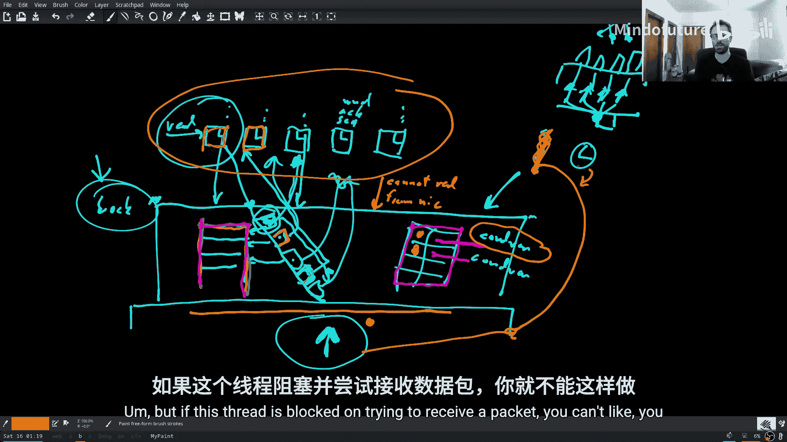

I don't know if there's a way to do that， though。Ohoh， it might be。

 it might be that the way we do this。It's going to be really funky， but。Basically。

 we can get a raw file descriptor to the underlying thing。

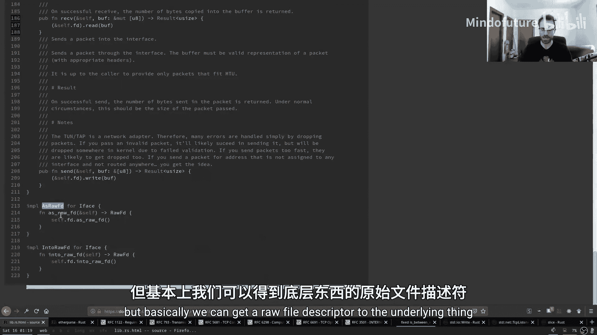

Oh， that allows for all sorts of cheating。 but basically。

 we can just before we make this call to block。Right， sorry， this is called read right read blocks。

 And if we wanted to block for it most a certain amount of time。

 this this crate doesn't let us do that， right， It only has a receive method， but。

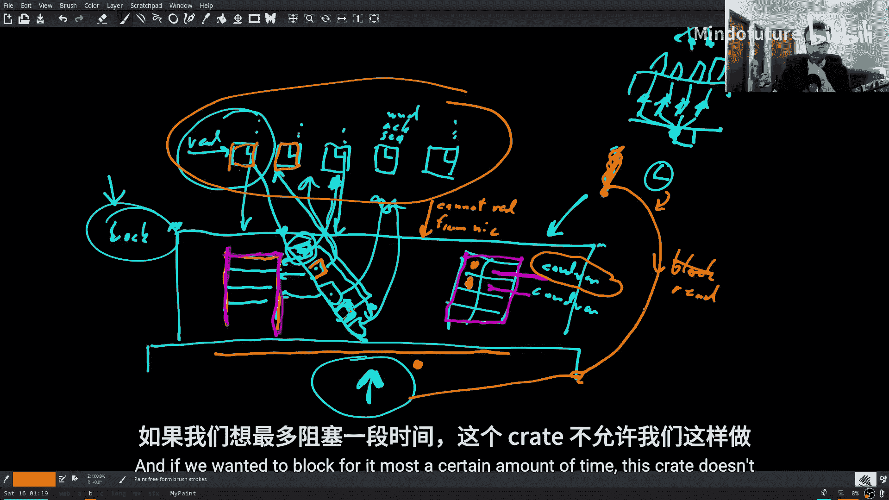

When read。Oh， man， to。嗯。But where's the timeout business。呃。うう。So there's a way to set。啊。Sock got。Wow。

Maybe you just suck it。Nu。😔，What's the thing for setting？嗯。Actually。

 we can do this in a different way if we look at the rust docks for received timeout。

So on a TCP stream you have received timeout， what does that do internally？Well。

 that's platform specific that I think we need to go to the real code。

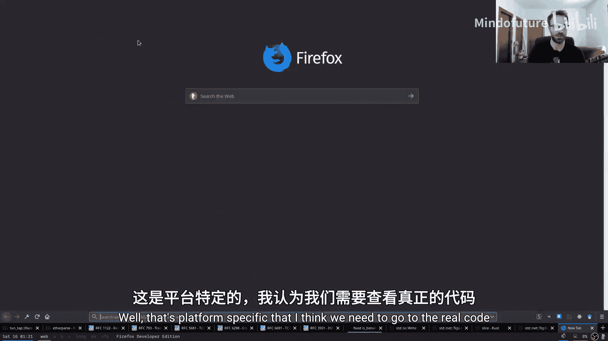

So let's see。Lib。Lib standard。Ss。Uix。😔，Where is net？Here。So let's look for receive。

Or is it read time up？Oh。Maybe it's just common then。😔，Net。Yeah， so there's this。So basically。

 there's a way that we can because we have this。

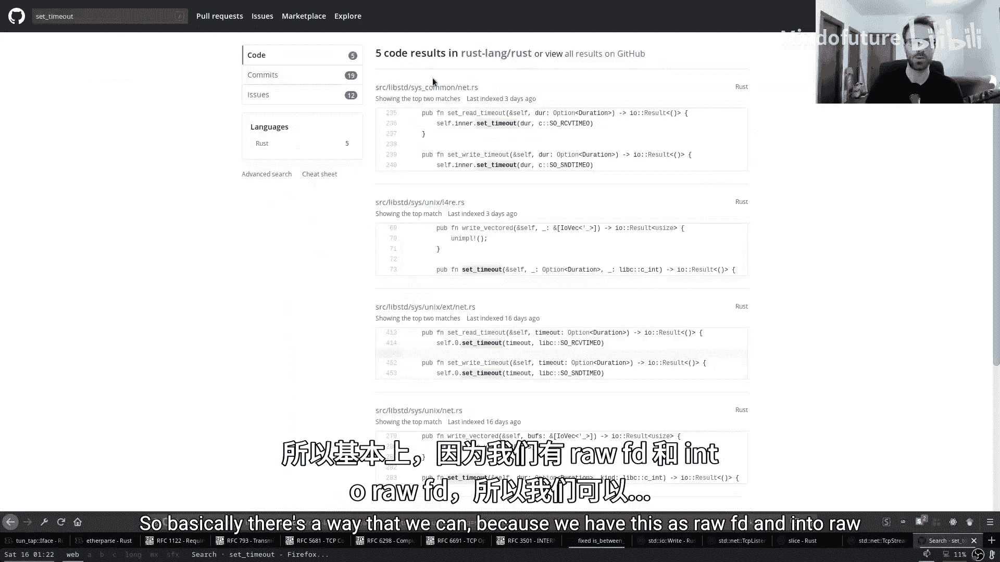

Because we have this as as raw F D and into raw F D。

 we can get sort of a raw handle to the underlying thing。

 and then we might be able to just set a timeout directly on it so that the read call actually will time out。

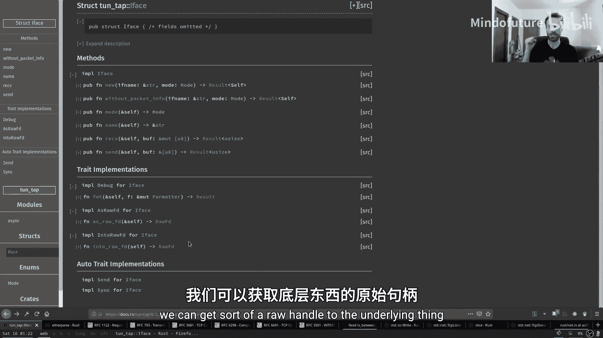

But in order to do that， we would have to。Find excellent。St 0 dot set time out， O。

 And where does that come from here。😔。

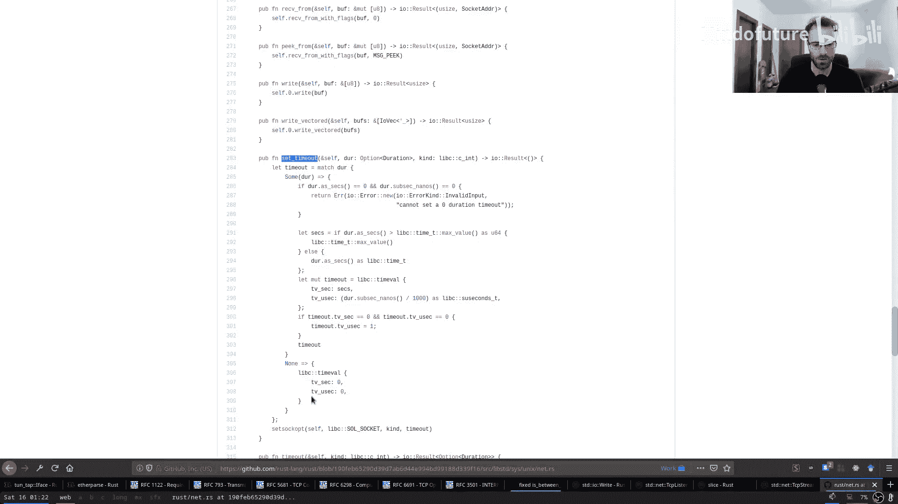

Set sock opt。Yeah。

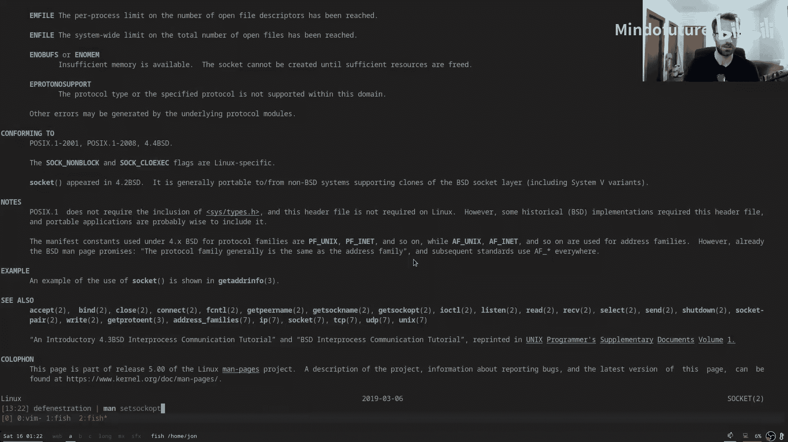

Right， so we can basically do the same thing that Rut internally does to set a timeout on a particular channel because all this is doing。

 all receive is doing is really just calling read on the underlying file descriptor。

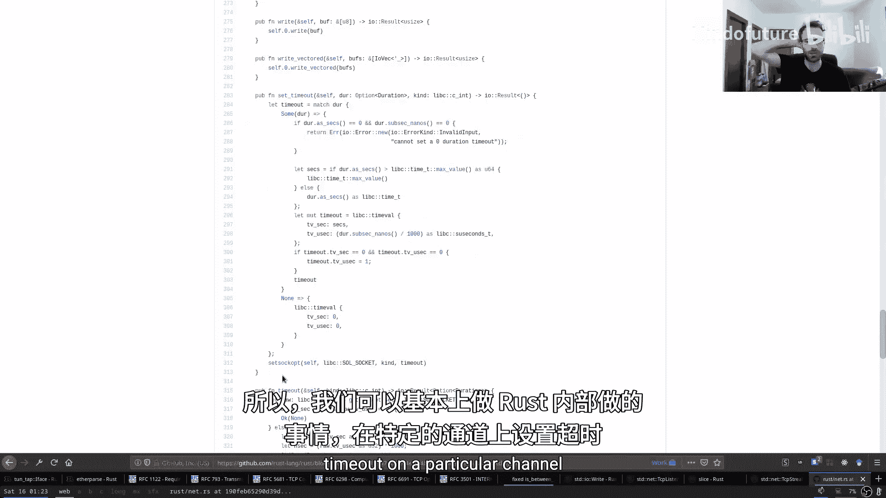

And so what we're going to do is we're going to set the same。

 we're going to set a timeout on this file descriptor so that a read will block for it most。

 so and so long。And so this basically gives us a way to emulate， receive time out。

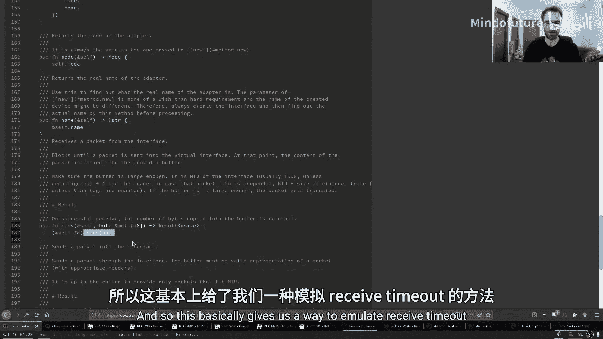

And we'll see whether that works。And so that would mean that when。

 when this thread that manages sending and receiving packets does a read。

 it's actually going to do a read。Timeout。呃。2。That's going to be sort of。At most。

 the time until the next timer fires。Now we're probably not going to end up implementing timers in this particular stream or like it might happen in a future TCP stream。

 but we need to make sure that the design actually supports having timers because they're critical to getting TCP to work。

Okay， so I think what this now suggests is this is somewhat similar to the design we had before。

 but with fewer threads and fewer channels。So instead what we're going to do is we're going to have every TCP stream is really just going to have a pointer to a mutex of all the sort of connection state。

 this is basically what we had in connection manager before。

And connection manager is going to have everything except for the NC itself。

 so this is going to contain Nick， this is going to contain connections。

If we think about the data structure。And then the thread that reads from the NI is going to populate things into the connection structure by managing the connections。

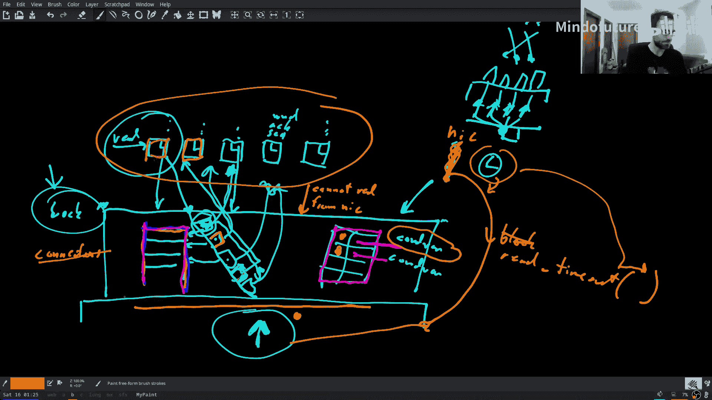

Alright， so let's give that a try。It means we have to rejiig this a little bit because we no longer need these interface requests。

 which is good， right， Like getting rid of that seems fantastic。😊，嗯。So。U。

What's really now going to happen is when you create a new interface。We're going to create the ni。

Right， so that we have to create regardless， we're going to spawn。

We're going to spawn some thread that's going to sort of manage the ni。And we're going to have。

I guess a interface handle。And an interface handle is really just going be， it's going be a type。

That's going to be an Arc Mutex connection manager。呃，Yes。Probably does not need buff， either。Instead。

嗯。Here。So this thread is going to be what holds the ni。It's going to have a buff。Just gonna be this。

And it's gonna do the stuff that Maine does。 But anytime it has to touch a connection。

 it actually has to take the lock。嗯。So up here， we first have to。

We have to create the sort of connection structure that everyone's going to look at。

 So we're going to do connection manager default。This can presumably just derive default。And in fact。

 this is going to be an arc。🤢，New mutex， new。Connection manager default。

We might even be able to just say arc default here， but type inference is going to come kick or as。

 Oh， actually， we can do Cm interface handle。Is Arc default。Great。All right so。自。

This extra thread that we've made， it's going need a copy of the connection manager， right。

It's not currently doing anything， but it's going to have to do that at some point。

And the interface now is really just this handle to the connection manager。

So interface is a interface handle。And a joint handle。So the interface handle is where。

Is where all the stuff for all the connections is， so that's where you're going to have to lock to do reads and writes or accept for that matter。

This is no longer a thing。Bind now。 So bind is really just going to do。It's going to do。

Self dot interface handle dot lock。And I guess unwrap， right， So it has to lock the interface。

 It has to then do。Something to start accepting sin packets。On the given port， right。

 So that's going to modify some data structure in C M that we haven't constructed yet。

And then it's going to drop C。And then it's going to return。Yes。So this is releasing the lock。

 and then it just returns the TCB listener with the port because it needs to be able to identify the connection later and the interface handle because it needs to be able to lock in order to accept packets。

啊。So that's TP listener。 So if it wants to accept what does it do， well， it has to take the lock。嗯。

It then has to see whether there are any sort of pending connections for its port。

So the way it's going to do that is it might be where we can do finer grain locking here。

 but let's ignore that for a second。So CM is definitely going to have something here like。诶。Pending。

It's going to be a hash map from port to。To what。To a。Kuad。对。Qud。Yeah。So。

So pending here is a list of pending connections to this port。

So if there are no pending connections as Vec is empty， if you are not listening。

 then there will be no entry for that port。And so now we know what bind has to do。

 bindin has to do self dot pending， dot insert， port， being you。嗯。

And we're going to hear a c that was bound as none。

Right that there wasn't already someone bound to this sport。

Or the way we can do this in the sort of better way is collections， hash mapap entry。

 and then we match on we match on。Entry report。And if it， if it is vacant。Then we insert a a new。

And return okay。If it is。Occuped。Then we return near。

This means the user tried to bind to a port that has already been bound to。

And then we return IO error。New I air kind。I can never remember what the aines are。Atter in use。

Port already。so， and this should be C。Does that make sense， so for bind， we take the lock。

 we add an entry to pending for our port to say that we're willing to accept connections。

 initially it has no new connections and if it was already bound like if there was already an entry for that port。

 then we return an error saying we can't bound to a port that's already been bound。Okay。

 so the question now becomes， what does accept to Well， accept is really just going to be。

It's going to look imp。So。It's going to do C。Dot get mute。Port， self dot 0。

I guess we could be nice and name these， but for now we won't and we're going to say。

If let some quad is。Get mute。This， we actually expect to be some because we already have a TCP listener open。

So this is something like。Port closed while listeners still active。呃。And then we want to pop。

 This is from the Vck。 Actually， I guess this should probably be a V DQ。Collections。

The DQ and hashmap。嗯。So specifically we want to do a。

 you can imagine that this is going to be new connections。

 are're going to be pushed to the back and we're going to pop connections off the front。

And so if there is a connection for us to pop， then we're going to just return。呃。

A TCP stream for that quad。Otherwise， we actually have to block。

So here we've been told to accept a connection， but there is no connection to accept。And so here。

 what we really want to do is block。To do。So for now we're going to do this。

 we're going to have a try accept。That is going to do return。A I O。Air new I Air kind。哇。Tried to do。

No connection available。2 like。Right， we probably want an accept function that will actually block。

 It's just that。That's going to require us to write some infrastructure that we haven't done yet。

 I just want to walk through these first， and then we can add all the the sort of necessary bits and pieces afterwards for。

 for doing actual blocking。Before we continue， does this design roughly make sense？

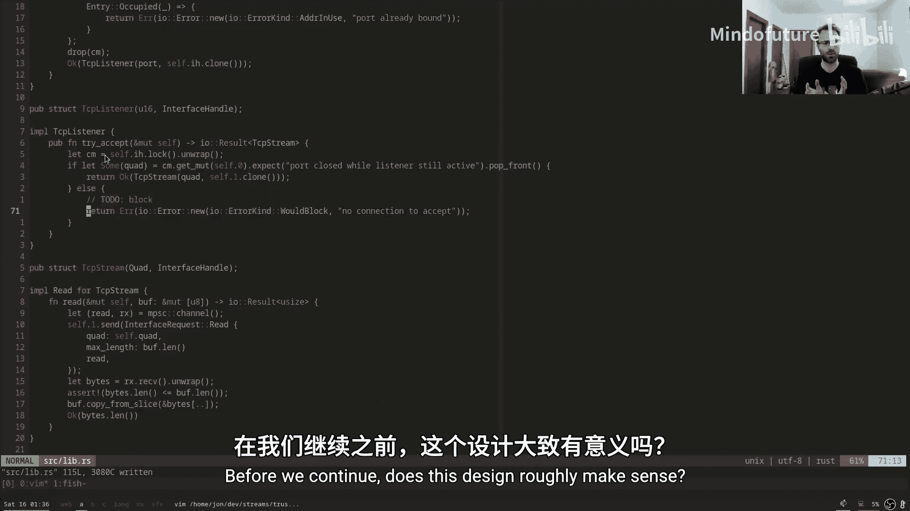

Like what we ended up on here， why we ended up on that design。

 what the sort of challenges of it was and what the general approach we're now going for is。

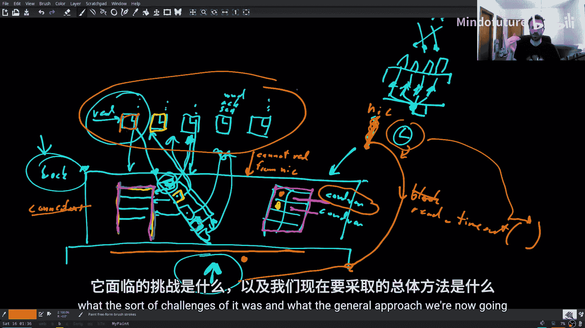

I sort of want to hear from chat that we。That I haven't sort of lost you along the way。

It's easy when writing this to sort of。嗯。I have a stack internally in my head of what we're doing。

 But if that doesn't match your stack， then。I've sort of lost you along the way and that would be unfortunate。

 so let's try to rethink just check that people are still understanding roughly what's going on。哎。

Sensei clolo says yes， it does。 Great。 So we have one person on board。 They were in theory。

51 people in chat。What do the other 50 people think or some subset of them？

Maybe everyone has me muted。You're E too busy eating pizza， that sounds pretty great。

 I wish I was eating pizza。I'm going to assume that if you're eating pizza。

 you're understanding everything that's going on。Pizza clearly just like。Makes your mind aware。

 right， that's how pizza works。哎。Well， there doesn't seem to be any loud complaints。

 So we're gonna continue and feel free to stop me if something does not make sense， because remember。

 if it doesn't， if you think it doesn't make sense to you。

 it is probably the case that it also doesn't make sense to other people。

 like whatever questions you have in your head where enough people here。

 that there are probably other people with those same questions。

 So please feel free to interrupt if you feel like something isn't isn't adding up。All right。

 so for reading at this point， the pattern should start to become clear。 we're going to lock。

 Then we're going to have to see whether there's data available for this connection。 So here too。

The connection is going to be self dot。 No， C dot。Connections， actually。

 this is going to be C dot pending。This is going to be CM。t connectionss。 getme self。t0。

Theres is gonna be a reference， a reference here， too。

 we basically expect there to be a thing because we have a TCP stream。

 So the TCP stream should still be there。 It might be that here you might get connection loss。

 actually。 So let's do an okay， or。Car else。嗯。A new。Iio Er kind。呃。Not connected。Broken pipe。Oh no。

 I think it's broken。Connection abored， seems good。呃。TP stream was pretty much sure was。

Terminated unexpectedly。Also， why is this not formatting my code？87。What no。Great formatting， nice。

Okay， so this here is the connection。Right， so this is the connection manager。

 The connection is just getting access to the connection object for this particular connection。

 And now we want to do something similar to what we did for accept， which is if。嗯。呃。Well。

 so this is where it gets tricky becauseuse we haven't actually implemented data yet。

 But if you look at TCP connection。Here， there's just definitely going to be like a receive buffer。

This is sort of incoming。It's probably going to be a vi。DQ。It's probably going to be a F DQ。Of U8s。

So this is going to be。Btes that we have read from this connection。

 but that the user has not yet read。 This is like a sort of buffer space。

 There's also going to be an outgoing buffer。 So this is bytes that the user has given us。

 but we have not been able， or that we have not been able to send yet。

 And that could be that we've sent it in a packet， but the other side hasn't acted yet。In fact。

 that's probably what it's going to be。 This is going to be sort of unact。I guess。Okay。

 so here what we really want to do is if C dot incoming。Is empty。Then to do。

 we're going to need to block。Right？And we don't know how to do that yet。So for now。

 no bites to read。So here， really what we want to do is block。If we get down here though。

 it means that there is data there， and so what we're actually going to do is just read however much data we can up to the size of buff。

嗯。And so here I'm going to have to look up。いき。リq。So there's a。It's never the expansion。 I want this。

There is a ass slices， that's what I want。

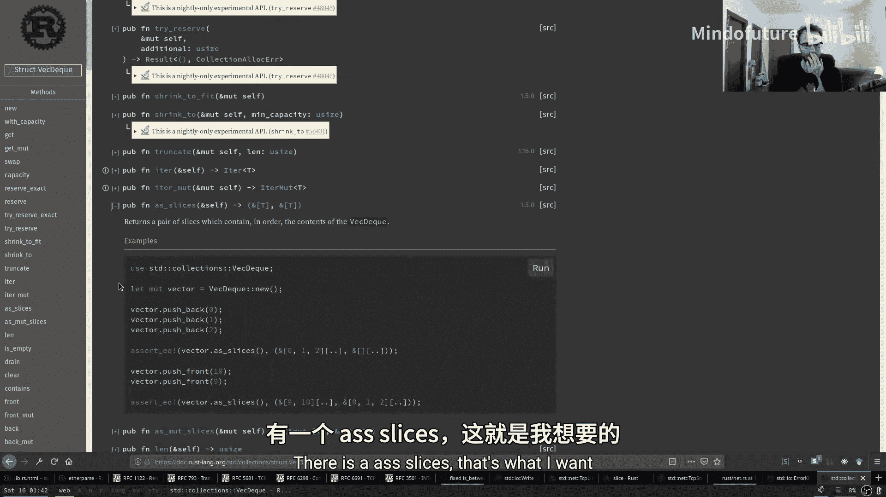

So a Vck Dcu， just for context is。VectTQ is a great little tool to have in your toolbox。

So a V DQ is a ring buffer。And if you don't know what a ring buffer is， you're about to learn。So。

Avek。Looks like this， right， so this is zero。And this is n where n is the length of your vector。

 and if you push onto the vector， you push over here。Right。In reality。

 it's a little bit more complicated that than that， because a vector in rust actually has。

I need to find a better way to erase。 I this is a silly。I want when I switch to a race。

 I want a larger brush。So really， the picture is more like this isn't N。 This is。Capacity。

And this is Le。And all the stuff in between here is like stuff that you've written。 And if you push。

 what really happens is you push some stuff from here to here。 And now let's call this L prime。

 So this is now the updated L， but no allocation had to happen because the vector can actually hold this much data。

 right。So until once you get here， if you then try to push more data。

 then the vector is going to grow。Now this is really neat。 The problem， of course。

 is imagine that you want to use this sort of like a queue， right。

 like imagine that you keep pushing stuff to the back， but I want to read stuff from the front。

If I try to read， let's do。Orange， if I want to read like this bit。

That becomes really annoying in a vector， because if I read this， this stuff， this is now free space。

Right。So I could move0 to here， but if I kept doing that。

 then eventually I would just like all all this stuff is still in memory。

 The vector is still that long。 And so instead， what I have to do is if I read this。

 I have to take everything that follows it。And sort of shifted to the left to fill in the space that was voided here。

 Otherwise I never recovered that space。A V DQ tries to solve this problem by。What green do we want。

 I want like。Pasly。That one。So a VC DQ is somewhat similar。In that it， too。Has a capacity。However。

It has instead of having just sort of everything starts at zero。It has a head and a length， sorry。

 a head and a tail， so initially。The head points to zero。And the tail points to zero。

If the head and the tail are equal， then the thing is empty。If you push， what really happens is。

So this is a push， then the head starts pointing here， and it no longer points to here。

If you push again， the head now points to here。It doesn't point to here anymore。

 the tail still points here。I might have gotten head and tail。Messed up here， this is the tail。

This is the head。So head does in the start of tail as in the end of。

 so the start of the data is here， so this is the head， not the tail， this is the end of the data。

 so this is the tail， not the head。嗯。And so I might keep pushing stuff and eventually I'm going to end up in a position that is ignore all of this at this point where the tail points here and the head still points to the start。

So the question is， now what happens，ooh， that's a terrible color。

Now what happens if I want to read this thing？Well。

 reading this is now trivial because all I have to do is increment the head。

And any indexing operation just always starts from the head。 So if the head is now here。

 this now has length 4。Because the length is from the head to the tail， always。If I push。

 I still push the tail。 If I pop， if I。Pop from the front， then I just increment the head。Right。

Where Vchdcus get a little funky is as you move further to the right。

 you can easily end up in situations like this one where。You have your VCDQ。And the。呃。No。To。Where。

So this is still the capacity and the tail currently points to here。And the head deploy I dont here。

喂。And there's little bunch of stuff in between here that I've like written to in the past。

 but currently is not being used by anything。 so the head is currently pointing here。

 and let's say that there are three elements here。 so these are currently the three elements of the VDQ。

 So if I popped three times I would get these three things。But now what happens if I push， well。

 what actually happens when I push is the tail wraps around and moves to here。

So tail is now going to point to over here， it's not going to point to here anymore。

And now this is an element。And so notice that what this means is that a Vdcu can sort of become bifurcated。

 right， now it's now no longer a single region of memory。 The Vcdu， if you were to read it。

 start to finish， you would first read these bytes， and then you would read these bytes。

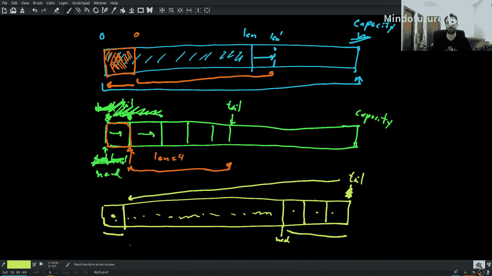

And so this is why in the VecDQ case over here， you can't dere into a U8 sorry into a slice。

 you can only dereence into two slices， which is the leading end and the tail end。

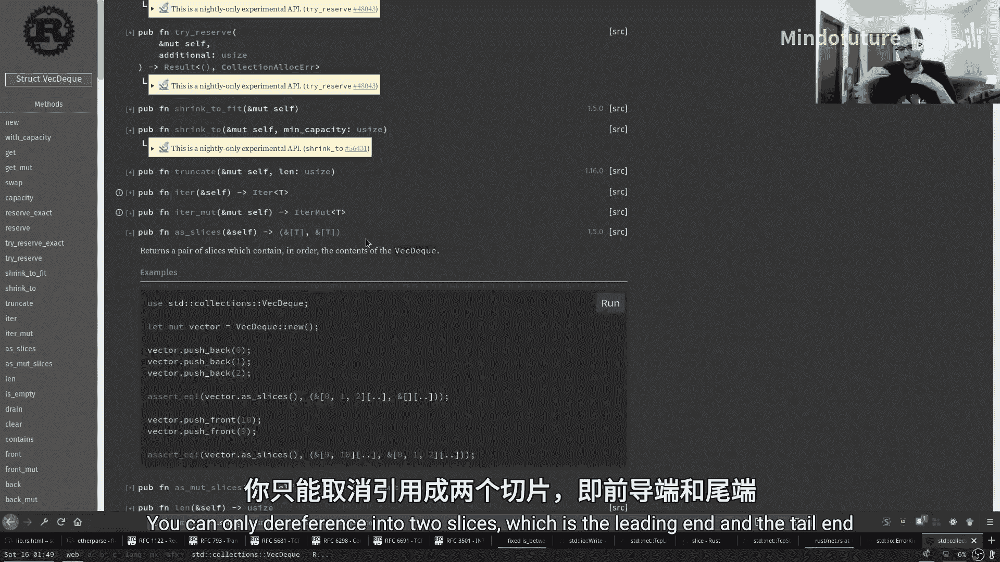

Or in other words， it is this bit。And then this bit。If you push data beyond the allocated size。So。

Basically， the same thing happens as in a vector。Let's go with。嗯。So。

Imagine that we've gotten to the point where the the tail is here。Right， well。

 the tail would never technically be there。 but imagine that like the thing is full and you try to push。

 it would detect that you're trying to push and that the capacity has been reached。

 So what we it would do is it would do the same thing as you do with a vector。

 It allocates a new vector Dq that is twice as long。Imagine that that is twice as long。

 Then it takes all of the existing things and sticks them into here。

 and of course the way it's going to do that it's going to take these things and stick them here and then these things because it's full right and stick them towards the end。

And so now you have all the stuff in order again， and now it's going to set the new the new head the new head to be here and the new tail to be here。

And now you can push by pushing to the tail。So it is basically the same cost as a vector。

 the only way in which it's different is in a vector， if you need to resize the vector。

 you can copy a single segment of memory， whereas with a vector DQ you have to copy two segments of memory。

 but the total size is the same。I doubt that you would notice this in practice。

 except if you were doing lots of ress。But in general。

 because of the way this resizing works of sort of doubling each time the。

We call this of amortized cost that you would expect to not see resizes as your data grows because they become rarer and rarer the more data you have。

So effectively， they're not that different。 and I think very often a V DQ is what you want if you want to be able to operate on both ends。

 if you only ever operate on one end， then a V is perfectly fine。

And the VC has the nice property that you can always get a slice to the entire contents。

 whereas that is not true for a VDQ。

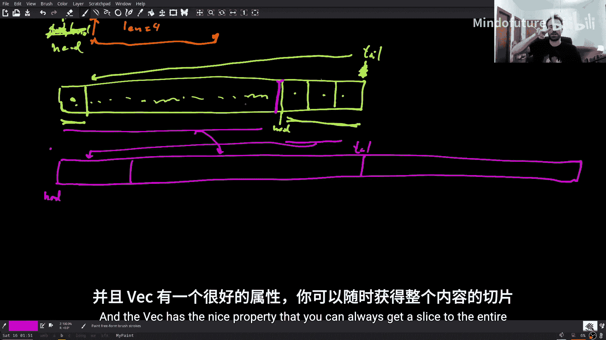

嗯。And so now when we do a read， what we really have to do is do a like a head tail is。呃。

Where were we？C， dot incoming。Dot a sliceus。Actually， I might be able to do even better than that。😔。

See， we might be able to just do drain and not have。 I was gonna。

 I was going manually use like the copy from slice manually for head and tail。

 But I think instead what we'll do is。啊。Actually， we might not be able to do that。

I wonder if there's a。This gives us an iterator over bytes， which is probably not what we want。

Wonder if there's。No， not really。I mean， we could the problem is that we have a we have a buff where because these are these are U8s。

 it's not like this is a vector we're going to push to。

 It's just we're going to overwrite the bytes that are there。

 So I think we might actually still want this so if。呃。Is there a way for me to。I want like。

 truncate start。But I don't know if that's a thing here。嗯。Split off is definitely not what I want。😔。

Rotate left。That's definitely not what I want。Ha。What does drain do internally？

And that just walks that doesn't really help us。Actually， let's see what brain does。No。

 I want match case。Give me the drain。And give me the iterator for drain。

So when the iterator is dropped， how does it， oh， it just directly changes the tail， doesn't it？Yeah。

 worry about that。嗯。I don't know how to best use this API at this point。

Because I want to not have to pop bites individually。Right， like I， okay， so here's。

 here's one thing we could do。 This is sort of stupid， but。that I actually。F IN C。Is。zero。

And red is 0。While let。This isI'm just going to show why I think this is stupid while let some bite is C dot incoming dot。

Pop front。N red plus equals one Buff N red is equal to byte。嗯。And I guess。呃If。

It's going to be a loop instead of that。If N red。Is equal to buff dot L。Then we break。嗯。

Then we're going to match。On this。And if it's some， then we get a bite。Then we do this。

And if it's none， that means there are no more bites in the incoming buffer， so then we also break。

Right， so this will do the right thing， but it's really stupid。 We're copying 1 byte at a time。

 I want the equivalent of this code， but without copying  one byte at a time。嗯。

And I think the way we do that is。Well， the problem is we need to be able to。

Remove stuff from the start。I'm actually kind of surprised that there isn't a。嗯。

An efficient way to just change the head。I mean， maybe the trick is drain。Actually， yeah， that's pro。

啊。Okay， so I think what we actually want to do here is。Headtail is C dot incoming dot as slices。嗯。

And then we're going to do。If。Okay， so we know this is not empty。

So we're first going to copy bytes from the head。Let's see。 Let mute and red is 0。啊。So， first。

We're going to do。Buff， copy from slice head。呃。意。バスタ。嗯。And that doesn't quite work either。

Let me write out roughly what I was thinking。And then we can discuss。C dot incoming do drain。

So I think that is basically equivalent。Except that we need to make sure that we don't write more bites into Buff than Buff can take。

I think slicing breaks。I think we need。H read is going to be。

Compare min of buff dot L and head dot L。And we're going to do H read。

 Then we're going to do n red plus equals H red。嗯。And then。

Tail readed is going to be Buff dot L minus N red。And。Tale dot L。 So this might be 0， right。

 It might be that we read all the bitetes we needed。嗯。

But it means that we don't really have to branch here， which might be nice。

So this might read no bytes， and then we drain as many bytes as we read。嗯。T read。嗯。

And at this point we can do OK and red。And I'm going to leave it to do for myself here that might not make sense right now。

 but we'll come back to it。Actuallyly， you know。will not need to happen Great， Okay。

 so let's take a look at read now that we have the whole thing right。

 we first try to take the lock right because we need access to the data that's been read we look up the connection for the TCP stream we're trying to read from if there's no data we're gonna have to block currently we don't know how to block and so instead we just return wood blocklock if there is data though。

 then we will read as much data as we can。 There's actually also a question here of detect Fin。

And return。 and read。It was0。Because we're going to have to detect when the other side of stop sending us data and then read the contract for read is basically you need to return OK zero if the other side is not going to send you anymore and currently we're not detecting that。

And I don't think we have a way to detect that either at the moment。嗯。Yeah， okay。

 so if there's no data， then we need to block and we don't know how to do that yet。 Otherwise。

 we're basically just going to read as much as we can from the incoming buffer that still fits within Buff and then we're going to re return the number of bytes we ended up reading。

And of course， right is going to end up being very。

 very similar except going sort of the opposite direction。Specifically。

We're going to have to take the lock， we're going to have to look up the appropriate connection。Oh。

 that's also a good question。嗯。So here's a question， should right ever block？

We could always keep doing rights by just expanding the buffer， the sort of outgoing send buffer。

But that might not be what we want。 We might want to disallow more than a certain number of packets outstanding。

 right？ So think of it this way。

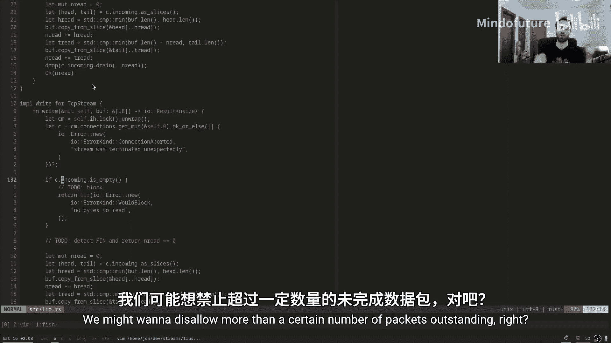

。I'm going to go over here。We're going to switch to the nice blue。So。

Imagine sort of in the very abstract， right a client。And a server。

 there's a connection going this way。 And there's a connection going this way。

 This is after the handshake has happened， right， And in this setup。如。Weird。

Did Cha go away or is Chad still there。Suddenly， the chat service is reporting zero people。

From like 60， which seems wrong。I'll keep going。But if someone can type something。

 that'll be helpful。 Okay， so you have a client in a server and。

There's like the server is gonna have some capacity。 Like。

 it's not going to let you send it just just keep spewing data to it。 It's going to say like。Okay。

 great， thanks。 So imagine that it has a limit of like 024 bys or something like you are not allowed to send me more than this much before you hear back from me that I've received them。

 Well， the client still has some application program that's running on it。

 right that's sending it data。 So imagine that this is like sending just like tons and tons of data way more and way faster than the server is accepting your data。

 you have a question， right， either you need to block the application。

 saying you're not allowed to send more data or you need to buffer up more and more and more data in memory on the client。

😊，That is like bytes that you ever see。 you have accepted from the application。

 but you have not sent out on the wire yet。 right？ And so the question becomes which of these two approaches you want to do。

 You probably want to block the application at some point。

 But that basically just means that there has to be a limit to how much。

 how many bytes you buffer up in the send queue before you say no to the application。 And in fact。

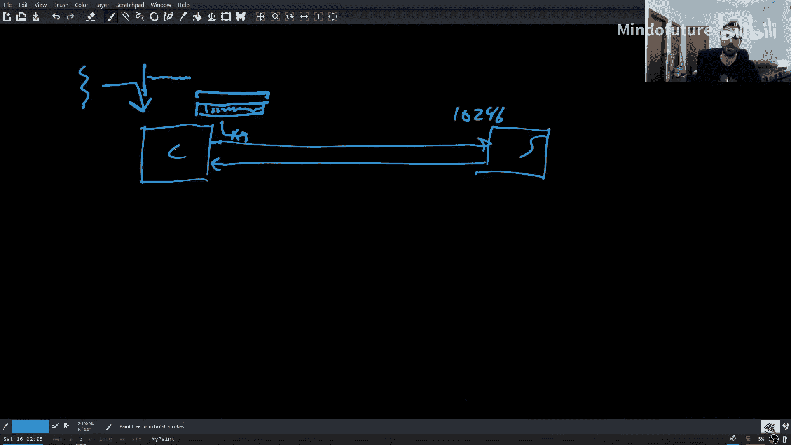

Usually on Linux， for example， you can find this out so if you type IP。I thought it was IP Li。

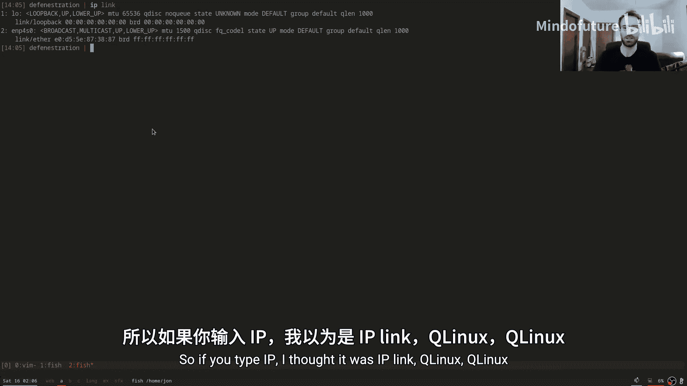

QN Linux， QN， there's a command to get more information about this。嗯。Yeah， so actually。

It's kind of funny to see how what we're building is basically exactly what exists in the kernel。

 But the kernel tries to be relatively clever on it。 Like there are lots of people who are。😊。

Doing research on how to manage this queue， right。And specifically。Where's the。HeIP show。

Where is the thing that gives meq and。Well， that's entirely unhelpful。It's like， net。TCPQN。

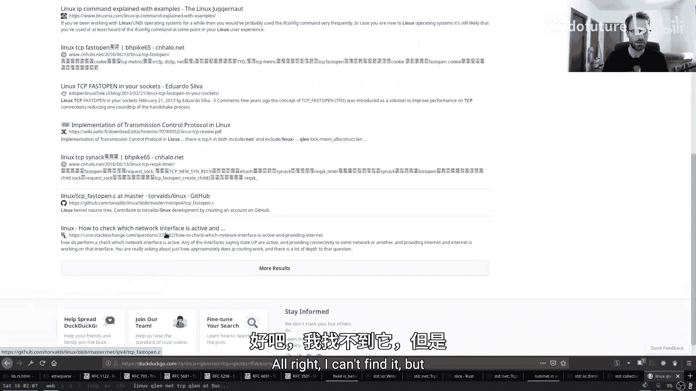

All right， I can't find it， but。Let's ignore that。 but there's basically like it's not quite this parameter I think。

 but there's like a there's a limit in the kernel to how many bytes you are allowed to stick in the buffer before the kernel will start to block you。

And so we have the same problem with right At one point do we see and say sort of enough is enough。

 And that's basically what we're gonna end up putting here， right。

 If C dot outgoing dot length is more than like。S Q size。So we're going to have some cons。

Send Q size， is's going to be 1024 for the time being。Then we're going to have to block。Right。呃。

Too many bites buffered。And we're going to have to block until some of the bytes that are in the queue have been sent out on the network until the server started basically accepting more of our bytes。

 we're going to have to block the application。 Currently， we don't know how to do that。 So currently。

 we're just going to return wood blocklock。 But this is the case in which we would block。嗯。Yeah。

Great， I also just realized that another thing we're going to want is Iple TCP stream shutdown。

So this is the way in which you can send you can sort of tell the other side that you're not going to send any more data。

And this is a。Like an I net， is that right。Standard net shutdown。かれと。

This is basically going to send a fin。If you remember from last stream。呃。Okay。

 so we're going to try to write out this many bytes into this buffer。

And it's going to work pretty similarly to what we did in Read， except it's sort of in reverse。

 instead of reading bytes out， we're going to push bytes in。And。Allowed to write。

 I guess n right is going to be send Qs minus C dot outgoing dot n。

That's how many bytes we're going to be allowed to write， and it's going to be standard min。

Of Buff dot L and that much。 right， So we will write either as many bites as we have or as many bites as we're allowed to。

 whichever is smaller， right， because we can't write out more bys than we've been given。

Q linkss with SSsL。No， that's the current size of the Q。 I was looking for the。 Yeah， you are right。

 So SS T L， T LP。Oh， what？That's哦 TPN。That's what I want， So this is showing me actually。

 let's ignore the N and ignore the P。So this is showing me all currently open TCP connections on my machine。

 and for each one， how many bytes are in the send buffer and how many bytes are in the receive buffer。

And and also things like which TCP state we're in。 So this is kind of neat。

 but this doesn't show me the maximum buffer that the kernel enforces。

Still try to figure out how I would do a lock free circular ring buffer in rust。

 This would be ideal in this situation。It wouldn't be quite enough because you still need the wake ups。

Whi you don't quite get with the lock free stuff it gets you quite far but not quite enough。

 I think some finer grain locking might help us here。Okay。

 so that's how many bytes we're going to write and of course the actually writing this is pretty easy because we don't need to worry about the head and the tail instead we are just going to do C dot outgoing dot extend。

B。From buff to and right。And then we're going to do oh。いす。And then we're going to do okay and right。

Because that's how many bytes we rode out。嗯。Here though， we might have to do a to do schedule。

Wake of brighter。And a flush。So a flush is basically saying。Block until there are no。

Until there are no bytes in the local buffer， every byte has been acted by the server。

And so this is also going to work very similarly， except that it's going to be。呃。If it's empty。

 then we're just going to return okay。Right， if the outgoing buffer is empty， then we're done。

 Otherwise， we're going to have to block， and we don't know how to block yet。嗯。

So we're going to have to figure that out。嗯。And shutdown is basically setting the fin flag。

 which is not something we have an external interface for yet。嗯。

But now let's see how far we get on compiling this。呃。Oh， we need a bunch of things， don't we main？

We have。These three。And。We also still have to do all this stuff that Maine does to manage packets。嗯。

Oh， it's not standard min， it's standard comparemin。No field IH。That is true。

Or you believe there should be a field called that。 Let's make things nicer for itself。

 So this is the port。And this is the interface handle。Could arguably just be H。

And TCP stream is similarly going to be the。Whatd。And it might be that we don't actually want this to be a quad。

 It might be that we just want this to be like a numeric index or something instead。

But for the time being， it's a quad。Which I guess also means that it's going to be here。

And down here in flush。And TCP listener is going to be。H， and this is going be port。No。It's not true。

 it's going to be H。This is going to be report。We're getting closer。66。That is actually IH。

And this is actually Ih。Because we need to oops， we need to distinguish it from the join handle。

 which is also a handle。In this instance。Mismatch types line 51。Bind。And。Oh， this is not。

 this is port。And handle。And I guess that also means that accept。Should also be。TCP stream。

 quad and handle。About now。Missing fields incoming。Oh， because we added fields to this。

 So this is on line 101。So the incoming and outgoing buffers here are initially going to be empty。Oh。

Did I not call it a unacted。And I guess that also means that here there's no outgoing。It is。Un act。嗯。

Oh yeah， we no longer need the MPC， that's nice。48。Cm。That should be IH， not C。

What else do we have mismatch Tpeline 50 bind？Did I like do something silly yep？Muts and arc。

 that's fine。Thank you。New Texan Park。158。Extend。Is not an iterator。That's interesting。

 So for a Vec DQ。What do they want us to do？Why dont want to push a bunch of stuff。嗯。u。Okay。

 so I may just have to do like。Hitter， I guess。嗯。呃。OhRight。We want to be able to access these fields。

 so incoming and UNAAC need to be pub Cate。For now。56。呃。Tending。Pending should be a V DQ。And。56。

Should be new。Pub crate means that it is public to any code that is in the same crate as where you put Pub crate so it's not public to people who use your crate as a library。

 for example， but it is public it is available within your crate。

Think of it as sort of like protected in Java。Maybe。167。 Oh， this is gonna have to be mute。

This is going to have to be mute。B。And this is gonna be eat。How about now。54， and this skin out be。

So course。わからし？All right， Maine is going to have to change a lot， that's fine。呃。

Bun of complaints in TCP， that's fine。To be expected。

 we do want to fix the ones that are in source lib， though。Okay， I think those are all expected。

Great， so now time to fix main， right， So we still have this to do of something has to be reading from the ni。

 and currently， nothing is reading from the ni。 right？

 So all the stuff that happens in main currently， we want to do here。

 And so this is gonna be something along the lines of。Packet loop。

 and it's going to be given a ni and the IH。And so we're going to have a， I guess。

We may end up splitting this file into multiple files in not too long。

It's going to be mutable and it's going to be a ton tap eye face。And the IH is an interface handle。

And we know that this is going to need to have a buffer of some kind to read the bites into。

 and that's going to be the buffer we all know and love。And inside here。

 it's basically going to do this loop。Right， it's gonna receive some stuff。

It's going to parse the stuff。嗯。But anytime it needs to actually touch the underlying state。

The status bar this is airline。 I have a separate video on my YouTube channel that's how my entire editor is set up so you should go whatsapp if you're interested。

So what we need this to do is whenever it's about to touch the underlying state。

 it needs to try to take the lock because there could be someone else reading at the same time。

 for example。嗯。And that is basically down here。 we're going to do。CM is Ih。lock。 unwrap。

And then we're going to do CM。Dot connections， dot entry。 If there is one， we're just going to do。

 we're going to process the packet。If。If it's vacant then the question becomes。

 is someone waiting right， so here it now becomes a question of。If let。Some pending is sell。 No。

 is C dot。Pending， get mute。A。TC， P， H destination port。Right， this is basically checking。

 Is anyone listening。 Do we have a listener for this port， And only if that is true。

Do we go ahead and do this？呃。And then we both insert into E and we also do pending dot pushback because we now accepted that connection。

 so we also push the quad。So let's go ahead and store the quad somewhere。The Q is equal to this。

 Then we push the Q to indicate that this is now a connection that exists。嗯。And of course。

 in this case， to do wake up pending except right so here we just accepted a connection and it might be that so currently nothing really blocks。

 but if an accept call is blocking， waiting for something to appear in pending。

 we need to wake that up and we haven't really said how we're going to do that yet。

The buffer mouth can all be in the circular buffer。

 and it would return wood block only if there's not enough room in it。

 and you can avoid all the locking part as well。Yeah the problem so I agree with you。

 the problem is we will not actually be using woodblock。

 We need to actually block and that's where you're going to need something that's a synchronization mechanism for waking people up it is possible to do that with lock free data structures but it is not quite as straightforward because imagine that you you detect that if you have a lock free ring buffer。

 you just sort of do a lockfr read， you notice that it's empty now what do you do in order to block。

You need to block in such a way that someone else can wake you up when there's data there。嗯。

You can see Alex is。Yes， so you're right that。You could totally have a push。

You could totally have a polling API if you had a lock free ring buffer。

 but you could not have a blocking one， which is what you want。

It depends right like we might want to be able to provide both。

 but they sort of necessitate different designs， even in a non- blocklocking design。

 you don't actually want to be polling all the time。

 You want to get notifications when you should poll at least that's how sort of the current async infrastructure works。

 and that means that you have to be able to somehow give wake ups。嗯。Okay。

 so here we're going to have to do some kind of wake up and we don't quite know how we're going to do that yet or。

We have some idea， but I haven't told you。嗯。All right， let's see how it complains about that。

 So Maine。In some sense， main is just going to no longer exist， but we kind of want main， right。

 And so specifically what we're going to do with Maine is mainine is going to do trust。Interface。

 new。Let I is。Let。Hi。嗯。Like so。 And then we're going to do I dot listen。Or I dot bind to port 9000。呃。

We're also going to do。9001， but we're not going to listen on any other ports。And then。

Then what are we gonna do。Then we're going to thread spawn， move this。This is going to do。Look。

Are actually is going to do while okay stream。 So this is going to look very similar to how you write networking code。

 which is sort of intentional because we've， we've built it on top of the same kind of design。

 actually while I remember， we're going to have to do I drop for TCP listener。Which I haven't。

Talked about yet。Basically just stop listening on the port。

 we're also going to have to do the same thing for stream。To basically send a fin。

And we're also going to have to do the same for interface， I think。

Because the interface has to tear down the network and stuff。All right， so。

While there's while L1 dot accept。呃。You print line， God connection。On 9000。

And then it's just going to drop it。And this is going to be God connection on 9001。Okay。

 so we have some problems in sort lib mine 80。呃。That returns nothing。Oh， that's a good point。Yeah。

 like what happens if this errors？If on packet errors， for example。

I think we're going have this return， a。An IO results。Why is this not okay。 Oh。

 it needs needs to be a reference。Y is 74 not okay because this has to be a quad。

Why is this not okay。Because。Expected nothing found results。Oh right。

 this join handle is now for an IO result， this because that's what the packet loop terminates with。

And line 79 doesn't need to be viewed。Great。And line 80。Oh。This is an artifact of how。

The borrowing rules work。I think we're going to have to do this for that tour。

So the the problem here， let me。Recap that。 So it says cannot borrow Cm as mutable more than once at a time。

Specifically it's saying we're borrowing CM do connections here and we're borrowing CM dot pending here and that's not okay at saying and you might think well this is weird normally it should realize that these two borrows are of different fields and so why does it care like borrowing those mutably separately should be fine The reason here is CM is a muttex guard。

And because of that， because it's a mutex card， we're going to D ref。

And we're using the DF mute trait on CM to give us the underlying connection manager right but that DF borrows the entire muttex guard and so here it's really saying you can't borrow the entire mutex guard mutably again because you're already borrowing it here。

So what I'm doing here is basically a reborrow so I'm de reference， so I'm doing the D of mute here。

 which gives me a mutable reference directly to the connection manager as opposed to the mutex guard。

 and then it can distinguish that these are different fields。Main is complaining why。呃。

No method named， except found。Oh right， because we call Win and try to try accept。

Just have it be called except， even though it's not quite right。Mismatch。It's saying five。呃。

Function body does not return。Jage1 is this。Stage 2 is this。1 dot join jh2。t join。Great。

And then I guess， okay。So this is a really stupid server right all it does is just like starts up two services and then prints whenever it gets a connection。

But it is a much nicer interface than the giant main function we had before。

 This actually makes the interface look somewhat similar to what the the real rust network interface looks like。

Some unused things， that's great。And we want to use also thread here。Cannot borrow L1 is mutable。

It's fine。Right， and we're not actually using the streams for anything。我责陈斌。

And we want to make sure that these threads didn't fail。Great， okay， so now this compiles。

 it won't actually run correctly because we haven in diploma of the blocking。

 but this is a good step forward。But let's go ahead and implement the the drops as well。 So when。

When TCP listener gets dropped， we basically want that to be the same sort of unbinding right。

 like now we're not going accept any connections on the port that the TCP listener initially was listening on。

 And the way that's going to work is pretty straightforward， really， it's going to be。

Almost exactly what you expect it to be。 We take the lock。嗯。Then we do CM dot pending。

Dot remove self dot port。Right。嗯。So this is going to be pending。

And we also sort of want to drop all of those connections。So remember that the code that we wrote。

For in TCP。That's what I meant so the code we wrote for the packet loop， right， it gets a packet。

 if it gets a packet for a quad that it didn't have and that port is currently open。

 It's going to go ahead and accept that connection。

 But imagine that this means that you might have it might have accepted a bunch of connections and then we go ahead and drop the TCP listener。

 what do we do about all the connections that have been accepted or that were about to remove from pending Well we sort of need to terminate them。

 and the question becomes how So down here in the drop。This is going to be， I guess。

Connection for quad in Pennday。And here we're going to have to do something to。Shut down or。

termminate。All terminate。Cm dot connections Quad。Which is something we haven't done yet。So currently。

 we're going to leave that as unimed and that unimmented is only going to be hit if there are any pending。

 right， So this is basically the same as like assert pending is empty。

 except that we get to write out what we want this pattern to eventually be。

The drop for TCP streamam is somewhat similar。In that it is going to do。It's going to take the lock。

 It's going to remove itself。Expect。And this is a similar kind of expect of。Or， actually this。嗯。

This is going to be if let。Some C is that right， because it could be that the other side has。

Disterinated the connection。 If the other side is terminated the connection and we just drop the TCP stream。

 that's not a problem。 It's only if we still have the connection open。

 then we need to do the same thing。 We need to terminate this connection。

But we probably don't want to sort of forcibly terminate it。 We just want to like send F。On this。

So this is similar to this bit down here。 This is similar to shutdown。 So arguably。

 this could be like self do shutdown type or deal。Becauseuse it's basically doing the same thing。

 I guess。Do this here。Just to leave the to do for ourselves。嗯。All right。

 and I guess maybe we don't need drop for interface。呃。Well， so for this。嗯。When the last。Oh， I see。

We sort of want some way to do a clean exit， right， So currently the。This， this packet loop thread。

 Remember， we we spawned a thread to do the packet loop。

 That loop is just going to keep running forever。 It doesn't。It doesn't know when to exit。

 But if you drop every single TCP stream， actually， if you drop the interface， right。

 if you drop this and you've dropped all the。TCP streamams and TCP listeners。

 then we sort of want this thread to shut down。嗯。And so I think what we really want to happen here is。

呃。Well we certainly want to do is self JH。Oh， this is where it gets awkward。 Well。

 so we want to join unwrap， unwrap。We also sort of but and we sort of want to drop self。ih。Right？

The problem is this won't actually work。 But that this is what we want to do。

 And then we just want the， we also need to make the packet loop somehow recognize。

 So maybe we do something like on the connection manager， like。Terminated。

I was just going to be a bull or terminate。Bol，So this is going to do self IH lock unwrap。

Terminate is true。And then we sort of want to。Want to wait for that to actually finish running。

The problem that there are a couple of problems with this。

 One of them is that this might be blocked on this receive， right。

 But here we know that we're gonna have a timeout regardless。

 So here to do set a timeout for this receive for buffers for timers or。For TCP timers or sell。

Connection manager。Terminate。So at least we know that once we fix this to do。

 this receive will eventually return， and at that point it's going to recognize that it's been told to terminate and it's just going to terminate。

What exactly a terminating means is。Another potential problem。 So down here。

 we might have something like to do if。Self do terminate。呃。Wow。And our。Get。Strong refs or something。

Ih。Is equal to one， so that would mean that theres the loop is the only thing that still has a handle。

Then。Tear down all connections and return。So this we still don't really know how to do。

 but this business is a little tricky because we only have a mutable reference to self so we can't drop any of the fields inside of it and self。

jh a join handle join also consumes the join handle this is a pattern that you run into and drops that are always a little bit annoying。

And so one way to fix this is to have interface be an option。 It's kind of sad。But it does work。

So it's basically this。And so it's self。ih。 take。Prop。And take。Nott expect。呃。Interface。

Drapped more than once。呃。Is there an actor Cate you could recommend？

I haven't really used any of them， as far as I'm aware， Acts is sort of the biggest one， although as。

呃。し。They seem to be pretty sort of trigger happy on doing unsafe things。

 and I think that's a problem。But I haven't looked at it in enough detail to really say for sure。

Apart from that， I don't know of any other actor libraries in the rusty ecosystem。Yeah。

 so what we're doing here is basically just asserting that drop this option is always going to be some until you call drop。

 then there are going to be none and you cannot call drop more than once。

This has the unfortunate side effect of。You need to do this。Everywhere you want to use thH。So down。

Here。Ih。As mute unwrappped。1，33。Ih is going to be some。I。And Ja is going to be summed。嗯。Yeah。

 so there's still a bunch of to do's here。 the biggest to do， though。

 that I think we sort of need to fix is this blocking business because without that。

 if we try to run this right now， I mean， I can try。

 but I don't know that it will do anything useful。Probably break in all sorts of horrible ways。呃。

That's interesting。What happens if I do 9002？Actually， let's kill that for a second and run。T shirt。

So we're going to start this， we're going to run T shark。We're going to run first on 9000。

So nothing responded on 9，000， which seems like a problem。Not sure why that is。Yeah。

 definitely not sure why that is。 So something is weird， even beyond this。 So the packet loop。

I guess， here。IGo packet for。Kown quad。This。For unknown quad。Listening， so accepting。

So let's see what this does。So this saysGo packet it for unknown quad。

 and it's claiming that no one is listening on that port。Which is kind of weird。

 because Maine should be listening。Right， 9000 and 9001。So let's see what actually is impending。呃。

CM团。Penning is empty。That seems problematic。嗯。Why is pending empty？😔，Ha。Bund to 9，000。

 let's see that these calls actually return。Oh， they might not。No， it should have bound。

So this suggests that our binding isn't working。呃。Bound。I guess down here， we're gonna。

Bound and then print out Cm dot pending。And then I guess。Just to make sure this doesn't drop。

Listener。Oh， I know what's happening。The listener does get dropped its because。Okay， so here's why。

This thread， these two threads are immediately going to start trying to accept connections on these TCP listeners。

 except though remember we haven't implementeded blocking so they're just immediately going to return an error with wood blocklock and so it's the thread is immediately going to exit at which point it drops the TCP listener so it's no longer listening on that port。

 so we do need to fix this blocking issue。So let's go ahead and do that。Let's keep those in for now。

Readed of that。And let's get rid of that。Okay， so specifically， let's fix blocking for accept。

Because that is basically the delta we have to what we had working before， right？

 So before you could accept， and then it would just end the connection。

 Now we want to do a little bit better than that。嗯。Okay， so the question is for accept。

How do we get this block to work right like this is our nemesis right now。U。

And the way we're going to do that is we're going to use what's known as condition variables。

So a convare is basically a way to block a thread while waiting for something to happen。

 let me make this a little larger。And so the idea is that you're going to take a lock。

 you're going to check a condition and if the condition is not true。

 you're going to wait on a condition variable that someone else is going to notify you when changes and then you're going to check if the thing is now true。

 otherwise you're going to wait again and so the basic pattern is sort of like this you take a lock。

You take a lock， you check whether the condition is true and while it is not， you wait。

 and the weight implicitly releases the lock until the condition is true again。嗯。

So here we're going to do。This is going to be。Or this is going to be。Yes， it's gonna be a loop。

So this blocking is going to be- so we're going to need a condition variable somewhere。

But here we're checking the condition。 and if the condition is not true。

 we're going to take sort CM dot pending var。Dot weight and give it the C and say C is equal to that dot unwrap。

Right so this pattern is basically。We're going to keep releasing the lock and blocking until someone tells us we should wait up on this。

Now， there are a couple of ways in which we could implement this。

 We could have a single condition variable across all TCP listeners。

 but that's probably not what we want。 We probably want sort of a condition variable per。

So it might not even matter。Because the lock is global anyway。嗯。

But let's go ahead and make this pending variable be per port。

 So now what we're going to have is in the connection manager。

 instead of having pending just be this， we're going to have a pending。

Which is going to have a VC DQ quad and also a condition variable。

And the restrictions are each convore can be used with precisely one muex。嗯。

And I assume that you can use one muttex with multiple convaris。

They don't say anything to the contrary， so。Yeah， okay， great。

So this is also going to hold a con bar。So it's going to be， this is going to be。

Quads and this is going to be。Var， I guess。And so the pending is going to hold a bunch of pending。

 Does this implement default， sort of hope so， great。Okay， so this is going to derive。嗯。

Let's see whether that what fails to build right now。So this is going to be dot。Quds。Right。

 and this is going to be。Actually let's do this this way。啊。Ou。I don't know if that's okay。

 I wonder whether the mutex has to be stored， the convore has to be stored outside of the muttex。

Yeah， it does， doesn't it？Well， that's kind of awkward。嗯。Can I clone the convo。I can't， can I。

So the issue is the。We need to when we wait on a conar， we need to give it the muttex guard。

 but if the convare is inside what the mutex is guarding。

 then we can't give it the mutex guard because that would give up our handle on the var。嗯。

Interesting。Interesting。That tells me that we're going to do this in a is this still going to be a slightly stupid way to do this but？

So。We're going to have。Strt。Man。呃。Don't know what to call this yet。

 I'm going to call it food bar for now and we're going to change that name as quickly as we can。

 So it's going to have this the sort of manager， which is going to be the Mutex。

And it's going to have a pending bar。Wch is going to be a con bar。 It's going to have a receive v。

 although we're going to ignore the other bars for now， but eventually it's going to have those。

 I don't know what the food bar is going to be called yet。

The reason we want to do this is because it means now。So this is going to be self doth dot manager。

Dot lock。And down here， we're going to do CM is self。th。pending v。weight CMm。

So this is now waiting on the pending var is now just in the thing that we have an arc to。

 it is not inside the mutex itself。嗯。Yes。Which means that this now goes back to being a V。ピーキ？

And this is no longer quads。呃。86。So this now needs to be manager。This needs to be manager。

This needs to be manager。manager。呃。This needs to be manager。This needs to be manager。

 This needs to be manager。 This needs to be manager。And we need sink con bar。

The reason it's a little sad to have one convare for all pending is that now you have to notify basically all the TCP listeners whenever any connection is received。

 so we might want to try to do better than that。嗯。バり。Great。So now， of course， now we have the。

Now we have accept， we have a way for accept to block and the loop is going to make sure that even if we get woken up and it's not for our connection。

 we're just going to realize that this is still not the case and so we're going to block again。嗯。

The problem， of course， is we have to have something that notifies us to wakes this up when the pending state changes right and that's going to be here in the packet loop。

 right， the packet loop down here。Once it realizes that it has woken that it has added a pending thing。

 it is going to have to do essentially I mean， this is why we have this to do here right so this is going to be doing IH dot pending far dot notify。

So if you look at Convaar， it has。It has。Wait， wait on。Till， which we don't actually need。

 not wait time out， not wait time out， not wait time out。Notify one。I think we need so unfortunately。

 currently we need notify all。嗯。So this is going to call IH pending bar Notify Hall。

And we're going to before we do that， we are going to drop the CM。Wow， that's awkward。呃。

We really want to drop the lock here。🤢，So I think this is going to be。ち。Gi。Drop CMG。

Because we want to drop the guard so that we release the lock so that when these things that are notified are woken up。

 the lock will already have been released。Oh， hey， that compiled。 How about that。啊。

So let's see what happens now if I connect to 2000 illegal instruction。Wow not yet implement。 Okay。

 so this got packet for a quad， but it's listening on 9000， which is what we wanted。

 Then it got another packet for a known quad。 There was a connection on 9000。

 I forgot to run T shark。And then it ran into not get implemented online 222。

Wwhich is dropping the TCP stream and dropping the TCP stream currently。

 we're just going to sort of ignore because we know that our underlying TCP implementation。

 Currently it will just send a f immediately if you remember this from part one we set it out so that the moment it gets a connection it sends FI。

 it just goes I'm done， I'm done， and so we don't actually need to do this yet。

 but we do want this to eventually happen。So let's try that again。Let's start this this time。

And try to connect。Okay。So， that's interesting。呃。Oh， this is like an old leftover。

 let's run that again。Wait， why is it getting packet for 9000， That's unfortunate。 Oh。

 it's like the kernel still hanging behind。So that's kind of annoying。嗯。

So let's have it bound to a different port。Let's just say that it now listens on 6000。

And let's get rid of some of this other stuff it's not terribly important for now。

All we want to see is that this interface works。嗯。Okay， so currently it's not getting anything weird。

 start this。 There's no weird traffic going on。 we're gonna connect on 6000。 So it got。

 it still gets some old packets from 9000， This is because we didn't shut down that connection correctly So our Linux kernel is still trying to close that connection。

 We're just going to ignore that but we're gonna connect on 6000， which is where we're now listening。

 So 6000 connects。 Okay， so we got a packet for the unknown quad 6000。

 We're listening on that port because we bound to it。 we got a packet then for that。

 And now we say we got a connection。 So this is the setup。 think of this as this is the sin。

This is their act of our sin act。Then we got the connection and then this down here is we drop the TCP stream and so therefore the we get rid of the quad。

Which might not be what we want。呃。So it sent sin。 We sent sininach。 It sent a。We sent Finak。

 It sent a。Great， so we have closed the outgoing connection。

 It hasn't closed the connection to us because I haven't told NetCt to stop sending stuff yet。

But it did drop the connection because we dropped the stream。Which is not really what we wanted。

 because it means that if I now send this。It will just get very confused about the state。So， maybe。

How do we want to do this even。Basically， when the TCP stream gets dropped。

 it's unclear we really want to forget about it straight away。嗯。TCP stream。嗯。Specifically。

 I think we don't want to， so to do eventually。Remove from CM dot connections。Right。

 because even after the user。Drops the TCP stream。 There's still a bunch of hand shaking that needs to go on。

 right， like the。We， when we drop the TC P stream， all we're really doing is sending them a fin。

 They， We still have to wait for them to act that。 Otherwise， we might have to resend the fin。

 And so we don't want to get rid of all the TCP state for that connection until we really know that all the the peer knows that we shut down。

And so therefore， we don't actually want to do anything when we drop the stream。

 except for send the f。 And currently， we don't have a good way to do that。 We do that automatically。

 So currently， we do nothing in drop。So let's go ahead and try that and make that 7，000 this time。

Al right， so now we're going to connect on 7000。Okay。

 so notice now we didn't get any packet for unknown connection after here because we didn't drop。

 And so now we see the same pattern。 Net cat sent sin。 we responded with S act。

 it responded with act to our sin。 We immediately send a f act。 and they act our fin。

 but they have not sent a f yet， I can then terminate Net catt without sending any data。

At which point it sends a thin act and we act。 And at that point， the connection is done。

So now notice the kernel isn't doing any retransmissions or anything。

 it's totally happy with everything just worked out。

ItIt really does think that this connection is is shut down， and we can check this with T N。

 So there are there are no connections listed for the tunnel。Right， whereas if you look at。

 if I did this。Then now there's a connection listed here。Because it hasn't been shut down yet。

It's set in close weight because the other side has closed。

 but we have not yet closed once I terminate this， this now closes and the connection goes away。

 so that means the entire sort of pipeline now works and also notice that this means that accept blocking is now working right the except blocks when we try to do accept and then it gets woken up when there's a connection available。

So that is exactly what we wanted to happen。 Of course， we haven't implemented any of the。

 the sort of read or write stuff。We haven't implemented at any of the read or write stuff。嗯。

Let me think a little here。So we have implemented read and write。

 We just haven't like this incoming buffer and the out the unact buffer are just currently entirely unused。

 We are writing data into it and reading stuff out of it。 but， but that's all。

Maybe we should fix this。Because that should be possible to detect。Specifically， in some sense。

 what I want here is I want the following code to work。啊。Stream dot read。呃。

To like whatever it doesn't really matter。And then assert e n0。嗯。So basically。

 this is making sure that we can do a read that read will block until the other side is shut down the connection。

 and we're just checking that we only ever get no data。

So let's see if we can get that to work I think we will probably not do all like data read and write in the stream This is more sort of infrastructure stuff for getting the stream in the right place as getting the project in the right place。

 but being able to block at least on，嗯。There being no data for you to read or the connection has now been terminated seems useful。

 so specifically that's this to do here and read right where I guess it's also this to do in block。

From what language did you come to rust， So Ive worked on a bunch of languages before Ru。

 I think the biggest ones for me were。Probably go。But I've done a bunch of different stuff。

 I've done a bunch of C programming too， and like C++。嗯。Okay， so for Reed。

 we basically need to fill in these two blocks， right？

So let's look at our actually before we do that， let's do this。Add nice net like interface。呃，没。

Let's go back。没有。Right， so now this is the code we sort of want to work。

 so let's look at how our TCP code actually deals with FIinNs。嗯。So。On packet is really the。

Tricky part。🤧う。嗯。So here is when we get a fin from them， so then we know that any subsequent read。呃。

Yeah， there's a weird synchronization thing where Twitch people can see the YouTube chat。

 but the YouTube chat can see the Twitch chat， I don't know why sadly。嗯。

So this is the point at which we receive a packet that has a fin。

 and at that point we know that there's just like no more data。嗯。And I guess， in theory。

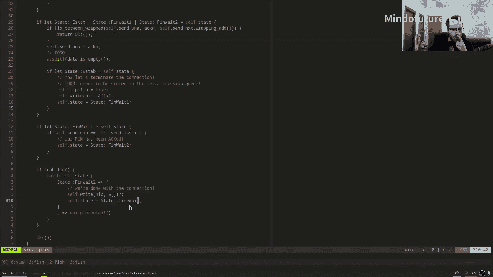

Oh， let's pull up the state diagram， actually from。TCP的。😔，Where is it？No。😔，No。😔，Here we go。Okay。

 so at some point， we receive a fin。So here we receive a fin。And here we receive a fin。

 and here we receive a fin。So what that means is if we are ever in the states's close weight。

Closing or time weight。Or， of course。Last a or closed。Then we know that we're done。

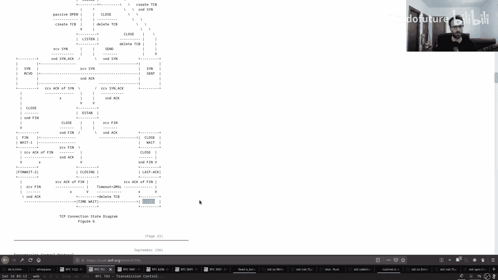

So what we're going to do is。On connection。We're going to have a pub crate a thin。嗯。呃。嗯。

I think what we want here is a。嗯。Sort of like。Is closed。 Is receive closed。And that's going to be if。

Self do state。I guess if let state time weight。And is equal to that。To do， this is also close weight。

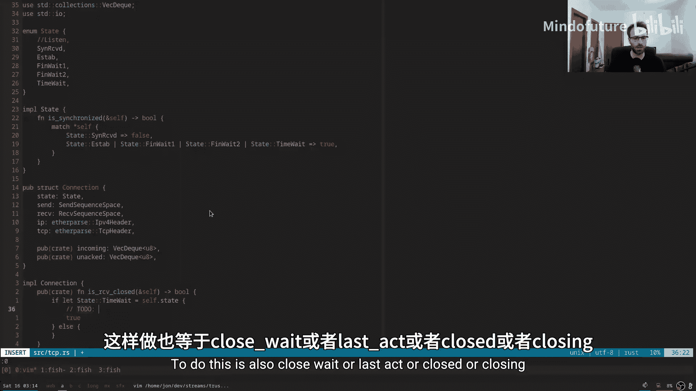

Or last act。

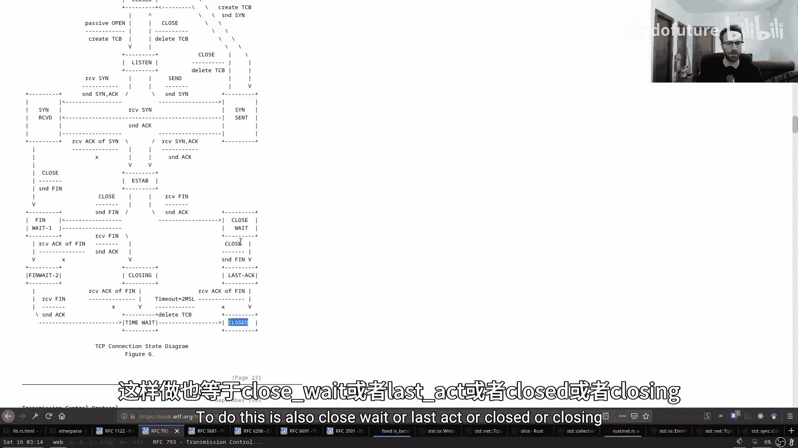

Or closed。Or closing。Those states also imply that the other side。Any state after received。Fen。

So also those， which we have just haven't implemented those states yet。And otherwise。

 of course false。And so now this is going to be。If。C dot。Is receive。Closed。And that。

So if the receiver is closed and and incoming is empty， then we know that those's just werere done。

 we can just return okay zero。Right， no more data to read。And no need to block。Because。

There won't be anymore more， right， Like we received a f。

 And so we know there's no more data coming from from the other side。 The tricky part is still。

 of course， this， if incoming is empty， then we do need to block and we need to figure out how to do that。

 We're going to do it in a similar way to what we did for except right， So if you remember， except。

 we now have this sort of loop down here。And so this is going to turn into a loop。

That is probably going to end up being weird。This is going to be a loop。I's going to return this。And。

Continue。Actually， were we're going to do it the other way around。 we're going to say。Like， so。

If there is， if we're done， then we return zero， if there's data， we return that data。

 otherwise we have to wait。And of course， this is not going to be a pending var。

 this is going to be a receive var。And so now you see why this is sort of problematic， right。

 you see why having one conva for like all of the connections is problematic because it means that if any data arrives。

 we need to wake up anyone who's waiting， which can be pretty costly。

 so we might want to find a way to sort of split this split it up so that we have one conva per connection。

嗯。But for now， let's not do that， so we're going to have a pending v and a receive var。And now。

 so if we do cargo check， that should compile。こ。Why did it not compile？11 mute stream。 That's fine。

Okay， so that now compiles， but of course， currently no one is ever notifying on the Re bar and so if we wait on it。

 we're never going to be woken up。嗯。That does get a little bit tricky， though， because now。

 how do we know whether to wake someone up well。We know that it would have to be on packet。

So we sort of need on packet to return something telling us what to wake up。

So let's go to TCP and find our。F N on packet。 So currently， that returns an I result。 Nothing。

 I think what we're going to have to need to do here is this going to have to be。Now ready。

So we're going to have to do a pub crate。Eum now ready。

 and it's going to say whether read or write is now ready。So that roughly make sense。

 so when you call on packet or they could also be none。So when you call when you。

When we pass in here a packet that we received， it's going to report back whether the this particular connection is now available for reading。

 is now available for writing or neither， or maybe both。呃。Actually。

 let's instead of having it say ready， this should be。It's almost like available。

So that it's going to be available for read， for write。For read， write and none。

And so we're going to match on that。And if it is read。Actually， let's。Yeah， if it is read。

Then we are。是よです。Availability is this if let what do we call it TCP available read or TCP available readr is equal to a。

Then。Check。Compare。I'll explain that in a second。So if read， if it's now available for reading。

 then we are going to do what we did down here。Which is we're going to， well regardless。

 we're going to drop this， we don't need that anymore。

 then we're going to notify all in the receive bar。If it's available for writing。

 then you could imagine that we're going to do something like。Sendar。Right。

 currently we don't have such a ab， you could imagine the reason I want to compare before after here is if it was available for read before this and it is available for read after this。

 there's no reason to notify anyone right， because it was already available for reading。嗯。

But that is a performance optimization。 It's always safe to notify。

 So we're gonna just notify for now。And of course， that's going to break a bunch of stuff specifically。

I think what we're going to want to do here is anytime we're about to return。Okay。

 we need to actually do like self。Availability。So on connection。

 we're going to have a Fn availability。Self that's going to return available。呃。

And A is going to initially be available none。诶。呃。I guess if。Self do is received closed。

 or self do incoming。Is not empty。Then， a is going to be available。

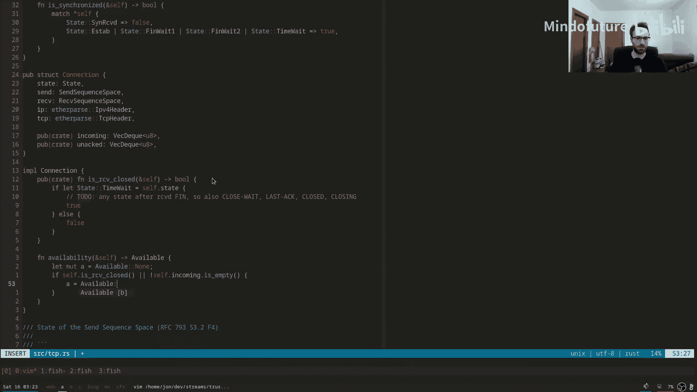

没没异议。This is a bitmap， I want a bitm crate。What is the bit mask bit。Bit flag。は。Flaex。

But it's not bit flags that I want。😔，WhatMaybe it has sp flags。😔，Yeah， I said。

 I don't need it to be that I want like flag。Flags。呃。Anyone remember the name of this crate。

 the one that gives you。Basically， way to or together enums。I feel like it's bit flags。Good mask。で？

I mean， maybe it really is just bit flags。I mean， I don't particularly want。All right， fine， sure。

 bitfls， bitfls， it is。

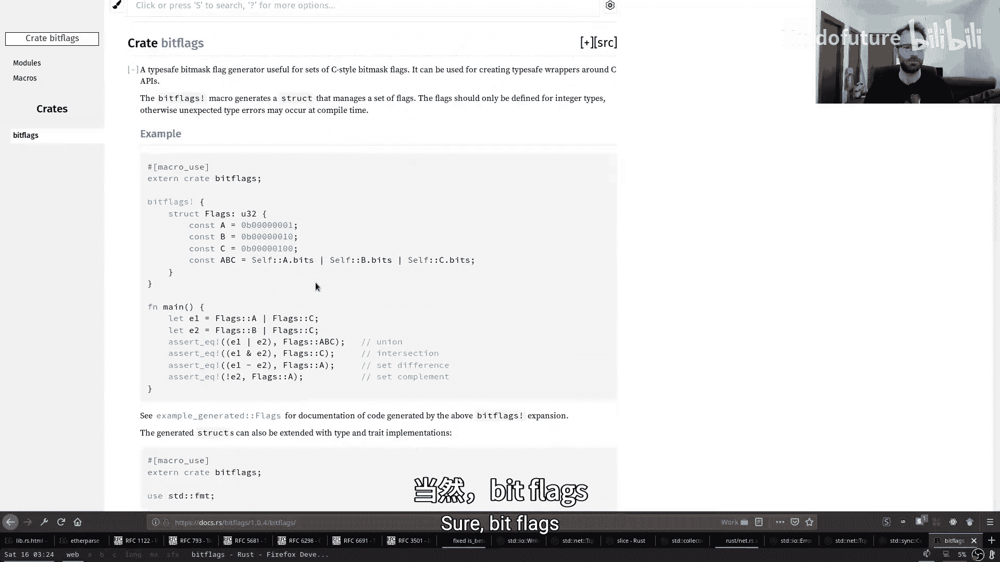

So we're going to depend on bit flags is 1。0。And then down here。

 we're going to say that instead of having available be an enum， it's going to be one of these。

Sostruct available。It's going to be a con thread。This can be a U8。Con right。So I guess one， two。

 three， four， no。Yes。No， binary。No on the map。有。That way we don't need these。And now。

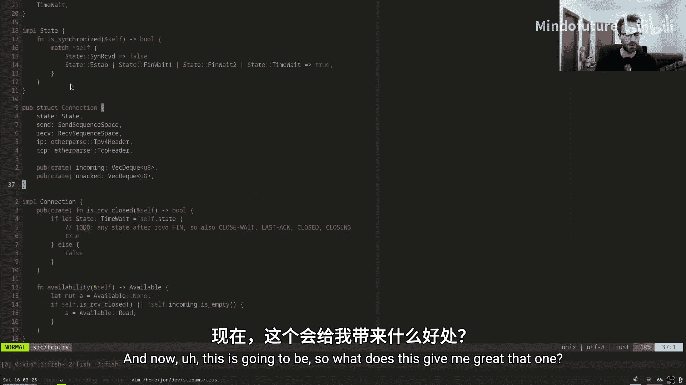

This is going to be。So what does this give me？😔。

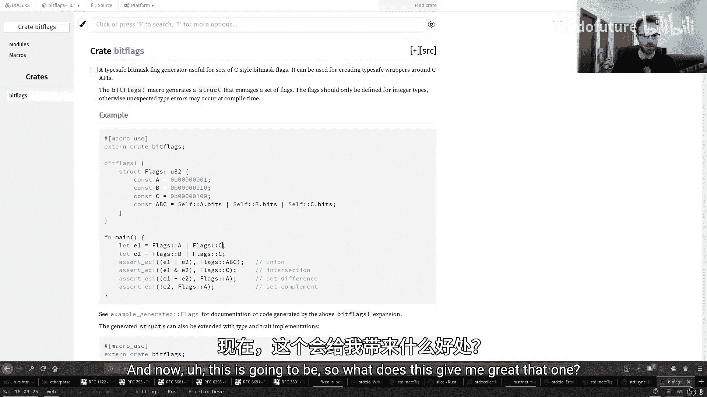

Great， that one。So， I want。Empty。I want a or equals available read。呃。And we don't。

 this is going to be like a to do set available， right？And then it's going to return eight。

And now up in Lib world。

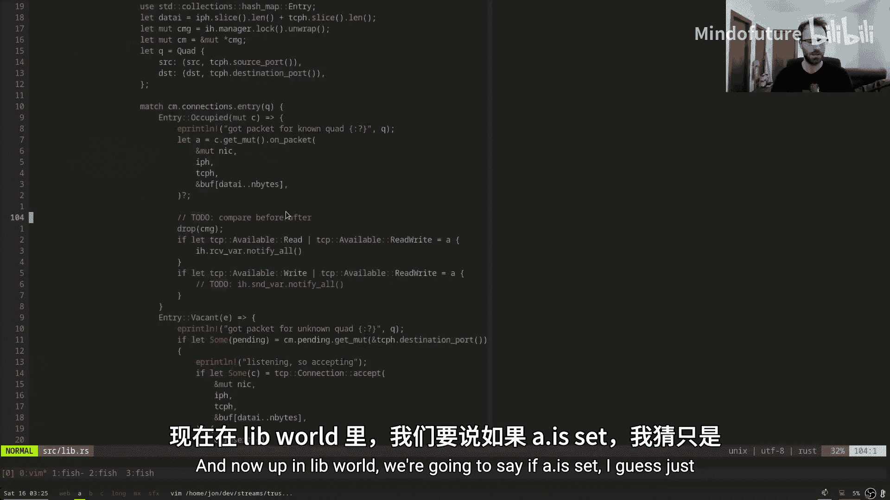

We're going to say if a dot is。It it is set。嗯。

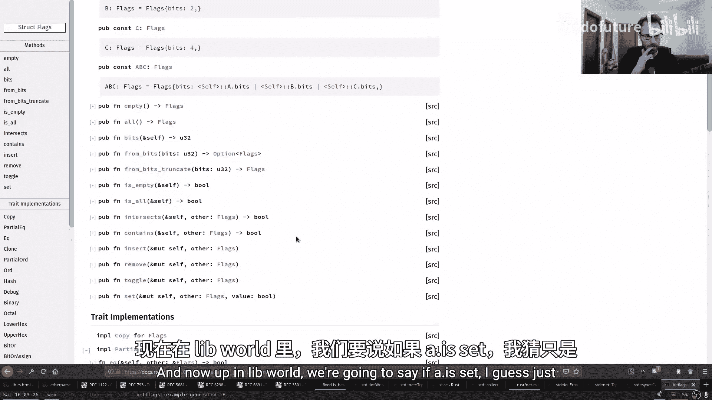

I guess just or TCP available。Read。And this。

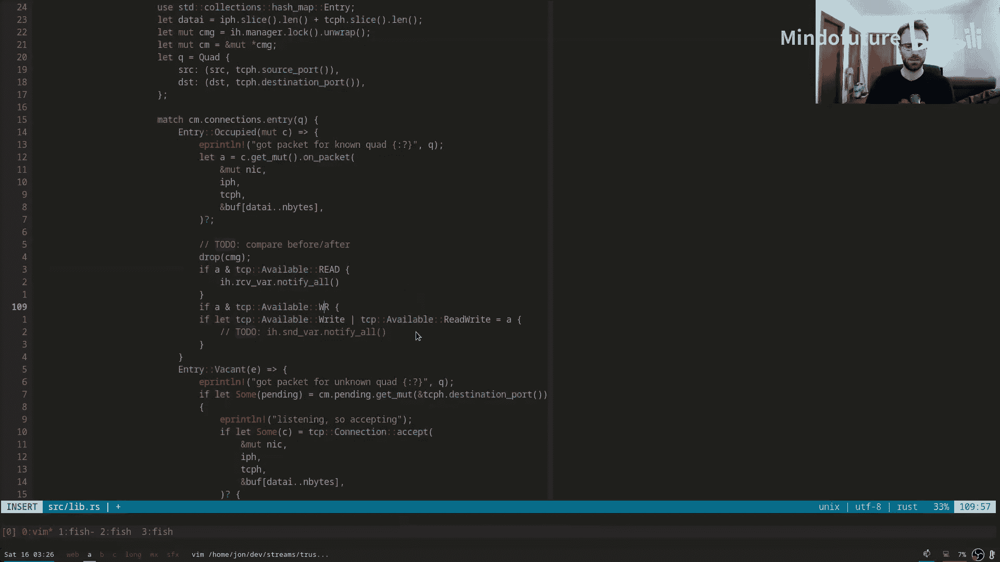

So does this have a。Bit1。Why doesn't this have an I set？😔，Ca that's really what I want。嗯。

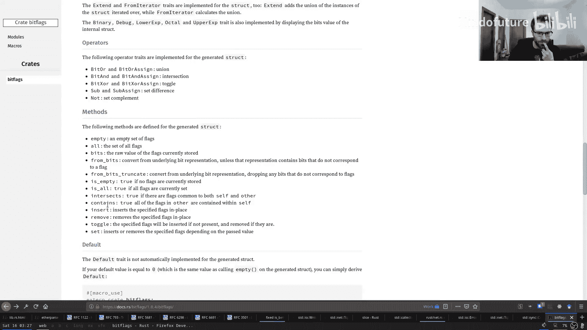

O contains。That's what I want。Contains this。How do you create unique types in rust。

 What do you mean create unique types？呃。All right， let's see whether that compiles， probably not。

This needs to use spit flags， spit flags。The available is primed。 This has to be pub。285。

So this has to be self do。Availability。This probably has to be the same。And this has to be the same。

There are also some questions here about whether to do take into account self dot state。Right。

Although this check might be enough for read， I'm not entirely sure it might only have to be taken into account for right。

2，38。Oh， no， this should not be。Public。Al， let's try that out for size。呃。Well， like closures。

 they are really unique because they're types created by the compiler so they're probably a clone copy。

I'm not sure what you're referring to。Oh you want type the compiler names for you。

I don't think there's， I mean， arguably enum variants that arestruct are sort of like this。

 but you can name them。 They just have other names。I don't think there's a good way to do that， no。

What， what were you thinking that you would use such a type for？ It's almost like。

Like an anonymous type。Okay， so we're running and in theory， we should run this and now。

Let's see what happens if we try to connect。All right， all right。Oh。

 we forgot to change main to actually print。 Oh， no， it should have printed red data。 It did not。

So something is broken。It sent a F act， but we did not think that we read any data。So。

Why is that the case。嗯。Now available for reading。Okay。

 so that would be the hope that that prints out。Then it should notify。

 so I guess the other thing is read。Checking on status for read。I guess try read。呃。No more data。

Stus is this， this。Is receive closed and C incoming is empty。Not yet。B。So let's see。

 it tries the read， it gets false true。So this gat packet for known quad。

 why does it not print anything useful？嗯。Specifically， it doesn't say this。

So that means on packet is not returning read set。Yeah。

 I don't think there are anonymous types in rust yet。I could be wrong， but I don't think so。

So this means that A does not contain available for read。 What does it contain。呃。Availability。呃，A。

And I'm sure it's going to complain about the port， so let's do a different port。If I do this。

Availability empty， right。 That's what we expect。 Now this。It still says availability empty。

Even after I terminated the other side。So the question is why？嗯。

So now we need to look into here and look at availability。And。The question becomes。😔。

Why is this not returning true。嗯。LetSee， computing availability。

So it should be available for read either if the channel is closed so or either if the other side has sent a fin。

 in which case we should be in the time weight case or。If。Incoming is not empty。

 although we're currently not writing anything to incoming。 So this should always be。True， no。

 this should always be false。This so without the exclamation mark should always be true。

 but this should always be false。嗯。So this means that where this is not returning true。

Let's make sure that this has debug。呃。Asked if。Closed， when in。Solf thought state。Okay。

 that's fine and nowll end that。Okay， so。Asked if closed when in Fin weight 1。 So in Finw 1。

 Finw 1 is the state where we have sent a f， and it has not yet been act。

This is the act for our Finnin。 So now we're in Finway2。

 which is we have sent a fin and it has been act。But they have not the hadphon。

 And here the reader is blocked because， well。There's nothing for them to read。

Specifically close as false and empty is true， at which point there's nothing to read。

 so it's blocking。Here is what we get the。This is where we get the fin。

So why is it not transitioning， that's really what's wrong。

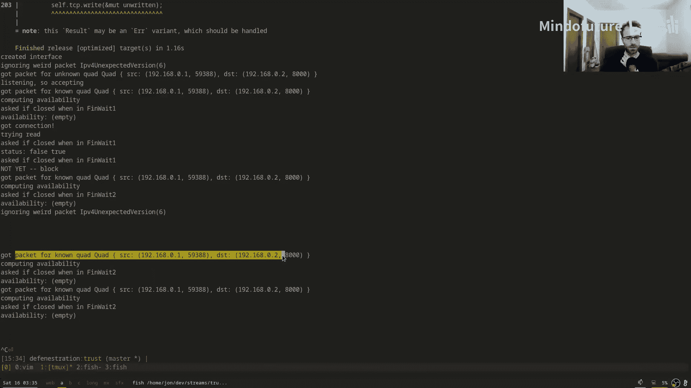

So we're in Finway2， and we just received the f。

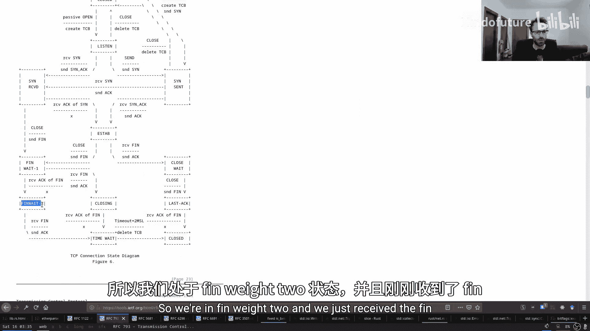

So why， oh why。Are we in Finway， too。

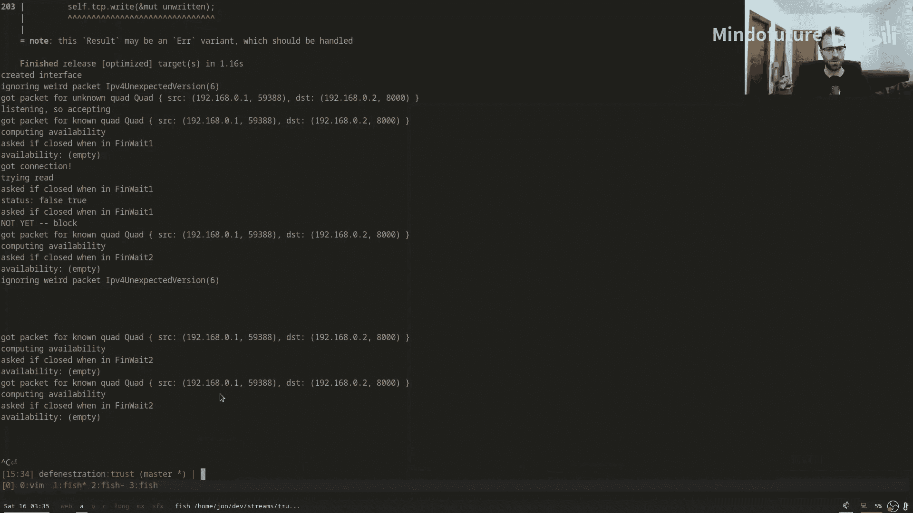

That seems wrong。Because。

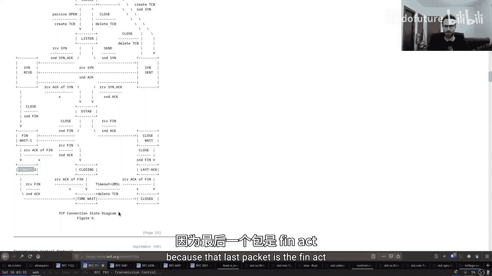

That last packet is the Fin a。

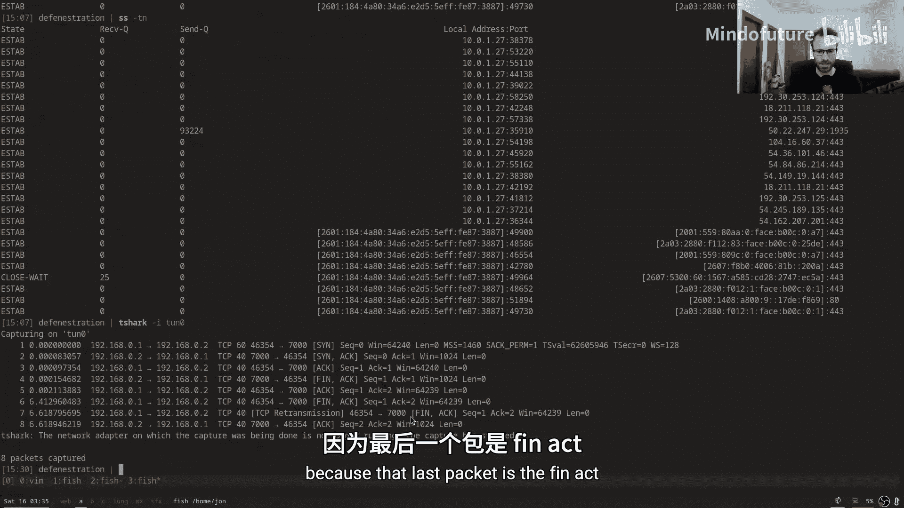

And that thin a should move us from Finway2 into time weight。Because we received a fin。

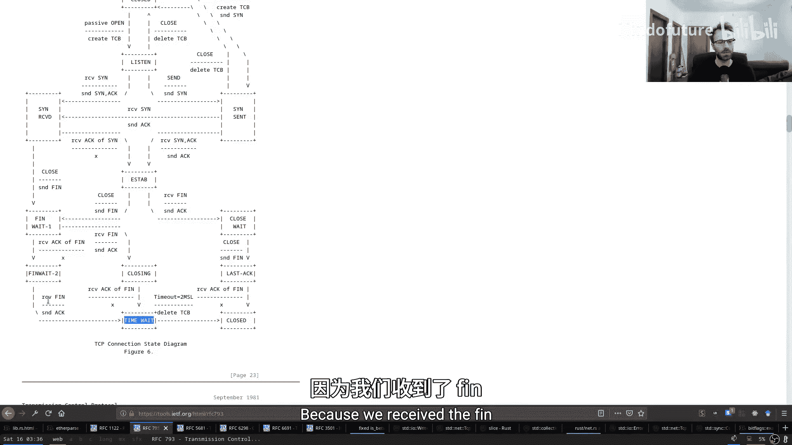

So why is that not the case well？Guess it's time to figure that out。Not O。 Could be one case。

No ak could be another case。Otherwise。Thatd sex。呃。This fair。And。Okay， so hopefully we get down here。

But it doesn't really seem like it。So， I guess。LetGo back to all7。Okay。

 so the pattern is pretty much what we expect。 So the packets are always the same。

God packet it bad sequence。That's probably wrong。I don't believe you that that has a bad sequence number。

So it's saying that this is a bad sequence number。W it seems incorrect。

 And then it's saying that the second one does not。The second one is not okay。All right。

 so let's figure out what's going on here。Specifically， it's saying that the first one is not okay。

I'm almost sure that there is between wrapped that has been updated as wrong。But。

So O is being set to false。 So where is it being set to false？Good old print debugging。2。3。4。

And then， the one。Oh no， the first one said bad sex， which is here。呃。So this should be self send U A。

 act N self send next。Wping。And。That800。Okay， so all the initial packets seem to be fine。嗯。

And it's saying this is a bad sec，2， lesson 2， lesson 3。

What's the requirement for that again。This is for。呃。

The requirement is that。This is less than this is less than or equal。

To that。

So this is a bad act。2，2，3。But how？

I see。I don't think that's right。Okay， so we're failing this check for this incoming packet。嗯。

And this is saying that the act number in the packet。

Which is like the sequence number the other side expects next has to be greater than。

The last thing we haven't heard at。W。😔，Something's not right。

 So this is in when you receive a packet， right？H， event processing。

 So we specifically want segment arrives。If you remember from the previous stream at the bottom of the。

Of the TCP spec， there's a basically a state machine that you can follow。

 and what we're looking for here is if we're in established Fin weight of1 or Fin weight 2。嗯。So。

 that's this。So this is the acceptability check and the acceptability check we already is already fine。

啊。Yeah， so this is not the check we're failing。We're failing。The a field auppiid is on。

And we are in established FinW 1 or Finw 2。If。

Oh。This is really just saying that。Only if it's between here。

 do we update which things haven't been acknowledged。

 but we shouldn't stop processing just because of that。Right。Exccept data。

So if what we get is an unacceptable act that doesn't mean that we shouldn't handle the packet。

 It just means that the act shouldn't be used to update our tracker of how much data the other end is received。

 So， for example， we might still want to process the fact that they sent us a f， right。嗯。

And crucially， we don't want to return。Great， let's try that。Yeah， so we get the packet。

 We notice that it's a f。 We compute the availability。

 We notice the availability is read because it's now been thin。

 So we're now setting ourselves available for reading that wakes up the thread that blocked when trying to do a read。

😊，And it recognizes that it can read， it reads the data， it gets the zero。Excellent。Okay。

 let's get rid of some of these。Here。Don't need these anymore。Actually。

 let's keep these because those are probably going turn in handy。

 We might want to add like a logging library that we integrate with this。

 because otherwise debugging this is gonna just keeping a pain。Connection turn connection， close。

No more data。Great， so this is still sort of stupid， right， This is still we're trying to read0 data。

 but at least it means that we can correctly detect when there's no more data coming。嗯。

So what do we have now of like E prints and stuff。All right， we probably don't want that。第一个。

By protocol。Probably want that。We don't want that。That's fine。Right， so this is still broken。

 but broken just in the sense that we never write anything incoming right， So remember from TCP。

 we have this。Assert the data is empty。 So if if the other side tries to send it as data。

 we're just going to crash anyway。 And so that's fine。

 But the infrastructure we have here should in theory now be enough that we should be able to do reads。

And reads are probably easier than write because reads don't require any retransmissions。

Sort of you need to retransmit X， but we'll get back to that later。Yeah。Okay。

 so let's go ahead and commit that。嗯。呃。Fin。 let me push that out。嗯。

I think we might actually want to end it there。 I don't want to dive into doing all the timer and data stuff。

This dream because I feel like this is sort of a nice。

Termination point for cleaning up the entire external API。So I think we're going to end it there。

And that way we can leave sort of the data aspect of this and sort of that includes things like congestion window sizes。

 timeouts， that sort of stuff to cover that entirely in the next stream。

I think that's what we're going to do。 I've pushed the the code that I have so far。

 So feel free to sort of play around with it。I think。Yeah， so we'll leave it there。

 And the next stream， as I mentioned， at the beginning， will not be until。Early May sometime。

 I don't know exactly when， but sometime early May。So I guess stay tuned for that。

 we still haven't figured out a name for the stream。

I'll stick around and chat a little bit after I end the video。

 but if you have thoughts for first of all whether it should whether there should be a name。

 whether there should be sort of a dedicated Twitter account or something like that and if so what you think it should be called then feel free to ping me I genuinely want like potential names for this。

But in the meantime， take care， enjoy the start of spring， and I will see you in May。

Bye。