# 通过玩游戏来解释汇编语言-｜-Jon-Gjengset--BV1NoKBznE4N-

Kick us off。Hi folks， welcomee back to another stream。 This one。

 I feel like I've said this now a decent number of streams like this one's going to be a little bit different than the other ones。

 but this one truly is going to be a little bit different。

 So in this stream what I'm going to do is play a game。

 but it's not a sort of standard let's play video although it may end up turning into that Who knows the intent here is to look at a game called Shenzzen IO Shenzzen IO is I mean it's a puzzle game。

 but the nature of the puzzle is that you are basically an electrical engineer trying to put together components and write assembly code for them to accomplish various tasks。

😊，And it's not real assembly code， but it's close enough。 It's not real hardware devices。

 but it's close enough。 And it， the fact that it's also fun to play meant that， you know。

 when I was playing this for myself， I was like， this feels like something。😊。

This feels like something I could use to teach。 Assely programming is。

Or can be at least quite hairy Like a lot of it becomes like even to do the simplest things can be quite painful because you're operating at such a low level in the sort of stack of the computer。

 And so while I think we could do a stream on actual assembly programming and probably like assembly coding in rust。

 I'm not opposed to doing a stream like that。 I wanted something slightly softer for the introduction here。

 That's also something you can play with yourself。 I want to stress here at the head that this is not real assembly programming。

 Like if you if you do this， it's not like now you know assembly programming。

 but I do think that if you do a decent amount of puzzle solving of this kind where you actually do need to like look at hardware reference sheets and look up the assembly instructions and know how to think about like a small number of registers and how to operate with memory。

 I do think it's like a useful。like pathway towards doing actual assembly programming。

 you would need to learn these things and a bunch more in order to do assembly programming yourself。

 But there is like a way to get started。嗯。And so we're gonna try it。 We're gonna see how it works。

 We're basically going start the game from the beginning。

 I've erased my save file so that we start from scratch。 And then we'll see。

 we'll see whether this game ends up being or whether this ends up being a good way to teach or whether we just have fun or whether it's just lame and we all go home and don't do this again。

 This is， we will be partially for me to evaluate it and partially or I think in large part for you to evaluate it。

 whether this ended up being a good idea in hindsight。 But we shall， we shall try。 All right。

 So without further ado。😊，Let's go ahead and start the game。

 And now the next interesting thing is whether when I do this。Do you now。See a game。Aha。

 you do see the game， Okay， fantastic。So this is the intro。

🎼The the setup for the game is a little interesting。

 So the intent is basically it seems like people have stopped writing like lowleve computers in this world。

 like doing assembly programming or maybe programming at all in at least in the Western world I think is the setup And so this person who wants to work with like low level machinery is trying to figure out where to go。

 They're trying to figure out like how can I keep doing this work。

 and they end up with a job offer in China for like a random company that makes microelectronics。

 And so this is sort of the mainstream screen of the game。 Let's say so we got an email。

 sort of thank you for joining I'm not gonna in this game， I think read through all the text。

 There is a bunch of lore to the game and the lore is like moderately interesting。😊。

But I'm not going to read you through it， but the basic set up here is we have a bunch of people who are like welcoming us to this new company and you know in true fashion it's like。

 you know we expect you to have diligence， connections and salubriousness which I don't even know what means and sort of welcome from a bunch of employees some more questionable than others。

 we get a reminder to read the actual manual which I'll pull up whenever we need it here and then we get asked to build our first device。

 build our first little engineering thing and so we're gonna open it in concept CAD which is this little program where you get to lay out so I'm gonna get rid of these because I think these are from my last。

🎼Play through so these are going。🎼What？Why can't I， Oh， it has not erased my save？

I think because this is not old， no， this is old enough。

Oh maybe it gives you those components to begin with in this one so the the setup appears is we're supposed to build a fake surveillance camera so down here this of the information screen。

🎼And we have active and network outputs here。😊，🎼And the goal is to control them with a fixed repeating signal as indicated in the verifications tab right so we have here a little microcontroller that we are going to write some assembly code in here and to control these pins that are connected to the board you see we have x0 x1 p0 and P1 and these little green things are wires so we've connected P0 here to the active output The characters are too small I can probably make that bigger let's see if I can do that we'll do this we'll try to make this maybe this。

😊，🎼And then do this， and then I'll do this and see if I can make it bigger for you， transform。

Fit to screen， how's that？I guess we're about to find out when I open this one。

 let's see if we it again。Is that easier to see？The text is fairly small in this game。

 it's a little hard to make it larger sadly。But is that easier to follow， all right， move 1002？🎼Okay。

 great cool so the the setup here is that we are supposed to write。😊。

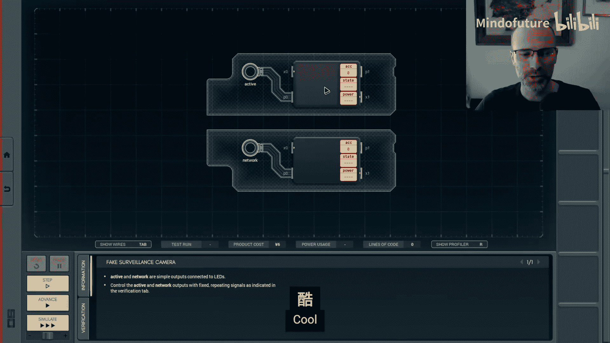

Outputs to each of these two ports each one controls an LED and the values that we can ever write out here are so we can write any value between0 and 100 where0 is off 100 is on and the values in between are like various fadings of the LED which we're not going to need here and you see the verification tab here is our goal is to write some code in this top microcontroller to make the active LED be off and then on and then off and then on and then in this particular pattern and the network LED to to be in this particular pattern instead so slightly different one and in order to do this we have access to。

🎼A manual， so Ill pull the manual up here， so the manual explains here what the programs look like in on these microcontrollers and this is where we start to get to something that looks a little bit like assembly。

So in particular， every line of a program here has an optional label。

 a condition we'll get back to how that would look like in assembly later because normally you don't have condition in quite the same way there。

 an instruction and then any comments that we have。🎼。

🎼The way that like some code might look like is here we you have an example program right so loop here is an example label you have these in rust2 right you can label a piece of code and you can refer to it later to say jump to this part of the code comments or comments and then here you have an example of an instruction so this is the T instruction it takes two opera here a which is a register we'll get back to those later and 10 which is a value So this is going compare the value in this register to this literal value you have instructions like jump。

🎼Wwhich jumps to a label by name， you have move， which takes the value of the first opera end and puts it into the register or pin of the second opera end。

🎼You have add which adds this number into the accumulators of the one register that you have and that's how to read this。

 Well we'll get back to the plus here a little bit later because we don't need it right now。

 And if we scroll further down you'll see here that there are there are a number of instructions。

 there are basic instructions like move and jump there are thematic instructions like add subtract multiply not these digits which are getting and setting a particular digit of a number note that this unlike in assembly。

 this computer that we're operating on here operates in the decimal system not in the binary system So these are。

🎼base 10 numbers， the way we're used to thinking about number as humans。

 so for example here if you have the number 596 and you ask for the zeroth digit you get6 which is this rightmost digit in general the indexing of digit starts from the end。

Or the closest to the one's place， if you will。🎼So these are kind of like bit twiceice operations you would have in assembly code but they let you think about numbers in the same kind of way where you think about them as their constituent parts rather than as their ultimate value although you can think about it that way too if you use things like add there's another more complicated instructions will get to later but one other set that we should know about this the test instruction so the test instructions allow you to compare the values in two registers or the values two different values or a value of the register you see the notation here is rlash I Rlash I is a register or I don't know what I is supposed to be short for but it's a integer so it's a register or an integer literal so T for example will compare this to this and it will do something depends on the conditional annotations are on the side depending on whether the two compared equal or did not compare equal I'm not gonna to explain how these type to assembly code quite yet because that's a little bit more nuanced。

We start using them， I'll start talking about that bit。

🎼But for now know the things like add and subtract and multiply are things you would see in assembly on standard CPUs as well like real CPUs you wouldn't see things like digit and Det but you would see things like manipulating particular bits right so ending and oring on the bit level or。

🎼You know X or bit shift all of those various operations that we're not going end up using in this game。

 which I think is okay Similarlyly， like move is a very common instruction you'll see in assembly same thing with jump like these kinds of instruction you'll see they will usually have many more forms。

 So for example， I think the move operation on X86 has like。

🎼Tens of forms like I think it's like 30 different variations of move。

 I think someone actually proved that the move instruction alone is to incomplete in like X8664 which is pretty wild We have jump which jumps to a label also very common in an assembly usually an assembly you would also have things like jump if equal。

 we'll get back to that when we talk about test operations and then we have sleep which is sleep for a number of you know cycles here。

 you don't really have the same when you work with assembly like there's not usually a sleep instruction in quite this way but。

It's an easy way to it's an easy enough instruction to understand， even if an assembly。

 you wouldn't really have it。Okay and then there are registers so when you work in assembly programming there are sort of two places you can store things Oh thenP I forgotn KnP is a no operation it's an instruction that does nothing it just takes up space the real reason you would use this is for things like padding so sometimes you want particular instructions to be at particular memory addresses and a KnP is the way that you might shift them further down in the binary without affecting the semantics of the program that's executing。

And。🎼When you're operating with memory in assembly there are sort of two ways in which you could do that you can access things that are in main memory like in D and the way that you access things that are in DM is usually that you have addresses which are the sort of byte index of data that's stored in in allocated memory。

 those things are。Not a thing we'll probably get into at least in the beginning here。

 but there are some components later on that start to look like memory you wouldn't in normal assembly and then usually you have instructions like move where you can either say move this memory address or move the value at this memory address like move the value that's pointed to and that's how you get things out of main memory or put them back into main memory like write back to main memory。

🎼But then you have these other things called registers and registers we don't really think about when we write programming normally isn' there isn't usually the concept of a register in something like C or rust or go you wouldn't really use this term because they're usually allocated and managed by the compiler when it takes your code and turns it into assembly。

 we do talk about main memory right like pointers are a thing in rust。

 but registers not so much registers are fixed size bits of storage that are sort of embedded in the CPU they are there's usually relatively few of them。

 although depending on the platform， you can get a lot more like I think arm CPUs these days have like what hundreds of registers but back in the good old days you would have like8 like you would not have a lot of them and the registers are sort of your notepa there's're your scratch space for the CPU So for example。

 if you wanted to I don't know。🎼Multiply a number that's stored in main memory。

 what you would do is you would move the value out of main memory into a register。

 you would use an instruction to modify that value in the register and then you would write it back to main memory。

You don't necessarily have to that sometimes you can operate directly on the value and main memory。

 but usually if you wanted to do multiple operations， for example， oh sorry。

 let me reduce the background music。Good call。 like this。

🎼There are sometimes instructions that allow you to operate directly on main memory without going via registers。

 but very often you have to pull them into registers in order to do things with them。

 There are also often instructions that operate on specific registers without you even specifying them。

 So an example down here in this particular instruction set is the add instruction So the add instruction as you see adds the value of the first opera end to the value of the a register。

😊，So you don't say add you know one plus2 or one plus this value in memory。

 you just say add one and it knows which register that it is operating over Regs are also often used for things like calling conventions。

 So if you have a one function， that calls another there are sort of two ways in which you can pass the arguments to that other function。

 the function that is to be called。 One of them is that you could put the value of that argument on the stack。

 which lives in main memory， but that requires you go all the way to main memory in order to call that function。

😡，Sometimes if you don't have too many arguments or they're not that complex。

 you can instead just write the argument。 Let's say it's an integer。 you can take that value。

 write it into a register， call the function。 and the function sort of there's a there's usually a calling convention where it assumes that a certain set of arguments are in particular registers。

 So that way you don't have to go to main memory in order to call the function。U。In this game。

 you can't have self modifying code， I don't think。 so you can't。

Like if you think about like running on Linux like on X 86， your program is also in main memory。

 And so in theory， you could have instructions that modify the bit of memory that holds the program itself。

 And so the next time that code gets executed。 It does something else。

 So this is what is known as self modifying code。 It's really cool。

 but we're not gonna I don't think that's the thing that comes into play in this game。  😊，There are。

 yeah， I don't， I don't think that comes into playing this game。

Okay so what registers do we have Well， so in this instruction set and with these these microcontrollers that we get in this game。

 you see the set of registers varies between models。

 This is common between CPUs as well not all CPUs have the exact same registers like not just in terms of numbers but they also might be called the different things they name different things depending on the platform like for arm 64。

 they're named something else than they are an x 8664 they're also sometimes of different size So some registers might be made to hold a floating point number while other may be like let's say a double So 64 bits some might be you might have a very small number of registers that can hold 128 bit integer like kind of a big end kind of thing on older CPUs。

 you might only have access to 32 bit registers sometimes you might only have access to 16 bit registers if you're working in an embedded environment And so this is where it gets。

🎼Like you really need to know your platform because the components you have available。

 even just at the assembly level to interact with change。😡，But let's go back to what we have here。

 So into the Shenzzen microcontrollers， we have AC。

 which is the primary general purpose register used for internal computation。

 All arithmetic operations implicitly use and modify the value of Act。

 This is the kind of documentation。 you end up seeing if you start reading the docs for instruction sets。

 Usually those have a lot more detail to them。 But it's this kind of language， right like。😊，嗯。

🎼They're often implicitly used。 They'll say things like this is a general purpose register as opposed to some registers that are known to always be used like the EIP register。

 which controls the pointer to where in program execution you are。

 So that one's not really a general purpose register because if you store something in there。

 you're changing where the program is executing。 So not a general purpose register。

 That is a second register available on some of the microcontrollers。😊。

The initial registers are all initialized to the value0。

 and then there are the pin registers so these are the ones we looked at on the marker controller earlier。

That are used when reading from or writing to the pins。 So this is where you can send signals out。

 such as to set the LED， which we're about to do or to read inputs from like if there's a button。

 for example， you might be able to read them in pins like this exist on real CPU as well usually they don't necessarily operate quite the same way。

 like you can test whether they're high or low you can set them to be high or low。And in this case。

 too， like in this world that we're about to enter， you also have pins here。

 but they're made in the form of registers， which is not always the case on CPUs。

 there are some approximations here， but the notion of having pins to a CPU that are the way in which you interact with the outside world is very accurate。

 whether the exact representation is is sort of more of a fuzzy question we'll talk about the distinction between P registers and X registers a little bit later when we start using them。

Okay。Let's then dive into our first challenge here。 as I'll go back to the game。

So。Hopefully， now you should be seeing the game。 Yes， you are fantastic。

 So we have to have this microcontroller output signals onto P 0 such that they match this pattern and signals on this microdoroller such that they match the bottom pattern。

 And in this case， I think this is actually fairly straightforwards。 if you look really。😊。

Closely here， you'll see that。There is what，1，2，3，4，5，6 samples in between here。

 So we're just going to sleep for 6。 Then we're going to move the value 100 into P 0。

Then we're going to sleep 4，1，2，3，4，5，6。 I could have miscounted one of these maybe。

 and then we move 0 into P 0。So if I now try to simulate this。

You'll see here the orange here is the target， the red or the sort of orange lighting up means that that is actually what we output。

So you can see here if I hover over as well。 it says expected 0 actual 0， expected 100 actual 100。

 So this was sort of the right code for active for the top pin。

 But if you look at the bottom one for network because we havet written a code there。

 you'll see for network werere just at 0 the entire time。

 So the red here indicates that here we output the signal 0， but it was expected that we output 100。

And yeah， the instructions on my controllertrollers loop automatically in this case。

 so when you get to the bottom， you automatically go back to the top if that weren't the case right。

 then we could write loop here and we could write jump loop here and it would have the same effect。

But we don't need that in this case because it。It loops automatically when it gets to the bottom。

🎼h moveve to P0， right？

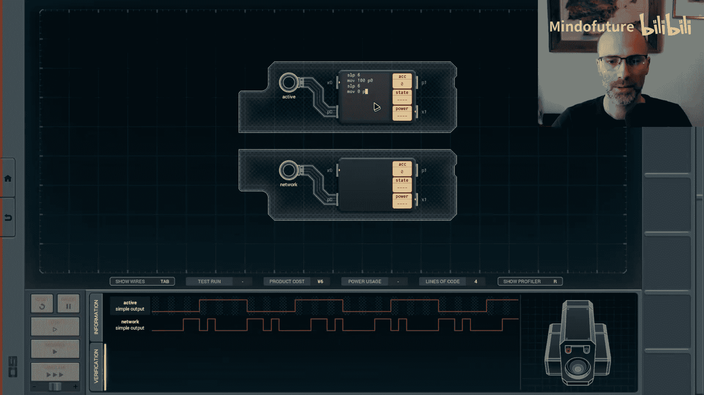

So for network this is also going to be very straightforward right so let's see here so we'll do a sleep of what is this4 and then we'll do move 100 to p0 then we'll sleep for2 because that's the length of this p here then we'll move 0 to p0 then we'll sleep for1 move 1 to p0 sorry move 100 to p0。

And then， sleep。For one and then move 0 to P0。And then we'll sleep 1，2，3，4。Maybe that's 5。 Let's see。

Yeah， no that seems to be right， and you can see here what the LED looks like on the device。

 this is what we're trying to emulate。You see， it keeps running and sort of running through multiple multiple tests。

 but it's really just a sequence of operations that it does to make sure that for every sort of time step and eventually it'll be for every time step and every input。

 you produce the expected output result。And then at the end， we get this verification result。

 which tells us the production cost， which is how many。

 how much did we pay for the components in this in this case， versuss just the two microcontrollers。

 the power usage， which is how many instructions got executed and the lines of code。

 which is how many lines of code did you write So you can see that there are if you look really closely here。

 This is a sort of I think global scoreboard。 As you'll see here。

 there are some people who manage to solve this with the way fewer lines。

 I think this like when you get to the later game you get access to some instructions that aren't in the manual。

 which also not entirely inaccurate to the real world。

 but I don't think we're gonna to chase those at least not right now。😊。

So we've now completed our first task， we've made this fake surveillance camera。

 so we returned to our email。

And now they say， thanks for our work， again， I'm skipping over the lore。

 but the lure is very fun here。So， let's then open the next。Question， I'll remove my old solution。

 So in this， we have a control signal amplifier。 So control in is a simple input connected to factory equipment。

 That's over here。 Control out is a simple output connected to other factory equipment。

 So control out over here。The signal from control in should be multiplied by 2 and then copied to control out。

 Okay， so this one also seems like it's fairly straightforward。

 So what we want to do is we want to move the value that's on the pin P0 into the accumulator。

 We want to multiply the accumulator by 2， and then we want to move whatever is in the accumulator out on P1 and then we'll sleep to the next cycle。

That makes sense why that is probably the。The solution here， again。

 these initial ones are very straightforward， but it's to get us familiarized with the the sort of language of the game and the the wiring of the game。

 And then they get more involved as we go。

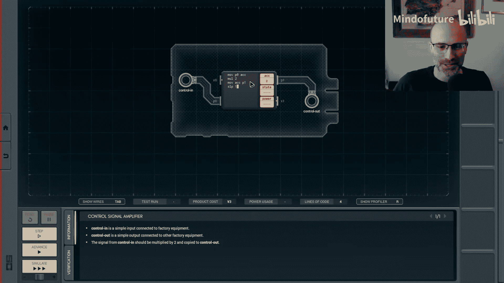

So， if we simulate this， hopefully I didn't mess it up。🎼This seems promising。

 The sleep one is needed because otherwise， you would be in an infinite loop and you would never move to the next time step。

 So this is like a slightly less realistic， perhaps part of this game where。

In the game as currently set up， there's an expectation that。

You the verification happens in units of time and your program needs to explicitly say when it wishes to move to the next period of time in real CPUs usually you wouldn't have it be time driven。

 That's at least less common， usually for real CPUs， it's interrupt driven。

 So it's driven by an external signal from something like it might be a device saying I have data available。

 it might be a button be impressed but it could also be like you have a dedicated like time chip on your board that is sending instruction that is setting an interrupt pin on the CPU to tell it。

 hey， time progressed， but you can also have in the poll way where there' is a chip that you can ask for the current time。

 and it will tell you。 So this all depends on the exact setup you want to do。

 I think the most common one for time operation in microcontrollers is more that you can read the current time from some chip。

You have， and you can tell it a time at which you wish to be woken up。

Right so so the way you might use this is for things like scheduling so imagine that you have you have a program running like your a Linux and you have multiple concurrent threads running multiple concurrent program so let's not talk about threads yet they're complicated in their own way and you want to be able to say I'm going to let this program run for 20 milliseconds So what you would do is you would set a sort of timer。

 if you will on that clock chip saying in 20 milliseconds send me and interrupt and then you would start the process of that process you would schedule it you would let it run but after 20 milliseconds have passed the interruptop pin gets set。

 which means that some special code and the CPU gets to run instead of whatever' is currently running it interrupts the CPU and in that you would go。

 oh， the time budget for this process is expired， I'm now going to unset that interrupt I'm going to pause that program。

 I'm going to pick which program to run next。😊，And then I'm going to set another timer for 20 milliseconds to allow it to keep running so there's there's no that kind of interrupt driven programming we don't really have here。

 although there is stuff that needs to happen on triggers。

 but it's still based on this this notion of time。嗯。Okay。So we succeeded on this  one， too。

 We did exactly as expected average。 Great， This one also not super complicated。 Let's go back。

 What do we have next。

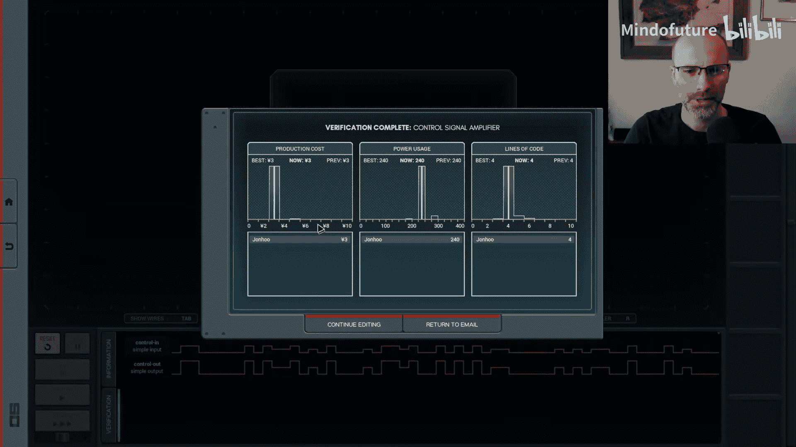

We have。😔，Succeeded our mission。This is just a game of like a。Weird kind of solitaire。 I enjoyed it。

 it was fun to play through， but we're not going to do that on stream pulse generator。

We need a pulse generated with certain requirements， however。

 instead of buying one at the market price， we're going to create our own。

We will need to make use of conditional execution， fantastic。🎼Alright， let's open this design。

 I'll get rid of these。 You saw nothing。 I don't know why when you delete your save file。

 it restarts your progress， but it keeps all of your solutions。

 which there's probably a way for me to solve。 but， you know， I'm gonna， it's fine。

 I'll just delete them before you see them。🎼Cool， so we have a diagnostic pulse generator。

 It has a button and a pulse button is a simple input connected to a button。

 P is a simple output connected to an electronic device。 When the button is pushed。

 generate pulses as indicated until the button is released。😊，Okay。

🎼So what we're going to do here is when the button is on。

 we're going to do these sort of alternating ticks。And when the button is off。

 we're going to generate nothing。Cool。So this is when we're going to have to use the T instruction。

 So this is a comparison instruction。 Usually in assembly this would just be this would be called CM instead。

 but here it's going to be called T and we're going to compare p0 to 100 So this will be true if the button is pressed。

 which will be a value of 100 and it' will be false otherwise。

 the way this is set up in Shenzhen is you write a little plus at the beginning of the line and those lines are executed if the previous comparison instruction returned true the previous comparison was true you can also prefix the line with minus。

 which is the previous comparison instruction was not true。 So if we go back to to the manual here。

 you'll see here。Test instruction of fatigue， for example。

 Test if the value of the first opera end is equal to the value of the second opera end。

 If a is equal to B， then plus instructions are enabled and minus instructions are disabled。

  Similarlyly， if it's not equal to B， then plus instructions are disabled and minus instructions are enabled。

 So there was an example they gave earlier。Appear。RightSo this tea is going to sort of set the set the did the previous comparison evaluate it true or not bit and if it's set。

 then this instruction is executed， if it's not set this instruction is not executed and there are no instructions are executed only if the comparison was false。

This is not too far from what you would do in assembly except that in assembly you wouldn't really have this plus instead you would have a section of code usually with a label that is the stuff you want to happen if the instruction is if the comparison is true and another part that is the thing to happen if it's false and then a label for the code that follows the conditional so that should be executed after whichever branch was taken。

😡，🎼And then in fact， let me pull up the gaming and I can show you roughly what that would look like。

 So in standard assembly， let， let's say I wanted， you know， something kind of like， if this is 100。

 then you know， move。

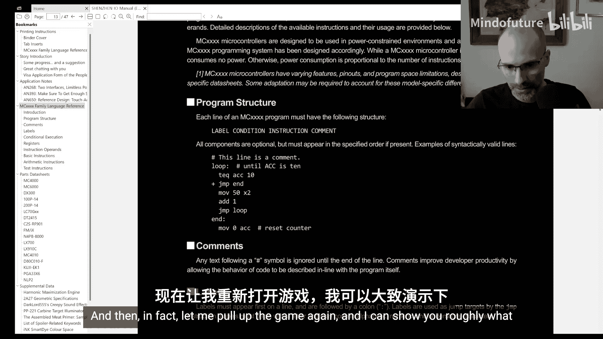

3 to P1， Otherwise move 4 to P1。 Let's say this is what I wanted to write an assembly。

 The way you would write this in normal assembly would be something more like compare p0 to 100。

 And then you would write。Sor of true would be move 3。

 P1 and then jump after false would be move 4 P1。Jump after and you don't actually need to jump here because after will come here。

 and this will be whatever instructions follow the conditional branch。🎼So you see the difference。

 this is， this is what it looks like in the Shenzhen way。

 This is what it works looks like in the traditional way。

 except in the traditional way you would also have here after the jump a。Jump equal。To true？

And otherwise， jump to false。Right， so the the structure here is slightly different in that you would jump to the segment that you want rather than annotating the assembly with do this if true。

 do this is false。 And this is because there's no in an actual like。Computer。

 there's not a meaningful sense， which you could say these instructions are only executed。

 if there could be right， They're like there， there are ways you could imagine this to work。

 but this is the the sort of way that standard assembly has， has landed on。 Now。

 there is an interesting bit of sort of knowledge here。

 which is the way this actually works usually at least its that the comparison operator。

Is actually a substitution operator where let me erase these for a second。

 So this what a compare actually turns into is it does a subtraction of p0 and 100。

 and then if the result is equal to 0， then it sets the0 flag。And if the result is less than 0。

 then it sets the negative flag。And something like jump Eke will actually check what will actually happen on the CPU is it will check the zero flag。

 which is sort of an internal state of the CPU， like a single bit flag。

 and it will jump only if that bit is set to one。Otherwise， it will not jump。

So that's a little bit of an insight into like the deeper aspects of the assembly here for how that really works。

呃。Yeah， so it's not so these flags are set in something called the flags register。

 it's only kind it's certainly not a general purpose register。

 but it is a set of bits that the CPU uses for a bunch of its internal state and you can also interrogate those flags if you wish to get those bits out。

Cool， okay， so back to what we were actually trying to do。 We're gonna compare p 0 to 100。 if it is。

 if it is 100， then we will。😊，Then， we will move。100 into the accumulator。We will sleep for a second。

We will move 0。 sorry， not into the accumulator into P1。 We'll sleep for a second。

 We'll move 0 into P1。And then we'll sleep for a second。So this is， this one is a little weird。

 Let me see that it works first that I haven't lied to you， cool。So what are we doing here？

🎼J J so j is a native instruction in assembly。 I don't think the assembly does it。

 I think the it is an instruction listed in the assembly manual。 Co。

 listed in the assembly manual for something like X 86。

 But the way the CPU actually implements that instruction。

 So this is what's often known as microcode。 like the the internal code of the CPU2 execute assembly is that that instruction reads the like I think if you read the the Intel manual for X 86。

 for example， it would say that the ge instruction will jump if the if the 0。😊。

Flag is set and otherwise will not jump。Okay， so what do we do here Well we compared p0 to 100 and if that's the case。

 then we set the P1 thing to 100， we sleep for a second or not a second。

 we sleep for one cycle and then we set it back to0。

 and then at the end we sleep but notice that the sleep does not have a plus here because we want to do we want to sleep regardless of whether the button is set to 100 or not。

This pattern is a little weird， right， So there are two ways you can imagine solving this puzzle。

 One of them is like this where you， if it is equal to 100， then you sort of do two steps， right。

 we have two sleeps in here， we do two cycles of computation before we check again。

 The other is that you try to implement this pattern right here by using the accumulator。

 So you you know， if it's 100， then you check what the accumulator was。

 which is what you output the last cycle around and you flip that's you to use something like a not instruction to flip the value of the accumulator。

 output that and then sleep。 So now your your iteration loop is only one cycle long。

 where you always you're reevaluating the button every time but what you output is dependent on what you output previously。

 which use the accum register to store。😊，🎼So we could try to write that solution too。

 So what that would look like is you would do。Not。So not flips the accumulation register between 0 and 100。

so if it was0， it would flip it to 100 in this case， which is what we want。

 then we would move the accumulator into P1。And。And then， we would。If it's not。

 we would move 0 into P1， and we would also move。0 into the accumulator。And then it was sleep one。

I think that would work。So the setup here is if the button is on。

 then we keep flipping the accumulator and we move whatever is now in the accumulator to be P1 and then we sleep if the button is not on then we set p1 to0 and we set the accumulator to0 and then we sleep one and the reason we have to do that is because whenever we exit like whenever the button goes to0 we have to make sure that the state is sort of reset again for whenever the button does go to1 so hopefully this will also do the same thing。

Guo。So you see， these are sort of two ways in which you could do this。 You could either have one。

 know one loop here， do two cycles worth of work， or you could have sort of keeping the state between the executions。

 but you'll notice this one is more lines of code。 This one is also using more power in this as a more instructions get executed。

 And the reason for that is you look here， in the case where the button is not on。

 we execute these two moves， but we do that on every cycle。 So every time the button。

 every cycle the button is off， we're computing a few instructions。

 even though like we only really need to compute them the first time the button was not on。

 like the moment it moved from 100 to 0。So we could go even further and say， well， if it's not 100。

 then compare the accumulator to 100 and。嗯。🤧。To 100。 and only if it is 100。

 only then will we set them to zero and then we don't have to execute it repeatedly。Now。

This is an important lesson here， and this applies to assembly programming too。

These the zero flag in the CPU and in this case， the choice of whether plus or minus get evaluated are based on the last comparison instruction that got executed。

 not that's in the source code， but that got executed。

So imagine where we're executing this comparison。 Well， this comparison is true。

 So we execute these two lines。 Now， the question is， and we don't execute this line。

Do we execute this line？ Well， we do， because the last comparison that was executed was this one。

 So this would mean that we execute this line。Whenever this test true。

 which is not the intention we wanted here， we only want this to be executed in the case where we have taken this branch and we're also now taking like we've taken the minus branch and we're going to take the branch from this。

So the way you do this is either you go home and cry or you flip this one around。

 so you check whether it is not the value you're after。

 which in this case I guess we could do0 to0 and then you have this be minus。

Because now the minus here is not affected by this being plus， this being a true check。

 because these are all disabled by that being true anyway。

 and then that means these would only be executed if you executed this and this also ended up being false。

So let's see if that also does the trick。now you'll notice we're not executing these instructions when the button is off。

 We're only executing them once when the button goes to 0 and the accumulator was set to 100。

 So it needs to be reset to 0。 So now you see the power usage is slightly less than it was before。

 I think our our previous was 240。 now it's 226 because we're executing for instructions。 But we。

Still have a bunch of lines of code， like this is still worse than the original solution we had。

So using state is often more complicated。 So let's go back to what we had， which was if P0 is 100。

 then move 100 into P1， then sleep for one， then move 0 into P1 and then steep 1。

That was our original。Run， run， run， run run， cool now we're back at where we want it to be return to email。

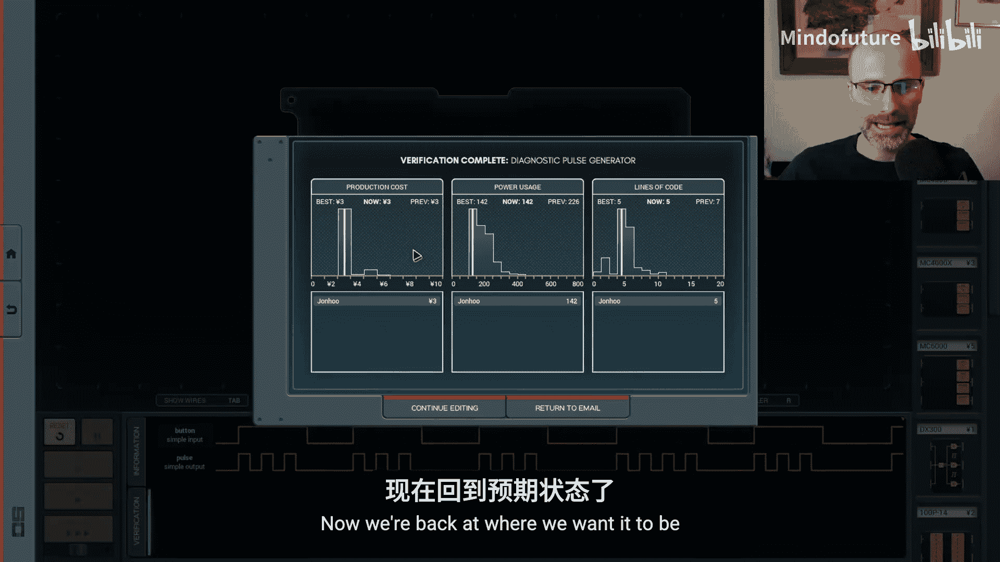

Hey， looks okay， suitable for purpose。 Great pep talk from the boss。Light up signs。

A major esports personality。 Okay， we need to make a light up sign that animates。Cool open。

 So here again， we're gonna erase my previous solution。 makes me sad that they're in here。Again。

 here you can see there's a lot more going on。 And well。

 hope maybe we can find a smarter solution than I had last time。You'll notice on the right here。

Actually，s be here。 So animated esport sign。 We have click 0 and click  one that are outputs connected to display segments corresponding to a clicking animation。

 What does that look like。Well， if you look here， there's like a hand on a mouse down here。

 So that's going to be the clicking animation。 drink 0。

 drink1 and drink  two or simple outputs connected to display segments corresponding to a drinking animation。

And now。Down here， this is the pattern we need to match。Okay， so how are we going to do this， Well。

 click 0 and click  one， look pretty straight forward， right， They're just。呃。🎼2222。🎼You want。P 0。

Notice that the it's not like the ones on the left are inputs and the ones on the right are outputs。

 They're all just pins that can be set in either direction。 This is。

 this sort of depends in the real world。 Some pins are out pins only， Some are in pins only。

 but there are pins that are in out pins。🎼So in this case， this pattern， in fact。

 I can move this even further down to conserve some。Layout space， which is nice。

 So what do we want to do here， Well， we want to move。100 into。P 0， right。

 So at the very start of time， p0 should click 0 should be 100 and click 0 is connected to p 0。

 So we move 100 to p 0。we move zero to P1。🎼Then we sleep for one。 actually。

 I think maybe we could do this nicer。 We could do。🎼Move the accumulator to P1， then not。

 then move the accumulator to P0。And then we don't do a knot after this so that the value that's previously at p0 will go into P1 the next time we go around and then it will get flipped for p0 so I think this is going to give get those right。

🎼Cool， so that did the right thing for click0 and click 1。

 but obviously the others are wrong because we haven't done them yet。 So someone asked the question。

 what is x0 and x1。 So x1 and x0， we haven't used these yet。

 But these are using a different protocol。 So the P0 and P1 pins here are sort of continuous circuits。

 The idea here is that you set the pin。 And now there's this power flowing over that pin or power commensurate with the value that you set。

😊，X1 and x0， are pack is a package based system， so you get to send signals that are a value that is like received once and then is no longer set。

 whereas these， if I set this to 100 and someone reads it， it will be 100。 if they read it again。

 it'll still be 100， right's not it's not packetized， whereas x 0 and X1 are packetized。

 So if I move like， let's say the value 100 into x0。 that'll send one packet that is the integer 100。

 and the' receiving end when they read from their export。

 they'll get the value hundred the first time they read the second time they read。

 itll block until another message comes here。So we're not going to need those right now。

 but we might need them down here。Okay， so drink 0， drink 1 and drink 2。🎼Here's a fun one。

 So this is。Drink 0 is mostly on， and then off。🎼Drink 1。 is this pattern。 Drink 2 is this pattern。

So I think there are a couple of ways to this， we could have a microcontroller over each。

 but that seems lame， we could have a microcontroller for drink0 and one， but not for two。

 but there is a pattern here if you look kind of closely right so。🎼This， if you take。

🎼If you take drink 0 and drink 2。🎼Then drink one is the Xor of those values。

 So drink one is only on if。No， that's also not true。 D one is the。Nand of those values。

 so it's only true if neither of those are true。Right， so here this one's。🎼On therefore。

 this one's off here， this one's on。 So therefore this one's off。

 So I wonder if you could use a pattern here to make that。Better。🎼Or zero is the or。🎼No。

0 is not of the or。 Yeah， so the Nand and the nors， right， These are interchangeable by the order。

 So that like one is the inversion of the other。 So the question is， how do we best represent this。

I think the way we're going to do this is。🎼By。🎼I think we're going to be a little bit sneaky， maybe。

 and we'll see whether this ends up being sneaky or not。 but I think we're going to send。

We're going to have one microcontrl that just generates the drink zero。🎼Signal。

You just treat drink1 as the same pulse generate as the last problem instead of drink 2 can be handled with logic comparisons of drink 0 and 1。

 Yes， however， and this is where it gets a little tricky。 So if you go。

 if we go back to the manual here， you'll see that the only instructions we have。

 at least the only instructions we know about so far， are move， jump， sleep。

 this is sleep until you receive something on an export。Add subtract multiply， not and then digits。

 So we don't have and an or。 We don't like we don't have Boolean values。 We only have integers。

 However， I think we can do this by using integer values and subtraction。And a comparison point here。

 right， So we could do。What is the pattern for this one， it's like move。1002 p 0， then sleep。

4 what is is 1，2，3，4，5，6。Sleep for 6， and move02 p0。But I think we can also have it generate a。Oh。Bm。

Now you can see the game。🎼And。🎼I think we could also do it by。🎼Having it。

I'm unsure whether that's easier。🎼Yeah， I feel like it should be doable here to say that drink。

 this needs a little more space。The drink， too。We can model as what，1，2，3。4，5，6，7。Right， yeah。

 is move。0，2 P1。Sleep for 7。Move 100 to P1。Sep for two。And then， I think。

🎼Can you implement it in physical logic gates so we don't have physical logic gates either。

 but we do so after a little while we get this thing or rather we can use it now。

 but it's a little early to introduce it， but it's still not really logic gates。

 even though it has symbols on it that kind of makes you think that it has logic gates。

And so this is， I think， one of the things that's。🎼Interesting about this game， right。

 And this is what makes it a puzzle game rather than like a pure assembly game。

 is that the instruction set is quite limited， Usually when you're programming in like actual assembly。

 you have quite a lot more to go on in terms of instructions you can use things like and， right。

 ends up being extremely useful for situations like this。 But when you don't have and。

 you need to get creative。 But I do think there's something a little realistic about it in not in the like missing and and or sense。

 But in the sense of。😊，🎼呃。🎼But in the sense of。There are times when you work on microcontrollers that just like they don't have the instruction you need。

 you need to figure out another way to do it that's not entirely uncommon。🎼嗯。

So what I was thinking here was。If we could do this so we can add this export to this。

And this p port to this。And so what we could do is when this moves to 0。We also send， I don't know。

 let's say 100 for now to x1。🎼And。Right and this is missing a sleep actually now that I look at it。

 it needs to sleep four。And then when it goes here， I think you could move zero to x1。

Does not get the compilation to 100。 I'm not sure I follow。Oh， there are logics further down。

🎼Oh yeah。 these are logic gates， nice， so we we can use those later。Now。

 the question is whether we can do something interesting with this。 I think we can。

 I think what we will do here is。We， in fact， we can do a very simple trick here。

 which is we wait until we get something on x0 and that will be when drink zero moves to， in fact。

 we can do this way easier we could just where's my we don't need this message。🎼We just do this。

 so we sleep until we get a message on here。 When we get a message in here。

 we know that drink 0 is gone to 0。 So then we move 100 to p0， which is drink 1。

And then we sleep for one。🎼Then we move0 to P0 and 100 to P1。 Then we sleep for2。

So that would be this one。🎼Then we move 1 to p0 and we move0 to P1。🎼Oh we're not gonna have enough。

 we're not gonna have so this I can't add any more lines here because the microcontrolllerers are set up such that you have a limited amount of instruction memory。

 you have a limited amount of instruction you can include in any given microcontroller Now this limit is very small right again this is puzzle game but it is the case that like on real embedded systems you will have a limited amount of roM to put your code in There's a really fun story about they' crash bandicute for the PlayStation1 where so they obviously had a bunch of like art assets and stuff too。

🎼And the game was like just like exactly as big as the amount of space they had。

 So the problem was actually almost like a bin packing problem。

 like the knapsack problem of how do you arrange them all in memory with like，Basically a tar file。

 Like， how do you， how do you put them together such that they all fit on the disk image that you have。

 And that process was basically randomized so they would shuffle the pieces。

 like shuffle the sections of the binary and see if it fit if it didn't。

 they would shuffle and try it again。 And like a few days before release。

 they realized that they had to change some art asset。 And as a result。

 the packing wouldn't work anymore more。 So they had to like。

Chaed some other unrelated part of the code so that they could shuffle again so that it would fit in the rom again。

 This is obviously an extreme version of this problem。 but it's just to say， like， it is the case。

 you do have limited amount of instructions in the real world as well。But yeah， I mean。

 these time these days like you're not really limited on on this kind of level。Okay。

 I think we don't need the sleep here。 I think we move。X 0， which is going to be 100。

 So we're going shave some instructions here by combining them。

 So we know x 0 is going to be 100 so we can move that into p 0。 So that saves us this instruction。

Then we sleep for one。 Then we move。0 into P 0。🎼And 100 into P1， then we sleep for 2。

 Then we move 1 into P 0。 We move 0 into P1。 We sleep for1。And then， we move。🎼Oh。

 this needs to be move 100。🎼And then we move 0 into。P0。And then we go back to waiting for the X。

So I think that will do it。RightSo this one now， like the the looping part。

 we don't actually need the sleep for this long period because the sleep for that long period is handled by this guy。

 So this one will only send us a message when it's time for us to kind of wake up and send some signals。

So we will wait for that to happen because the move reading out of X0 will block until that happens when that happens。

 we're going to move that 100 value into p0 turning P0 on。

 which is drink1 it's connected to this pin。 and we sleep for one。🎼Which is this period of time。

 right， then we flip them， so we move 0 to p0 and 100 to p1， we see for2。

 which is this period of time。Then we move 100 to P zeros。 we turn this one on again。

 we move 0 to P1 to turn this off again。 We sleep for one。

 and then we turn this guy off and then we wait until we get a signal to do the whole thing again。

All right， simulate。Part is not sleeping。Do I actually need the sleep because then I can't fit the instructions？

Can we shave an instruction here somehow。呃。I don't immediately see away。

There is a larger microcontroller here that also has。

It has more ports and it has space for more instructions。But it's slightly more expensive。

 we would end up with a solution that's like needlessly more expensive。🎼うん。mm。

We can do it with an additional microcontroller， but that feels excessive。Yeah。

 I think we do need the sleep。So like， okay， just to indicate that the。

 the sort of logic is kind of sound， right， if we do a sleep until here simulate。But yeah。

 the problem is that we're going to leave the P0 on。🎼U。

But I thought if we go back to the instruction manual and we look at the。

So this is the first time we're using the exports。Whereas the explanation of the exports。Res。

Refer to the appropriate data sheets for details on pin functionality。Alright。Yeah。

 so here they talk about the difference between input mode and output mode。嗯。Yeah。

 so the challenge is that the bigger chip only has， it still only has two pinouts。

 it does not have three pinouts， it just has more exports。

 which wouldn't help us here because we can't use the exports to drive LEDs。🎼But I'm trying to find。

🎼Yeah， so as you can see there's a there's a whole bunch of stuff down here and again。

 this gets more into the fact that this is a puzzle game and these all end up being puzzles as we go So it's really more the beginning where I'm like this is。

🎼呃。🎼This is useful for teaching。 Here we go， X bus。

🎼Exs are discrete data packets from minus 99 to 9999999。🎼Great。

🎼Xpo is a synchronized protocol data over Xos spins is only transferred when there's both a reader attempting to read and a writer attempted to write If a reader write is attempted without a corresponding operation on a connected device。

 the operation will block。But that's kind of what we want。

But I guess we're not allowed to block usingMo is my read here then。

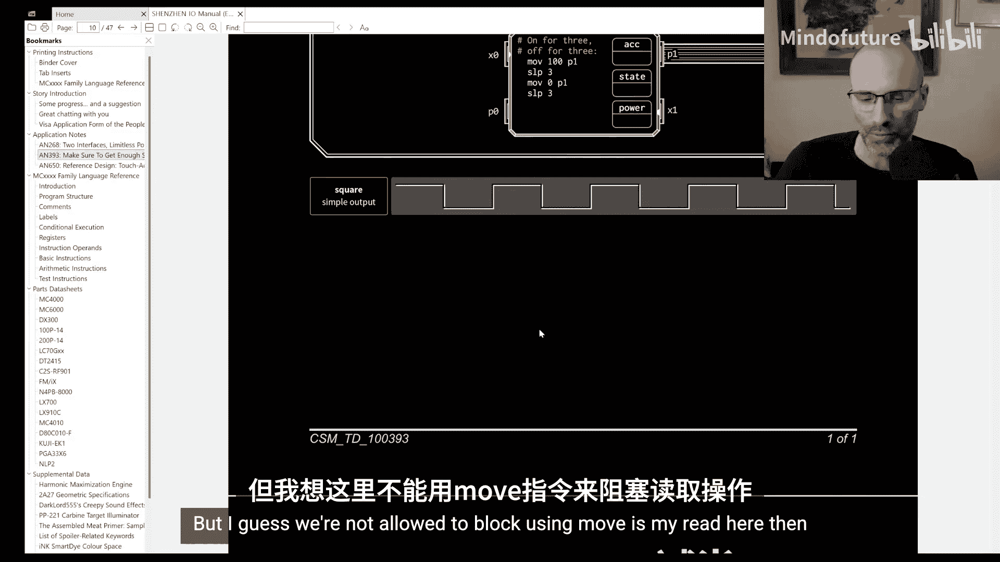

It has the big MC part just to see it here， so the big microcontroller still only has p0 MP1。

 but it is x0， x1 x2， x3。So we could use that one there just to get the sort of just to get the additional instructions。

 but it does make me kind of sad， feels like it should not be necessary。

So I'm wondering if there's a trick we could pull here， like。

Sending an extra thing on the X would not help us because sending an extra thing on the X bus would still require an extra SLX。

m。Alright， fine。 We'll do。 we'll do the。 We'll do the extra microcontroller。 makes me sad， but。

We can make it happen。And we will move 0 to P。0 is the last missing， right。

Now let's get rid of these wires because we're going to need to wire this again anyway。

And this is actually something that is also kind of realistic。 So when you start。

Wiring actual boards， one of the things that you truly do run into is。

Being able to lay out your board and get all the wires there so they don't cross and fitting all of your chips。

 So like this is not entirely unrealistic having to be able to， to like do this stuff。🎼And。

What if we use P1 on the top controller to handle drink？🎼2。We could do that。😮，🎼U。

We do probably have the space for that， actually。That's not bad。Alright， let's， let's try it in the。

 Actually， since we have this one， let's simulate it， see that it works。And then。

 this is what the animation now looks like with how we set it up。嗯。

But let's then now that it finishes running。 Okay， so that now we have a sort of a benchmark here。

So we had one fewer lines of code that it looks like most people achieved。 Same power usage。

 slightly more production cost， which is presumably them because we had to use the big chip。 Okay。

 so now let's go。 let's try to edit this again。 Let's try to pull this out。 So the proposal is。

To say that。P1。😔，Is going to handle。Drink， too。While drink one is going to be handled still here。

And then， this is now going to be。Sleep 1。Move 100 to P1。 Sep 2， move。0。To pe1 and sleep。Wan。Right。

And then this guy is still now going be sleep f 0。Move x 0。🎼In fact。

 now we can also change when this ha。 No， that's right。 Yeah。 So here， when we receive that message。

 we'll put 100 into p 0。 Then we're sleep for 2。 Then we'll move。🎼Now， we'll sleep for one。

 We'll move 0 into p 0。 We'll sleep for 2。 We'll move 100 into p 0。 Then we'll sleep for。

And then we'll just sleep。 No， then we'll sleep for one， then we'll move 0 and P 0。

Oh you can wire under the boards， that's nice。🎼So I don't know if this is really better。

 I feel like we ended up writing more code。Right， like， why is this one？🎼Yes。

 because we have to repeat the sleeps now。 So I think this is more code even if it's。

 but it's lower production cost right， It like less equipment， but more code。

🎼Does seem like it's doing the right thing， though。

 It's to see now lines of code is the same as most people did， and production cost is the same。

 but our power usage is higher。 So we're running like more instructions normally than we should need to。

How can we count those data。 So this is sort of this becomes an optimization problem。

 And the question becomes， do you keep trying to optimize or do you move on to the next thing？

 And I think this is something that is not entirely unrealistic of embedded programming as well。

 where there's usually you have a power budget right or you have a compute budget like you need to get something done in a certain amount of time like actual clock time。

 Otherwise the the animation starts lagging and stuff where if you're a game， then you get lag。

Or you have a budget on the amount of space that you have。

 or do you have the budget on just like engineering time。 But you can always go back and like， oh。

 but can I get rid of that chip or can I merge these two chips。You can sleep6 for drink。

1 is not depended on drink 0。Oh yeah， maybe we don't need this anymore。It's a little sad， though。

But you I think you're right。I think we can just sleep。🎼6。Skip this。

I don't know if that's meaningfully less power， but maybe it is。

But it's not entirely unreasonable to be faced with a sort of trade off decision of that's still using slightly more power。

 but it's slightly less than before。You know， when do you stop optimizing And I don't think there's a right answer to that in the real world or in the game。

 But it is interesting that like， yeah， someone pointed out in the chat。

 like sometimes you have constraints here that don't really come from just your desire to make the board as efficient as possible。

 But sometimes there's things like you get a bulk discount， if you buy more of a given chip。

 So actually using like four of the cheap chip is better。

 even though it's more cost than using some of those and some of those because you get more of a discount because you bought more of these right So there's like all of these interesting constraints on the actual way。

 you do optimization here， I think for the purposes of the game we're gonna move on to the next step。

 even though here obviously as you saw as well in the sort of verification results。

 there are ways to optimize this design that other people have used。😊。

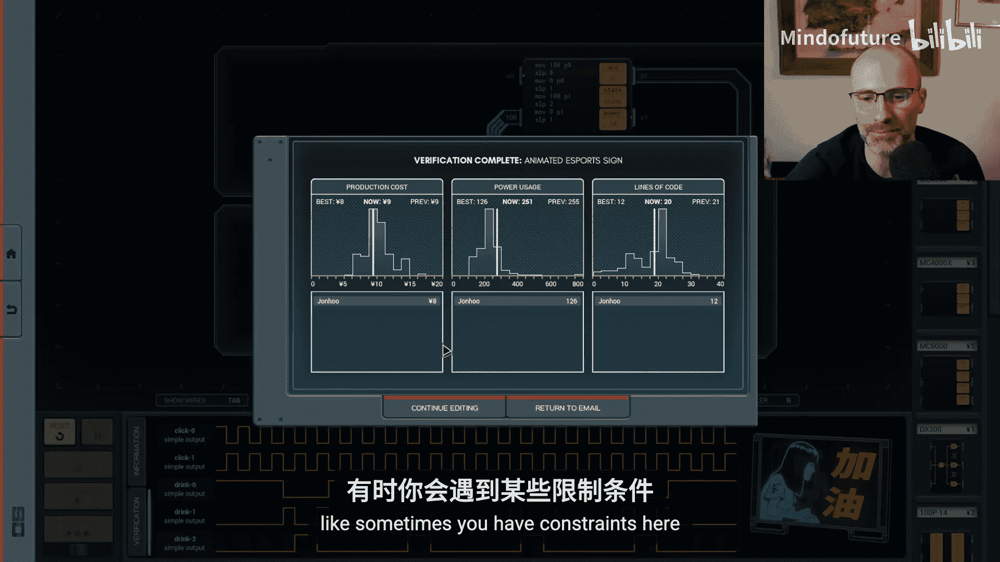

Wirrelings do not matter in this game as well， which is something that does matter in the real world。

 depending a little bit on what you're trying to do and the distances involved。Allright。

 so back to our email here， back。Hi。They're very happy。Bring out the baron。Ah。

 we need to supply them with personal scorekeepers for the little game。Let's open it up。

And now we're going to get to use a new device too， if we really want to。All right。

 So what do we got here。We have a display。Point and foul are simple inputs connected to buttons。

 Displays an X plus displays。 that means it's using the packetized protocol corresponding to an numeric LCD screen。

 The counter should keep track of count starting at 0。

 and ensure that the display is always showing the current value。 When point is pushed。

 the count should be incremented by one。 When foul is pushed， the count should be decremented by 2。

 but not below 0。 Okay， so let's do it。 the sort of。Slow， but easy way first。Which is as follows。

We have two pin inputs。 We have this one and this one。 We have one X output。

 which goes to the screen。And at every cycle， we're going to check which of the buttons are lit up and we're going to adjust the score accordingly and notice here we have two registers on this chip。

 we have the accumulation register and we have the the dot register。Oh， you're right。

 there is a way to create a new design。🎼Right here， isn't there。 Yeah， No， I should have done that。

 You're now wrong。 Oh， well， it's fine。 So here， what we could do is， you know， we want to。

We want to。Compare the foul。 or let's do the point button first。

 We're going to compare the point button， which is sorry， P1 with 100。 If that button is 100。

 then we want to add to the accumulator， add one。嗯。Then， we want to compare。P0。

 which is the foul button。With 100。And here， we want to。Sub 2。

 And then we want to compare whether the current score is less than 0。 And if it's less than 0。

 then we set it to 0。🎼So here， if we go back to the manual again， when we have four instructions。

For the test instructions。You'll see there is。🎼T， which we've already used。

 but then this's also greater than or less than。 So we can use one of those。

 We go back here and we say T less than accumulator less than 0。 If it is。

 then move 0 into the accumulator。

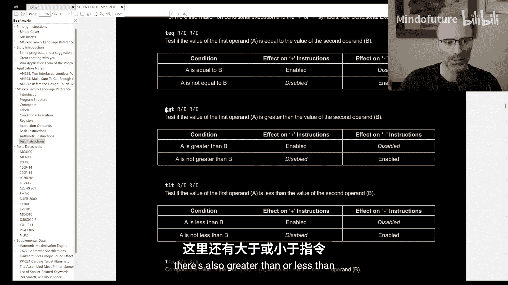

And then， we want to move。The accumulator into x 3。 And then we want to sleep 1。

 So this is sort of the， the， I don't want to say stupid version。 But like。

 this is a very straightforward way to do this， right， We keep the score in the accumulator。

 and we just。For every cycle， we check what's going on。Hey， we did it Okay。

 so this is eight lines of code， you know， seeming average power usage and production cost slightly above what some other people have managed to do。

 they've managed to do it with four yen instead of five。

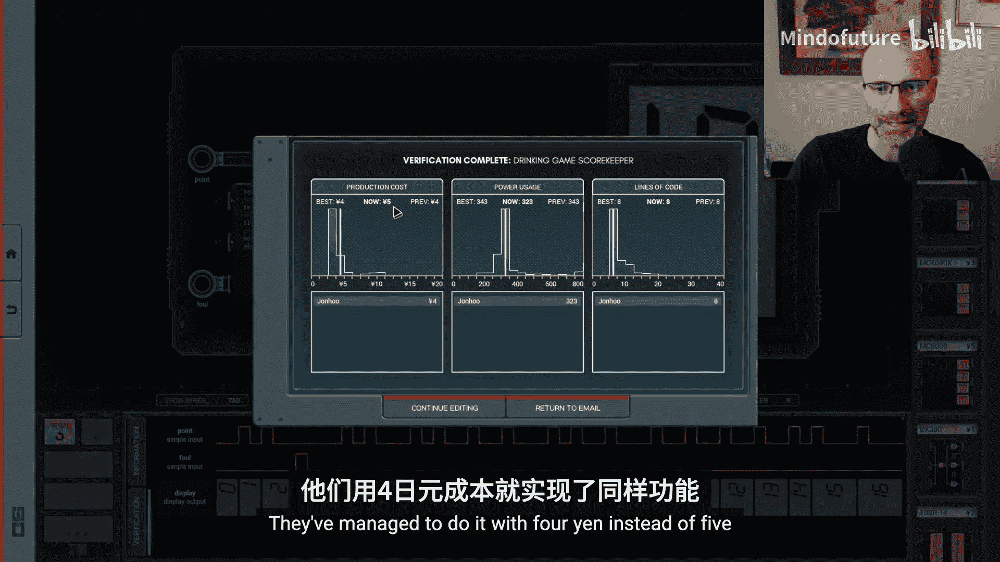

Now， I think the way you do it with4 yen is that instead of having this chip that does this sort of relatively repetitive compute。

You do it with a different chip。 So this is also the case in embedded programming。

 I'd like dumber chips are cheaper。 So if you look here， this microch where I can write code。

 this one's 3。 but this logic thing that just has what we'll explain what it does in a second。

 This one just costs one。 So that's a lot cheaper right。

 because it it doesn't it doesn't have customizable logic。 It's can be。

 it can be a lot simpler of a chip And as a result is also cheaper to make。 So what is this chip。

 This is the D X 300。 Let's go back here。And this is also the kind of thing you end up doing in a better programming all the time is like。

 let me go look at the reference sheet for this piece of hardware。 So D X 300， the digital I O Exper。

A unique and useful part that can read or write up to up to three on or off signals at once over S Io or X+。

So it can write a three digit number to any X pin to change the state of the simple iops。Right。

 so this is we can write a three digit number to any of these Xus inputs。

And it will change the state of the I O outputs。 The three digits of the value written will be used to turn the simple pins on or off。

 depending whether the digit is a 1 or a 0。 So if you write 100， then p 0 would be 0。 P1 would be 0。

 P 2 would be 100。 So this is p 2 being on， which is 100。 This is P 1 being 0， which is0。

 and this is p 0 being 0 So 0。 But it can also you can read from any of the x plus pins to get a three digit number that captures the state of the simple I O pins。

🎼The digits of the resulting X value will be set to either ones0 depending on the simply Iop pins so the sort of you can read this table in reverse if this is the state of the pins。

 this is what you read out of the X。So what might this look like well？

If we here take this and we flip it around so the。P things are on the left。Then what this means is。

Over here。🎼We can just read a single x values so we're going to sleep on X0。😊。

And what we're going to get in here is that if。嗯。If this value is。🎼If this is on。

 then we get a number of top one is P2。 so then we would get a one in the first digit。

 This would be a one in the second digit。 This would be a one。 No， that's P what P0。

SoThis would be a one in the rightmost digit， one in the middle digit， one in the leftmost digit。

And so now we can just wait to get a single value out of here so we only need to read once to get both the values at once。

So we can move X into the accumulator。嗯。🎼And now， this is where it can get really interesting。

 So we have this value being read out。 And what we're looking to do is to figure out how does this affect the score。

 like overall， rather than doing the pluses and doing the minuses separately。 We can just see。

 how does this total value change the score。 And what we can do here is we can compare the value in the accumulator to the value that's sort of in the middle。

 So let's do。诶。So if P1 is on， then that would be 010。If p0 is on， then that would be 001。Right？

So this would be a foul， this would be a point。And now this is where we can do something really trickyies。

 so the C instruction。🎼If we go back to the manual here， test instructions。

🎼The C P instruction compares the value of the two。 And depending on the case we're in。

 we either enable plus instructions or minus instructions or neither。 So if they're equal。

 then nothing happens。 So this basically gives us three different branch conditions from one comparison。

🎼So here， when we compare this to001， then we know that the the case where we got a point is no instructions get executed。

 which means that we need to we don't want to move this into the accessor。

 we want to add one because if there is a point， then。

🎼Then we won't get to execute any more instructions。 So we're going to always add one。 Now。

 if this is。🎼If this is plus， so plus would be， let's see for compare plus is if。

The first opera is greater than this value， so the accumulator is greater than this。

 I think this should actually be x0。 If x0 is greater than1， so that would mean that foul is set。

 then we need to sub 3。So three， because we've already added one。🎼Oh， you can see the game， sorry。

 how about now？

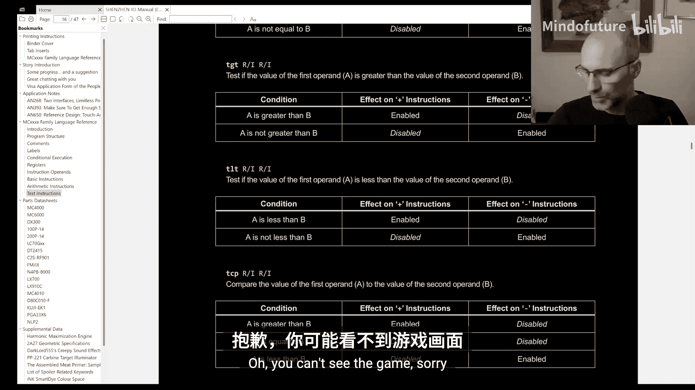

🎼Now you can see the game。Uh， so we're comparing x0 to one， which would be this point being set。

If the value of x0 is greater than1， what that means is we got this value out of the x plus。

 right because this value here would be 010， which is greater than 001。

We have to substitute three because we already added one so that we would correctly handle the case where these two were equal。

 meaning we got a point。And then we could do in the other case。

 So this is the case where point is not set and foul is not set。 when in that case。

 no points should be added or removed。 so we need to undo the add one。

So we need to substitute  one sorry subtract  one。 And then we can do our if。

P 0 is equal is less than 0。 Then we move 0 to the accumulator。

And then we move the accumulator to X1。So this is more code and more convoluted code。

 but it's cheaper components。Let's see if that okay， that was broken for some reason。呃。

Part is not sleeping。Why is the part not sleeping thiss asleep right there？

Do I like need to sleep one？I guess so。Well， that's not working。

Why is that not working so we can step through here？Yeah， so we correctly output a zero in beginning。

 then we sleep。We go back up， we do the same thing again。Still0。We go back to。🎼E 0。 Oh， I see。

 That's why It's because this component， when you read from it， it's always available。 It's。

 it kind of operates like a more like a pin than it does a packet。 So we。

 what we actually probably want to do here is just。

Just have our compare because every time we read from it。

 it's the current state and then we sleep here at the bottom。Okay， but pause。

We're still always outputting zero， so why is that， let's go back。🎼Let's advance through one step。

 Adv through one step。 So now。🎼You see here， there's 100 on foul and the0 on point。

 So the next step now should be。🎼That we ended up， yeah。 so if you compare these two。

 that is now positive。 We ended up with a value that's higher than point， which is foul。

 So we go in here。 we subtract three。🎼So the accumulator is now minus2。

 then we compare the accumulator to0。 Oh， it' I'd see the problem is's because I did not have a plus here。

 so this always got executed。Whereas what we want is only if the accumulator is less than zero。

 do we end up resetting it？Nice。This seems promising。As of now you see， the production cost now is。

4 y， or previous was 5。 Our power usage is about the same， slightly higher， actually。

 because we end up executing more instructions。 The previous one was much more conditional。

 Our production cost， though， is a little higher than someone else managed to achieve。

 So someone managed to do it with  three。Which would mean that they're doing it with just a small microcontroller。

Which is interesting。Oh， you want the game louder or I'll make the game a little louder。 There we go。

Maybe actually we can do this even without the bridge， which would be， we hook this up to P1。

Cook this up to p0。We add。嗯。I think you would do something like compare。Point you would compare。

Maybe P0 to P1， I feel like there's a way to do it with this where you compare the two signals and you see which is higher and if neither of them are higher than the other。

 then you don't touch the accumulator。🎼So， if。🎼P0 is higher than we substitute then we subtract two。

 If P1 is higher， then we add one。And then we do our comparison。So do the trick？Yeah。Even better。

We saved a component。Hey， how's that Okay， production Go three。

 are power usage is better than it seems most people were able to achieve and seven lines of code yeah。

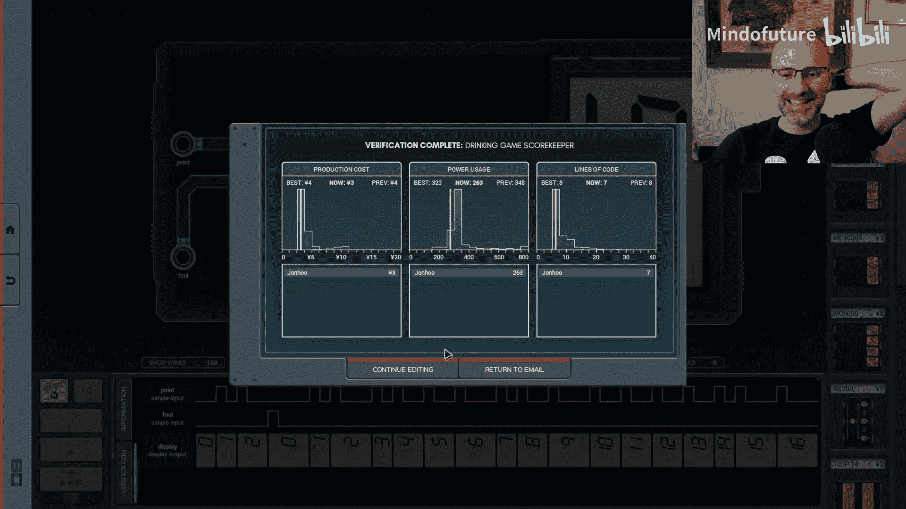

And I think this is also like emblematic of a lot of， I mean， a lot of programming in general。

 not just assembly， right， which is you can only get at the better solution if you do the poor solution first and then figure out how to how to shift stuff around such that you can incrementally get to a better place。

Nice。Okay， let's go back to our email and see what we got here。They're happy。

A you happy rubbish audio thing。🎼And now I'm going to click new design， great。🎼Okay。

 audioud in is a simple input connected to an audio source。

 Audio out is a simple output connected to an audio receiver。

 Maximize is a simple input connected to a switch。 The signal from audio in should be copied to audio out。

 applying the harmonic maximization algorithm when the max switch is on。

 Look in the supplemental data section of the manual to find advertisement featuring the algorithm。

 let's go back to our。😊，Mual here， supplemental data， harmonic maximization error。Sounds impossible。

 no， it sounds like harmonic maximization。Alright， so the algorithm is very proprietary。

 don't share it with anyone。Audio in minus 50 times 4 plus 50。

🎼Guo。All right。So。This feels like probably a big microconter kind of thing。🎼In fact。

 this one's trickier because we have two pin。 We have two pins in here that we need to provide。

 and the audio channel is if you go to verification， see the audio channel here is not 0 or 100。

 It actually varies in between the two。 And so what we're gonna have to do here is we need。

 we need to sort of plan our pins a little bit， which again。

Very common in a embedded programming as well， you need to remember how many pins you have and what they can be used for and which ones you've already used for something else。

 because this needs to be a pin。🎼This needs to be a pin， and this needs to be a pin。 While。

 none of these have three pins。 So I think what we'll do here is we either need to use two microcontrollers。

 like two small ones， or we need to use。This one。Just on the maximize to turn it into an export。

So by turning it into an export， then we can read it through the export here。

 and then we can read this here。嗯。🎼The challenge with the exports is that we need to sleep to read them。

 but we don't when we have this thing。 So I think this might be okay。

 So now x0 is going to be set to 010 whenever the maximize button is sort of held down and P0 is going to be the actual audio signal and then we're going to emit audio out over here。

 So what's this going to look like Well we're going to compare x 0 to 100。 sorry to 010。

 which is the middle port。🎼If it is on， which would be that being set that。🎼In fact。

 I guess we will always do add。No， move。P0 into the accumulator。If this is the case。

 then we use the algorithm， which was substitute 50。Multiply by 4 and add 50。嗯。And if it's not on。

 then we just we just keep whatever the original value is， then we move the accumulator to P1。

🎼See how that does how when we need to sleep。🎼Simulate。That looks pretty good to me。

And so this we could pretty easily have done this with a with the bigger microcontroller and or actually just with two smaller microcontrollers。

 but the smaller microcontroller would really just end up replicating what this one。

 this thing is doing over here。嗯。Okay， so we have this。 They here we did pretty well。 Look at this。

This is actually a better solution than what I had the first time I played through this level。Nice。

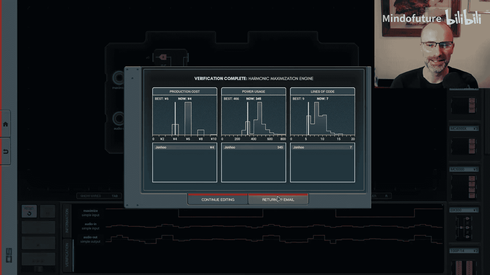

Okay， return to email。This thing is awesome。Infrared sensor。Open。

What we have here time is a simple input connected to a DT 2415 clock， providing the current time。

Sensor is a simple input connected to an infrared sensor。

So that would be this one alarm is a simple output connected to a simple alarm。

When the current time equals the on time。The device should be armed when the current time equals the off time。

 the device should be disarmed Whenever the device is armed and the sensor reads at or above a value of 20。

 the alarm should be active。The on and off times is said that the operator using dials can be read on an X input and use numerical values compatible with the time。

🎼Okay， so the we need something that figures out whether the alarm is currently on or not。

 And then we started doing an and with that of the sensor being greater than the sensor being greater than 20。

 And so this is where like some and ports might actually be really nice。🎼But let's see。

🎼So we certainly need a component that compares these numbers。 And I think we want this one。

 This is a small microcontroller that only has exports。 Oh， that's not an export。 Cool。

 then we don't want that。 Then we want the standard one。🎼So， we're going to get。This in here。

Then we're going to get。X from this。At X from this。And what we want to do is。We want to move X0。

🎼I guess we wantna sleep rag 0。Actually， that's an interesting question。 Does the。

I don't think the on time and off time change。🎼So I think we can just read them once。

 So in that case， we're going to move x0。🎼Actually， we can even maybe just compare them directly。🎼No。

 we need to。We need to save the on time here somehow。I wonder if we might need the bigger one。

🎼In fact， I think the bigger one might just let us do all of this stuff。

 because then we can connect the the sensor here as well。No。

 we can't because we're going to need three pins， right， We' need a pin from this。

 a pin from this and a pin for this。All right， so。Let's， let's see how far we get with this one。

 So this is going to be our。🎼P1。This is going to be our P0。No， that won't work。It's going to be this。

 it's going to be this。Okay。So what are we looking for here。

 we want to wait until we hit the on time。🎼And then we want to emit a signal。

🎼And this is where maybe do you think we can wire this underneath easily， not easily， no。🎼Alright。

But we can， however， put a bridge over here as a bridge is just a。

ACon so that the space for this to come under here。

And then I think we're going to struggle to get both of these passed there， though。

 might have to move this one further out， I think is going to be the trick。

So we move this one further out。Just to give some space to wire through there。🎼So。Can go away， maybe。

The bridge。🎼And actually， we can just do a bridge。🎼Here as well。

 so that this pin becomes our out pin。Oh， can you move the time thing， Oh。

 you can move the time thing。🎼Oh。Yeah， but that only kind of helps us， right。

 so we can move this one。🎼That's nice。🎼I suppose we can move this one and then use a bridge here to get the sensorensed data out。

Sure。🎼And then we'll end up with a。🎼Oh， actually， this is awkward。 That doesn't work either。

 I think this has to be a big one because that this is a pin out。

 but this is also a pin out and this only has two pin ins。

🎼So I think we're going to need this one to be one of the。One of the chunky ones。

🎼And then this can now use an export。🎼Here。And a P port here and a P port there。So this is for time。

 and this is for the rest。But I think you need a big one for this。

 otherwise you don't have enough pins out。🎼So what will this look like， Well。

 I think we're going to compare。🎼呃。I think we're going to move X。🎼One。

 which is the on time into the accumulator， we're going to move x2 into the accumulator。🎼And then。

🎼Then connect them both with and。 So we could connect them both with end。

 but then we would need through。We would need two microgens and an end。

🎼And this big microcontroller is only two more。 Oh， maybe would save as one。

 Let's try it this way first。 and'll， we'll see if we can simplify it。🎼Afterwards， two small ones。

 and an and is more expensive。Right，6，7， oh no， it's seven versus 8。Let's try it this way first。Okay。

 so we're going to move。 We're going to save the on and off times here。 and then we're gonna。

Say something like wait。Is going to be compare the current time， which is P0 to the accumulator。

🎼And if it is not equal， then we are going to sleep for one and then jump to wait。

 So this is a loop in assembly right， is that you just do some stuff and then you jump back up to something that tests the conditional。

🎼Now that that's done， so this means that we've reached the on time。

And I think now that we've reached the on time， we would move 100 over x3。And then we would do。

 again。We would do。Off would be T of p0 to the off time， which we stored in the other register。

🎼If it's not equal， then we sleep one and then we jump to off。And then at the end。

 we jump back up to wait。Because now we're going to process this whole thing again。

 although in between， we have to move a0 to x3。So now over here。

What we need to do is we're going to wait until we're told that the system is armed。

🎼Then we're going to move， then we're going to compare equal x 0 to 100 because we only want to do this stuff when the alarm is on。

 when the alarm is on。If the sensor data of P0 is greater than 19， right 20 or above。Then。

 we're going to move。🎼呃。🎼100 into P1 right， that means trigger the alarm。

 Otherwise we're going to move 0 into P1。Now the other thing that's interesting here is to note this minus here means it's the L branch for both this equality and this equality。

 but that's kind of what we want right because we want to set it to0 if if we're now below the alarm threshold or if we're now in off time in both cases we want to P1 to go back to0。

Right let's see all echoes。O。We never turn the alarm off， Oh， we turn it off here。

 so we turn it off at the off time， but we don't turn it off if we go below the threshold。Why not？

That's。Go here。😔，🎼Let's see。 so it's greater than 19。 so we move 100， then we go back up to the top。

And now nothing's coming in here， right， where that's just this。

 this whole processor is just waiting for the off time。🎼In fact， we could make this smarter， right？

 We can make it sleep all the way until the off time。 if we really wanted to。 Currently。

 it like sleeps were one and checks the conditional again。

 That's not really necessary because it actually knows how long it needs to sleep。

 but that would be more code， but more efficient。 The question， though， here is this one。🎼Oh。

 it's because。Yeah， I know why this is。It's because when we get to the bottom of this。

 we loop back up until we get another signal on x0。

 we only get another signal like another interrupt basically， when this one happens again。

 which is when the button gets turned off。Hm。Yeah， this is where what we really want is like the equivalent of a select。

 right， we want to select over either a second like a cycle having passed or there being something available on X0。

Or we would have this be a continuous signal， but then we don't have enough ports for that。Yeah。

 so maybe we do end up with this being an and kind of a situation。All right。

We'll go with the end proposal， which is just。It's actually like logically fairly straightforward。

 right it's just。Compare P0 to 19。 If it is greater than 19， then you move 100 to P1。

 otherwise you move 0 to P1。And then you sleep for one。And then here we'll then take an and， which。

Go I go back to the manual here。呃。Where what are the ends？These snow。🎼This。🎼08 is an and gate。 Okay。

 so we'll go back here， we grab is 08， which is an and gate。

And will end。P1。In this guy。Up to here。🎼So what does an end gate do， Well。

 an end gate will be on only if both of the inputs are on so we're both armed and we are and the sensor is triggered。

 So now this is going to be instead move zero to there and move。Here。See how that works。I mean。

 it's a nice visualization， right， you can sort of see exactly what's happening。

Does feel kind of wasteful though okay the power usage pretty low。

 production costs a little high right again， because we had more components we really needed to。

 lines of code also pretty high。Feels like the an gate should have saved us some code， if anything。

 but it does not seem to have done so。嗯。This also becomes a， do we improve on this or not。

 I'll show you what I did last time I did this。 So this one。

So here I actually use this as the output。 So that way。

 I use this just to turn the export into a P port。Which worked quite well。 And。

 you'll notice actually， the code is very similar。 So we move， we read out the two on and off times。

 Then we have one loop that waits until the on time。 then we。呃。🎼Then， we。

Compare the value of the sensor to 19。 and if it's set， then we just make this be。🎼And then we sleep。

 and then we make it be off。 and then we jump back up here。

 which checks for the off time and then checks the sensor again。

So that ends up being a kind of select right it first checks。

 well is the is have we reach the off time， if we reach the off time， then we jump weight。

 so we jump back up to the top， otherwise we do the comparison with the sensor。

 we do that for one cycle and then we check again。So if you see this。

And then it ends up producing this instead。Where the the lots of messages are going over here is for every cycle。

 if the alarm is triggered， we send a message saying turn it on and you see this actually does quite well。

 but there's probably a way to make it more efficient I'm pretty sure but ends up being kind of similar。

Move time to its own small one and the sensor and infrra can be done on another small one。

 I think that's probably true。

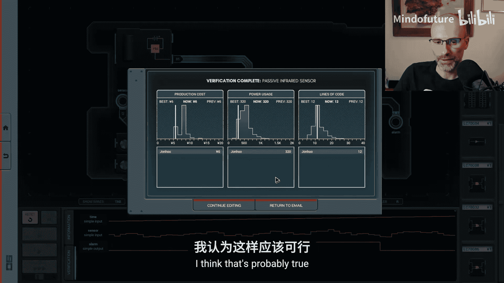

Then the cost would also be six。But this just says like this is a very different layout。

 even though the code is fairly similar， it's a very different setup to the one that we had in the other solution。

 right？Okay。What are we at next， virtual reality buzzer？Near design。

I think this is the first that I haven't done yet。Okay， so here what do we have。

 Radio R X is a non blocking X bus input connected to a radio receiver。

 Buzzer is a simple output connected to an electromechanical buzzer。

 When a data packet is received over the radio， read it and execute the corresponding command in the following table。

0 means power off。 So turn off the buzzer， one means power on， turn on the buzzer。😊。

This feels like it should be pretty straightforward， right？Famous last words？So we。

Wait for there to be something available in X0。🎼And。Wei。Move。🎼E 0 into。

 we might not even need to do that。 We'd compare egg 0。🎼To。

So data packet that's just 0 or 1 this time。 So if it's equal to one。Then we move 100 to。P1？

Otherwise， we move 0 to P 1。Right？Isn't that？Oh， and I guess we also need a sleep one。🎼Aha， okay。

 so this is why it's more complicated is because this only senses a message if something changed。

And so we can't really sleep on it because then we would only flip。Oh。

 it's also because the buzzer is supposed to go on and off， otherwise it wouldn't really be a buzzer。

 would it？So I'm guessing， yeah， exactly we just do it once when we get the on signal， okay。

 so thats that's why we may get more complicated than this cool。

🎼I think what we want to do here is we kind of need memory， right， We need to know。

 we need to remember。For every cycle， whether the buzzer is on or off should be on or off and we need to not that for every cycle。

Let's use a big one， and then we can almost move it to a smaller one if we didn't need all the code。

Now， I think， actually。Yeah， so what we're going to do is。

This one's interesting because it has this property， right that the。The port that we read。

 we kind of need to select over because if there's nothing on it。

 then we want to just flip the signal and continue。But there's not really a conditional read here。

Which makes me wonder， although it claims that we don't need these parts。

 so that you see the part not recommended is sort of here with the game telling you this is solvable without using those parts。

🎼Which I'm interested about， I think the way to do this is just by using two chips。

 So you have one that turns this into a continuous signal。Right， so it receives。Receives this。呃。Here。

🎼We could probably do this nicer。 but， you know， yeah， this probably can be a small。

 So this is going to be waiting for x0。 It's gonna move and it's good。 just gonna。🎼Compare x 0 to1。

 If it's 1， then we move 100 to P1。 Otherwise we move 0 to P1。And so this should now hope and sleep。

🎼And then this now has the。The job to。It's really just taking the and。

🎼Of a clock and whether the buzzer is on。 So maybe we can do this even simpler。

 Maybe we can do this with an and。 I like and gates。So 08 doesnt end。

So we should be able to do this with。And and here。And then just a separate thing that's really just a time chip。

Ah， but it won't work because。The time clock should start when it starts。🎼Which we can do if we。

 if we get the。Haha， we can。Because I've learned about underwiiring。So we can take this out of here。

And then we can say when。Now then you have the select problem again。

Because this is really just solving the select problem， right。

 it' turning a discrete pulse into a continuous pulse。😊。

🎼The challenge here is this can't just be a dedicated clock signal because it needs to be told when to start clocking。

Yeah， so I think then this can't trivially at least be an ore。🎼Think this then actually has to be a。

🎼。This to be this and this。🎼So what do we want here， we want。If。P0 is 100。

🎼Then we want to not whatever is in the accumulator。🎼Then， we want to。🎼Move。

🎼That accumulator into P1。 This is sort of the the same oh。🎼No， Noah， that's sad， really。All right。

 fine。🎼We're going to have to do， we're going to do it a different way than。

🎼Can I really not fit these， All right， fine， it'll be this then， right， this， this。

 I'm not allowed to do that。This like that。Does that connect the pin？

 That doesn't feel like it connects the pin， But fine， we'll go this way。🎼Does that connect the pin。

 That feels like it connects the pin。 If that doesn't connect the pin， I don't know what does， Okay。

 so we move the accumulator into P1。 So the the knot here gives us the clock signal。

Or the alternating clock signal。And then。🎼Otherwise， we。

And this is where we can pull the same trick as we did in the previous collectors that save some power。

 which is we only reset if the accumulator is zero。Although that doesn't really save。

Anything because you're still computing the E check every time。

 So I think we still just move zero to the accumulator。And then we sleep for one。See how that does。

Well， that's not right at all。Whys step through here so we get a packet from the radio。

We check if it's equal to one。It's not equal to one。So the output is  zero， so we go back around。

🎼We read it again。 There's nothing。 Now it's one。So we check whether it's one it is。

 so we output 100 on P1。🎼And now。Oh， this radio is like that this one， they's sort of out of sync。

 right do you see that？When that one's waiting， this one is executing。So when we get to here。

When this one sets P1 on， this one is sleeping because that one has to sleep at the top。And I mean。

 we could， in theory， fix that by sleeping at the top here。But then。

If the very first thing that happens is the radio turns on， we'd be wrong。

But there's still something else wrong here。Yeah， this doesn't feel， this doesn't feel right。

To re advance here。🎼So the next time around， it does then。Set it to on。I think this gets。

 I think this gets a signal every， oh， I see what's happening here。I know what's happening here Okay。

 let's go back to the data manual where the。🎼Theは。All data received as past an internal non blocking buffer。

 reading from it when no data is available with yield the value of  999 instead of blocking unlike typical Xos behavior。

Cool， so that does actually make our life easier。

🎼In a way， right， because it means we don't need this component whose only job is to turn the。

 the whole thing synchronous。 So let's， let's， all right。 everybody settle down。

 Let's get rid of these for a second and go。🎼Back to this for a little right now。

I think this might mean we can do this， so。We're going to。

🎼We're going to pull the same trick we did of having a single comparison that let's us check between three values by doing a compare with the middle value。

 which would be 0。 If it's less， that means there's no data available， so we do nothing。If it is。

Right， so what we need to do here is。And we might actually need two comparisons here because we need to do something in the case where it zero。

🎼But maybe we can do this easier。 So we just do， we do not。🎼We move。Here's here's I think what we do。

 We check whether x0 is minus 999。If it's not， then we move X0 into debt。

 so we're going to use the Dt register as the thing that holds whether or not we should be buzzing。

🎼And then we will。🎼And so the data is going to be should we be buzzing。

 the accumulation register is going to be the cycle of the buzzing。🎼And so now we'll do if。

That is one。Then we will not and we will move。🎼and we will move actually。

 we don't even need that So here we can use the trick from the very first puzzle。

 which is we just do， we do the the whole loop。Of。If it's equal to 1， then we move 100 into P1。

And then we sleep for one。And then we move zero into P1。And then we go back up。

That it' not sleeping because if data is zero， then we are going to just sleep one。

So that way we don't need to not in the register at all。What。🎼Is that。

Let's see from the beginning here minus is 999。We just go to sleep。Now it is minus999。

 so we go to sleep。Now it's one。So we move one into。Dad。That was a one， right。

 Why did that not get set。🎼It's what I want to know。All， was I blind？So then the next step here。

 here， there's a one ready here。So when we read x0。Why did that move minus 999 into the data？Yeah。

 you're right。 At this point， we don't even need that， right， We could just do。No。

 we do need that because that when we get minus 999s， then we don't do the comparison。う。

But I suppose we always sleep。Maybe there's a world here in which we。Do a whole little loop。

Inside of the positive case。So we just do if。If x zero is1。Then we don't do any of that。We just do。

No， that won't work。I think we need we need to preserve the state of whether we're in a continuing mode or in a stop mode。

There's a packet， so Tegos X0 is already red。Oh no， that's not the problem。

 the problem is we don't always sleep one。🎼We need to always sleep one， I think。Right， because。

After the zero here， we need to sleep one， but we also need to sleep one to wait for the next exit zero。

Oh， it's consumed by the equals。 You're totally right。🎼You're totally right。 So we move x0 into a。

Then we compare a and we move a。How's that？Fels wasteful， though。

 feels like there's got to be a better way to do this。Oh， apparently， which is quite well。

Very few lines of code production costs 5， so it should be doable with 4。Yeah。

 we can definitely do this in a small one， right？In fact， maybe can we do it？

We can do it with what we already had， actually。I mean， just just。Oh， but we're missing a register。

This is actually also not an uncommon problem with microcontrollers is if you you might have written code that actually works on the other microcontroller。

 but you're using more registers than what the microcontroller actually has。How do we do this？H。

🎼I know how we do this。 This is awful。 this is， this is very awful。 We're going to add。

X0 to the accumulator。Then we're going to check whether the accumulator is now。Less than zero。

And if the accumulator is now less than 0。Then that means it was a minus 999。So， then we。Subtract。

Then we add 999。To bring it back to what it was。Otherwise， we know that the accumulator。🎼Yeah。

🎼You see what I'm after， right， So a negative number would mean that we got no signal。

 so we just undo it， but otherwise something did actually change。In which case， what changed。

 what changed if it was。0ero。🎼Then we added a one， so it now went。2 one， if it was one。Ah。

 then we added a zero， that might be hard。That's not going to work。

I think what we might need to do is add。No。We add one always。Then we add x0。

 which might be a negative number。Then we check whether we now have a negative number。

 which can only be the case if x0 was very small in which case。🎼We。Undo。No， that doesn't work either。

I feel like there's a way to do that， right？Can't we hard code 10 and0 instead of。Not a。

We already have hard coded1 and0。That's not the problem。

 The problem is we need somewhere to read x0 into， and that needs to be separate from our signal about whether。

The last packet we got that wasn't minus 999 was a one。Now， I think we were on something。

 I think add of x0。And。🎼If it's less than。Actually， no， if it's equal to minus。🎼9，9，9。

If it's equal to minus 999， that means it was a0。So that means we shouldn't。🎼Do anything。Oh， boy。

🎼if it is equal to minus-999。Then it means we were zero， we got to keep doing what you're doing。

And so therefore we're going to output nothing。If it's not equal to minus 999。

 that either means that it was a one。And we。Got。A0。Or it means that we were a zero and got a one。

The challenge here is we need to distinguish between those because one of them turns it on and one of them turns it off。

 so I don't think that works either。We could use the the yeah， someone suggested in chat。

 we could use this one to gain an extra bit here， but like I don't。

 I feel like it should be doable with this one， right？But maybe it's not。Actually， okay。

 here's an interesting question， what happens if you give an invalid number to that device？

🎼So this device is supposed to be like you need to give it either ones like every digit needs to be a one。

 What happens if you give it minus 999。 What is it output？Right， because。Otherwise。

 we can just do this。Where it's like if。🎼If p0 is 100， then that means the last thing we got was a1。

So therefore we do the thing。Otherwise， it's off， so we do nothing we just sleep。

But this hinges on minus 999， not changing the outputs。Oh， that's sad。I was hoping it would be like。

 if you input an invalid number， then it just stays in the state it was in。That's annoying。呃。

Add 100 to the accumulator。So 101 is on an output。Oh， you're saying move these the other way around。

is that what you're saying， have this be here？Have this be。Export to here。Have this come in here？

🎼And then。🎼So this would be， I'm getting a。I don't see how that helps。

Ca you still have the same problem， right， Like if we， oh， there's no sleepinging， right， but if we。

The problem really is the fact that we need to preserve the state。

But we also can't like the moment you read from X0， you invalid， you lose the stuff you read。

🎼So we just compare on it。This does really feel like it should be doable by just comparing to X0。

With zero。And then before that， we'll write the code that we wanted to do if。If the input is zero。

Which is。So if it is。Less。If we don't have a second register， we could keep here as the problem。

we don't we going to don't get to flip values between registers because we only have one register。

 this is where it's like tempting to like connect the port to ourselves。

 but we're not allowed to do that。I mean。Now， this this is when we're now we're now definitely in the area of overthinking the problem。

 or rather this is more of an optimal solution that we need for this one。

But it is fun to try to like micro optimizeimize the exact assembly。

 right it feels like it should be doable。If you add。Like the okay， the compare x0。

🎼To 0 is the trick that like allows us to branch three ways。

 The problem is we only get to execute code for two of them。For the -9，99 case。We wanted to。Oh。

 actually， maybe that is what we do。 So we， then we do if the accumulator is one。🎼Then， we jump to。

🎼Output。I think there's something to this so。🎼If we put jumps in here， then I think it's doable。

 so we would。If it's minus- 999。Then we compare。🎼We might actually do that regardless。

 So if it's now set to one， then we move。🎼100 into the accumulator。🎼And if it's。🎼And then we。In the。

Plus， case。We jump to like continue and in the minus case， we jump to continue。

🎼But in the do nothing case。We turn off。🎼Move 0 to the accumulator。

But then this now becomes a compare the accumulator to one。

 and I don't think we have the instructions for this。Because now we need to move 100 to P1。🎼Right。

Here。🎼Move。Sleep。1an。Mo。Z to P1。And this's not enough for one more line。But I think that would do it。

 I mean， just as a sanity check， right， we could do this in the in one of the big ones。Well that。

Didn't work at all。🎼So my thinking was if we compare it to zero， then if it is more than。

🎼If it's more than 0， then we put 100 into the accumulator and we jump to this loop。

 the checkse that needs to be 100 is y。 we could just make this one， I suppose。Yeah。

So that does work。But it's one line too many。And we'll see a way to save me a line？

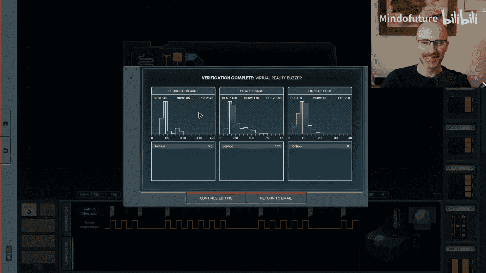

I don't see a way to save me a line。It's unfortunate that we have to duplicate this。

 but I think that's the only way to ensure that we run this code only specifically if we got zero。

And it feels really useless， right， Like it doesn't feel like it should be necessary。Uh。

 is there anything in the instruction， Is there like a。

 there another test instruction we could use here？Now， only compare is the one that does this。🎼No。

 we could we couldn't use T0 because T 0 would treat。🎼Oh， would treat 9，9，9 and one the same。

 which is effectively what we're doing here。 No， we're not， though。 See how for one。

 we also run this line。We don't run that line for minus 999， and that's important。🎼呃。All right。

 think I think we're done optimizing on this one。But it does feel like there's a way to do this too。

It only sends a signal whether it goes 1 to0 or zero to1 no， because we have the cycle in between。

Move zero to act is never run。It is run， it is run because if you good look back at the manual。

The manual says for the TCP。If A is equal to B， then pluses and minuses are both disabled。

So neither of them are taken， and that's what we're making use of here。

Is that this only gets executed if this is equal to0？But， of course， if we have the big thing。

 then we could just use the extra register。 The whole point of rerun it this way was so that we could use a small thing which lacked to register。

 but now we have one line of code too many。Yeah。It feels like it's so close。And if we did it。

 we would be really good， right， becauseuse if we look at if we go back to this。Right。

 we're really good on lines of code。 It's possible to do with less， but not by much。

 We're really good on power usage。 And it's just the cost where we got 5。

But this looks like four to me， if we get it with three， that'd be wild and that would be this one。아。

There are other things here， those like knots and stuff， but。No， I think， I think we're gonna。

 I think we're gonna leave it。 We have to walk away at some point。Okay， we made the buzzer。

🎼I think we're now getting to the point where we're not really learning new assembly things as much as just playing the game。

 which is fine。 I like this game。 This is the reason I started doing this。

 But I think we're mostly now through the sort of。😊，Through the assembly bits， I want to flip back。

 though， to the instruction manual here to show you some of the other things that are sort of oh。

 we haven't used any of the。Digit set and un。 But some other things that are like。

🎼Assembly real is looking。🎼Whereas the if we go further down。 So these data sheets。

 usually data sheets for hardware is like more advanced than this， right。

 it's not usually quite the simple， but it is roughly like this。

 one of the reasons I say this is because I think people sometimes fear embedded programming because they're like。

 oh， it's so complicated。 And， I mean， yes， it is。🎼Less straightforward as writing like programming languages。

 like just writing software only where like you just have to write semi English in the language。

 But it's not that complicated， right， It's mostly a matter of you have a slightly more constrained language for for expressing yourself。

 And also the devices you're working with have rules that you have to follow。

 But they're really just like interfaces， right。And as we see here。

 those rules for the interfaces are not usually that complicated。 There are， of course。

 cases where hardware has like weird properties to them， but which I think is captured， for example。

 for the whereas our。That's randomandom X's memory， which we haven't used at all。Logic gates。

 which we didn't use here， the clock， which we used。Yeah， like things like the clock， which emits。

And a number that corresponds to the number of 15 minute increments since midnight。

 So this is the kind of stuff that like real hardware has these really weird properties。

 but you just kind of need to like read their spec sheet and then you know what the property is。

There are sometimes bug in the hardware where it just doesn't do what it says it's supposed to do。

 That's always hilarious in its own way。 But like generally。

 at least you can just read the spec sheet， and it's just like interacting with any other code base。

 except youre writing assembly code that interacts with pins rather than programming code that calls the library interface。

😊，The Denver Tkeeping story。🎼I'm trying to find， yeah。

 so the other example being here like this network interface。

 which you would assume to be interrupt driven， is not instead you just it always yields a value and the value is just invalid if there was nothing to read not unheard of in the hardware world either where they don't want the thing to be interrupt driven so that it's easier to work from in something in a consuming program that doesn't want to deal with interrupts but as a result。

 you end up with a polling API instead of a pushbased API which would be interrupt driven。

 So I think like one of the things that really got me with this game was the yes。

 it is simplified compared to the real world。 But I think many of the ideas you have to wrangle with are actually fairly realistic。

 like do you want your lowle microcontroller code to be interrupt driven or do you want it to be polebased that feeling of I need to make this fit in the instructions that I have。

😊，In the memory that I have with the pins that I have。

 this sort of constrained environment is very realistic to working in the real world with real microcontrollers。

 Yes， the limits are lower and slightly more artificial， but。

That's like the limits are still there in the real world。 things like the limited number of pins。

 very real number of registers you have available， not quite like you only have one。

 but usually you don't have that many。 many of the end up being taken up for things like function calls。

 for example。So like this does feel like you're not going to learn assembly programming from playing this game。

 but you will learn some of the mental model you need to have and some of the concepts you need to apply when writing assembly code for microcontrollers for actual hardware interactions。

And。Someone else in chat that feeling of damn， I know this should be possible if I did it like with slightly less memory or slightly smaller amount of code or something。

 whether that's common in a embedded programming。And I think the answer is， like。

Kind of the reason I say kind of is because。嗯。You the like， let's say Iop Iops。

 So when you're operating with something like a raspberry pie with a little extension board or an Arduino。

You do run out of pins sometimes。 usually it's not so much running out of pins as running out a specific kind of pin。

 So I forget what the spec sheet is for the raspberry pie， but it has some number of general purpose。

Io pins of the sort of simple Iovari from here。 It has some other pins that can be used to drive slightly different kinds of motors。

 It has like a couple of different types of pins that are general purpose。

 but for different purposes， And you do only have a limited number of them。

 And so once you start like attaching multiple pieces of equipment， You need to start planning， like。

 well， but how many pins do I have for this， do I need an extension board。

 or is there a way I can find to make use of fewer pins or make this thing use a different type of pin than it was supposed to use。

 You don't run so much into。How can I express this with fewer lines of assembly code that's。

Pretty rare these days。 But you do run into the， oh， I only have so much main Ram storage。

 which we haven't really talked too much about here， right but。You know， in a modern computer。

 like desktop computer or laptop computer， you have like gigabytes of Ram， If not。

 at this point more on an embedded device， you often have much， much less。 You。

 you usually this is where in rust， you would get into the the discussion of like。

 do you have access to alloc or not。 Like， do you have dynamic memory allocation or do you not And if you don't。

 you need to do static memory management。 in which case， maybe use an arena allator or something。

 but you have a very fixed memory budget。 And so you can no longer just like allocate randomly strings everywhere and vectors and hash maps to grow。

 Like you actually need to think pretty carefully about how much memory you use。

 And that can become a bottleneck where you're like， well， I need to store， you know。

24 hours of data。 Well， then you need to come up with a more compressed data format in order to do so。

 or， you know，Battery is an example of that kind of limited。

Limited capacity that's not really explored in this game。 You get measured on power。

 but you never get restricted by power， whereasas in the real world。

 writing efficient assembly code is the difference between the battery lasting for a week or a day。

 or an hour， right， So you know if you write a program like some of the ones we've been writing here where you really just have a loop where you sleep for some number of seconds between every loop。

 You're actually going find that you exhaust your battery quite rapidly。

 You really want like an external device for external， I say。

 But really a connected device that is interrupt driven。

 It only wakes up the main CPU and the main disk， which tend to be the battery hogs。

 It only wakes those up when there's something for them to do。 Like let's imagine you are。

 I don't know。😊，Monitoring for。Whether it's day or night。 Okay。

 so there are two ways to write this thing。 You， you probably gonna need a light sensor。

 You could maybe do it based on like the time of day。

 But let's say you're trying to do it accurately。 So you pointed it out your window。 Well。

 assume that you're in a place where there are never clouds and never bad weather。

 But you use use a light sensor that you stick out your window。

 And now you have two ways to write this program。 One of them is you check what the current lighting conditions are。

 And if they are above the threshold for daylight， then you， you know， I don't know。

 lightable an LED or something or if if they're not， you turn the LED off and then you sleep for。😊。

A minute， an hour， whatever you think the fidelity of this timer needs to be。

 Let's say you sleep for a minute。 and then you wake back up， and then you check again。Well。

 now you are running some compute every minute。 And there's also the question of how deep of a sleep can your CPU go into in that period of time。

 Does it end up shutting down like the does it end up shutting down。

 let's say it has a network interface， Does it shut down the network interface if you have like a disconnector。

 if if it's just a flashcard， does a flashcard get like turned off or does it still have some traffic to that card in between。

 you have to figure these things out， but you are waking the thing up every minute to do some compute？

 The other option is if you manage to get a light sensor， that does interrupts instead。

 Because then you could say when it detects like if you could program it to say when it detects that light is more than a certain threshold。

 only then set the interrupt pin and wake up the main CPU， Well。

 now the only thing you're constantly powering is the light sensor， you're not constantly。

 you're not waking up the CPU every minute。😊，You're only waking it up ideally twice a day， right。

 You're waking it up when the diode tells you， oh， there's now more light or less light than this threshold。

As as a result， this is the like， you now have something that is probably going to last significantly longer on the battery because powering just that sensor is so much less power than powering the whole device。

 The whole rest of the device can fully go to sleep in between。😊，🎼And so there's。

 there's a bunch of that kind of constraint driven programming in embedded development。

 So not quite the same as the game， but。A similar flavor。

 a similar feeling is something you can get when working with embedded。Any last minute of questions。

 I think we I think we're at a good point here to sort of。Ty things up and。

 and tell people that if you want to now play more of the game， you can go play more of the game。

 I could also tell you， you know， you could also just like get a like an EP 32 or get a little Arrduino。

 get a like a raspberry Pi Pico or something。 like get a tiny embedded device。 just play around with。

 You don't even need assembly for a lot of the programming for them。 But you can， if you want to。😊。

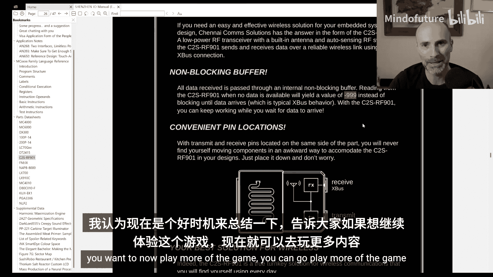

🎼What's the best way to learn assembly， There isn't really a best way。

 Usually the the way I've found learning assembly is the easiest is to either just try to use it for something like genuinely take a rust program。

Have a tiny function you have。 Like I genuinely mean very， very simple code block。

 and then try to write it in assembly instead。 we have we have inline assembly on stable now in rust。

 right so you can open like an assembly block As M exclamation mark curly brackets in rust。

 and then write actual assembly code in line in your rust program。

 Try to write some inline assembly that does the thing that your original rust code did。

 Just see if you can do it。 And you're gonna learn so much by just replicating even a few lines of rust code and see how interesting and frustrating and challenging。

 but also rewarding it is to try to do it in in assembly code。

 And then what you can do when you get stuck is there's a website called Godbalt Godbalt do org。

 I think which which you can give a rust program or indeed a program written in almost any language these days。

 and it will show you what。😊，The assembly for that program is。

 as you could put in the Ru code that you have。And it will sort of tell you the answer right。

 but it will be a very the reason I say answer as opposed to answer is because it will be whatever comes out of the rust compiler。

 which might have gone through a bunch of optimizations。

 So it will do the right thing but it might be more optimized that you would have thought of to come up on your own but often it also isn't you can also tell it to not apply optimizations quite as much and then it might be more comparable be aware though that if you do this。

 you sometimes get a bunch of boilerplate around it like if you use let's say print line in a rust program printline is actually quite complicated。

 It generates a bunch of assembly code that would sort of mask the part of the assembly code that you care about but in Goldbalt can you can look you can click a line in the source code and I think it highlights which assemblymb is for that source line which interestingly is the same information that's used by things like profilers to figure out when they measure how where your program is spending its time when it runs using something like Perf it actually measures is which。

😊，Assembly instructions got executed the most。 and that's the information it gets from the CPU。

 And it uses was known as dwarf's debugging symbols to map those backs into lines of code。

 And that's the same information that Godbololdt uses to map the assembly instructions to which line generated this assembly。

And so that can be one really good way to learn Asmblies。

 just try to write some things in assembly and see if you can。

 And you might find that some things you thought would be simple are really complicated。

 But then other things are actually very straightforward in assembly code。

 especially if you're just doing things like arithmetic， basic loops， comparisons。

 like those things are easy， where it gets harder is once you start like calling other functions can get really like。

😊，Tricky other things like operating with strings can get painful， especially if they UTF8 strings。

 But there's a bunch of like。Things that are easy in programming languages， but are hard in assembly。

The other way to learn assembly， I think is to work with embedded devices where some of the stuff that you do。

 you have to do in assembly。Usually these days， you can just kind of get a crate off of crate Io。

 for example， that supports your chipset。 And that's great。

 Like for anything you want to build for production or something。😊。

That you at least want to be reliable。 You usually want to use those crates as's a much nicer experience。

 But if your goal is to learn assembly， see if you can get the device to like boot up and blink an LED or something。

 just using assembly。 It is possible。 It should not even be that bad。 And you do have a reference。

 which is whichever crate was built for your chipset。

 you should be able to go read their assembly code to figure out how they did it。 But usually。

 especially for something like。😊，Like a Raspberry Pi Pico or like an ESP 32。

 which is sort of the just a microcontroller。They have really good。

 both reference manuals and documentation and code people have written for them because they're so common。

 They're also dirt cheap。 So that is a really good way to just like， get yourself started。

 If you really want to take a deep dive of the rabbit hole。 There's a third way， which is to。😊。

Do something。 So MI T has this class called。🎼Oh， I don't know what it's called these days it used to be called 6828。

 It was a class on operating systems and。Let me see if I can find it actually what it is now called。

🎼U。MIT。It is now called。Actually， 6828 is if you search for 6 dot828， it is still findable。

 but that's the one from 2021。🎼I'm trying to figure out。What it has been renamed to。

Maybe it hasn't been renamed。 I can， at least I can't find the。The replacement for it。 So 6，8，2。

8 operating systems is a great lab。 It it has， So all of the， all of the。😊。

Lecture materials for the class are available for free online。 and crucially。

 all the labs are available online。 And in the labs。

 you program an operating system kind of from scratch。

 At least you implement many of the interesting parts of the operating system。

 and the operating system is one place where you have to write assembly for at least some parts of it。

 for things like setting up the CPU or for things like。😊，呃。For things like doing process switches。

 So if you want to switch from one process to another。

 because you need to switch over which memory space they're in。

 which requires some assembly instructions。 So same thing for setting up virtual memory management often requires some assembly。

 that class is normally， I think taught in rust。 No sorry in C。

 But there are parts of it that are just pure assembly。 But the labs come with like auto graders。

 they come with instructions。 if you really want to dig deep on this stuff and also learn some adjacent stuff about operating systems。

 I would go through the labs of that class。 It's really fun。😊，Cool， I think。

 I think this means that were we're at the end。 It has been。

 I hope this has been fun and educational。 I certainly had fun and feel like I talked a lot。

 whether you've learned anything from it， I'll leave you to be the the evaluators on。😊，But with that。

 I think we're gonna call it a day。 That was Shenz Io is the game we played。

 I think it's 50% off on steam Now， if you want to buy it and play it。

 if the response to this is good， then I will happily do more of these。

 I'll probably switch up the game。 So there's a different game called Turing complete where you build。

😊，You don't even get assembly you just get wire diagrams of circuits so the game starts with here's a Nandgate。

 build all of the other logic gates and then from there it goes like build things like a delay circuit build things like you know what is build a loop and eventually you get to build an assembly language for your own chipet basically so that's an even lower level introduction to like the underlying principles here。

😊，It's farther away from the kind of videos I usually do， which is most much more like。

 let's do rust all the way。 But I feel like this is a useful part of computer science to know that。

It this felt like a good way to teach， but I will also still be doing rough streams。 It's just。

 this is， in addition， it's fun if we're playing games。

 but let me know what you thought and whether you think I should do more of these And if if if enough people do。

 then I'll I'll find other streams to do。😊，Anyway， I'll see you in the next one， thanks for watching。

