# 阅读-LLVM-源代码--BV1XddBY5Ebh-

Let's take a look at the LLVM source code yesterday， at I looked a little bit at GCC。And。

That was exciting and fun。I thought I would take a look at L L VM to get a sense of how they are different。

And。That will， I think they will inform。My understanding of what GCC is up to as well。

So as with the GCC case， again， I haven't looked at this code before。

 I don't even know if I've ever used LLVM or Kang directly。But。

And so I'm going into this mostly blind。嗯。So I'm just going to poke around。

Try to get a sense of what the different directories are doing。And。Yeah。

 just build my familiarity with。With the code base。Okay。

 so I'm looking at their their Gitthub repo I see that they have。A separate place for。

For submitting patches。

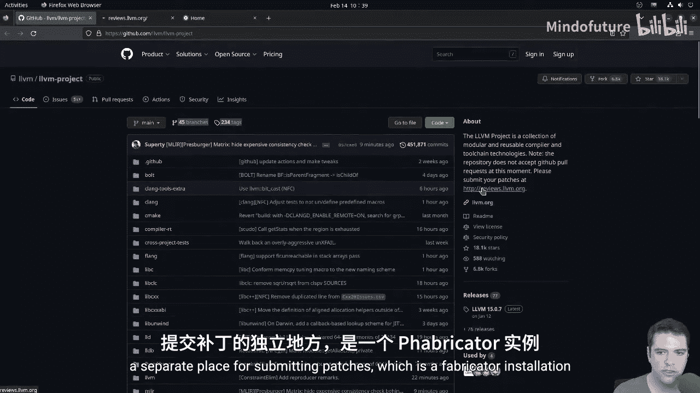

Which is a fabricator installation。I guess I might poke around here in a bit， but why don't I。

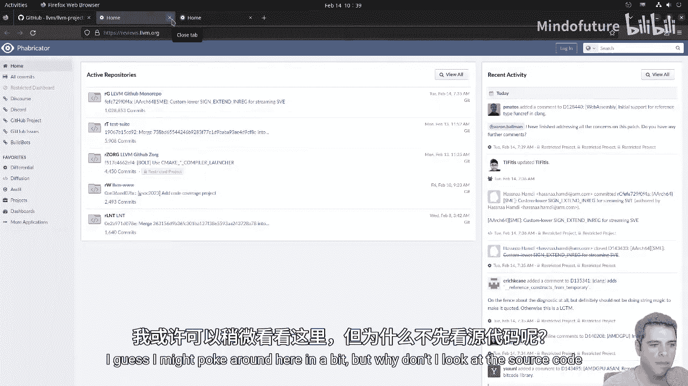

Why dont I look at。The source could， first。Okay， so in here we have， okay。

 so Kang is part of the LLVM project， okay， I was not entirely sure that that was the case。

But it's in the same repo。Let's see。Compilr R T。😔，Flying Lipsy。LLD， I guess， assume is the linker。

Although。Is this。Is this an LL VM specific linker， Okay， L L D。

Is the source code with the LLVM linker， a modular class platform。

 So what is the new linker that's just LD， I think that's just LD。They can do link okay。好 so。

This one is two Ls。I assume the first one is for LLVM。Okay， so we'll look at the L L VM directory。

 There's an L L VM Lib GC， Lib GCC directory。What is LLDB？I don't know。Right。Okay， so。

You're not gonna tell me what， what's going on in this directory。Gcc EsV。

 there's not much going on in the LLVM the GCC。Here's a doc。And。

Enabling Lib Unwind is a replacement for Lib GCC on Linux has proven to be challenging since LibB Gcc that underscore S SO is a required dependency in the Linux standard base。

Some software is transitly dependent on Lib GCC because GLpsy makes hard code calls to functions in Lib Gcc。

 okay？And。So I guess this is building Lib Gcc with LLVM。I will guess that's the case。Okay。

 so let's take a look at this LLVM directory。Examples， yeah， sure， let's look at examples。

Lib project。What is projects？Let's take a look at what projects is resources， run times。Test tools。

 unit tests。And you tellss。😔，Okay， so this is a much。This seems to be a bit more organized。

Then the GCC code base， Okay， contains source code for L VM。

 a toolkit for the construction of highly optimized compilers， optimizers and runtime environments。嗯。

I'm guessing maybe Lib。Is the place to be？I don't know。Uils。😔。

I guess let's look at us and then just out of curiosity see what is thought I。This is。

This is some sort of metadata description of。The project。I'm not sure what it's for。Okay。

 how to use Jit， how to use L L Jit IR transforms。 So these this is the examples directory。Jit。

 I assume is going to be just in time compilation。Here's a demo。Brain half。Okay。😔，Hm。

 is this a full parser？Fbonnaati。Right， what is this Fi。

 This small program provides an example of how to。Build quickly a small module with function Fibonacci and execute it with the Jit。

So I wonder how much LLVM is about。嗯。Its about justin time compilation。

Cause this is what this is a C plus plus file。Initialized native target。

 initialized native target AM printer。So I assume this is going to print the。With ASM。Assembly。嗯。

Then we need an LLVM context， so create some module to put our function into it。

We've got owner new module test context。Great fib function。Okay。

 so what is create Fib function going to do， It's going return a function。Now。

 as function an LLVM thing， I think it is。Okay， so L of V M slash IR。Slash function dot age， okay。So。

It's going to create the Fb function and insert it into module M。

This function is is said to return an int and take an int parameter。Okay， so where does that。

Where does that happen， So function type get。Get in 32， y。DY， I don't know what the DY is。嗯。Okay。

 so this is going to be the fib function。 And I guess that this is setting up the。

The maybe the return value。And the arguments。 So it's taking a。Something in curly braces。

So some kind of container， I assume。Okay， and so。We have Fib。Oh， type is T Y type。Okay。

 so we have the fib type I see。 And then we're going to create the function by calling function create with the type。

This is just a way， I guess， of encapsulating the type information as a single argument。

And function external linkage， I guess， some setting that says to do external linkage。

Fib is maybe its name。 And M is the module that it's in。Add a basic block to the function。Allright。

So we're going to do basic block create on the context。 We're going to， I assume。

 call it entry block， and it's going to be in the function Fb F。嗯。Get pointers to the constants。

To which constantstance。Okay， so that we're going get value 1 and 2。Okay， so these these are the。

 I guess the numerical contents， numerical constants one into two they're building up。

 assume theyre we're going to build it up recursively。

Get points to the integer argument and the add one function。r x。诶。

Get pointeder to the integer argument of the add one function。So this is going to be an argument。

Which I'm going to guess is also y an LLVM。Hm。😔，Type thing。It's is going to be called Arg X。And。😔，呃。

It's that A begin in FibF。We're going to set its name to An A。H。Give it a nice symbolic name for fun。

 that is fun， thank you。And。So we're going to create the true block and create the exit block。

 So we've got return and recur。So， I don't know。What the name of a basic block is。

 is it just for human consumption， I don't know if it shows up in the code anywhere。

But this is going to be return， I guess is is obviously going to return， but that's like the base。

 that's going to be the base case。 and then we have the recursive case。

Create the if R less than equal to2， go to exit BB。So。I comp in。I assume， is comparison。I don't know。

 inst， maybe comparison instance。And this is maybe conditional instance。We're going to pass in BB。

Where is BB， BB is the basic block。Create a basic block。 I this like the outer， the outermost block。

And ICMP SLE。Aga 2。And I guess we're calling it condition。I don't know it。嗯。I compare instance。

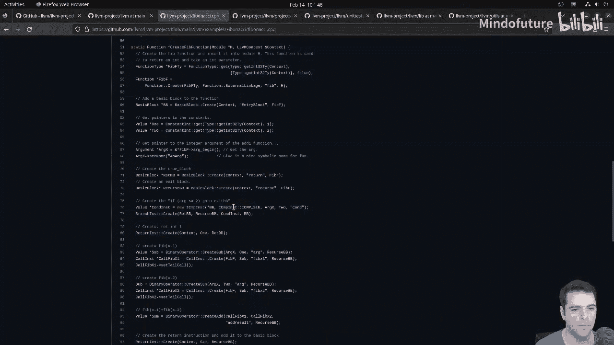

Oh， yeah， okay。 So we're just I compare SLE。Instead of curiosity， I want to know what this is。

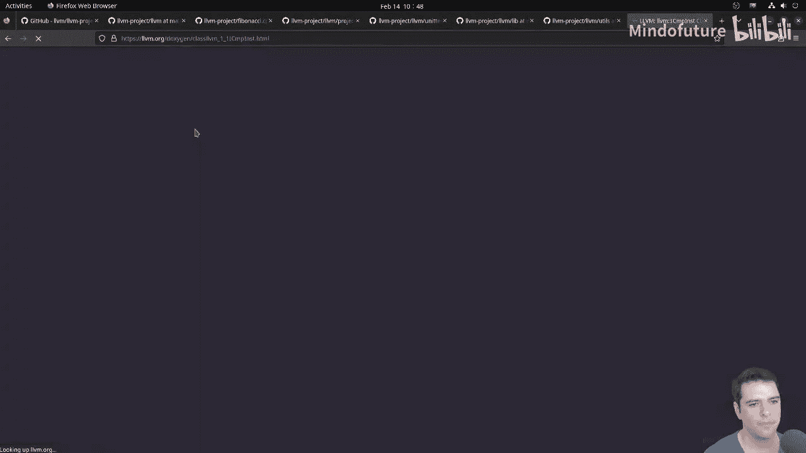

Can I click on this， I compare it SLE。Where is this， this is in doxygen。嗯。

I just kind of want to know what SLE stands for。Signed okay， signed less or equal。

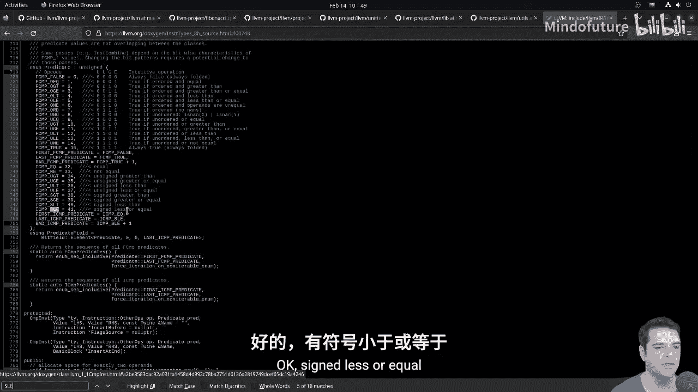

All right， so we're going to do less than or equal。And branch， instant， create。Return， branch。

 recurse branch。系 see。So I guess this branch。We're creating a branch。

And the stuff that we need to create the branches， we need the condition that we just created。

 that's going to tell us what。 you know， logically， when do we branch。We need the basic block。

Which I'm guessing is kind of just like a root node to a tree。

 kind of like a tree that we're building。We need a recurse BB， which was the recursive case。

 and then we need the return case。So。All right， that that that all makes sense。

 I think assuming that I'm under， that I'm understanding this correctly。

 and we're going to create R into one return instance， I assume， create context 1， red B B。 Now。

 what was one，1 was。The constant one。Okay。And then we're going to recursively call。

And we have a binary operator create sub。Rrggax 1， R Cur B B， What is sub。 Is it like a sub function。

And we're going to call callins to create。Ofphibeth。Sub。Fibex1 recur Bb。

Call for anywhere to do set tail call， okay。嗯。Yeah， right。 So we're gonna do a tail hall。

And I guess this is kind of like a sub function。I'm going to look up。

 I can't click on these in Gitthub， but I can search the internet。

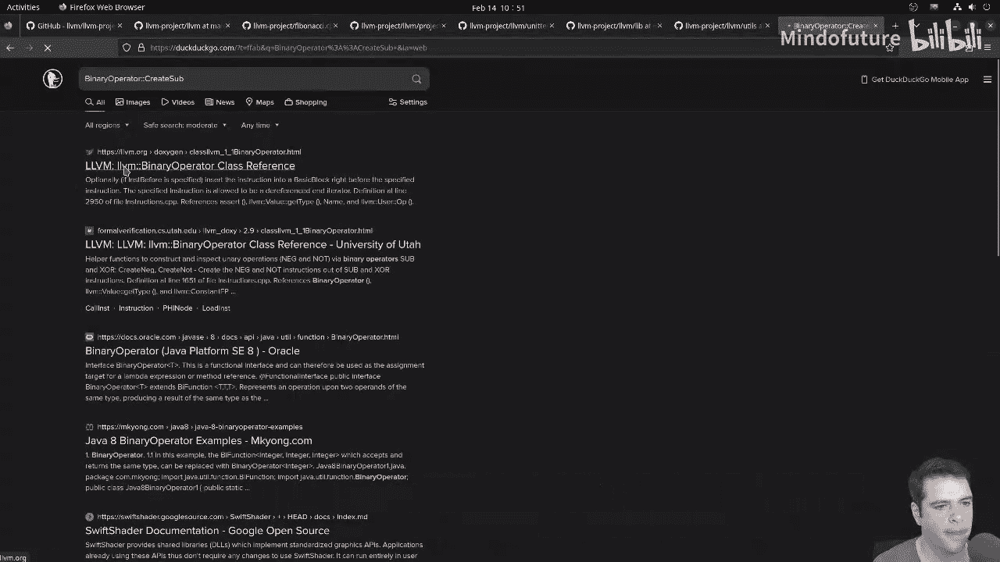

Create sub。

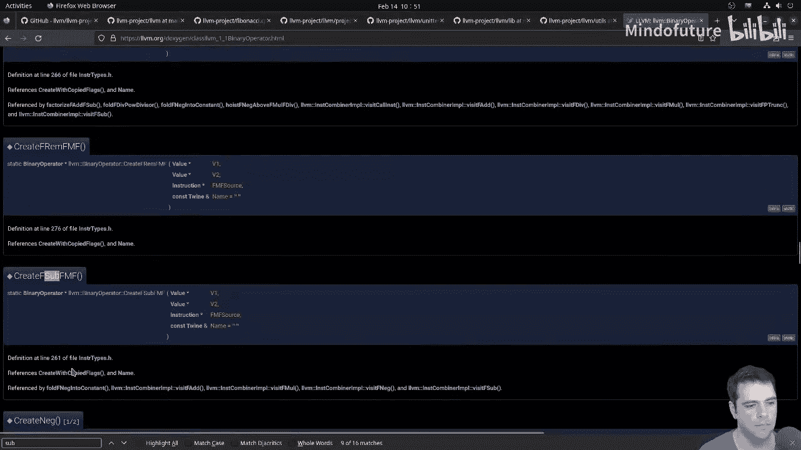

嗯。

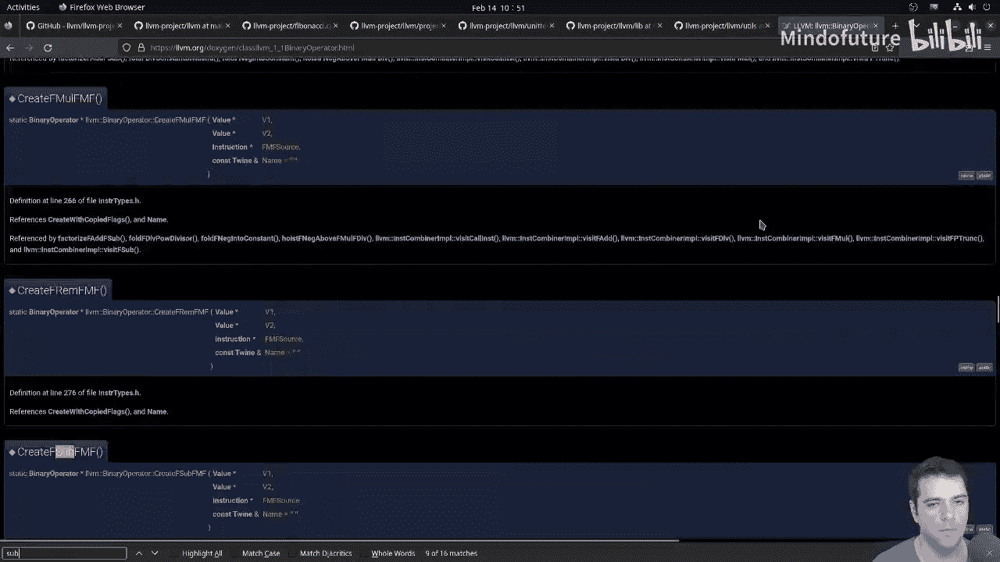

Not sure if that creates sub whatever is a。

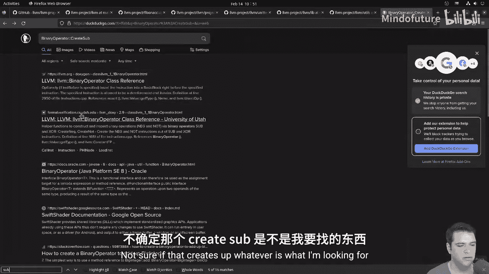

Is what I'm looking for。Oh wait。Let me fix this。Video glitch。Let's try this。Okay。嗯。

No folder create sub。I don't know。😔。

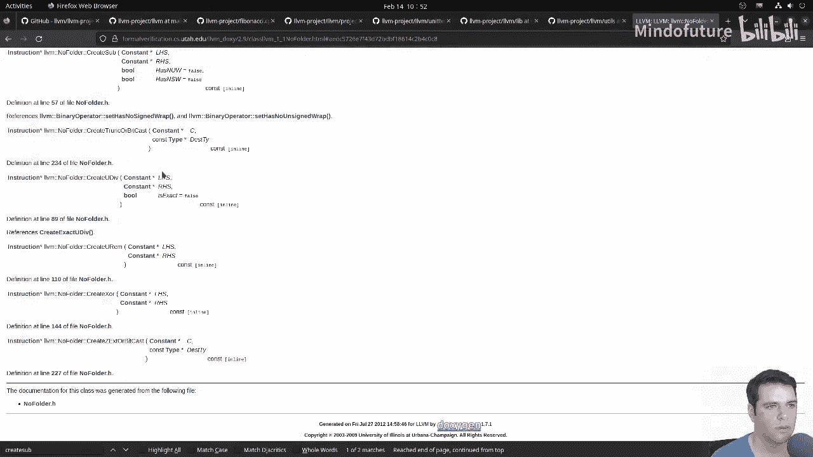

Al right， I'm not sure what create sub is， but I assume it's kind of like a sub function。All right。

 And then we've got this other。F x -2， which is more or less the same thing。

 And we're going to call there sum。嗯。Create add。We're gonna call。 We have a call from Fb 1， Fbex 1。

 a call from Fbex 2。I think we're just going to name it add result。 and we're going to。

What is recur B B doing here again。嗯。Not sure is that where maybe that's where the control returns？

And we're going to call it So， okay， so we've created， I see。

 So that's actually relatively intuitive。What it's up to？

And so it's going to initialize native target， ASM printer。um。

You've got a new module which is just going to be called test。And。What is owner。

Maybe it's a module owner。Were about to create the Fb function， so we call Cre Fb function。

 which returns this function。And。Now we're creating a just J I T。

You've got an aero stringing execution engine。Yeah using that builder。

Reet error stringing and create。We're gonna move the owner。 we're gonna move the owner object。

 It's gonna be owned by the。Eine builder。And then we checked the error condition。嗯。

So is this is this error stringing wait what yet？If not Ee， okay？

So we're not taking the air condition。 We're checking whether we got a。

I guess a null pointing to your back or not as the engine。And then， errors。

We're going to just print out some stuff。 We're going to verify the module。If verify module。

A constructing function。 Wait， so this verify module return。True， if there's an error。

If verify module， okay。嗯。Then we're gonna do。We're putting out some more stuff。

Call the Fibonacci function with argument N。So， we're gonna create。A vector。With as，1。

Arg 0 in value is equal to API int 32 n。Generic value， E run function。So generic value， I guess。

 is kind of like an any type。And we'll see， where are we passing as。 Sorry， we get。Oh， oh， okay。

 sorry， we're just creating the vector here。And then we're assign we're assigning its zeroth position to this particular inry。

So， that's args。Alright， so this run function， I guess， must take in a vector of generic values。

 which are the arguments and a returns to generic value， which is the return type。And then that's it。

 okay， that was actually pretty informative。嗯。I'm a little bit。

Surprised at what's going with verified module。Maybe I'm misreading this code， but。

Kind of looks like it returns true。If there's an error。So let's look at verify。맞아。

They're not type it correctly。Verify module。 Is it defined here。No results in code。

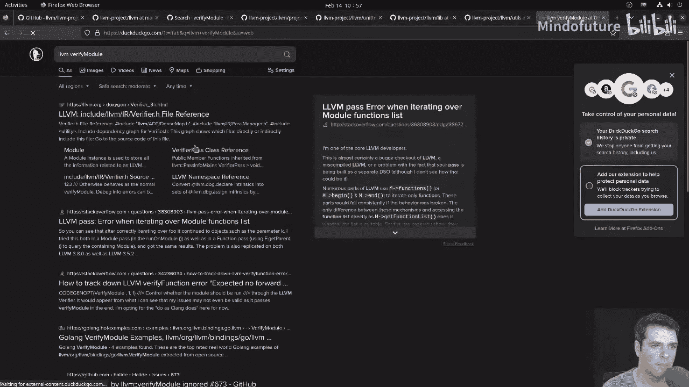

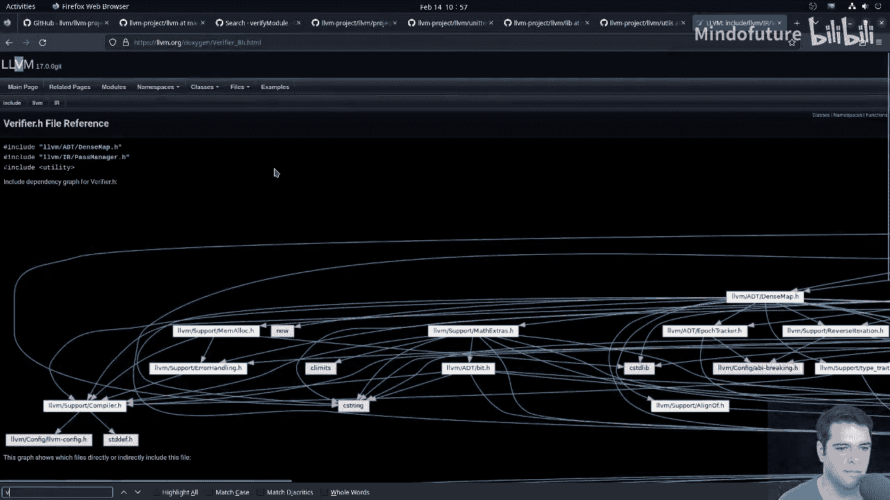

Okay， we go。 check a module for errors。

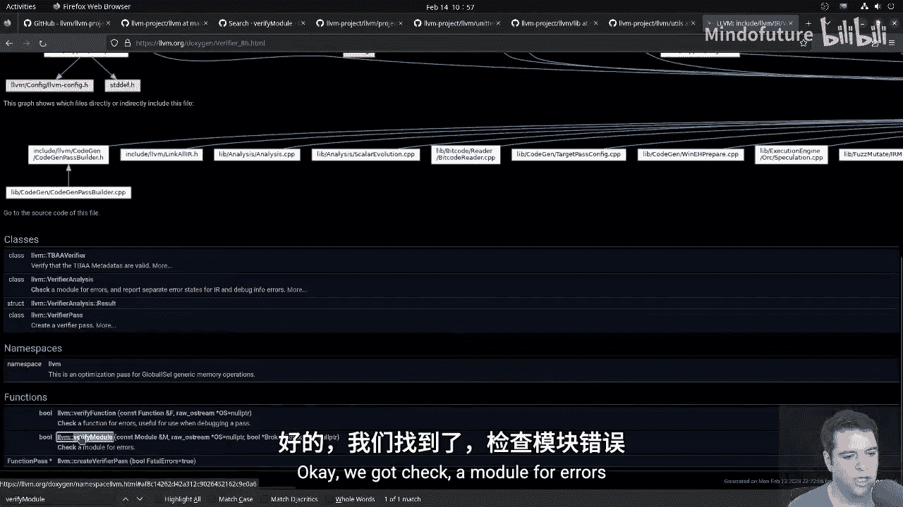

H now。😔。

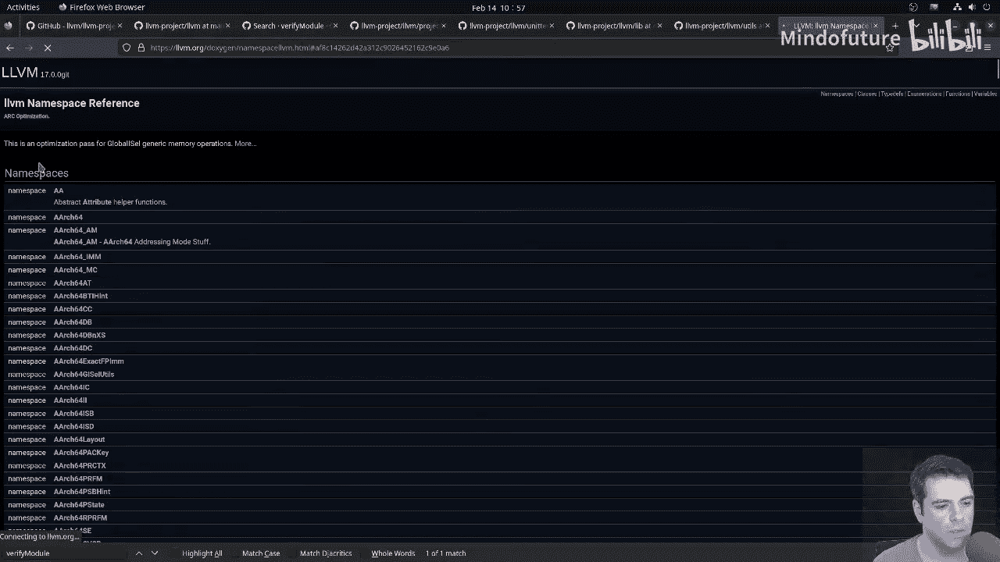

Did I click on the wrong thing。I'm looking at verifier 8。H。

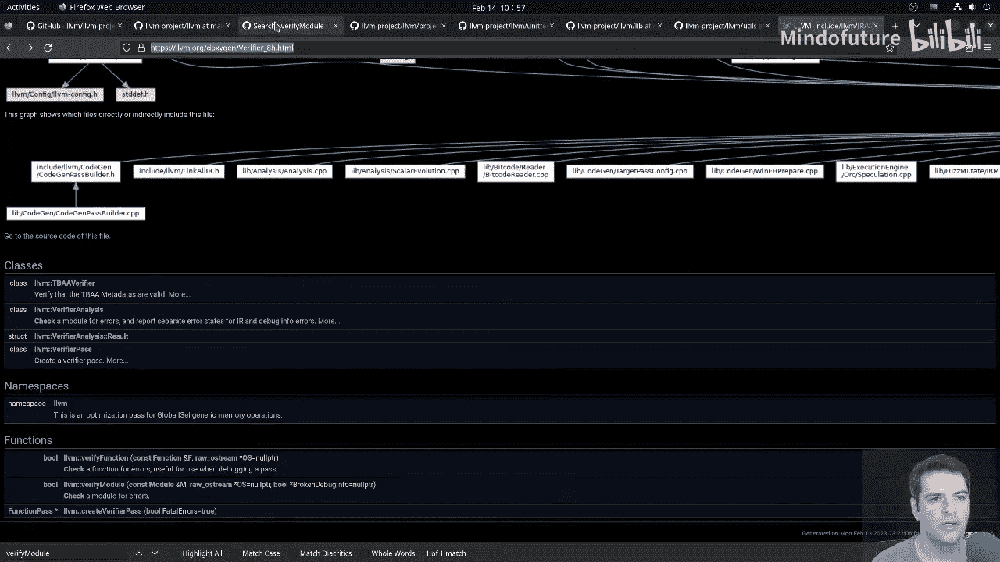

So maybe I can look a verifier。What。Is it in details。

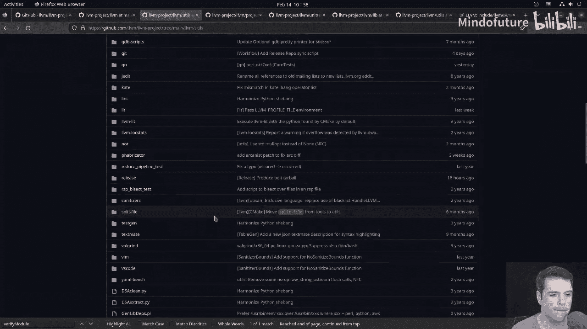

What have we done wrong here。Verifier dot H file reference。 Can I see the source code。Classes。

 namespaces， functions。Include dependency graph for verifier at age。

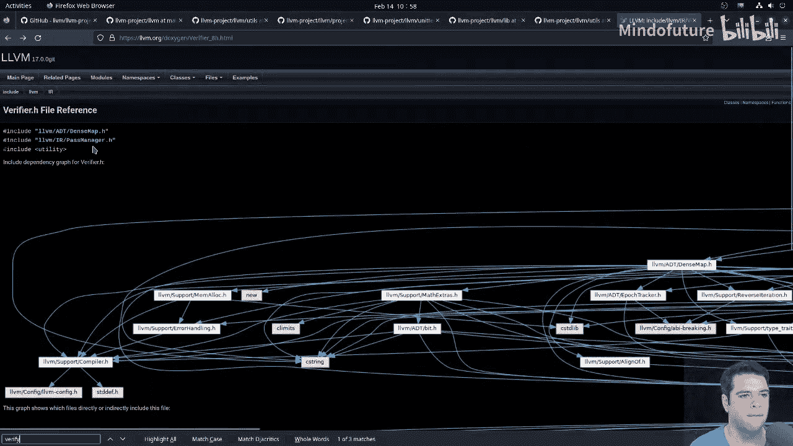

This is just where I was before。

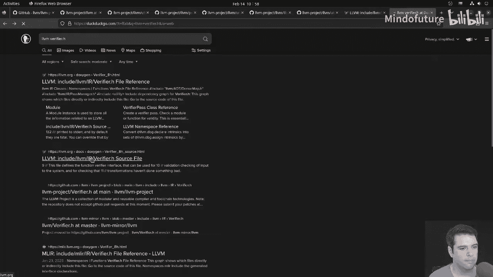

Source file。O。

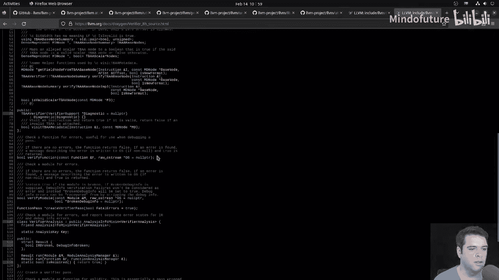

Verify module。Check a module for errors。 If there are no errors， their function returns false。 O。

 if an error is found。A message describing the errors is written to O S if non null and true is returned。

It seems seems a little bit backwards。

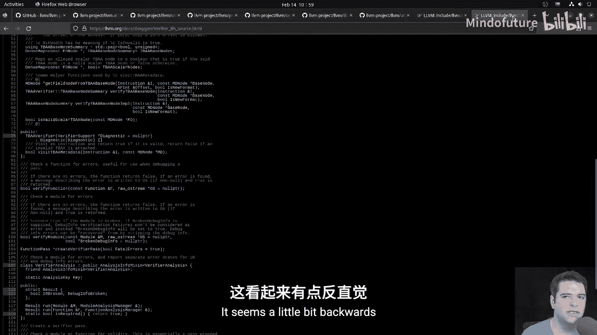

I'm sure that that's a source of。嗯。Of common bugs， as youre writing a。LLVM plug in thingy。

Killed the doctor。Yeah， let's check this out， What is killer doctorates is a u？Could it prevent Dr。

 Watson from stopping tests。A。provides an extremely hacky way to stop Dr。

 Watson from starting due to unhandled exceptions in child processes。Is so what is Dr。

 Watson is supposed to be。Thank you。Why am I finding no code？Nope。

 can't couldn't find any code matching Watson an LLVM project。But onceatson is right here。嗯。

What's going on in Gitthub search。Okay。hoops。😔，Oh， hey。This is a tiny font digs BTW7。

I don't know what's up。I know it' Valentine's Day， so that's exciting。And。I don't know。

 I don't know what Watson is， but I'm going to guess some sort of test runner。The Dr。 Watson program。

Wait， is Dr。 Wason a Windows thing。

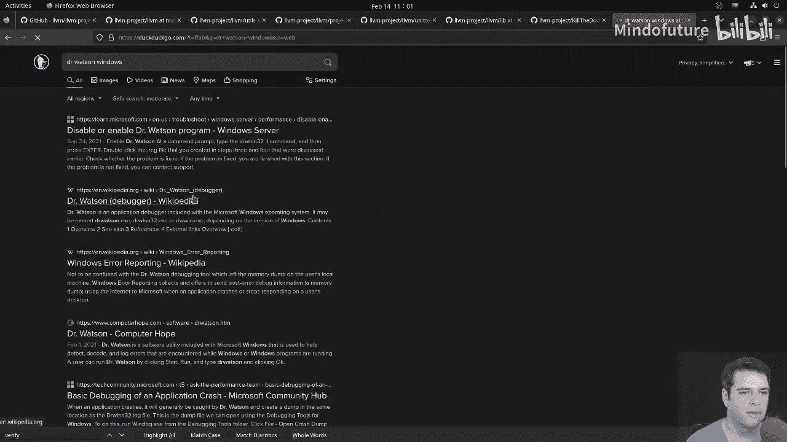

It's a debugger。Yeah， we know it's noon for Sherlock Holmes。Al right。

 it's a debugger included in the Microsoft Windows operating system。

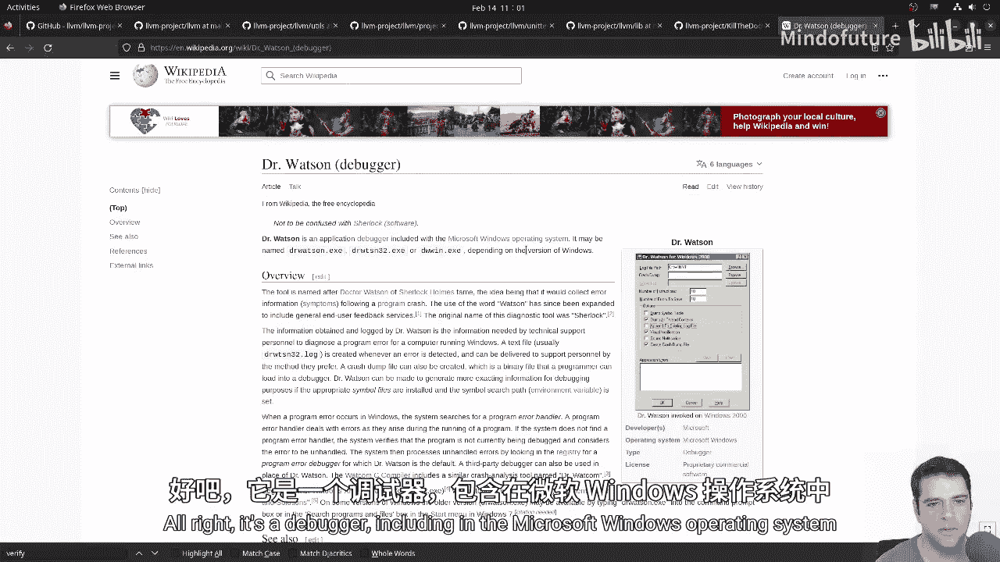

Not to be confused with Stillock。 All right， great。So this is just going to kill Dr。 Watson。Okay。

 cool。 So that basically told me a lot of what I wanted to know， which was。😊，What's going on？

With kind of how how LLVM does things。 And so I guess if I'm going to summarize what what I think I understand from that。

From that example is we're。We have this。C++ syntax for building up。

A generic representation of functions。And it's pretty intuitive and pretty straightforward。

 I don't know what that would， what that gets compiled into。 I'm guessing that。It's going to be。

Some kind of tree。Let's see if we can find out where that is。

So we have binary format format ASM parser， bitstream。codeode Jen， I'm going to guess happens。

After the tree is built up， but maybe we can take a look at that。D mango。Oh is it execution engine？

Oh， no， it's I R。 That's what I want， right？ Yeah， I think so。Option passes。

 Let's take a look at passes， remarks。This is a way of maybe that's a way of annotating the tree target testing。

 tool drivers， transforms。And yeah， let's look at x ray because I already open this。Okay。

 let's go out of here。What are open back here。 Anything interesting us。Perfect shuffle。Visualizes。

 reviewing。Table gen crossed to old count， Emax。I wonder if these are。

I'm kind curious what they're doing with fabricator。 I wonder if like Eax。

 And so there's a bunch of code editing software that I recognize like J edit Kate。

Linnt is not code editing software， but I'll look at the Lin directory。 I think I saw Vim somewhere。

So I'm guessing these are like LLVM supports for these editors。Indirect calls。

 allivviium compilers check。Reduce pipeline。All right。😔，Let's get rid of some of these tabs。Okay。

 so we're in perfect shovel。Genary Nan。So a mask is a four nible hex number。嗯。Okay。

But where are we asking。We're gonna make， we can make a mask。 Oh， is this just， wait， let's see。

 perfect shovel。 So let's see。We can call make mask。

And it's just going to do the bit wrangling for us， I guess。1 times 4，0 times 4。

You can get a mask element。So this is just a nicer interface， I guess too。To doing the bit。

iss it called bit twidling or is that something different for doing all this stuff by hand？

Get compressed mask。Turn a 16 B uncompressed mask where each element uses 4 bits into a compressed 13 bit mask。

 where each element is multiplied by 9。Okay， so you've got a 16 bit uncompressed mask。

Each one using four bits， and we're going to turn it into a 13 bit mask where each element is multiply by9。

But why。4。😔，嗯。M we multiplying by 9。I don't know， I'll have to work that out some other thing。And。

Okay， here's a shuffle operator。It represents a shuffle vector operation。Cost。I'm not sure。嗯。

I also don't know what neon is， but。All right， so see the table with accessors。

So I'm not really sure what's what's going on here。 We're doing some sort of shuffling with masks。Or。

呃。I'm assuming we' were shuffling like。Bits around to do。To do something mildly。Myly fancy。

 But what exactly that's that's doing， I'm not， I'm not quite sure Eax。

These are the syntax highlighting files for Ems and X emAC editors。

 and they're apparently in the listsp。As you would expect， L LVM mode。系 cool。

It's like a giant bunch of giant tables， right so。Special instructions， Phi tail call。

So these are this is basically like a big list of redx's for， oh， okay。Is this how things work in Es。

We get a rex， and then。嗯。That red X is used to map match different。Types like keywords or。

Or operators， okay？Guo。Oh fabricabricator。 Okay， this is。Some sort of fabricator patch。

 Maybe is it a patch to fabricator， I guess so because it's in PP， right。OK。And。Lnt。Are these。

I'm not sure if these arelins for the LLVM code base。

 or if this is tools for implementing a L based on LLVM。Generic code Lnt。

Max line is a max length is a check files to make sure they conform。 Okay。

 conform to the L VM standards， which can be applied to any program language。 Okay。

 so this is Lis for L VM， so。I'm going to ignore that。 would I just reduce pipeline。Alright。

Where is Yp？I don't think I know yap。Google， yep。Okay。It's based off clk format。

 and it takes the code and reformats it to the best formatting that conform form to the style guide。

 even if the original code didn't violate the style guide。

The idea is also similar to the Go format tool for the Go programming language。

And all wholy wars about formatting。 Okay， so it's some formatter。嗯。So this is Python， right？Alright。

 so verify， okay， but what pipeline is this script for automatic opt pipeline reduction for when using the new pass manager NP PMm based around the print pipeline passes。

The reduction algorithm consists of several passes。

First verify that the input fails with the given pipeline， make note of the error code。

Split pipeline into two， starting from front and move forward as long as the first pipeline exits normally。

 and the second pipeline fails with the expected error code。O。

 and remove passes from the end of the pipeline as long as the pipeline fails。

 But what is this pipeline。I don't know， but it's in Python， so。I don't think this is。

And it seems like some kind of utility。I don't know。 that is。 Okay， unit tests。

There are a lot of them， which is good。Just just randomly take a look at the passes unit test。嗯。

Doubr plugin。Pass builder binding test， plugin test。What is the Dor plugin？

So this called doubler plugin， I guess this is a test plugin。Doubler module pass。Pass info mix in。

Double the value of the initializer。 Okay， so we're going to pass in initializer and double it。

 and this is just。A wayed test。I guess a plug in。Register callbacks， pass。Pipline parsing callback。

If maybe could okay， cool。All right， so here's the main Lib directory。

I think I already opened some of this stuff， so I'm going to back out of later。Let's see。All right。

Selection D， aggressive anti depth breaker。I like the sound of that， so let's take a look at that。

Allocation order。ok。Assignment track。 So these， these files are at least named super clearly。 So I。

 you know， when looking at the code， I can tell what they do better than than when I was looking at the GCC code。

CalC spillweights。CFI fix up C inch Iner。Critical antid breaker。Early if conversion。

Execution domain fix。Fault maps。Inlines pillarer。😔，LLVM target machine。Live interval loop traveral。

 yes， sure I look at that。Machine branch probability info。Machine check， debuify machine module。

 machine loop。So I'm wondering if machine here is the like LLVM machine that。Like the， the virtual。

 I guess you would call it machine。And。So I guess I'll take a look at a couple of these Ma sink。

Machine verifier。And。I'll think it look to read me。Red is maybe register。Redge Eec fast。

 eviction advise。Safe stack。There's a shadow stack， whoops。Stack frame， layout analysis pass。

There's a lot of stuff here。I'm just kind of。Bking at whatever looks interesting。

 but here's the read me Common register allocations billing problem。

Whatever the stuff is can be this， and then merge allll and move。So would we merge， Here's the mall。

Okay， how are these different？ This one has a move here。So it doesn't。

And this also doesn't never move。But we've gotten rid of 1，2，3，4，5，1，2，3，4，5，6，1，2，3，4，5，6。Okay。

 it also increases the likelihood that the storm may become dead。

LVM aggressively lift CSE out of loop， sometimes this can be negative。Side effects。嗯。This is。

 I'm not sure that I， that I really understand what's going on here because I don't know what these。

Registers are。Suppose there's a high register supposeupp there's high register pressure。

 R 1 R2 and R 3 can be spilled。 We need to implement proper rematerialization to handle this。 Oh。

 okay， so the loop is going to load。This stuff。And。I guess this is saying that， in some cases。

Other instructions make monkey with the registers and is that what rematerialized means？

That they need to be like put back。Where they were。Yeah， maybe， okay， so。

We're like recompute like down here in loop， we've kind of like recomputed。These values。

It's not only is it going to do to choose re materialization over spilling。

If all the loads store instructions would be folded。

 then spelling is cheaper because it won't require new live intervals。Okay。

I think that's something I don't have to worry about if I'm not writing a compiler with with copying with a copy and garbage collector。

 derived pointers must not be retained across collector save points。

The collector could move the objects and validate invalid the derived points。 Okay。

 so so if we have a car a copying garbage collector。

 because that means we copy the some of the values that were potentially going into garbage collect。

Derived pointers must not be retained across collector safe points。

So I don't know what collect your safe point is， but I guess it's。

Place where the collector can do things more freely。And across some boundary。

It can't make as strong guarantees。The collector could move the objects and invalid the derived pointer。

 so if you move stuff too much， you can invalidate pointers。Drived winters。

This is bad enough in the first place， but save points can crop up unpredictably。Unpredictably。

consider。Whatever this is， arrays， load。Good element。If the I64 division is lowered to a lib call。

 then a safe point will or must appear for the call site， the collection occurs。

To fix this is the copy address calculation so that dependent pointers are never live across it This is。

 this is actually pretty nice documentation because。This is， you know。

I guess this is going to somewhat prevent somebody who is new to the code base from introducing a subtle bug。

That。That that has incorrect behavior， even though it seems like it would be a reasonable thing to do。

Okay， the Ocal frame table structure supports liveibness information， it would be good to support it。

Okay。The schedulers should also be able to sort nearby instructions by their address， for example。

In an expanded Mens sequence is not common to see code like this。 Whatever that is。

 Each of the stores is independent in the scheduler is currently making an arbitrary decision about the order。

So it should be ordered instead。I think is what it's saying。All right。F times。 al right， selection D。

 okay。I's a bunch of stuff here。I'm not going to look at all of it legalized Ag。

I have to look at legalized Dg and legalized types。But also want to look at target lowering。

All right， this reimples the target lowering class。Is position independent？The target machine。

 what does it mean to lower a target， though。So is it intail call position？

Checks whether a given call as in tail position within his function。 If so。

 it says chain the input chain of the tail call。Conservatively require that the attributes of the code so attributes of the call to match。

那 sure。Set call lower， set call lowering info info attribute flags based on a call instruction and called function attributes。

So。I don't know lowering。 I don't know what lowering is。

 but I can at least take a look at maybe what's going on here。So。😔，We're collecting a bunch of。

 I guess， bulloles。 call parametermeter has attribute。 parametermeter has attribute。嗯。

And these are all。Being saved as variables， if is swift a sink。Is swift self， okay。

And what are we doing with all this information？Supposed to is in。Alllaa。Is this ever called again？

The only one match，103。O。We we， we can set the attributes。If isn't alaa indirect type。

 call get perm in alaa type。So is this doing just some kind of dispatch based on， based on these。

Based on these bulloles。I don't know。Maybe。😔，But the code is definitely very readable。Or at least。

Yeah。For for something that's complicated， especially， keeps track of the state。What am I looking at。

Legalize dag。 Okay， let's find out what it means to legalize a dag。So we've got floating sign as int。

 this keeps track of the state when getting the sign of the floating value as an integer。

It takes an arbitrary selection da as input and hacks on it。And the target machine can handle it。

 okay。So I see。So this is actually kind of interesting。Well， I think so what is a selection tag？

I don't know。 So this involves eliminating value sizes that the machine cannot handle。

 promoting small sizes to large sizes or splitting up large values into small values。

As well as eliminating operations。The machine cannot handle。 So if we have a target machine。

So we have some directed acyclic graph。Which that I'm going to assume for now is a representation of the program。

In in the intermediate representation。And。We have to make sure that。

I guess we have to make sure that it's not doing anything that that the target。Machine。

 which I'm guessing is maybe the architecture， like I 86 or or arm。Or spark or whatever。And。

That we can generate assembly。With the that's legal。

 and so I guess that's why this is called legalized DAg。

This code also does a small amount of optimization and recognition of idioms as part of the processing。

 for example， if a target does not support setCC instruction efficiently。

 but does support BRC instruction， this will attempt to merge setCC and BRC instructions to BRCs。

So is a class？We've got a selection D。You've got the target machine， target lowering。

We've got a set of nodes which have already been legalized。These are the legalized nodes。

We hold a reference to it in order to update as necessary on node deletion。

 and we have a set of all nodes updated during legalization。Okay。And we've got the function。And。

No this is what this is a constructor。Selection， dag， legalize。And。You have legalized op。

Legalized store ops。And。Return of vector shuffle operation。

 which performs the same shuffle in terms of。Order and result bys。

 But on the type whose vector element type is narrower than the original shuffle light。 Oh， O。

 this must be what the shuffler is up to。So if we're shuffling around like。Bid vectors of length 16。

Then and that's not supported by the target architecture。 then I guess what it's trying to do is。

Give you the same shuffly goodness。But with a smaller or larger type， which will involve。

A lot of really fiddly。嗯。Bookkeeping。😔，Around。Making sure that you're doing things correctly。

That is my guess。Okay， shuffle with narrower element type。Expand F。Expand Lib call。

 expand FP Lib call。Modify sign is int。Replacease node， replaces node。

Shuffle with never element type。 Okay， so let's at least take a quick look at this。Okay。

 so we've got。Some good vector number。 we're getting the number of elements。

Assert numb elements growth and cannot promote vector type with fewer elements。Okay， so if。Hi。

So what is it doing here？You've got some stuff with masks， new masks， push back。Return dag。

 get vector shovel。Okay。Expand constant FP。Perform insert vector element in memory。

 Some targets cannot handle a variable insertion index for the insert vector element instruction。

In this case it is necessary to spill the vector being inserted into memory。

 perform the insert there， and then read the result back。All right。Okay， legalized load ops。

Very cool。Legalized types。So I guess this is doing the same thing as。As the other one。

 except for types。All right。Okay。So。LVM Library visibility， DAg type legalizer。

It an arbitrary selection da as input and hacks on it， weight。不是。Legalized types until wast I just。

I was looking at legalized dag， right， So what is this doing with types。Okay， until only value types。

And it's gonna hack on it until only value types of the target machine can handle our left。

 This involves promoting small sizes。Okay。This seems like a subset of legalized da。嗯。

Aggressive anti depth breaker。This implements a register antidepend breaking during post RA scheduling。

 it attempts to break all anti dependencies。Within a block。 so what's an anti dependency is that。诶。

It it means。A condition that that can't happen。 that can't hold。We me see if this is a thing。

And I can look up。And anti dependency is an example of name dependency。

As renaming variables could remove the dependency to the next。

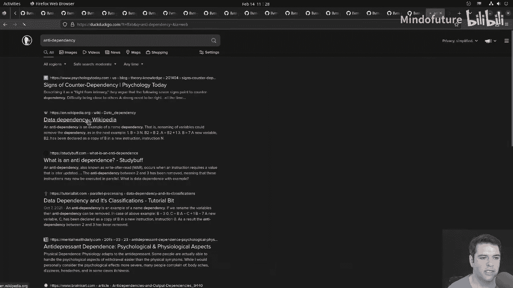

situationly the program statement refers to the data。Of a preceding statement。In a compiler theory。

 the technique is used to discover data dependencies among statements。 Okay， so we just， I guess。

 walk through the statements and see which variables it refers to and that creates some sort of tree or graph。

 So three cases exist。 anti dependency。 if what is I I is a set of memory locations read by S I。

If the set of memory relocations read by statement 1 and the set of。嗯。

Output locations written by S2 is non empty。Then S1，arrow S 2 and S1 read something before。

S2 overrs it。Why is this antidependence？So。😔，So as one reads something before S2 overwrites it。Oh。

 wait。 Maybe this is another condition。 This is not like Van S1。Implies as to maybe S1 depends on S2。

Oh okay， an anti dependency also known as right after read occurs when an instruction requires a value that is later updated。

And the following， it requires the value that is later updated。 Is that good， Is that not good。

the following instructions two out dependencies。On In 3。

 the ordering of these instructions cannot be changed， nor can they be exceeded in parallel。

Possibly changing the instruction ordering， as this would affect the final value of a。

 So we're going to set B to 3。We're going to set A to B B plus 1 and B is equal to set B equal to 7。

 I guess， is that what it means。I don't know。😔，Mall r three or one or two add or two or five or six。

It's clear that there's an antidependency between these instructions at first we read R2 and in second instruction we are writing a new value to it。

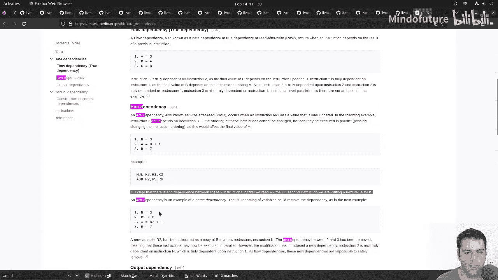

All right。So we're going to aggressively break。Anti dependencies。

So we've got a destroy union data structure。To form register groups。

 a notice represented by an index into the vector， a notice can point to itself to indicate that it。

Is the parent of a group or point to another node to indicate that is a member of the same group as that node。

 Okay， so this is a standard destroy union data set。For each register。

 the index of the group node currently representing that group that the register belongs to which to0 is always represented to the group。

And。We're going to map registers to all the references in live within a live range。 Okay。

 so we've got this union， this destroying union data structure。And it's going to， I guess， sort。

Names or nodes into。And。Djoined classes。What if union groups union register one and register two groups to form a new group？

And we can leave the group。Okay。I'm looking at the header file， right？

So let's see what the actual implementation does。Aggressive anti depth state。

Kill andicey initialize a vector to indicate that no registers are live。First。

 everything starts in its own group。I guess this is the initializer right。

 so you can get group union groups。Is live。So we're gonna create。

 collect the bits out of all registers that are only broken if they are on the critical path。For。

HHow did they know whether critical path R Cs or I guess you do stuff and add stuff to the critical path。

Bid vector， CP P set allowables set blah， blah，la， critical path set， none。 do this。Okay。Start block。

 finish block， observe。Is ob get path through res， pre scan instruction。If Regdge is current live。

 then mark that it can't be renamed as we don't know the extent of its live range any more。

 Not that it has been scheduled， now that it has been scheduled。 If it is not live。

 but was defined in the previous schedule region， then set its def index to the most conservative location。

 That is the beginning of the previous scheduled region。Okay。😔，As implicit dephews。

Get past through eggs。Handle last use。It's like going on and handle last views。Precr instruction。

 I'm going to zoom out here just to see kind of the shape of what's going on。Here's the break。

 I think this is the， the， the break anti dependencies function。

Identify added dependencies within this schedule dig and break them by renaming registers， okay。

So doing some setup。Track progress along the critical path through the S unit graph walk through as we walk the instruction this is needed for red classes that only break critical path anti dependencies。

嗯。So。All right， fine。Then we have a bit vector of ra aliases， which guess is register alias。

 attempt to break antidepend edges， walk through the instructions from bottom to top。

Tackling information about liveness， as we go。keeping a。And。Keeping a。

I think I've gotten disconnected。

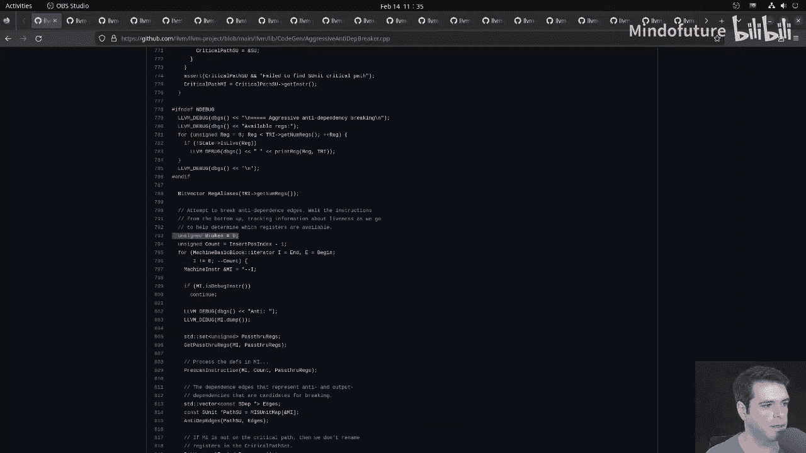