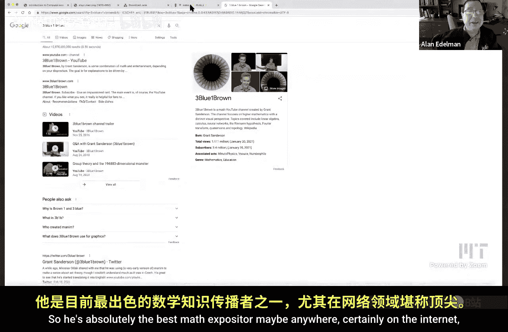
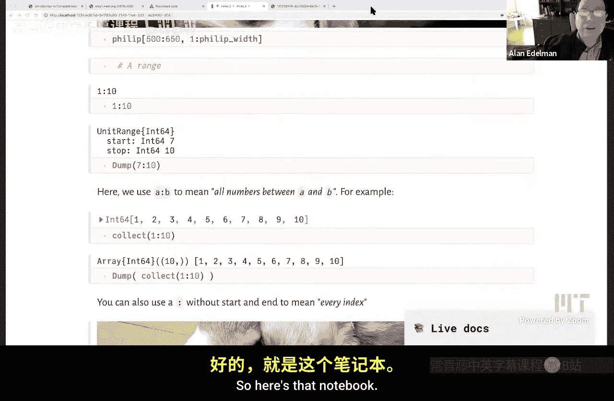
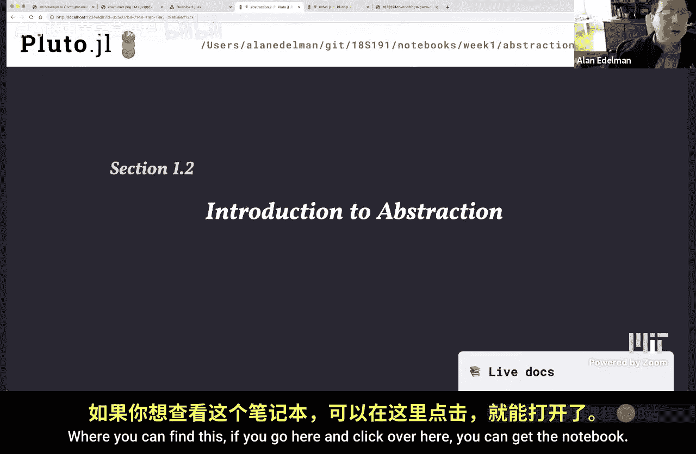
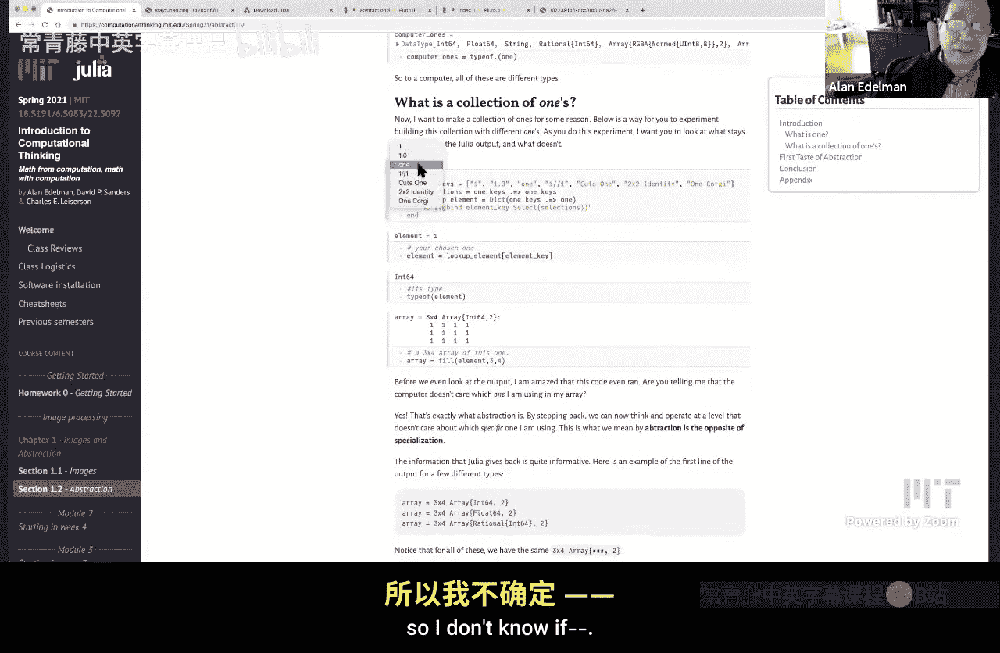
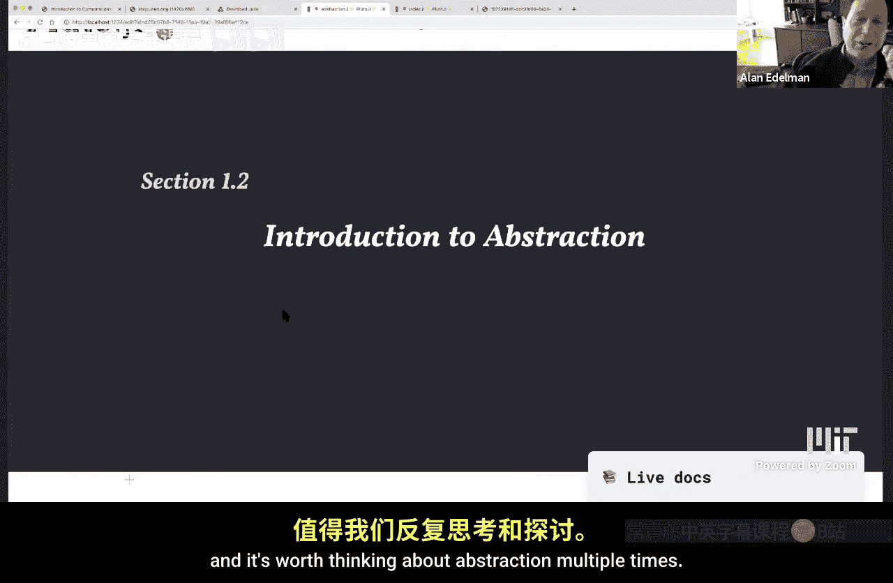
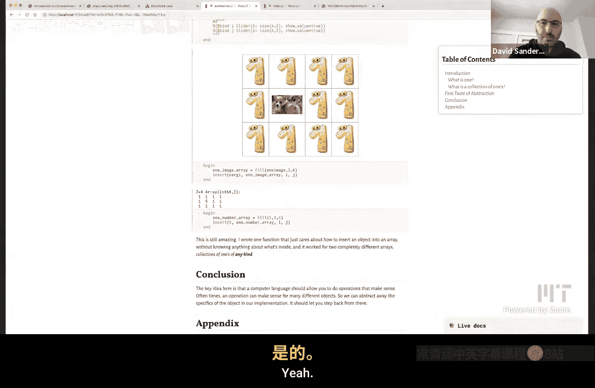

# 麻省理工学院【中英⚡计算思维 ｜18.S191⧸6.S083 Spring 2021, Computational Thinking】 p01 P1 Course Welcome + Intro to Arrays & Images! MIT Computational Thinking Spring -BV18EqQBQEF3_p1-

Hi everybody out there in internet Land and MIT students as well， can I just get a quick sound check。

 please for somebody on the Zoom meeting？Yeah， you're good， Okay， great， thank you so much。😊。

And a couple of logistics， this course is available to the public on YouTube and the MIT students get what you might call the premium experience so the MIT students are participating on zoom for the public we have a number of ways you can participate with the class theres a Discord channel you probably already seen the link over here you could also ask questions directly on YouTube and we have people monitoring both of those things for the MIT students in addition you can also use the zoom chat and we have somebody monitoring that as well now for the MIT students。

You。If you speak i'm not sure your voice will be broadcast live on YouTube and possibly if you share your camera it may or may not we experimented with it and we think we said it to not do that but we can't be sure so for the MIT students if you don't want your image to be seen or your name to be seen then you should probably only ask questions directly in the zoom chat right if you don't mind then you know you can speak and by all means you know we'd love to hear your voice but at some point we'll have to get probably in some retrospect way we're going to have to get your。

😡，Permission for a release， but just be aware this is live broadcasting and so anything you say will be heard live。

Okay the plan we're going to try this is a bit of an experiment like everything this year what we're going to do is we're going to approximately broadcast to the public for about maybe one hour so that would be maybe till about two o'clock Eastern time and then for the last half hour the MIT students we're going to stop broadcasting and for the MIT students we're going to invite you to speak freely in the zoom ask questions interact with some of the programs and you'll have all of us to kind of hold your hand and work with you and I think you'll enjoy that。

Now。What if if some of you might have come last semester and in fact， you couldn't。

Look over here and see the the whereas the previous semester is this is the fourth time we're teaching this class。

And what's new this time is we are in effect writing a book。

 but not the traditional way of writing a book， what we are doing is we are publishing on the web the very notebooks that we are using in the lectures。

 so you can see that today the plan is to go through section 1。

1 which is working with images and arrays and section 1。2 which is abstraction。So。

This you can just read it which is sort of the easiest thing to do you can just you know go to a web page and anytime you like and scroll down and see what we are going to do you can also interact with these things so i'll show you a fun if I might sort of skip ahead for example anybody on the web can enable a webcam right and you can wave and then if you press this picture thing you could you know you can see a kaleidoscope of your image right and so we're going to be putting a whole bunch of these sorts of things。

Directly on the web but at the moment you won't be able to edit code right so you could try to edit it but nothing will happen right you can click over here but you can't edit code so if you want to run with us and I strongly recommend it what you should do is click over here and follow the instructions and basically there's three choices the first I just described you can just work on the website do the easy thing the second is you can click on binder I don't love binder because it takes so long to start up and it's even slow after it starts。

But it does have one feature which is you don't have to set up anything， it just works。

 so you could click on binder and you'll be able to run this notebook without any setup whatsoever。

The preferred method， and certainly I would encourage the MIT students to do this if you haven't already is to set up。

What you do is set up Julia first of all and we have a little thing here on how to do it but I'll just turn it into a quick one。

 two three in case you haven't seen this before if you want to set up Julia just go to Julialang。

 org and download version 1。5。3 okay and this turns to work pretty well so just pick your operating system and just get it and get it going and probably you won't have any troubles I think these days 99% of people who try it if not more have no trouble whatsoever setting it up on their computers it didn't used to be like that but these days it's been pretty good so and then。

Yeah， so so get that then when you're in Julia you have to get a hold of the Pluto package and then you go Pluto。

run， so Pluto is the notebook that we're running on and we have the author of Pluto I think is even on this call his name is Fonzy and his name is Fz and he's on this call but you can't see him。

But he is on this call and all you have to do is paste the URL that you copy up here into Pluto and you'll be running as well。

 so I hope you can follow along it takes a few minutes to install packages the first time。

 but once you have those packages everything runs。Very well。If I can ask my。

If I can ask my assistance， is anybody posted anything in Discord or the Zoom chat？

Or otherwise or the YouTube that's worth。Sharing with everybody。If not。

 let me do a quick introduction to the various professors who are teaching the class and just very quickly because I love to delve into the material and then the MIT students will have a chance to speak personally afterwards so let me just go quickly in the order that I see them in my zoom thing here so Dave。

 do you want to turn on your video and just say a quick hello。So。So。😊，Can you see me， I see you。

 I don't know if the world sees you yet， but there morning。Yeah， I'm David Saunders。

 Co Profe on the course。And visiting MIT for the last couple of years working in the Julia lab with Alllan。

Great， thanks， Dave and Charles， do you want to say hello。

 do you want to share your video and just give a quick high？So yep， great。I don't hear you， Charles。

Yeah， I'm afraid we don't hear you， but that's Charles Lyson everybody。

Yeah so Charles is waving but we don't hear him so many of you will know Charles as the author of one of the most famous textbooks in algorithm go how's that oh perfect there you go Charles go ahead so so this is the first time involved in this course for me and I'm looking forward to learning everything there is in the course along the students as we go on and hopefully contribute in some other ways。

Great， thanks Charles。And maybe we could quickly introduce fundss if you want to。

 do you want to say hello Fo Foz is the author of the Pluto notebooks。Yeah。Hey。

 so I'm Falls and I am very excited about the technology behind this course。

 so what we're trying to do is really have the textbook come to life and the homework exercises respond to what you're doing。

 so I hope that you will have a good time this semester。Okay， and Bla。

 do you want to say a quick hell， Bla is serving as the graduate student TA for this class。Hi。

 I'm Bla， I'm a physics student， the MIT graduate student。

 and I'm happy to be helping out and interacting with some of you。Great， and let me just see if。

Let me just see if my little Corgi friend who is also there he is well you can see part of him anyway so that's Philip the Corgi wholl get to know through through the notebooks and through live so I will often be starting the lectures by saying something like when I'm giving the lectures it I'll say hi it's Alan Leman and Philip the Corgi so there's Philip kind of curled up over in the side over there okay a little bit of administrative stuff for the MIT students as far as sort of grading goes you'll see there's homeworks and these MIT X problems these little short problems that you can start with homework zero right away which is over here so this is basically just to make sure that you can hand in the problem sets through canvas other than that there are a few fun problems that that are not required but you're certainly welcome to try them you might have fun playing with these things but these are the optional parts the main。

Part of the homework is just to sort of go one plus one essentially and hand it in or multiply x by x and get the answer。

As far as grading is concerned， there's it's basically that the MIT X and the so it's 80% the problem sets。

 20% the MIT。X， we're going to drop your lowest score and otherwise there won't be any finals or tests which are very difficult to do anyway in a computer class like the one we're doing and certainly very hard to do during a pandemic。

So other than that， I think i'm ready to start so I don't know if there's any questions。

 but for the MIT students， if there are questions， it could also be taken after the。You know。

 after the two o'clock Eastern time。So let me jump right in， I think， and start with section 1。1。

 but before I do， let me just say a few words as to what we are really trying to do in this course。

Okay and this class I've been trying to do something that I think is maybe a little bit different from other classes。

 maybe not maybe the students can tell me， but I've always been interested here let me just put this right up in computer science and computational science working together that's kind of been my hope for a theme for this course we have a bit of a motto which is math from computation math with computation over here but really I want to focus right now on computer science and computational science because I think we live in a world where both of these subjects are more and more coming together so when we think of traditional computer science。

You know I'm not about to get some stereotypes that are probably not completely true they're not even completely fair but just to sort of give you a sense as to what do I mean by computer science versus computational science so usually when I think of computer scientists I can't help but think of people you know who who like the first algorithm is sorting right sorting is like the big algorithm the big poster child for an algorithm and computer science it's certainly not the only algorithm and i'm being a little silly here but I tend to think of discrete algorithms。

I tend to think of。You know know， I tend to think of if there's an application to sort of the physical world。

 it's sort of as part of a bigger thing， you know， compilers， computer languages。

 this is what I think of as in the context of this course for computer science。

But when I think of computational science， I tend to think of applications to the physical world where where you know the computer scientist。

 I have a lot of computer science theory friends， I think of myself as one of them。

 computer scientists the theorists love to prove things the computational scientists are happy to prove things that people like mathematics and computational science。

 but really if an algorithm runs fast and nobody understands why that would be better for a computational scientists then an algorithm that's。

That you know that's provably polynomial but actually runs like you know really really slowly okay so computational scientists tend to be more interested in modeling physical systems and seeing just how fast they can get their models to run so we'll see more about that in a minute but of course these these lines are blurring anyway maybe they were always blurry and they're certainly blurring more and more。

These days， but I think it's sort of obvious that in a world where we know that the climate change is a big。

 big problem， something we have to worry about， the physical world is impinging upon us right now and it's going to become more and more important in computer science if it hasn't already been so there's the climate pandemic modeling obviously has been very important and during the last year。

 there are other sort of physical models that are affecting us as a human race more and more and so it becomes very important for computer science and computational science to work together and so maybe I'm spending a little bit more than I should on introducing the class but this is what we're trying to do and of course we're doing it with the Julia language。

Because we all love the Julia language and so I wrote a little essay I'm going to put these essays in from time to time。

 you could take a look at these essays yourself， they're kind of editorials that just you know my own opinion。

But Julia is up and coming， it's becoming very much the language of computational science these days。

 and we just like Julia and we're hoping that you're going to grow to like it as well。Okay。

 with that， I think we can really start， let's just see if there's any。Any questions at all？

I'm so used to seeing an audience of students where somebody will raise their hands。

 but maybe I just continue。Okay， so let's go on today's lecture is。The first there's a 1。1 and a 1。

2 the 1。1 is about images， 1。2 is abstraction and images is in part a chance to sort of。

Say some obvious things about data， but it's really a getting started with Julia。

Notbook that's really what the purpose you know a fun getting started with Julian notebook I would say is images。

 and then 1。2 is a computer science idea。 It's abstraction and I didn't want to wait for the computer science idea I think it often comes too late much later in a lot of courses。

 and I thought that we could start with abstraction right away because this is the principle of abstraction is one that is not always found around in computer in computational science。

 Comp science are sort of usually the ones that are better abstractions in my experience lots of exceptions。

 of course so that that's the plan for today and so I have to let's grab the。

Let me grab the notebook。So I've got this notebook over here。

So it's loaded on my local machine and i'm going to run on my local machine and i'm going to start with images and arrays and you could see the table of contents up here on the right and you could do the obvious you can click around and move around the table of contents so all right Ive very pointed you to my little essay and I gave you my。

My speech about my soapbox， if you will， about computer science and computational science。

And let's delve right into data Okay， so if we talk about applications in the real world。

 we are often talking about using data， you know information we can measure in some way。

And of course data has many different forms， numbers can change over time so you know you could have stock prices。

 you could have a weekly number of infections， you could have the earth's glow average temperature。

 these are some examples we're inviting you to think of two other examples of a time series things that change over time data could be in the form of video you know the video from a window of a self-driving car。

 a hurricane monitoring station， you know or you know you know a baby you know is you is in an ultrasound format right a prenatal baby Helen can you zoom in a bit on the Google absolutely but now that you spoke to。

 you have to give me one more example just for fun。Just so that everybody hears another voice。啊。

A soap opera on TV that you want to analyze the patterns of use of language from。

That ought to be easy。I don't think it's how do you see no I always I used to watch my grandmother watching soap operas when I was a kid and they all looked alike。

 so I thought that I'm feeling that this is a very one dimensional pattern。

 but but probably you if you if you look at the language the use of language。

 for example different soap operas all use you know different kinds of words or different numbers of possible words。

 I think that could be quite interesting。😊，No there's a research opportunity right there okay so that's a video I guess it's also an audio the way Dave's describing it and then of course images。

And as in healthy tissues or pictures of your favorite dog， which you will see that I'm very。

 very partial too。OkayAnd so there are lots of processes that will come up when you're doing computational science and this stream is not quite perfect as written。

 but I wanted to get all the words up there but sometimes some of these are left out or sometimes these are done in different order。

 but roughly when we are processing we might bring them some data。

 we might be inputting it into the computer in some way。

 we might process this so we have a computer program that takes the input data and processes it sometimes not always we want to model the process in some way so we have a program that。

In some sense。Acs to sort of mimic the data you that try to understand the underlying physical or otherwise mechanisms。

If we it's always nice to visualize data， which could be an image， it could be a chart。

 it could be a graph of some kind and then we often want to output it you know。You know。

 print it out and hand it to your boss or something like that。So again。

 these are sort of basic things and I don't see any point in dwelling on。The obvious， but。

This these processes you could see became the table of contents and I guess that's why we。

You know we organize it this way， so for example， you know data you know images are an example of data okay oh and by the way this is kind of just for fun。

 but last semester we had Grant Sanderserson the famous three blue one brown does everybody know about three blue one brown I'll just give a advertisement right？

So。Here he is， so he gives what I think most people would think are the best math lectures on the internet。

So he chose his name because he has this interesting eye condition where three quarters of hissiris is blue and one quarter is brown so and he's made that his logo So he's absolutely the best math。

Expositor maybe anywhere certainly on the internet and he helped us with the course last semester and you'll see some of the videos that he created and they're pretty popular videos and so if you want to just click on the video at some point you could watch essentially the same lecture we've we've redone it a little bit but the same content you could watch coming from three blue one brown and even if you're listening to me now I promise if you listen to him saying this same or similar things it'll be quite a treat and soll encourage you to go and listen to this your free time but let's go ahead and talk about getting an image so if you want to get an image you can。

One way to grab an image is to get it off the internet and so here's a picture on the internet i'm not even sure what it is。

 but I do know what it is there it is if you take this URL you get a picture of Philip who's is he still behind me oh there he is。

Yeah， so。Can everybody see people cant see Philip， though， but he's really there。 Yeah。

 I'll just show you， that's the Philip in the real world right now。

So。So all you need is a URL and you can put your own URL here if you like。

 and that tells me where to get the image。Okay， so this is a string， this is a Julia string。

 the double quotes on both sides give you a string。

And you can download the URL and what's happening is。

When I download the URL what I'm basically placing the image on my own computer and so it's ending up here in some sort of unreadable path which you don't even have to know。

 but if you want to look at it this is the path on my computer as to where the picture of Philip is and then with the images JL package which was already preloaded you could just load Philip and there he is okay and so we have a variable called Philip which is just the image and so just I'll type his name again is so just like I can go in almost any programming language or x equals one right and you can see X。

Right， it's one， I can go x equals Philip。特别气人。And then right， and x is this little  corgi over here。

Okay， so。你系闺面。Let me just hide it over here and just put it over here so you can assign x to be this picture and of course it is just this picture。

Okay， and so。We're inviting you to change the URL or download a file that's already on your own computer just so that you can play with images。

 but the other thing you can do is we can enable the webcam and let's see maybe I'll focus on the real world Philip。

Hey， Phil， you want to come and turn the other way。 Give me a moment。

 I'm going to turn it the other way。 Let's see Phil come by。 Come up。 Here we go。

Your public wants this you。 Okay， there he is。 Hope he doesn't move。Okay。

 there's Philip and I'm going to capture a picture of him all right。I've got the picture of him and。

This is put in a variable called my F one here， let me just type my F one so you can see what happened。

Okay， so my face one， I've just captured an image and it is now a simple variable。

 you know it's stored in my face one is sort of a silly name maybe I'll change the name to。To Philip。

Right now。Okay， so actually all I have to do。了解的。 that's what I was afraid of。Let me undo that。Yeah。

 so let's do it this way。Philip。Right now。Is that too long a name anyway， is my face one？Okay。

 and then。What you see here is once you have an image， you can， of course。

 you can manipulate it right so you can process this is where processing starts to happen。

So this is a kaleidoscope and you could see that you just take the image and I think it's even if you've never seen Julia before。

 I hope you can just see what's happening here， I'm reversing the columns I'm going from the rows stay the same and the columns go backwards here's let's just take another。

Image of yeah， I'm going to do my hand here。There we go。 Maybe I think the hand is more fun。 Okay。

 so let's see， so so I reverse the columns here I reverse the rows and here I reverse the rows and the columns。

😊，Okay， and so you can play with this and build your own kaleidoscopes and so forth。

 so I'm already processing the image right I'm playing with the image。Okay， so。This is fun。

 another thing I'll do here let me just do this because it's so much fun to do on on my own computer。

 I wouldn't recommend doing this on binder， but if you just keep moving around and keep clicking。

 you know interesting things start to happen。So。I don't know。

 I was playing with this the other day you guys might have fun with this too。All right。So。All right。

 so inspecting your data， okay， well。The data， as you probably can guess。

 is made up of a bunch of pixels right， I mean， if I were to can I zoom in on this enough that you could see the pixels I don't know。

 maybe。I almost see a little bit。If you look at the edge over here of。You know where my hand。

 you know， my wrist is over here， you can almost see the pixelation a little bit。

I don't think I can blow it up anymore， but you all know that there are pixels and so you might want to ask how many pixels there are and if you go size of Philip you'll find out that it's 864 by 700 and so images are a little different from matrices there's 864 is the long way this way and 700 is the short way this way。

Okay， so so the height is 864， the width is 700， though it looks to me like it's the other way around。

Let's see， yeah， that's how it's set up。And let's show you a little bit of indexing。

 so if I wanted to grab one pixel let's say I want the pixel that's in the 200th row on the 100th column all I have to do is type right so here let's take look we could change this。

 you could take the pixel that's in the top left。Right， or you could just take a pixel。

That's over here， right， and so。If you want to oh， that's also black， all right， let's see。Yeah。

 so pixels by themselves are just one solid color and the thing to notice is that we index in Julia with square brackets right so other languages use different things the other thing I'll mention is and this is the one that makes Python people so upset that indexing starts at one it does not start at zero like Python or C it does start at one like R and I guess the old language forran。

So the index origin is at one， you can actually change that if you really want to。

 though we don't really recommend that you could even have individual arrays that start at minus5 if you want。

 but the default is to start at one and my colleague Ron Reve，Has a wonderful joke about all this。

 which I'll share because I think it's terrific。When I talked to him about， you know。

 do you prefer zero like in Python or one， like in Julia。

 he I said this to him one day and he kind of looked at me and said， you know。

 we should just settle this once and for all， we should start everything at one half。So。

There's the wisdom of Solomon for you we could start the mo to half。Okay， so。

Julia starts at one that doesn't take that long to get used to it if you've never used a one based language before。

Okay。You can obviously use variables as indices， you know Roi， colli。We can do that。

 but here's here's what's fun and we can actually build these sliders and you can I love sliders as you can you're going to start to know that I like buttons and sliders and widgets。

Ever since I took my kids when they were little to the Boston Science Museum and I noticed that all they ever wanted to do was press buttons and。

Pull widgets， I realized that this was the way to go。

So I love these things so i'm actually literally running through the picture of Philip but it almost be nice to have a picture of Philip on the side and watch the a frame slide by we didn't do that。

 but we could have。But you know that's not an exercise for the for the homework Oh yeah there we go。

Right， make an image of Philip on the right and as you're moving the sliders around。

 you should sort of have a little square that tracks where you are in the image and here we go exercise。

 make an image。So。Pilllip。And as the slider。Goes make a visible frame。Okay。All right。

 so this is an optional exercise， it'd be great to have it。There we go， good。呃。So。

A little bit more Julia playing again， this isn't that interesting， but it's fun to play。

If I were to take 550 to 650， that's。That that will actually give a sort of narrow number of rows。

 so you know we're taking a piece of。Some some rose from Philip and one Philip with actually gives you the full。

You know， I call it the length， but anyway， the full number of columns from left to right of fill Okay and so this obviously can change I could go I could start it at one。

Oh， it's going the other way because it's images， sorry， I got that backwards。嗯。This is from the top。

I'm a linear algebra guy。 I'm going to admit that。 And so for me。

 these are rows and these are columns， but images are always backwards。So it's going from the top。

That's all right。So here， let's put this back at 500。All right。

And so what's going on here is that this is the idea of a range， so let's just say a range。

And the idea of a range is you can， you can do things like one through 10。 and this denotes a range。

 right， And as you see here。The thing about one colon 10 is that。It doesn't store in the computer。

 I'll show you a command that maybe it's a little bit more advanced， but if you dump one through 10。

 you can see how it's stored。Can I see， oh， I can't see how its started because I maybe use done with the capital D。

 dump with the capital D， is that how I do it in Jupyter in in putto？Oh， great。Oho。

 I liked D with the capital D。Well that's great， I didn't know about that one funds。

 that's a new feature。So you could see that it's starting let's not start at one here let's start at seven so you could see that the range seven through 10 is really not storing78 nine10 it's somehow storing a start and a stop and nothing in between if you literally want all the numbers from one to 10 you have to you collect them。

And that gives you a full set from one to 10。 so if I take the new command that I just learned。

Which I never knew before。You can see that this actually stores the array one through 10。

 okay it's got some other information， but basically all the numbers from one through 10 are there。

Okay， and there's the colon without starting N， meaning every index。 So this is the same as。

Having the entire left to right situation。We could get a single row of pixels if you want to。

I guess this is the top row over here。 It looks very strange to see it stretched out。

 but this is the。I wonder if I can use the little pen thing here。

I'm going to change the color here let's use this little pen thing right and so what this is doing is it's taking just the top top my handss not steady enough to do this the way I want。

 but I hope you'll get the idea。But it's taken this very。Top set of pixels。

 And is putting it right here。All right。So moving along， here's Philip's head。

 we're inviting you to zoom in on Phil's nose here。

 I'm going to play the game but you could do it yourself。So。You know。Anyway， like I said。

 I like sliders。Where's his nose， Come on。There is his nose。All right。

 a little bit too close up if you ask me， but theres is nice。All right， so you get the idea。

All right， let's talk about processing images。That's going to be a bit of a subject of the next lecture。

 So for today， the purpose is just to point out that there are lots of things that we can do to process images you can。

You can think of some things yourself， everything from fixing up an image that。

 you know where the coloring is not quite the way you want it or the lighting is not the way you want it to removing an uncle that you don't want in your picture is sort of a famous story。

Or you know lots of other ways， but to do that we need to really understand what images are made of and to start doing that we have to talk about representing colors so let's talk about a color so one way to create a color in Julia is just to use the RGB command where the red value goes so RGB stands for a red green blue it actually says it right here red green and blue。

And。And and here， I could just play with this， but you could do it yourself。 I mean。

 this is all green， right， It's the。It's going from 0 to 1。 This is all blue。Right if I go 111。

 then it'll be completely white and if I go 0，0，0， it'll be all black， right。

 so that's how RGB works。And。Here's the weapons。I don't see the code for B but you can see the test stars。

Point1 test would presumably be 0。5。Right， and test B will be。1。Alrighty， so。Here's an exercise that。

You could try yourself。But it's meant to invert， is it working right now or do I have to fill in the code？

It may not work yet because well， this is something you could try yourself。

I's not working yet because I have to fill in the code。 Does somebody。 Should we do it together。

Return missing。 Yeah， we need to return。Something。Should we you know。

 well let's maybe this is something that we work on after， you know。

 this this could be one of the many things we could work on during the two o'clock session。Okay。

's let me move forward。All right， modifying the pixel here we've copied Felix's head and then we've。

Just。Take one pixel and turned it red。 I don't know if I can even see it。

Am I supposed to be able to see the pixel that went red？It's the 100th， 200th。 Can anyone find it。Oh。

 no， I don't see it。Anybody see it， oh I see it there now。So。

That was pretty hard to see could you see it like this， there it is。Do you see it now？it on on zoom。

 yeah。Yeah， I haven't put on YouTube yet。Right， the。

The audio and the video of the YouTube corresponds。Yeah， you can see Im just about Okay， good。

 all right， so there's。There's， there's。The one pixel that we changed。So。

 you know this could be the subject of another essay， but I haven't written it yet but。

You know it's interesting to think about the differences between working with images and software and various tools out there like you know I'm always manipulating PowerPoint and there's Photoshop and other ways of manipulating images and it's interesting to think about the pluses and minuses of software versus tools and there are I think I'll make this an essay but I mean the software gives you total control possibly you know at but you have to sort of do it all from scratch the tools will do many。

 many nice things for you but there might be limitations of what you can do and so if you really want total power software is absolutely the way to go and so you can change every pixel individually but it could take you a long time。

All right so if you want to look at some pixels over here just I'm just going to take you through this fast because I want to get to the abstractions before we run out of time here we just changed the bunch of pixels all to red right and so what we've done is we've taken the 50th row and columns 50 through 100 and made them all red okay and so if I wanted to I could。

Make a whole block maybe that's later but i'll just do it here I just made a whole block red right or I could you know change it and make it all green or something right and so like I said you've got total power to control each and every pixel。

So you know， it's kind of， you know， it's really left out your imagination as to what you might want to do oh here here's the the whole。

And。You can do some of these yourself okay reducing the size of an image so this is the sort of thing that people do when they want to do thumbnails so though this particular method may not be the best way here we've downsized the image by taking every 10th pixel。

And of course the image is smaller， but it hasn't really been smoothed out。

 so there actually are better ways to do it than just taking every 10 pixel but here you see is what happens when you do that let's see what happens if we take every second pixel just for fun。

So every second pixel doesn't look too bad， should we try every third？So。

You could try every third pixel， you can make it into a slider。That's not too bad either。

 I think 10 is asking for too much。I mean， I would say it doesn't look too grainy yet。

 maybe as fur is starting to get a little grainy。But。

There you have it Okay modeling is creating synthetic images we're not going to talk about that today。

 but you might want to know。How to save an image just save into a file and let's now get into data structures right the world's simplest data structure is an array i'm guessing that。

Everybody knows what an array is， but just in case you haven't。

 one dimensional arrays are often called vectors， they are rather similar to the word vector in linear algebra if you've taken a linear algebra class but。

There's certain interesting similarities and differences， maybe not today's not today。

 two dimensional arrays are often noticed or often called matrices in programming languages and higher dimensional arrays might be called tensors or they might just be called higher dimensional arrays or they might just be called arrays。

Okay and。Just a few words about constructing arrays is so so Julia's got lots of ways to play with arrays。

 if you want to construct an array， a vector or one dimensional array just use square brackets and commas。

 so you can mix up any kind of type， so we have 120 and hello right so this is numbers and strings。

Right and you can concatenate them right， or you could put red。

 green and blue and with a comma that concatenate you can even go just to sort of show you that this is possible you can go one two I think oh this may come out ugly I'm not sure let's see what happens if I do this。

I might regret this。Oh no， it's good。Right， so here's a vector。Enjoy it。That has a couple of numbers。

You could see it vertically or horizontally。It has a couple of numbers， it's got this pixel。

 this red， and it's got a string hello。So all of these things can be completely mixed inside of a vector in Julia with no problem whatsoever。

Okay， you can put them together like you saw the kidoscope with Phil's picture， so here that is。

And you could do fancier things like let's do a rate comprehensions so if I go。

If I were to go I squared for I equals。1 to 10， right。

 You get a kind of a table of squares right above you。 By the way。

 Pluto puts answers above rather than low for interesting reasons that maybe fs will tell you someday。

But the answer is above where I type， so here's a table of squares。

Okay and just for fun in Julia you can go backslash in and then hit tab and you could impress your friends by looking really mathematical so that was back slash。

I N plus tab。威尔。Right so and that gives you the like the mathematical element sign。

 which I really like。Okay。The thing about Julia is there's nothing that's restricted to a particular type like you could take colors。

 and here's all the， you know， here's a whole range of reds， right。

 So you I hope everybody sees that。That getting the numbers from one to 10 in this manner is not any different from getting this set of reds in this manner right this is a this is called a comprehension。

And to me， it looks like set notation， you basically let x run。In this range。 So this range here。

 I don't know if we talk here。 this is a range。 I don't know if we talked about。Ranges。

 we talked about this kind of range。We talked about this sort of range。

You let me let me do it collect。But I don't think we could。Maybe呃。Oh let's collect here。

We talked about this， I guess I briefly did this with Philip's picture when I down sampled。

 this means started zero， step by two， and in 10。Okay， or in the case that's here。

 it started zero step by point one and end in one Okay， so this is what's happening。

What are you wrong， no square records。Wass there a square bracket。Yeah， the ones you deleted。

You had to delete them。So it what。Oh， sorry， I'm looking at the delayed version。Oh， okay。Yeah， okay。

 yeah。 So that might have been something I should have done。 I think the delay is about。30。

 40 seconds。So I'd have to go back in time and see what you're talking about。

So and we could also do comprehensions in two dimensions as well so here's a a little red and green color chart so this would be the analog of say I don't know I we can make a multiplication table right I times J for I in one through 10 J in one through 10 would be your third grade multiplication table there it is。

Maybe your teacher put that on the blackboard， I gather in America。

 I don't know this is completely true。A lot of classes only go up to 10。

 but in Europe somebody told me I don't know how uniform this is the classes go up to 12。

 but that probably varies Dave， what did you have in England what was your first multiplication October 12 October 12。

Yeah， so。Americans are not good as multiplying now I'm sure I've forgotten quite a lot of it。

I'm not supposed to say that。All right， I want to， you've seen this kaleidoscope and stuff。

 if you can do this on your own， we're showing you how to put things together。

 but you kind of saw that already， we're telling you how you can define a slider。

 it's this bind command。By the way， anytime if you like， you can actually。Highlight。

 I think this will work actually let's see if this really works。

 I've got my zoom commands in the way can I get the。Oh。Bins， right？

If you you could type it or you could click and you can get the help right here of how to you know I always forget the syntax for bind so I like to go over here and look it up right so there's a little hint right there。

Okay， so。That's that's the first。One for today， the first notebook since I've got I'm planning to take only 10 more minutes if I may I'd like to switch to。

A first view of abstractions and so let me where is my notebook for that I just got to find it。Okay。

 so here's that notebook let me bring it in Okay so the second notebook where you can find this if you go here and click over here you can get the notebook i'm not sure I know that some of the folks were working on this just before today's class so I don't know。

If I don't I don't know if this is the latest version or not。

 but anyway I'm going to use the latest version I hope over here and talk a little bit about abstraction like I said。

Abtraction is a real computer science thing and it's worth。Thinking about abstraction multiple times。

So。So呃。Let's just go ahead and let me go ahead and use the。The notebook， this is the notebook yes。

 this is the notebook yeah okay so。Abstraction， so as a word in this context。

 abstraction is the opposite of specialization。So。And。

A lot of people will tell you that the real secret to really good computer programs is knowing when to abstract things out and when to specialize things in。

So what do I mean by this， What is this abstraction thing？Let's start with the number one okay。

 so everybody seems to know what one is let me see if I can just go down here and all right here I'm going to use this little drop down to talk about the number one I'll come back up in a second。

But what I really want you to do is just focus on。Here I'm going to even I'm going to hide the code even and I just want you to kind of focus your eye right over here。

 oops thats into what I want to do。I have to do it this way。I want you to focus right over here。Okay。

 so so you'll all recognize that this is the number one right this is the numeral one it's it's the international symbol for one right it's an integer now there's also 1。

0。And。Well， some people would say that it's the same thing。

Right I mean you'll see what's happening over here， but you might say that 1。

0 and one is the same like mathematically they're both amount to one in a math course they wouldn't be indifferent in a chemistry class they might tell you well you're only allowed to write as many significant digits that you know so if you write 1。

0 you're making a statement that you know the next digit is zero but you don't know the digit after that right it just rounds to 1。

0 right on a computer one in 1。0 have another difference they actually have a different type so here's the Julie command that tells you the type and you see that one is an int 64 so this is sort of a funny way of saying that the computer is storing this number one with 64 bits that is the computer stores numbers as a sequence of zeros and ones。

And it's going to use 64 of these bits， these these binary digits。

 these zeros and ones to store the number one， 1。0 on the other hand is a float 64。

 so it's also going to use 64 bits。But it's going to be encoded in some different way right so to a computer the float 641 and the 1。

0 are different in fact， if you actually inspected the 64 bits。

 you'd see they were completely different things。Okay， now here's the third thing。

 There's this string。 Okay， so you could see it over here if you want to kind of look ahead a little bit。

 but here is the one， here's the word one， the English word one。Is a string。

RightSo the type of element here is string。Right so when I pick this one。

 you see that maybe you think of this word and the numeral one as the same right as a human being。

 they're abstractly the same thing， but to a computer this is going to be stored completely differently it's probably going to have a lot more than 64 bits。

 for example， then in Julia there's the concept of a rational。So this is a rational。

And it's denoted with two slashes because one slash is just simple division。

 it's denoted with two slashes， and you'll note that the type。

Actually is constructed from another type right so this is a rational whose numerator and denominator are made up of integers you can actually have other kinds of rationals。

😊，But in Julia， this is a rational that's made up of N64s right and again。

 there's one over one is something different。In some sense。

 these are all different than the number one。Okay， and here's a cute little image of a one and it's so big。

 we should shrink it。But this is sort of a cute one that we got over the Internet， right。

 So I think I just searched for cute pictures of one on the Internet and this one came up and again。

 it's the same and it's different， right。嗯。And。Some people would say that the two by two identity matrix acts like a one。

 if you know how matrices multiply。And then here's one corgi。

 one singular corgi right so here's a picture of a corgi。

 if I had been talking about two I would have had to have two corgis。Okay。

 so I hope you all agree that in some sense these all represent one， but in another sense。

 they represent one differently。So what we would like to do is write computer programs that。

If you're thinking about this as the same you want the computer program to not have to change depending on which representation you use on the other hand。

 if you think of these things as different then you want the computer program to specialized and so judgment is knowing when things can be abstracted and when they can be specialized so one thing we're going to tell you over and over in this course。

😡，And we kind of mean it is you should never never never copy and paste and modify code now I'll tell you a little secret I do it all the time and so does everybody else but if you want to know really really good practices code should never be copied and paste and modified because what it's saying is it's a kind of laziness it's kind of saying that you know you've got most of the code but you never really first wrote the general code in the first place so as a kind of ideal coding methodology you know it's really really good to think about it if you' if you're copying and pasting code somewhere in the back of your mind you should say to yourself a little bit like you know I'm being a bad boy or bad girl right I mean like you're not you're not you know doing what might be the best just just a little thing in your back of your head there's judgment calls here there's you its not it's not oh yes and all no but copying and pasting is something you should watch out for。

See while you're doing it I mean of course what always happens in the real world is code has to be written by tomorrow morning because your boss is a supervisor or whoever wants that code and you don't have time to think about the abstraction you might even have it in the back of your mind but you have no time to get it working but but but it's always nice when it happens so。

Let's see I think we've got an example here of this working we have an insert function here which will literally insert a you know one image in another so let me just see how we're doing this so here what we're going to do is let me let me go right here we're going to insert a Corgi in the one image array and we're going to do it in the IJ position。

Okay， and so let's see is this going to work， let me see if I move this over， does it move Yeah。

 so now it's in the third row and fourth column I can move it over here and it's in the。Come on。Okay。

 it's in the second row and fourth column， I think it's responding a little slowly because it's images。

But the code that's doing this is something I called insert。And if you look at the insert program。

 what it does is it takes an array and it places。The new image in that array right and what the main point I want to tell you about this code you don't whether you understand it or not is this code doesn't care whether you're taking images or numbers or strings。

 so if you let's see。Right， so if you do it， oh yeah。

 can I see them both at the same time just to make my point？Okay。

 so look at them both at the same time， so the five is what i'm inserting here。

 you can see it's in the two four position。And if I let's say I move this to the third column。

You'll see it moves in both places right so keep your eye on the five here I'll do it again right and the Corgi you'll see that they're moving at the same time。

 So this is actually one of the reasons why Julia is very。

 very powerful in that I mean this is sort of a long story and it's going to come out through the course of the semester but Julia is very powerful that you can write code independent of type and yet if you do it correctly the code will run very。

 very fast just the same Okay and that's sort of a magic thing that Julia does you'll understand why that happens in the course of the semester but again。

 it's all about getting the right abstractions and the right specializations So I think with this I'm going to conclude the public let me just see if if there's any questions Dave Bola anybody。

Any questions that haven't been answered or worth repeating to the general audience？

If going once going。嗯。Otherwise， Dave， did you want to say something otherwise let me mention that the next lecture will go live on Monday at 1 pm Eastern and I hope so the MIT student should stay but the public just to let you know that the next。

The the next class will be this coming Monday at 1 PMm Dave。

 did you want to say anything or no done all right。

 well then it's nice seeing you all out there come back on on Monday and I'm going stop the streaming and MIT students please stick around。

嗯。I don't know how to stop streaming。 Am I still streaming。 Yeah， maybe I wonder。

