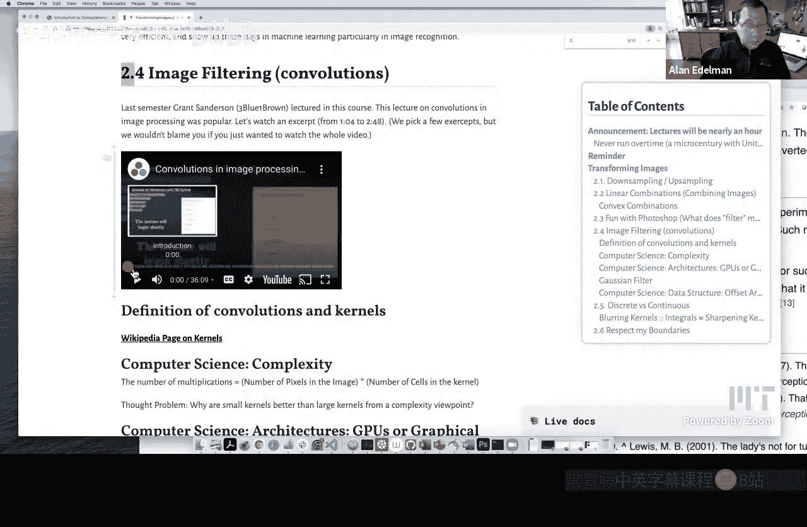
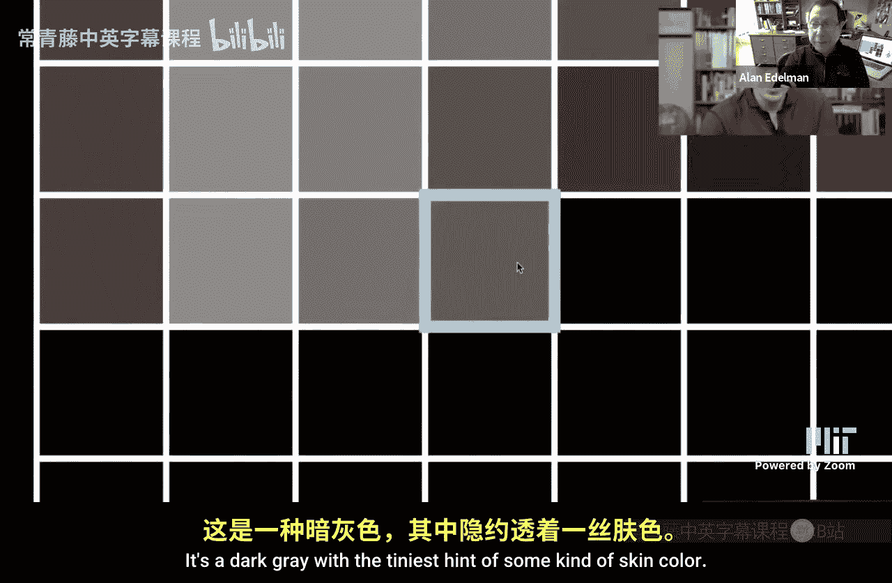
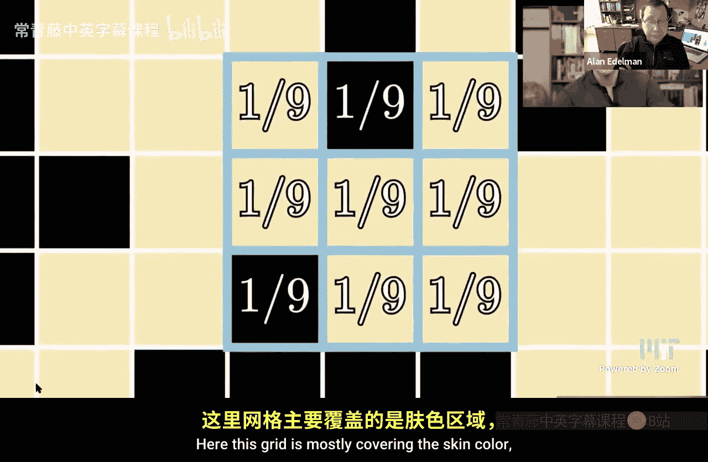
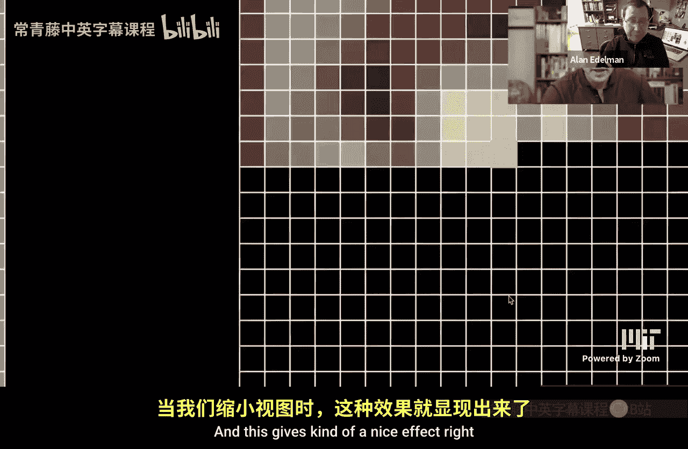
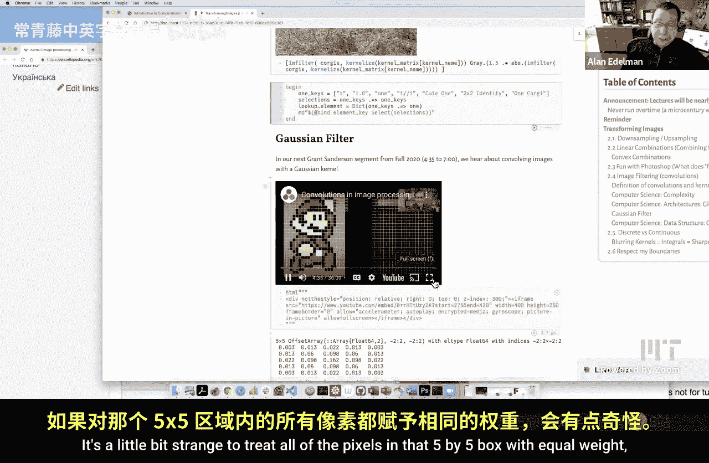
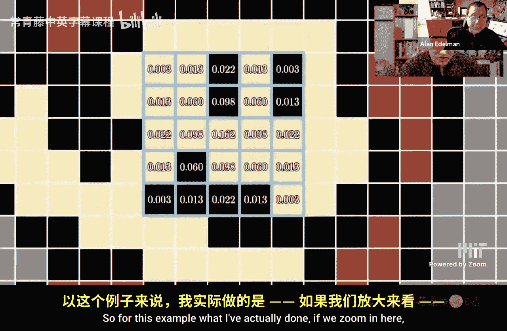
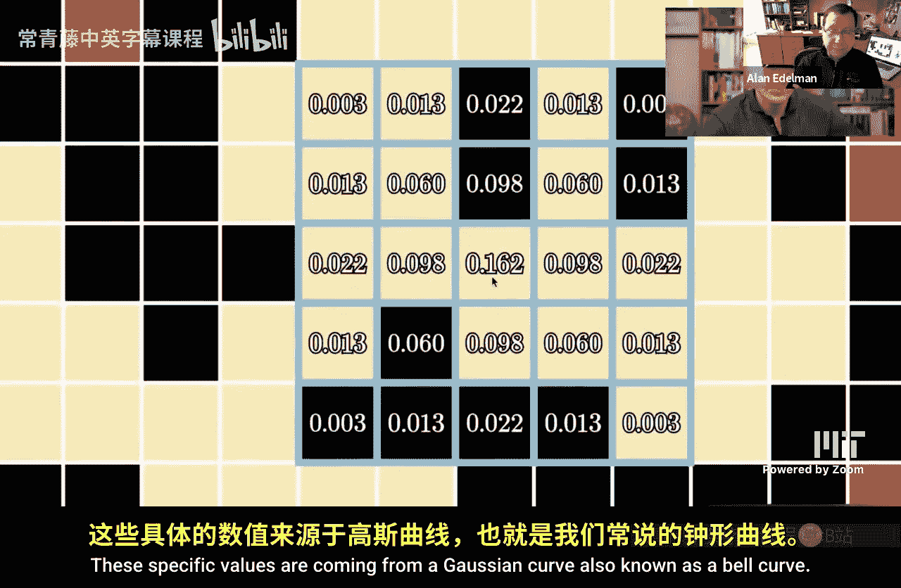
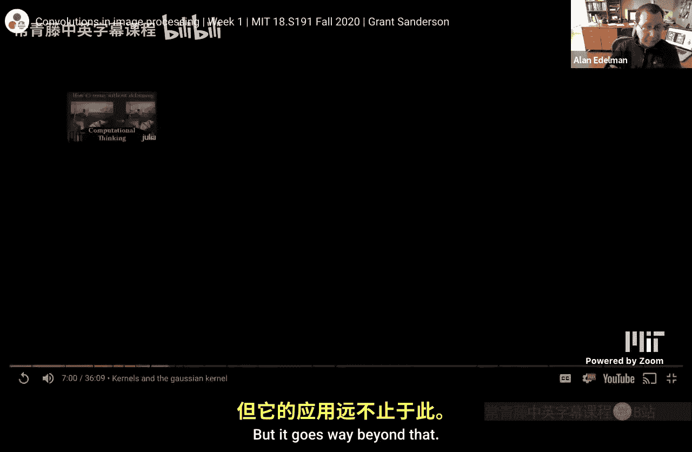
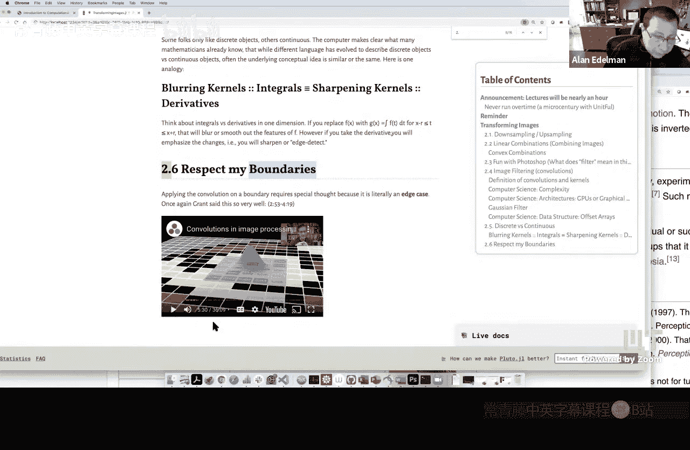

# 麻省理工学院【中英⚡计算思维 ｜18.S191⧸6.S083 Spring 2021, Computational Thinking】 p02 P2 Transforming Images , MIT Computational Thinking Spring 2021 ｜ Lecture 2 -BV18EqQBQEF3_p2-

Hi everybody out there on the internet and the MIT students as well。

 a quick reminder for the MIT students that if you speak or if you share your video。

 it's possible that you might be seen live broadcast。

 we think that doesn't happen but we can't guarantee it。

 so if you don't mind whether your voice is public you're welcome to ask questions。

 otherwise for the MIT students you're welcome to use the chat and the Discord or the Zoom chat the general public we also invite to use the to use the Discord and the YouTube chat。

Okay， so welcome again， this is the second lecture on the MIT course on an introduction to computational thinking。

And if you go to the class page， we're now up to what's now currently labeled as section 1。3。

 we're toying with these labels， but today's class will be about transforming images。

 let me remind the MIT students that the first homework is due on Friday that's homework one right here。

So。Let me。Click on this， and you can download it for yourselves。

 I have an active notebook already loaded。 And so I'm going to go ahead and use that notebook。

 So as far as the course announcements go， we've decided to make the lectures more like an hour than an hour and a half。

It seems to be sort of the right way to do things during virtual teaching and regarding that。

 I don't know if you' know this wonderful book by Jean colorrodo who was a professor in the mathematics department who passed away some number of years ago。

 but a really great man who he gave a list of 10 pieces of advice on giving a lecture。

And I think it was advice number three was never let a lecture run over time。

And the advice he repeated was from John Yvo Neumman。

 who was a famous mathematician and computer scientist。

 which is that you should never have a lecture go over a micro century， so there's the。The， the key。

Yeahs let's make this nice and big so the key unit of time for a lecture is a microcent not a moment longer and so you might be curious what a microcent is and this is a good chance to shell off Julia's units package on the side so if you look at the package that's being loaded here this is the unit full package that's being loaded up on top and if you want to get a0 years which is a century all you have to do is type。

This year thing is a special kind of string， it's a unit string。

Referring to the units of a year and so a century is 100 of these things it's 100 years right and then you could do math on this you could go century times two is 200 years century over 200 maybe half a year century squared and you see the unit square so what Julia lets you do is basically do all kinds of math on on the units here is a unit of meters divided by units of second squared so there's the gravitational constant and so if you actually want to know what is a microcent all you have to do is do a unit convert of 11 millionth of a century that's a microcent into the units of minutes and it'll tell you that it's just about 53 minutes and so that microcentury is the perfect length of lecture according to John von Neumman just a few more things with units just because it's fun to play with。

Suppose you。Want to calculate， say a potential energy or you know。

 use the standard old formula of M times G times H that you might have seen in physics math。

Mass times gravity times the gravitational constant times the distance it moves。

 So here's an example，10 kilograms times g times 50。

 and this would be 4900 kilograms meter square per second squared and you can convert it to Juules and you probably already know that that's already one jo So the bigger picture is not that you can do the units。

 The units is just kind of fun。 but the real big picture here is a message about。

A little bit of an insight to the Julia's internals and we're going to be seeing more of this at some point。

 but as far as Julia's internals go， what's happening is something about the type system。

 you may not know what that means yet， but there's some sort of underlying technology that means that you don't have to rewrite code to work with units that somehow the ordinary arithmetic that's defined in Julia when we sort of push the units through it just works and that's what we're often looking for is a system whereby you could come up with novel uses and everything just works and by the way if this little bit helps you do problem sets in other classes I say go for it so nobody should have to kind of keep track of units anymore it's very tedious I mean this is really the work for computers even though I'm sure it's still taught in many elementary classes。

All right， but today's lecture is not about units but it will be a microcentury today's lecture is about transforming images and i'm going to remind you that I've got my favorite quagi picture oh here's my assistant just walked into the room here so here's Philip。

Right behind me。And I'm going to use pictures of corgis， but you could use your own pictures。

 whatever you would like to do so that's。Go through a bunch of image transformations with the real goal I mean playing with images is fun I love playing with images I can't stop playing with images but the real goal here is to illustrate ideas from mathematics and to illustrate ideas from computer science and so we're going to see along the way convolutions linearity linear combinations we're going to see a little tiny little bit of complexity today right so these become excuses for seeing some of these ideas that show up all over math and computer science but let's start from the beginning I god earlier today for a pixelated corgi so here's a little fellow here that's been pixelated but actually the funny thing is about this image is this image is there's a real corgi here who。

😊，If he's not quiet， he might get pixelated， there he is。

So this image is actually not it only looks pixelated it's actually a very high resolution image that grabbed off the internet so I'm not going to use this pixelated Corgy。

 but I'll use Philip here here's the standard picture of Philip that I use and what I'm going to do is I'm going to downstample Philip so we've seen this already in the previous lecture what I'm going to do is take every art pixel where R is a number that can go。

😊，Right， so if R gets bigger。It gets more pixelated because I'm taking fewer pixels。

Right the system redraws things but as our goes to one I get the original image so there's downs and then i'm going to so that i'll downsle just by taking every ortho pixel and up sampling i'll do by a mathematical operation called the chronicroner product so here let's let me make this smaller so you can see rest's see it happening and then we can explain what's going on so。

Here， it is highly pixelated。And here's the original image and everything in between so that the operation here is the Cher product。

And it's an operation that basically says take every pixel and wherever you saw a one pixel。

Replace it with an R by R matrix of ones just like here。

 So yeah let's make R smaller so you could see， let's make R like three or something。 So when R is3。

 what we're doing is we're taking the chronicle product of the downsled fill。

 That's this picture right here。With a three by three array of ones。

 and so literally all that it's doing is it's taking this pixel here and replacing it here。

 let me I guess I can kind of draw like this right it's taking Ill just sort of pretend。

 but it's going to take like this pixel here and instead it's going to replace it with a three by three array of pixels with exactly the same color right and then it'll do the same with this pixel and replace it with a three by three array of the same color So that's what the Chle product does。

And if you'd like to know more about the Cher product， I put in the Wikipedia article。

 you can see exactly how this works。For now I think it's good enough to see that this is a way of sort of quickly upsembling okay now let me move on though to sort of another to more of a big mathematical idea that I'm sure everybody is seen somewhere or another maybe lots of times。

 the idea of linear combinations。Okay so for linear combinations， I'm going to combine images。

 so I don't know where you've seen linear combinations， maybe you've seen。

Linear combinations of functions or maybe you've seen linear combinations of signals in another course。

 or maybe you've seen linear combinations of vectors if you've taken a linear algebra course or if you've taken a differential equation course。

 you might have seen linear combinations of solutions to differential equations so linear combinations you've probably gotten the idea is all over math。

 applied math， engineering it's just everywhere and。Whether you've seen it before or not。

 I'll remind you that the big idea of linear combinations is that it's really a combination of two basic operations。

 you can scale an object。And then you could combine two or more objects and so you put those two together and we talk about combining scaled versions of multiple objects so let's see how that looks in image processing well here are some corgis this isn in Philip this is just some corgis I found on the internet。

Okay， so here's some corgis。 And what I'm going to do is I'm going to take these corgis and I'm going to multiply them by C。

 And so just so there's just to give you the idea， here's Corgis， right。

There's a lot of quirky in my background。I think the amendments here are something。

here's Corgis times2 and you'll see that what this does is of course it brightens the pixels right it's heading more towards white right and if I go Corgis times 10 it would be practically completely white on the other hand if I do Corgis times 0。

1 it's kind of grayed out right so theres Corgis times 0。5。

It's getting darker and darker with so so want I want to do exactly this I'll do it with a slider because it's more fun to do with a slider so I have a slider that I could set between zero and three and I can play around and add more brightness to the Corgis once the colors hit white that get saturated so unlike vectors and functions there's a sort of upper limit an upper kind of an upper bound to how you know how much brightness you can add but nonetheless this is a scalar multiple of a Corgi picture and again I'd like to encourage you to put in your own picture all you have to do is put your own URL right here and away you go you can。

Or just load a picture off of your file system so you can do this too and in fact this brings up a bit of a point where you know for many。

 many years we would have CanNs computer demos for all sorts of courses where somebody has written you know a picture is loaded that's it it can't be changed various choices of C might be in there but no they can't be changed we don't like that anymore。

 we really believe that the beauty of software is that it's not about the professor being on the zoom telling you which numbers to use we want you to have the full control and play with these things and so I like Corgis you know you might like hats that's all fine。

Okay， so just a quick word about the dot times， this is a point wise times。

 it actually would work without the dot。You see I could do that and it still works。

 but the sort of good behavior thing to do is to do the element wide times and what it really means is that every pixel in the Corrgus picture gets multiplied by this constant C so it's sometimes called broadcast I like to call it pointwise but you see this is a scalar and this is an image and we want that scalar to apply to each and every pixel in that image okay and so that's what the doc does it applies to each and every。

Okay let so that's the scalar multiple which you again you might have seen in various discussions of linearity now there was that other one remember there's there's scalar multiple and there's combining two objects so let's grab another object I could have loaded another picture so I decided to turn the corgis upside down so here's some upside down corgis so I promise you if I did that to Philip you wouldn't like it you would complain but I reversed the row indices and so now these corgis are upside down okay and。

And what？What I'm doing here is I'm going to combine the two images。

 So here I'm going to take half of my upside down picture。Plus， half of my right side up picture。

 and you could see superimposed。 It's just that easy。 This is what a linear combination really is。

 You can see the the if you look closely， see if I can make it bigger， maybe。

But if you look very closely， you can see that there is an upside down corgi and there is a right side up corgi。

 By the way， is this just me， but I notice this is something like almost psychological。My mind。

 you know， whatever processing goes on in the human brain seems to prefer。

 even that these pictures are clearly weighted equally， right， one half and one half。And somehow。

 when I look at this picture。I see the right side up corgi more than the upside down it's like my the math is waiting at 5050。

 but my brain I don't do you see this too， I mean I'm curious。

 but my brain sees the the expected you know right side up corgi more clearly。😡，And in fact。

We could actually investigate that phenomenon by taking other combinations and so what I'd like to do is take alpha times the right side up corgis and one minus alpha times the upside down corgis and right so when alpha is one。

 the corgis are you looking like they should when they's  zero the corgis look like they're about to fall off the ground they're upside down at 0。

5 they're right in the middle okay and this is another math thing that you might see sooner or later let me see。

And oh okay and one of these students has said that this is a common perceptual illusion in the chat cool I'm glad you know that do you know what the name of that perceptual illusion is you could type in the chat if you know the name。

So I hadn't known about this common illusion one of the students did。

 but I didn't know about this before， but I did look it up so first the math points and then the psychology point so the math point is that if you take linear combinations that are all positive or non negative and add up to one this is called a convicx combination。

Oh， and now it's a package deliverer， I'm sorry， maybe I'll close the door， excuse me one second。

My co professor is very， very excited。About。My co professor is very。

 very excited about convex combinations。 Okay， so here just for fun。 I mean。

 this is something I kind of only discovered。 So we're gonna take a convex combination again。

 this is the the 5050 weight And I decided I was going to look and see roughly where my brain is willing to say that it's equally upside down like if I go to zero。

 it's clearly upside down。 my brain has no doesn't see in any other way right And if I go here。

 it's obviously upside writes it up。 But again， 5050。😊，I's not 50，50 in my brain。

 So I was going to like add more upside downness。 And I finally decided for me。

 and you could try this for yourself。 It was around  point 39 when I stared at the image。

 and I would say。So remember， this is 61% upside down and 39% writes it up。

 but in my brain I felt this was 5050。 and again， you might find something else。

 So I looked this up and I found out that there was something on the Internet that applies。

To humans it's called the face inversion effect where and I just learned this I mean I'm just reading you know I'm reading Wikipedia like anybody would I'm no expert on any of this stuff。

 but apparently faces upside down are not as recognizable as faces right side up and by contrast objects don't have that problem and the inference is that objects recognition is going on in a different part of the brain than facial recognition okay somebody said something called the Thatcher illusion one of the students said something about the Thatcher illusion I don't know even know that word cool。

Where it was more difficult to detect and okay， so there's the thatcher。

 is that because they always use market Thatcher and the。InAs an example。

 I see I didn't know about that， the Sacher illusion， thank you， thank you so much。

So so I've decided that this applies not only to human faces but but corgis as well。

 I mean this is what I just learned last night Okay， so there's my five minutes of armchair science。

 you know psychometrics whatever， but it sounds like other people know about this phenomenon。

So if you've never seen it before， though， you can play with it yourself。Okay， so convict okay。

 so look at all the fun math we've got we've got convex combinations linear combinations all right。

 I want to I want to see like what kind of。Image transformations people do in the real world like what what do people do and so I decided to I'm not a Photoshop person like every time I tried to use Photoshop maybe some of you you know are experts at it if there's any MIT students who actually is really good at Photoshop maybe you could tell me in the chat I'd love to know who you are。

But every time I try to use Photoshop， I find like the interface is somehow not I have an expectation of what it should be and it does something else。

 but in any event I decided to pull it up yesterday and' here's Photoshop。

And let me you let's go back here's that famous picture I just loaded into Photoshop and I just decided to see what could I do to this picture and so there's this oh can people see my screen maybe not let me I think I only shared I'm sorry I think I need to。

Share my entire desktop pre to see what I want you to see， okay。All right， here's Photoshop。

And there's Philip right here in the Photoshop and。

I don't know I think I even have to grab the whole picture maybe I don't have to do that。

 but that worked so what I was very interested in is what the filter menu brings down right I'd kind of like to know the menu of choices。

And I kind of， there's a part of me that wants to focus on blur。

Well let's start with pixelix eight because we already pixelated once so if we let's see pixelix eight let's do a pixelix eight so which is the good one was it？

Was it mosaic？There we go， yeah， so here's the this is the one we already did with Julia。Right。

 so that's kind of fun。So we could cancel that。呃But。Let's take a look。 There's blurring。 let's blur。

 There's all kinds of blurs。Oh， didn't did it do anything？So I have to， like I said， I'm not。

 I warned you， I'm not any good at this stuff。 Alright， let's see blur。Let's do a Gaussian blur。

 Okay， so Gaussian blur comes with a radius。If the radius is very small， it hardly blurs it all。

 and as I move this radius over。It starts to get blurry it kind of hurts my eyes to the point where you can't even find Philip anymore so there's a Gaussian blur right so this is a that something this is the sort of thing I guess you would do if you only wanted to sort of。

You know you wanted to hide somebody's identity right， so like what I might do is。just race。

 that's one way to do it。Ors said， I want to grab。A little piece of him。

 and then I could just you know blur through the Gaussian blur thing。

Right so that just blurs a piece of the image。Okay a couple of other ones I just want to show you again I don't know if some of you play with this sort of stuff it's I mean Photoshops available to every MIT person so I just thought I would try it let's see there。

Where is the one where we do， there's sharpen others。I want to show you distort in a minute。

 but oh yeah stylized find edges edge detection is always a big deal so I think I mean that actually kind of looks nice so it finds all the little。

Hair on Phillips fur。So so there's edit tech and then let me by contrast。

 show you some really strange ones like。Distort one of the ones that's almost too bizarre for words is polarors。

So。It actually， I mean， it takes Philip and puts him through the laundry machine is it the only way I can describe it。

So this is a very nonlinear transformation， so if you ever take courses and you learn about linear transformations and you ever wonder like what are they not telling you。

 what are the nonlinear transformations， here's an example of putting Philip through the laundry is absolutely a nonlinear transformation。

All right， so this is what we can do in Photoshop。 Let me get back to。

What we can do it actually turns out that many of these are quite readily done in in you know with with direct software where you have all the control I mean obviously nothing is as easy as just pointing and clicking at menus but lots of these things can be done and what I would like to do is focus。

U。Let me focus on blur， sharpen and find edges first。

Because these are all examples of convolutions right so these are examples of we're going to find out in a moment what a convolution is。

 but let me say right now that。Convolutions。Come up in machine learning these days and so everybodys everybody knows that computers are good at picking out pictures of apples from pictures of oranges。

 how do they do that well they do it through convolutions I'll say a few more words later convolutions is also a mathematical idea you could convolve functions but let's talk about convolving today we're going to talk about convolving an image with a kernel so that's the language we're going to use and last semester when we talked about this when we when we talked about this this lecture was given by Gr Sanderserson whos just amazing absolutely wonderful。

呃呃 it。An absolute wonderful lecture and so I thought what I would do is pick out some excerpts from Gr's lectures from last semester and of course you're welcome to listen to them all by yourself。

 but here let me。🎼Did I did this come out right yeah。

 so I want to I set this up to start at 64 seconds and ended 168 seconds so let's see if this really works the way we went。

I might have to execute this again to make it work that way。

So I want to start at 64 just I'm going to play 100 seconds just because this is so wonderful I think you'll all like it just just let me do it sure convols are super interesting and let you do a bunch of powerful things so I say let us just jump right into things so as the first example I'm just going to take this eight bit Mariio that we see this very low resolution image and I want to blur it。

😊，And if you're thinking about blurring an image， maybe the first thing that you could think to do would be to look at each pixel and kind of average it with all of its neighbors and do this sort of moving average so the way I'm doing it here we've got this little grid three by three grid of values it's marching across the image and slowly creating a new image on the right and to be concrete what's going on here is each of those values is one night and we're sort of thinking of lining them up with some pixels multiplying each of those values by the corresponding pixel and then adding them together so in this case if they're all one ninth and we multiply them and we add them together we're just taking an average of the nine pixels so in this specific window it looks like there's four black pixels four gray pixels and then one that's kind of the Mariio skin tone color so you would expect the average to be like a darker gray with the tiniest hint of Mariio skin color and if we go and look at the new image that's being generated and what's painted into that pixel it's that it's a dark gray with the tiniest hint of some kind of skin。

や？And as we keep marching along we get this blurriier image of Mario we might zoom in on another example here。

 you know this grade it's mostly covering the skin color with just a little bit of black here and there so we would expect it to be a dye down version of that which is what we see and this gives kind of a nice effect right we zoom out and we see what was once this nice clean eightpe bit Mario same resolution nothing's changed about the resolution but what we've got is kind of this blurry。

😊。

Okay。So， let's see how do I。Oops。How do。Get rid of this。系。No， that's not got work。Maybe escape。

 escape。 Thank you。 I should have done that。 Thank you， Dave。Okay。

 so so I'm going to do a few other excerpts from this video。

 the whole video is 30 minutes six minutes long， I would actually encourage you to watch it anyway just because Gr is just a great great speaker。

 but let's，Get into。Let's get into， you kind of get the idea of what a convolution is。

You can go to this Wikipedia page if you like and see that， but you know。

 here's a bunch of different kernels。So but you see what happens what you do is you kind of paste this over your set of pixels this one being the identity would mean just give me the value at the center so it actually says nothing right this one this edge detector here says take four times what I am in the middle and subtract my north southeast and west neighbor right the blur is take the average of my north neighbor my northeast east southeast。

 south， southwest， west， northwest neighbors right and so I think probably you get the idea and let me just do sort of baby complexity just for today and in future lectures we'll probably talk about more about complexity but if you want to count the number of multiplications。

If you think about it in some you know in some basic sense。

 I mean there might be some edge effects and whatnot。

 but basically the number of multiplications a good approximation is we're doing this operation on every pixel in the image and so it' it's going to be the there's going to be for every time for every pixel in the image。

 we're going to do a multiply by the number of cells in that kernel and that little sort of three by three kernel would be nine you could have a by five kernel maybe would be 25 right and so that would be。

Complexity another quick mention is why kernels are so here's a thought problem why are small kernels better than large kernels I think that's probably fairly obvious。

But another thing that sort of complexity is not always the whole story and this sort of gets a little more complicated。

 so in some sense before people would time things on real computers。

 complexity would be sort of the only way of measuring how much time it takes for an operation to run but it turns out that not all operations are created equal and not all architectures are created equal。

 and so this is a whole other story， this becomes the story of performance engineering on different kinds of architectures。

 but for today's lecture let me suffice it to say that these convolutions。

 these operations like the ones that Grant described are remarkably fast on the kinds of GPUs that are readily available today。

 so probably you have a decent GPU even on your own computer these GPUs are graphical processing units they were invented so that you could see pretty colors on your computer when playing games right？

They were really rendering engines and it was only discovered somewhat later on that， you know。

 we built these machines， we built these chips to be graphics processors。

 but actually they're remarkable number crunchers， they actually crunch regular patterns very。

 very fast。And so it's not enough that it's a smaller number of multiplications。

 but what's really important is that it's a very regular pattern and because it's such a regular pattern。

 you can execute these things really， really fast and so if you're doing machine learning and you want to be able to recognize images and you have to do lots and lots of convolutions to train your system and so forth。

 GPUs are amazing at being able to do these sorts of things。Okay。

 so let's play with a few of these just to sort of get the idea of exactly how this works Okay。

 so I put a bunch of kernels this is。Yeah， so so here let's bring this back in here so I put some of these kernels。

Directly into Julia so we could play with them So here's the identity kernel right here。

 Li just remind you all how matrix notation works in Julia。

 so I'll just execute this if I go identity。And oh， you。

 let's say the identity you could see it's exactly the three by three pattern that came from this Wikipedia right so I don't really need this so in fact it'll show up over here so I don't really need this So let's kill the cell right so if I took the identity you'll see it's this pattern if I do the edge detect pattern it's exactly this pattern is can I see them both at the same time I don't know it's a good way to do that here the edge detect pattern is this one the sharpened pattern is here's here' is a superposition or linear combination I'm going to take the identity and I'm going add the edge detect right and so so sharpening means find edges but also retain my original and then you could see this is the the sharpened pattern let's put that on there right here。

Box blur is just taking an average， right， So it's one ninthth everywhere。

 You can see this is one9th everywhere。 That's the box blur。 And let's take a quick look at。

The x gradient and see if you can recognize this from calculus so the the x gradient。

Is it's really one dimensional， though it looks two dimensional。 The x gradient says。

Take half my value at the right and subtract half the value on the left。

 right if this was a function。YouLet me grab my pen again if this was a function。

I'll just make the point。If this was my function and I actually had values。

 like if this was like an f of x。And this was like an f of x plus one is the value to the right。

 and this is f of x minus1。Then I hope you could see that if I apply this。

 what I'll get is F of x plus1。マイナス。I should write this with the pen， but I'm writing with the mouse。

This is why it looks like the final jeopardy if you ever to watch that okay the answer is okay so you see that this is a centered difference right you might recognize this as from calculus as a slope right like Delta y over Dlta X it's a discrete slope it wants to be like a derivative more about that later as well All right so this is the gradient in x the gradient in y is just what is just you flip it on the side。

 this little this is called the transpose operator thepostrophe it transposes on the side and so what we have is is minus a half up here and one half over there I probably couldn' have negated that but actually maybe we should negate that。

So that。Oh no yeah， you want the hire wise。 Yeah， maybe it's nice to negate that it usually we take absolute value so it won't matter。

 but here I'm going to negate it and I'm going to do the Delta Y。And now it'， yeah。

 that's probably the better way。Okay， so， so these are the kernels now let's apply these kernels to the various images。

 Okay， so and you could do this too here's the Corgis。

Here are the corgis and I'm going to use one or the other of these two halves。

 either I'm going to display the colors， so what I'm going to do is I'm going to in filter which is going to actually run this。

In for the homework you're going to write and it's actually very easy to write for homework you're going to write the convolution yourself and so you'll really understand it。

 but i'm just going to use the in filterter command here just to show you。

The packages I loaded at the very beginning。The in filterter comes from the image filtering package。

Okay so let's go back to playing with these things I just wanted to show you that like in five minutes I could almost write like。

 you know some basic elements of a Photoshop it's it's it's not nearly as mysterious as some people might think。

So here's the identity filter， which of course gives me back my corgis。

The Ebb detect filter there it is you know you can play with different values for the thing I multiplied it by 1。

5 and I'm doing it in grayscale and I got to tell you these these corgis look so much more vicious than those corgis I don't know about you but。

You know， here's the。It's the same picture。I I should try to put them back next to each other。

 but yeah， these cors look vicious to me， I mean something about their teeth。You know， I don't know。

 but anyway， this is， I scaled it by 1。5 because I thought it sort of I could scale it by 0。5。

 I thought it was too dark。If I scale it by three， it was too grainy， so I't know I picked 1。5。

 you could play with that as well using the edge detector。Okay， and then there's the sharp end。

 which。I guess if you look at it closely， you could see that it's。I mean。

 what sharpen is supposed to be， let me remind you is it's a combination of identity and edge detect and so it's supposed to keep the original image but kind of sharpen the edges。

I guess I kind of almost see it。I mean， here's the original identity。

And here's the sharpen it's definitely I'll do it again if you want to say identity and sharpen so you can see that it really does do that and i'm sure you could see that this is just you know a few lines of Julia here。

So let's also， here's the X gradient。So what this is doing is it's looking for sharp changes in the horizontal direction right if it sees a sharp change in the horizontal detection。

 it gets emphasized with a white color right and then this is the gradients in the wide direction which looks terrible to me。

 but it looks for sharp changes in the wide direction。Okay， so somehow the X direction。

Is better and what a lot of image processing will do is take a combination of the X。

 they'll take the gradient X and gradient y。 and we'll also see that in repcom lecture。

RightSo this is a very common thing to do is to take some sort of combination that as you might imagine you would want something that should be invariant to rotating the picture okay and that's what people do these days right so this is this gradients of x depends a lot on the X direction and this depends a lot on the y direction right。

Yes水。There's a question in the Zoom chat， I thought sharpen was original mine blur。

Was sharpened with original minus blurs so sharp so we haven't we have not I mean that's we we。

You can probably think about it like that， right？I was wondering if this was just a matter of who's。

Doing it。Oh the end detect。I mean， I just did E detect plus identity from this Wikipedia page。

 but I wouldn't be surprised Yeah， so it's they're saying that it's two times identity minus blur。

So yeah， you can definitely think。No， I don't you can think wouldnt I wouldn't be surprised if people detect with the negative of this matrix as well。

 and in which case that would flip the sign。So， you know， right。Yeah， I mean。In a way。

 is something this is sort of a bigger phenomenon that never happens in the pre internetter age and the pre Wikipedia age。

 but if you don't follow the convention of Wikipedia and mean people always have you plus sign minus sign and I mean。

 it's enough to drive you crazy。But in the past， nobody would check you， so internal to a class。

 you could just define it and it would be okay。But it's true， there's always different conventions。

 but I don't think two times the identity minus the blur would give me this answer。

But the real truth is。It doesn't matter to me what you call an edge detector。😡，What would I mean。

 so here let let's let's。To keep you anonymous unless you want your name out there。

 I'm going to call you MIT student。And I will go that MIT student wants me to take twice the identity。

Answertract。The the box blur。Okay， and so now I have to add in just the name MIT student。

To keep this going and I think that's all I need to do and then we couldn see what it is oops。

 did I really mess things up？Two times。Identity dot minus B blur。Oh， thats pastd oh， oh， oh， oh。

It doesn't know， no， oh， now what's the matter。Two times a day， Dave。

 did you see the problem quickly。小因咪。Oh， I need it over here here， here， here。MIT。St。

I missed that one。Now it's happy。 Okay， so now I just added， see。

 I just upgraded my own Photoshop with a new filter。Okay， and this is a different thing。But anyway。

 you got to play with it。So that's the point， I don't really care what you call it。

 it's so easy to define your own filters and fiddle with them and see what they do。Okay。

 and then there is the Gaussian filter and again I am going to the Gaussian filter is a little bit it's a little more complicated not a lot so and i'm going to let。

Grant do I have three videos from Grs here's the second I it's a little bit strange to treat all of the pixels in that five by five box with equal weight because the ones towards the centerner are somehow more representative of what's going on in that image at that point than the ones that are farther around。

So for this example what I've actually done if we zoom in here is I've given a grid of values that aren't all the same you know it's not all one divided by 25 in this case。

 but the middle one is 0。162 and out of the farther regions we've got 0。

003 so when we multiply those by the corresponding pixel values and then we add them all together we're basically taking a weighted sum weighted according to how close to the center it is and that's a way of saying that okay it's okay for this pixel here to be influenced by what's at the outer corner but only by a little bit' we shouldn't get into it too much。

These specific values are coming from a Gaussian curve， also known as a bell curve。

 so you might imagine kind of this bell curve surface sitting on top of the image and it's bulging right above the point that we want and then it dissipates in values as you go away from that。

And that gets us a much nicer notion of averaging the pixels so that it's like I said it's taking into account how close they are to the point we want the Gaussian specifically has some really nice mathematical properties that we might talk about a little later on in this lecture that makes it really really quite nice for doing this kind of operation。

Now this operation that we're doing as you can infer from the title of the video and everything about this and what we talked about last time it's a convolution what you would say is that the image on the right the resulting values that we get are a convolution of the original image with the little grid of values that we have here so it's an operation that takes in at least in an image processing context two different grids of values maybe one is RGB maybe one is numbers they could both be numbers and it combines them to get a new grid of values in other mathematical contexts we often think of it as combining two functions to get a new function。

😊，And when you're doing it with just this little smaller window。

 it's quite common to refer to it as a kernel， so in this case we would say that we convolved Mario with a Gaussian kernel。

And at this point， you might sit back and think， okay， you know that's all well and good。

 I guess with different kinds of averages， I could get different sorts of blurring effects going on in the images and I guess there's some use cases for blurring images like blurring out faces。

 but it goes way beyond that。😊。

And escape。Okay， so。Let's see。 Where are we So the you just learned about the Gaussian kernel and we saw that。

Let's see， I wanted to。Okay， I wanted to put the focus at five minutes and 23 orders here I just want to and it's bold see if I can grab right like maybe I have this five by five box that's wandering along it's very huge。

How do we get it to go just a little to the left there we go Okay so this is the five by five kernel that you saw grants going and averaging with and just to show you that if you use the Julia kernel Gaussian function and round it to three digits you can check and see that it' i've got the same numbers here so I left to match up numbers I feel like I really understand things but just in case you think this Gaussian thing is very mysterious let me tell you that it's really quite simple it's just here and i'll write it in sort of you know in my own handwriting but it's basically e to the minus x squared plus y squared over two is all this。

Is and so here you can see me I'm doing this comprehension， I'm going to get this。

I'm going to take x and y or I'll call it I and J to go from minus2 to2。

 so that gives me a five by5 array and I'm just simply going to calculate either the minus x squared plus y squared over two and you know I'll round it into three digits if you like just till it looks the same so there's nothing really mysterious about this Gaussian kernel at all it this very simple formula。

Okay， so this is called Gaussian blur and what we can do is we can actually look at the kernel just like Gr right here。

Here it is when。so the smaller to the value here let's go。

The smaller the value the the smaller the kernel right so when I'm at zero I've got a one by one kernel kind of really boring at one I've got a five by five kernel and we can make the kernel bigger and bigger and then you know with Julia you can zoom in and out like I guess lots of packages do that these days and you can you know you want to get to sort of know the kernel you can。

You can manipulate it and play with it and get to see it。 And so I like to put put it head on。

 and then you could kind of see that it wants to be a circular the cross sections get drawn when you do this So it wants to be a circular cross section it will be more circular if I。

Take the higher order kernel and you can see it now it looks pretty circular， but I love doing this。

 I love sort of you know I could do this all day， you know。

 this sort of parabolic like cross section going this way in the circular cross section going horizontal。

Right， I could sort of play with these things all day。But， but I don't have all day。

 so let's let's move on。 there's the。There's the Gaussian kernel。

 You might have noticed this offset array。 I just thought I'd quickly show you how you can define it。

 So the kernel here let's let's let's take a look at the kernel here， the kernel。

Is let's make it the smaller ones， so it's easier to see。Okay。

 so the kernel here is now five by5 kernel you could see that the00 entry right so if you're one of these Python people that think things have to start at zero or if you're a fort person things have to start at one let me point out that I'm actually starting in the middle the 00 entry which you could see is 0。

162 is right here in the middle The minus22 entry is the one that's two to the left and two up and that's this number here which you can see right so I'll show you how you can you can make you can make any matrix started any place you want there's nothing magical about。

Python zero or four trans1 or no I mean there's it doesn't it doesn't matter right so here you just have to be consistent。

 That's where the trouble is。 But here's a three by5 array going from one through 15。

 Okay I'll call it M。And what I'm going to do is I'm going to turn my plain old vanilla array M right here。

 I'm going to turn it into an offset array Z by saying that my row indices will go from minus1 to1 and my column indices will go from minus2 to two so that's three numbers and that's five numbers and you can even see the indices I just sort of laid them out for you right and so if I were to go to z of1 minus2 you see what it's going to do it's going to pull out the it's going to pull out the 11 right because this is row minus10 and 1 and this is column minus2 and so it pulls out the 11 and so so the trick is not to get mad at the language。

 the trick is to put whatever data structure is natural for the problem at hand right and that's kind of the way1 does things。

Okay， well， if I'm going to keep to my microcent， I think I。Only have time for one more points。

 But I think that's all I really need。 So I'd like to talk a little bit about the discrete versus the continuous。

 because this may come up。In your， you know undergraduate career and your working career over and over again。

 I often hear people。Say things like oh I like discrete stuff but I really hate continuous objects or the other one you know I like continuous math you know discrete I don't really understand discrete math you know then there are those who are saying I don't really you know I haven't learned enough about both or so forth but what I want to tell you is that the difference between discrete and continuous is not nearly as great as many people would have you believe so for example when I show you these convolutions and they're discretized I mean you could all easily imagine the limit of sort of a bell curve or when I talked about that。

Gient X filter。 let's bring it back up so you can see it。 I mean。

 this is nothing other than a derivative， right， I mean， it's a discrete version of a derivative。

 Where is it， Where is it， Where is it up higher， I think。But。I have lost it。 Sorry。

 it's very further done， but。You remember there like this one。

 This is just a derivative in the X direction right it's discretized Sure。

 but it's just a derivative and it's been my experience that the difference between discrete and continuous is more about the fact that there are different names that have historically evolved then the actual underlying intellectual concepts by and large So you know people could argue with me。

 you could disagree with me if you like， but what I'm really inviting you to do is as you continue to take other courses say or even this course。

 you know I would like you to sort of keep your eyes open to see whether the continuous and discrete are quite as different as some people would have you believe okay well I think my microcentries up the last thing that I might have said。

 but you could watch this for yourself because Grant did a very good job at it is that when you do these convolutions you could probably already imagine something you bump into issues about at the boundary here let me see if I could just get a as with yeah let let me get a picture up see one of。

Well， all right， I can't find it quickly but。As you reach the boundaries。

It's not clear what you should do right in fact you as the programmer have to make a decision do you pretend there's zeros when you sort of fall off the edge of the earth do you go back and use some pixels over again from the inside right there are lots and lots of choices people come up with there's no right answer there might be a better answer for a particular problem at hand but the fact that you have to handle boundaries is a bit of a it becomes a bit of a software problem because it's nuisanceancy and so know good software might find ways to make it easier for you and bad software means that you have to do the hard work all by yourself but still you have to respect the boundaries all right well my microcenturry now is I'm pretty sure officially up so if the MIT students want to stick around they are welcome to but I'm going to stop broadcasting to the public and I'm going to thank the public for listening so let's see if I can。

S the。How do I stop this？No on what a moment。Just see if I figured out how to stop this。

I knew had this before。

