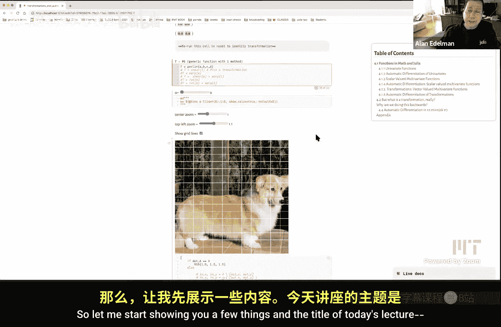
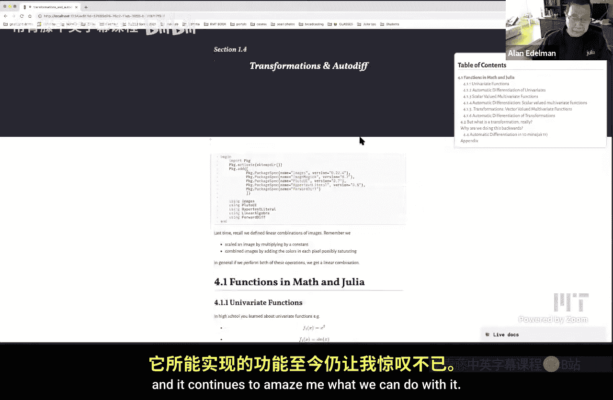
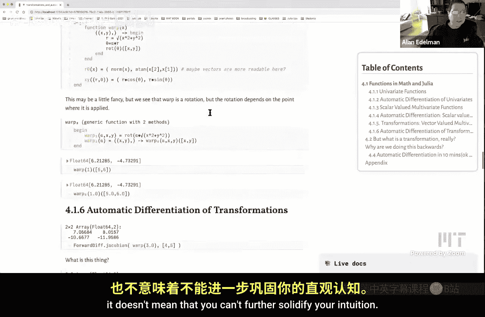
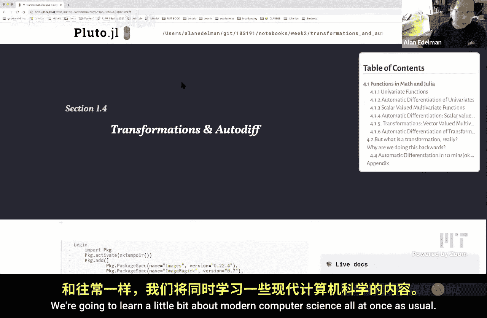
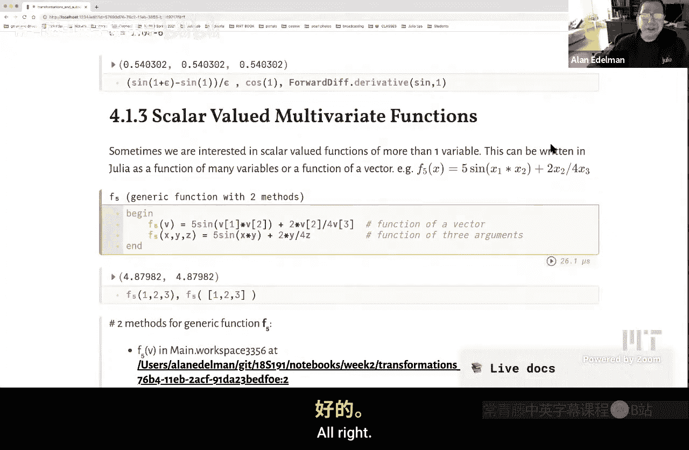
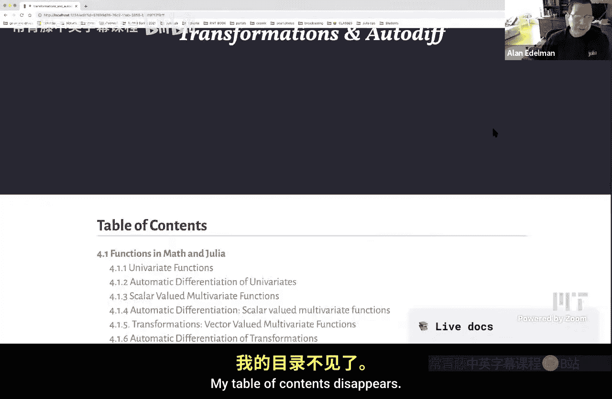
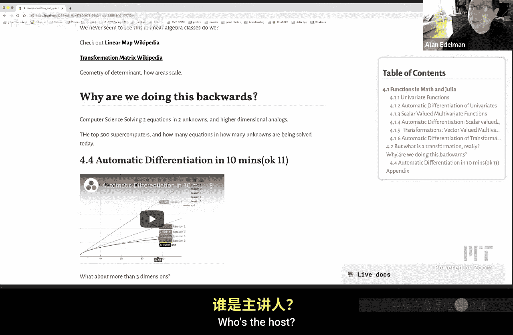

# 麻省理工学院【中英⚡计算思维 ｜18.S191⧸6.S083 Spring 2021, Computational Thinking】 p03 P3 Transformations & AutoDiff ｜ Lecture 3 ｜ MIT Computational Thinking Spring 20 -BV18EqQBQEF3_p3-

Okay， well。Let me say hello to everybody out there out on the internet it looks like we've been getting thousands of viewers。

 which always boggles my mind because even under the best of circumstances one gets。You know。

 a few hundred students in an MIT classroom， but so having thousands of viewers on the internet is pretty exciting。

Today's lecture is as always showing off what programming languages can do。

 but also we're going to have a lot of fun， you'll see here we're going to play with some of these image transformations。

 you know we're going to do stuff like this and this。

And what my real goal for this lecture is how do I say it。

 there are math courses out there like multivariate calculus and linear algebra and you know these are basic college math courses that many people take。

 probably maybe you've already taken such courses or maybe you're going to take such classes in the next few years or maybe you're an expert on these subjects or maybe you've never you know done these subjects before。

 it's my belief that whether you haven't seen these things before or you are the expert。

 there's nothing like doing it on a computer so。Let me start showing you a few things and the title of today's lecture I as well go to the top here are transformations and automatic differentiation that's abbreviated as Autodiff so Autodiff technology is a very very exciting technology that kind of has really kind of come to its own in just the last few years and it continues to amaze me what we can do with it but to set the stage what I'd like to do is scroll down and I'm hoping you can join me and do this along with me and let's just play with a few transformations just to get the idea so I've got a bunch of transformations predefined like a general linear transformation you'll see what these words mean in a minute a shear a warp here like I'm going to put this one down on the bottom to do it last okay a rotation and so forth so here you could take any picture that you like here's a long corgi we could do the usual corgis you could pick a picture or you could load any。

You like from the internet we also have this arrows picture which this is really has been our test pattern but here have a have a let's take the three corgis Okay so here's a picture and what we're going to do is we are going to run a linear transformation this general linear transformation by picking the coordinates of this matrix so this is what's called the scable matrix if you're running in in your own notebook you can click here and then you could see oh look at those。

😊，Look at those corgis， you know， becoming sheared， right， You could， you might notice， you know。

 what， what happens to the square， the squares， Does somebody want to tell me。

The squares the squares become parallelograms as you share。Right so this is a share。

 we could do other linear transformations。Right， and we can also zoom in， zoom out。

Zoom in from the top left。Just disappear so you've got a whole lot of controls it's actually very easy to make these sorts of things so heres let's put these back to maybe around one so we can play with it later。

😊，Okay， so this this is this is a general linear transformation right and quite frankly。😊。

This is really how you should look at matrices in my opinion so all too many people think of matrices as as of numbers right it's just like a table like like you know you could be looking at a spreadsheet。

 it's just a boring table of numbers and and there are all too many linear algebra classes。

 which would have you think that linear algebra is about doing like row operations and column operations on those tables of numbers。

You would never walk away with sort of the intuition as to what a matrix really is。Okay， but。

As far as i'm concerned， this is what a two by two matrix is and this generalizes to three by three and end by end dimension matrices so we'll say more in a bit。

 but one point of this lecture is。What is a matrix if you thought it was a collection of numbers。

 if that's how you've thought of matrices all your life。

 you know here's your chance to really find out how the big shots think of matrices right that's this kind of linear transformation。

Okay so we'll say more about that， but let's play with a few more of these lower we're edit so yeah let's pick I've already played with the shear so you know there's the share。

A pretty fun one is a warp。 So here let's do a warp， a warp。Here， here's the warp。 And let's。

 let's warp these poor corgis。 There they go。 Look at that。 So this， as you might imagine here。

 it's like。You see， we could put the corus through the washing machine just like Photoshop could。

 so this warp。Is a nonlinear transformation。And so these are the sorts of transformations that you don't see in a linear algebra class because you know。

 in a precomp age it was really hard to sort of see these things in real life I mean you could draw them one pixel at a time。

 but it would have been really really hard Alan could you zoom in on your browser please？

Do the zoom in。 Let's do that。 Alright， that's a good idea。 The trick is bit more。Well。

 I need the alpha in screen， so I don't know if I can do that。So， this is。

About as far as I can go still and still be able to manipulate， she could try to do one more。But。

Let's see if I can make the suggestion。 Okay， I can do one more level。Okay， there we go， right。

 so here the warped。Corgis just to sort of see this image， we have a few other images。呃，For example。

Composed images where， for example， you can， Oh， yeah， let's rotate the corgis first。

Let's rotate the corgis there they are right so now alpha controls the rotation。

 I guess that's a pretty easy transformation， this one's linear。Okay， and then we can compose things。

 for example， we can go。We can do a rotation followed by a warp， right。

Right to here it is spinning around。Here's。Can you you can actually hide that。

The markdown in but how do you can you mention how you can visually distinguish whether a transformation is linear or not well I would like the students to think about that for a moment okay。

Right and if somebody wants to tell me in the Zoom chat， they can tell me。Hello。Okay。Yeah。

 definitely zooming in really or on discord or on discord that's right Think about。

 yeah what what makes it seem linear versus nonlinear and then we could talk about what that means All right。

 so I just wanted to set the idea of just to kind of get things started I mean I could have shown this later in the lecture。

But I kind of wanted you to sort of。See two dimensional transformations， linear and nonlinear ones。

Right away okay we have a couple more maybe i'll bring them out there's the X Y that we have floating around。

So this is a very strange transformation。Okay， and one more transformation that I have floating around。

 you could define your own just write your own function， but the R theta transformation。

I yet another one that we have floating around， which is kind of fun to look at。嗯。

This is the one where sort of fans out， let's see。Gotta zoom a little bit。 Alright。

 so point number one is transformations， linear and non linear transformations。 Okay， so。Like I said。

 my goal is is to kind of get you to see linear algebra and multivariate calculus in new ways and I really believe I would love to hear your opinions after this lecture。

 but I really do believe that you can。Not have taken a course。

 see it here in Julia and you already get the intuition or you could take the class first。

And get better intuition from this lecture and I still believe that even the experts。

 even the people who think they know everything about multivariable calculus and linear algebra still get something about being able to manipulate these things in real time so just because you understand these things it doesn't mean that that you know you can't further solidify your intuition All right so that was like a little bit of the trailer from the movie now let's go ahead and start the lecture for real so we're gonna to learn a little bit about Chi you' going to learn a little bit about modern computer science all at once as usual okay so let's start with some very simple things let let's remember last time we define linear combinations of images you remember that we scale an image by multiplying by a constant we also combined images by adding the colors in each pixel and we said that that if you do combinations of these two operations you get linear。

😊。

In general， Okay， now today we're going to see linear combinations from another view。

 but let's start with。Really really simple almost high school stuff okay functions in math and in Julia so I wrote down a couple of Uniivariate functions here there's the square function。

 the sine function and a generalization of the square where you have x to any exponent alpha。

And in Julia， you can。Express these in a number of ways， and so I just thought I showed them to you。

There's the so called short form where you say F of x is x squared。 Okay。

 and just to follow the subs of the math， just want to show you that if you go here。

 let's just do it right So you see it。 if you go F。Back slash underscore score1。

 And then I'm going to hit the techie。 I get the subscript 1， right， Or I can go7， right。

 and I get the subscript 7。 So this is one way to make your code look more like mathematics。 right。

 I mean， I suppose I could have written F1。But you know and I see people writing alpha like this as opposed to writing it like this。

 and it seems like a telltale sign that you're on a computer and you're not doing math anymore。

 so here we blurred the distinction between math and computing by actually writing things in a nice way。

Okay， so back to function calls， I can create the function x squared simply by saying f1 of x equals x squared and then you can see f1 of5 is 25。

Okay， so that's one way。 that's the short form way of writing a function。 and the short form。

 as you might expect， is a。Handy method for defining a function when it's not a very complicated function when you know you can do one expression or two。

 that's usually when you use the short form。Then there's the so called anonymous form。

Okay and you know any list people out there， this is sort of these lambda expressions。

 but nowadays they're generally just called anonymous forms and so here instead of giving it a name like F2 word anonymous means there's no name right？

The function is the thing that takes x to sine xex。

Okay that's it There's no the function doesn't have a name it's just the thing that maps x to sine x right and so you could take this thing and evaluate it at pi over two and that'll evaluate。

 of course， the signine at pi over two which is one Now of course I can go ahead and give it a name it won't be anonymous anymore right I could say my sign is。

Dis function。And then I can go ahead and evaluate it at say pi over two。And。Of course， it'll work。

Right， so I got one mouth。Okay， so。So this is anonymous。Okay嗯。But then I give it a name。Right， okay。

 good， so we have the short form for a function anonymous form and then there's the long form。

Wwhichch where which you've seen before a few times now you take a function and you have an end and you put in the return value。

 you don't have to type the word return but it makes it very easy to read and I just sort of threw in another piece of the puzzle that you can have a default parameter alpha equals three so the way this works is if I evaluate f3 of5 it'll take the cube okay so the exponent alpha is understood to be three if I don't tell you what it is but if I do include it then that's what will be used right so five squared is 25。

Okay， so there's F3。Let me also mention rather quickly。

That the concept of a keyword because they come in handy， so instead of a comma we use a semicolon。

And then what that means is that you have to type alpha equals if you want to know what exponent is being used right so this way you know the key word or that you know maybe it would have been good to call this exponent。

For example。That might be even more readable。Oh， can I not oh， sorry。Lets。对。Let's。Wait。

 what did I do？Wait， what can I do that or you know， let's leave it as is。Okay。

 and so when you call it， you go alpha equals whatever you want it to be and it runs。Okay。

So three different ways to write down functions maybe not that exciting。

 but they come in handy the short form anonymous form or the long form， each one has its uses。

 each one has its places when you write Julia for a while you start to know which ones to pick meanwhile it probably doesn't really matter you get to pick your choice。

 you could see Julia's function documentation for more okay but let me get into the more interesting thing which is automatic differentiation。

So that that's the big hot topic it got really really hot because of machine learning so in some sense automatic differentiation's been around for decades。

 I mean I know people who were doing it 20 or 30 years ago but more and more these days people are applying it in so many ways and the programming languages themselves are doing are letting you do things with differentiation that in a way。

In a way， calculus， you I don't know， I feel like you almost couldn't have imagined it。

 so to get the story straight。Let's。Let's actually run it first。 Okay。

 so just to check that we know what we're doing。 So we're going to use the forward different package。

 There' is also something called backward differentiation， but we'll do that another time。

 So I'm just going to grab the forward di package。 And I'm going to just start taking some numerical derivatives。

 Okay， and so F1， you might remember was x squared， right， So let's remember that。 Remember F。1。

Was x squared。Okay， so the derivative。Is2 x。So if I evaluate the derivative at 5。

 I should get the number 10。 That's good。 Okay， and let's also remember here that this is the same as saying the derivative of x cubed。

😊，Is， of course，3 x squared。Elan， could you zoom in a bit again？Well now zoom in some more， okay。嗯。

Maybe even one more time。Yeah， good idea， thank you。

In this particular notebook I may have to zoom in and out depending you know you know the usual trade off if I'm looking at just one small piece。

 then I could zoom all the way in， but if I need to sort of see a bunch of things at a time I'll have to zoom out so I'll try to work with that。

Right， so3 x squared， three times 5 squared to 75。 All right， no big deal。

 I'll tell you what is a big deal。What is a big deal is this derivative is being calculated。

In a way that's different from what almost everybody expects。I think that's what's the big deal。

 so when you think about differentiation。You probably think about how you learned it。

RightYou probably you probably learned all the rules I mean there aren't that many rules and it's very know derivative of sine is cosine the derivative of product is UDv plus VD right you learn a bunch of rules and then it's pretty mechanical to evaluate derivatives I call that symbolic differentiation it's the sort of thing that mathematicalmatica is really good at you can do it in Julia as well but we're not going to do that today my point is this is not what is happening here it is not like the way you did calculus when you took a calculus class so if it's not that then you might think it's like what you do in a numerical class or you know sometimes people did this in calculus where you do a finite difference right know you evaluate your function over a little bit you subtract it from where you were you divide by your displacement right and that's you know that's an approximation to your slope and so that's probably what's going on here right and many。

 many people would guess that and interestingly enough。

Not what's happening here either okay what's happening here is a different kind of thing and if there's time at the end of this lecture i'll tell you a little more about what's happening but for now what I want you to walk away with is that。

Computers are taking derivatives now in new exciting ways。

 I mean the ways it have sort of been known for years but but it's happening on a large scale now and it really lets you do things that I think people had no idea they can do so it happens a lot with machine learning but in other places as well we'll see in a minute more but right now I just want you to walk away with the derivative of a scalar function all you have to do is write down the function and you're where you want to evaluate the derivative and bump it happens。

😊，I decided to do a numerical differentiation with finite differences just to kind of show you here's I've got a little epsilon。

 So when epsilon。So here I'm going to take in case you never knew what a derivative was。

This is how it would be done in a math class again this is not how forward di is working but just to give you the equivalent mathematics。

 if I wanted to know the derivative of s at the point one right。I mean。

 this sort of syntax tells you what i'm doing this says give me the derivative sign at the point one right this we know is the derivative because we've taken calculus classes and this is that finite difference thing where you move over just a little bit。

Compared to where you were， you know， this is the Delta Y over the deelta x sort of thing。

 and you see that if epsilon is。Very large， like 01。 all you guys like 1 digit，05， right。

 But if you move your epsilon to be smaller， you get， you know， better and better digits。

 as you'd expect。So and at10 to the minus6 to the displayed number of digits。

 it looks like it's matching perfectly。Okay， but I mean， in some sense。

 this is the intuition of what the derivative is and of course。

 something magic is happening here and how you're calculating it。Okay。

 scalar functions scalar functions are easy that's just the warm up you all knew that let's move on to what you might see in a multivariant calculus class right so that the MIT numbers 1802 MIT has these funny numbers for all of its classes and as far as I could tell only undergraduates and the professor of the course。

Knows the numbers for the classes right so undergraduates know all the numbers and the professors know the numbers for the courses they teach。

That's that's what i've learned right and to the as you teach yeah I I have a K gallery the background telling me that I don't even remember the numbers of courses I teach after a couple of years okay so。

So let's talk about multivariate functions。 again， this is a simple idea for multivariate calculus。

 Let's define a function F5 of x。Which is。呃。Which is a function of three variables， let's just say。

Okay， so holdll on a second just to okay。A function of three variables。

 So I mean I just picked a random function and it has no meaning five sign of x1 times x 2 plus2 x2 over4 x3 Okay。

 and in Julia， we kind of have a choice now I mean I guess in math you have a choice as well。

 but you don't think about it as much we could have a。

We could actually write it as a function of a vector。

 So this is how you would do it as a function of a vector。RightAnd so if you this is the short form。

 right and it says。Oh。Input a vector and then pull out the components， right， So here are the the X1。

 x2 and x3 components， right， Or I guess I'm calling it V now， V1 V2 and V 3 components or。

What I find more readable is you can write it as a function of three arguments。

But then the drawback of this is that it doesn't apply to vectors。

RightSo you could write it as a function of three arguments or function of this is definitely more readable than this。

 I think everybody would agree with that。But and practice。

 what you really want to do is take functions of vectors。

 so I'll show you how you can fix that in a minute。But。Here here's sort of a kind of halfway step。

 which is that go ahead and write it in the readable format here I'm going to call it F6 now just to give it a new name。

 you can go ahead and write it。In this readable format， and then when you want a vector。

 you can just go ahead and call it。On that right and so Julia let you do that Julia says that it's okay if you call this thing with three arguments。

 this is the function that's called and if you call it with one argument。

 this is what's called it's kind of very， very handy to be able to have a function dispatch just on the number of arguments right and so this way you can you know you can you can kind of write a bunch of different methods for the same function。

And you know， and it'll kind of work in both ways。 and so you could see here that。No。

 you can see here that where's the you don't see the code。

 but you know I can call it with three arguments or you remember from the first lecture this is how you define a vector。

 so here it is F5 applied directly to a vector， maybe a little space here would emphasize the point。

That this is the vector function， and this is the three scalrs function。 Okay。

 And so here I'm doing the same thing。With F6 just to show you that it's working， there's a trick。

 by the way， that lets you define it all to do it at once where you can actually have。

Readability and it works for vectors。 And I debated as to whether I should show this to you on the third lecture of the course。

 But it just， I thought it was worth showing you because it it it just makes code much more readable。

 So here this double parentheses， which basically means a function of a two bowl。

 So this is a kind of a Julia thing。But but don't worry about like how it's working just point out that this。

When I write this， it is readable， right， X， Y， and Z， just like math almost。

But it actually takes vector arguments。 Okay， and so you could write one function that's readable and has vector arguments just in case you want to。

You want to do that， okay？Getting back to the function F5 though， in fact。

 maybe I should have moved this up a little bit， let's go back I'm going to move this back to here because this was as good a time as setting to show it to you so。

In Julia， this F5， you might say， well， is it this function of three arguments or is it this function of a vector argument。

 Well， if you call methods of a function name， you can see that it's actually this is a little bit ugly to read。

 but you could see that for methods of F5， you see there's a one version and a three argument version。

 so if you compare that with I'm almost afraid to do this， but if you go methods of plus。

You can find out that there's a， you know， a very。Large number， almost too many to admit to。 Plus。

 it's so overloaded。That。You can't even see these things you can add matrices， you can add vectors。

 you can add numbers there's you know you can add booles。

 you can add reels to floats so all of these different things come up and add again more on another time。

证明。I's define find the end of this now。It just goes on and on there just， yes。

 I'm just going to get rid of that。Okay， but the bottom line here， whoops， let's go back up here。

 The bottom line is really just a few different ways of writing。A functions。Okay， so。

Where are we in our table of contents， I have to move the zoom thing to kind of see this。All right。

 so hey， where's my table contents？

Whatever table contents disappears it doesn't show if feel're zoomed in too much。

Oh， it， I guess that's clever， I see。 so that's a down part of zooming。 I see one lesson there it is。

Look at that， Okay， so we we are talking about scalar valued multivariate functions。Okay。

 and now what I want to do is talk about derivatives of scalar valued multivariate functions while i'm at it Okay。

 so let's let's get some derivatives so where are we okay so。So there's this word gradient again。

 maybe that's scary to some people， maybe some of you you know。

 having calculatedulating ingredientss。Grads for many， many years now but。

If you have a scalar function and you calculate the gradients， whatever that is。

's the gradients is just the derivative。For functions from vectors to scrs。 it's really all it is。

 It's a derivative of the function from。 So if， if I evaluate this F5 function， where。

 where was its definition。It's up here。 It doesn't really matter what it was defined to be。

 but here it is， you know，5 sine x y plus2 y。Forzi， whatever it was。You evaluate it at a vector now。

 and you get。A vi of oh here's the reminder of what it was。Again。

 this is not how automatic differentiation works。But just in case you didn't really catch the intuition as to what a gradient is or if you never saw it before。

 this little box of code。Is all that you need to get the intuition as to what a gradient is。 Okay。

 so you might remember my epsilon from earlier。Okay， so all you have to do is。

We have a function of three variables。Okay all you have to do is perturb the first argument and compare it to where you started。

Okay， and so this is like a Dlta delta， you know， the change to the function over epsilon for the first argument。

 then you do it for the second argument， so the epsilon is here and here you do it for the third epsilon。

 the third argument。And then the gradient is just the vector that combines all of these and you can see that here let's make it vertical。

 you could see that whatever it is， whatever magic the automatic differentiator did。

 it gives the answer to enough decimal places to be convincing where I think the seven this was an eight。

 but it's pretty convincing that this is what it is。Perhaps I'm repeating myself。

 but I feel like it's a really important point。 If you take a multivariate calculus class。

 you probably practice taking gradients and maybe you're good at it。But still for me。

 there's something wonderful， I mean maybe it's just me。

 I don't know if I could share this with the Internet audience out there and the MIT students that are here。

 but there's just something really nice to just see， oh， I've changed the X a little bit。

 I've changed the Y a little bit， I've changed the Z a little bit and I get the same answer that the magic gets。

😊，Right so for me， I love seeing these things again， if I could share that joy。Okay。

 but I hope certainly that this numerical thing makes the idea of a gradient more intuitive and。

What's happening left and right these days is machine learning。

 also other optimization contexts where everybody wants to optimize scalar functions of many parameters in the machine learning world this is called the lost function and everybody's following the negative gradient so what you do is you've got a function a scalar function and your goal is to make that function as little as possible so you start at a certain vector and you start at a point and you compute this direction and you go a little bit in that direction and you do it again and again and again。

😊，And this is sort of the simplest way to minimize functions。

 probably also the best way when you have many variables like machine learning。

When you only have a few variables， I'm just going to say that there are much better techniques than following the gradient。

But these days， people have so many variables， you can't really afford to do the fancy techniques。

 and so you do the simple technique of following the gradient。Okay， all right， well。

 I think you see where I'm heading here， we did Uniivariate functions。

So that's you know scrs to scrs right， you know a number to a number and then the next two we did。

vector in and scalar out。 right， So this is scalar in Scalar out。 This is vector in Scalar out。

And now for the big boys and girls， let's go vector in and vector out。 right。

 That's that's where the action is， right， So vector valued functions。

 vector valued multivaried functions。 So what goes in is a vector and what goes out is a vector。

 And here are the functions， some of which I displayed at the very beginning of the lecture。

 But here you could see a bunch of functions， some of which have parameters。

 and they're all designed to work on vectors。 Okay， so here let let me actually make that very clear。

 All the functions。😊，Below are designed to work on vectors of size 2。 Maybe I already said that。

I may have actually already said that。Can't say it too many times。All right。

 so let me just sort of show you a few functions。 There is the identity function。

 the world's most boring function， maybe next to the zero function。

 the zero function might the world's most boring function。 This is the do nothing function。 Okay。

 you put in the vector X Y using the trick I showed you earlier and now comes the vector X Y right here's an example of a typical linear function there's nothing magic about the two to3 minus4 coefficients but this is your typical linear function Okay。

 here's the scale in the x direction by alpha and notice that what's going on here。

 I now have a function that has a parameter alpha。😊，Okay， and so， but that's okay。

 scale x alpha is a function that takes a vector and scales that vector by alpha in the x direction。

 And， of course， scale y of alpha is another function。 This is a function， right。

 It's not the value of a function。 It is the function like。😊，You know， it's not like sine of x。

 it's like sine。 it's not like x of x。 it's like x， right。

 This is a function that if you give me a vector X Y， it'll scale the y direction。Okay， and then。

This is called a rotation it takes xy and rotates it by theta degrees all right this is the format。

 this is the share which also has a parameter alpha。

And then alpha kind of is sort of the strength of the shearing。

 and then this is the general linear transformation where I just have any coefficients， A X， B， Y， C。

 X and D Y。Here， okay， so just to show you that if I， yeah， let's， let's do this slowly。

 rock pi of two is a function， right， It's， it's generic function with one method， right。

 It's just a function until you call this on an argument。Like three comma four。

It right doesn't do anything， but if you rotate  three comma4 by 90 degrees。

 you'll get four minus three。Okay， so。呃，Now。I'll bet that you noticed。That。

That some of these functions， I should have said some。Let's make that some of these functions。

That some of these functions could have been defined with matrices。

 so if you've taken a little bit of linear algebra this actually shows up at MIT in 1802 even before a linear algebra class。

The you。You might have noticed that we could have instead of writing this out in this。Sort of long。

 clunky forum mathematicians have。Come up with matrix notation to right so it becomes a matrix times a vector or in math。

 it looks like this right and so there's something kind of。

Nice about this notation because instead of breaking up the coefficients all over the place。

 it kind of separates out the coefficients， the things that matter for the function and the vector Xy。

Okay， so let's see oh are these are all linear actually。

 let me see this one's linear they all could be yeah。

 every one of these functions could be written with a matrix a two by two matrix。

 So I take it back all of these。😊，We bet you' notice that all of these。

 I shouldn't have written that。Because all of these have could have been defined with matrices。Okay。

 but then if you remember the Warped corgi from earlier， that one can't be defined。With a matrix。

 so we actually have to spell it out。 So here are there's the warp。

 there was that r theta and those X Y functions。And you can't write those with matrices。

 but they're still vector to vector functions， right。

 that's all that they's still these are nonlinear functions。Okay。

 so these are these but they still take vectors to vectors。

So the warp function might look a little complicated。

 but it's not really very complicated I'll explain why in a minute。

 but what you do is you take the distance from the origin of XY and you use that to multiply your angle and then you rotate so what's going on is your rotation depends on not only your parameter but also your argument。

Okay， so。There it is there's the warp this some of you might recognize that the R theta and Xy are the typical conversions from polar coordinates to Cartesian coordinates。

 I think many of you will have seen that in high school or maybe later I don't know they used to do this stuff in high school I don't know if they still still do these things in high school maybe some of it you could tell me if they still do it in high school。

 but these are the conversions between polar coordinates。And Cardiian coordinates。

 I wanted as long as I was talking about cool ways to write functions。I呃。But。I， I would。

I would like to mention sort of another way to write the same function that kind of it's fun in Julia and again。

 it these are the sorts of things that。You might have to look at like five times before you see what's going on。

 but once you learn how to do these things， you could do it yourself and you start to realize。

In the end， how elegant Julia can be and so for example。

If I wanted to write a work function and I didn't care whether the input was a vector right so you see look。

😡，You see that。We see that warp depends on a parameter alpha。Right and an input argument。

Input argument。X， Y。So let's not worry at first。About the format of the inputs。And just do this flat。

And just do this。With a flat structure。But， that is。Yeah。

 let's just do it with aship flat structure that is just。

 let's just look at alpha x and y and we see that because we've already defined a rotation。

 we can create the function that rotates by the parameter times the distance to the origin So this would work except that it is not a it doesn't take a Julia vector as input it takes three arguments。

 Okay， but no worries we now know what to do， we can define the function to be the anonymous function that takes a vector and applies the thing we just defined。

And does it at the point thats at the point that we want to do it at？

Right so you put X and y twice because in this case it actually defines the R and then here it applies it so if you got that great if not just walk away with the notion that there's some funny fun things you can do。

And you could see that it actually， I just want to check that it works。

 that the warp function that I wrote the long complicated way and the Warp2 function that I wrote like this give the same answer。

 so just to show you that it's correct。Okay， now the big fun automatic differentiation of I'm going to call these things transformations。

 you see。I think the word transformation， I almost feel like I should lift this up。

But like what's the difference between a function and a transformation。

 probably nothing other than how the words are used， I think a transformation。

 I think we use the word transformation when the input and the output are both multidimensional。

Right otherwise I don't think we call down transformations when like a scalar function to a scalar function might technically be a transformation just just like just like a square is technically a rectangle right but you don you don't say rectangle when you mean square you just don't do it so in the same way you don't say transformation when you mean a function right and I don't think people you use the word I mean you know we could check I'm sure that I could say these things and somebody will find counterexamples but I haven't seen transformation used a lot for vector to scalar I think vector to vector you know or higher dimensional to higher dimensional than one is where these things go so lets the word the word for a higher dimensional derivative is Jacobian right so in a way the vocabulary is derivative that's elementary calculus gradient that's what you get when you go from vector to scalar and vector to vector the word is Jacobbian but they're actually they're all Jacobbians in a way they're all the same thing just。

Kind of。Generalized， but here let's。Let's take the warp of three， so the warp has a parameter。

 so let's give take warp of three， I don't think I need a。0。So let's just kill that part。

 let's take warp of three。And let's find its derivative。At 4，5。 Now， remember。

 Warp takes a two vector in and takes a two vector out。 Don't forget that。

 So warp takes a two vector in and a two vector out。 And before you know it。

 the derivative of warp at this point is a two by two matrix。 It's got four numbers。Okay， and。Again。

 if you don't， maybe you never saw Jacobbin， maybe you don't know its mathematical definition。

 or maybe you do。But。But。Here it's easy to see the definition。

 What we're going to do is we're going to take the warp function。And we're going to evaluate it。

A little bit more than the first argument。 And then subtract that for the value Act right。

 So this is like any derivative。 You're going to do it on the first argument。

 and then we'll do it on the second argument。Okay and maybe it's worthwhile to look at the pieces individually。

 so here's DwDX。Okay we'll make it vertical to be suggestive Okay。

 what remember that if this function takes the two vector in and takes the two vector out right that's the thing you got to remember。

 So this thing here is a two vector and I'm going to subtract a two vector right and so the result's going to be a two vector and look at that that's the first column of the Jacobian Okay。

 and of course I can。I can get the second piece of the Jacobian and you'll see that this thing is the second column okay。

 and of course you just concatenate the two and you get this two by two matrix so from a mathematical point of view。

 this is what a Jacobian is。again some of you may already know this。

 I still love seeing it numerically， I just love being able to see that you know I could just do this difference and there the answer is okay so。

So let's get back now now that we've sort of played a little bit more and let's。

Let's see here I'm afraid Dave， I know you're going to want me to zoom， but I think。

I need to be able to play with these parameters。So， so I have no choice。 I guess I could move this。

Yeah， I'll tell you what， just to get a little more real estate。

 let's go back and play with this again。So I'm going to do the general linear transformation。

 and I'm going to move this below the picture。Yeah， let's let's go here， let's go below the picture。

 anything else I can do。Maybe that's about if for now。

 let's just get rerun this code to make the identity okay so。可来。

Yeah so I can change the pictures to long the long Corgi right or Corgi move the text rerun their Yeah that would be a good idea let's do that。

嗯。Yeah， let's get rid of that。That's not too much good it。There we go。Shahowre grid lines。

 don't show grid lines。Okay， so。Here I'm going to repeat what I said in the original lecture。

 the beginning part of the lecture。Choosing a matrix chooses a transformation。

 This is how I would like you to see matrices right it's a matrix is a transformation when people tell you how to do matrix times vector。

😊，They're actually telling you where you can take。Every pixel is a vector oh you know what I can do just to kind of make the point yeah lets let's I can draw with my zoom pen so here let's give you an example。

Let's take。Let's take， oh， I don't know the tip of the middle Corgi's ear。I'll do this point here。

 I would call this point two comm 3。RightSo two over and three up and not quite the tip。

 but here I am on the Corgis here。Okay， now if I go and apply a matrix to that。

I'm going to do matrix times vector， right， And I'm going to get a new point， right， So a times 2，3。

Is going to be an image now I'm slightly lying to you and Dave's going to catch me because I'm actually inverting the matrix。

 but let's not worry about that。Vectctor， see， so one matrix times vector would tell me。

I don't know what it'll show up to be， but depends on the matrix。

 but here let me just sort of draw a picture that lets you kind of imagine what it would look like right so。

This is going to be。A2，3， right， This is the the place where the image ends up。 Okay。

 so this is like 0，1， two。 it's like you have a flattened coordinate system。Okay。

 and so linear all matrix times vector is doing is it's taking every every， it's not doing， you see。

 a transformation is not one matrix times vector， you do it to the entire picture all at once。

Right every point in this picture has a coordinate right and then when you squash things here let me clear this now when I start when I start。

You know， doing。When I start moving my matrix around。

Right every point the entire the entire image is going to another place right so it's not one matrix times vector。

 it's the matrix times every vector， every point that you have here Okay。

 and this is what a linear transformation does Okay and so does somebody want to tell me how you could look at the grid lines and tell me if the transformation could be written as matrix times vector。

嗯。Right， so if somebody does it in Discord， yeah， there was a response on thisord。

you want to read it or say that loud， Dave？Straight line in input goes to straight line in output and vice versa Okay。

 so so thats that's the point that a colonlinear remain coline right so all of those things are true。

But that is actually not enough。So。So I could promise you that if you don't have that。

Then your map then your transformation is not linear。However， that alone is not quite enough。

For example， if this。If if you had a situation， for example。Yeah， let me draw a situation where。

Suppose your grid lines started to do this。So， you know the the。Right， so the rows are equal， but。

Right， so this is  zero，1，2。3。I think you could organize it that all the lines。

 actually I'm not completely sure of what would happen to the non vertical lines。

 maybe they would stretch in funny ways。I just don't think that's completely enough well maybe it is maybe i'm wrong let me just think actually it might be enough I don't think it's enough I have to think of an counterex I just bi air transformations。

We don't yeah， all right， well now I got to think I won't do that in real time。

 can't think well' on live television。I mean， there's also aI transformations， which。Yeah。

 but let's not worry about Fine transformations anyway there that's not the answer I'm looking for。

 whether it's correct or not I have to think did anybody else give an answer？

There was another one which was， oh， they have to stay equidistant as well。Yeah。

 that's almost what I'm looking for I kind of wanted a two word answer。Maybe maybe I'm just。

So what I'm looking for is is the grid lines become congruent parallelograms。

 that was kind of the answer I was looking for。 I'm not sure that the other answers are wrong with probably right。

 but the way the way I want to say it was congruent parallelograms right So all of these。

Have congruent parallelograms， right， and so that's what makes it linear。Okay。

 so and while we're at it， some of you might know there's this thing called the determinant right。

 and so if you have a matrix just to remind you， if you have a matrix that's ABCD。

 there's this function called the determinant， which is A minus BC。And in linear algebra classes。

 you learn about a lot about how the determinant tells you whether a function is the matrix is singular or not。

 whether you can find an inverse。But how many of you learned that the determinant is how the corrgus nose is scaled？

And so to be clear。Let's go back to the zero。Let's go back to the identity。

So let's get this to the identity。 So you see there's a。You could take any。

 there's nothing magic about the nose， obviously， you could take any。

You can take the ear of this corgi， right here's his ear and you can call that area before before transforming。

Okay， and then you can apply a transformation。Oops， I gotta do it this way。

 You apply the transformation。 Come on。And now the ear has been transformed to a new place， you know。

 maybe it's gone here。I'll come on let's do it like this。Okay， so here's the ear now。

This matrix has determinant one。 So actually the even though it's been warped。

s it's actually been sheared， the area remains the same because this matrix has determinant one。

 but the determin in general is。Is is is。The scaling factor right so if you take area after over area before any area you want as long as it's kind of yeah。

 any area you want for linear transformation that is the geometric interpretation for the determinants right so that's usually I think that's much more interesting than whether a matrix is similar or not。

All right， I'm about to run up against my microcentry， so let me just。

See what else I can tell you quickly before we could do a little bit more of this on next Monday。

 There are a couple things I'm lying about the matrix。

 It's actually the inverse of the matrix that matters and's's if I go ahead and make yeah I think I need more time so I'll probably pick this up on Monday。

 but I just wanted to mention that if you have a nonlinear transformation。

 you've got parallelogramms when you look closely enough。

 but they're not when you start going out they're not conruing anymore but locally in a small neighborhood every function is linear and then the Jacobian determine that Jacobian will tell you how area scale。

 So I'll say more about this on on Monday， but if I can just run the T if I could find it again。

 where's my T T T T。Where did I do it， I can't see it now。 Did I move it， choose an image center。

 I think it's below the image。I've lost it， never mind。

What I was going to do is I was going to warp this thing。Don't see it anymore。

 I was going to work this thing and then show to you， but we'll do that on Monday anyway。

 for those of you who want to do things before Monday， if you'd like to know。

 I told you automatic differentiation is。Is mysteriously interesting I made a 10 minute video about this a couple years ago all right it's really 11 and you might just want to take a look at it because it it'll really show you the difference between how you learn calculus and how a computer can calculate derivatives these days I also made a few comments about more than three dimensions you can read that on your own if you like All right so what I'm going to do is say goodbye to the folks out in Internet land the MIT students are welcome to stay on if they would like to and we'll be back on Monday with more fun things that you could do with Julia math。

And computational thinking。Okay， now Dave， who has the power this time， who's the host， I am。

 so let's stop。

